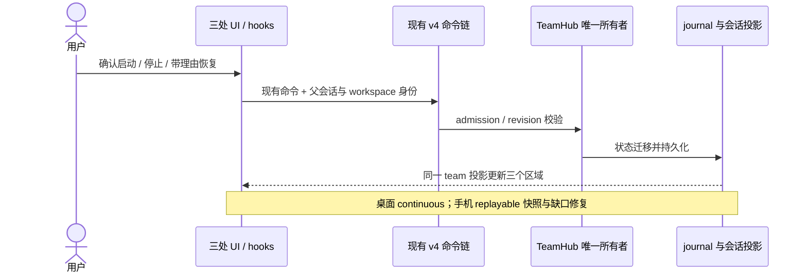
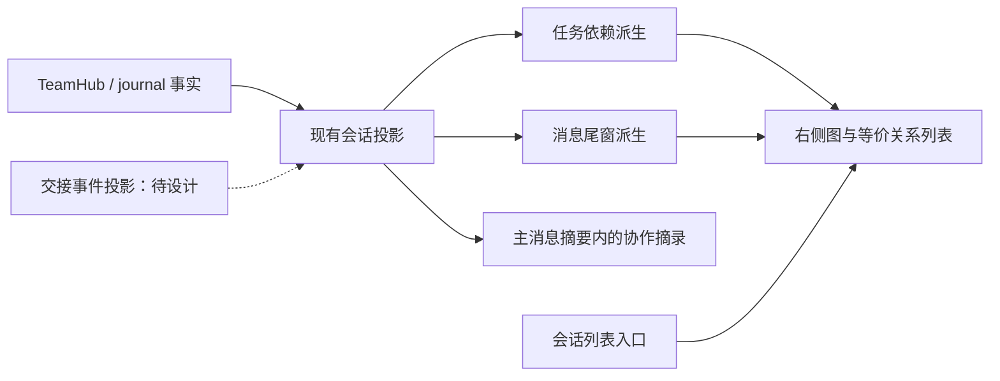

# Agents Team 三处界面设计

日期：2026-10-18；2026-10-19 确认后实施。状态：三处 UI 已落地，交接历史保留为预留能力。
实际实现边界与验证结果见 §12，历史设计阶段记录不代表全部预演能力已经上线。

2026-10-19 修订：补充成员交叉协作的三处呈现；新增 §11。§11 对相应显示细节的
规定优先于首版，其余状态机、命令与审批规则不变。

依据：`specs/agents-team.md`、`01-command-and-ui-design.md`、`DESIGN.md`、
`docs/dynamic-workflow/presentation.md` 及当前 `packages/ui/src/team/` 实现。
本文细化三个显示区域，沿用现有状态机和命令，不把视觉样例当作已实现能力。

## 1. 信息分工

| 区域         | 用户要回答的问题                     | 默认内容                                                           | 点击结果                                     |
| ------------ | ------------------------------------ | ------------------------------------------------------------------ | -------------------------------------------- |
| 左侧会话列表 | 哪个会话在组队？哪里需要我？         | 原会话标题下附一条团队运行行：团队图标、状态词、完成数；待裁决优先 | 先选中父会话，再打开它的团队面板             |
| 主消息区域   | 团队开始了吗？关键结果是什么？       | 紧凑团队摘要、必要生命周期行、成员给 lead 的报告、lead 汇总        | 摘要打开团队面板；成员标识打开成员下钻       |
| 右侧面板     | 谁在做什么？依赖卡在哪里？如何干预？ | 状态头、待处理入口、分组任务板、成员、消息尾窗                     | 任务展开详情；成员进入只读会话及独立消息输入 |

三个区域使用同一 teamId、名称、状态与任务计数规则。完成数仅计算 completed；
failed/cancelled 仍在分母。任务全部完成不代表 team 已 completed。
成员数量不包括 lead；staged 显示“拟定成员”，不伪造成员会话。

## 2. 与 workflow 的视觉关系

- 复用冷静、致密、低饱和底色，状态灯旁始终有文字。运行中使用 workflow 的 warning
  状态灯；这需要实现时集中调整 `team-status-presentation.ts`，三个区域统一消费。
- 团队入口使用 Users，保留 Workflow 图标区分实体；没有固定阶段的数据就不画阶段轨道。
- 成员使用 workflow 的小型圆角头像形态。已有 profileColor 优先；缺席时复用现有
  avatarColor 映射，颜色只标识身份。可复用现有头像能力，避免复制头像与调色逻辑。
- 全部界面字号为 text-ui-\*，正文与主要控件 base，次要说明 sm，徽标计数 xs。
  界面缩放只更改 --ui-font-size。圆角依 DESIGN.md 的容器层级。
- 待启动审批、成员权限待决统一用 interaction-confirmation token；
  escalated/halted 用 warning；任务 failed 用 destructive；这些不是同一个状态。
- 使用现有 Zai Light / Zai Dark；实现中引用 styles.css token，不新增一套固定主题。

## 3. 左侧会话列表

会话仍为一级条目，成员不自动变成左侧的普通会话，以免与独立任务混淆。
标题下增加约一行高度的 TeamSessionLine。与 workflow 运行行并存时分别占一行，
不共用完成数、状态或点击目标；折叠工作区的既有行为保持一致。

文案优先级：

| 条件                 | 运行行样例                     |
| -------------------- | ------------------------------ |
| staged               | 团队 · 待确认启动              |
| 有权限待决           | 团队 · 1 项待审批              |
| escalated            | 团队 · 需要处理                |
| halted               | 团队 · 已停止                  |
| active               | 团队 · 运行中 · 2/5            |
| idle                 | 团队 · 空闲 · 5/5              |
| completed            | 团队 · 已完成                  |
| cancelled / archived | 团队 · 已取消 / 已归档（中性） |

待决是一枚正交提示，不修改 team.status。停止与待决同时存在时保留“已停止”，
额外显示待决计数。标题省略时 tooltip 提供完整标题，计数不挤掉状态词。
行上的点击区有明确 aria-label，阻止冒泡后由父会话地址导航。

终态行先保留；本轮不引入“阅读即消失”的新持久化状态。

## 4. 主消息区域

### 4.1 团队摘要

跟随创建团队的回合显示一份紧凑摘要。第一行：Users + 团队名称 + 状态文字 +
打开面板入口；第二行：成员头像串、成员数、完成数。最多显示三个头像，余量为 +N。
默认不渲染完整任务列表，不为每次板更新插一条消息。

staged 第二行改为“3 位拟定成员 · 5 项任务”；可提供“查看计划”和“确认并启动”
两个入口，后者仍走现有 approveTeamPlan 命令。回对话修改、放弃放在右侧。
active 显示任务进度；halted 显示停止事实；completed 展示终态和板计数。
终态不是每个回合重复生成一张新摘要。

### 4.2 报告与待处理

成员到 lead 的真实报告进入既有消息流，头部保留成员名、任务标识及 attempt 溯源；
技术细节可折叠，不能删除来源。图例中的静态报告仅是视觉样本。
成员互发消息仅在右侧尾窗摘要展示。无 delivered 事实不能标注“已送达”。

成员权限审批保留在既有 interaction 卡中，成员名清晰可见。右侧和左侧只做计数
与定位入口；不新增第二个同意按钮、批量批准、替成员转发授权的流程。

### 4.3 输入区

主 composer 始终发给 lead。主输入区旁保留“团队”入口，打开右侧；不添加
把任意 @名称偷偷切换为成员投递的隐式行为。给成员发消息只在成员下钻输入区进行。

## 5. 右侧面板

### 5.1 默认团队视图

沿用既有 Side Pane tab、关闭/调整宽度与租约，内部次序：

1. 团队名称、状态、已记录权限模式（无记录不伪造值）、成员数、completed/total。
2. 当前需要处理的事项：staged 审批；真实 pendingInteraction 定位；escalated 升级；
   halted 恢复。优先露出具体原因，不单独制造“健康分数”。
3. 共享任务板：窄面板为“进行中 / 待开始 / 已完成”分组列表；failed/cancelled
   固定放在待开始组前并明确各自文字，不能归为完成。宽面板可切换三列布局。
4. 成员：头像、名称、profile、运行文字与当前任务。点整行打开成员下钻。
5. 协作消息：最近若干条 from → to + 摘要；沿用有界 mailboxTail，不冒充完整邮箱。

任务行采用状态符号 + 标题 + 负责人，展开后显示任务编号、依赖、验收信息与
artifactRefs（仅实际存在的字段）。依赖用“等待 #T3 完成”表达；失败的依赖不解锁。
不拖动任务到已完成，不提供客户端自行改板状态的交互。

成员 working 显示“执行中”；spawning 显示“启动中”；terminal 显示“本轮结束”；
removed 显示“已移除”。不能把 terminal 一概当成成功、在线或可立即执行。
本轮不做按 30 秒计时自动折叠；大量成员允许用户手动折叠，避免计时改变事实。

### 5.2 staged

同一面板显示“团队计划”，成员及任务为拟定名单。v1 以当前投影的只读计划 +
“确认并启动 / 回对话修改 / 放弃”为准；直接编辑角色、模型、依赖属后续能力，
不把未接线的表单画成可提交。awaitingFeedback 时提示“等待你的修改意见”，
保持同一份草案，主输入预填沿用 revise-prefill。

### 5.3 停止、恢复与终态

active 的“停止团队”在低强调动作位置。点击先弹既有确认框，明确影响：
取消 lead 当前回合、中断全员、冻结调度，团队记录保留。
halted 恢复必须填写理由；escalated 展示真实升级原因，提供带理由的继续与停止。
idle 无法因为“5/5”显示“已完成”。completed/cancelled/archived 只读；
当前命令未提供的收队、归档、复制配置按钮不作为 v1 可执行入口。

### 5.4 成员下钻

面板原位切换，顶端“返回团队”，带成员头像、名称、当前状态与任务引用。
正文沿用父投影门和只读 child SessionPane。底部明确“发送给 Frontend”，
通过现有 sendTeamMessage；本地只保留草稿和命令处理中状态。
ACK 不等于成员收到：未有 delivered 事实前显示“已提交”，不能显示“已送达”。
childSessionId 缺席则显示“成员会话尚未建立”，保留返回入口；不另建 runtime。

## 6. 状态所有者与事件顺序

team 事实仅来自父会话 team 投影；pendingInteraction 属现有 interaction owner。
选中的成员、任务展开、面板布局、输入草稿是 renderer 局部视图状态。
命令等待中可禁用重复提交；ACK 前后均不擅自把 team.status 改成成功值。
投影重建期间保留“正在同步”提示及只读旧内容，旧 team 目标动作不可提交。

## 7. 当前实现接线差距

- TeamPanelModel 当前丢弃 team.name，视觉实现应经同一纯映射保留名称。
- 当前 workspace 会话列表没有 team 摘要契约。左侧跨会话行需要单独评审有界
  workspace summary 的 additive 接缝；不可为列表每行订阅完整 conversation。
  数据未具备时本设计稿不等于左侧已实现。
- pendingInteraction 计数从现有交互投影按成员 origin 关联，不增 team 事实字段。
- 主消息团队摘要尚需挂接 v4 行流；候选新文件放 team/，宿主只留组合接缝。
- 右侧面板优先组合现有 TeamPanel、TeamStagedEditor、TeamMemberSidePane；
  如需调整已有自研文件，保留 team/ 公共出口和 commands 的唯一写入通路。
- 上游镜像文件不能内联团队主体。后续实施先运行 architecture gate/context，
  明确文件接缝并按 AGENTS.md 记录；本轮只有文档与独立交互样例。

## 8. 窄屏与可访问性

桌面优先保证主消息阅读宽度；空间不足时侧栏由既有框架收起，入口留在标题或输入区。
手机依现有 MobileTaskShell 使用会话 / 对话 / 团队分面，团队为全宽详情页并保留返回。
同一事实与命令语义不变，手机不新增成员运行时，不提供桌面草案编辑器。
触控目标至少 44px，表单遵守 text-mobile-input-safe；状态不只用颜色，
折叠按钮带 aria-expanded，图标按钮有名称，动态反馈用 polite，恢复必填错误可读。
会话切换不抢主输入焦点；自动打开 staged 仍沿用现有一次性边沿策略。

## 9. 实施验收场景（尚未执行产品 E2E）

1. staged 三处都显示待确认；批准前无成员会话；批准只提交一次。
2. active 含 completed=2、in_progress=2、pending=1 时三处为 2/5。
3. failed/cancelled 计入总数，带失败原因且不解锁下游，不呈现为完成。
4. 所有任务完成但 team=idle 时显示“空闲”；仅 completed 事实呈现团队完成。
5. 两成员并发权限请求逐条定位处理；处理一条不清除另一条。
6. 左侧点击能定位父会话与团队面板；成员下钻返回后任务展开仍在。
7. 停止必须确认；恢复空理由不能提交；命令被拒保留真实投影并显示拒绝反馈。
8. 成员消息提交与 delivered 分开显示；主 composer 始终面向 lead。
9. 桌面实时更新、桌面重连、手机冷恢复后三处读同一事实；旧 attempt 报告保留溯源。
10. 长中英文名称、大成员/任务数、320px 窄屏、键盘、两主题与界面字号缩放均可用。

## 10. 本轮验证

基线 freshness 通过。仅文档和独立视觉样例，无产品行为变更。
`pnpm typecheck` 退出码 0；`pnpm lint` 退出码 0，396 warnings / 0 errors。
执行环境 Node 为 24.1.0；mise.toml 要求 24.14.0，故这些结果不等同于声明版本 CI 验证。
静态样例浏览器检查另记于交付说明，不能替代上述产品 E2E。

交互样例已用 agent-browser 在 1060px 桌面、352px 窄屏浏览器视口检查，查看了
浅色、深色布局；操作了计划启动、成员下钻与消息提交、两项审批逐条处理、停止确认、
恢复理由必填、恢复后运行、空闲场景，以及放弃草案后仅保留拟定计划的归档视图。
检查时页面未报告 JavaScript 运行错误。这些均为本地样例交互，不构成真实命令链或产品 E2E 通过。
新增文档的 oxfmt 检查通过；既有 01 文档的格式检查仍报告差异，本轮只增加索引段，未整篇重排。

## 11. 成员交叉协作视图（2026-10-19 提案）

### 11.1 三个区域的增量

- 左侧：会话标题旁增加“查看团队协作关系”图标入口；状态运行行保持原有信息密度，
  不叠加聊天计数。入口关联父会话身份，直接打开右侧协作页。
- 主消息：在现有团队摘要内增加一条当前协作摘录，例如“Backend → Frontend · 接口字段已送达”。
  它随投影更新，是摘要的一部分，不是每条成员消息都插入会话。点击定位右侧对应关系。
  无近期消息则显示当前阻塞的任务依赖；无两者则隐藏。staged 不出现已发生的消息。
- 右侧：增加“协作 / 任务与成员”两种查看方式。协作页分“依赖 / 消息 / 交接”三个图层，
  一次显示一个图层，保持图中线条可读。选择关系后显示来源事实、方向与关联任务。
  原任务板、成员下钻和消息输入继续复用首版设计。

### 11.2 图的语义

| 图层 | 节点                         | 连线含义                       | 来源与限制                                                                     |
| ---- | ---------------------------- | ------------------------------ | ------------------------------------------------------------------------------ |
| 依赖 | 任务，附负责人和状态         | 实线箭头从前置任务指向后续任务 | board.tasks.dependsOn；不能用成员消息推断依赖                                  |
| 消息 | 成员及 Lead                  | 虚线箭头从发送者指向接收者     | 有界 mailboxTail；保留 messageId、at、sourceTaskId、sourceAttemptId、delivered |
| 交接 | 旧负责人、同一任务、新负责人 | 带方向的负责人交接及事件步骤   | 必须有已提交的交接事件历史；当前快照不足以还原历史                             |

身份颜色仅用于头像；运行/完成/等待继续用既有状态 token 和文字。
选中一条关系才加强对应连线，其余保持中性。连线不循环流动，不将历史消息画成当前正在传输。
图下提供同源关系列表，作为键盘、读屏及触屏的等价操作入口。
同一对成员的多条消息可折叠为最近消息组，计数只代表当前尾窗，不代表全历史。
缺失任务或成员引用保留“引用已不在当前投影”文字，不能把关系接到任意同名节点。

### 11.3 数据与所有者边界

TeamHub 仍为唯一事实所有者；图是当前父会话投影的纯派生。界面选中的图层、
关系、任务和成员是局部状态，不回写服务端。不能由界面新建协作边或拖线改依赖。
跨 Host 和远程仍使用父会话地址及 workspaceIdentity，不按显示名称关联不同团队。

当前 view-model 尚未保留 mailboxTail 的 at、delivered 与任务/attempt 溯源字段，
后续实施应从现有 wire 字段保留显示事实，不另建消息订阅和持久化。
当前投影裁剪掉 handoffId、reassigning 等内核过程数据；即使保留这些瞬时字段，
也不能替代交接历史。交接视图属于设计预留：实施前必须单独设计并审核有界事件投影，
至少携带事件身份、团队/任务身份、旧新负责人、attempt 世代、发生时间与已提交结果。
不得通过渲染进程对快照 diff 生成“历史”，也不得让 UI 直接读取 journal。

### 11.4 具体样例与交互

默认样例：T1 Backend 契约 → T2 Reviewer 审查 → T3 Frontend 任务板与 T4 Backend
消息投影并行 → T5 Reviewer 联调。依赖只接受 completed 解锁。
消息样例包含 Backend → Frontend、Frontend → Reviewer、Reviewer → Backend 与
Reviewer → Lead；其中一条待投递，其余有 delivered 事实。

“任务交接（方案预演）”为独立视觉场景，不是 team.status 新枚举：
示例已提交交接 T3 Frontend → Reviewer，旧 attempt 1 失效、旧成员停止、新 attempt 2
接手。任务列表、成员当前任务、主摘要与交接图必须同时显示 Reviewer 接手 T3。
普通运行场景的交接图为空态；不能凭成员消息补成已交接。
staged / 未启动草案归档不显示历史消息或交接；依赖图只表达计划。

点击任务节点展示依赖及负责人，可再进入成员只读会话；点击消息边或关系列表显示
对应摘要及投递事实，可打开发送者或接收者；点击负责人交接显示事件步骤。
成员下钻返回时保留图层和所选关系。父 teamId 改变时清空旧团队的局部选择。
手机使用同一协作页、图层和同源关系列表；不缩小字体强塞整张桌面图。
超过可读规模时使用有界任务邻域/成员筛选，并明确当前范围；不能静默遗漏关系。

### 11.5 增量验收

1. 依赖、消息、交接三种关系有各自语义和数据来源，不会相互推断。
2. 消息待投递与已送达分开；不把尾窗数量称为累计消息总数。
3. T3/T4 未完成时 T5 明确显示等待；失败不会让依赖线显示已满足。
4. 选择图节点或同源列表均可查看证据；键盘可走完整流程。
5. 主摘要与左侧入口定位同一父会话、同一协作图层。
6. 交接预演四处的 T3 负责人一致，旧尝试不呈现为仍在执行同一任务。
7. 普通场景没有交接证据时显示空态；staged 不显示已发生协作。
8. 手机、两主题与图层切换不改变关系含义；成员下钻返回保留选择。

本节设计阶段仅更新文档与本地可交互视觉稿；后续实施结果见 §12。

### 11.6 本次验证记录

2026-10-19：freshness 通过；pnpm typecheck 退出 0；pnpm lint 退出 0，
396 warnings / 0 errors。执行 Node 仍为 24.1.0，与 mise 声明版本差异沿用 §10 说明。
新增图层的脚本语法检查通过；在 1060px 桌面和 352px 窄屏视口查看了布局与主题，
操作了依赖/消息/交接图层、普通场景交接空态、关系列表选择、交接预演、任务与成员
视图切换、成员下钻及返回、staged 计划视图。页面未报告 JavaScript 运行错误。
这些是静态设计样例验证，不是产品命令或远程同步 E2E。

## 12. 实施与验证（2026-10-19）

### 已实施

- 主消息当前团队摘要：`TeamConversationSummary` 只消费实时 team，展示名称、状态、
  拟定或实际成员、完成数、最近消息与投递事实。通过 timeline 通用 footerSlot 只显示一份。
- 右侧：`TeamPanel` 组合新的 `TeamCollaborationPanel` / `TeamRelationGraph`，依赖与消息
  图下提供等价关系列表及来源证据。任务与成员页沿用既有功能，下钻隐藏而不卸载原面板。
- 左侧：普通、时间线、分组与手机列表使用 `TeamSessionLine`。会话目录新增严格的有界
  teamActivity，经 CLI → sessions-index → controller / 手机快照透传，无逐行完整会话订阅。
- 桌面 shell 用 `TeamNavigationProvider` 先定位父会话再打开团队面板；identity 优先，
  连接身份从当前 workspace registry 解析。无该端口的手机会话摘要可展开只读协作详情。
  手机的 `RemoteConversationTimeline` 复用原 statusSnapshot.team，独立入口也挂同一摘要。
- 当前 wire 只证明依赖与近期消息，交接页显示“当前版本尚未提供交接历史”，没有模拟记录。
- 大任务图只显示选中任务邻域并给出范围；缺失引用保留占位；消息窗口与总数明确区分。

实施新增的接口、所有者和接缝账同步记于 `specs/agents-team.md` 开头的实施增量。
除已有通道的轻量接线外，UI 主体集中在 `packages/ui/src/team/`；文案放 i18n 基础层，
避免 locale 与 UI 模块发生循环。共享兼容协议入口复用同一 schema，不复制契约。

### 验证结果

使用 Node 24.14.0 / pnpm 10.33.2；显式用该 Node 启动 pnpm，避免本机 Volta shim 回到默认版本。

| 验证                                          | 结果                                                                             |
| --------------------------------------------- | -------------------------------------------------------------------------------- |
| `pnpm typecheck`                              | 通过                                                                             |
| `pnpm lint`                                   | 通过，396 既有 warnings / 0 errors                                               |
| `pnpm architecture:check --changed`           | 通过，0 violations                                                               |
| shared/UI 定向单测（summary、关系、模块契约） | 11 tests 通过                                                                    |
| CLI summary 与原 sessions-index 定向测试      | 17 tests 通过                                                                    |
| `pnpm --filter @drora/desktop typecheck:e2e`  | 通过                                                                             |
| ATUI01–03 真实 React / 仓库 CSS 浏览器场景    | 通过；两主题、1060px / 352px、身份导航、关系证据、失败依赖、下钻返回、草案与空闲 |
| bootstrap 包 `typecheck`                      | 通过                                                                             |
| CLI 总 `typecheck` / `lint`                   | 失败：既有 Turbo 入口缺少 turbo.json / turbo.jsonc                               |
| bootstrap 包 `lint` 与定向源文件 lint         | 既有还原代码 ignorePatterns 排除了目标，0 files，不作为通过证据                  |

同轮补充验证通过：手机无 shell 导航端口的只读详情展开；coarse-pointer 图层按钮有效高度
至少 44px；`packages/mobile-web/test/remoteFrame.test.ts` 独立远控适配器 SSR 回归，
确认空消息窗口也展示 team 摘要，旧快照无 team 时不展示。

浏览器场景保留在 manual-review/pending，属于 renderer-only 候选，未宣称真实 Host 命令、
Electron 整窗或手机重连 E2E 已通过；未进行正式 fixture promotion 或 Docker admission。

提交门禁复核补充：会话行改为独立公开入口 `team/session-line.ts`，避免总入口加载成员
会话及工具渲染器；无 teamActivity 时直接返回空，不要求额外 Provider。原有桌面/远控
行交互 9 tests 通过，重新执行类型、Lint、架构、浏览器及手机 SSR 检查均通过。
Windows 原生 Node 用例发现路径同步修复，回归先失败后通过；规则与验收见
`docs/windows-test-compatibility.md` 的原生 Node 用例发现段落。
