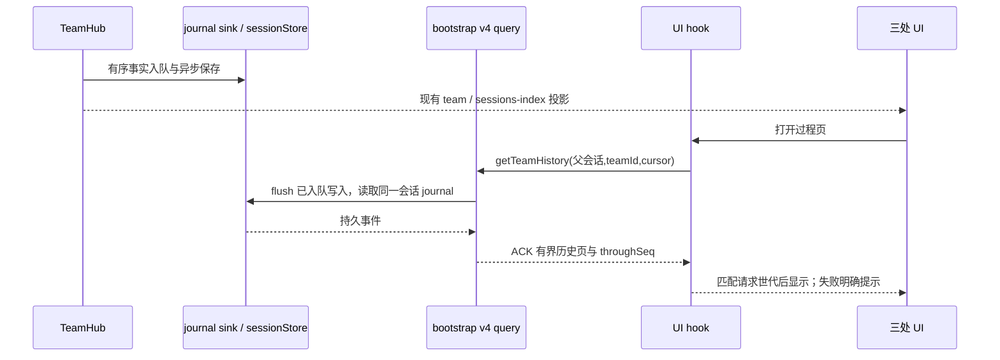

# 对话优先团队 UI

状态：用户已确认设计，已实施。2026-10-19。

## 产品与表面

- 左侧保留父会话归属，显示成员数、运行人数、完成数和依赖等待数；可展开有界成员预览。
  目录数据从同一 team 快照纯派生，不为列表行 acquire 对话。成员预览最多 6 人，显示总人数。
- 主消息区保留唯一当前团队卡片和现有 footerSlot 接缝，不把团队事件插入历史对话行。
  增加阶段轨迹、可点击成员与最近真实消息；只标注当前投影范围。
- 右侧默认总览（成员与任务），过程页查询已保存历史，协作页保留依赖图与真实消息关系。
  任务、成员、消息详情可互相跳转。保留任务看板作为总览的可选展示，不新增编排编辑器。
- 点击成员/任务/消息仅导航，不改变状态、不创建会话、不发送消息。导航携带父会话、
  workspacePath、workspaceIdentity、remoteSessionId、teamId 和本地 focus。
- teamId 变化清除选择。成员终态不等于任务全部完成；仅 completed 解锁依赖。
- 历史不伪装实时状态；过程页显示记录时间与范围、加载更早和返回最近。
  成员 transcript 使用现有只读链路；主输入仍发给 lead，现有成员消息通过 lead 邮箱。
- 审批/停止/恢复沿用既有命令和 ACK；不增加设计稿中无协议支持的确认类型。
- 手机无 shell 导航时可在卡片展开只读详情；可用 transport 时允许同一只读查询，
  不新建 runtime，保持 desktop-continuous 与 web-remote-replayable 差异。

## 所有者与接口

- 业务事实唯一 owner：TeamHub。历史事实唯一 owner：sessionStore 中 team journal。
- UI 仅持有展开、tab、focus、历史页 cursor/loading/error；不得创建历史事件或第二份团队状态。
- shared 新文件定义 `getTeamHistory` 查询 payload 和 ACK result：
  输入 teamId、beforeSeq?、throughSeq?、limit?（默认 20，上限 30）。
  输出 teamId、events（按 seq 升序）、throughSeq、nextBeforeSeq?、savedAt?、skippedEntries。
  throughSeq 固定此次浏览上界；beforeSeq 为严格小于的排他游标。事件含 kind、at、seq、
  有界成员/任务/消息溯源及正文。单页最多 30 条，消息正文沿用 8000 字符上界。
- 查询复用 lead 会话 v4 command/ACK 传输，只读、不需 baseRevision、不入输入 admission；
  不属于八个 mutation 命令。requireRecord 与已装配 lead hub 校验隔离；teamId 不匹配拒绝。
  bootstrap 安装层注册只读 reader，先等待此次查询前已排队 journal flush，再经 store 读取。
  无 store、读失败、旧端不支持均显示不可用/重试；不能返回假空成功。
- core 纯历史投影按 teamId 和 seq 去重分页；错误/未知事件跳过并计数。
  投递事实只认 message_delivered，不能以 queued 等同已送达；消息关联任务仅用 sourceTaskId。
  状态更新记录不等同所有权交接，不合成不存在的 handoff。
- UI query hook 通过既有 conversation transport；所有 await 结果按父会话/teamId/请求世代防陈旧。
  分页替换当前页，避免无限增长；保留 throughSeq，回最近时重新读取。
- 目录新增 optional 预览字段兼容旧帧；旧摘要缺字段仍可渲染。协议字面量单一出处 shared。

## 实现接缝与上游

团队主体放 ui-team、core/team 与 bootstrap/app/drora-team 自研文件。
shared command.ts 仅导入/注册新 query schema 与 result schema，v4 barrel 仅再导出。
现有导航 Provider 接受附加 focus，shell 仍只负责选择父会话和打开现有 team tab；
TeamSidePane 组合 hook 与视图。sessions-index 继续透传已有 teamActivity 字段，
不新增 Main/Host 业务 owner。上游同步只重放 schema 注册与既有组件组合接缝。

## 已接受验收

| ID     | 场景           | 断言与证据                                                                         |
| ------ | -------------- | ---------------------------------------------------------------------------------- |
| ATUI04 | 三处联动       | 成员/任务/消息定位右侧同一事实；scope 三键与父会话不丢失；浏览器                   |
| ATUI05 | 总览和详情     | 总览默认，任务依赖可点，成员 transcript 回退保留标签；浏览器                       |
| ATUI06 | 完整已保存过程 | journal 超过尾窗，分页无重复无遗漏，固定上界，跨 team 隔离；core 单测              |
| ATUI07 | 查询拒绝与损坏 | 无 store/读失败/错误 team/旧端均明确不可用；未知条目计数；单测                     |
| ATUI08 | 重新打开与历史 | 同一 sessionStore 新 reader 可读取此前事件；UI 卸载重开再查询；集成+浏览器         |
| ATUI09 | 异步竞争       | 换队或切会话后旧 ACK 不覆盖新选择，翻页不修改业务状态；hook/浏览器                 |
| ATUI10 | 平台与状态     | 390/736/1024、浅深色、zh/en、触摸目标；staged/active/idle/failed/cancelled；浏览器 |

裁剪：不新增 runtime 状态机、自动接管、权限类型、数据库迁移或真实所有权 handoff；
不把 renderer-only 测试写成完整 Desktop/Host 重启证据。现有成员消息入口继续保留，
设计稿省略入口不等于删除已实现功能。

## 验证记录

- 根 `pnpm typecheck`、`pnpm lint` 与架构检查通过；lint 保留 396 条既有警告、0 错误。
- core/team 与 bootstrap summary 共 11 文件 / 83 项通过；shared/UI/contract 共 4 文件 / 15 项通过。
- ATUI01–10 真实 React 浏览器候选通过，历史 ACK 明确为 synthetic；1024/736/390px、浅深主题、
  zh/en、触摸控件、分页、错误、面板重开和换队旧 ACK 均已断言。独立手机时间线 SSR 回归通过。
- `pnpm --filter @drora/desktop typecheck:e2e` 通过；core/bootstrap 各自 typecheck 通过。
- CLI 根 `typecheck` / `lint` 仍因已有 Turbo 入口缺少 turbo.json/turbo.jsonc 失败；
  core 定向 lint（--no-ignore）通过，12 警告；bootstrap 定向 lint 使用 --no-ignore 通过，23 警告。
  bootstrap 默认 lint 被还原资产 ignore 排除为空，不将空扫描写为通过。
- 验证启动器使用 Node 24.14.0 / pnpm 10.33.2；嵌套的 pnpm shim 仍可能回落 Node 24.1.0，
  E2E 类型检查中的 report build 出现过相应 engine warning；检查本身退出 0。
- 不声称覆盖完整 Electron Host 重启、真实模型调度或手机网络重连；不进行 promotion / Docker admission。
