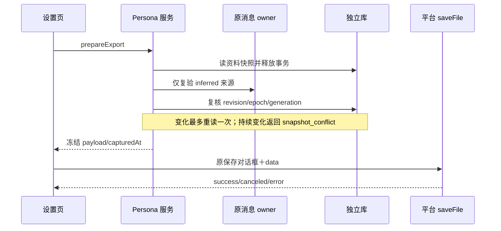

# Drora Persona v5 数据、接口与验收合同

- 日期：2026-10-29；与[唯一主 spec](../../specs/drora-persona-system.md)同步，未实现。
- 本版替代本文件 v4；字段、错误语义、限制均为实施合同。方法名是逻辑 API，最终 wire 名称在共享常量区定义一次，不由各端另起别名。
- 目标是可实现、可测试的有限资料域，不提前建设通用用户画像、知识图谱或自由文本经历库。

## 1. 数据模型与唯一字段

所有业务时间由服务产生 UTC 时间，revision/epoch/generation 为非负单调整数；opaque ID 不从昵称、cwd 或用户文本推导。字符串先 NFC 规范化、trim，拒绝控制字符（自我描述只允许普通换行），长度按 Unicode code point 计算；限制超出报 validation_failed，不截断后静默保存。

| 对象/阶段          | 字段                                                                                                            | 合同                                                 |
| ------------------ | --------------------------------------------------------------------------------------------------------------- | ---------------------------------------------------- |
| Authority/P0       | authorityId、personaId、schemaVersion、createdAt                                                                | 首次显式启用/管理初始化原子生成；同可信根仅一份      |
| Core/P0            | coreRevision、templateVersion、displayName、selfDescription、warmth、directness、humor                          | 当前核心，核心 revision 独立于偏好                   |
| ProductTemplate/P0 | identityStatement、principles、capabilityHonesty、relationshipBoundary、情境示例、compilerVersion               | 随发行的只读资产；设置中可审阅，不接受自动学习 patch |
| Policy/P1a         | policyRevision、policyEpoch、usePreferences                                                                     | 默认 false；执行开关 E 不存在这里                    |
| Policy/P1b         | autoLearn、预算配置、learningGeneration                                                                         | 默认 false；关闭使用默认同时关闭学习                 |
| Preference/P1a     | key、value、revision、keyGeneration、provenanceKind、epistemicStatus、status、pinned、autoSuppressed、updatedAt | 一个 authority＋key 只有一个当前值槽                 |
| Evidence/P1b       | evidenceId、sourceHandle、evidenceRefs、源校验值                                                                | 引用原 owner，不保存聊天原文                         |
| Candidate/P1b      | key、proposedValue、evidenceRefs、expectedGeneration、状态                                                      | 每键最多一项待确认                                   |
| Work/P1b           | workId、evidenceId、policyEpoch、keyGenerations、状态、lease/fence、attempts、预算预留                          | accepted 后恢复；无原始聊天正文                      |
| MutationReceipt/P0 | scope、mutationId、requestDigest、resultCode、resultRevision、createdAt                                         | 不含核心/偏好正文，重试幂等，不是审计转录            |

### 1.1 核心字段

| 字段            | 允许值/上限                        | 默认                 |
| --------------- | ---------------------------------- | -------------------- |
| displayName     | 1–40 code point                    | Drora                |
| selfDescription | 0–300 code point；作为资料而非指令 | 空，使用模板自我定位 |
| warmth          | restrained / balanced / warm       | balanced             |
| directness      | gentle / balanced / direct         | direct               |
| humor           | off / light                        | light                |

核心不包含 preferredAddress、replyLanguage、explanationDetail、collaborationStyle。最终核心编译贡献上限 4,000 code point；若产品模板本身超限，构建/模板测试失败，不能把责任推给用户编辑。

产品原则不随用户自我描述改变；表达配置不改变模型、工具、权限或执行范围。恢复产品默认是明确的 Core 更新，不删除偏好、不更改 U/L/E。P0 不存无界历史；当前与前一核心版本最多两份，回滚是以当前 revision 提交旧字段生成新 revision。

### 1.2 四类交流默认

| key                | value                                            | 默认未设置时         |
| ------------------ | ------------------------------------------------ | -------------------- |
| replyLanguage      | follow_user / zh-CN / en-US                      | 跟随当前任务与原行为 |
| explanationDetail  | concise / balanced / detailed                    | 产品表达基线         |
| preferredAddress   | 1–40 code point 的纯文本                         | 不强行称呼           |
| collaborationStyle | direct_answer / explain_tradeoffs / step_by_step | 产品表达基线         |

未知 key/value 拒绝，不把任意 JSON 转成指令。后续支持其他语言需要扩受控合同与兼容测试，不能自动保存 schema 不认识的 locale。collaborationStyle 只影响回答组织；step_by_step 不切 Plan mode，不增加工具审批或运行步数。

设置提交产生 provenanceKind=settings、epistemicStatus=explicit、pinned=true，无伪造聊天 evidenceRefs。自动提交永远 extraction/inferred/unpinned，即使原话语气明确。不同 inferred 值冲突则 disputed，不按时间取最新；status 与认识状态分开（active/superseded/forgotten 不是置信度）。

没有默认值时不写空 preference 伪装已学会。forgotten 槽保留 keyGeneration/autoSuppressed 等最小控制信息，不保留旧 value；一个字段的另一个 UI 入口不能恢复旧值。

## 2. 持久化、并发与幂等

P0 只迁移 authority、core、mutation receipt 所需表；P1a 才增加 policy/preferences，P1b 才增加 source/candidate/work。具体 SQL 遵守现有 migration/schema 校验体系；每个阶段 schema 只由 adapters 仓储拥有，Host/UI 不执行 DDL。

库唯一键包括 authority/persona singleton、preference(authorityId,key)、candidate(authorityId,key)、work(authorityId,evidenceId)、receipt(scope,mutationId)。Core/Policy/Preference 采用独立 revision，保存必须提供对应 expectedRevision。跨对象策略操作在本库单事务完成；对原 Session Store 只读复验发生在事务外。

mutationId 每次用户提交生成；同作用域同 ID 同摘要返回先前结果，同 ID 不同摘要返回 mutation_conflict。权限/authority 校验先于 receipt 查询。保存成功回执可以返回 revision，需看最新内容时重新读取，不由 receipt 重新暴露已忘记正文。

receipt 保留至少 7 天；正常上限 4,096 条/authority，达到上限且无过期项时拒绝新管理写入并返回 storage_capacity，不驱逐窗口内的幂等凭据。7 天外重复提交不保证回放原结果，仍须通过 expectedRevision；失效回执不能绕过 CAS。无内容变化的有效保存返回 unchanged，不制造新 revision；忘记/策略关闭仍执行必要 generation/epoch 屏障。

SQLite 位于异步 worker，锁等待上限初始 100ms、管理请求总预算初始 5s、capture 总预算初始 250ms；均需在实施前性能实验验证。超时不意味着写未提交：写请求返回 outcome_unknown 时，UI 保留 mutationId 查询/重试，不显示失败后换新 ID 重写。capture 超时可省略；迟到写结果不能被 UI 取消当作回滚。

多进程通过 DB 事务/CAS 同步；内存缓存只能缓存 immutable revision，不当写 owner。capture 必须读到当前已提交 policy/generation；不能仅用进程 TTL 缓存证明停学/忘记生效。迁移未知版本或损坏报扩展不可用，不降级写旧 schema、不恢复整库、不影响原 session ready。

## 3. 管理与执行接口

所有方法带严格 schema、requestId，鉴权后的控制域由服务绑定，不接受客户端任意文件路径/dataRoot。未知字段拒绝；业务 key 在共享合同单一出处。下面是逻辑签名，实际 RPC 注册须服从现有框架和能力发现。

| 方法                         | 输入                                                              | 输出/副作用                                                     |
| ---------------------------- | ----------------------------------------------------------------- | --------------------------------------------------------------- |
| getPersonaOverview           | 无，已绑定 authority                                              | capability/schema、核心/策略版本或 uninitialized；不得暗建会话  |
| initializePersona            | mutationId                                                        | 显式管理/启用时创建默认资料；并发幂等                           |
| getPersonaCore               | 无                                                                | 当前可编辑字段＋产品只读模板说明；未初始化返回 built_in_preview |
| updatePersonaCore            | expectedRevision、patch、mutationId                               | saved/unchanged/conflict；只允许五个核心字段                    |
| resetPersonaCore             | expectedRevision、mutationId                                      | 恢复产品字段默认，其他域不动                                    |
| previewPersona               | 有界核心草稿、可选受控情境                                        | 本地确定性文本；不写库、不用模型                                |
| setPersonalPolicy            | expectedRevision、usePreferences/autoLearn/预算 patch、mutationId | 新 revision/epoch；策略屏障按 §4                                |
| savePreference               | key、value、expectedRevision、mutationId                          | explicit/pinned；清该键候选，生成新 generation                  |
| forgetPreference             | key、expectedRevision、mutationId                                 | 清应用持有正文、抑制、generation++                              |
| allowLearningForKey          | key、expectedGeneration、mutationId                               | 清抑制并生成新 generation；不恢复旧源/旧值                      |
| listPreferences              | 无                                                                | 当前值、来源类别、有效性/争议状态；无原文复制                   |
| getPreferenceSource          | key、revision、sourceRef                                          | 经源 owner 权限/分支验证后的有界展示；不可用不补造              |
| getPersonaApplication        | sessionId、turnIdentity                                           | 当前 Runtime 的 applied/omitted/not_available；不伪造冷历史     |
| preparePersonaExport         | requestId、AbortSignal                                            | §7 的冻结 JSON payload 与 cutoff                                |
| captureContribution（内部）  | trustedExecution、turnIdentity、modelBudget、AbortSignal          | applied/omitted/cancelled                                       |
| acceptLearningSource（内部） | trustedSourceHandle、admissionPolicy                              | accepted/already_accepted/rejected；外部 UI 不可调用            |

管理取消不能回滚已提交事务；UI 的 request generation 防止旧响应覆盖新 authority/页面。来源详情最多展示 4 段、每段 512 code point；权限失败不泄漏旧缓存正文。

返回错误枚举：unsupported、unauthorized、authority_mismatch、validation_failed、revision_conflict、mutation_conflict、uninitialized、storage_unavailable、storage_capacity、outcome_unknown、schema_incompatible、source_unavailable、snapshot_conflict、budget_exhausted、cancelled。正常 omitted reason 与管理错误分开；故障日志只记固定类别/ID/耗时，不落个人正文。

E 仍由原 Settings 更新接口保存。开启 E 后可触发独立 initialize；两域没有跨库事务，初始化失败显示“已允许，资料暂不可用”，capture 省略，不撤销其他设置。未保存自定义资料时允许明确的内置默认；资料损坏不能用同样文案伪装为默认状态。

## 4. 许可与线性化时点

### 4.1 已核对的能力发现路径

CLI↔Host 采用现有 droraProtocolMethods.runtimeCapabilities（runtime/capabilities）。当前 schema 位于 packages/shared/src/drora-protocol/index.ts:138，server.ts:816 已响应该方法，services 的 independentPlanSupport.ts 已示范调用。新增可选 personaControlV1=true 表示控制合同 v1 可识别；缺失、method-not-found 或断线均视为不可用，原会话继续，不试发 persona 方法。能力缓存按 CLI 连接实例保存，重连重新查，不按 workspacePath 全局缓存。

Host↔UI 采用既有 hello.capabilities（transport.ts 的 hostCapabilitiesSchema 为非 strict 对象）广告可选 personaControlV1；该位只表示 Host 注册了管理路由，UI 仍须由 overview 确认目标本地 CLI 的支持和服务状态。P0/P1 对手机/远端不广告管理能力。不增加 clientHello 的新键，不改其 strict schema，不新增推送帧；旧客户端可以忽略未知 Host 能力。

新 Host 只有确认 CLI 能力后才在既有 session/requestRuntimePreferences 的响应中附加可选 personaEnabled；旧 CLI 不收到该字段，新 CLI 对缺失值按 false。这分别处理新 Host/旧 CLI、旧 Host/新 CLI，不把 App 版本当能力证明。

personaControlV1、personaEnabled 及实际 persona/\* 方法字面量只在 shared/contracts 常量区声明，通过现有协议公开入口引用。personaControlV1 不是启用、授权、资料健康或已应用状态；只打开页面后还要走受信管理鉴权和独立初始化。真实旧端回归仍为 PM15/33 的准入，源码兼容推理不替代执行证据。

### 4.2 提交与捕获时点

| 操作                | 本库事务内                                                 | 对当前执行的效果                           |
| ------------------- | ---------------------------------------------------------- | ------------------------------------------ |
| 核心保存            | CAS＋新 coreRevision＋receipt                              | 下一新轮，当前冻结值不变                   |
| U=false             | policyEpoch++、L=false、撤销全部学习租约、清工作负载/候选  | 新 capture 不读偏好；在飞抽取不能提交      |
| L=false             | policyEpoch++、撤销租约、清未提交候选/工作负载             | 停止新接收/提交，已存有效值可继续被 U 读取 |
| forget(key)         | generation++、suppressed、清 value/版本/候选、失效相关工作 | 新 capture 不提供该键；当前轮不追溯改写    |
| 显式保存(key)       | generation++、pinned、新值、清候选                         | 后续旧工作不能覆盖                         |
| allowLearningForKey | generation++、解除抑制                                     | 只接受之后的新机会；不重新扫描旧历史       |

关闭 L 的“未提交候选”含自动生成的待确认候选；已存 inferred 值不自动删除。U/L 开启不自动调用模型、不扫描历史；无新合格机会则零工作。

capture 在短事务读取 core/policy/偏好版本；inferred 在事务外验证源，再短事务确认上述版本未变，变更重试一次，否则省略。成功最终复核为资料 cutoff。此后提交的 forget/核心更新影响下一 capture。源查询返回自己的 snapshot/version，和 Persona 库没有原子共同截止点；源在复验之后变化的窗口如实承认，不宣称跨库强线性一致。

已冻结轮仅对同一存活执行成立。原恢复丢失 contribution 时省略；不把管理 revision 记录附加到旧 session_entry 以“修补”回放。

## 5. 编译、用途和记录

编译输入为产品 templateVersion/compilerVersion、Core revision、当前通过许可/来源校验的交流默认、受控情境参数；顺序和编码确定，同输入产生同摘要。摘要只作内容一致性诊断，不可当权限或隐私证明。禁止随机人名/背景、随机价值片段或从环境文件自动扩核心。

合并顺序只定义默认的适用关系：当前用户/格式要求与 Output Style、明确项目规则、显式交流默认、可用推测、产品基线。既有更高层权限及安全规则不改变。编译贡献标注为默认表达资料；对原自由文本冲突的解释仍需真实模型验收。

主请求 overlay 不污染 canonical。记录投影在原自动 Continue 过滤等既有规则基础上附加同一贡献；“一致”指贡献与最终有效请求对应，不把原记录投影的既有差异抹平。原 token/媒体预算计算含贡献，catalog/ToolSearch 与 source mapping 不变。

原始贡献可能进入 ModelRequest 内存事件及 model-io 文件；当前默认 eventStore 不据此认定为旧 session 持久表。原日志脱敏/轮转不保证人格正文不可恢复。设置需说明个性化内容会发送给当前选择的模型，并可能随原诊断保留；这不是额外上传通道或后台模型调用。

辅助请求没有 contribution 参数。新学习只接受源 owner 的消息窗口，无 file/Read/Bash/MCP 工具，不能把日志当来源。旧 Memory 文件能力保持；Dream 不启用；仅凭哨兵出现在真实聊天或获准诊断工具结果中不能宣称“直接注入隔离失败”，测试须区分来源。

## 6. P1b 来源、工作与预算

sourceHandle 最少包含 authorityId、workspaceKey、sessionId、productTurnId/sourceCommandId、原始消息边界、活动分支证据、源版本校验、可信 origin、接收时 policyEpoch/keyGenerations、合格执行许可描述。workspaceKey 使用 workspaceIdentity?.trim() || workspacePath；remoteSessionId 如来源契约要求则贯穿，不按相同路径串域。

源 owner 必须能够证明成功持久边界；仅有 lastOutcome、任意 assistant 或模型给出的 user 标签不够。现有接口不能证明则拒绝，不在旧库添加来源字段。本地同控制域的共享手机输入可合格；远端 authority 的输入不迁入桌面个人域。

同一来源唯一 evidenceId 由服务对稳定源身份/分支/边界构造；不可由模型生成。通知最多 64 个待接收项/进程，超出丢机会并计数；DB 非终态最多 128 个/authority，满时拒绝接收。未 accepted 允许漏学，accepted 后至少一次处理、至多一次提交效果。

每项抽取输入最多 8 条相关原始人类消息、合计 8,000 code point；不读助手/工具/summary 作为事实来源。合格新轮的原话必须直接重述值与全局范围；对需助手上下文才能消歧的省略表达拒绝学习。每项最多 4 候选，每候选最多 4 evidenceRefs；引用片段最多 512 code point。取不到足够上下文则跳过，不扩全历史扫描。

工作状态：accepted → running → applied/no_change/rejected/retry_wait；租约过期可重新领取，fencing 单调递增。worker 最多并发 1 个/authority；同进程不能独占其他进程的租约。P1b 模型端口独立于已关闭 Runtime，按明确允许配置调用，不启动占位聊天；配置不可用暂停，不换模型绕过用户选择。

首个预算方案：每日最多 10 次模型尝试、总输入 32,000 token、总输出 4,000 token；失败尝试计入，调用前在 DB 预留硬上界。租约并发共享额度；崩溃无法确认用量时保守不退预留。UTC 日窗口服务侧记录，时钟倒退不重复补额度；达到上限推迟，最长工作有效期 24 小时，最多 2 次尝试。用户关闭策略立即取消在飞并阻止提交，不能靠预算重试复活。

model 返回后重验源、epoch、keyGeneration、pinned、revision、fence，再单库提交；模型不得自报 sourceRole/origin。同值 inferred 可合并有界有效来源（最多 4）；不同值 disputed；pinned 保持且最多一个待确认建议。被拒候选不留正文。终态工作保留最小 ID/原因最多 7 天；receipt/证据清理独立于旧任务活动时间。

这些预算是首版上界，真实模型实验可在发布前重新冻结并记录理由；不允许运行中自动扩大预算。新旧两条抽取的总成本一并报告。

## 7. 导出与逻辑忘记

JSON envelope：format=drora-persona-export、formatVersion=1、capturedAt、coreRevision、policyRevision、core（当前允许字段和只读模板版本）、preferences（key/value/revision/provenanceKind/epistemicStatus）、omittedCounts、limitations。不导出 authorityId、工作来源定位、聊天原文、历史值、候选、抑制内部记录、令牌、执行/学习授权。pinned 等内部控制态不能被未来导入误当许可。

导出不创建默认资料；无资料返回 uninitialized。U/E/M/L off 不妨碍已存在资料的本地管理导出。只含未忘记且有效的当前值；inferred 源不可验证则省略，显式值不因聊天删除消失。总 UTF-8 bytes ≤256KiB，超限报 validation_failed，不交付截断 JSON。

成功复核后冻结 payload。forget 在 cutoff 前成功则不包含；之后无法撤回内存副本或已保存文件。取消准备传播 AbortSignal；保存阶段沿原平台语义，页面关闭不保证已发出的原生保存被撤回。只有 success 显示已保存；不自动重试、上传或写聊天附件。旧 saveFile 不承诺原子替换，失败可能留不完整用户文件。

逻辑忘记清除应用可访问的 value/历史正文/候选/工作负载并设置 generation 屏障；不承诺 SQLite 页/WAL/系统备份安全擦除。源聊天、旧项目记忆、原诊断与用户导出继续其既有生命周期。恢复核心默认、重新启用 U/L、重装较旧版本不能成为新域旧工作绕过撤销的支持路径；降级不兼容新库时只停扩展。

## 8. 真实模型与性能验收

确定性测试负责 schema、CAS、mutationId、cancel、用途投影、source mapping、源复验、epoch/generation/fence、导出 cutoff。模型实验负责语义归因、人格自然度和任务质量，不能互相替代。

P0：工作、日常、异议、纠正、结构化输出、连续身份六类，每类至少 5 个固定场景；两个实际支持模型，各 3 次重复，并跑同配置无人格基线。隐藏配置标签评审；场景是独立样本单位，重复运行不能夸大独立样本数。模型版本/参数/模板/编译版本/语料冻结，报告每模型结果和不确定性。

P1b 增加 12 条固定序列，每条 4–8 回合，两个配置各重复 3 次（72 次序列，基线另跑）；覆盖全局/项目/临时、第三人、假设/否定、裸确认、重述确认、冲突、pinned、纠正、忘记旧源、跨项目/模型。

| 指标            | 发布前合同                                                                                         |
| --------------- | -------------------------------------------------------------------------------------------------- |
| 任务质量        | 关键事实/结构化输出不新增失败；汇总成功率下降超过 5 个百分点不发布；分模型及样本不确定性报告       |
| 自然度/稳定身份 | 盲评 1–5 分均值至少 4 且不低于基线；无虚构真实经历关键违例                                         |
| 权限/干扰       | 越权、无授权主动消息、人格破坏指定输出为关键失败                                                   |
| 自动归因        | 固定禁止学习负例有效写入为 0；失败键不开放自动学习                                                 |
| 有效学习        | 合格 accepted 且无冲突机会正确写入≥90%；同时报告总机会/丢弃/accepted/拒绝分母                      |
| 捕获可用性      | 受控健康环境热态 applied≥99%；冷首次 applied≥95%；失败报告原因与恢复率，不能只看任务成功           |
| 时延            | capture 总等待初始上限250ms；健康热态 p95≤50ms，冷态/锁竞争/取消分别报告；实际模型 TTFT 与缓存单列 |
| 成本            | P0 背景模型调用0；按轮报告额外 token，新旧抽取合计预算单列                                         |

百分比不是实测结果；每类 capture 至少 100 次受控样本，OS/冷暖分组，不用整体平均掩盖失败。未达冷启动指标应优化初始化/打包再测，不能静默称开启成功。阈值若需调整必须在下一实验前说明版本与原因，不看结果临时降线。

## 9. 当前完成与未完成

字段归属、许可、版本时点、逻辑 API、错误/幂等/取消、来源、预算、导出和评测合同已在本版确定。SQL migration、RPC wire 注册、provider 接缝、UI 和用例代码均未编写。能力发现与实际打包属于实施准入验证；发现不满足现有模块边界时修订 spec，再实现，不能凭本文假设已存在接口。
