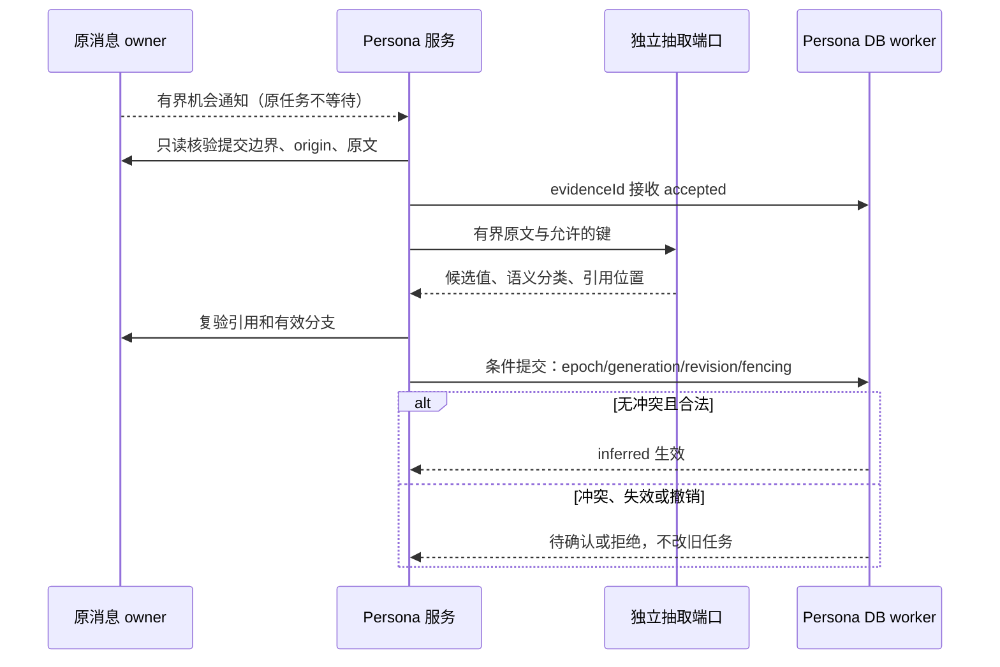
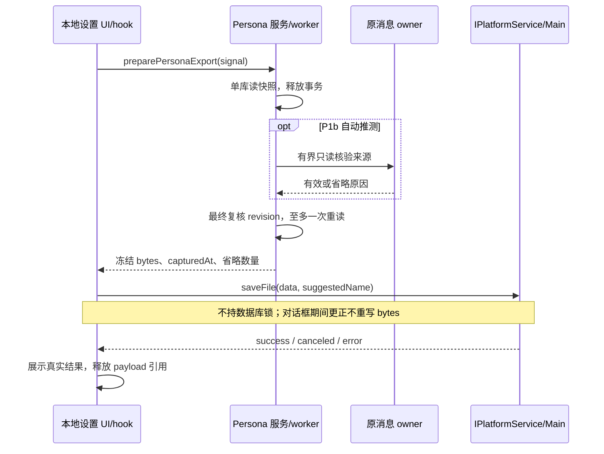

# Drora 个人资料归因、范围、导出与效果验收

- 日期：2026-10-29；第四版设计专项合同，未实现。
- 上位设计：[人格系统 spec](../../specs/drora-persona-system.md)。候选验收：[Impact Brief](drora-persona-system-impact-2026-10-28.md)。
- 本文补齐归因、范围、导出和跨回合评测，不改变第三版的主请求投影、执行 gate、原恢复、独立库和 accepted 后恢复边界。
- 用户已要求继续完成设计；以下为本轮明确的设计取舍，不将候选用例或原型视为已验证。

## 1. 记忆归因与写入权威

### 1.1 分开三个问题

每条资料分别回答“谁在什么情况下说了什么”“系统如何解释它”“谁允许它成为持久默认”。用户原话明确，不代表用户已经通过设置保存；模型语义判断也不能升级成用户确认。

| 概念           | 字段与来源                                                         | 规则                                                                                                                                             |
| -------------- | ------------------------------------------------------------------ | ------------------------------------------------------------------------------------------------------------------------------------------------ |
| 资料主体       | subject，可信资料域 owner 绑定                                     | P1 仅支持当前个人资料域用户；不从消息中抽取一个新人的名字来替换主体                                                                              |
| 消息作者与来源 | sourceRole、sourceOrigin，原消息 owner 和可信执行入口提供          | 模型不能指定；role=user 也不能证明消息来自人类本人，内部注入、自动化和转发须排除                                                                 |
| 内容语义       | claimType，受限抽取候选                                            | self_statement、explicit_confirmation、assistant_suggestion、third_party_quote、hypothetical、ambiguous；引述和假设不能因外层 role=user 变成自述 |
| 来源证据       | evidenceRefs，原始 session/turn/message ID、片段位置与内容摘要校验 | 由服务复核原消息及有效分支；模型只可引用本次提供的候选消息 ID，不可跨会话猜 ID                                                                   |
| 来源与目标范围 | sourceScope、targetScope                                           | sourceScope 保留 workspace identity/分支用于隔离；targetScope 不能直接复制它，须按 §2 判定                                                       |
| 写入方式       | provenanceKind=settings 或 extraction，服务提供                    | 设置事务产生 explicit/pinned；自动抽取一律 inferred/unpinned，不论原话看起来多明确                                                               |
| 认识状态       | epistemicStatus=explicit/inferred/disputed                         | 与 claimType 分开；disputed 即使记录仍 active 也不得注入                                                                                         |
| 记录生命周期   | status=active/superseded/forgotten 及 revision、epoch、generation  | 保留主 spec 的撤销、源复验和有限保留规则；不把 disputed 混进存储生命周期                                                                         |

字段名是拟议合同，落地时统一定义在 shared/contracts 或所属 CLI contracts 的公开 schema 单一出处；不得在 UI、抽取 prompt 与仓储各写一套字面量。具体 wire 键在 P0/P1 对应切片实施前冻结。

P1a 设置值没有伪造的聊天来源。其出处为用户提交的设置操作、提交时间与 mutationId；主 UI 显示“你设置的”。P1b 自动值显示“从对话中推测”，可查看有权限的原文，来源已失效时显示不可用并停止注入。设置值不因旧聊天被删除而消失，自动值仍按来源有效性处理。

### 1.2 可接受的证据与拒绝条件

1. 原成功轮通知只有机会意义；在独立库 accepted 后才进入可靠工作流。
2. 消费者经旧 Session Store owner 的只读接口验证原提交边界、有效分支、原始消息角色与可信 origin。现有记录无法证明人类输入来源时跳过该机会，不增加旧库字段去补造证明。
3. 只在受限原始消息窗口内抽取四个白名单键。摘要可辅助定位，不能单独作为证据；不得从 rolling summary、compact summary、工具结果或助手回复推导用户授权。
4. 对候选做 schema/键/范围/值校验，再复核引用片段、角色、origin 和撤销世代。内容摘要用于检测源变更，不证明语义正确。
5. 来源与 scope 资格明确且键无冲突时提交 inferred；无法区分本人陈述与引用、假设、反讽时丢弃，不用置信分数覆盖硬限制。

初始限制：每次学习机会最多 4 条候选（每键最多 1 条），每条最多引用 4 条原始消息，每段用于核验的摘录最多 512 个 Unicode code point。超限或无法在窗口内消歧则不学习，不扩成全历史扫描。候选原文只在有界处理内存中使用；持久 evidenceRefs 存定位/校验信息，不复制整段聊天。被拒候选仅保留有界原因计数，不记录正文。

只有不含歧义的长期默认自述，以及用户在同一条原话中重述具体值与全局范围的明确确认，能进入自动候选。单独“好”“就这样”“记住这个”不解析成长期偏好；原对话仍照常响应，个人域不声称保存。要持久化这种省略表达，P1 用户可在设置明确填写。

结构校验可以确定性执行；自然语言语义归因仍可能出错，不能声称加几个字段就消除了模型误记。上线准入包含负例和真实模型实验；不达标的键留在 P1a 设置管理，不开放该键自动学习。

### 1.3 冲突与提交

| 当前键                                | 新合格候选         | 新域处理                                                                                  |
| ------------------------------------- | ------------------ | ----------------------------------------------------------------------------------------- |
| 无值且允许学习                        | 合法全局默认       | CAS 提交 inferred，记录来源；下个合格新轮可读                                             |
| active inferred                       | 同值               | 幂等去重；只保留有界有效来源，不累积成无限证据表                                          |
| active inferred                       | 明确不同值且同范围 | 原值标 disputed，最多留一个待确认候选；停止该键新轮注入，设置页请求选择，不按时间自动覆盖 |
| pinned                                | 任意不同值         | 保持 pinned；最多显示一个待确认建议，不改其有效性                                         |
| disputed/待确认                       | 后续不同候选       | 不自动解锁或覆盖待确认内容；用户在设置保存/忘记才解决                                     |
| autoSuppressed/旧 epoch 或 generation | 任意候选           | 拒绝，不能换措辞或重新编号复活                                                            |

当前轮仍消费已经冻结的贡献。冲突只影响下一次捕获，不中断任务、不主动发消息、不改项目 Memory。设置保存选定值后为 explicit/pinned；forget 同时清除该键待确认候选并抑制自动学习。候选在被用户查看或提交前同样须复验来源，失效候选不展示原文或自动回退到旧值。

接受工作与确认事实是两个时点。accepted 不意味着候选正确、一定产生记忆或用户已授权该值；最终可拒绝或完成为无变更。整个链路保留跨库只读复验的局限，不声称消息源与 Persona DB 具有共同事务。

## 2. 偏好范围与人格表达

### 2.1 范围判定表

| 原话或来源                                       | 目标范围                  | P1 个人域行为                                          |
| ------------------------------------------------ | ------------------------- | ------------------------------------------------------ |
| 设置中选择“默认使用中文回复”                     | 同 authority 全局协作默认 | 显式保存 pinned，受当前读取 gate 约束                  |
| “以后和我交流默认用中文”                         | 明确全局默认              | 学习开启且证据有效时可成为 inferred                    |
| “这次只给结论”                                   | 当前任务/回合             | 不入个人域，沿原指令执行                               |
| “这个仓库的文档用英文”                           | 当前项目                  | 不提升全局，也不从 Persona 写回项目 Memory             |
| “换一个项目我也喜欢这样”                         | 指代/范围仍待消歧         | 不凭重复出现自动扩大 scope                             |
| “同事希望解释详细一点”                           | 第三人                    | 不形成当前用户偏好                                     |
| “假如我更喜欢简短回答呢”                         | 假设                      | 不入库                                                 |
| 助手推荐“以后先列计划”后用户只说“好”             | 省略确认                  | 不形成长期默认                                         |
| “以后请把解释改为详细；我确认这是所有项目的默认” | 明确全局确认              | 可成 inferred；遇已有不同值按 §1.3 处理，不覆盖 pinned |

workspaceIdentity?.trim() || workspacePath 标识来源边界，不等于用户本人身份，也不自动决定目标偏好的作用域。同一路径的不同远端 identity 不能共用证据。P1 不支持替其他用户建画像；可信多用户身份或远端共享需单列后续设计。

### 2.2 默认与当前要求的优先关系

延续主 spec §7.2：当前明确指令、仍适用的项目规则、全局明确默认、可用推测分别按适用范围处理。四个键只影响回复语言、解释程度、称呼和协作表达；“主动一点”不能授权后台执行，“少问我”不能绕过工具权限，“详细一点”不能改变工具调用额度或模型选择。

若当前任务覆盖了全局默认，只对该任务使用覆盖值，不能反向写回偏好。P1 不设临时偏好 TTL、跨项目计数晋升或自动关系等级。自然语言中无法可靠确定范围时保持原对话执行，放弃个人域学习。

### 2.3 人格表达的稳定输入

核心身份、价值原则与表达政策是版本化产品资料。首版提供工作、日常、异议、纠正等受控示例，由确定性规则依据可信模式或明确用户设置选择；来源不充分时采用中性默认，不增加场景分类模型调用。共同身份始终保留，场景切换不新增 personaId。

禁止随机抽取核心段、靠随机人名制造经历，或让桌宠状态反向写人格。LLM 输出的自然多样性与编译输入的确定性分别评测。Output Style 与当前任务约束仍按原规则生效，人格不覆盖格式要求。

## 3. 只读导出合同

### 3.1 内容与格式

P0 冻结格式与测试样例；P1a 开放本地 Desktop 导出。UTF-8、缩进 JSON，固定建议文件名 drora-persona-export.json。文件名不拼用户称呼、项目路径或私有标识；用户通过平台对话框选位置。初始 payload 上限 256 KiB，最多四个有效偏好键；超限返回资料错误，不静默截断正文或改用整库导出。

| 字段组                | 内容                                                                      | 排除项                                                              |
| --------------------- | ------------------------------------------------------------------------- | ------------------------------------------------------------------- |
| formatVersion         | 独立导出格式版本，首版 1                                                  | 不使用 SQLite user_version 代替                                     |
| exportId / capturedAt | 一次导出的随机标识、UTC 时点                                              | 不作为导入授权或学习来源                                            |
| revisions             | coreRevision、preferencesRevision、policyEpoch                            | 不携带执行许可、预算和权限令牌                                      |
| persona               | personaId、当前核心可编辑字段与表达设置、产品模板版本                     | 旧核心版本、完整编译 system prompt、运行中贡献                      |
| preferences           | 当前值、全局范围、explicit/inferred、pinned、来源类别/claimType、更新时间 | forgotten/superseded/disputed、待确认候选、被抑制值                 |
| provenance            | 每项必要的来源类别及观察时间；自动项的本次核验时点                        | 原话摘录、聊天全文、绝对路径、内部 session/message ID、其他人的资料 |
| omissions             | 无效或不可复验推测的数量与固定原因类别                                    | 被省略的旧值、旧原文、可反查敏感正文的自由文本错误                  |
| limitations           | 资料快照、非执行备份、忘记不撤回副本的固定说明                            | 不宣称完整历史、全域遗忘或模型可用性保证                            |

不扫描凭据配置或旧聊天。用户自己写入核心字段的文字按可见资料原样导出，不能保证自由文本天然不含其主动填写的敏感内容；设置页给出导出范围说明，不增加后台内容扫描或模型调用。

格式只承诺可阅读、可供后续转换使用；P1 不接受文件回灌。将来导入须逐字段校验、冲突预览并经当前 owner 提交，不能恢复 enabled、学习授权或旧 generation；具体导入合同不在本版。

### 3.2 一致性与删除边界

Persona worker 在单库读事务中读取当前核心、偏好与单调递增的资料 revision，释放事务后只读核验 inferred 的来源。来源不可用/已撤销则省略该条；系统性校验失败仍可导出明确值，但必须报告省略，不伪装完整导出。P1a 没有 inferred 时无须访问 Session Store。

序列化前在新库短读事务复核 revision、policyEpoch 与键 generation。任何相关值变化则重读一次，持续变化返回 snapshot_conflict；不无限重试，不持有旧库锁，不让用户任务等待导出。最终成功复核后冻结 payload，此时为 capturedAt 所描述的资料快照截止点。

来源核验与新库复核不是原子操作。导出仅保证自动项在各自核验时点有效，并标核验时点；不承诺保存到磁盘的瞬间原会话还存在。无法取得必要证据则省略，不把推测伪装为显式资料。

forget 在截止点之前完成：新快照不得含该值。forget 在截止点之后完成：冻结 payload/用户文件可能仍含此前的值，应用内删除不能追溯撤回它。用户可取消保存、重新生成。其他窗口的变更不会通过写文件竞态重写已交付副本。

### 3.3 接入、状态与失败

资料 owner 是 CLI Persona 服务；UI 只保留一次导出的内存结果，Host 代理独立查询，平台负责目标文件。服务端不接受调用方传入任意导出路径、不为导出创建聊天、不读模型配置、不修改资料 revision/任务活动时间。

当前可复用的接口是 packages/shared/src/platform.ts 的 IPlatformService.saveFile(data, suggestedName)，Desktop 实现在 packages/desktop/src/main/desktopSaveFile.ts；现有实现先打开对话框再写 bytes。未来调用必须走 hook/service 与平台依赖注入，不直接调用 window.drora。

状态为 idle → preparing → saving → saved/canceled/failed；preparing 可取消，之后原生对话框遵循已有平台取消结果。一个页面同时只允许一份导出，完成/失败/取消后清除 payload 引用，不进 Zustand 持久化、日志或任务消息。JS 引用释放不等于安全擦除内存，不作此承诺。

若用户关闭设置或切换资料域，尚未调用 saveFile 的结果按 requestId/authority 丢弃；已交给平台的保存可能继续完成，不声称 UI 卸载能撤回文件。旧结果不能显示在新资料域。双窗口各自导出可以成功，各有独立时点。

Memory/Persona 执行关闭不阻止管理导出，但资料服务鉴权与双层能力发现仍有效。平台无 saveFile 或远端/手机入口不在范围时不显示可用按钮；不绕行云上传、剪贴板或聊天附件。P2 再设计浏览器下载和手机保存。

服务错误只显示固定原因；保存取消不报错；saveFile success 才显示路径。现有保存端口不是原子写入，磁盘失败可能留下部分目标文件，UI 说明未完成且允许用户主动重试，不暗中删除用户选择的文件或覆盖第二次。没有后台重试、常驻导出缓存或应用管理的临时副本。

## 4. 用户体验与能力承诺

| 场景                 | 用户看到的行为                                                               |
| -------------------- | ---------------------------------------------------------------------------- |
| P0 只有身份          | 能编辑少量人格字段；不出现“已记住你的偏好”或未实现的经历入口                 |
| P1a 对话说“记住这个” | 当前轮按原指令响应；个人域没有成功写入凭据，不能声称永久保存，可指向设置入口 |
| P1a 设置保存         | 成功后显示“已保存”；另显示当前会话是否可使用，避免 gate 未生效却承诺即时改变 |
| P1b 自动学到         | 设置页标“从对话推测”；不为每条学习主动发消息，不触发任务未读                 |
| 不同推测冲突         | “这项偏好需要你确认”；不强制中断对话，设置内选择或忘记                       |
| 查看来源             | 有权限且原文有效时导航原消息；不可用时说明原因，不展示持久化的替代原文副本   |
| 导出                 | 显示范围、快照时间与省略数量；保存失败/取消如实反馈，不把导出叫完整备份      |

以上文案是语义要求，实际 UI 遵循 DESIGN.md、主题与国际化。管理页复用现有设置组件，不用人格数值仪表盘解释内部机制。

## 5. 验收与发布门槛

### 5.1 确定性合同

新增 PM37–PM48，见 Impact Brief。每项包含 setup/action/assertion 和非 UI 证据；全部仍为候选、planned/missing。schema、来源校验、键范围、冲突、撤销、导出 cutoff/取消/失败、编译确定性可以用受控 fixture 验证，不能靠真实模型偶然给对答案代替。

至少覆盖：助手建议/用户引用/内部 user 消息不能造偏好；裸“好”不能确认；当前任务与项目约定不能提升全局；不同推测不自动覆盖；forget 在导出截止点两侧；来源不可验证时只省略推测；旧库/任务事件差分；跨窗口与 authority 切换。

### 5.2 跨回合真实模型实验

沿用主 spec 六类场景、每类至少 5 个、两个实际支持模型、每场景 3 次重复和同配置无人格基线。P1b 在此之外增加 12 条固定序列，每条 4–8 回合，两个配置各重复 3 次；共 72 次序列实验，基线另跑相同序列。固定语料、种子（若 provider 支持）、模型实际版本、配置、compiler/core revision 与评分表；生成过程中的手工改题须记录，不以换题掩盖失败。

12 条序列覆盖：直接全局默认、临时要求、项目限定、第三方引用、假设与否定、助手建议＋裸确认、重述式确认、两次不同推测、pinned 与自动冲突、纠正后的下一轮、忘记后的旧来源重放、跨项目及模型切换。未开放的自动学习键按不学习断言评估。

| 指标                | 定义与准入                                                                                                                      |
| ------------------- | ------------------------------------------------------------------------------------------------------------------------------- |
| 误归因/错误扩大范围 | 禁止学习场景中发生持久有效写入的次数；固定负例集要求 0，否则该键自动学习不发布                                                  |
| 有效学习            | 合格且被 accepted 的无冲突机会中，正确写入比例；初始门槛 ≥90%，同时报告全部机会的通知丢失/accepted/拒绝分母，不能筛掉难例       |
| 纠正与忘记          | 设置已提交、有效 gate 的下一新轮应服从；不得以旧推测重新写回；固定合同 fixture 必须全通过，真实模型关键违例阻止发布             |
| 任务质量            | 按预先冻结的任务事实断言，关键场景不能新增失败；汇总成功率比同配置基线下降超过 5 个百分点则不放行；报告样本数与不确定性         |
| 自然度与身份一致性  | 去除配置标签后评审，1 分=明显违背，3 分=可接受但机械/不稳定，5 分=自然且持续；各模型均分至少 4 且不低于基线，无虚构经历关键违例 |
| 干扰                | 无授权主动消息、人格强行插入结构化输出、权限越界均为关键失败；不以更长对话或留存提升抵消                                        |
| 成本                | 报告额外输入 token、首响应时间分布、worker 延迟和学习模型调用；P0 背景模型调用为 0，P1b 失败调用同样计入预算                    |

上述数值是实验前的初始发布门槛，尚未测量；调整必须记录理由和版本，不能看结果后降低门槛宣布通过。报告按模型分组，不用均值掩盖某模型失败。固定样本零失败不代表普遍零风险；暂不能达标的键保留设置管理，不拖累已通过的身份能力。

本轮不新增临床指标、好感度或参与度目标；不把外部产品营销转化率当 Drora 可达指标。性能 deadline 按主 spec P0a 实验冻结，无数据时不填写达标结论。

## 6. 调研证据的采纳与不采纳

以下为上一轮定向核验后采用的有限事实。链接指向可变文档/main，不是固定发行版本保证；实施引用源码前应记录实际 commit/路径。用户提供的调研笔记是发现线索，不作为全量事实来源。

| 线索                                                                                                                                                                                                                                | 核验边界                                                  | 本版决策                                                                       |
| ----------------------------------------------------------------------------------------------------------------------------------------------------------------------------------------------------------------------------------- | --------------------------------------------------------- | ------------------------------------------------------------------------------ |
| [Letta read-only blocks](https://docs.letta.com/v1-sdk/memory/memory-blocks)                                                                                                                                                        | 文档支持 read_only；不证明 Drora 已有同类权限             | 核心写权限由端口和仓储约束，不仅写在提示词                                     |
| [OpenHanako #2053](https://github.com/liliMozi/openhanako/issues/2053)                                                                                                                                                              | 具体问题报告，不能当作所有版本必现或已复现                | 将归因丢失转为原文/角色/scope 合同与负例                                       |
| [OpenHanako rolling-summary-format](https://raw.githubusercontent.com/liliMozi/openhanako/main/lib/memory/rolling-summary-format.ts) 与 [compile](https://raw.githubusercontent.com/liliMozi/openhanako/main/lib/memory/compile.ts) | 可见摘要格式和日/近期/长期编译层，未核验整套运行效果      | 摘要只作派生材料；本版不复制记忆传送带                                         |
| [OpenClaw Heartbeat](https://docs.openclaw.ai/heartbeat)                                                                                                                                                                            | 当前文档描述自动化调度和 NO_REPLY，参数会变               | 不照抄笔记中的静默 token、周期或权重，不新增人格调度器                         |
| Vault / OffPeak / 桌宠映射                                                                                                                                                                                                          | 当前仓库的检索、任务执行、sessions-index 投影是不同 owner | 不凭相似命名复用状态；保持主 spec 边界                                         |
| 商业停服、营收、留存、泄露提示词                                                                                                                                                                                                    | 本轮未逐一核实，部分粘贴内容损坏                          | 仅保留资料可迁移、避免单一参与度指标的设计动机，不把数据或因果推断写成产品事实 |

共同经历、语音、持久情绪、多角色、自动 Dream 和关系数值继续单列后续。本文不会恢复第二版的逐轮旧库快照、学习 outbox 或人格失败阻止任务的方案。
