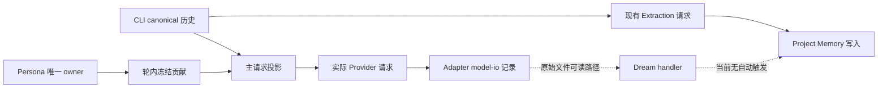

# Drora 两份拟人设计差异与重新评审

> 后续处理：两份方案现已整合为 [v5 统一设计](../../specs/drora-persona-system.md)。本文保留 A/v4 在评审时的事实，问题闭合方式见 v5 §13；不得将本文的旧方案描述当成当前合同。

日期：2026-10-29。源码核验基线：`54db6b6309c2b155f1e6d6630062c97c0432f0f2`。

状态：设计评审，未实施。本文记录问题、证据和推荐收敛方向，不替代产品裁定，不将候选验收标为通过。本轮不修改两份产品 spec、业务代码或现有记忆。

## 1. 结论与审查范围

**功能方向可行，两份稿子均不宜直接按当前全文实施，也不能拼接为一套实施计划。** 优先保留“单一持续身份、稳定核心、受控表达、显式启用、扩展故障不阻断任务”；第一阶段聚焦身份与设置管理。自动成长、桌宠主动行为各自有独立的事实与状态边界，应分期验证。

| 代号 | 审查材料                                                                                                                                                                | 定位                                                              |
| ---- | ----------------------------------------------------------------------------------------------------------------------------------------------------------------------- | ----------------------------------------------------------------- |
| A    | [文件与 ContextSection 方案](../../specs/drora-persona.md)、[P0 实施计划](../superpowers/plans/2026-10-29-drora-persona-p0.md)                                          | 本地 Markdown 核心、公共上下文注入、复用 Project Memory、桌宠呈现 |
| B    | [人格系统 v4](../../specs/drora-persona-system.md)、[资料合同](drora-persona-data-contracts-2026-10-29.md)、[影响与候选验收](drora-persona-system-impact-2026-10-28.md) | 独立资料服务、主请求贡献、分期全局偏好、故障隔离                  |

本会话明确确认的是：长期数字伙伴，兼顾工作与日常；有限成长且核心稳定；只有一个 Drora。A 记录了“专业同事、文件自由编辑、v1 桌宠、模板主动气泡”的另一组裁定。这是两份设计的产品范围差异，不能凭文档版本号认定其中一组自动覆盖另一组，也不能把“数字伙伴”收窄成只服务编程。

本轮采用 `feature-boundary-planner` 的 `impact-only` 模式。结论来自源码静态路径和设计契约对照，不是已实现功能的运行时故障复现；P1/P2 表示设计问题的处理优先级。

## 2. 核心差异

| 维度     | A                                                     | B                                                 | 重新评审                                                                           |
| -------- | ----------------------------------------------------- | ------------------------------------------------- | ---------------------------------------------------------------------------------- |
| 核心资料 | `soul.md/worldview.md` 整文件覆盖；CLI 与 Main 分别读 | 服务拥有版本化结构资料，独立 SQLite worker        | 必须只有一个权威存储；不能同时双向同步文件与 DB                                    |
| 核心注入 | ContextBuilder 的 stable system section，进入公共历史 | canonical 历史不变，主请求投影加冻结 contribution | 推荐 B 的隔离方向，但需补审计记录和间接消费者                                      |
| 内容变化 | context init 快照，refresh 沿用                       | 已启用 Runtime 在新轮读取，轮内冻结               | 两者都能实现；必须明确用户编辑何时生效，不能混用                                   |
| 执行许可 | AppSettings 经 spawn env；新 Host＋CLI 生效           | 可信 runtime preferences；新建/真正 cold 生效     | 现有 runtime preferences 可复用；env 不是唯一接入方式                              |
| 无效资料 | 回退内置人格                                          | 本轮省略人格贡献                                  | 推荐区分首次默认模板与已保存自定义内容故障，避免静默换身份                         |
| 成长范围 | 项目 Memory 的 user/feedback，跨项目画像后置          | 少量全局结构偏好，项目 Memory 保留                | 两者解决不同范围；不能用同一个“记住了”文案掩盖差异                                 |
| 归因     | 模型填写 frontmatter，部分工具校验格式                | 消息 owner 提供来源；模型分类；显式值与推测分开   | B 更可审计，但仍不能保证模型对偏好含义的判断正确                                   |
| 透明管理 | 文件可直接操作；部分 UI 管理延后                      | 独立设置、修正/忘记、快照导出                     | 本地透明不必等于任意 Markdown 成为 system 指令；自由外部编辑若是硬要求需单独定契约 |
| 桌宠     | mood、模板气泡纳入 v1，按 P2 交付                     | P0/P1 保持原行为                                  | 简单状态呈现可独立做；历史事件触发不具备现成事实来源                               |
| 失败边界 | 资产读取降级，现有 Memory 写路保留                    | 惰性服务、预算、省略、熔断                        | B 保护主任务更完整，但不能只测“不阻断”，还要测人格实际应用率                       |

## 3. 需要先处理的设计问题

### R1 · P1 · 两套产品与权威契约并存，没有唯一实施基线

A §3/§4 与 B §4–§7 对存储、生效粒度、失败行为、成长范围均有不同规定。按两份分别开发，会出现设置读文件、主请求读库，或者 UI 宣称下轮生效而 CLI 仍使用旧进程快照的情况。这是契约冲突，不能靠再加一层同步消除。

**建议**：在任何实现前，以一份 spec 固定“核心 owner、唯一写入口、执行许可、内容版本、生效时点、失败显示”。另一份保留为历史方案并指向决策记录；不要先实施 A 的 P0，再默认把 B 的 P1 接上去。

产品范围尚未定案的部分是：是否必须支持直接外部编辑 Markdown、桌宠主动行为是否属于首发。它们不阻碍本轮技术评审，也不能由技术评审擅自删去。

### R2 · P1 · A 的公共 system section 会被旧 Memory 抽取读取

路径已经确认：`context.ts` 初始化上下文 → `context-history-entries.ts:11` 把 systemMessages 转为历史消息 → `project-memory-agent.ts:32–77` 捕获 `runtime.messageHistory`。system 消息转换时未保留可供逐分节筛选的 source 信息。

因此 A 的 persona 原始文字会进入主会话派生的 Memory 请求。workflow/custom/subagent 门不覆盖这一消费者。添加 `source: persona` 或提示“不要记忆人格”不足以构成隔离；按字符串删除片段还会误伤用户实际说过的内容。

**建议**：保留公共 ContextBuilder，新增可选的主请求贡献端口，沿 B 的方向做用途隔离；在实际 provider 请求、记录、预算和续跑上统一消费。验收须检查主请求有标记内容而 Extraction/compact/title 等辅助用途无新增原始贡献。影响不止一个 section 文件。

### R3 · P1 · B 忽略了请求记录到 Dream 的间接原文路径

B §6.1 声明主请求记录应包含实际贡献，同时声明 Dream 不接收新增原始贡献、旧 helper 不改。这两项不能仅凭 canonical 历史隔离同时成立。

源码证据：

- `runner-debug.ts:124、233` 分别在非流式/流式记录中保存 `input.request.messages`；`:64` 的记录门不是仅开发态；`:605` 之后的生产裁剪仍保留 request.messages。
- `runner-debug-redaction.ts:3` 处理头部和图片/视频数据，没有 persona 正文专用删除规则；容量轮转、增量压缩也不是内容访问隔离。
- `project-memory-dream.ts:118–141、190` 选择 model-io 文件并传入 transcriptRoot；`memory/dream.ts` 提示会要求读取该目录的转录。
- 同一 Dream helper 的 `:54` 明确说明**当前产品不会自动触发 Dream**。所以这是 B 的隔离承诺缺口及未来接线风险，不是“当前已经后台泄漏人格”的运行时结论。

**建议**：把“执行请求、诊断记录、学习输入”作为三个用途评审。保留真实请求观测时，学习消费者只能取得有来源结构的允许视图，不能取得任意原始 model-io 文件。若 P0 不建设该视图，须把相关消费者不可用写成可执行准入条件，并收窄隔离承诺；不能一面承诺所有辅助原文隔离，一面把修复都列到后续。

不建议为了消除这个问题静默关闭整份 model-io，或篡改诊断记录使其看起来与实际请求一致。诊断保留、资料删除、导出副本分别说明；“忘记偏好”不意味着清除所有历史请求记录。

图中虚线是条件路径；B 仅移除 `F → C`，没有移除 `D → R`。

### R4 · P1 · A 的“agent 禁写人格目录”没有对应执行保障

A §8.3/A15 承诺运行时 agent 写人格目录直接拒绝；其 P0 计划 Self-Review 却以“没有 persona 专用写路径”认定结构性满足。已有通用工具可以写文件，这个推论不成立。

`permission/write-tier-policy.ts` 说明 Bash/js/普通 MCP 等能力边界；`permission/service.ts:154–171` 的普通工具路径在特定 mode 下提前 allow。不能只给新工具加 deny 就覆盖所有可写通道，也不能假定缺少专用工具就保护了文件。B 的独立 DB 同样不能把“服务 API 只有一个 writer”提升为“同用户权限下任意 shell 无法改文件”。

**建议**：区分应用内写入规则与 OS 文件隔离。P0 可以明确“不提供 agent 修改核心的产品能力”，不能声称已实现任意工具硬隔离。如果硬 deny 是首发前提，必须先设计能够覆盖所支持工具/执行模式的受保护资源边界并验证；这是独立工程量，不宜隐含在人格接入中。

### R5 · P1 · A 的主动气泡要求超出了现有桌宠投影的信息量

`desktopPet.ts:54` 的活动行只有 target/title/mode/preview/revision。`desktopPetProjection.ts:26–104` 中，attention 合并权限与普通提问，completed 合并成功与中断，revision 取 lastActivityAt；列表还是有上限的展示投影。

因此无法可靠推导：连续两次不同任务/执行失败、某个 permission 已等待 5 分钟、成功结束的任务运行了 30 分钟。重复收到同一 error 行不是第二次失败；中途观察到 working 后计时也不是任务真实起点。A6 的“error ×2”夹具会验证错误的事件模型。

另一个独立冲突是“每日最多 4 条”与“计数器重启清零”：后者最多能保证进程存活期内的限额，不能保证跨重启日额度。

**建议**：简单着色只能表达当前投影状态，不能把 interrupted 映射为庆祝成功。复杂气泡后置；如保留这些触发，先定义既有业务 owner 提供的有界展示事实、执行身份、原因、时刻、去重和失效语义，Main 只消费事实。日额度若必须跨重启成立，由独立呈现策略拥有最小持久配额，不能写回任务状态或在 Main 重建任务历史。

### R6 · P1（自动学习前）· 两份方案都需明确记忆范围与归因权威

A 正确识别了 Project Memory 已有 user/feedback，但“复用”同时改变模板、manifest、服务类型、管理 UI 和写入守卫；它不是零侵入。A 也已承认主 agent 直写绕过部分守卫，模型自填 source_role 不能证明真实来源。A5 的强结果措辞与其实际格式校验能力仍有距离。

B 将全局偏好和项目事实分开有合理性，不应仅因两边都叫“偏好”就判定必然重复 owner；但相同语义若在两域都可自动产生，就必须说明范围、优先级、冲突和忘记范围。B 的四个全局字段与核心 ExpressionPolicy 也需逐项避免同义的可写配置。项目 Memory 是自由文本，不能假定现成程序能准确解析出所有冲突。

当前 `session-store.port.ts:50–142` 已有 MessageSemantics、origin、消息/命令/turn 关联；特别是 `workflow_launch` 可同时为 synthetic 与 real_user。B 应具体绑定这些源事实及活动分支，而非新建一套角色标签，也不能用 `synthetic=true` 作为统一的学习拒绝/允许条件。角色正确与“用户表达了全局稳定偏好”仍是两项不同判断。

**建议**：P0 不改 Memory。下一阶段先做少量显式全局偏好，每项只有一个设置 owner；随后才评估自动候选。自动候选始终是推测，核心身份不可被学习改写；项目限定语句、建议和模糊认同不得自动提升全局。复用已有模型/任务基础设施，不复用不满足该范围的写权限。

### R7 · P2 · B 的故障降级需要“可用性”证据，而不只是“不阻断”

B §6.2 的 250ms 捕获总预算、冷 worker、重复失败熔断明确标为待测值，这一点正确。但如果冷启动常超预算后被熔断，任务仍然成功，用户开启的人格却长时间没有生效。

**建议**：P0 实验同时报告冷/热启动延迟、贡献实际应用率、省略原因、恢复成功率和主任务额外延迟。显式启用/管理时可准备资料服务；未启用不得启动额外 worker。运行时 deadline 只界定等待预算，不能代替 CAS、取消或轮身份校验。不要在没有测量前把 250ms 写成发布指标。

### R8 · P2 · 两份材料都有随合并失效或内部不一致的实施依据

- B §2 以 `f1619365...` 为源码基线，声称未发现拟议 voice 模块；当前已存在 `packages/ui/src/voice/module.ts` 与 `CONTRACT.md`。人格可继续不扩展语音，但理由应改为“已有语音作为兼容性检查对象”，不是“语音未实现”。这也不等于语音所有场景已验收。
- A A10 声称根 typecheck 不覆盖 CLI；当前根 `package.json` 已包含 bootstrap 的类型检查入口。根 affected UT 与 CLI 专属测试仍要区分，不能用这条旧结论指定验证范围。
- A §11 P0 写“资产读写”，P0 计划改为只读并准备最后回写；A15 还有写路径/禁写强断言。范围应在实施前统一，不应等标记 shipped 时才修正文案。
- A env 方案的“off 回基线”须覆盖 inherited env；现有同构 `resolveAgentsTeamHostEnv` 会保留 inherited `1`。新窗口并不天然消除外部继承的值。B 的 runtime preferences 有现成请求入口，但新增字段仍需能力协商与旧端测试。

## 4. 推荐收敛方案（待更新统一 spec，不是实施授权）

### 4.1 保留的产品核心

一个 Drora，稳定核心包含身份、性格、价值边界和表达倾向；按工作/日常情境调整表达，不通过切换人格或权限实现。可以有观点和温度，不能编造真实经历、把助手建议当成用户事实，或用亲密度替代任务质量。

### 4.2 唯一资料 owner，存储格式由明确需求决定

推荐一个版本化 Persona 服务负责读取、校验、保存与导出；Core 只编译纯数据，Main 只做平台文件动作，UI 只保留草稿。执行许可继续属于原 Settings/Runtime preferences，不能把同义 enabled 再写进人格资料。

在现有两份选择中，**推荐沿 B 的服务契约与结构资料继续收敛**，吸收 A 的透明查看与本地可携带性。独立 SQLite 是否必须在 P0 上线应按已冻结的并发/版本要求评估，不能仅因后续可能有学习队列就把全部表和队列提前落地。

若“外部直接编辑 Markdown”确为首发硬要求，则需另定文件作为唯一权威的版本检测、原子保存、并发冲突和校验合同。文件此时不是 DB 的第二个真相。导出文件可读与实时外部编辑是不同能力。

### 4.3 生效与失败合同

推荐执行许可在新建/真正 cold materialization 冻结；已经启用的 Runtime 在新轮捕获核心版本，同轮重试/工具续跑不变。warm resume 不伪装成重新读取开关，手机共享 owner Runtime 的执行结果，不另起人格执行体。

首次无自定义资料可以明确使用内置模板；已保存的资料损坏/读取失败时省略本轮扩展并显示原因，保留原任务错误处理。设置显示“已保存”和“当前会话已应用”两个事实，不能用同一个成功提示代替。

### 4.4 按风险分期

| 阶段          | 交付目的                                            | 准入条件                                             |
| ------------- | --------------------------------------------------- | ---------------------------------------------------- |
| P0a 技术验证  | 证明主请求贡献可隔离、预算/记录一致、取消与续跑正确 | 先通过下述 CR01–CR06；不改旧 Memory 和任务数据       |
| P0 身份与管理 | 稳定模板、有限字段、显式启用、编辑/预览/生效状态    | 唯一权威和失败语义定稿，任务质量与身份稳定性实测     |
| P1a 显式偏好  | 少量跨项目个人默认值、范围说明、修正/忘记/导出      | 不与核心字段重复写；项目覆盖关系清楚；管理不触发模型 |
| P1b 自动候选  | 有限学习、来源复验、冲突待确认、抑制与预算          | 学习用途隔离、真实消息关联、删除/分支变化测试通过    |
| 独立呈现阶段  | 简单桌宠状态表达；之后再做主动气泡                  | 现有动画/导航兼容；复杂触发有可信事件事实后再接入    |

不把 Dream 自动调度、语音人格接入、多个角色、持久情绪或好感度混入 P0。语音、团队、自动化作为已有能力检查隔离，不能因不在首发范围而不检查。

## 5. Impact Brief

### Feature Summary

| Field            | Value                                                                               |
| ---------------- | ----------------------------------------------------------------------------------- |
| Developer intent | 比较两份稿子，重新评估可行性与现有功能影响                                          |
| Capability       | Persona；邻接请求投影、Settings、Project Memory、桌宠、语音                         |
| Change layer     | 拟议涉及 presentation、validation、commit-effect、persistence、recovery；本轮仅文档 |
| Operating mode   | impact-only                                                                         |
| Primary seeds    | Context/history、主请求投影、memory helpers、model-io、desktopPetProjection         |
| Out of scope     | 业务实现、重写旧记忆、恢复/队列重构、实际触发 Dream、修改既有产品裁定               |

### UI Surface Matrix

| 场景/入口      | 共享实现与草稿 owner                     | 默认/校验与提交                                   | 权威与持久化                                | 模式与隔离                                           |
| -------------- | ---------------------------------------- | ------------------------------------------------- | ------------------------------------------- | ---------------------------------------------------- |
| 设置启用       | 现有 Settings；行内局部状态              | 默认 false；A env 与 B runtime preferences 二选一 | 原 AppSettings；Runtime 冻结许可            | Desktop 开关与同 Host 手机执行分开；不重启活动任务   |
| 核心编辑/查看  | 拟议独立设置组件、hook/service           | 保存校验、版本冲突；平台仅处理文件动作            | 文件或资料服务唯一 owner，尚须统一          | 不创建会话/模型；远端不能按相同路径套用本地身份      |
| 本轮应用状态   | B 拟议独立状态查询                       | 显示捕获版本/省略原因，不冒充已保存状态           | Runtime 内存事实                            | 不写 sessions-index、未读或消息流                    |
| 记忆管理       | 既有 MemorySettingsSection；新域管理待定 | 先分全局/项目，再定义修正删除                     | 项目 Memory 与个人默认值各自 owner          | 不能用“忘记全部”掩盖只清一域                         |
| 桌宠气泡       | 原 overlay 与 typed IPC；Main 呈现       | 当前 schema 可校验行，不能校验缺失的执行事件      | 旧任务 owner 提供事实；Main 仅展示/呈现配额 | 不写任务状态；点击沿用原 target 校验                 |
| 语音/手机/团队 | 原入口与运行时                           | 沿用原 admission、权限、owner/lease               | 原 owner                                    | 人格不增加 Agent、不改语音录音状态、不改变子代理身份 |

### Shared And Divergent Behavior

共用：身份核心、Settings 装配、请求投影基础设施、平台保存能力。不同：执行许可与资料管理许可；全局个人默认与项目规则；桌面呈现与手机执行；原始诊断记录与允许学习的输入。共享 UI 或文件根不代表共享授权或写入权。

### Feature Relationships

| Rank           | 关系                            | 原因与证据                                                                |
| -------------- | ------------------------------- | ------------------------------------------------------------------------- |
| must-inspect   | Persona → 主请求/记录/预算/续跑 | 同一贡献必须一致，且不能回写 canonical entries；turn-loop/turn-model-step |
| must-inspect   | 公共历史 → Extraction           | ContextSection 可能进入旧消费者；R2                                       |
| conditional    | model-io → Dream                | handler 读原始文件，当前无自动触发；R3                                    |
| must-inspect   | 资料管理 → 通用工具写能力       | 无新工具不等于通用工具不能写；R4                                          |
| must-inspect   | 任务事实 → 桌宠触发             | mode/revision 不是完整业务事件；R5                                        |
| should-inspect | Persona ↔ Project Memory        | 同义偏好范围、来源与删除语义；R6                                          |
| invariant-only | Persona → 语音/团队/远控        | 保持既有身份、录音状态与单一 Host 执行；本轮未改这些模块                  |
| evidence-only  | 既有架构/类型检查               | 只能验证当前基线，不能证明拟议行为                                        |

### State Owners And Commit Sinks

| 事实               | 草稿/展示          | 权威 owner                      | 提交与持久化                        |
| ------------------ | ------------------ | ------------------------------- | ----------------------------------- |
| 执行许可           | Settings UI        | 原 Settings；Runtime 使用冻结值 | 既有设置提交，扩可信运行偏好合同    |
| 核心与显式全局偏好 | 人格设置草稿       | 推荐唯一 Persona 服务           | 版本化保存；存储选择统一后定稿      |
| 本轮贡献           | 当前执行状态       | 原 Runtime                      | 内存冻结；不新写 session 人格 entry |
| 项目事实/来源消息  | Memory UI/来源展示 | 既有 CLI Memory/消息 owner      | 原项目文件/会话存储；新域只引用来源 |
| 桌宠状态与导航     | Main/overlay       | 原任务事实 owner                | Main 持有有界投影，不成为任务事实库 |

### Must-Preserve Invariants

| 不变量                                          | 需要的证据                                  | 当前状态   |
| ----------------------------------------------- | ------------------------------------------- | ---------- |
| 默认关闭时原请求及持久化行为不变                | 请求快照/调用计数/库访问断言                | 待实施验证 |
| 人格失败不吞掉原 provider/session 错误          | 注入扩展错误与原错误的对照测试              | 待实施验证 |
| 输出预算、ToolSearch、source mapping 与记录一致 | 实际投影与请求记录对照                      | 待实施验证 |
| stop/guide/queue/continuation 不改变原执行顺序  | 既有回归＋新贡献生命周期用例                | 待实施验证 |
| 原权限、远程身份、owner/lease 与恢复语义不变    | Desktop continuous/手机 replayable 分别验证 | 待实施验证 |
| 子代理、workflow、自定义身份不被默认人格覆盖    | 主/辅助请求用途断言                         | 待实施验证 |

### Codegraph Evidence

本轮工具目录未提供 codegraph；使用精确源码读取与调用点搜索替代，没有生成或声称取得 codegraph impact 结果。按直接数据流核对，主要展开 1–2 跳；model-io → Dream 的条件链为定位间接消费者额外展开。

| Seed                              | 核对路径                                                                 | 结论                                         |
| --------------------------------- | ------------------------------------------------------------------------ | -------------------------------------------- |
| context-history-entries           | context init/refresh → messageHistory → captureProjectMemoryAgentContext | A 原始 section 会进入抽取输入                |
| runtime-provider-request-messages | turn-loop → recordableProjection/runModelBackedTurnStep                  | B 有接缝，但需同一贡献与不回写证明           |
| runner-debug                      | generate/stream → JSONL → Dream transcriptRoot                           | B 的辅助原文隔离未闭合                       |
| desktopPetActivitySchema          | projectDesktopPet → desktopPetSource → pet window                        | 展示行字段不足以还原 A 的触发事件            |
| session-store.port                | MessageSemantics/ProjectionAnchor → 来源绑定                             | 优先复用现有事实；synthetic 不是统一语义判断 |

### Graph Drift Candidates / Graph Delta

| 状态     | 候选关系                                                                                | 后续                                                     |
| -------- | --------------------------------------------------------------------------------------- | -------------------------------------------------------- |
| proposed | Persona → model-io → Dream 条件消费边                                                   | 统一 spec 后补图，明确“无自动触发”条件                   |
| proposed | Persona → 已有 voice 兼容性边                                                           | 更新 B 的旧源码事实，不标为本次实现                      |
| proposed | Persona → 桌宠当前态/事件态分开                                                         | 复杂触发定案后才登记正式实现依赖                         |
| 已有发现 | 旧图悬空引用 `persistence.desktop-user-data-root`、`capability.mcp-oauth-authorization` | 沿用前轮发现，本轮不修无关节点，也不声称重新完成全图校验 |

### Unresolved Questions

| 待决策                               | 选项/建议                                              | 对范围的影响                              |
| ------------------------------------ | ------------------------------------------------------ | ----------------------------------------- |
| 是否必须自由外部编辑核心 Markdown    | 推荐设置内结构编辑＋可读导出；若必须外编则文件单一权威 | 改变版本并发、校验与权限边界              |
| 桌宠主动性是否首发硬要求             | 推荐先做当前状态表达，复杂触发独立交付                 | 需要新增可信展示事实与配额合同            |
| agent 禁写核心是否要求任意工具硬隔离 | 推荐先准确承诺应用内写入边界；硬隔离单独设计           | 可能涉及执行环境，而非只增加 persona 模块 |

以上均为待收敛项，本次未把文档中的另一组“用户裁定”视为新的直接授权。

## 6. 下一版必须补足的验证

下表是评审建议，不替代已有 A1–A15/PM01–PM48，不表示已接受或执行。

| 候选 | 设置与动作                                            | 必须断言                                                               |
| ---- | ----------------------------------------------------- | ---------------------------------------------------------------------- |
| CR01 | 默认关闭/旧端缺能力，普通输入与 slash                 | 原请求不新增贡献；不启动资料 worker；不改旧库                          |
| CR02 | 开启后使用独特核心标记，主请求后抽取/压缩             | 主请求有原始贡献；辅助请求无该新增贡献；用户真实回复保留               |
| CR03 | 同一轮发生工具续跑、重试、compact、编辑核心           | 轮内贡献版本固定；canonical entries 不变；预算/记录一致                |
| CR04 | generate/stream 记录，再检查 Dream 可读范围           | 记录符合实际观测合同；学习不能绕过用途边界读取原始贡献；关闭路径可验证 |
| CR05 | 冷 worker、慢盘、库错误、取消同时发生                 | 原任务可用；不吞原错误；迟到结果不重启已取消轮；报告应用率             |
| CR06 | 打开→warm/cold、新窗口、继承 env、同 Host 手机        | 开关生效粒度与 UI 一致；不新建远控 Agent；关闭语义不被继承值反转       |
| CR07 | 项目限定偏好、助手建议、synthetic real_user、分支变化 | 来源分类与资格分开；不误升全局；失效来源不继续固化                     |
| CR08 | 重复同一 error 行、中断结束、列表裁剪、窗口重启       | 不算第二次失败/成功长任务；按准确的配额范围限流                        |
| CR09 | 通用写工具尝试更改核心；用户正常保存                  | 按最终声明的执行边界验收，不能只测试 persona 专用接口                  |
| CR10 | 两项目、跨窗口、忘记后导出、已有语音/团队             | 范围与 owner 保持；副本限制说明准确；原功能不改变                      |

模型效果验证继续使用固定任务和无人格对照，分开报告任务成功、结构化输出、身份稳定、自然度、过度迎合与虚构经历。提示词优先级声明不能代替工具权限测试，通用 lint/类型检查不能代替模型效果验证。

## 7. 本轮验证记录

- 基线 freshness 检查已完成；两份设计位于同一分支，HEAD 为本文开头所列提交。
- `pnpm lint`：通过，0 errors、395 warnings；未修改无关警告。
- `pnpm typecheck`：失败，退出码 2。输出集中在 `packages/relay-v2-server`：无法解析 `@drora/shared/web-remote-relay`、测试入口及部分 workspace 包，并伴随相关类型错误。未对依赖解析根因作进一步归因；本轮没有改业务代码，不能把检查写为通过。
- 推送设计提交时的 pre-push 检查已通过；根 affected UT 选择 0/2118 个测试。此结果不等于 Persona 测试已覆盖。
- 本轮未执行 CLI 行为测试、桌面 E2E、真实模型效果实验或 Dream 流程；所有新增验证候选仍待执行。
- 本轮只新增本评审文档，保留两份 spec、原 P0 计划与无关本地文件。源码行号对应上述基线，后续实现须按新 HEAD 再核对。
