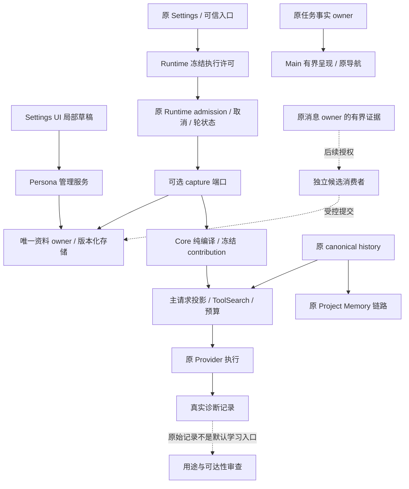
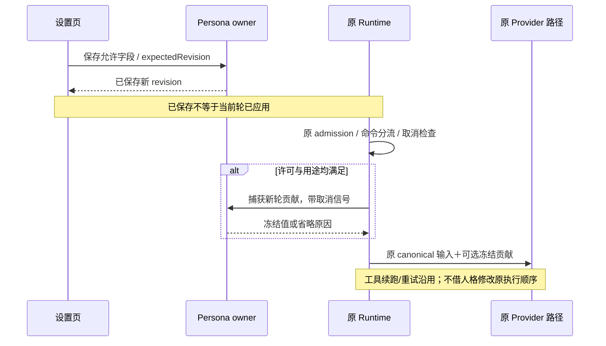

# Drora 拟人系统综合评审

> 后续处理：用户已要求据此完成设计，取舍已写入 [v5 统一 spec](../../specs/drora-persona-system.md)与配套合同。本页是评审时点记录；设计合同已收敛，实施与运行准入仍未通过验证。

日期：2026-10-29。源码基线：`54db6b6309c2b155f1e6d6630062c97c0432f0f2`。

状态：综合评审完成；推荐方向尚待统一写入产品 spec，未实施、未取得发布准入。审查模式为 `impact-only`，本轮不修改产品契约或业务代码。

输入：[A 文件方案](../../specs/drora-persona.md)、[A P0 计划](../superpowers/plans/2026-10-29-drora-persona-p0.md)、[B v4](../../specs/drora-persona-system.md)、[资料合同](drora-persona-data-contracts-2026-10-29.md)、[差异评审 R1–R8](drora-persona-design-comparison-review-2026-10-29.md)。具体调用路径和两份差异以该差异评审为证据索引，本文决定哪些应保留、修正、后置及如何进入下一阶段。

## 1. 总体结论

**产品方向成立；推荐以 B 的服务边界和请求隔离为架构骨架，吸收 A 的透明管理与独立桌宠呈现。两份现稿均不能直接作为完整实施基线。** 不采用公共历史人格分节作为首选，不同时建设文件和数据库两个权威，不把旧 Memory 改造成承担所有个人化需求的容器。

当前可以继续完成统一 spec 和设计验证准备。P0 实施前必须解决权威、请求用途隔离、开关语义三个阻断项；自动学习与复杂气泡另有准入，不应拖着整套首版一起上线。

| 评审面       | 判断               | 依据与限制                                                                   |
| ------------ | ------------------ | ---------------------------------------------------------------------------- |
| 产品价值     | 成立               | 单一持续身份、工作与日常共用、有限成长，符合本会话确认；不能收窄成纯编程同事 |
| 人格模型     | 有条件成立         | 稳定价值原则和表达倾向可行；应补齐人格字段与用户偏好的边界                   |
| 架构接入     | B 方向更合适       | 能避免新正文进入 canonical 历史；间接记录消费者仍未隔离闭合                  |
| 现有功能兼容 | 尚未证明           | 设计边界较完整，但没有新接缝的行为、恢复、provider 或多端验证                |
| 成长与记忆   | 需要收敛           | A 的来源字段不足以验证归因，B 的全局域合理但 gate 和同义配置需调整           |
| 桌宠呈现     | 当前态表达可独立做 | 历史型主动触发缺可靠事实；不能由 Main 猜测任务状态                           |
| 工程范围     | 首版过宽           | 不能把身份、自动学习、跨域源复验、导出、主动行为视作同一个最小交付           |
| 发布准备     | 未就绪             | 契约冲突未消除，关键实验未执行，当前 typecheck 也未通过                      |

此处“有条件成立”不是代码通过，也不表示已经选择了尚未确认的产品选项。

## 2. 人格本身应怎样建模

首版需让用户能感受到一个稳定的 Drora，同时把稳定人格与事实知识、用户习惯、执行权限分开。建议采用以下边界；这是对下一版 spec 的建议，不是新增四套独立存储。

| 内容           | 示例与职责                                   | 可变来源                       | 不允许承担的职责                       |
| -------------- | -------------------------------------------- | ------------------------------ | -------------------------------------- |
| 核心身份       | Drora 是数字伙伴，身份连续，诚实说明实际能力 | 产品模板；用户显式编辑允许字段 | 虚构真实经历、把静态介绍当运行能力探测 |
| 价值与行为原则 | 诚实、有主见、尊重自主、承认不确定性         | 稳定产品模板；明确版本变更     | 工具授权、访问控制、改变任务目标       |
| 表达倾向       | 克制的温度、直接但不生硬、适度幽默           | 核心受控配置；情境示例         | 覆盖当前用户格式要求、强行闲聊         |
| 用户交流默认   | 回复语言、解释程度、称呼、协作表达           | 显式设置；后续有限候选         | 同时在核心配置里再保存一份同义值       |

“世界观”首版适合作为价值判断与自我定位，不宜扩为自由叙事履历或可自动改写的信念库。外部知识仍通过当前工具、项目资料与原检索链路获得；知识更新不等于人格成长。人物名、出生故事、随机语录不能替代身份稳定性。

场景适应采用同一核心下的受控示例，不必建立新的情绪状态机或每轮分类模型。工作时给出明确判断；日常交流允许更自然的语气；用户不同意时能修正观点；遇到错误先补救。是否做到应由固定对照场景评估，不能只看 prompt 中是否写了这些词。

## 3. 对已有问题的综合处置

| 差异评审项                 | 综合处置                                                              | 首次阻断阶段                          |
| -------------------------- | --------------------------------------------------------------------- | ------------------------------------- |
| R1 两套权威与生效合同      | 统一一份主 spec；A/B 保留设计来源，不并行实施                         | P0                                    |
| R2 公共历史进入 Extraction | 推荐主请求贡献；不能按字符串剔除人格                                  | P0                                    |
| R3 model-io → Dream        | 建立用途/可达性清单；隔离未闭合时明确限制相关消费者；不称全链路零泄漏 | P0 契约；相关消费者开放前须有执行保障 |
| R4 agent 禁写目录          | 应用内不提供修改核心能力与任意工具硬隔离分开；不虚报后者              | P0；若硬隔离为必需则先完成执行边界    |
| R5 桌宠触发与日额度        | 保留当前态呈现；复杂触发独立定义事实和配额                            | 主动气泡阶段                          |
| R6 全局/项目记忆与归因     | 保留范围分离；复用现有源事实；先显式配置后自动候选                    | 显式偏好/自动学习各自阶段             |
| R7 降级后可用性            | 评估实际应用率与恢复率，250ms 仍为实验参数                            | P0                                    |
| R8 旧源码依据与范围不一致  | 统一 spec 时刷新 voice、根检查范围、读写范围及 env 继承说明           | P0                                    |

保留 B 的轮内冻结、可选端口、惰性初始化、accepted 后才可靠恢复、CAS/抑制、无跨库事务承诺、旧 session schema 不变。它们分别解决实际边界问题，无需为“简化”而删除。

同时裁剪 P0：不提前建设学习队列、来源详情、跨库复验、自动候选冲突 UI、远端资料同步。模块可扩展不要求所有后续 schema 和接口一次落地。

## 4. 本轮新增的综合问题

### S1 · P1 · 显式偏好依赖旧 Memory，扩大了所需功能范围

B §7.1 要求显式偏好读取同时满足旧 Runtime Memory gate。当前 `server-operations.ts:3515` 会在关闭时注入 `memory.enabled=false`；`project-memory-extraction.ts:32–44` 的自动抽取还受 extractionEnabled、memoryRoot、远端和 store 等条件控制。打开旧 Memory 在合格的本地会话上可能同时启用原项目抽取，它不是纯粹的“读取我填写的语言设置”。

这不是自动替用户开启 Memory 的已实现 bug；是产品依赖造成的范围扩大。用户仅想保存称呼，也必须理解并启用另一个带自动行为的系统。继续加说明文字不能消除依赖本身。

**推荐**：显式交流默认属于用户主动配置，独立于旧 Project Memory 的执行许可；读取仍受人格许可、请求资格及新域明确授权控制。自动学习另有默认关闭的策略。旧 Memory 保持原义和原行为。这个调整需先在统一 spec 明文替换 B 的现有合同，不能在实现时悄悄去掉 guard。若产品决定旧开关是跨域总记忆开关，就必须准确说明其总控范围，并重设计“只用显式默认”的入口；不能两种解释同时存在。

建议的权限关系如下，均为下一版待定稿方案：

| 能力               | 所需条件                                           | 不应隐含开启           |
| ------------------ | -------------------------------------------------- | ---------------------- |
| 核心表达           | 人格执行许可＋合格主请求                           | 项目 Memory、学习      |
| 显式交流默认       | 人格执行许可＋新域使用许可＋已保存值               | 项目自动抽取           |
| 项目 Memory        | 原执行许可和原条件                                 | 新域学习               |
| 新域自动候选       | 单独学习授权、来源资格、预算；读取另受新域许可控制 | 核心自动改写、旧 Dream |
| 查看/编辑/导出资料 | 管理权限及能力支持                                 | 任何模型调用或执行开关 |

### S2 · P1（显式偏好前）· 用户偏好与核心表达字段没有唯一归属

B §9.1 的人格编辑包含“解释习惯、称呼”，§7.1 的全局偏好又包含 explanationDetail、preferredAddress。当前设计没有把两个编辑面与一个 canonical 字段逐项对应。若实现者按页面分别建字段，就会产生同一个用户意图的两条写入路径。

**推荐**：核心保存 Drora 的稳定表达基线；用户给出的语言、称呼、详细程度等只存一次。人格页可以展示它们的入口，但保存必须指向同一资料字段和 revision。产品默认是未设置时的 fallback，不是第二份可写偏好；情境覆盖只作用本次请求，不反写配置。

编译优先关系应逐键固定：当前适用要求与 Output Style → 明确项目要求 → 显式交流默认 → 合格推测 → 产品表达基线。涉及项目自由文本的适用性仍由模型解释，不能声称全部程序化证明；不能稳定共存的键暂不上自动学习。

### S3 · P2 · “忘记”必须区分逻辑撤销与存储安全擦除

B §7.3 使用“删除值及个人库可恢复副本”，但拟议 SQLite 资料库尚无完整物理清除合同。删除当前行、清历史版本/候选、拒绝旧工作重新写入，可以形成应用级忘记保证；这不能直接证明文件页、WAL、系统备份或已导出文件中的字节不可恢复。

**推荐**：首版精确定义为“新域不再提供该值，应用管理的历史/候选/重试负载清除正文，旧来源不使其复活”；不承诺介质级擦除。已冻结轮、原聊天、原项目记忆、诊断记录和用户导出副本分别列明。此问题并不要求本次修改旧数据，只要求避免发布强于实际机制的承诺。

### S4 · P2 · 必须证明新功能有收益，而不只是证明没有崩溃

现有候选集已经覆盖很多正确性边界，但“默认关闭无变化”“失败省略”通过，仍可能得到一个开启后经常没有应用、语气机械、频繁提及自我身份的产品。B 的真实模型计划有价值，应保留，但先验证核心收益再投入自动成长。

**推荐**：P0 先冻结一套小而代表性的双盲或隐藏配置标签的对照样本，分别检查工作、日常、异议、纠正、结构化输出、长期连续性。报告每个模型的实际应用率、额外 token/cache/TTFT、任务结果和身份表达效果。重复运行不是新的独立场景；小样本的“0 失败”不能支持普遍零风险结论。沿用原计划的多模型/重复运行安排，但不把未测阈值写为能力保证。

## 5. 推荐架构与接入责任

DIAG 到 AUDIT 的虚线表示待处理的数据边界，不表示已经存在隔离器。Core 只处理数据；IO 在 adapter/组合服务；Host 代理；Main 不拥有人格学习队列、会话事实或用户画像。

唯一存储推荐沿 B 的版本化服务方向；文件/SQLite 的最终选择应以首版并发保存、跨进程一致性和外部编辑需求决定。不得建立 DB 与 soul.md 双向自动同步。外部可读导出可以是副本，不因其存在就变成第二个 owner。

恢复继续以原执行器为准：同一存活轮保持贡献；冷恢复丢失旧贡献时遵守明确降级合同，不能猜测历史版本。稳定身份不是跨进程精确重演承诺。协议能力发现、cold/warm、手机共享执行与 SSH/WSL 数据域仍沿 B 的分界，不能为本功能重建恢复链路。

## 6. 第一版范围与五道准入

首个可交付版本建议只包含：可审阅的稳定核心、少量受控字段、默认关闭的执行许可、管理与确定性预览、准确的保存/应用状态、主请求贡献和故障降级。真实模型预览、四类用户偏好、导出、自动学习、桌宠主动性按其独立价值和风险后续切片。

简单桌宠当前态呈现可平行设计，但不作为人格核心工作的必要依赖；“专业＋温度”由语言行为证明，不以桌宠数量或动效证明。

| Gate              | 必须交付的证据                                                            | 当前结论                            |
| ----------------- | ------------------------------------------------------------------------- | ----------------------------------- |
| G1 唯一产品合同   | 单一 owner、字段归属、编辑范围、许可/生效/失败语义；主 spec 与计划一致    | 未满足：R1、R8、S1、S2              |
| G2 请求与资料边界 | 主/辅助/诊断/学习用途清单；原始贡献可达性；recordable、预算与实际请求一致 | 未满足：R2、R3；需要接缝验证        |
| G3 运行兼容       | 默认关闭等价，stop/guide/queue/续跑、cold/warm、旧端、手机与远端隔离      | 只有设计，未执行验证                |
| G4 产品效果与成本 | 固定对照样本、模型分组结果、应用率/延迟/额外 token、取消与慢盘结果        | 未执行；不预填通过值                |
| G5 发行与回退     | 正式打包/跨平台 worker；功能关闭后原任务可用；旧库可用；真实检查记录      | 未执行发行验证；当前 typecheck 失败 |

G1/G2 先完成设计定稿，随后实施阶段用最小接缝验证 G2/G3，才进入 UI 完整交付及 G4/G5。不能把所有未知风险都推给最后 E2E，也不必先建设完整自动学习系统才能验证人格价值。

自动学习额外要求：源 owner/有效分支可验证、逻辑撤销及旧工作 fencing、两域冲突、成本预算、通知丢失与 accepted 分母明确。复杂气泡额外要求：业务事实合同、去重、离线/重启语义、日额度口径。没有这些证据就后置相应能力。

## 7. 综合 Impact Brief

### Feature Summary

能力与层次：Persona；本轮仅文档评审，拟议影响 validation、commit-effect、persistence、presentation、recovery。主要 seeds 为主请求投影、runtime preferences、Memory 抽取与管理、Persona 字段合同、桌宠展示事实。排除业务实现、恢复重构、旧库迁移和自动开启能力。

### UI Surface Matrix

继承[差异评审 §5](drora-persona-design-comparison-review-2026-10-29.md#5-impact-brief)完整入口矩阵；新增需明确的关系如下。

| 入口                  | 草稿/默认                      | 验证与提交                               | 权威/持久化                      | 平台与隔离                           |
| --------------------- | ------------------------------ | ---------------------------------------- | -------------------------------- | ------------------------------------ |
| 人格页的称呼/解释习惯 | 产品 baseline 或已保存交流默认 | 同一字段 owner/CAS；不得另存同义核心字段 | 唯一资料服务                     | 不因页面位置改变全局范围             |
| 交流默认使用开关      | 默认关闭，已保存与可使用分开   | 需统一 S1 的许可合同                     | 原执行配置＋资料策略分别拥有     | 不隐含打开项目抽取；旧端不调用新能力 |
| 忘记偏好              | 显示明确范围                   | 逻辑撤销、清应用持有正文、抑制旧来源     | Persona owner；原聊天 owner 不变 | 不承诺副本全域删除                   |

### Shared And Divergent Behavior

共用 Persona 服务和版本保存，不代表所有字段都是人格核心；共用设置页面，不代表项目记忆与个人默认共用执行许可；共用主请求，不代表诊断文件可直接进入学习。以上边界要落到接口和用例，而非只靠菜单分组。

### Feature Relationships / State Owners And Commit Sinks

| 级别           | 关系                                      | 唯一 owner / commit sink                | 综合影响                               |
| -------------- | ----------------------------------------- | --------------------------------------- | -------------------------------------- |
| must-inspect   | 交流默认 → Memory gate → Extraction       | 原 Settings/Runtime；原项目 Memory 文件 | S1：不要为了显式默认扩大开启范围       |
| must-inspect   | 核心编辑 ↔ 偏好编辑                       | 推荐统一 Persona 字段/版本提交          | S2：两个 UI 可以指向一个字段，不能双写 |
| must-inspect   | 忘记 → 历史候选/工作重试                  | Persona 仓储/策略 generation            | S3：逻辑撤销与物理擦除的合同边界       |
| must-inspect   | contribution → Provider/recordable/budget | Runtime 冻结，原投影执行                | R2/R3：同一值，多用途明确隔离          |
| invariant-only | 人格 → 原任务/语音/远控/团队              | 原业务 owner、owner/lease、CommandInbox | 不新增业务状态 owner，不替换原执行路径 |
| conditional    | 桌宠 → 历史型事件与配额                   | 原事实 owner＋独立呈现策略              | 只有复杂气泡纳入范围才需要             |

### Must-Preserve Invariants

延续差异评审的不变量及 CR01–CR10。新增：显式设置不得隐式启动旧抽取；一个偏好只有一个可写字段；忘记后旧工作不能让值复活；人格故障可降级但不得掩盖人格长期不可用。新增三项候选验证：

| 候选 | 设置/动作                                  | 断言                                                       |
| ---- | ------------------------------------------ | ---------------------------------------------------------- |
| IR01 | 旧 Memory 关闭，保存/使用显式交流默认      | 按统一后的许可合同使用；不启动项目抽取、不自动更改旧开关   |
| IR02 | 从两个设置入口编辑同一称呼，跨窗口并发保存 | 同一 canonical 字段、revision 冲突可见，不存在另一份隐藏值 |
| IR03 | forget 后旧候选/重试恢复，再导出与捕获     | 应用内旧值不再提供、不复活；副本与已开始轮按明确合同处理   |

候选尚未转为 accepted，也没有测试覆盖结果。

### Codegraph Evidence

本会话无可用 codegraph 工具；使用精确文件/调用点搜索。S1 核对 runtime startup preferences → memory config → extraction guard；S2/S3 为两份文档契约审查，不伪装成现有代码 bug。

本轮额外核对 `turn-model-step.ts:207–224` → `events.ts:82` → `persistDurableSessionEvent`，以及 `create-app.ts:855`：**不能仅凭 appendEvent 名称认定 ModelRequest 原文新增落入旧 session 表**，默认 eventStore 在内存，durable 分支按事件类型处理。已确认的文件副本证据仍是前轮 model-io 路径。该核对避免把请求审计风险扩大成未经证实的旧库污染结论。

### Graph Drift Candidates / Graph Delta

建议下一版登记“显式默认与 Project Memory gate 的语义关系”“表达字段 owner”和“资料逻辑撤销范围”；继承前轮 model-io/Dream、voice、桌宠事实边建议。本轮不修改 feature graph，不把静态调用关系视为已接受产品依赖。

### Unresolved Questions / Planning Handoff

尚需定稿：自由外编 Markdown 是否硬要求；复杂桌宠主动行为是否首发必需；核心文件是否要求任意工具硬隔离；显式默认与旧 Memory 的许可关系。前三项沿用前轮，不再次假定用户已经裁定；最后一项推荐 S1 的分离方案。确认后统一主 spec、字段表、资格表和候选验收，再修订实施计划。当前 handoff 为“评审完成，实施前合同待收敛”，不是 ready-to-build。

## 8. 检查记录与限制

- freshness：通过，当前分支与其 `drora` upstream 同步。检查同时报告相对 `origin/main` ahead 999 / behind 1；本文审查基于当前 HEAD，不等同于完成上游同步评审。
- 本轮重新执行 `pnpm lint`：0 errors、395 warnings。
- 本轮重新执行 `pnpm typecheck`：退出码 2；仍为 `packages/relay-v2-server` 的 workspace 模块解析及相关类型错误。未修依赖或代码，未推断引入提交；命令后续 `&&` 阶段没有因此获得通过证据。
- 未运行全量测试、CLI 行为测试、E2E 或模型实验。当前设计准入结论来自静态审查，不能推导实现已安全或效果已达标。
- 本轮只新增本文，保留两份 spec、差异评审与无关本地文件；没有提交或推送本轮文档。
