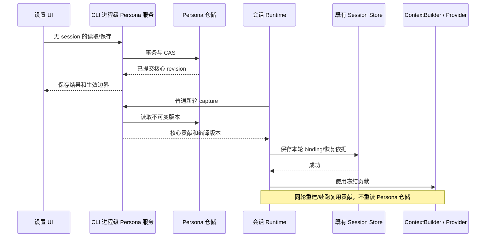

# Drora 人格方案可行性审查

> 历史评审，反映当时版本的问题与判断。当前实施合同以 [v5 主 spec](../../specs/drora-persona-system.md)及其配套文档为准；本页不作为并行方案。

- 日期：2026-10-28。
- 对象：[设计草案](../../specs/drora-persona-system.md)与[影响分析](drora-persona-system-impact-2026-10-28.md)。
- 方法：当前检出源码的定向静态审查；未改实现、未进行原型或真实模型效果实验。
- 结论：方向可行；原方案不能直接作为全量实施规格。身份模块可先落地；个人记忆存在跨域语义缺口，自动成长必须独立设准入门槛。
- 本文提出修订建议，不自动改写已确认的产品方向，也不将新建议标为用户已接受。

> 2026-10-29 更新：F1–F7 先合并到第二版；随后依据兼容性审查继续收敛为[第三版设计 §13](../../specs/drora-persona-system.md#13-两轮审查的第三版处置)及[候选验收 PM01–PM36](drora-persona-system-impact-2026-10-28.md)。下文保留最初问题依据，当前设计以第三版为准；其中旧会话学习账本、逐轮正文和恢复限制已撤回。“设计已处置”不代表实现或实验通过。

> 第四版补充：当前基线更新为[第四版 spec](../../specs/drora-persona-system.md)及[资料专项合同](drora-persona-data-contracts-2026-10-29.md)，保留第三版兼容边界，增加归因、范围、只读导出与跨回合验收；候选范围为 PM01–PM48。本文原始审查证据保留，不将新设计视为运行验证。

## 1. 可以保留的设计

一个持续身份、稳定核心与有限成长，符合用户已确认的范围。人格资料归 CLI 领域、Host 代理、Runtime 使用本轮快照，也符合现有进程边界。无需更换模型供应商、重写 CommandInbox 或建立新的用户任务执行器。

ContextBuilder 已有 addSection，普通轮已有 outputStyle 冻结，session store 已有通用 session entry，协议 server 也有非会话操作。这些都是可利用的接点，但不是已经实现的人格生命周期。

以下问题中的 P1 表示必须在对应阶段实施前解决；不意味着当前已上线代码存在同等严重度的缺陷。

## 2. 发现的问题

### F1 / P1：新增个人记忆与旧 Project Memory 的职责实际重叠

**证据：** [memory.ts](../../apps/drora-cli/packages/core/src/context/sections/memory.ts)明确允许保存 user（角色、知识背景、偏好）与 feedback（协作纠正与确认）；[Memory spec](../../apps/drora-cli/docs/design/v2/memory/README.md) §4–6 也规定了这些类别、索引注入与独立 Extraction。原方案 §7 同时增加个人偏好抽取，并要求保留旧写入契约。

**触发与后果：** 用户要求“以后简短回答”，旧文件记忆和新个人数据库可能分别保存。只在新库纠正/忘记，旧索引、记忆文件或已加载的项目上下文仍可能提供旧偏好。新库的 tombstone 无法管住旧抽取器。scope 不同不代表语义不重叠。

**建议：** 先将记忆管理界面明确区分“个人资料”与“项目记忆”，展示删除范围；所有“下轮停止提供”承诺限定为新域贡献，不承诺清除旧聊天与旧项目上下文。新个人资料注入必须标注适用范围和来源。第一阶段只支持显式个人偏好；开自动学习前，专项确认两域冲突规则，以及是否通过独立路由端口让新记忆写入按 scope 选择唯一 owner。改变旧抽取行为须单列与上游的有意分歧，不能就地改旧 prompt 当作已解决。

**退出证据：** 同一偏好同时存在两域，随后纠正、忘记、跨项目打开、warm/cold resume；最终 provider body 与实际回答分别验收。只查新库已删除不算通过。

### F2 / P1：无会话资料控制面不能直接装在 createDroraApp 中

**证据：** [create-app.ts](../../apps/drora-cli/packages/bootstrap/src/app/create-app.ts) 的 createDroraApp 要求 Provider Registry、分配 sessionId，并在正常构造链创建 AgentRuntime。[workspace-model-runtime.ts](../../apps/drora-cli/packages/bootstrap/src/drora-protocol/workspace-model-runtime.ts) 的 createWorkspaceDroraApp 最终调用这条链。

**触发与后果：** 按原方案 §4.3 只在 create-app.ts 装配人格服务，无法满足“尚无会话时打开设置，不创建 AgentRuntime”。还可能把全局资料服务绑定到某个会话的模型与关闭周期。

**建议：** 新增独立 Persona 应用服务工厂，依赖可信的数据根、仓储与生命周期端口；在 CLI/app-server 的进程组合层创建，提供无 session 的协议操作。createDroraApp 只接收该服务的窄端口。TUI/独立 CLI 的入口调用同一工厂。各进程可有自己的服务实例，数据库负责跨进程一致性；“唯一逻辑 owner”不是强行引入一个常驻全局进程。

数据根需由可信启动配置决定；project config/cwd 不应悄悄切换个人身份。当前 getCliStorageRoot 只是路径规范化工具，不能单独证明控制域与每个会话配置的 storage.dir 一致。实施前必须列出 Desktop、TUI、远端各自传入的数据根来源。

**退出证据：** 零会话、未配置模型时，仍能读写人格；没有新增 session、AgentRuntime 或模型请求；关闭一个会话不关闭其他会话正在使用的资料服务。模型供应商无效也不能阻止编辑名字。

### F3 / P1：快照保存与“忘记”的合同没有闭合

**证据：** 原方案 §6.2 时序图写“持久化 binding/hash”，正文又要求保存不可变快照并恢复同一执行；§7.4 要求清除个人内容副本。[session-store.port.ts](../../apps/drora-cli/packages/contracts/src/interfaces/session-store.port.ts) 提供 session entry，但没有现成的人格快照合同。

**触发与后果：** hash 能校验内容，不能恢复内容。若只保存引用，记忆纠正或删除后无法重建原请求；若复制完整个人记忆到会话快照，又必须处理忘记后的副本删除及崩溃恢复。原文没有规定这些情况下哪个承诺优先。

**建议：** P0 只冻结稳定核心，核心版本内容不可变且可按 revision 取回；本轮输入额外记录 compilerVersion、schemaVersion、内容 hash，避免编译规则升级后同 revision 产生不同请求。人格记录与会话 binding 分属两库时，先捕获已提交版本、再保存 binding、最后发请求；失败不发请求，重试复用已保存 binding。

到个人记忆阶段另定恢复策略：建议轮内在存活进程中保留不可变贡献；个人资料被撤销后，崩溃重启不得自动恢复含旧资料的执行快照，应进入现有中断/新轮路径。若现有运行时支持的恢复方式不同，需另行评估，不为人格功能新增整套执行恢复能力。历史正文与模型记录的留存单独说明。

**退出证据：** 捕获后保存失败、首请求前崩溃、工具续跑、compact、核心版本变化、忘记后重启。明确哪些是同轮续跑，哪些是新轮；不得用最新内容补写旧快照。

### F4 / P1：自动学习的持久来源与失效协议尚未实现

**证据：** create-app.ts 默认使用 createInMemorySessionEventStore；[server-types.ts](../../apps/drora-cli/packages/bootstrap/src/drora-protocol/server-types.ts) 同样明确每 session 使用内存事件流。[events.ts](../../apps/drora-cli/packages/core/src/runtime/methods/events.ts) 的 appendEvent 在通知前调用 persistDurableSessionEvent，但 TurnComplete 分支保存的是会话 lastOutcome/timeUpdated，不是可供任意回合补扫的完整持久事件账本。[turn.ts](../../apps/drora-cli/packages/core/src/runtime/methods/turn.ts) 在普通成功路径上先固定 stable fork boundary，再发布完成事件；这是可复用证据，但要限定覆盖路径。

**触发与后果：** 进程在会话提交后、learning work 建立前退出，重启仅靠事件订阅补不回任务。“有界补偿扫描＋cursor”还缺少被扫描的持久记录及顺序合同。另一个并发窗口是：worker 复检来源有效后，源在另一库被 rewind/delete，随后 worker 提交；只复检一次和使用 expectedRevision 不能消除该竞态。

**建议：** 自动学习单独一期。先定义持久 evidence descriptor，包括 sourceSessionId、原始消息边界、来源有效性版本及明确的学习资格；明确用已有落盘边界还是新增通用提交记录支持补扫。不要因为事件名含 complete 就新增第二份完整事件库。源变更与个人库异步失效时，规定恢复期间查询暂不注入未复验推测，或通过来源校验端口在 capture 前确认有效性；跨库关系不能写成原子事务。

free-text 相似语义无法靠 jobId/tombstone 精确去重。首批自动学习宜只接受有限偏好键，例如输出语言、解释详略、称呼、协作方式；撤销键使用 subject＋scope＋preferenceKey＋证据截止边界。自由文本共同经历放后续，不承诺已经解决任意改写文本的“忘记后不再学回”。

**退出证据：** 分别在源提交后、建任务前、候选返回后、校验后/提交前、撤销后注入崩溃或屏障；两个进程并发消费；旧来源改写措辞后重新抽取。证据复验失败不得影响主用户任务完成。

### F5 / P1：本轮冻结必须覆盖上下文重建，不能只给 builder 加一段

**证据：** [context-refresh.ts](../../apps/drora-cli/packages/core/src/runtime/methods/context-refresh.ts) 的 rebuildContextPrefix 会重建 ContextBuilder、替换上下文前缀；[context.ts](../../apps/drora-cli/packages/core/src/runtime/methods/context.ts) 的 createContextBuilderFromSnapshot 目前接收 env/model/memory 等，没有 turn contribution；[turn-loop.ts](../../apps/drora-cli/packages/core/src/runtime/methods/turn-loop.ts) 的 output_style 是本轮运行时 attachment，注释明确它不落 session。这不足以直接证明新人格的持久恢复。

**触发与后果：** 如果只在初始化调用 addSection，重建时可能丢失；如果每次重建从仓库取资料，则当前轮可能读到新版本。若作为普通聊天历史反复追加，旧人格又可能在后续轮持续叠加。

**建议：** 通用贡献端口只在允许的普通新轮 capture；所有本轮前缀重建都接收同一贡献值，preview 不得误写执行态。贡献使用稳定的 section ID，在前缀构建时替换，不把人格正文永久追加为普通消息。约束项包括 custom prompt、subagent、workflow actor 排除，以及 provider 角色转换后的内容唯一性。

**退出证据：** PM03/04/05 外补“运行时上下文重建”与“跨两轮无旧贡献叠加”；检查最终 provider body，不只比较仓库 revision。

### F6 / P2：开关时序、身份表达和效果指标需要更精确

原方案复用旧 Memory gate 保持兼容是合理选择，但它在 Runtime materialization 时冻结。用户在当前会话打开 Memory 后，新个人记忆仍可能无法使用；不能让设置统一提示“所有修改下一轮生效”。建议明确展示人格配置、个人策略、既有 Runtime Memory gate 三者的生效边界。第一版不为了易用性暗改原有 gate。

当前 [cli-prefix.ts](../../apps/drora-cli/packages/core/src/context/sections/cli-prefix.ts) 固定 coding agent，[identity.ts](../../apps/drora-cli/packages/core/src/context/sections/identity.ts) 默认软件工程任务身份，dynamic-sections 也有工作协作表达。它们并不证明日常交流不可行，但叠加新文本不保证“长期伙伴”效果。新核心宜明确补充持续关系与可用场景，避免制造两套互斥身份；若评测证明需替换原身份前缀，另列最小接缝与上游差异，不直接改还原文本。

人格用户字段、导入文本与自动抽取资料的信任等级要区分。自动学习只产结构化偏好，不能成为任意 system 指令。persona、Output Style、当前明确请求之间需要冲突用例；上下文排列顺序本身不是权限机制。

**建议评测：** 第一版准备一组工作、闲聊、异议、纠正、久别重逢、切模型场景，比较开关人格前后的任务正确性、自然程度、虚构经历、过度附和和重复寒暄。至少在实际支持的两个不同模型配置上重复运行；报告样本与失败，不能用 prompt 字符串存在或 MBTI 标签当效果证明。具体样本量和通过阈值在实验前确定。

### F7 / P2：复用基础设施不等于已有非阻塞数据库和成本保证

**证据：** [sqlite-session-store.ts](../../apps/drora-cli/packages/adapters/src/storage/session-store/sqlite-session-store.ts) 使用 node:sqlite DatabaseSync；async createSession 仍直接调用同步 repository。

**后果：** 原方案“异步端口＋复用 SQLite”尚未说明实际 IO 调度。将同步数据库操作包成 Promise 不会消除事件循环阻塞，尤其是锁竞争和批量整理。每轮最多一次抽取也是上限，不是有效的成本控制策略；原有 Project Extraction 可能仍在运行。

**建议：** 新仓储在独立 worker/执行边界中运行同步 driver，或选已有经验证的非阻塞适配方案；不顺手改全仓数据库。事务有界且不得跨模型调用。P0 使用短的固定核心，无自动分类/反思请求；先测无人格与启用人格的 token、缓存和首 token 延迟。P1 自动抽取另加有界输入、输出、重试与每数据域消费预算，普通寒暄默认跳过。8,000 字符仅作草案硬上限，不作为每轮填充目标或已验证容量。

## 3. 推荐修订后的实施顺序

| 阶段              | 内容                                                         | 进入/退出条件                                                                |
| ----------------- | ------------------------------------------------------------ | ---------------------------------------------------------------------------- |
| P0a：接入验证     | 无会话控制服务、单身份仓储、核心版本、通用 turn contribution | F2/F3/F5 合同闭合；设置不创建 Runtime；快照和上下文重建有 provider-body 证据 |
| P0b：身份产品版   | 一个 Drora、少量可编辑字段、场景表达、设置 UI                | Memory 关闭仍可用；真实模型效果评审；旧任务质量无已知关键退化                |
| P1a：显式个人偏好 | 有限结构化字段、查看/修改/忘记、来源与范围                   | F1 两域语义清楚；F3 撤销/恢复规则明确；不依赖后台抽取                        |
| P1b：有限自动学习 | 偏好白名单、持久来源、工作记录、撤销截止线                   | F4 故障与并发验证通过；新增模型成本有界                                      |
| P2：多入口与经历  | 手机恢复、远端只读核心、共同经历与后续整理                   | 传输/资料范围逐项验收；不把这些全压入 P0                                     |

同 Host 手机在早期仍应保持正常对话并消费 owner 生成的回复；新设置入口可按能力门控，不能把延后人格管理页解释为允许手机另有一个身份。

下面是建议的所有者与时序，而非新增实现：

## 4. 审查结论与验证边界

保留领域划分和单一持续身份；修订生命周期接入、记忆两域语义、快照恢复和学习证据合同。原 P1 同时包含手动管理、通用经历和可靠自动学习，范围过大，应拆为 P1a/P1b。

尚不能依据此审查承诺具体工期或人格效果。无会话入口、轮内快照与恢复是身份阶段的关键技术验证；跨域记忆和可靠学习是后续主要成本。

- 本次 freshness 通过；源码定向审查完成，未运行应用或模型实验。
- 本次仅新增审查文档，保留原方案供对照；没有将修订建议当作已确认产品规则。
- 未执行人格实现测试；原方案记录的 typecheck/lint 结果是上一轮结果，不能作为本次可行性证明。
- 不修改无关的 `docs/voice-merge-readiness-2026-10-24.md`。
