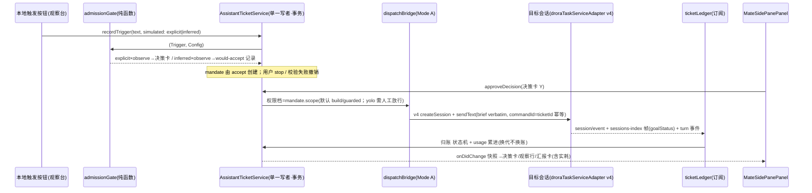

# Drora Mate 实施方案（master plan）

- 日期：2026-11-04 · 版本：v1.2（并入 subagent 审查修复，见 §9）
- 基线：main @ 42bacc627（upstream v3.17.2 已整并）
- 关联：`specs/drora-personal-assistant.md`（W0 spec）、`specs/drora-divergence-ledger.md` 台账 16
- 分阶段详设：`01-p1-detailed-design.md` / `02-p2-detailed-design.md` / `03-p3-detailed-design.md` / `04-p4-detailed-design.md`——每 PR 开工前以其为实现准绳
- 范围裁定（用户）：P1 仅本地 Source（im/手机后移 P3）；P1 即含 session 管理与消息派发最小闭环（手动放行直派 Mode A）；Router/附着/建队/代际属 P2+

## 0. 阶段地图

```
P1 准入(含 Mandate)+observe+手动放行直派(Mode A)+usage 归账   [PR-1A 服务核心 | PR-1B UI]
P2 Router 预设(Spike 先行)+Mode B/C+代际锚校验+W1/W2+assistantActivity(host 侧)
   +Surface A/C 落点 + /mate 入口
P3 Source 注册表(飞书/手机/GitHub)+Thread 直通+桌宠接缝(含 tray 直达)
P4 watchdog(automation)+auto 信任门(唯一入口+配额默认5)+汇报卡完整版
语音入口：随 voice-agent spec 排期对齐后单列（不在 P1-P4 内，见 §8）
```

包×模块落位：shared（contracts/assistant.ts + channels 键）、services（`src/assistant-tickets/` 六件）、ui（`src/mate/` 族 + store/hooks/i18n）、desktop（P3 桌宠接缝）、apps/drora-cli **零改动**（P2 assistantActivity 走 host 侧挂载，见 §3.9）。

## 1. 开工门禁（每 PR checklist，AGENTS.md 对齐）

1. `node scripts/check-workspace-freshness.mjs`——红则先做上游同步战役；
2. `pnpm architecture:check --changed` 先行 + `pnpm architecture:context <module-id>` 读取受控上下文后再动码；
3. UI 类 PR 开工前重读 `DESIGN.md`（涉及插件商店词汇再读 `CONTEXT.md`）；
4. 新模块同步 `module.ts` + `architecture-policy.yaml` 登记；
5. 完成门禁：`pnpm typecheck` + `pnpm lint` + `pnpm verify:pre-push` + `pnpm test:drora`（新测试入 `scripts/drora-test-files.json`；串行组入 fork-isolated 清单）+ 浏览器验收 mjs + 手动冒烟进 coverage matrix；
6. 改动 shared 的 PR：push 后确认 `pnpm test:engineering:affected --scope push` 无回归；
7. PR 描述遵守仓库规范（背景/设计意图/前后行为；bugfix 逐项触发场景-根因证据-修复机制-回归验证）；
8. 实现约定：异步文件/网络 IO；中文注释说明原因依据；hooks 含 JSX 用 `.tsx`；禁 UI 直调 Repo、禁跨域实现细节导入、禁循环依赖。

## 2. P1 · 准入（含 Mandate）+ observe + 手动放行直派

**P1 主链所有者与事件顺序**（AGENTS.md 状态/时序图要求）：



### PR-1A：契约 + 服务核心 + 派发桥 Mode A + usage 归账

**前置 commit（spec 修订，行为先行）**：§14 P1 验收改"本地触发→explicit 出决策卡放行 / inferred 出 would-accept 记录→会话执行→完成记录（含实耗）"（**同步修正 §14 原文"点名→would-accept"的矩阵混用**：点名=explicit=决策卡，would-accept 属 inferred）；§5 标注 v4 协议文件视 P2 Spike 而定；§9 标注 P1 写域简化（无 worktree，同 workspace 软预算=1，决策卡/汇报卡明示"P1 未隔离"）；§1 命名统一：持久化前缀 `mate-` ⇒ 数据库文件名 `mate.sqlite`（与 contracts 常量一致）。

新建（依赖注入：`assistantTicketsService` ← `droraTaskServiceAdapter` 相关服务与事件面，注入式照 `createBotsService` 先例 `services/src/node.ts:3040-3059`，装配链置后）：

| 文件                                | 要点                                                                                                                                                                                                                                                                                                                                                                                                                                                                                 |
| ----------------------------------- | ------------------------------------------------------------------------------------------------------------------------------------------------------------------------------------------------------------------------------------------------------------------------------------------------------------------------------------------------------------------------------------------------------------------------------------------------------------------------------------ |
| `shared/src/contracts/assistant.ts` | `ASSISTANT_STORE_SCHEMA_VERSION=1`、`ASSISTANT_STORAGE_KEYS{database:"mate.sqlite"}`、`ASSISTANT_MODES/STRENGTHS/OUTCOMES/PERMISSION_TIERS`、错误码枚举（`as const`，照 `contracts/persona.ts:28-46`）；登记 contracts/module.ts + architecture-policy.yaml + shared index re-export                                                                                                                                                                                                 |
| `shared/src/channels.ts`            | ServiceChannels 加 `AssistantTickets: "assistant-tickets"`                                                                                                                                                                                                                                                                                                                                                                                                                           |
| `…/assistantTickets.ts`             | 接口（recordTrigger（含 simulated 强度标记）/listTriggers/listDecisions/listTickets/approveDecision/stopMandate/revokeMandate/setMode/setAllowlist/getConfig/onDidChange）+ descriptor（照 `memory/memory.ts:25-65`）                                                                                                                                                                                                                                                                |
| `…/admissionGate.ts`                | 纯函数 `(Trigger, Config)→{strength,outcome}`；矩阵单测（explicit×observe=决策卡；inferred×observe=would-accept 零执行）                                                                                                                                                                                                                                                                                                                                                             |
| `…/mandate.ts`                      | Mandate 最小域模型：accept 创建、用户 stop、校验失败撤销三条唯一变更途径；`消息/评论/引用文本不能改变权限`不变式入单测；scope→权限档映射（默认 build/guarded，yolo 必须决策卡人工放行）                                                                                                                                                                                                                                                                                              |
| `…/dispatchBridge.ts`               | Mode A **统一走 v4 command 通道**：`droraV4HostCommand.ts` 的 `createHostCommandEnvelope`(:61)/`assertV4CommandAckOk`(:118) + `droraTaskServiceAdapter.ts:1773-1800`（createSession）与 `:454-480`（sendText，inputId→commandId 幂等注释原位）；**不用 legacy `droraSessionService.createSession` facade**，避免混合路径；brief verbatim 作首条输入                                                                                                                                  |
| `…/ticketLedger.ts`                 | 订阅既有事件面：`droraAgentService` 的 session/event（:2671 邻域）与 sessions-index 帧（:2792 邻域，订阅真名 `subscribeConversationV4`/`subscribeSessionsIndexV4`），goalStatus 经 `droraTaskIndexSyncer`（:604 邻域）——**行号以 architecture:context 实读为准**；状态机 `dispatched→running→done/failed`（P1 三态简化：`awaiting_output` 并入 done，四态 P2 恢复）；usage 记**差值行**累进 `ticket.usage_accum`（含 cacheRead/Write）；**失败写原因不自动重试**；事件驱动禁超时兜底 |
| `…/assistantRepo.ts`                | node:sqlite 六表（trigger/admission_decision/**mandate**/ticket/kv/usage_log），照 `knowledgeDatabase.ts:19-78`；版本迁移只加不破+迁移单测（bots repo 先例）；dispose 登记 `node.ts:3394` 链                                                                                                                                                                                                                                                                                         |
| `…/assistantTicketsService.ts`      | 工厂（node-only）+ `createServiceLogger("assistant-tickets")`（debug=逐事件、info=生命周期）；trigger+decision+mandate+ticket 同事务单一写者                                                                                                                                                                                                                                                                                                                                         |

触碰点：channels 键；`services/src/index.ts`（只导 descriptor+**type-only** 快照类型，`:187-190` 红线）+ `node.ts` 注册链/dispose + `accessor.ts` 可选字段（照 :135-141）+ `client/src/remoteServiceAccess.ts` 代理（照 :181-188）+ `client` messageport options **能力门控**（照 modelCapabilities 先例 `remoteServiceAccess.ts:111-117`：服务缺席时 renderer 判空降级，不硬依赖）。

测试：gate 矩阵 / **Mandate 三途径+不变式** / repo 事务锁迁移 / **派发幂等（同 ticketId 二次放行不重派）** / 状态归账折叠 / usage 累进。

### PR-1B：ui-mate + Side Pane tab + 决策/汇报卡

- `ui/src/mate/` 五件套：module.ts（+architecture-policy）、contract.ts+CONTRACT.md、index.ts、view-model.ts、组件：`MateSidePanePanel`（过滤+软预算+workspace 分组+成本+信任条）/ `MateDecisionCard`（Y 放行·N 忽略·E 改单；原文 verbatim+预估+目标 workspace 选择+权限档显示；**明示"P1 未隔离"**）/ `MateReportCard`（done/failed+实耗+"打开会话"跳转，照 `handleOpenTeamSidePane` 同位先例 `useAppPanels.ts:1138`）/ `MateObserveRow`（would-accept 行，foreground-subtlest 空心灯）。
- **状态灯五档映射**（PR-1B 视觉契约）：待决策=destructive 级提示、运行=warning、观察=foreground-subtlest 空心、完成=success、失败=destructive；时间线 token 用 mate scope（P2 Surface C 起用）。
- Side Pane tab 七处接缝：`workspaceSidePane.ts`（:632/:981/:1255；Mate 为 workspace 级全局 tab）→ `useAppPanels.ts` → `WorkspaceShellLayout.tsx` → `AnimatedSidePanePanel.tsx`（:1024）→ `SidePaneTabTrigger.tsx`（:314/:537）→ `sidePaneTabPresentation.ts` → 新 `app-shell/MateSidePane.tsx`。
- store/hooks/i18n：`mateStore.ts`（照 `offPeakTaskStore.ts`）；`useAssistantTickets.ts`（照 `useModelCapabilities.ts:36-55`）；`mateMessages.ts` 双语（zh「大副」/en "Mate"）+ 键守护。
- 本地触发入口：**双按钮**——"点名触发"（模拟 explicit→决策卡）与"未指名触发"（模拟 inferred→would-accept，为信任条提供 P1 数据来源；P3 前替代 im 未指名形态）。
- **非容器级安全边界声明**：决策卡权限档区+docs 明示"隔离=独立会话+目录+白名单，非容器级"。
- 测试：view-model/store/键守护 vitest；浏览器验收 fixture + `mate-observe-ui.test.mjs`（真实 React+仓库 CSS，dispatch synthetic ACK），登记 coverage matrix + drora-test-files.json。

P1 验证：§1 门禁全项 + 手动端到端冒烟（双按钮各一例→放行→真实会话执行→状态流转→汇报卡含实耗→打开会话；重复放行不二派）。

## 3. P2 · Router 预设 + 派发补全 + 代际

1. **Spike S2-T0（先行）**：Router 决策回传二选一——(a) 结构化文本（persona preset 会话+system prompt 约定 schema 输出+host 侧 zod 校验后走既有 `approveDecision`，零 CLI 改动，**保底首选**）；(b) 插件注册 `mate_*` 工具（仅当插件 SDK 工具注册+回访 host 通道验证可行）。结论落 spec §5 与台账 16（若 (a) 成立，v4 命令族全程不需要）。
2. assistant preset：persona 系统+create-session-config 注入；**宿主=窗口 Local Host 内 assistant 虚拟 workspace**（spec §2.1）；工具白名单收敛；无状态壳每 N 工单轮转。
3. **Surface A 落点**：preset 会话建立即有大副对话（模式徽标/打扰配额/活动工单数状态条）；决策卡/汇报卡内嵌该对话流（bottom dock 同位先例 `TeamApprovalDock`，或对话内卡；"已等待 X"只显示不超时）。**Surface C 落点**：`MateSidePanePanel` 下钻二级视图（时间线/汇报/证据/成本四页签，mate scope token）。**`/mate` 命令入口**：经自定义命令/导航端口直达（与 /team 对位）。
4. 候选卡路由循环：Trigger 过门→候选卡（截断+读指针）→Router 评估（observe 下只产出"建议+证据"，人工决策卡终审；低置信必经问人）。
5. **Mode A 目标解析统一**：本地/远程统一经 `botRemoteWorkspaceService`（`node.ts:2854`/`:2862-2873`/`:3053` 实际标识符；原方案误写 resolver）identity+hostId 解析；workspaceIdentity/remoteSessionId 贯穿。
6. Mode C 附着：照 `bot-project-runtime/index.ts` identity+Lease 代际重附（Lease :16/assertLease :37/admit :47/重附 :73-80）；Tier1 绑定直读（busy 排队合法；**绑定只存 TicketService 不进会话上下文**）/Tier2 harness 有界候选（硬过滤 busy·跨 identity·过期；模型带证据选择，**派发桥校验后生效**）/Tier3 决策卡换绑（"开新会话"恒为选项）。
7. 代际与锚校验：`incarnation.generations`+anchor（最后已投递消息 id，CAS 双基准先例）；投递前校验；失配→事务归档+台账浓缩重派（复用 Mode A）+未汇报增量如实标注；六变化场景处置表；最多一代；换代续用同一 worktree；禁超时兜底。
8. **W1+W2 写域**：W1=worktree（`.drora/mate/<id>`+分支 `mate/<id>`，Mode A 默认；终态清理保留分支、失败清理入台账）；**W2=非 git 目录或用户关闭 W1 时：写域声明+派发桥比对同 workspace 其他活动工单，重叠→排队/问人**（P2 与 W1 同期交付）；W3=附着不隔离但查冲突。软预算放开 3（超出排队+告知卡）。
9. Mode B：prompt 驱动——建 lead 会话+sendText 指示走 /team stage，人批门原样；**状态归账第三信号 teamActivity**（`teamMemberStateSchema`）在 Mode B 工单接入；cause 枚举取消（随本阶段修 spec §3/§7 与台账 16）。
10. **assistantActivity（host 侧挂载，裁决）**：事实源在 host TicketService，**不照 teamActivity 的 CLI 投影路径**——由 host 侧在任务行/会话索引 overlay 合成（直接先例 `windowHostControllerService.ts:128` 的 teamActivity overlay 透传），CLI 零改动保持；手机经 controller 快照透传；**双链路（continuous+replayable）同验**。`mate/session-line.ts` 挂 TaskListItem/task-row（project-sidebar requires 加 ui-mate）。

P2 验证：门禁全项 + E2E（候选卡→建议→人放行；follow-up 直投延迟对比；kill→锚校验→换代重派→增量标注；W1 建立/清理+W2 重叠排队；Surface A 状态条与对话卡；Surface C 四页签；/mate 入口；手机快照 assistantActivity；远程目标派发一例）。

## 4. P3 · Source 注册表 + 多入口 + 直通

1. Source 注册表抽象：`register(kind, handler)` 产出带 identity/workspaceIdentity/remoteSessionId 的 Trigger 进 gate——P1 的 gate/ledger 零改动消费；本地双按钮降级为测试工具保留。
2. 飞书：`createBotsService` 注入可选 `assistantForwarder`（channelRuntime+channelMentionResolver）；名单内@=explicit，未指名=inferred；真机冒烟（用户侧配智能体应用凭证）。
3. 手机：远控 attachment 链路→Trigger（前置小探查 window host attachment 事件面）；手机端形态=单列+drawer+`回放·未建 runtime` 徽标+footerSlot 摘要；推送=决策卡精简版。
4. GitHub：新 services 模块轮询 issue/PR 评论（token 经 credential service；ETag 省额）；点名=名单内账号 @。
5. Thread 直通完整版：同 ticket follow-up 直投 incarnation 会话。
6. 桌宠接缝（台账 16 范围，宠物本体零改动）：`desktopPetMenu.ts` 加「打开大副」+ 单击→宠物旁 tray 速览（330×400 几何复用 `desktopPetInteractionLayout.ts:23-24`；速览内 Y/N + **点卡直达主窗口对应工单**——导航端口同 §2 PR-1B 先例）+ badge 待决策数/气泡（与每日打扰配额同源）；**新增 command IPC 字面量走 shared 常量区**（照 PlatformChannels 形态）；pet/tray 不建第二 Host，快照经 Main 转发（Main 只转发）。

P3 验证：门禁全项 + 飞书/GitHub/手机真机各一例 + 桌宠 badge 一致 + inferred（im 未指名）would-accept + tray 直达工单。

## 5. P4 · watchdog + auto 门 + 汇报卡完整版

1. watchdog：复用 desktop/host cron 基建（`cronBotDelivery/cronRunLifecycle` 先例，`desktop/src/host/index.ts:151/:172`）；停滞判据→标记+通知，不杀不改写。
2. auto 信任门：kv 累计放行率→信任条达标→**"切 auto"唯一入口**（Side Pane 信任条区）+确认 dialog 不可逆；auto 下 inferred 接受须评估引原文证据。
3. 汇报卡完整版：成本按代分解（usage_log）、工件核验（git diff/PR 只读检查）、**每日打扰配额默认 5**全端生效（含桌宠气泡）。

## 6. 横切

| 项        | 规则                                                                                                                                                           |
| --------- | -------------------------------------------------------------------------------------------------------------------------------------------------------------- |
| spec 同步 | 每阶段开工先修 spec（含 §14 矩阵混用修正）；台账 16 随偏差更新                                                                                                 |
| 上游      | 每阶段 freshness；**两接缝点（assistantActivity host 挂载点/contracts 常量）每次上游同步人工重放**（spec §13/台账 16 钉死）；subagent/agent 面演进按五要素评估 |
| 测试      | 每阶段门禁同规格；浏览器验收进 coverage matrix                                                                                                                 |
| i18n      | 键一次建齐+键守护                                                                                                                                              |

## 7. 风险表

| 风险                                        | 缓解                                                                                                                                       |
| ------------------------------------------- | ------------------------------------------------------------------------------------------------------------------------------------------ |
| Router 决策回传机制未知                     | S2-T0 先行，(a) 结构化文本保底零侵入                                                                                                       |
| 服务装配顺序                                | 注入式+bots 先例，注册链置后                                                                                                               |
| shared 改动波及 engineering 链              | 门禁 §1.6                                                                                                                                  |
| assistantActivity host 挂载点无直接模块先例 | `windowHostControllerService.ts:128` overlay 先例+P2 首个交付物即其冒烟；若不可行回退"仅任务行 overlay 不进 sessions-index"并修 spec §11.4 |
| 手机 attachment 事件面未探明                | P3 前置探查，双链路红线约束                                                                                                                |
| bots 服务侵入（P3）                         | 可选参数注入，缺席零行为变化                                                                                                               |
| Windows worktree 语义                       | git 服务复用+路径/锁测试                                                                                                                   |
| sqlite 迁移破旧库                           | 版本常量+只加不破+迁移单测                                                                                                                 |

## 8. 知情修订记录（与 spec 的偏差）

1. v4 命令族可能全程不需要（S2-T0 (a) 成立即生效）；spec §5/台账 16 届时改"域 schema 位于 services 模块"。
2. P1 写域简化：无 worktree、软预算 1、决策卡/汇报卡明示"P1 未隔离"（W1/W2 随 P2）。
3. 台账 16 的 `assistant_dispatch` cause 枚举取消（Mode B prompt 驱动，TeamHub 真正零改动）。
4. 语音入口不排期，随 voice-agent spec 对齐后单列。
5. 持久化文件名 `mate.sqlite`（spec §1 `mate-` 前缀与 contracts 常量统一）。

## 9. 审查记录（v1.1→v1.2）

- subagent 审查（2026-11-04）：结论 **GO with fixes**；抽查 20+ 代码锚点（19 项实证匹配，3 项漂移修正：`droraV4HostCommand/droraTaskServiceAdapter` 为真实派发通道、ticketLedger 事件面=droraTaskIndexSyncer+session/event+sessions-index 帧、`botRemoteWorkspaceService` 实际标识符）。
- P1 必修 4 项已并入：Mandate 域模型（§2 PR-1A `mandate.ts`+六表+接口 stopMandate/revokeMandate）；P1 验收链矩阵修正（explicit=决策卡/inferred=would-accept，本地双按钮模拟，信任条有数据源）；锚点修正（§2 表）；命名统一（§8.5）。
- P2 裁决 1 项已并入：assistantActivity 走 host 侧挂载（§3.10+§7 风险行）。
- 建议项全部落位：Surface A/C+/mate（§3.3）、W2（§3.8）、状态灯五档（§2 PR-1B）、失败不重试明文（ticketLedger）、teamActivity 第三信号（§3.9）、非容器声明（PR-1B）、桌宠直达（§4.6）、手机形态（§4.3）、配额 5+唯一入口（§5）、时序图（§2 头）。

## 10. 二审记录（v1.2 → v1.3，2026-11-04）

第二轮审查（新鲜视角，全套文档对真代码实证）：结论 **GO with fixes**，已修复——

- **P1 必修 5 项**：①权限档载体改 `config.mode`（`permissionScope` 是 `z.literal("session")` 唯一值，command.ts:54，不得承载权限档；DroraSessionMode 枚举含 build/guarded/yolo）②`onDidChange` 返回 `{dispose()}` disposable（ProxyChannel.toService 对 on\* 返回 channel.listen 语义，proxy-channel.ts:126-133，照 IModelCapabilitiesService）③usage 补 cacheRead/cacheWrite+差值口径+声明 token-only（sessionUsageState 无金额字段）④工件核验阶段统一归 P4（01/04 对齐）⑤commandId=ticketId 标注 P1 单发限定、P2 起带投递序号。
- 回调跨 channel 最大风险**实证解除**：ProxyChannel.fromService 注册 on\* 为 listen 事件+bufferEvent（proxy-channel.ts:46-83/:178-213），wire 经 ChannelServer/Client 推送，全链先例 modelCapabilities onDidChange。
- 建议项落位：01 补订阅生命周期 mermaid+订阅方法真名（subscribeConversationV4 :6922）；STORAGE_KEYS 补 directory 键；id=createUuid+前缀；snapshot zod 归属 host 侧 parse+UI type-only（前置 commit 同步 spec §5）；触碰点补 messageport 能力门控；00 §2 ticketLedger 行回注 P1 三态简化。
- 跨文档一致性：spec §14/§5/§1/§11.4 修订随前置 commit 执行（含 /mate 锚点改 `.drora/commands` 真实机制、核实"对应既有 /team"表述）；02 §4 W3 表述修正、§1.1 虚拟 workspace 的 workspacePath 取值 P2 开工前补；台账 16 cause 句随 P2 修订（本仓未提交前直接改写）。
