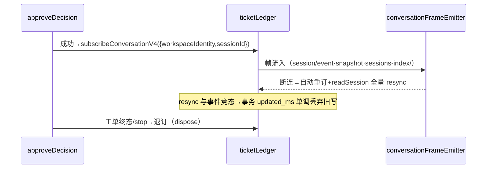

# 01 · P1 详设（PR-1A 服务核心 / PR-1B UI）

- 对应 master plan §2；所有签名对齐实读代码（`droraTaskServiceAdapter.ts:454-480/:1765-1815`、`droraAgentService.ts` 事件面、`snapshot.ts:519` usage）。

## 1. 数据契约

### 1.1 `mate.sqlite` 六表（字段级）

```sql
kv(key TEXT PRIMARY KEY, value TEXT NOT NULL, updated_ms INTEGER NOT NULL)
  -- 初始键: mode='observe'; allowlist=[本机用户 identity]; budget_max_active_per_workspace=1
trigger(id TEXT PRIMARY KEY,             -- 'T-'+createUuid()（对齐 createUuid 先例 drora-task-types.ts:27-42；仓库无 natsseq 先例，不自建）
        source_kind TEXT NOT NULL,       -- P1 恒 'local'
        simulated_strength TEXT NOT NULL,-- 'explicit'|'inferred'（P3 起由真实 Source 判定）
        identity TEXT NOT NULL, workspace_identity TEXT,
        text TEXT NOT NULL, at_ms INTEGER NOT NULL)
admission_decision(id INTEGER PRIMARY KEY AUTOINCREMENT,
        trigger_id TEXT NOT NULL REFERENCES trigger(id),
        strength TEXT NOT NULL, mode TEXT NOT NULL,
        outcome TEXT NOT NULL,           -- 'decision_card'|'would_accept'|'rejected'|'ignored'
        reason_code TEXT, decided_by TEXT NOT NULL,  -- 'gate'|'user'
        decided_ms INTEGER NOT NULL)
mandate(id TEXT PRIMARY KEY,             -- 'M-'+createUuid()
        ticket_id TEXT NOT NULL,
        scope TEXT NOT NULL,             -- JSON: {permissionTier:'build'|'guarded'|'yolo', writeDomain:'workspace'}
        state TEXT NOT NULL,             -- 'active'|'stopped'|'revoked'（三变更途径唯一枚举）
        created_cause TEXT NOT NULL DEFAULT 'accept',
        ended_ms INTEGER, end_reason TEXT)
ticket(id TEXT PRIMARY KEY, mandate_id TEXT NOT NULL REFERENCES mandate(id),
        brief TEXT NOT NULL,             -- verbatim 原文（E 改单=原文+追加段，原文段永不改写）
        target_workspace_identity TEXT NOT NULL,
        status TEXT NOT NULL,            -- 'dispatched'|'running'|'done'|'failed'
        incarnation_current TEXT NOT NULL,   -- JSON: {workspaceIdentity,sessionId,hostId?,remoteSessionId?,boundAtMs,cause:'dispatched'}
        incarnation_generations TEXT NOT NULL DEFAULT '[]',  -- P1 恒空，P2 启用；P4 预留 stale/queued 附加列（只加不破）
        usage_accum TEXT NOT NULL DEFAULT '{}',  -- {inputTokens,outputTokens,cacheReadTokens,cacheWriteTokens}（对齐 sessionUsageState.cumulative）
        output_summary TEXT,             -- 尾消息首行截断 120 字
        fail_reason TEXT, created_ms INTEGER NOT NULL, updated_ms INTEGER NOT NULL)
usage_log(id INTEGER PRIMARY KEY AUTOINCREMENT, ticket_id TEXT NOT NULL,
        turn_ref TEXT, input_tokens INTEGER NOT NULL, output_tokens INTEGER NOT NULL,
        cache_read_tokens INTEGER NOT NULL DEFAULT 0, cache_write_tokens INTEGER NOT NULL DEFAULT 0,
        at_ms INTEGER NOT NULL)
  -- 差值口径：cumulative 为会话累计值（snapshot.ts:195-212），usage_log 每行记（本次 cumulative − 上次已记累计），usage_accum=Σ差值
  -- 费用：sessionUsageState 无金额字段——P1 实耗=token-only，金额换算后置（spec §2.3"费用"部分 P4 评估）
```

P1 状态机简化说明（master plan §2 状态机四态中的 `awaiting_output` 并入 `done` 判定：turn ended(completed) 即 `done`+写 output_summary；turn failed 即 `failed`+fail_reason。工件核验归 **P4**，见 04 号 §3）。

### 1.2 `AssistantSnapshot`（onDidChange 推送形状）

zod schema 定义于 **host 侧**（`assistant-tickets/snapshot.ts`）且仅 host parse；UI 经 `services/src/index.ts` **type-only** re-export（:187-190 红线内，useModelCapabilities 同款先例），信任推送、不做二次运行时校验——归属随前置 commit 同步标注 spec §5。

```
{ version: 1, mode, allowlist: string[], budget: {maxActivePerWorkspace: 1},
  trust: {wouldAcceptCount, releaseCount},        // releaseCount=决策卡人工放行数（显式路径）；P1 双按钮均可积累
  triggers: Trigger[≤50 最新], decisions: Decision[≤50],
  tickets: TicketView[≤100]                        // TicketView= ticket 摘要: id/brief 首行/status/权限档/实耗(token)/output_summary|fail_reason/updatedAtMs
  updatedAtMs }
```

### 1.3 服务接口（`IAssistantTicketService`）

```ts
recordTrigger(input: {text: string; simulated: "explicit" | "inferred"; targetWorkspaceIdentity?: string}):
  Promise<{triggerId: string; outcome: "decision_card" | "would_accept"}>;   // off 模式→"ignored"
approveDecision(input: {decisionId: number; briefAppendix?: string; permissionTier?: "build" | "guarded"}):
  Promise<{ticketId: string; sessionId: string}>;   // yolo→错误码 mate.yolo.requiresHumanApproval（P1 恒拒）
stopMandate(input: {ticketId: string}): Promise<void>;
revokeMandate(input: {ticketId: string; reason: string}): Promise<void>;     // 仅校验失败路径调用（测试/内部）
setMode(mode: "off" | "observe" | "auto"): Promise<void>;                    // auto→mate.auto.locked（P1 恒拒）
setAllowlist(identities: string[]): Promise<void>;
getConfig(): Promise<MateConfig>;
onDidChange(listener: (snap: AssistantSnapshot) => void): { dispose(): void };
  // 返回 disposable 对象而非裸函数——ProxyChannel.toService 对 on* 属性返回 channel.listen 订阅语义
  //（proxy-channel.ts:126-133），照 IModelCapabilitiesService 先例；UI 端 unsubscribe=subscription.dispose()
```

### 1.4 配置归属（决策）

P1 配置全存 `mate.sqlite` kv 表，**不动 `AppSettings/validationAppSettings`**——`drora.mate.*` AppSettings 键（配额/默认模型等全局项）留 P4 启用时再进，避免本 PR 触碰设置链与 engineering 回归面。

## 2. 派发桥详设（真实通道签名对齐）

```ts
// createSession（对齐 droraTaskServiceAdapter.ts:1771-1807 v4Create 分支）
await agentService.sendConversationCommandV4({
  workspacePath,
  workspaceIdentity, // remoteSessionId 缺席=本地
  envelope: createHostCommandEnvelope({
    type: "createSession",
    sessionId: null,
    payload: {
      workspaceId: identity?.trim() || workspacePath,
      config: { provider, model, mode: permissionTier },
      // 权限档载体=config.mode（DroraSessionMode 枚举成员 build/guarded/yolo 即取值，adapter :1792 toDroraMode 通道）。
      // 注意：payload.permissionScope 是 z.literal("session") 唯一值（command.ts:54），不承载权限档差异——不得使用。
    },
  }),
});
// ack.result.sessionId → readSession 校验

// sendText（对齐 :454-480 主路径）
await agentService.sendConversationCommandV4({
  workspacePath,
  workspaceIdentity,
  envelope: createHostCommandEnvelope({
    type: "sendText",
    payload: { text: brief, heldQueueDisposition: "keepQueueAndSend" },
    sessionId,
    commandId: ticketId, // P1 单发限定：一工单恰一次投递，恒取 ticketId 即幂等
    clientId: "drora-mate",
  }),
});
assertV4CommandAckOk("sendText", ack, `ticket=${ticketId}`);
```

幂等依据：CLI 侧以 commandId 为 inputId 起 turn（adapter :454 注释原语义）——P1 单发场景下同 ticketId 重复投递由 host command queue 与 CLI inputId 对账天然去重；服务层另有 decisionId→ticketId 唯一索引兜底。**P2 起（follow-up 直投/换代重派）每次投递 commandId 需带投递序号（`ticketId-<seq>`），否则被幂等表判 duplicate 去重**——见 02 号 §3。

## 3. 事件流详设（ticketLedger）

**订阅生命周期**（方法真名标注：`subscribeConversationV4(params)`＝wire 名 `V4_METHODS.conversationSubscribe`，droraAgentService.ts:6922/:6977；host 进程内消费走 `onDynamicConversationFrame → getConversationFrameEmitter(...).event`，:7615-7617；sessions-index 订阅=`subscribeSessionsIndexV4` :7650 邻域。ticketLedger 与 droraAgentService 同进程，直接注入实例订阅）：



**事件→归账映射表**：

| 事件（topic/frame）                                                    | 来源                          | 归账动作                                                                                             |
| ---------------------------------------------------------------------- | ----------------------------- | ---------------------------------------------------------------------------------------------------- |
| turn started / turn ended(completed)                                   | conversation 帧 session/event | →`running` / →`done`+output_summary（尾 assistant 消息首行）                                         |
| turn ended(failed/cancelled)                                           | 同上                          | →`failed`+fail_reason（不自动重试）                                                                  |
| snapshot.usage conflation 变更（`snapshot.ts:519`，cumulative 累计值） | conversation 帧 snapshot      | usage_log 追加**差值行**（本次 cumulative−上次已记）+usage_accum 重算（P1 单代；换代不换账=P2 语义） |
| sessions-index 帧（`sessions-index/` topic 分流，:2795）               | 会话索引                      | 活性核对：goalStatus 与工单状态矛盾时以事件流为准、记 warn 日志（防漏帧，不反向改写）                |

## 4. 错误路径表

| 路径                                  | 处置                                                                                      |
| ------------------------------------- | ----------------------------------------------------------------------------------------- |
| createSession ACK 拒绝                | ticket 不创建（decision 记 `rejected`+reason）；不重试；用户可再触发新 trigger            |
| sendText ACK 拒绝                     | ticket=`failed`+reason；已建会话保留并标注孤儿（不自动删，诚实留痕）                      |
| 同 decision 二次放行                  | 幂等返回首次 ticketId                                                                     |
| setMode(auto) / approveDecision(yolo) | 拒绝错误码（mate.auto.locked / mate.yolo.requiresHumanApproval），UI 相应按钮禁用+tooltip |
| sqlite busy/迁移失败                  | busy_timeout 后仍失败→mate.store.busy / mate.store.migration；启动拒绝降级打开            |
| 订阅断连期间事件缺失                  | 重订后 resync 补齐；resync 与事件竞态→以事务 updated_ms 单调递增丢弃旧写                  |

## 5. UI 详设（PR-1B）

**组件树**（`ui/src/mate/`）：

```
MateSidePane（tab 容器，照 TeamSidePane 形态）
 ├ MatePaneHeader     过滤 pills（待决策/进行中/观察中/全部）+ 软预算指示（1/1 满载）
 ├ MateTrustBar       would-accept 数 · 人工放行数 · 进度条（P1 双按钮积累）
 ├ MateWorkspaceGroup 按目标 workspace 分组（组头=组内实耗合计）
 │   ├ MateDecisionCard  状态灯=destructive 级｜原文 verbatim 引用块｜预估（模型/tier）｜权限档徽标｜"P1 未隔离"徽标｜[Y 放行][N 忽略][E 追加说明后放行]
 │   ├ MateTicketRow     状态灯（running=warning/done=success/failed=destructive）｜T-id(mono)｜brief 首行｜实耗 mono｜updatedAt
 │   ├ MateReportCard    done：✅+output_summary+实耗+[打开会话]；failed：⚠+fail_reason+[打开会话]
 │   └ MateObserveRow    空心灯（foreground-subtlest）｜would-accept｜原文首行
 └ MateConfigSection  模式（observe 锁定，auto 禁用+达标 tooltip）｜allowlist 编辑（每行 identity）｜双测试按钮（点名/未指名）
```

**数据流（推模式，照 conversationProjectionStore 先例而非 offPeak 拉模式）**：`useAssistantTickets()` 用 `useSyncExternalStore(subscribe=service.onDidChange, getSnapshot=service 缓存快照)`；`mateStore`（zustand）只存 `{filter, selectedTicketId, expandedDecisionId}` 三个局部态——快照本体不复制进 store，避免第二份业务状态。

**view-model 纯函数**：`deriveMateViewModel(snap, filter) → {groups, counts, trust}`（零副作用，单测主战场）。

**i18n 键清单**（`mateMessages.ts`，zh/en 各 ~36 键）：`mate.title`（大副/Mate）、`mate.filter.decision|running|observe|all`、`mate.budget.full`、`mate.trust.title|wouldAccept|released|hint`、`mate.card.approve|ignore|edit|origin|estimate|tier.build|tier.guarded|p1.unisolated`、`mate.report.done|failed|openSession|cost`、`mate.observe.wouldAccept`、`mate.config.mode|mode.observe|mode.auto.locked|allowlist|trigger.explicit|trigger.inferred`、`mate.error.store.busy|migration|yolo|auto` 等。

**状态灯 token 映射**：待决策=destructive（仅灯）、运行=warning、观察=foreground-subtlest 空心、完成=success、失败=destructive；时间线 mate scope token P2 启用。

**键盘流**：P1 仅按钮（Side Pane 卡片内）；Y/N/E 键盘流随 P2 Surface A 对话卡交付（诚实简化，避免 P1 tab 内焦点管理复杂度）。

## 6. P1 验收场景（冒烟+浏览器验收对照）

1. 未指名触发 → MateObserveRow 出现 would-accept，trust.wouldAcceptCount+1，零执行。
2. 点名触发 → MateDecisionCard 出现；N 忽略→记 rejected；Y 放行→目标 workspace 真实新会话收到 brief（打开会话可见原文）→状态灯 running→done→MateReportCard 含实耗与 output_summary。
3. E 追加说明→brief=原文+追加段，放行后 sendText 内容含两段。
4. 同卡二次 Y→幂等不二派（会话列表仅一个新会话）。
5. auto/yolo 按钮→禁用+tooltip；断连重连后快照 resync 一致。
