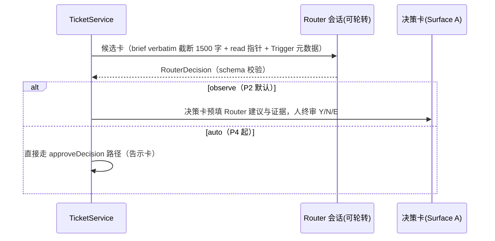

# 02 · P2 详设（Router / Mode B·C / 代际 / 写域 / assistantActivity / Surface A·C）

- 对应 master plan §3。S2-T0 Spike 结论为 (a) 结构化文本（保底）；若 (b) 成立，§1.3 工具面替换、其余不变。**spec §7 的 mate\_\* 工具白名单仅在 (b) 路线启用**——(a) 路线 Router 无自定义工具，只输出结构化文本。

## 1. Router（大副会话）

### 1.1 preset 与宿主

- 宿主：窗口 Local Host 内 **assistant 虚拟 workspace**（`workspaceIdentity="drora-mate"`；⚠️ `DroraAgentWorkspaceTarget.workspacePath` 为必填 string（droraAgentPluginParams.ts:9-14），虚拟 workspace 的 path 取值——候选：数据目录下 `mate-home/`——P2 开工首任务定案并回填本节）。会话经派发桥同一 v4 createSession 通道创建（01 号 §2 签名），`config` 注入 persona preset（persona 系统既有契约）。
- system prompt 契约（persona 资产承载）：只路由不执行；路由注 ≤30 词；输出必须命中决策 schema（见 1.2）；不读代码/日志原文（评估只依赖候选卡与读指针）。
- 无状态壳：轮转规则=每 N=10 张工单或会话上下文超阈值→归档旧会话、建新会话（同一 `mate-session-<seq>` 序列，台账浓缩上下文作新会话首条输入）；编排事实永不依赖会话记忆。

### 1.2 决策输出 schema（host 侧 zod 严格校验，`assistant-tickets/routerDecision.ts`）

```
RouterDecision = { dispatch: {targetWorkspaceIdentity, permissionTier, briefBase:'verbatim'|'verbatim+appendix', appendix?, budgetMaxTokens?}
                 | hold: {reason} | reject: {reason},
                 evidence: [{quote: 原文片段 ≤80 字}] }
```

校验失败（不命中 schema）→ 该候选降级 Tier3 决策卡问人（不重试模型、不猜测）。

### 1.3 候选卡循环时序



### 1.4 Surface A 落点

大副对话=assistant 虚拟 workspace 的会话本体（v4 会话流既有渲染）。状态条（mode/打扰配额/活动工单数）=该会话 header 扩展（SessionPane header 插槽）；决策卡/汇报卡=bottom dock 同位（`TeamApprovalDock` chrome 先例）内嵌对话流底部；"已等待 X"仅显示不超时。

## 2. Mode C（附着）与解析三层

- 附着通道：与 Mode A 同一 v4 sendText（目标=既有 sessionId），`heldQueueDisposition:"keepQueueAndSend"` 天然排队进 CommandInbox——busy 投递合法、保序由既有机制承担。
- Tier1：`incarnation_current` 直读投递；busy 排队合法。
- Tier2：harness 生成候选（目标 workspace 的 sessions-index 快照，硬过滤 busy/跨 identity/updatedAt>7d）→ Router 带证据选择（1.2 schema 扩展 `attach: {sessionId, evidence}`）→ **派发桥校验**（存在/归属 identity/非 busy 时可直接投）→ 写回绑定 `cause:'attached'`。绑定只存 TicketService，不注入任何会话上下文。
- Tier3：候选并列/低置信/用户原话含糊→决策卡 top-N+“开新会话”恒为选项→`cause:'user_picked'`。

## 3. 代际（incarnation）

- anchor=该 incarnation 最后一次成功 sendText 的 CLI inputId（=commandId）；重投前经 host command queue 对账校验锚仍可寻位。**commandId 规则升级**：P1"恒取 ticketId"仅单发成立；P2 起每次投递 commandId=`ticketId-<投递序号>`（kv 计数器），否则幂等表判 duplicate——anchor 即记录该带序 commandId。
- 状态流转：`incarnation_generations[]` 追加 `{sessionId, fromMs, toMs, cause: superseded|lost|user_picked|expired, note}`；换代事务=旧代归档+新代 Mode A 重派（brief=原文+台账浓缩段：历史 output_summary+usage 合计+**未确认增量标注**）+续用同一 worktree/分支。
- 触发源（仅三种，禁超时）：①锚校验失配（fork/rewind）②会话生命周期删除/归档事件 ③lease 失效超窗（远程）。
- 不变式：任一时刻最多一代 active（唯一索引保证）；换代不改写 usage_accum（按 ticketId 记账）。

## 4. 写域 W1/W2（W3=Mode C 附着不隔离，本阶段随 Mode C 交付）

（P1 的实际形态是 **W2 退化**：同 workspace 整域+软预算 1，无写域声明比对——非 W3。）

- W1：派发桥经 services git 服务 `git worktree add .drora/mate/<ticketId> -b mate/<ticketId>`；brief 注明工作目录；终态→`worktree remove`（分支保留）；失败清理动作写 ticket.fail_reason 附属日志。换代重派前检查该路径已检出则续用不重复 add。
- W2：非 git 根或用户关闭 W1→ticket.write_domain=paths[]（决策卡可编辑）→派发桥比对同 workspace 其他活动工单 write_domain，重叠→排队（budget 队列）或决策卡问人。
- W3：附着用户会话不隔离（用户自己的工作目录），仍检查与 W1/W2 活动工单冲突（随 §2 Mode C 交付）。
- 软预算=3：活动工单（dispatched/running）计数，超出→新 approve 进入 queued 状态+告知卡；释放即依 FIFO 派发（kv 记 cursor）。

## 5. Mode B（建队）

目标 workspace 建 lead 会话（v4 createSession）→ sendText 指示走 /team 流程起草（brief 含角色建议）→ 既有 staged→人批→spawnMembers 全链不动。工单状态归账追加**第三信号 teamActivity**（`sessions-index-team-activity.ts` 派生，订阅同 sessions-index 帧）；team 终态→ticket done。cause 枚举不引入（master plan §8.3）。

## 6. assistantActivity（host 侧挂载）

- 事实源=TicketService 快照；挂载点=host 任务行/会话索引 overlay（`windowHostControllerService.ts:128` teamActivity overlay 同位）：`sessionOverlay` 合成 `mate: {activeCount, pendingDecisions, updatedAtMs}`（有界、旧帧缺席合法）。
- 手机=controller 快照透传自动携带；`mate/session-line.ts` 消费同字段挂左侧行（TaskListItem/task-row 接缝）。
- 双链路同验用例：desktop continuous 实时变化 vs 手机 replayable 回放一致；重连 resync 后一致。
- 回退（风险表）：若 overlay 面不满足列表渲染需要→仅任务行 overlay 不进 sessions-index，spec §11.4 随之修。

## 7. Surface C 与 /mate

- MateSidePane 下钻二级：工单详情（返回按钮+四页签 时间线/汇报/证据/成本）。时间线=代际站（mate scope token：`--color-mate-trace` 等，不挪用 workflow 家族）；成本页=usage_log 按代分解。
- `/mate`：自定义命令机制=CLI `.drora/commands` 目录 markdown frontmatter（`apps/drora-cli/packages/adapters/src/commands/roots.ts`，**非** config.json commands 键）——P2 文档化默认片段直达 Surface A 会话/任务中心。（spec §1 原文"对应既有 /team"已修正：/team 是 UI 功能入口非 CLI 命令。）
