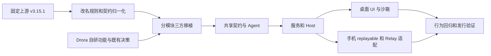

# ZCode v3.15.1 更新分析与 Drora 合并方案

分析日期：2026-10-13（Asia/Shanghai）。本报告保留实施前分析；后续实施见 [迁移策略](../../specs/upstream-v3.15.1-migration.md) 和 [合并记录](zcode-v3.15.1-merge.md)。

## 结论

建议把 v3.15.1 的产品代码按模块移植到 Drora，保留 Drora 的自研能力、品牌和发行机制；不直接整树 merge 或覆盖。

新版最明显的增量是 MCP Apps / Visualize 交互页面、辅助对话与引用、手机远控源码、动态工作流补洞与保存、Bot 群/话题协作，以及大规模测试设施。它并不是单纯的版本号和几个 bug 修复。

直接 Git 合并在临时裸仓库中产生 4,107 个冲突路径。针对源码、脚本和配置做主要改名规则归一化的三方文本比较，共检查 2,440 个上游变更文件，其中 114 个需要优先人工复核。两个统计范围不同，不能将它们描述成“归一化把全仓冲突从 4,107 降到 114”。

最需要守住的 Drora 决策：VaultView/知识检索和 Jev/ONNX 装配、S03 写入安全分级、自建 Relay/LAN 和 mobile-web、桌面宠物、Computer Use 还原实现与 Drora Helper 身份、GitHub 更新渠道及已经移除的上游强制升级门控。

## 1. 可复现基线与版本事实

| 对象 | 基线 |
|---|---|
| Drora 当前 HEAD | `82b02c1411a995a4c33080d5ea497b1477ae6ded`，短 SHA 为 `82b02c14` |
| 上游旧基线 | `29628c9acdb81b703bbd4080c207a0e7ce5e276e`，标签 `v3.14.3` |
| 上游新基线 | `aac4755666d09fdcd70272fcf063c077a639015f`，标签 `v3.15.1`，上游 `main` 同指该提交 |
| 上游更新时间 | 2026-10-10 18:57:01 +08:00，提交 `feat: update to v3.15.1` |
| 提交形态 | v3.14.3 → v3.15.1 只有一个公开的批量更新提交，无法从公开 Git 历史逐个还原内部功能提交 |
| Drora 分叉历史 | v3.14.3 提交是 Drora 的祖先；之后已有 413 个提交 |
| 工具版本 | 两侧均以 Node 24.14.0、pnpm 10.33.2 为固定版本 |

已通过 Git 读取上游源码。GitHub API 的 `releases/latest` 请求返回 403；GitHub HTML `/releases/latest` 本次返回 v3.14.3，而显式 v3.15.1 页面存在。显式 v3.15.1 的 expanded_assets 本次仅列出源码 zip/tar.gz，没有列出安装包或官方 `zcode.cjs`。因此下文功能结论来自源码及同提交文档，不冒充新版发行说明或安装包验证。

来源：

- [上游 v3.15.1](https://github.com/zai-org/ZCode/releases/tag/v3.15.1)
- [固定提交](https://github.com/zai-org/ZCode/commit/aac4755666d09fdcd70272fcf063c077a639015f)
- [v3.14.3…v3.15.1 对比](https://github.com/zai-org/ZCode/compare/v3.14.3...v3.15.1)
- Drora 改名与豁免规则：`specs/drora-rename.md`。

## 2. 更新规模与分析口径

Git 默认重命名检测统计：11,736 个文件变化，1,942,850 行新增、25,090 行删除。禁用重命名后为 11,737 条路径记录：9,836 新增、1,885 修改、16 删除。

包含 6,086 个命中 test/tests/e2e/fixtures 路径或 test/spec 文件名的变化、2,234 个 docs 路径变化。两类统计可能交叠，不可相加作为互斥分组。存在 vendor、图标、测试夹具、说明和开发工具的大量内容，新增行数不能直接当作产品功能规模。

另一个限定范围的比较只纳入 packages/apps 的 src 下 JS/TS 文本，以及 scripts/config/.github 的相关脚本和配置，共 2,440 文件；不包括完整测试树、所有清单/锁文件、二进制和全部发行资源。

三方比较输入：旧上游、最新上游、当前 Drora 的 Git 对象。对上游路径/内容应用主要品牌映射和已知外部地址、OAuth、header、CUA 豁免，再执行 `git merge-file` 文本预演。它是冲突筛查工具，尚未覆盖所有新增契约的改名决定；文本可合并不证明依赖闭包、状态机或权限语义兼容。

| 预演分类 | 文件数 | 实施含义 |
|---|---:|---|
| Drora 内容与归一化旧基线一致 | 1,469 | 可优先移植上游差分；仍需要依赖与行为验证 |
| 上游新增且 Drora 无对应路径 | 769 | 按模块导入，确认不是已有自研模块的第二份实现 |
| 两侧有变化，三方文本合并无冲突 | 76 | 必须复核接口、时序和政策，不能自动判通过 |
| 上游新增但 Drora 已有不同内容 | 26 | 主要包括已有还原的 Android/iOS 插件与远程连接文件 |
| 三方文本内容冲突 | 85 | 人工合并、补验收场景 |
| 上游修改而 Drora 路径缺失 | 3 | forceUpdateGuard/forceUpdatePrompt/manifestUpdateProvider；前两项已明确有意删除，第三项需按 Drora 更新渠道核对 |
| 已完全对齐 | 2 | 不重复移植 |
| 上游删除可直接处理或本地已无此文件 | 10 | 仍确认删除后调用链和构建入口 |

完整逐文件记录见 `mapped-comparison.json`；114 个优先人工复核项见 `manual-review.csv`。

## 3. 上游的主要产品增量

### 3.1 MCP Apps 与 Visualize / Gen UI

新增 `packages/shared/src/mcp-apps/`、`gen-ui/` 契约及 Agent、服务桥、Electron 沙箱和 UI 接线；新增 Visualize 0.1.0 官方插件种子。协议包括页面实例创建/关闭/校验、sampling、tool call、resources/read/list/subscribe 和页面工具注册/调用处理。

这是从模型输出进入交互页面的完整链路，不能只迁移渲染组件。实例归属、过期实例、CSP、可用权限、原生手势、文件大小和 MIME 检查都属于能力边界。上游 MIME 契约保留 8 MiB 资源总量限制，新增常见类型的精确白名单，不是放开所有 application/*。

Gen UI 新增状态、follow-up、tweak 和布局消息；同源生产方/消费方的 `zcode/*` 契约必须一起制定 Drora 映射。上游文档明确：未提供沙箱的 Web/手机保持 HTML 降级，本版本不能因此宣称手机获得桌面沙箱能力。

证据：`packages/shared/src/mcp-apps/contract.ts`、`hostContract.ts`、`resourceMime.ts`；`packages/shared/src/gen-ui/contract.ts`；`docs/specs/gen-ui-external-links.md`；`docs/mcp-apps-resource-mime-spec.md`；`apps/zcode-cli/packages/bootstrap/src/app/official-plugin-definitions.ts`。

### 3.2 会话、辅助对话、引用与投影

新增主时间线选区引用、Side Pane 辅助对话入口和 `/side`、`/btw` 交互；辅助 child 有独立 runtime/session 状态，renderer 管窗口内 parent/children/tab 关系。会话投影、后台工作和终态展示变化较大。

迁移要保留 Drora 的 VaultView、证据引用与自研 side pane 入口。普通会话投影、知识 citation/receipt 和辅助对话引用不能因名字相近而合成同一种事实。尤其注意主 composer 与 child composer 的会话归属、异步迟到返回和跨 Host 恢复。

证据：`docs/ui/conversation-selection-side-chat.md`；`packages/ui/src/lib/zcodeSessionProjection.ts`；`packages/ui/src/v4/SessionPane.tsx`；`packages/ui/src/app-shell/WorkspaceShellLayout.tsx`。

### 3.3 动态工作流

新增工作流保存/按 run 查询协议、hole/fill 补洞模型及相关运行投影；launch、amend、设置调整、journal 和 UI 接线有扩展。补洞实现按 run 串行，并在状态和脚本校验后由同一控制面放行等待分支。

权限流程拆分出 input preparation、response interpretation、request、input adjustments 等独立步骤。确认窗可以调整工具输入，这与 Drora S03 的最终输入复核和授权范围有直接交集。

证据：`docs/dynamic-workflow/launch.md`；`apps/zcode-cli/packages/bootstrap/src/app/dynamic-workflow-run-fill.ts`；`dynamic-workflow-run-holes.ts`；`apps/zcode-cli/packages/core/src/tool/executor/permission-input-adjustments.ts`。

### 3.4 手机远控

上游新增远控 manager/transport、共享 RPC/remote-control 契约和 Web 移动任务首页/时间线等源码。上游架构文档明确其当前方案使用外部 Relay，旧仓库内 Relay/control socket/HTTP bootstrap 已移除。

与 Drora 有意分歧：Drora 保有自建 Relay、内嵌 LAN、源码化 mobile-web、双传输等能力。不能移植上游启动与页面入口后直接删掉 Drora 的 `relay-server`、`relay-client` 和 `mobile-web`。需要先对 transport/attachment 和 owner 边界做兼容适配，再评估是否替换旧 UI。

共同应保留：桌面 continuous 与手机 replayable 分离、手机独立选中态、Host/workspace scope 复用、重连与 snapshot/gap 恢复；不为手机另起一份任务 runtime。

证据：`docs/web-remote-control/web-remote-control-architecture.md`；`packages/shared/src/web-remote-control.ts`；`web-remote-control-rpc-transport.ts`；`packages/desktop/src/main/webRemoteControlManager.ts`；Drora `specs/mobile-relay-server.md`、`specs/mobile-web-remote.md`。

### 3.5 Bot 与 Feishu/Lark 群协作

新增/扩展群和话题会话、材料引用/资源读取、反向 channel reply、流式卡片、终止后续接和授权撤销。当前文档以 `(botId, chatId, threadId)` 隔离话题，机器人消息不能执行控制命令或响应审批；其他机器人连续新消息存在最多 5 条的限制。

需迁移服务、共享 schema、Agent handler 和回调验证整条链路，并保留 Drora 现有 Bot Host 与写入政策。合成事件测试不证明真实 Feishu 租户已授权或会推送这些事件。

证据：`docs/bots-feishu-group-collaboration.md`；`docs/bots-topic-input-materials.md`；`packages/services/src/bots/botsService.ts`；`packages/shared/src/channel-mention.ts`；协议 `topic/resource/*`、`bot/channel/reply`。

### 3.6 插件、Computer Use 与请求安全接口

官方注册表中 node-repl-host 0.6.0 → 0.6.1，documents/pdf/presentations/spreadsheets 0.1.7 → 0.1.8，guide 0.2.0 → 0.3.0，computer-use 0.6.3 → 0.6.4。guide 的 required seed 从旧 workflow 文件改为配置指南，workflow 技能/命令已迁到其他位置，不能只更新版本号。

Drora 已有部分新增插件的还原源码，所以本次上游的“新增文件”会形成 add/add 冲突，尤其 Android 和 iOS 插件。

重要限制：上游 CUA 开源 `broker-server.js` 中安装根目录返回 null、候选 Helper 路径返回 []、broker MCP 注入原样返回，并仍有权限请求 unavailable 占位。Drora 的同文件已是还原实现公共出口。必须保留 Drora 的实现与 Helper 身份，仅对新公开契约逐项适配，不能把上游占位实现当作新版完整能力。

另一个限制：`request-security-edition/verification-policy.ts` 的 readRequestVerificationConfig 返回 null、requiresRequestVerification 返回 false、请求头返回空对象、interactionAvailable=false。源码包含运行时请求头接口变化，不代表开源版新增了可用的官方签名/验证链。

### 3.7 工程与测试

增加 Vitest/coverage、WDIO/Electron E2E 分片与报告、fixture admission/promote 和原生搜索/SEA 验证命令；新增 `apps/dev-docs`、`packages/e2e-report`、`share-ui`、`web-share`、`stream-animate` 等包。

先按功能导入相关测试与必要 runner，再决定开发文档、分享页面和演示工具的范围。保留 Drora 已有的 node:test/tsx 行为测试和官网。Vitest 配置必须用 run 模式、检查实际发现和执行的测试数；不能把新增清单的 `vitest tests` watch 命令直接当成 CI 命令。

新增 Vitest 与 wdio-electron-service 补丁需要连同对应依赖版本一起审查。合并依赖声明后用固定 pnpm 重新生成锁文件，保留 Drora 自有 ONNX 等依赖；禁止覆盖整个锁文件或全局格式化来掩盖冲突。

## 4. RPC 差分

旧上游方法表 74 项，新上游 99 项；当前 Drora 75 项。上游新增 25 项，当前 Drora 尚无这 25 个表项；旧方法的 wire 字符串本次未观察到改名。Drora 独有 `knowledge/search` 必须保留。

| 分组 | 新方法 |
|---|---|
| 子代理 | `subagents/readRuntimeConfig` |
| MCP | `mcp/readResource`；16 项 `mcp/ui*` 实例、sampling、tools、resources 方法 |
| 插件 | `plugins/listUiSurfaces` |
| 工作流 | `workflows/save`、`workflows/forRun` |
| Bot | `topic/resource/read`、`topic/resource/cancel`、`bot/channel/reply` |
| 诊断 | `process/networkCapture` |

详表见 `protocol-summary.json`。若完整保留上述新增方法和 Drora 自有方法，目标至少是 100 项，但这是清单验收数，不代替 handler/schema/client/Host 端到端验证。

## 5. 需要人工处理的关键交叉点

| 文件/区域 | 三方文本预演 | 合并要求 |
|---|---|---|
| `packages/services/src/node.ts` | 7 处冲突块 | 新 MCP/Bot 装配与 Vault/knowledge/Jev 依赖同时保留，避免重复 Service owner |
| `packages/desktop/src/host/index.ts` | 5 处冲突块 | 保留知识能力和窗口 scoped Host，按 workspaceIdentity 路由 |
| `packages/desktop/src/main/index.ts` | 3 处冲突块 | 保留宠物、自建/LAN Relay、Drora Helper 和更新渠道 |
| `WorkspaceShellLayout.tsx` | 4 处冲突块 | 辅助对话/远控布局与 VaultView/自研入口同时接入 |
| `packages/web/src/main.tsx` | 2 处冲突块 | 本地 Web、手机页和新远控入口分工，不创建第二份 runtime |
| core permission-flow / input-recheck / executor types | 内容冲突 | 按新的分步流程重新接入 S03；最终输入、hook 改写、inputAdjustments、持久授权均复核 |
| `remoteServiceAccess.ts` / shared accessor 与 exports | 内容冲突 | `obsidianVaultService` / `knowledge/search` 保留；上游没有这些入口不等于可删除 |
| plugin market / node-repl browser bridge | 内容冲突 | 保留市场别名桥、scope 与 metadata 契约归一化，生产消费方同步 |
| forceUpdate / autoUpdater | 删除和内容冲突 | 依现有 spec 保持强制升级门控删除；不能使 Drora 被上游升级覆盖 |

另外：`permission/service.ts`、`create-app.ts`、共享 protocol 主表在文本预演中可无冲突合并，但它们接入权限上下文、知识搜索端口和新增 handler 的语义仍须人工审核。这类“无冲突但容易回归”的文件不能从清单中省略。

## 6. 建议的合并实施顺序

本次未建立实现分支或变更工作区。实际实施时从当前 Drora 基线建立普通集成分支；保留原始上游提交对象与 SHA，在临时区域产生按 spec 转译的差分，再按模块移植。每批提交写明 Upstream-commit 与保留的 Drora 分歧，不重写已有历史、不整树覆盖。

| 批次 | 内容 | 进入下一批的门禁 |
|---|---|---|
| 0：证据与范围 | 固定两个 SHA、整理改名/豁免、保存源码与发行物 provenance、对齐新增 runner 和必要依赖 | 上游新模块与自研模块不重名复刻；许可/补丁/种子范围明确 |
| 1：共享契约 | MCP/Gen UI、引用、Bot、workflow、runtime headers schema 与 interface | 严格 schema 正反例通过；旧协议及 knowledge/search 保留；Host/client/Agent 表项一致 |
| 2：Agent/runtime | workflow hole/fill、权限流程拆分、输入调整、子代理配置、官方插件注册/种子 | CLI 构建与握手通过；S03/P0/P1/P2、plan/memory、hook 修改输入与持久授权回归通过 |
| 3：服务与 Host | Bot/topic/channel、会话投影、资源实例服务、服务桥与依赖注入 | 多 workspace/owner/cancel/重连测试通过；VaultView、Jev、ONNX 和现有数据库迁移回归通过 |
| 4：桌面 UI/沙箱 | MCP Apps、Visualize、引用和辅助对话、页面生命周期 | 真实 Electron 验证实例归属、CSP/手势/下载/采样；保留宠物和知识入口；Web fallback 明确 |
| 5：远控兼容 | 先统一共享传输与 attachment，再迁新版 task timeline/home/reconnect | 自建 Relay、LAN、官方外部 Relay分别测；continuous/replayable、gap、断线恢复和旧页面版本兼容通过 |
| 6：发行与收尾 | Guide/CUA 种子升级、Windows helper、native/SEA 打包、报告/文档、版本策略 | 各平台构建和真机权限验证；Drora 品牌/OAuth/更新源检查；禁止将上游 stub 覆盖还原实现 |

不能把批次当成“前面每批都能独立发布”：共享契约到生产消费方的中间状态要位于同一个集成过程；需要上线时，将未完成能力维持关闭或按完整端到端批次发布。避免出现新 schema 已生效而旧 host/Agent handler 未实现的组合。

### 应保留的关键边界

## 7. 必须保护的差异与发行策略

1. 保留 `specs/force-update-gate-removal.md` 的决定，forceUpdateGuard/Prompt 不复活；正常更新仍使用 Drora 渠道。
2. 保留 S03 写入分级：Bash/js/未自报 readOnly 的 MCP 按现有 P0 规则处理，plan 不能被 memory 免确认绕过；检查上游新 inputAdjustments 后的最终执行输入。
3. 保留 Vault/knowledge 协议、receipt/审批/账本、索引和向量表、Jev 配置热生效；升级前对用户数据副本跑迁移，不以删库作为通过条件。
4. 保留 Desktop continuous / mobile replayable 和唯一 CommandInbox admission；不引入第二份会话队列、任务 owner 或业务 snapshot owner。
5. `.zcode-plugin`、外部 CDN/API、`zcode://oauth/callback`、服务端注册 appId、`x-zcode-*` 等已有豁免继续执行。新 MCP/Gen UI 契约先确定归属再改名；同一契约键只定义一次，宿主与插件种子同步。
6. Computer Use 恢复代码、原始字节资产和 Drora Helper 身份按各自规则处理；上游公开源码占位不作为替换实现的依据。
7. 当前 Drora 根版本 3.14.3，CLI 内部/正式发行版本还有独立口径。建议先用 provenance 记录“基于上游 3.15.1”，等功能验收完成再确定 Drora 发布版本，不能仅拉新 tag 就将产品升级宣称为已完成。

## 8. 验证清单与尚未执行的工作

合并时的共同门禁：固定 pnpm 安装、`pnpm typecheck`、`pnpm lint`、架构检查、CLI 闭包构建与 `scripts/ci/cli-app-server-smoke.mjs`，以及每批真实行为测试。格式化与超大测试套件按批次使用，不全仓扫写。

重点回归：

- 写入安全：existing `apps/drora-cli/packages/core/test/*write-tier*`、memory-file-permission、permission-suggestions、hook 修改输入、上游新 input adjustment / permission response 流程。
- 知识与 Host：现有 `packages/services/test/knowledge*.test.ts`、Vault RPC、client accessor、引用和审批账本、旧 SQLite 数据副本迁移。
- MCP/Gen UI：新共享契约测试、Agent tests、上游 `packages/desktop/scripts/mcp-apps-host-e2e.mjs` 与 `gen-ui-e2e.mjs`；移植后运行，当前 Drora 尚无完整该能力。
- 远控：三种传输模式、owner/lease、快照/帧/重放、重连、后台状态、手机独立选中态以及桌面/手机同一任务同时在线。
- Bot：身份/群/话题隔离、重复/迟到回调、停机撤权、机器人控制命令拒绝、连续消息上限；真实租户联调另记。
- Computer Use/发行：restored smoke、原生 addon parity、Drora Helper 身份/权限首用、CLI/SEA/native-search；Windows/macOS 需要对应平台，Linux 通过不能代表它们通过。

仓库要求的 bundle 字面量族 parity 尚未执行：本次取得的是上游源码，GitHub v3.15.1 页面资产只列源码归档，没有取得官方同版本 `zcode.cjs`。实际同步还原模块前，取得可核验来源的新版发行 bundle，执行 `node scripts/check-bundle-key-parity.mjs <官方bundle> <Drora bundle>`，逐项定性差异。不能用源码拼接或重新构建 bundle 伪装官方发行真值，也不能把旧 0.16.9/3.14.3 对拍报告当作新版通过证据。

本次实际完成：Git/HTML 版本核实、固定 SHA 源码差分、协议方法表差分、临时裸仓库 raw merge-tree 预演、主要改名规则下的文件三方文本预演。所有合并预演都发生在 `/tmp/drora-upstream-analysis`，没有合并到 Drora。

当前 Drora 基线复核：`pnpm typecheck` 退出 0；`pnpm lint` 退出 0，389 个现有 warning、0 error。未运行新版 upstream 的安装、类型检查或 E2E，也未将预演结果编译成合并产物。

## 9. 附属证据

- `mapped-comparison.json`：2,440 文件分类及冲突块数。
- `manual-review.csv`：114 个优先人工复核路径。
- `protocol-summary.json`：两侧及旧基线方法表，新方法和 Drora 自有方法。
- `package-changes.json`：上游变更的工作区/种子清单。
- 过程脚本与 raw merge 日志在 `/tmp/drora-upstream-analysis/`；长期复核以固定 SHA 和上述分类数据为准。

实施范围建议：先完成批次 0–4 的桌面/CLI 主链，再在同一集成计划中完成批次 5 的 Drora 远控兼容；文档站、share UI 和 stream-animate 这类新增独立包可以独立排期。若目标是“全部 3.15.1 同步”，这几项必须有明确的后续批次与验收记录，不能默默排除。当前用户要求分析和方案，本次未执行实际合并。
