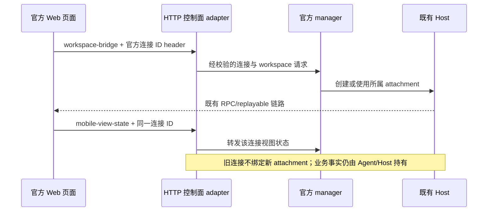

# ZCode v3.15.1 补齐合并方案

状态：已实施并完成本地验收；上游基线和公网/平台限制单列保留。日期：2026-10-13（Asia/Shanghai）。

实际结果与逐案例证据见 [补齐验收](zcode-v3.15.1-followup-result.md)。以下保留实施方案与完成标准。

目标：补齐完整性审查发现的构建与外部契约缺口，逐项定性 CLI 失败；官方实现持续对齐，自研能力通过已有模块和装配端口保留。

## 基线与范围

- 官方目标固定为 `aac4755666d09fdcd70272fcf063c077a639015f`（v3.15.1），旧基线为 `29628c9acdb81b703bbd4080c207a0e7ce5e276e`。
- 补齐起点为 Drora `4831598b`，沿用 `integrate/upstream-v3.15.1`。现有提交已经记录官方祖先；本轮采用可逐批审查、逐批回退的补齐提交，不重复整树覆盖、不重写历史。
- 依据：[完整性复核](zcode-v3.15.1-completeness-review.md)、[原迁移策略](../../specs/upstream-v3.15.1-migration.md)、[改名规则](../../specs/drora-rename.md)。
- 不变更远控状态所有者：Agent/runtime 与 CommandInbox 管业务，窗口 Host 管 scope/attachment，官方 manager 管连接，自建 Relay/LAN 管透明转发与部署。
- 强制升级启动门控保持移除；CUA 保留现有 0.6.3 复原 SDK/Helper，官方 0.6.4 占位包不覆盖它；GitHub 更新 feed、知识库、S03、宠物继续独立装配。

## 分批提交与完成条件

| 批次 | 内容                                   | 完成条件                                                                   |
| ---- | -------------------------------------- | -------------------------------------------------------------------------- |
| A    | Android/iOS 插件源码构建与 staging     | 无旧 dist 缓存仍可构建、stage、启动 MCP；开发与打包入口一致                |
| B    | 官方 CDN、Guide 图标与手机 HTTP header | 默认地址/请求符合固定上游；Drora 资源覆盖显式配置；HTTP 代理链得到独立验证 |
| C    | CLI 全套失败定性与必要修复             | 每个失败有证据和处理结果；合并回归为零；上游失败单列且不掩盖新失败         |
| D    | 与本次链路相关的既有问题               | Webhook 两端兼容、宠物只装配一次、下载 fallback 可执行                     |
| E    | 集成验收、差异台账与状态更新           | 全量路径差分可解释；根与 CLI 入口均覆盖；构建和功能证据可复核              |

A、B、C 的调查可以交错推进，提交保持独立。D 不混入官方源码同步提交；E 在受影响批次验证完成后执行。每批更新 spec/回归证据，再修改实现。

## A：插件构建依赖闭包

涉及 `pnpm-workspace.yaml`、对应锁文件、两个插件包、`scripts/build-desktop-agent-cli.mjs`、`packages/desktop/scripts/prepare-agent-node-bundle.mjs`，并核对 `scripts/prepare-prebuilds.mjs`。

1. 将 Android/iOS 两包纳入根 workspace 安装和构建；其他冻结插件的排除决定不连带修改。保留 `.zcode-plugin` 资产格式。
2. 桌面打包对齐官方 `requiresRuntime: true`、`requiredRuntimePaths: ["dist/mcp/server.js"]`、`runtimeBuildScript: "scripts/build-mcp.mjs"`。远端 prebuild 当前已采用此声明，只核对依赖和执行结果。
3. 开发 Agent 构建补齐两包 runtime，缺产物时在构建阶段失败。不能以复制陈旧 dist、临时手工编译或将产物提交进源码替代构建接入。
4. 复用各包官方 `build` 脚本。确实需要 Drora 特殊编排时放独立构建 adapter，仅由入口调用；不改 MCP 业务源码。构建清单暂按官方结构作最小修复，用行为检查防止三个入口遗漏同一插件，不再增加一份平行插件注册表。
5. 安装生成 lockfile 后，冻结安装模式复核；平台工具只在实际调用模拟器功能时需要，构建和 MCP 初始化不得依赖 Android SDK/Xcode。

验收：在临时复制的源码目录或隔离输出目录中构建，初始两个 dist 均不存在；执行真实 build 和 staging；从 staging 产物通过 MCP initialize/tools/list 校验公开工具集合和可执行入口。打包闭包不得依赖仓库开发 node_modules。已有用户文件/产物不删除，不创建 worktree。

必跑入口：两个包的 `build`/测试、`node scripts/build-desktop-agent-cli.mjs`、`pnpm --filter @drora/desktop prepare:agent-bundle`。后者验收全体插件，不能仅重复审查中的两包提取函数。

## B：外部契约与资源发布

### B1：CDN 来源

官方默认国内/海外发布根保持 `/zcode/electron/releases`，包括 `remoteCdn.ts` 的 fallback 和构建时已知官方域名的路径默认值。Guide 图标保持 `assets/zcode-guide/icon.png`；本地插件 ID 仍为 Drora canonical ID。

配置优先级沿用现有链路：显式 `DRORA_REMOTE_ASSET_CDN_BASE_URL` → 构建注入的 release roots → 官方默认有序 roots。国内/海外顺序、版本追加、组件摘要验证、缓存身份和版本不匹配拒绝保持官方行为。

`CDN_DOMAIN`/`OSS_PATH_PREFIX` 必须一起区分来源：已知官方域名可用官方路径默认值；自建域名缺少发布路径时在构建阶段说明缺项，不猜测官方桶内的 `/drora/`。显式配置的 Drora 路径原样保留，不新增环境变量。此规则先写入已有配置 spec，再实现。

Drora 自有远端制品使用现有 prebuild/manifest/component 流程，从当前源码生成并通过独立来源装配。**修复 URL 不等于验证可用制品。** 若官方远端 Agent 不含知识库/S03 等扩展，不能在 UI 仍展示这些能力时静默切换到官方 Agent；对各来源验证 CLI/Host 协议、版本、插件和所需能力。产物发布属于后续发行步骤，本方案不部署或上传制品。

验收覆盖：生产默认值、中文/UTC+8 顺序、显式 override、多域注入、不同路径前缀数量、版本不匹配、缺失组件、摘要不符和缓存隔离；本地 HTTP fixture 用真实生成的 Drora manifest/components 验证下载、部署和握手。公网 CDN 可用性单独记录；代理 CONNECT 拒绝不能写成 CDN 404，也不能写成下载成功。

### B2：手机 HTTP 控制面

将两个 HTTP 请求恢复为官方 `X-ZCode-Mobile-Connection-Id`。契约名在 shared 现有远控契约区域定义一次，Web 请求构造和适配器引用同一常量。官方 wire `zcode_type`、MCP `zcode/csp`、OAuth callback 等既有例外保持。

只修复命名及接口边界，不借机让 Relay 保存任务状态或复制 manager。HTTP fixture 应实际消费连接 ID，检查 workspace-bridge 与 mobile-view-state 正确关联，并覆盖失效连接、旧请求迟到和跨 workspace 路由。加浏览器请求验收，不能只检查常量字面量。



这是待实现的本地 HTTP 契约验收模型，不表示取得了官方 Relay 服务端实现或已通过官方云联调。raw Relay/LAN 与 HTTP 代理两条路径分别计结果。

## C：CLI 失败逐项闭环

先保存当前包级完整结果，不只处理上次抽查的 10 项。Core、Adapters、Bootstrap 使用各自 cwd 的 Vitest；CLI 使用 package.json 的 Node runner；Contracts、动态工作流、node-repl-host 和已纳入的插件按自身 runner 执行。根套件的 include 不替代 CLI 套件。

每个失败登记：suite/case、失败断言、涉及源码、固定上游 blob SHA、依赖/fixture 条件、当前复现、上游复现或差异证据、分类、修复/验证提交。分类规则：

| 分类                | 必需证据                                             | 处理                                                        |
| ------------------- | ---------------------------------------------------- | ----------------------------------------------------------- |
| 合并遗漏/Drora 回归 | 当前失败且相关官方改动丢失，或同条件上游通过         | 恢复官方实现；自研冲突经 adapter 修复；保留回归             |
| 上游源码或测试漂移  | 固定 SHA 清洁源码/测试在记录的依赖条件下复现同一失败 | 不为旧 DTO 增加生产兼容层；修正测试契约或单列可复核上游失败 |
| 有意功能差异        | 已批准 spec、完整生产消费链及行为证明                | 测试按有效产品规则验证，记录官方行为差别                    |
| 环境/fixture        | cwd、构建、依赖或样例不满足测试前提的直接证据        | 修复环境/fixture 后保留原断言重跑                           |
| 未定性              | 缺少上述证据                                         | 保持待处理，阻止“全部完整迁移”结论                          |

同源码 token 相同不能单独证明相同行为；依赖、配置、装配和 fixture 也需对齐。runner-options 的 45/53 失败仅证明其记录的上游源码在 Drora 当前依赖下失败，不是官方锁文件环境下全部 CLI 的结论。

清洁上游对照优先使用固定提交及官方锁定依赖，在独立临时目录执行；无法取得所需依赖时明确证据只适用于记录的当前依赖条件，不把它升级为官方发行结论。不得使用 Drora 的旧 DTO adapter 让所谓清洁上游对照通过。

执行入口示例（实际结果写入独立日志/JSON，逐条保留退出码）：

```sh
pnpm --filter @drora/contracts exec vitest run tests --maxWorkers 2
pnpm --filter @drora/core exec vitest run tests --maxWorkers 2
pnpm --filter @drora/adapters exec vitest run tests --maxWorkers 2
pnpm --filter @drora/bootstrap exec vitest run tests --maxWorkers 2
pnpm --filter @drora/cli test
pnpm --filter @drora/dynamic-workflow test
pnpm --filter @drora/dynamic-workflow-runtime test
pnpm --filter @drora/node-repl-host test
```

以上命令是包级验收骨架，不穷尽 workspace 测试；其余提供 test 脚本的 CLI 包和源码插件同样按当前 package.json 纳入结果清单。已有脚本含 Vitest watch 模式时，迁移检查使用明确的 `vitest run`。

重点处理本次 10 项：session-persistence 6 项、v4-cold-resume 3 项、v4-gateway 1 项。启动迁移通知、严格 modelSelection DTO、durable selection 恢复、stale ACK 分别按官方新契约核对。不得通过删用例、放宽断言、关闭校验或刷新架构 baseline 消除红项。

最终通过项与上游已知失败分别报告。接受已知上游失败时按 case 和证据建立有限清单；新增失败必须让检查失败，不按 suite 整体豁免。引入清单需要独立 spec，计划阶段不预先把任何未定性失败加入其中。

## D：既有问题的独立修复

这些问题在 `82b02c1` 已存在，提交说明明确其来源，不归因于本次官方更新。

| 问题                                       | 决定与边界                                                                                                                                                                                                      | 验收                                                                        |
| ------------------------------------------ | --------------------------------------------------------------------------------------------------------------------------------------------------------------------------------------------------------------- | --------------------------------------------------------------------------- |
| Webhook header 两端不一致                  | 新建 bot 使用官方 `x-zcode-bot-secret`；持久化的自定义出站 header 不全量重写。已知旧 Drora 入站别名通过独立 adapter 收敛为服务的唯一 `webhookSecret`；两个 header 值冲突拒绝，不放宽 secret 校验、不记录 secret | UI 配置→真实 HTTP→真实 Bot 服务验密；官方/旧别名/缺失/错误/冲突全部覆盖     |
| 重复 useDesktopPet                         | App 只装配一次，保留独立 hook 与既有 sessions-index owner                                                                                                                                                       | 任务变化一次发布；终态 timer 一份；卸载释放 listener/refcount；实际交互回归 |
| prebuild fetch fallback 缺 pipeline import | 按官方依赖补齐 import，保持 curl/fetch 两分支及摘要验证                                                                                                                                                         | curl 不存在时真实 stream 下载成功；中途断流/超时失败可观测并保留非零状态    |

Webhook alias adapter 归服务/HTTP 边界，官方 handler 只调用端口；不在 UI、Bot domain 和 HTTP 中各自维护一套 alias 状态。实现前更新 Bot spec 和架构依赖登记。

## E：完成门槛与交付

1. 重算固定上游全量路径差分，对文本差异、缺失/迁址路径和 mode 差异逐项给出“官方对齐/改名例外/自研扩展/有意移除”的依据。原始资产不经品牌归一化。对外 URL/header/string 单独核验，不能用品牌相等充当契约相等。
2. 知识库、S03、宠物、Relay/LAN、发行 feed、Helper 身份差异各有模块/接口和 spec 记录；原实现内仅保留必要装配调用。新增边读取 architecture context 后登记，禁止增加第二个 Agent/Host/CommandInbox。
   冻结还原资产仍遵守原始 bundle 证据规则，不能用新版公开占位源码推断冻结二进制行为或就地加入自研逻辑；没有原版真值时保持未验证状态。
3. 最终受影响产品树执行 `pnpm typecheck`、`pnpm lint`、全量架构检查、根 Vitest/Node 和完整 CLI 包级检查，分别保留 pass/fail/skip/unrun。把 CLI 检查接入明确的迁移/CI 入口，保留各 runner，不强行混入根 Vitest discovery。
4. 构建 CLI、server、Web/mobile、desktop renderer/Main/Host，以及实际 `prepare:agent-bundle`；执行 CLI 7 组 smoke、官方 transport/manager、HTTP 控制面、知识库和 S03 回归。必要的 Electron 交互复跑覆盖改动入口；已有未受影响 E2E 不为刷计数重复运行。
5. 远端部署验收区分“本地 fixture 已验证”“公网资源可访问”“实际 SSH/WSL/Docker 已验证”；原生平台、真机手机和账户限制继续单列。官方 3.15.1 bundle 未取得时，发行字面量 parity 保持未验证。
6. 发布/推送之前提供真实差异、测试和制品结果。补齐源码与本地验收、跨平台验收、制品发布各是独立状态，不自动互相代表。

A/B 的确认缺口、C 的失败定性和相关 D 链路问题已闭环；执行结果以补齐验收和原始报告为准。已知上游失败不被豁免为通过；全平台/官方服务/发行 bundle 的限制仍保留。

## 回退与后续同步

每批提交保持代码、spec 与测试相匹配；回退受影响批次并重跑其依赖批次，不使用 hard reset 覆盖用户改动。依赖/lockfile 与产物协议相关的改动一起回退；不回退用户数据、凭据或数据库。新增迁移若改变数据结构需先单独制定数据副本验收与兼容策略。

下次官方更新从 `aac4755` 起计算增量，保留目录映射和外部契约例外，按模块对照 Drora 扩展端口。文件迁入、测试通过和有意差异分别记录，避免再次用祖先关系或根套件全绿推断完整迁移。
