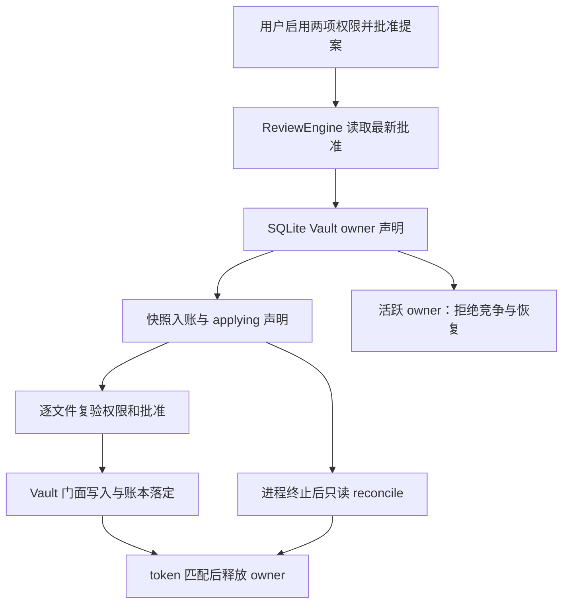

# S03 / L2 收尾复评 — 2026-10-17

## 委托与交付决定

维护者要求“不要人工验收，你自己 review”，并要求完成剩余缺口与明确交付预期。
本轮按该委托自行审查和实现，不再把“独立 reviewer 签字”当成无期限的执行依赖。
决定：候选版本允许桌面本地 L2 显式 opt-in；最终交付仍须本次同一提交的完整三平台检查通过。
这是委托自审结论，不是外部独立安全认证。PR 保持开放，不自动合并或部署。

## 实际审查发现与修复

1. 普通 MCP/js 即使没有可靠的内容权限契约，也能用 input.path/command 获得内容 allow。
   现在建议侧不生成此类授权、评估侧不匹配、持久化边界丢弃。P0 ask 复用 user-once，
   PreToolUse/PermissionRequest Hook 不代批，持久化应答被拒；保留 Host OfficialCua 与显式操作员例外。
2. Apply 使用捕获的旧 Proposal，异步等待期间修订/拒绝/过期/撤销后仍会写入。
   新测试在旧实现下四项均失败；修复后写前加载最新 ledger 并复验，四项通过。
3. 进程内 live Set 不能阻止另一真实进程 reconcile 活跃 writer。
   现在 Apply/Undo/reconcile 共享 SQLite 短事务 owner。仅同机器且 OS 明确报告 ESRCH 才接管，
   无超时强抢，随机 token 防迟到 release。活跃/杀进程的 apply/undo 四项真实子进程回归通过。
4. createOnly 的 check→rename 可能覆盖检查之后出现的目标。
   现在完整临时文件用 hard-link 独占发布，目标存在即失败，最终清理临时文件。

## 状态所有者与事件顺序

owner 表只保留运行所有权；Proposal/approval/operation/file 账本仍是唯一业务事实源。
SQLite 事务内不等待文件 IO；不会由 Renderer 建第二套 accepted 操作队列。

## 迁移、兼容与回退

SQLite migration v6 只新增 review_runtime_owners，不更改已有 proposal/snapshot/receipt 数据。
数据库打开时按现有短事务迁移。回退前停止全部 Host，避免旧版本绕过新 owner；新增表可保留。
仅共享同一 Profile/SQLite 的本机 Host 在协调范围内。异机、权限不明、PID 重用均保守拒绝接管。

## 验证范围

- 新增失败复现与修复：P0 策略/真 executor、最新批准、跨进程 owner 和原子 createOnly。
- 保留原有 SHA、source epoch、跨 Session Receipt、幂等、双 Host、SIGKILL、Undo/conflict 回归。
- 生产 node.ts 使用 reviewReleasePolicy，只授予 desktop-local 能力；用户开关依然默认关闭。
- G65/G67 真 Electron 直接验证生产装配的 opt-in Apply/Undo；失败不能通过跳过或关闭功能规避。
- 最终检查和运行链接统一写入 PR 当前描述，避免提交文档引用自身 SHA 的循环。

## 仍不作出的保证

不声称屏蔽外部进程写盘，也不将固定模型回放称为真实模型效果验证。
现有外部编辑器的最终指令级竞争属于乐观 SHA 校验局限；治理不能替代文件系统 sandbox。
