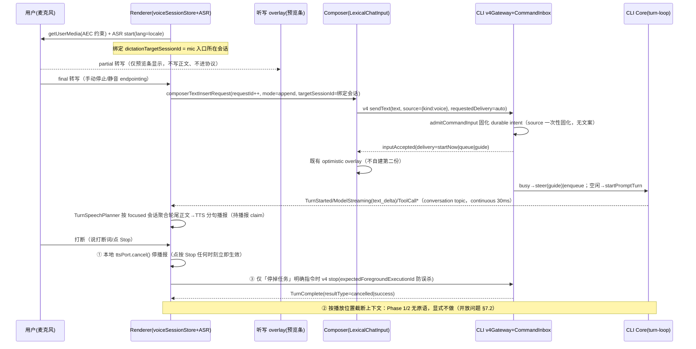
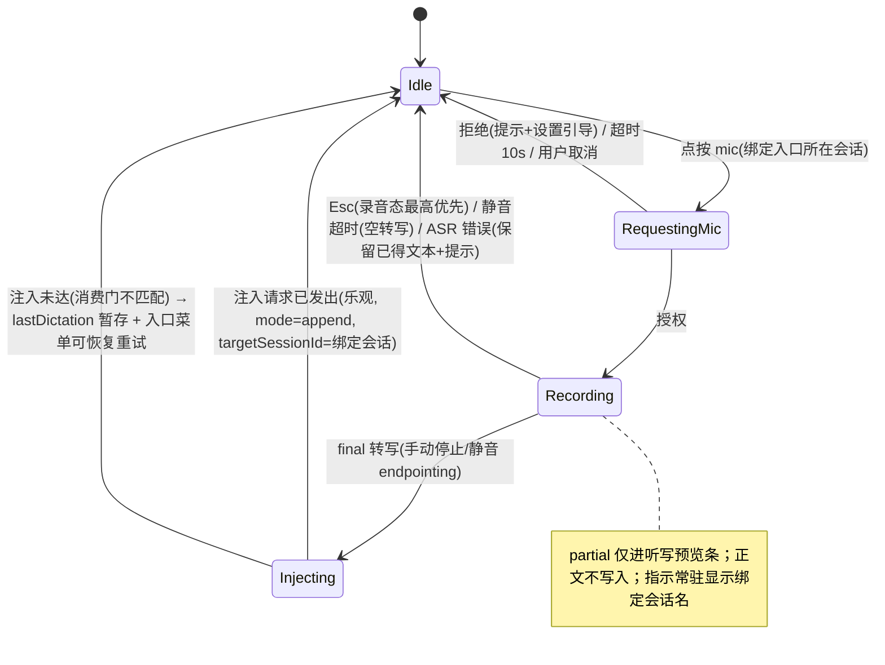
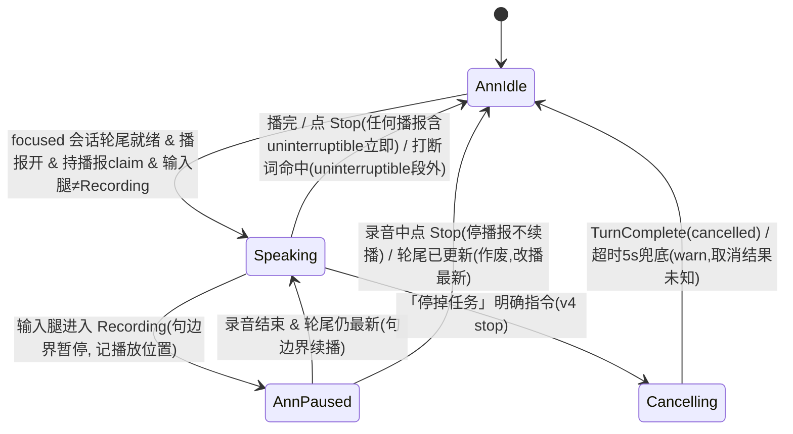

# Drora 语音 Agent 接入设计（评审修订稿）

- 日期：2026-10-22
- 状态：设计定稿候选（待 `specs/voice-agent-integration.md` 立项后冻结决策记录）
- 输入材料：语音 Agent 接入设计方案（架构/形态/协议/UX/路线图/风险六部分）+ 评审意见（wrongClaims / boundaryIssues / gaps / uxHoles）
- 证据约定：文中 `path:line` 均为 2026-10-22 在本仓检出源码上核验或勘察所得；未能复验、仅引用自前期勘察材料的行号在附录 B 单独列明。评审意见的逐条落实对照见附录 A。

---

## 执行摘要

**适合哪种形态？** 分三段走：Phase 1 采用「A+B」——端上 ASR 听写 + 轮尾 TTS 播报，全部落在 renderer，零协议音频；Phase 2 接入「D 的事件语义」——voice 输入来源契约、三层打断映射、任务运行中的语音 steer/queue；跳过 C（语音 peer 会话），不做 E（端到端 S2S 替换大脑）；Phase 3 的完整 D 音频旁路仅条件触发。理由：Drora 的 agent 执行循环已具备 D 所需的全部四项运行时预留（常驻会话 admission、guide drain 插话、三层取消、全量进度事件），C 的存在理由（绕过常驻化改造）在 Drora 不成立；传输侧 relay rpc-frame 信封缺省上限实为 **1MiB**（此前误写 16MiB，16MiB 属 v4 wire 层），实时音频流更容易打爆有界确认制的重放缓冲——修正数字后「现在不做实时音频」的论据更强而非更弱。

**怎么设计？** 自研全部放新模块：`packages/ui/src/voice/`（ASR/TTS 端口 + 适配器 + 播报规划器 + 入口 hook + composer 按钮）、`packages/shared/src/contracts/voice.ts`（契约常量单一出处）、`packages/shared/src/drora-protocol-v4/input-intent.ts` additive 扩展 `voiceInputSourceSchema`（CLI 先行合入，保证 `.strict()` 偏斜方向 CLI→renderer）；语音状态 store 按 AGENTS.md 约定落 `packages/ui/src/store/voiceSessionStore.ts`（照 `composerAttachmentUploadStore` 先例，不搞 feature-colocation 豁免）。语音=文本同路走 CommandInbox 串行 admission，无快速通道；Electron main 唯一改动是为主窗口 session 登记 mic 权限 handler；CLI 不承载任何用户可见文案（「来自语音」由 renderer 按 `intent.source` 投译）。听写采用「partial 只进预览条、final 才落正文（新增 append 注入语义）、绑定按下 mic 时的会话」的写入规则，从构造上消除覆盖人工编辑与插错会话两类事故面。

**用户体验怎样？** 点按麦克风说话（不做 always-listening）：转写实时显示在听写预览条，句子说完落入 composer 正文，由用户手动发送（防误发，同时让口述内容在发送前经人工审阅）；agent 回答可选轮尾语音播报（默认关），点 Stop 任何时刻立即停止播报（不取消任务），说「停掉任务」这类明确指令才真正取消；权限确认仍必须点按卡片（语音只播报内容并自动 snooze 倒计时防错过）。录音与播报互斥：开口说话自动在句边界暂停播报，说完从断句处续播。桌面 Chrome/Edge 与手机 Chrome Android 可用；iOS Safari 语音 Phase 1 缺席。隐私三条披露进设置面：ASR 引擎数据去向、口述文本与键盘输入同等持久化可导出、麦克风仅点按后开启且录音中持续可见。

---

## 1 结论先行

### 1.1 决策总表

| 决策项 | 结论 | 关键依据 |
|---|---|---|
| Phase 1 形态 | **A+B**：端上 ASR 听写 + 轮尾 TTS 播报，全部 renderer 侧，零协议音频 | 贴合勘察结论「渲染层零语音链路但接缝齐全」；成本极低，是行业验证的 80 分基线 |
| Phase 2 形态 | **D 的事件语义**：voice 来源契约、三层打断映射、任务运行中语音 steer/queue | 四项运行时预留已具备（见 §2.2），只缺契约与 UI |
| C（语音 peer 会话） | **跳过** | Drora 无需 C 所要绕开的常驻化改造；旁路会新开第二条输入面，与「turn 循环内 guide drain 是唯一内联插话机制」冲突 |
| E（端到端 S2S） | **不做** | 干净条件语音通道仅保留文本能力 36-60%；工具生态/权限/owner/lease/审计全在文本侧；上游对齐约束下属重依赖决策 |
| Phase 3（完整 D 音频旁路） | **条件触发** | 取决于「用户要在 agent 跑工具时说话」假设的 Phase 2 验证；实现照 `remoteMediaPreviewProxy.ts` lease+TTL+并发上限先例 |
| 音频帧通道 / binaryFrames / clientMode | **均不新增** | relay rpc-frame 信封缺省 1MiB、高水位 1MiB、重放缓冲 8MiB/45s，全为有界确认制可回放设计；`.strict()` 握手会整条拒收老 Host 未知 clientMode |
| always-listening 后台监听 | **不做** | 隐私红线；麦克风仅显式点按后开启 |
| 语音自动提交 / 权限语音 allow | **Phase 1 均不做** | 防误发、防噪声误授权；留待 Phase 2 产品决策 |

### 1.2 明确不做清单（Phase 1/2）

1. 无音频帧通道、无 WebRTC/实时音频栈（Phase 3 条件另议，音频不过 relay/v4 wire）。
2. 不启用 binaryFrames 能力位（两处 hello 硬编码 false、无物理载体，启用即空承诺）。
3. 不新增 clientMode。
4. 无 always-listening、无后台监听。
5. 无语音自动提交：final 转写必经 composer 人工发送。
6. 无权限语音 allow：语音对权限请求至多 decline/cancel（Phase 2 且待决策），allow 必须点按。
7. 无三层打断之第②层（按播放位置截断上下文）：CLI 无现成原语，Phase 1/2 显式不做（开放问题，见 §7.2）。
8. CLI 不承载 UI 语义：durable intent 只固化 `source={kind:voice}` 数据事实，用户可见文案全部在 renderer i18n。
9. 自研代码不进还原目录、不内联进 `ConversationComposer`（2900+ 行收口文件）、不进 CLI runtime。

---

## 2 形态选型与理由

对照调研报告 §7.4 五种接入模式（A 听写 overlay / B TTS 旁路播报 / C 语音 peer 会话 / D 实时语音网关+文本大脑 / E 端到端语音模型替换大脑），结论：**Phase 1 = A+B，Phase 2 = D 的事件语义接线，Phase 3 = 完整 D 的音频旁路（条件触发），跳过 C，不做 E。**

### 2.1 为什么是这条路线

调研报告 §7.5.2 的通用建议「D 是终态、C 是务实起步」，其前提在 Drora 不成立。§7.3 的关键判断是：接入已有文本 agent 的真实工作量不在音频管线，而在把 agent 执行循环改造成「可被 tool_call 驱动的常驻会话服务」——这是唯一需要提前协议预留的部分。逐项核对勘察结果，Drora 已全部具备这四样预留：

1. **常驻会话**：CommandInbox 串行 admission + per-session FIFO + session resident pool；
2. **运行中指令注入**：turn-loop 的 guide drain 与 steer/queue 路由（turn-loop.ts:57-72 是唯一内联插话机制）；
3. **取消**：foreground controller → turnAbortScope → call-runner AbortSignal.any 三层贯通 + stop 带 expectedForegroundExecutionId 防误杀；
4. **进度事件**：SessionEventType 全集经 conversation topic 按 30ms/150ms profile 分发。

C 模式（MCP/工具旁路会话）的存在理由是绕过常驻化改造，Drora 无此改造要做——旁路反而新开第二条输入面，与既有插话机制冲突，且整段转写的 MCP 往返延迟与 admission 幂等（同 commandId 幂等、settled LRU 512/session）打架。

### 2.2 为什么现在不做实时音频（传输侧现实，含评审修正）

> **评审修正（wrongClaims #1）**：设计方案原文称「relay rpc-frame（16MiB envelope、1MiB 高水位、8MiB/45s 确认制重放缓冲）」，其中「16MiB envelope」层属错挂。本轮已在源码核验修正：
> - relay rpc-frame 的信封上限是 `maxEnvelopeBytes`，**缺省 = `MAX_PHYSICAL_FRAME_BYTES = 1024*1024`，即 1MiB**（`packages/relay-client/src/clock.ts:7`、`packages/relay-client/src/rpcFrameChannel.ts:71`，:123 的 envelopeTooLarge 判定即用它；全仓无任何生产方 override）；
> - **16MiB 实际是 v4 wire 层常量 `logicalFrameAssemblyMaxBytes`**（`packages/shared/src/drora-protocol-v4/core.ts:67`），与同句引用的「wire 分片层」同族；
> - 其余数字属实：高水位 `RELAY_SATURATION_HIGH_WATER_MARK_BYTES = 1MiB`（`packages/shared/src/relay-wire/constants.ts:9`）、重放缓冲 `RELAY_REPLAY_BUFFER_MAX_BYTES = 8MiB` / `RELAY_REPLAY_BUFFER_GRACE_MS = 45s`（同文件 :13/:15）。
>
> 该修正**不削弱反而加强**「实时音频会打爆缓冲」的结论：信封上限实为 1MiB 而非 16MiB。持续音频流（每秒数十帧 × 数 KB～数十 KB）会在秒级写满 1MiB 信封与高水位，随后写满 8MiB 重放缓冲触发 `RELAY_REPLAY_DEGRADED_BUFFER_EXCEEDED`，把文本控制面一起拖垮。

同时全仓零 WebRTC/实时音频栈（勘察 grep 确认），binaryFrames 能力位两处 hello 硬编码 false、无物理载体，启用即空承诺。故「预留」动作收敛为：Phase 2 的 voice source 契约 + spec 中记录调研 §7.3 事件集到现有 SessionEventType 的映射表——四项预留 Drora 均已存在，无需新协议面。

### 2.3 为什么不选 A 或 B 单独、不做 E

- **A 单独**只解决输入效率（调研 §7.1 以 Claude Code /voice 解剖的五瓶颈：只进不出、无打断、无轮次感知）；**B 单独**只出声不进声。A+B 是「听得进 + 说得出」的行业验证基线，成本极低且完全落在 renderer。
- **E**：调研 §7.5.1 + τ-Voice 定量数据——干净条件语音通道仅保留文本能力的 36-60%；Drora 核心价值（工具生态、权限体系、owner/lease、审计）全在文本侧。S2S 替换大脑等于放弃产品核心换对话体验天花板，且在 AGENTS.md 上游对齐约束下属重依赖决策，无对应需求。

### 2.4 Phase 3 为什么条件触发

完整 D（边说边听全双工）是否被需要，取决于「用户要不要在 agent 跑工具时说话」这一核心假设。Phase 1/2 已用文本 steer/queue 承载该场景；只有假设被验证后才立项音频旁路，且照 MediaPreview 旁路先例（`packages/desktop/src/host/remoteMediaPreviewProxy.ts`，lease token + TTL + 并发上限，Host 内 sidecar 是本仓被接受的模式）实现，音频不进 relay/v4 wire。

---

## 3 分层架构设计

原则：自研全部放新模块，经 hooks/props/既有通道接入；不进还原目录、不内联展开进 ConversationComposer、不进 CLI runtime（CLI 不做 UI 语义）。已核验的接缝：

| 接缝 | 位置 | 本轮核验 |
|---|---|---|
| 听写逻辑先例（复用逻辑、重写 UI） | `packages/ui/src/components/ai-elements/speech-input.tsx`（Web Speech API + MediaRecorder fallback，无消费方） | ✅ 存在；:90 `lang` 缺省 `"en-US"` 硬编码；:151-153 `handleError` 静默关闭（本设计修复该行为，见 §5.1） |
| 输入来源契约扩展点 | `packages/shared/src/drora-protocol-v4/input-intent.ts:38-47`（discriminatedUnion 现仅 pluginUi/genUi，`.strict()`） | ✅ |
| 定向注入消费门 | `packages/ui/src/store/droraSessionStoreTypes.ts:127-139`（`ComposerTextInsertRequest.targetSessionId`，注释明示「主/辅 pane 可同时 focused，按会话定向保证单一消费者」） | ✅；:131 现仅 `mode: "replace" \| "prepend-if-missing"`，听写需 additive 扩展 `append`（§3.1） |
| composer 按钮插槽 | `ChatPromptEditor.tsx` leadingActions/betweenCancelAndSubmitAction 插槽（:65/:119/:423/:450） | 引用前期勘察，未复验行号 |
| 入口 hook 三段式先例 | `packages/ui/src/hooks/useCuaComposerEntry.ts`（:35/:50/:63 `isWebRemoteControl`、:70 `hiddenBySettings !== false` 默认隐藏） | ✅ |
| v4 方法注册 | `packages/shared/src/drora-protocol-v4/transport.ts:337` `export const V4_METHODS` | ✅（Phase 1/2 无新增项） |
| 轮尾文本聚合同源先例 | `packages/ui/src/v4/assistantPreviewCards.ts:9-34`（`assistantTextRows` 聚合轮尾文本，与 `ConversationRowView.tsx:280` `assistantCopyText` 一致） | ✅ |
| 跨窗口 claim 先例 | `packages/desktop/src/main/broadcastHub.ts:24` `BROADCAST_CLAIM_RESERVATION_TTL_MS = 5_000` | ✅ |
| Host 内旁路先例 | `packages/desktop/src/host/remoteMediaPreviewProxy.ts`（lease+TTL+并发上限） | ✅ 存在 |
| 契约常量先例 | `packages/shared/src/contracts/desktopPet.ts` | ✅ 存在 |
| 权限自动处置先例 | `packages/ui/src/hooks/useTaskInteractionAutoResolutionSnooze.ts`、`packages/ui/src/v4/V4InteractionDialogs.tsx` | ✅ 存在 |

### 3.1 模块划分

1. **`packages/ui/src/voice/`（renderer 语音模块，Phase 1 主体）**
   - `voiceAsrPort.ts`：ASR 端口 `start(lang, hints)/stop(): Promise<final>/onPartial(cb)`；实现 `WebSpeechAsrAdapter`（复用 speech-input.tsx 的 SpeechRecognition 逻辑，UI 重写）与（Phase 2）`RemoteAsrAdapter`（MediaRecorder blob → 云 provider，经 services 注册）。`getUserMedia` 显式约束 `echoCancellation: true, noiseSuppression: true, autoGainControl: true`（全仓 grep 现为零使用，此为首批；回声论证见 §5.3）。
   - `voiceTtsPort.ts` + `SpeechSynthesisTtsAdapter`：TTS 端口 `speak/cancel/onBoundary`，默认 Chromium 内建 `speechSynthesis`（grep 确认全仓零使用，绿地；OS 音色，零新依赖）；云 TTS 预留同端口替换。
   - `turnSpeechPlanner.ts`：播报规划器。只作 conversation 投影的**消费者**：轮尾正文取 ConversationTurnGroup 聚合同源（`assistantTextRows`，与 assistantCopyText/复制文本一致，避免读到分段碎片），按句边界切分喂 TTS；不建第二事件流、不建第二状态源。
   - `lib/voiceComposerEntryState.ts` + `useVoiceComposerEntry.ts`：照 useCuaComposerEntry 三段式（汇聚 platform/services/settings + 纯函数判定 + 权限门控懒查询）。平台判定复用 `isWebRemoteControl` 检测思路但语义不同：CUA 禁手机是因操作桌面机器，手机 mic 是手机自身硬件，手机远控听写合法（§5.2）。
   - `V4ComposerVoiceEntry.tsx` + 听写 overlay：mic 按钮进 leadingActionsNode（模式切换旁、V4ComposerCuaEntry 旁），录音中态替换为波形/停止；ChatPromptEditor 是纯 props 壳，语音态经 props 注入保持壳的纯度。ai-elements 只复用逻辑不复用样式（speech-input.tsx 的裸色 border、text-white、animate-ping 违反 DESIGN.md token 规则、硬编码 en-US 违反 i18n，前期勘察 :289/:303/:90）。
   - **注入语义扩展（新增）**：`ComposerTextInsertRequest.mode` 增 `"append"`（光标处追加 + 智能分隔符）。这是 **UI 包内部 additive 枚举扩展**（非 wire 协议），需同步 SessionPane 消费门匹配函数；生产方 Phase 1 仅语音。
2. **`packages/ui/src/store/voiceSessionStore.ts`（评审修订落位）**
   - 新 feature Zustand store，持有：输入腿（micPermission/recording/recognizing/dictationTargetSessionId/lastDictation 暂存）与播报腿（ttsSpeaking/annPaused/playbackPosition/announcementClaim 状态）。
   - **音频 buffer 禁入**；不进 droraSessionStore 桶（workspace 桶无删除路径；TaskUiState 语义被注释钉死为人工介入面）。
   - **落位依据**：AGENTS.md 明文「Zustand 状态位于 `packages/ui/src/store/`」，且方案自称的先例 `composerAttachmentUploadStore.ts` 实际就在 store/ 目录（本轮核验确认）。故**不采用 feature-colocation 豁免**，store 落 store/，`voice/` 目录经包内 import 引用——字面遵守约定，无需在 spec 记录豁免理由。
3. **`packages/shared/src/contracts/voice.ts`**：契约常量单一出处（settings 持久化键、广播频道名、storage 键前缀），照 `desktopPet.ts` 先例；改任何一侧前全链 grep 生产/消费（AGENTS.md）。
4. **设置分节**：新 SettingsSectionId `voice`（settingsNavigation.ts 注册表 + SettingsPage.tsx 引入，行号引自前期勘察），照 ComputerUseSection「能力+权限引导+设置项」先例；权限引导走 IPlatformService optional 方法（照 openCuaPermissionOnboarding）。设置面承载 §5.5 的三条隐私披露。
5. **Electron main 唯一改动**：为 app 主窗口 session 显式登记 media（microphone）权限处理器——主窗口现无 handler（仅 embeddedBrowser/pluginSandbox 两处，前期勘察）；照 embeddedBrowserPermissionPolicy 模式新增。Main 不承载语音业务状态（权限批准是原生操作，属 Main 职责）。
6. **CLI（Phase 2）**：仅 input-intent schema additive + admission 固化（source 数据事实，**无任何文案**）+ source 数据随既有投影面下发；无语音专用运行时。

### 3.2 状态所有者（单一所有者，无第二写路径）

| 事实 | 所有者 | 说明 |
|---|---|---|
| partial/final 转写、录音态、绑定会话 | renderer `voiceSessionStore`（store/ 目录） | 局部事实，不进协议；partial 亦不进 composer 正文（§5.1） |
| composer 正文 | Composer（唯一写入 = composerTextInsertRequest 通道，含 targetSessionId 消费门） | 语音生产方不绕过 requestId 版本号；转写文本自动随既有草稿机制持久化 |
| 会话事实（admission/queue/busy） | CLI CommandInbox | 语音=文本同路，无快速通道 |
| busy 权威 | snapshot.control.canStop | 播报门禁复用，不另设 busy 判定（useCuaComposerEntry.ts:36 先例，前期勘察） |
| 偏好（TTS 开关/音色/语速、听写语言/引擎、隐私披露确认） | 全局 store（跨窗口广播，sourceWindowId 防回环）+ settings | 照 isTaskNotificationSoundPreferenceEnabled 先例 |
| 播放位置/播报中/播报 claim 持有 | renderer `voiceSessionStore` | 纯 UI 态，不进 CLI 账本；跨窗口仲裁见 §3.6 |

### 3.3 事件顺序（一次语音轮次）

### 3.4 幂等与并发边界

- ASR final 提交重试**复用同一 commandId**（CommandInbox key gate 幂等 + settled LRU 512/session）；partial 不逐条过 admission（每条都是独立 commandId 会撑爆 FIFO 与 LRU）——partial 本就只进预览条、不上协议（§5.1），该边界进一步收窄。
- 打断≠取消显式建模：停播报=renderer 本地行为；任务取消=既有 stop 命令（guard.stopTargetChanged 防误杀新轮；`session-flow.ts:346` 核验：命中即 `throw new V4CommandNoopError("guard.stopTargetChanged")`，无 ACK 回 renderer——播报腿 Cancelling 态因此必须设超时兜底，见 §5.4）。
- TTS 播报是纯消费端渲染：重连/重放不自动重播；播放失败吞异常但必落 warn 日志（§3.7），照 taskNotificationSound「开关收口+吞 autoplay 异常」先例（前期勘察 taskNotificationSound.ts:19-42）。
- 麦克风互斥：Phase 1 单 active 语音端产品约定 + 窗口内互斥；跨窗口强互斥如需走 BroadcastHub claim（TTL 5s 先例已核验），Phase 2 验证后决定。

### 3.5 会话绑定与播报跟随（评审 gap #1 落实）

`voiceSessionStore` 是全局单例，而 `ComposerTextInsertRequest` 的 `targetSessionId` 消费门明示「主/辅 pane 可同时 focused，按会话定向保证单一消费者」。因此：

- **听写绑定**：`dictationTargetSessionId` = mic 按钮所在 composer 的会话 id（主/辅 pane 各有各的 mic 入口，天然互不串扰），按下即捕获，录音期间不变。final 经 `composerTextInsertRequest(targetSessionId=绑定会话)` 定向注入——消费门保证单一消费者，**不存在插错会话的路径**。录音中切换 focused 会话：不改绑定，录音指示常驻显示绑定会话名；此时 Esc 停止录音（键位仲裁见 §5.1）。
- **播报跟随**：播报只跟随当前 focused 会话的轮尾正文。非 focused 会话的 TurnComplete 不自动播报（文字 + 未读徽标走既有面）。focused 切换时正在播旧会话内容 → 立即停播；新 focused 会话若有就绪轮尾则从 Idle 起播。多会话并行 TurnComplete：只播 focused 那个，不排队（避免多轮播报连放；文字始终可读）。

### 3.6 播报仲裁：单播报者（评审 gap #2 落实）

「播放位置/播报中=renderer 本地态」+ 偏好跨窗口广播，意味着不仲裁时桌面多窗口同 workspace 会叠音。设计：

- **同端（桌面多窗口）**：Phase 1b 引入「播报者 claim」——照 `broadcastHub.ts:24` 的 `BROADCAST_CLAIM_RESERVATION_TTL_MS = 5_000` 先例，播报期间持 claim 并续约，未持有者静默不播（UI 不出「其他窗口播报中」指示，Phase 1 从简）。mic 的跨窗口互斥与播报 claim 复用同一机制。
- **跨端（桌面+手机）**：不做强仲裁。手机播报为手动触发的本地 TTS（§5.2），桌面播报默认关，两端同时出声的概率被「默认关 + 手动触发」压到产品可接受；跨端仲裁列开放问题（§7.2）。

### 3.7 日志与诊断映射（评审 gap #9 落实）

语音模块是 renderer 模块，按 AGENTS.md 日志规则走 `packages/ui/src/logger.ts`，scope 划分与级别：

| scope | debug（生产不落盘） | info | warn | error |
|---|---|---|---|---|
| `voice.asr` | partial 事件、endpointing 触发（**只记事件类型与文本长度，不记转写原文**） | 适配器选择结果、引擎可用性探测 | onerror 错误码（network/audio-capture/not-allowed）、非静音超时的 onend | 适配器创建失败致入口不可用 |
| `voice.tts` | 句边界 boundary 事件 | 首次播报启动（引擎名+语言） | 播放失败（吞异常但落 warn + reason）、claim 竞争失败、Cancelling 超时兜底 | — |
| `voice.entry` | 门控判定中间值 | 权限授予/拒绝结果、设置变更生效 | 权限拒绝后的再次尝试 | — |

不落音频数据、不落转写原文到日志（隐私边界，与 §5.5 披露一致）。「播放失败吞异常但可诊断」由此落地为：catch 后 `logger.warn('voice.tts', ...)`，不中断 UI。

---

## 4 协议与状态设计

### 4.1 Phase 1（近零协议改动）

- 无新 v4 方法、无音频帧、无 topic。共享包只读引用：DroraPromptAudioAttachment 已存在（drora-task-types-core.ts:245-252，前期勘察），Phase 1 不做音频附件发送（推迟至 Phase 3）。
- 契约常量进 `packages/shared/src/contracts/voice.ts` 单一出处（settings 键、广播频道、storage 前缀），照 `desktopPet.ts` 先例。
- Electron main 新增 app session 的 mic 权限 handler；权限结果是一次性生产事件，经 IPlatformService optional 方法回报 renderer，Web/手机缺席即不出入口（能力探测，不写 UA 分支）。

### 4.2 Phase 2（additive 协议扩展）

- `input-intent.ts` `conversationInputSourceSchema`（discriminatedUnion，现仅 pluginUi/genUi，:38-47 已核验）增 `voiceInputSourceSchema = { kind: "voice", lang?, engine? }`（`.strict()`）。
- **偏斜方向与灰度顺序（关键）**：schema 是 `.strict()` discriminatedUnion，旧 CLI 收到 `kind:"voice"` 会整条拒收 sendText。落地顺序必须 **CLI 先行**（schema+固化+source 数据下发先合入），renderer 在 CLI 具备后才携带 source；灰度期内听写照常以纯文本发送（source 本就 optional），功能不受影响——additive 扩展的天然偏斜安全（transport.ts:355 注释先例，前期勘察），但方向是 **CLI→renderer，不可倒置**。
- 固化不变量：source 在 admission 边界一次性写进 durable session_input 账本（input-intent-persistence.ts 头注「只保存 text 与 metadata，恢复端不得重新推断」，前期勘察）；恢复后 renderer 按 `intent.source` 投译卡片文案。
- **不新增 clientMode**（`.strict()` 握手会整条拒收老 Host）；**不启用 binaryFrames**（无物理载体，空承诺）；**不新增音频帧通道**（§2.2，修正后信封 1MiB 论据更强）；语音 steer/queue 与文本完全同路（`requestedDelivery=auto` 让 inputRouting 裁决；听写型输入不设 evidenceRefs，天然规避「带上下文禁 guide 回退 queue」分支，session-flow.ts:90-96 前期勘察）。
- 权限语音处置：按「保留边界判断，不因单一路径删除」——Phase 2 范围限定语音只能消费 pending 队列（V4InteractionDialogs 同一 pending 队列）的 decline/cancel 意图，allow 必须点按（最终产品决策开放，§7.2）。

### 4.3 契约常量与文案边界（评审 boundaryIssue #2 落实）

- **数据与文案分属两层**：CLI 账本只固化 `source={kind:voice}` 数据事实（durable intent，无任何用户可见字符串）；「来自语音」/“From voice” 是 renderer i18n 文案，按 `intent.source` 投译（照 pluginUi「来自插件 X」先例的 renderer 侧）。这同时满足方案自立的「CLI 不做 UI 语义」原则——roadmap 第 2 步据此拆为「CLI：schema+固化（无文案）」与「renderer：投译+携带 source」两半。
- 契约键单一出处：voice 相关 settings 键、广播频道名、storage 前缀只在 `contracts/voice.ts` 常量区定义一次，生产方与消费方引用同一常量；改名任何一侧前全链 grep 生产与消费（AGENTS.md）。

### 4.4 身份

语音订阅/命令复用 DroraWorkspaceRef（workspacePath + workspaceIdentity? + remoteSessionId? + workspaceKey），不新造身份格式；手机发起的语音指令经 relay 到 desktop Host 走同一 sendPrompt(clientMode=web-remote-replayable) → CommandInbox（specs/mobile-web-remote.md 已裁定复用 attachment，不为手机另起 Host/会话）；remote workspace 缺 workspaceIdentity/remoteSessionId 即 throw（desktopMobileRelayProtocol.ts:397-409 先例，前期勘察）；不手写 workspaceKey 三元表达式，引用 resolveWorkspaceKey/connectionScope 既有工具。

### 4.5 恢复语义（desktop-continuous vs web-remote-replayable 双语义）

- voice intent 的 text = ASR final 转写，随 session_input 账本与 user message 持久化；**冷恢复重放文字事实，不重播 TTS 音频**（TTS 产物零持久化——与 OpenAI Realtime 音文双流 transcript+audio 的架构分歧，对照调研报告 §2.2；恢复后重播需消费端显式重新 TTS）。
- 已播放位置/TTS 音色/播报开关 = renderer 本地态，不进 CLI 账本（冷热等价不变量边界：凡影响恢复后状态的才在 admission 固化）。
- partial 转写是「仅 live」事实：不上协议、不进 composer 正文、只进预览条，天然不进 snapshot/recovery（conversationTelemetryFact「仅 live ingest，不进入 topic snapshot/recovery」先例 transport.ts:418-419，前期勘察，自动满足）。
- 桌面 continuous：播报消费 30ms flush 流式路径（output.text/summaryText 可用），粒度足够。手机 replayable：流式仅 text 路径 + WebView autoplay 限制，播报 = 手机本地 TTS 消费同一文字投影、手动触发兜底；重连后语音会话以文字事实从 snapshot/resume 恢复，音频腿（未来若有）重建而非续传。两种语义在 spec 显式分叉并各自验收（AGENTS.md 要求同验）。

### 4.6 权限播报与 auto-resolution 倒计时的竞争（评审 gap #5 落实）

权限请求内容播报耗时可能超过 auto-resolution 倒计时，用户来不及点按。约定：**播报权限请求内容前，先经既有 snooze 语义暂停倒计时**（`useTaskInteractionAutoResolutionSnooze` / V4InteractionDialogs pending 队列已支持 snooze/interacted 意图追踪，本轮核验存在），播报结束或用户处置后恢复倒计时；确认动作仍必须点按卡片。该约定进 Phase 1b 验收场景。

---

## 5 用户体验设计

### 5.1 桌面端场景走查

1. **免提说话（听写）**
   - composer 工具条 mic 按钮（leadingActionsNode，照 CUA 常驻入口先例）→ 点按开启（**不做 always-listening**）→ 录音指示（波形/红点，token 化配色，常驻显示绑定会话名）。
   - **partial 只进听写预览条，不写 composer 正文（评审 uxHole #6 落实，修订原方案）**：原方案「partial 实时进 composer 正文」与「用户可随时键盘修改」争同一正文，且多句 final 的 replace 语义无法区分替换/拼接。修订后：正文在录音期完全归用户键盘；partial 实时显示在 composer 下方听写条；每句 final 以 `mode="append"` 追加进正文（新枚举值，UI 内部 additive，§3.1），连续说多句即顺序拼接，不覆盖用户已编辑内容。代价是「实时落正文」的即时感略降，换取零写入冲突——取舍在 spec 记录。
   - 转写**保留在输入框由用户手动发送**（Phase 1 不做语音自动提交，防误发；同时让口述内容发送前经人工审阅，呼应 §5.5 披露）。转写未发送时随既有草稿机制持久化。听写语言跟随当前 locale（zh-CN/en-US），不硬编码（修复 speech-input.tsx:90 现状）。
   - **Esc 键位仲裁（评审 gap #8 落实，勘察结果）**：composer 域已有两处 Esc 消费——`packages/ui/src/v4/composer/escapeStop.ts:1-24`（Esc→停止生成，dialog 路径忽略判定）与 `ChatPromptEditor.tsx:226`（Esc→onCancel）。仲裁表：

     | 场景 | Esc 归属 |
     |---|---|
     | 录音中（无弹层） | **听写最高优先**：停录音，stopPropagation，不触发停生成。理由：录音态下用户意图是结束拾音；误停任务代价高且 Stop 按钮始终可达 |
     | 录音中 + Radix dialog 打开 | Esc 归弹层（沿用 shouldIgnoreEscapeForStopGeneration 的 dialog 路径判定），听写不受影响 |
     | 非录音态 | 既有语义不变（停生成/关闭弹层等） |

     键位仲裁表进 spec，验收场景覆盖「mention 菜单开时 Esc 关菜单不停录音」「录音中 Esc 停录音且任务不中断」。
   - **RequestingMic 超时（评审 uxHole #4 落实）**：权限对话框被忽略/折叠时 10s 自动回 Idle + 轻提示；拒绝则提示 + 设置引导（IPlatformService optional 引导方法）。
   - **ASR 运行中失败恢复（评审 gap #6 落实）**：Recording 增加 error 出边，错误码映射：`not-allowed`/`service-not-allowed` → 权限提示 + 设置引导，回 Idle；`network` → 保留已注入文本 + 「语音服务不可用」提示，回 Idle；`audio-capture` → 设备检查提示；`aborted`/onend 无结果 → 同静音超时处理。**不自动重启**（防后台白跑与隐私顾虑），重试 = 用户再次点按。修复 speech-input.tsx:151-153 静默关闭的先例行为。
2. **打断（三层语义落地 + uninterruptible 裁决）**
   - agent 播报中（状态面板/播报指示「正在播报」）→ 用户点既有 Stop（TID_V4_STOP）或说打断词 → 层① 停播报（本地 cancel，立刻）+ 层② 截断上下文（Phase 1/2 不做，开放问题）→ 若用户意图是「停掉任务」（明确指令或再次确认），才发 v4 stop 层③（带 foregroundExecutionId 防误杀）。**不打断映射成 stop**。
   - **规则裁决（评审 uxHole #5 落实）**：原方案「Stop 只停播报（立刻）」与「权限内容播报标 uninterruptible」正面冲突。裁决为：**点按 Stop 是物理输入，永远最高优先，任何播报（含 uninterruptible 段）点按即停**；uninterruptible **仅约束语音打断词通道**——权限内容播报段内，语音「停」不生效（防回声与播报正文里的字误触发），点按不受限。
   - **打断判定按语言配置（评审 uxHole #7 落实）**：min_words≥3 阈值引自英文 MinWordsUserTurnStartStrategy，对中文失配（「停」1 字永不达标）。修订：打断 = **语言化打断词表精确命中 OR 词数阈值**。zh-CN 词表初版 {停、停下、停止、别说了、取消}（1-2 字精确匹配即打断）；en-US 词表 {stop, stop it, quiet, cancel} + MinWords≥3 兜底。词表是 UI 交互判定，放 `packages/ui/src/voice/` 常量 + spec 记录，不进 wire；词表真机调优列 §7.2。
3. **长任务播报**
   - 设置 voice 分节开启「播报」（默认关，照 CUA `hiddenBySettings !== false` 默认隐藏哲学，useCuaComposerEntry.ts:70 已核验）→ 工具运行期按 ToolCall 事件播简报（「正在编辑 foo.ts」），轮尾终态正文整段播报（与复制文本同源聚合，§3.1）；静默间隙不做填充语（调研 §3.5 风险：填充语连发反致挂断，保守起步）。
   - **工具简报合并限流（定稿轮已裁决；权威文本见 `specs/voice-agent-integration.md` §4.2 与附录 A FD-3，冲突以 spec 为准）**：简报只在 ToolCall 行「从无到有」时生成候选；同名工具 10s 窗口合并、任意两条已播简报间隔 ≥5s（不足丢弃、不排队）、窗口内只播最新、每 turn ≤6 条；简报不打断正文与权限段，插播点仅限 AnnIdle 或正文句间空隙——权限段（uninterruptible）整段闭合，段内/段间句隙不开放插播，优先级 权限 > 正文 > 简报。阈值常量落 `packages/ui/src/voice/voiceTuning.ts`。
   - 权限请求内容播报先 snooze 倒计时（§4.6），标 uninterruptible（仅约束语音通道，见上）；**确认动作必须点按卡片**。
   - **输出设备限制如实披露（评审 gap #4 落实）**：speechSynthesis 走系统默认输出，Web API 无设备选择；蓝牙拔出/系统切静音可能转外放。缓解：播报中常驻可见指示 + 点 Stop 立即停（泄露窗口最小化）+ 设置面披露「播报使用系统默认输出设备」；「仅耳机播报/自选输出设备」列开放问题（§7.2，需原生层）。
4. **权限确认**：语音可播报权限请求内容；消费走 V4InteractionDialogs 既有 pending 队列与 snooze/interacted 意图追踪，不新开状态。

### 5.2 手机 Web 远控（语音远控桌面会话）

- 复用同一 composer/远控壳，mic 入口同款；手机 mic 是手机自身硬件，与 CUA「远控不渲染本机硬件入口」的判定**语义不同**：手机本地听写合法。落位受 DESIGN.md R3 约束：入口在 @drora/mobile-web 包内（src/ui）或经 remote-timeline 公共入口，不直接 import 桌面实现（remote composer 构成待验证，§7.1 风险 9）。
- 链路：手机浏览器 getUserMedia（HTTPS+授权，AEC 约束同 §3.1）→ 本地 ASR（Chrome Android SpeechRecognition 可用；iOS Safari 无，MediaRecorder fallback 需仓内不存在的转写服务，**iOS Phase 1 缺席**）→ 转写文本进远控 composer → 经既有 web-remote-replayable 链路 sendPrompt → desktop Host 同一 CommandInbox 受理。**音频从不过 relay**，过线的是文本。
- 手机端不自动播桌面 TTS（autoplay 限制+replayable 仅 text 路径）：手机播报 = 手动触发的本地 TTS 消费同一文字投影（Phase 2）；重连后语音会话以文字事实恢复，不重播。手机端与桌面端的播报不做跨端仲裁（§3.6）。

### 5.3 边界场景

- **回声/自听 AEC（评审 gap #3 落实）**：Phase 1 是 push-to-talk，Speaking 与 Recording 互斥（播报时麦克风关闭），回声自触发的窗口**天然不存在**——「说话时自动暂停播报」的触发源是用户开麦，而非播报漏音。仍显式声明 `getUserMedia` 的 `echoCancellation/noiseSuppression/autoGainControl = true` 约束（防外放漏音残留与噪声打断）。Phase 2 若引入边听边播（barge-in），AEC 约束 + 「打断词 vs 播报正文的回声护栏」（比对候选打断与近期播报文本、要求打断后跟随人声持续）列为前置设计与验收项。
- **静音/嘈杂**：能量 VAD 无声超时自动停止并保留已转写文本；噪声不触发打断（词表精确命中 + 有无后续语音判定）；无转写的打断（咳嗽）→ 静默观察后恢复播报（LiveKit false_interruption 先例，Phase 2）。
- **多语言**：听写 lang 跟随 locale；中英混说 Phase 1 不承诺；打断词表按语言配置（§5.1）；语音 UI 文案同时进 zh-CN/en-US 两份 locale（enforced by test 先例）。
- **隐私/always-listening 顾虑**：明确不做后台监听——麦克风只在显式点按后开启、录音中持续可见指示、Esc 即停；入口默认隐藏、设置显式开启后才出现（防新用户「闪一下按钮」+后台白跑，照 CUA `!== false` 判定哲学）。数据去向披露见 §5.5。

### 5.4 关键交互状态机（评审 uxHole #1/#2/#3/#4/#5 落实，重画）

原方案单张状态机把 Recording 与 Speaking 画成串联态，无法承载「录音优先于播报」「Paused 续播」「Cancelling 兜底」等规则。修订为**两条腿**：输入腿与播报腿，由 `voiceSessionStore` 单实例持有，互斥规则表链接。

**输入腿（听写）**：

**播报腿（TTS）**：

**互斥与裁决规则表**：

| 规则 | 内容 |
|---|---|
| Recording 优先 | 输入腿 Recording 时播报腿不得处于 Speaking；已在播 → 句边界暂停入 AnnPaused（评审 uxHole #1 的 Paused 承载） |
| 顺延规则 | Recording 期间轮尾就绪 → 不立即播（AnnIdle 等待）；录音结束时若该轮尾仍最新 → 从句边界起播；期间已更新 → 作废旧轮尾只播最新。不排队多轮 |
| 点按 Stop 最高优先 | 任何播报态（含 uninterruptible）点按 Stop 立即回 AnnIdle；只停播报不取消任务 |
| uninterruptible 界定 | 仅约束语音打断词通道；点按通道不受限（评审 uxHole #5 裁决） |
| Cancelling 兜底 | 5s 内无 ACK/TurnComplete 即回 AnnIdle + `voice.tts` warn（guard.stopTargetChanged 命中是 throw V4CommandNoopError 无 ACK——session-flow.ts:346 已核验；host 崩溃/断连同理），UI 回落显示任务实际状态（评审 uxHole #2） |
| Injecting 乐观 + 暂存 | composerTextInsertRequest 无回执类型（requestId 单向递增）；注入后乐观回 Idle，final 文本暂存 `lastDictation`（TTL 300s），入口菜单「恢复上次转写」以新 requestId 重试（评审 uxHole #3）；残余风险记 spec |
| 会话跟随 | 听写绑定 = mic 入口所在会话；播报跟随 = 当前 focused；切换 focused 停旧播报（评审 gap #1） |
| 单播报者 | 同 workspace 多窗口经 BroadcastHub claim（TTL 5s 续约）仲裁，未持有者静默（评审 gap #2） |
| 打断词 | 词表精确命中（zh：停/停下/停止/别说了/取消；en：stop/stop it/quiet/cancel）OR en MinWords≥3；按 locale 配置（评审 uxHole #7） |

### 5.5 隐私与数据生命周期披露（评审 gap #7 落实）

设置 voice 分节固定披露三条，双语：

1. **ASR 引擎与数据去向**：桌面默认 Web Speech = 浏览器/系统云服务；更换为云 provider（RemoteAsr）时如实标注 provider；本地 ASR 引擎是后续独立决策。
2. **口述文本的持久化与流转**：发送后的口述内容与键盘输入**同等持久化**——进 session_input 账本、transcript、随会话导出/分享（conversationShareItems 已存在，前期勘察）流转；口述可能含凭据、路径等敏感内容，发送前请在 composer 审阅。此披露与「final 必经 composer 人工发送」的默认互为支撑。
3. **麦克风边界**：仅点按后开启、录音中持续可见、Esc 即停、无后台监听；日志不落转写原文（§3.7）。

---

## 6 分阶段路线图（spec 先行 + 每阶段验收）

1. **spec 先行**：新建 `specs/voice-agent-integration.md` 落决策记录——形态选型（A+B→D 语义、跳过 C、不做 E 及各自理由，含 §2.2 修正后的 relay 数字）、状态所有者表、两条腿状态机与互斥规则表、三层打断映射表（调研 §7.3 事件集 ↔ 现有 SessionEventType/v4 stop 对照）、键位仲裁表（§5.1）、会话绑定/播报跟随规则（§3.5）、TTS 单播报者 claim（§3.6）、打断词表 per-language（§5.1）、日志映射（§3.7）、隐私披露文案（§5.5）、明确不做清单（§1.2）、开放问题清单（§7.2）。
   *验收：spec 评审通过，决策项与本文档一致且含评审落实对照。*
2. **契约先行（CLI→renderer 偏斜方向）**：`packages/shared/src/contracts/voice.ts` 常量区 + `input-intent.ts` additive `voiceInputSourceSchema`。CLI 先行合入 = schema + admission 固化 + source 数据随投影下发（**无文案**）；renderer 随后 = i18n 投译（「来自语音」/“From voice”）+ sendText 携带 source。同批：`ComposerTextInsertRequest.mode="append"`（UI 内部 additive，含 SessionPane 消费门适配与单测）。
   *验收：旧 renderer + 新 CLI 灰度期听写照常（纯文本）；新 renderer + 旧 CLI 不出现（顺序门禁）；`.strict()` 解析往返测试通过；append 注入单测覆盖「拼接不覆盖用户编辑」。*
3. **Phase 1a 桌面听写**：`packages/ui/src/voice/` 新模块（AsrPort + WebSpeechAsrAdapter + useVoiceComposerEntry + V4ComposerVoiceEntry + 听写预览 overlay）+ `packages/ui/src/store/voiceSessionStore.ts` + composerTextInsertRequest 注入（targetSessionId + append）+ 设置 voice 分节（含三条隐私披露）+ Electron main mic 权限 handler + 双语 locale + AEC 约束 + Esc 仲裁 + RequestingMic 超时 + ASR 错误处置 + lastDictation 恢复。
   *验收：桌面点按说话 → partial 只在预览条 → final 追加进 composer → 手动发送 → CLI intent.source={kind:voice} → 卡片显示「来自语音」；isWebRemoteControl/无 ASR 适配器时不出入口；连续多句 final 顺序拼接且不覆盖手动编辑；录音中切换 focused 会话后 final 仍注入绑定会话；mention 菜单开时 Esc 关菜单不停录音、录音中 Esc 停录音且任务不中断；权限对话框 10s 超时回 Idle；network 错误保留已得文本并提示；转写保留在 composer 草稿可键盘修改；双主题 + 390px/1200px。*
4. **Phase 1b 轮尾播报**：TurnSpeechPlanner + SpeechSynthesisTtsAdapter + 轮尾聚合（与 assistantCopyText 同源）+ 播报 claim（BroadcastHub 租约）+ AnnPaused/顺延规则 + Stop 永远立即停播报 + 权限播报先 snooze + 播报中指示（注入需引用稳定，防破坏虚拟列表 memo）+ 设置开关（默认关）+ 输出设备披露 + §3.7 日志分级。
   *验收：播报文本与复制文本一致；Stop 只停播报不取消任务（含权限内容播报中也立即生效）；「停掉任务」走既有 stop 带 expectedForegroundExecutionId；TurnComplete(cancelled) 后不再播报；录音开始即句边界暂停播报、结束后续播最新轮尾；多窗口同 workspace 只有一个窗口出声；权限内容播报开始时倒计时已 snooze、播完可点按；Cancelling 超时兜底回 Idle 并落 warn 日志；非 focused 会话完成不播报；双主题 + 390px/1200px。*
5. **Phase 2 D 语义**：busy 时语音指令 steer/queue 实测、工具运行期进度播报（ToolCall 简报 + 权限请求内容播报 uninterruptible）、误打断恢复（词表 + 静默观察）、zh/en 打断词表真机验证、手机 Chrome Android 远控听写验证（@drora/mobile-web 包内实现，遵守 R3）、权限语音 decline/cancel 范围决策、边听边播的 AEC/回声护栏设计与验证。
   *验收：agent streaming 中语音新指令 → inputAccepted(guide|queue) → 无第二条输入面；手机语音指令经 relay → desktop CommandInbox 串行受理；中文「停」可打断播报且播报正文字不误触发；无转写噪声（咳嗽）静默观察后恢复。*
6. **Phase 3（条件触发，需 Phase 2 验证「任务运行时说话」核心假设后立项）**：音频留档（chatAttachments.ts audio 序列化分支 + attachmentRead 白名单扩展 + artifact 引用，改动前全链 grep）与 Host 内实时双工旁路 sidecar（照 remoteMediaPreviewProxy lease+TTL+并发上限先例，独立 spec，音频不过 relay/v4 wire）。
   *验收：独立 spec 评审通过后另行定义。*

---

## 7 风险与开放问题

### 7.1 风险（含【待验证】标记）

1. Electron renderer 的 Web Speech API（SpeechRecognition）可用性未验证——依赖 Chromium 内建语音服务的网络/地区可用性，近期 Electron 版本常不可用【待验证，Phase 1a 前置 spike】；备选 RemoteAsrAdapter（云 provider 经 services 注册）或本地 whisper 系（体积/许可待验证）；此风险直接决定 Phase 1a 的 ASR 引擎选型。
2. 三层打断的第②层（按播放位置截断上下文）无 CLI 现成原语——被打断轮次已生成的文本会完整留在上下文（persistCancelledStreamSnapshot 只落已到文本），存在轻度上下文污染；Phase 1/2 显式不做并在 spec 记录为开放问题【待验证：实际污染影响多大】。
3. speechSynthesis 中文音质与跨平台差异大（Windows SAPI/macOS/Linux 音色参差），且仓内零 speechSynthesis 使用先例（本轮 grep 复验为零）；provider port 已预留云 TTS 替换，但云 TTS 涉及凭据与上游对齐决策【待验证：中英双语播报质量】。
4. ai-elements 语音组件组样式违反 DESIGN.md（speech-input.tsx 裸色 border/text-white/animate-ping/硬编码 en-US，:90 已复验，样式行号引自前期勘察）；按「只复用逻辑重写 UI」改造，但 media-chrome（AudioPlayer 依赖）是否已被桌面包安装、体积可接受未验证【待验证】。
5. app 主窗口 session 无 mic 权限处理器（前期勘察：main 仅 embeddedBrowser/pluginSandbox 两处）；需新增 handler 并验证 Electron 对无 handler 时的默认放行行为是否跨版本一致【待验证】。
6. 虚拟列表 + memo 叶子（ConversationRowView/ConversationStatusPanel）：播报状态注入若引用不稳定会破坏渲染优化；非轮尾 text 段刻意无 action 的约束也限制播报指示挂点【待验证：注入方式】。
7. 语音安全边界未决策：语音授权 allow 的误触发风险（噪声→「允许」）与语音自动提交的误发风险——Phase 1 默认转写必经 composer 人工发送、权限 allow 必须点按，自动发送与语音授权留待 Phase 2 产品决策。
8. 多端同时开麦无产品约定：admission 只保证执行序、不合并不同 clientId 的语音草稿（CommandInbox 语义）；Phase 1 采「单 active 语音端」约定 + 窗口内互斥，跨窗口强互斥是否引入 BroadcastHub claim 待 Phase 2 验证。
9. 手机远控听写入口受 @drora/mobile-web 自包含约束（DESIGN.md R3：不得 bypass remote-timeline/remote-frame 公共入口直接 import 桌面实现），remote composer 的构成需勘察后落位【待验证】；iOS Safari 无 SpeechRecognition、MediaRecorder fallback 需仓内不存在的转写服务端，iOS 远控语音 Phase 1 缺席。
10. 隐私与合规：Phase 1 音频不过 relay 无 relay 侧风险；Web Speech API 听写数据去向（浏览器云服务）与口述文本永久落盘可导出两件事实在设置面如实披露（§5.5）；Phase 3 若音频过 relay 有隐私/合规问题（音频过第三方中继），自建 relay-server（specs/mobile-relay-server.md）是替代项。

### 7.2 开放问题

| # | 问题 | 为什么暂不落实 |
|---|---|---|
| 1 | 三层打断第②层（按播放位置截断上下文） | CLI 无原语，需协议级设计；Phase 1/2 的层①③已覆盖主路径 |
| 2 | 播报输出设备选择 /「仅耳机播报」 | Web speechSynthesis 无设备选择 API，需原生层（Main）；先以指示+即停+披露缓解 |
| 3 | 桌面+手机跨端播报仲裁 | 两端默认关/手动触发已把叠音压到可接受；等真实使用反馈再决定是否上跨端 claim |
| 4 | 语音权限 allow、语音自动提交 | 产品决策：误授权/误发风险 vs 效率；Phase 2 带 Phase 1/2 使用数据再定 |
| 5 | iOS Safari 语音 | 平台能力缺失 + 仓内无转写服务端；等需求验证再评估引入转写服务的重依赖 |
| 6 | 中文打断词表初始集合 | 需真机（麦克风/噪声环境）调优；先以保守词表上线 Phase 2 验证 |
| 7 | Phase 3 音频过 relay 的隐私合规 | 条件触发项；届时在独立 spec 对照自建 relay-server 方案决策 |

---

## 附录 A：评审意见落实对照表

| 评审项 | 处置 | 落实位置 |
|---|---|---|
| wrongClaims #1：relay rpc-frame「16MiB envelope」层属错挂 | **已修正**：信封缺省 = MAX_PHYSICAL_FRAME_BYTES = 1MiB（clock.ts:7、rpcFrameChannel.ts:71）；16MiB 是 v4 wire 层 logicalFrameAssemblyMaxBytes（core.ts:67）；其余数字属实。结论不变且更强 | §2.2 |
| boundaryIssues：voiceSessionStore 落位违反 AGENTS「Zustand 状态位于 store/」 | **已修订**：store 落 `packages/ui/src/store/voiceSessionStore.ts`（composerAttachmentUploadStore 先例本轮核验确在 store/），不做 feature-colocation 豁免 | §3.1-2 |
| boundaryIssues：「来自语音」文案归属未定，CLI 固化中文文案自相矛盾 | **已修订**：CLI 只固化 source 数据事实（无文案）；文案由 renderer 按 intent.source 投译 | §4.3、路线图第 2 步 |
| boundaryIssues：其余红线核对通过 | 保持：新文件/additive schema、契约单一出处、main 仅权限 handler、CommandInbox 同路、双语义分叉验收、DroraWorkspaceRef 身份 | §3、§4 各节 |
| gaps #1 多会话/主辅 pane 并发未定义 | **已落实**：听写绑定 mic 入口所在会话（targetSessionId 消费门定向）；播报跟随 focused；切换 focused 停旧播报；非 focused 完成不播报不排队 | §3.5、§5.4 规则表 |
| gaps #2 TTS 跨窗口/双端仲裁缺失 | **已落实**：同端单播报者 claim（broadcastHub.ts:24 TTL 5s 先例）；跨端默认关+手动触发缓解，仲裁列开放问题 | §3.6、§7.2-3 |
| gaps #3 回声/AEC 未考虑 | **已落实**：Phase 1 push-to-talk 互斥天然无回声窗口；显式 AEC 约束；Phase 2 barge-in 以 AEC+回声护栏为前置验收 | §5.3、路线图第 5 步 |
| gaps #4 输出侧静音/设备切换无处置 | **部分落实**：指示+即停+设置披露缓解；设备选择 API 受限列开放问题 | §5.1-3、§7.2-2 |
| gaps #5 权限播报与倒计时竞争 | **已落实**：播报前先 snooze（useTaskInteractionAutoResolutionSnooze 先例），播完恢复；进 Phase 1b 验收 | §4.6、§6-4 |
| gaps #6 ASR 运行中失败恢复缺失 | **已落实**：error 出边 + 错误码映射表 + 不自动重启；修复 speech-input.tsx:151-153 静默关闭先例 | §5.1-1、§5.4 输入腿 |
| gaps #7 转写落盘生命周期未披露 | **已落实**：设置面三条隐私披露（ASR 数据去向、口述文本持久化可导出、麦克风边界） | §5.5 |
| gaps #8 Esc 键位冲突未勘察 | **已勘察并裁决**：发现 escapeStop.ts（Esc→停止生成）与 ChatPromptEditor.tsx:226（Esc→onCancel）；仲裁表：录音态最高优先、弹层归弹层、非录音态不变 | §5.1-1 |
| gaps #9 诊断与日志面未定义 | **已落实**：scope/级别映射表（voice.asr/voice.tts/voice.entry），debug 不落转写原文 | §3.7 |
| uxHoles #1 状态机缺 Recording↔Speaking 互斥承载 | **已重画**：两条腿状态机 + AnnPaused 态 + 顺延规则 + 播放位置续播 | §5.4 |
| uxHoles #2 Cancelling 卡死无兜底 | **已落实**：5s 超时兜底出边 + warn（throw V4CommandNoopError 无 ACK 已核验 session-flow.ts:346） | §5.4 |
| uxHoles #3 Injecting 无失败分支 | **已落实**：乐观回 Idle + lastDictation 暂存（TTL 300s）+「恢复上次转写」重试；残余风险记 spec | §5.4 |
| uxHoles #4 RequestingMic 无超时 | **已落实**：10s 超时回 Idle + 提示 | §5.1-1、§5.4 |
| uxHoles #5 uninterruptible 与 Stop/「停」规则冲突 | **已裁决**：点按 Stop 永远最高优先（含 uninterruptible）；uninterruptible 仅约束语音打断词通道 | §5.1-2、§5.4 规则表 |
| uxHoles #6 partial 连续写入与人工编辑/多句拼接冲突 | **已重设计**：partial 只进预览条不写正文；final 以新增 mode="append" 拼接，正文录音期归用户键盘 | §5.1-1、§3.1 |
| uxHoles #7 中文打断词与 ≥3 词判定失配 | **已落实**：语言化打断词表精确命中 OR 词数阈值（zh 词表 1-2 字精确匹配）；真机调优列开放问题 | §5.1-2、§7.2-6 |

## 附录 B：核验记录

**本轮（2026-10-22）在检出源码上实际执行并确认的证据**（grep/read 命令与输出见会话记录）：

1. `packages/relay-client/src/clock.ts:7` `MAX_PHYSICAL_FRAME_BYTES = 1024 * 1024`；`rpcFrameChannel.ts:71` `maxEnvelopeBytes ?? MAX_PHYSICAL_FRAME_BYTES`。
2. `packages/shared/src/drora-protocol-v4/core.ts:67` `logicalFrameAssemblyMaxBytes: 16 * 1024 * 1024`。
3. `packages/shared/src/relay-wire/constants.ts:9/:13/:15` 高水位 1MiB / 重放缓冲 8MiB / 45s。
4. `packages/ui/src/store/composerAttachmentUploadStore.ts` 存在于 store/ 目录。
5. `packages/ui/src/store/droraSessionStoreTypes.ts:127-139` ComposerTextInsertRequest（targetSessionId 消费门注释、:131 mode 仅 `replace|prepend-if-missing`）。
6. `packages/shared/src/drora-protocol-v4/input-intent.ts:38-47` discriminatedUnion 仅 pluginUi/genUi、`.strict()`。
7. `packages/ui/src/components/ai-elements/speech-input.tsx:90`（lang 缺省 en-US）、:151-153（handleError 静默）。
8. `packages/ui/src/v4/composer/escapeStop.ts:1-24`（Esc→stop 生成 + dialog 忽略判定）；`packages/ui/src/prompt-editor/ChatPromptEditor.tsx:226`（Esc→onCancel）。
9. `apps/drora-cli/packages/bootstrap/src/drora-protocol-v4/commands/handlers/session-flow.ts:346` `throw new V4CommandNoopError("guard.stopTargetChanged")`。
10. 全仓 grep 零结果：`speechSynthesis`、`echoCancellation`；`SpeechRecognition` 仅 speech-input.tsx。
11. `packages/shared/src/contracts/desktopPet.ts`、`packages/desktop/src/host/remoteMediaPreviewProxy.ts`、`packages/ui/src/hooks/useTaskInteractionAutoResolutionSnooze.ts`、`packages/ui/src/v4/V4InteractionDialogs.tsx` 均存在。
12. `packages/ui/src/hooks/useCuaComposerEntry.ts:35/:50/:63/:70`（isWebRemoteControl / hiddenBySettings）。
13. `packages/shared/src/drora-protocol-v4/transport.ts:337` `export const V4_METHODS`。
14. `packages/ui/src/v4/assistantPreviewCards.ts:9/:21/:34`（assistantTextRows 聚合轮尾文本）；`ConversationRowView.tsx:280`（assistantCopyText）。
15. `packages/desktop/src/main/broadcastHub.ts:24` `BROADCAST_CLAIM_RESERVATION_TTL_MS = 5_000`。

**引用自前期勘察材料、本轮未复验行号的条目**（正文中已就近标注）：speech-input.tsx:289/:303 样式细节；settingsNavigation.ts:6-28 与 SettingsPage.tsx:75-95；ChatPromptEditor.tsx:65/:119/:423/:450 插槽；useComposerAttachments.ts:92；transport.ts:355 偏斜安全注释与 :418-419 conversationTelemetryFact 注释；session-flow.ts:90-96 evidenceRefs 分支与 turn-loop.ts:57-72 guide drain；input-intent-persistence.ts 头注；desktopMobileRelayProtocol.ts:397-409；taskNotificationSound.ts:19-42；drora-task-types-core.ts:245-252；conversationShareItems；useCuaComposerEntry.ts:36/:109-113；conversationProjectionStore 的轮尾聚合行号（同源先例已由 assistantPreviewCards.ts 替代核验）。
