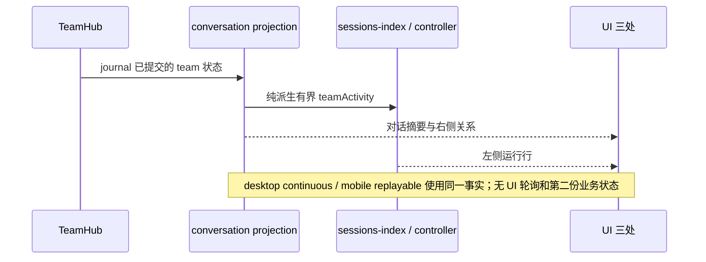

# Agents Team（多代理团队）设计 spec

## 三处 UI 实施增量（2026-10-19）

按已确认的 `docs/agent-team-implementation-2026-10-16/02-three-surface-ui-design.md`
实施主消息当前团队摘要、右侧协作关系页、左侧团队运行行。TeamHub / journal 仍唯一拥有业务事实。

- 新增有界 `SessionSummary.teamActivity`：teamId、name?、status、memberCount、completed、total。
  契约在 shared 新文件定义一次；CLI 从同一 ConversationSnapshot.team 纯派生，参与 sessions-index
  conflation，Host controller 和手机任务快照仅透传。旧帧字段缺席合法；列表不得 acquire 对话。
- 主消息只有一份当前团队摘要，使用实时快照，放在消息列表尾部的通用 footerSlot 内；当前 wire
  没有可靠的建队 turn 联接，故不猜测历史 turn，也不反复向持久消息流插入系统行。
- shell 提供有作用域的团队导航端口：先选择父会话，再调用现有 handleOpenTeamSidePane。
  workspaceIdentity 优先于路径，remoteSessionId 贯穿。无 shell 导航端口的手机/独立预览可展开
  只读协作详情，不额外建立 runtime。
- 右侧默认协作页，保留任务与成员页；依赖图仅用 dependsOn，消息图仅用 mailboxTail，保留
  delivered、at、sourceTaskId/sourceAttemptId。不能把未投递显示为已送达，不能推断交接历史。
  交接页诚实显示当前版本未提供历史。无历史的普通快照不生成任何假记录。
- 图是有界派生；大任务板使用选中任务的直接邻域，并显示范围。缺失引用保留未知节点；失败、
  取消不解锁依赖，循环/未知引用不崩溃。选择、图层、成员下钻仅属于当前 teamId 的局部状态。
- 新主体放 ui-team 新文件；现有接缝：sessions-index schema/controller schema 与 CLI summary
  producer 加 helper 调用，UI/Host/手机摘要映射各加字段，TaskListItem/SessionPane/WorkspaceShellLayout
  只组合新组件或端口；ConversationTimeline 只新增通用 footerSlot。上游同步逐处重放这些接缝。
  手机独立 RemoteConversationTimeline 也在同一 footerSlot 组合摘要，沿用既有 statusSnapshot.team。



验收：新增 shared summary/schema/conflation、UI 关系纯函数、真实 React 浏览器场景；
运行 Node 声明版本下的 typecheck/lint/architecture 与 CLI 检查，报告实际结果与 E2E 范围。

状态：设计定稿（v3 方案落地稿）；实现进度见实施增量与文末逐里程碑登记。调研与可行性论证见
`docs/agent-team-feasibility-2026-10-16/99-final-report.md`（下称"调研报告"）。
本文是实现的唯一权威依据；与调研报告冲突时以本文为准。

## 0. 决策摘要

- **做什么**：为 Drora 增加 agents team——一个 lead 会话显式创建的命名团队实体，
  含若干长寿命可寻址 teammate、单所有者共享任务板、受限成员消息。
- **不做什么**：不做 handoff 所有权转移、不做 GroupChat 广播发言权、不自建编排框架层、
  不做可视化编排器（Swarm 归档 / Agent Builder 弃用的反面证据，见调研报告 §2）。
- **上游判定（已实证）**：官方 ZCode 上游（3.14.3 原版 bundle + v3.15.1 对齐源码 +
  3.14.3 web snapshot）经穷尽 grep 无任何多代理协作协议面（`team` 字面命中全部为
  Team Coding Plan 订阅套餐、第三方补全/高亮数据与提示词文案）——agents team 是
  **纯 Drora 自研增量**，全部新逻辑放新文件/新模块，经 ports 接入。
- **替换条件**：若上游未来引入团队机制（如 Agent 工具加 name 参数成队），按
  AGENTS.md「官方实现优先」迁移官方契约并删除重复面；每次上游同步跑
  `scripts/check-bundle-key-parity.mjs` 时核对 team 键族。
- **核心裁决**：teammate 在 wire sessionKind 与内部 taskType 上**一律复用
  `subagent_child`**，团队性由请求级 additive 字段承载（§5）。由此全仓 22 处
  `subagent_child` 行为门零改动自动继承（§9）。
- **形态借鉴（dynamic-workflow 三个成熟先例）**：①权限模式在成队那一刻定死并记
  journal，此后 lead 换模式不影响在飞的 team（`workflow-actor-permission.ts` 模式）；
  ②team 是 run 型实体，有自己的状态机、journal 与恢复语义；③显示逻辑独立——专属
  侧栏面板（照 workflowRuns 投影 + WorkflowRunSidePane），会话正文只留紧凑摘要行。
- **二次借鉴（dsh-agent-teams v0.1.23，对照与取舍见 §15）**：①attempt 陈旧尝试防护
  （转派先撤销旧 attempt 并等旧 worker 静默，迟到写入按 attemptId 拒绝）；②事件驱动
  自动调度（成员 idle 即自动认领下一个 ready 任务）；③两阶段成队（staged 花名册+DAG
  审批后才 spawn）；④质量门禁（任务合同+verdict 机器判定，M5 可选）；⑤诚实边界
  声明（投影如实反映持久状态，模型不守仪式不以面板失真掩盖）。
- 实现设计：见 `docs/agent-team-implementation-2026-10-16/00-master-design.md`（2026-10-16 重设计定稿；**2026-10-17 v2 模块化重构**：集成架构改为组装根集中制，上游镜像文件触点 23→3，见该文档「v2. 集成架构重构」章与本文件 §11）。

### 实现设计修订（2026-10-17 v2 模块化重构）

应用户约束（模块化设计、尽量少影响源码、上游同步低成本）对集成架构的整体重写，
**取代下列 2026-10-16 十条中的第 1、2、8 条**（其余七条不受影响）：

- **v2-1（取代 2026-10-16 第 1 条「23 触点」）**：接缝账收敛为上游镜像文件 3 处
  （α 组装根 create-app.ts 单 hunk / β v4 投影 additive 块 / γ 命令注册表一行
  spread）。机制：TeamHub 私有持有 team 化 SubagentPort（`createExploreSubagentPort`
  的 `runExploreAgent` 必传构造回调，runner.ts:110-133）——团队性由「走哪个端口」
  承载，不再穿透请求/options；teammate 生命周期 = 未修改的 runner.ts。23 触点及其
  白名单断链问题类整体消失。
- **v2-2（取代第 2 条「单向 import」）**：subagent.port.ts **零编辑**，循环依赖
  问题不存在；team 类型全部在新文件 contracts team 族。
- **v2-3（取代第 8 条事件分立中的 S6 面）**：session.events.ts 零编辑；hub 事件
  全部走 team journal 自有事件流（TeamRuntimeAdapter 通道保留）。
- **v2-4（新增）**：团队工具注册改为自包含 ToolEntry 闭包 + hub 自建注册表实例经
  `deps.toolRegistry`（agent-runtime.ts:332）注入——types.ts（S3）与
  runtime-tools.ts（S4）零编辑；§6.2 的 TeamPort 接口语义不变，注入方式从 deps
  字段改为闭包捕获。
- **v2-5（新增）**：禁令文本经导出的 `formatIncomingMessage`（incoming-message.ts:12）
  在 team 投递代码内格式化，S5（加 export）撤销。
- **v2-6（新增取舍）**：member-runtime.ts 对 subagent.ts 构造区 ~100 行有意复制
  （失败模式从静默漂移变 typecheck 显式报错）；受限 profile 协作工具强制保留降级
  为 profile 约定（需要机器强制时再评估第 4 接缝）。

### 实现设计修订（2026-10-16）

以下十条为实现设计定稿过程相对本文正文的决策变更（逐条含变更与理由），对应实现设计文档 §10 差异清单 D1-D9（其中 D1 拆为下述第 1、2 条）；本文正文其余章节的完整口径回填按实现设计 PR-0.1 执行。

1. **变更**：接缝触点总数从 spec 的 8 处扩为 23 处：S1 为 launch+复活双链 13 触点（contracts 4 + runner.ts 9）——含 launch 链两道 options 白名单透传（launch :168-171 与 start() :473-481）、复活链 resume 签名 :958-966 加 sendOptions + 调用点 :928-936 透传、resumeRequest :975-985 恢复、runBackgroundAgent :1018-1023 透传；S2 为 3 触点（deps spread/:258-259 mode+planEnabled/:452 sink 三元）；S4 为 4 触点（含 tool/types.ts:87）。**理由**：终审实读证实：start() 在 :473-481 重建 runOptions 仅 signal/model 丢弃 startOptions.teamMemberPort——漏此触点则首次 spawn 成员零协作工具（includeTeam=false，任务板死锁）；resumeTerminalAgentInBackground 签名无 sendOptions 且调用点未传，sendOptions 引用不可编译；补齐后双链运行时可达。
2. **变更**：类型引用裁决为单向 subagent.port.ts →（type-only import）→ team.port.ts：SubagentTeamMemberSpec 与 TeamMemberPort 统一定义在 team.port.ts，team.port.ts 不依赖 subagent.port.ts（TeamSendDelivery 与 subagent.port.ts:74 是字面量对齐非类型引用）；初版 team.port.ts 段「依赖 subagent.port.ts 的类型」声明失实已修正。**理由**：终审指出两文件互指成环违反 AGENTS.md 禁循环依赖纪律；单一方向裁决消除，type-only 单向合法。
3. **变更**：TeamHub 生命周期定为 session 级常驻、内部 0..1 个 team。**理由**：若 hub 随 team 实体生灭，lead runtime 构造时 deps.teamPort 无从注入，TeamSpawn 注册门陷入先有鸡问题。
4. **变更**：TeamSpawn 在 staged 态再次调用 = 原子更新同一草案；一会话至多一个活跃 team；team 投影 status wire 枚举从 spec §6.3 七值扩为八值（加 archived）。**理由**：spec 要求原子更新同一草案但未指明载体；abandonTeamPlan 归档态需要 wire 载体。
5. **变更**：team journal 只记用户/协议动作与板/邮箱数据事实，常规状态迁移与成员运行态不写 journal，恢复后推导。**理由**：「team 状态是投影字段」不变量的工程推论，避免第二份状态。
6. **变更**：v4 用户命令面从 spec 四条补全为八条（+reviseTeamPlan/abandonTeamPlan/haltTeam/resumeTeam）。**理由**：staged 三分支与 halted/escalated 恢复语义需要显式用户命令入口。
7. **变更**：成员移除 v1 只走用户命令 stopTeamMember，不给 lead 模型移除工具。**理由**：给 lead 移除权扩大编排失控面，v1 从紧。
8. **变更**：S6 session 事件三值与 team journal 十五种事件分立两套；hub 发射通道经 TeamRuntimeAdapter.emitTeamEvent 构造时注入。**理由**：session 事件是进程内广播、journal 是持久化事实流；初版 emit 无接口载体。
9. **变更**：TeamPort 拆分为 TeamMemberPort/TeamLeadPort 两级接口配 isTeamLeadPort 谓词；S3 字段类型为 teamPort?: TeamMemberPort（spec §6.2/§11 单一 TeamPort 口径）。**理由**：lead 专属工具需要结构性注册门与冒用免疫；接口签名级变更，PR-0.1 回填 spec 必须同步。
10. **变更**：运行中投递禁令承载 = S2 落点 3 替换 message sink（member-sink.ts，subagent_reply_steer + no_active_turn 20×10ms 重试）；复活链 team 族经 SubagentSendMessageOptions 供给；queued 不算注入、hub 不重发（registry pending 队列已持有，成员下回合 flush）。**理由**：message-steering.ts:32/:44 硬编码 coordinator_steer 无禁令渲染；无重试则 no_active_turn 窗口投递滞留至下次复活且 hub 无重触发点；重发会重复投递。

## 1. 产品规则

| 规则 | 内容 |
|---|---|
| 显式成队 | 主入口是内置斜杠命令 **`/team [goal]`**（照 `/workflow` 先例：代码定义 prompt 型内置命令、名字进 shared 帮助表保留字、正文指向 bundled skill `agents-team` 与 staged 流程；斜杠菜单+加号菜单双入口；child 上下文禁用）+ TeamPanel 显式操作；不采用官方 Claude Code「Agent 工具带 name 即隐式成队」（副作用大）。命令与 UI/交互的权威设计见 `docs/agent-team-implementation-2026-10-16/01-command-and-ui-design.md`（先于实现定稿） |
| 一会话至多一 team | team 绑定 lead 会话（session-scoped），无嵌套 team |
| 成员上限 | 默认 5，settings 可调（键定义在契约常量区，见 §6.4） |
| 成员不可派生 | teammate 禁止再派生子代理/teammate（现有 child 硬编码 `subagents:{enabled:false}`，`core/src/runtime/methods/subagent.ts:305-308`，保持不动）。第二个理由：团队级取消只需一层 abort 级联（`core/src/subagent/runner.ts:622-654`）即充分 |
| 灰度 | team 默认关闭，settings/config 显式开启（端口/配置双门先例：`runtime-tools.ts:67-76` offPeak/dynamicWorkflow 同风格） |
| 权限模型成队时定死 | 创建 team 时捕获 lead 会话权限模式（plan 不带入，记 build——team 总在执行，与 run 同理）写入 team journal；此后 lead 换模式不影响在飞的 team；resume 从 journal 读回。成员 profile 只能收窄（如 Explore 只读）、不能放宽（§8.1） |
| 消息零授权 | 任何 teammate 消息不得充当待决权限的批准；被拒操作不得经成员转发绕过（§8.3） |
| 用户对成员说话 | 必须经 lead 侧团队命令走邮箱投递；teammate 会话本体只读（v4-bridge 只读守卫自动覆盖，§8.2） |
| 两阶段成队 | 默认先 staged：花名册占位 + 任务 DAG，**不 spawn 任何成员**；用户在 TeamPanel 审查（可改成员路由/角色/依赖/负责人）后 Approve & Run 才原子创建成员并启动调度。用户明确要求跳过审批时才直通（approval: automatic 同款例外）。**草案校验（2026-10-18 登记）**：stageTeam 源头拒绝成员重名（E13）与悬空 assignee（E14）——wire 面 agent↔task 关系全部按 memberName 联接，重名/悬空会让任务卡负责人、成员下钻与邮箱地址失位；lead 寻址键字面量单一出处为 shared `TEAM_LEAD_ASSIGNEE`（core 以 `LEAD_ASSIGNEE_KEY` 再导出，UI 直接引 shared 常量） |
| 停止与恢复分离 | halted（用户停队：取消 lead 当前回合 + 中断全员 + 冻结调度，team 不删除）≠ escalated（自动循环到上限，升级给用户）；halted 后普通建任务不得静默恢复，必须显式 TeamResume 且带理由 |
| 转派/接管是 lead 专属 | 成员可建任务、可认领，但撤销 attempt 与转派（含 lead 接管）只有 lead 工具能做（§2.3） |

## 2. 概念模型与状态所有者

### 2.1 术语

| 术语 | 定义 |
|---|---|
| Team | 绑定 lead 会话的显式命名实体；持有花名册/任务板/邮箱的唯一事实源 |
| Lead | 用户的主交互会话 runtime（现有 interactive runtime，不新起进程） |
| Teammate | 命名、长寿命、可寻址的子代理成员；会话层就是 `subagent_child` |
| TeamBoard | 共享任务板：三态 + 依赖 + 原子认领的结构化任务列表 |
| TeamMailbox | 成员消息投递队列；写成功（持久化后）才算发送成功 |

### 2.2 状态所有者表（谁写、谁读）

| 状态 | 唯一所有者（写） | 读取方 | 持久化 |
|---|---|---|---|
| 花名册（name→agentId/childSessionId/profile/状态机） | lead runtime 内 **TeamHub**（新模块，`core/src/team/`） | lead 模型（经工具）、teammate（经 TeamPort 只读快照）、UI 投影（只读） | team journal（session store 侧） |
| 共享任务板 | TeamHub（**所有 board 写操作经 TeamPort 收敛到 hub 串行裁决**，in-process 原子，无文件锁） | 同上 | 同上 |
| 成员邮箱 | TeamHub 写入并投递（运行中 steer / 终态复活续跑） | 目标成员 | 写入持久化后才 ack |
| team 权限模式记录 | TeamHub（成队时一次写入，此后只读） | 全体成员构造与复活（hub 花名册记录，经私有端口构造通路）、UI 权限徽标 | team journal `team-created` 事件 |
| teammate transcript | 各 child runtime（现状不变） | 下钻 UI 只读订阅 child topic | 现有 session store |
| UI teamStore（`packages/ui/src/store/teamStore.ts`） | renderer 派生缓存，**不得冒充服务端事实** | — | 内存 |
| Main / 外部 relay / Host facade | **零团队业务状态**（AGENTS.md 边界不变） | — | — |

所有者判据：与 conversation 投影同源、与 RuntimeTaskRegistry 单 runtime 所有权模型
（`core/src/runtime-task/registry.ts:70-94`）同构，只是从「per-runtime 内存态」升格为
「per-lead-session、跨成员、可持久化」。

### 2.3 任务板语义

- 任务卡 schema（落 `packages/shared/src/drora-protocol-v4/team.ts`，纯 schema+纯函数）：
  `{ taskId, title, spec:{目标,验收标准,产出格式}, status: pending|claimed|in_progress|completed|failed|cancelled,
  assignee?, attempt, attemptId, dependsOn: taskId[], artifactRefs[], createdAt/updatedAt,
  contract?: { objective, acceptance[], inScope?, outOfScope?, verify? } }`。
  状态机 pending→claimed→in_progress→终态（claimed 不得直接 completed）；依赖只认上游
  **completed**——failed/cancelled 永不解锁下游。刻意不引入 INPUT_REQUIRED 等中间态
  （权限待决由 pendingInteraction 链路自然表达）。`contract` 为 M5 质量门禁的 additive
  预留字段，v1 不强制。
- **原子认领**：`claim(taskId)` 由 TeamHub 单线程裁决；依赖未完成的任务不可认领；
  **一个成员同时至多一个未完成任务**；任务进终态时 hub 解锁依赖它的任务并推送 board 更新。
- **attempt 陈旧尝试防护（借鉴 dsh-agent-teams）**：每次执行携带任务上的单调
  `attempt` 计数与本次唯一 `attemptId`；taskUpdate 必须携带当前 attemptId，
  **迟到写入（旧 attemptId）一律拒绝**。转派（lead 专属 TeamReassign）与 lead 接管
  的顺序是：使旧 attempt 失效 → 中断旧成员 → 等待其静默（终态结算完成）→ 开新
  attempt——新结果不会被旧成员的迟到更新覆盖。成员被移除时同款：撤销 attempt、
  回收其未完成任务、等待中断收敛后重新调度。
- **自动派发（事件驱动调度，借鉴 dsh-agent-teams）**：TeamHub 订阅成员终态事件
  （现有 finalize 链路 + waitForTerminal，无新钩子）——成员 idle 且板上有 ready 任务
  时自动为其认领一个并投递任务卡（走 §7 运行中/复活投递）。**谁该干活由 hub 的
  确定性代码裁决**（强化 §3 拓扑理由 1），成员主动 claim 仍保留为补充；成员消息是
  增强而非依赖的兜底语义不变。lead 离线时调度静止（无轮询），任务与消息留在
  journal 等 lead 恢复——事件驱动而非常驻扫描。
- **冷恢复有界重试**：lead 会话 resume 时，对「开放 attempt 且成员已不在场」的任务
  自动重试**一次**；恢复投递失败则保持原状，**不退化为可无限重派的 pending**
  （dsh 实证的防雪崩语义）。
- **交接纪律**：任务产出默认落盘 + artifactRefs 引用回传，消息只传轻量引用与结论
  （Cognition/MetaGPT 实证：抑制级联幻觉与上下文碎片化）；产物区
  `.drora/team-artifacts/{teamId}/`（清理策略见 §12 开放问题）。
- 默认调度纪律：顺序优先、只读任务才并行（后派者能读先完成者产物）。

### 2.4 成员生命周期（定死：终态 + 复活路线，不新造 idle 钩子）

```
spawned(TeamSpawn) → working(独立 turn)
  → 终态（现有 finalizeBackgroundCompletion 结算：产物落盘 + idle 通知附最终结果，
         core/src/subagent/runner.ts:1497-1574）
  → 消息复活（给终态成员发消息 = resumeTerminalAgentInBackground 同族：
         恢复历史 + 消息为下一条 prompt，runner.ts:958-1036）
  → working … 循环
终态 → removed（用户移除 / lead 会话结束；花名册与终态 registry 条目此时才清）
```

- TeamHub 感知成员转 idle 走既有 RuntimeTaskRegistry.waitForTerminal（`registry.ts:197-204`），
  不新增端口方法。
- 长寿命策略经请求显式传递：spawn 请求带 `memberMaxTurns`（建议默认 40），
  经 `request.maxTurns` 优先级先例（`methods/subagent.ts:284`
  `request.maxTurns ?? this.config.subagents?.maxTurns ?? 4`）生效——**不经 taskType 分叉**。
- 名字重定向防护：花名册记录 name→agentId 绑定；名字移除后重用必须绑定新 agentId；
  TeamSendMessage 校验名字当前指向原成员否则拒绝。

### 2.5 关键事件顺序图

```
用户/lead模型           TeamHub(lead runtime)              teammate A               teammate B
   │ TeamSpawn(name) ──→ 校验花名册/上限/灰度门
   │                    构造 child runtime（复用 methods/subagent.ts:254-392 构造路径，
   │                      taskType 保持 subagent_child；hub 私有端口构造回调注入团队工具
   │                      + memberMaxTurns 显式传入）
   │                    ── spawn prompt(executeTurn) ──→ │
   │                    ←─ claim(taskId) 原子裁决 ────────│ A: 读板/认领
   │                    board 更新 → v4 team 投影(delta)                            │ B: 只读 board
   │                    ←─ TeamSendMessage(A→B) ──────────┼────────────────────────│
   │                    邮箱持久化→ack；B 运行中→steer(subagent_reply_steer)
   │                               / B 终态→复活续跑(消息体自嵌禁令, §7.2)
   │                    ←─ 终态结算(idle 通知附最终结果) ──│ [现有 finalize 链路]
   │ TeamSendMessage(A) → 复活（恢复历史，消息为下一条 prompt）

权限审批上浮：
teammate 工具调用 → permissionService.checkPermission(继承 lead 模式)
  → ask 经 deriveChildClientPorts 路由回 lead session(methods/subagent.ts:324-328)
  → v4 pendingInteraction(subagent origin 携带 parent/child sessionId)
  → 桌面/手机同链路 resolveInteraction 裁决
⟂ teammate 间消息 ≠ 任何批准（硬边界在工具执行前门控，permission-flow.ts:56-96）
```

### 2.6 team 级工作流程（run 型状态机，照 workflow run 形态）

```
created（显式成队：权限模式与成员路由定死并记 journal）
  → staged（两阶段成队：花名册占位 + 任务 DAG，零成员零会话；TeamPanel 可编辑）
      ├─ Approve & Run → active（原子创建成员 + 启动调度）
      ├─ 回对话修改 → 追问一次修改方向，原子更新同一草案（不得另建 team）
      └─ 放弃 → 归档草案，禁止自动重建
  → active（有成员 working 或邮箱有未读）
  → idle（全部成员终态且邮箱无未读——TeamPanel 折叠空闲态）
  → active …（自动派发 / 消息复活 / 新委派再激活）
  → completed（用户收队 / lead 会话正常结束，归档保留完整花名册/板/邮箱）
  / halted（用户停队：取消 lead 当前回合 + 中断全员 + 冻结调度；显式 TeamResume
           带理由才恢复，普通建任务不得静默解除）
  / escalated（自动循环到上限：升级给用户裁决，与 halted 语义分离）
  / cancelled（lead 会话被删 / 显式取消）
```

- team 状态是投影字段（§6.3），由 TeamHub 唯一裁决——成员终态/复活/邮箱事件驱动迁移，
  **不是成员状态的重复推导**（避免第二份状态）。
- 恢复语义与 workflow run 同构：lead 会话 resume 时 TeamHub 从 team journal 重放
  `team-created`（含权限模式与成员路由快照）与后续事件，恢复状态机、花名册、板、邮箱；
  在飞成员由既有 child 会话恢复路径（resumeFromStore）承接。

## 3. 拓扑选型结论

**显式 lead 编排（agents-as-tools）+ 单所有者黑板任务板 + 受限成员消息。**

理由（对照调研报告 §5.2 候选表）：
1. 与 turn 所有权模型相容——teammate 各自是独立 runtime/session，各有自己的 TurnMachine
   与命令队列（`core/src/runtime/command-queue.ts:11-17` 串行 admission 不变）；「谁该干活」
   由任务板（确定性代码外壳）表达，LLM 只决定「拆什么、派给谁」。
2. guardrail 集中——权限审批、最终答复收在 lead 一侧，权限上浮链路完全复用现状。
3. 上下文碎片化结构性缓解——成员不互读完整 trace，共享的是任务板 + 落盘产物引用。
4. 成员消息是增强而非依赖——无消息能力时成员仍可凭任务板自领/交付。

## 4. teammate 会话构造（复用清单，不改）

| 能力 | 位置 | 复用方式 |
|---|---|---|
| 构造三件套（child runtime + deriveChildClientPorts + 事件镜像） | `core/src/runtime/methods/subagent.ts:254-461` | TeamHub 经私有端口构造回调（member-runtime.ts，v2）复刻同款装配并注入团队工具与 memberMaxTurns——subagent.ts 本体零编辑 |
| 后台生命周期/终态结算/abort 级联/复活 | `core/src/subagent/runner.ts:184-218、622-654、903-1036、1497-1574` | teammate = 走现有终态结算的后台式 child；TeamHub 保留花名册与 registry 条目 |
| lead 接收成员回复 | `core/src/runtime/methods/subagent-messages.ts:77-99`（persistSubagentMessageCommand 产生 subagent_reply(_steer)） | 成员→lead 方向本来正确，现状复用 |
| 工具注册表 | `core/src/tool/registry.ts:12-13`（ToolEntry 自包含）+ `agent-runtime.ts:332`（deps.toolRegistry 注入） | 团队工具 = 闭包捕获 hub 的 ToolEntry，注册进 hub 自建注册表实例——runtime-tools.ts 零编辑（v2） |
| 权限链路 | permission-flow.ts:56-96、resolveSubagentPermissionMode（subagent.ts:527-549）、subagent origin（interaction-origin.ts:17-37）、v4 pendingInteraction/resolveInteraction | 全部原样（§8） |
| 成员角色定义 | `.drora/agents/*.md` profile（profile.ts:46-70；color 字段 :30,80 作成员视觉标识）+ ISubagentsService（subagents.ts:15-41） | teammate 角色即 agent profile |
| UI 多会话下钻 | WorkflowActorSessionSidePane.tsx:56-108（父投影门 + 只读 SessionPane 租约复用） | 复制为 TeamMemberSidePane |
| 手机远控 | webRemoteControlSharedHostAttachments.ts:41-189（clientMode=web-remote-replayable 已注入） | team 帧沿既有 relay 桥透传，零新语义 |

**刻意不动**：Agent 工具 schema（`contracts/src/tools/agent.ts`，现状无 name 参数）与
`Task` 兼容别名（`core/src/tool/compat.ts:2`）——上游对齐文件零改动。

## 5. taskType 复用裁决（本 spec 最重要的单项决策）

- **wire sessionKind = `subagent_child`**：droraSessionKindSchema 闭集不加值
  （旧端收到未知枚举整帧解析失败的偏斜代价，`snapshot.ts:365-368` 注释教训）；
  旧桌面/手机把 teammate 当普通子代理显示，天然优雅降级；任务索引排除
  （droraTaskIndexSyncer.ts:1680）自动沿用。
- **内部 taskType 亦保持 `subagent_child`**。新增 `team_member` 的方向 A **已评估并否决**：
  全仓行为门均为 `=== "subagent_child"` 严格相等（实测 22 处，§9），新值不命中即落入
  非子代理分支——runtimeScope="main"、automation/offPeak 照注册、后台 bash 上限失效、
  下钻/查询链路（subagent-session-query.ts:395、server-operations.ts:1738）跳过导致
  teammate 漏出、tool-allowlist.ts:114 不补回 RespondToCoordinator——逐点改判定 ≈10+ 处
  新接缝，违背最小接缝纪律。
- **采纳方向 B（v2 形态）**：团队性由 **TeamHub 私有 team 化 SubagentPort** 承载
  （`createExploreSubagentPort` 必传构造回调，§11）——不经请求字段、不加构造分支；
  长寿命经构造回调内取 roster 记录值（memberMaxTurns，:284 优先级先例同款）。
- teammate 与一次性 subagent 的区分不在会话种类层，而在 TeamHub 花名册与 team 投影
  （UI 团队面板按 roster 识别）。**会话层 teammate 就是子代理——这正是全族行为门
  自动正确的原因。**

## 6. 新增模块与接口

### 6.1 新增文件总表

| 层 | 新增 | 放置 |
|---|---|---|
| CLI 契约 | TeamPort 接口 + 请求/结果类型 | `apps/drora-cli/packages/contracts/src/interfaces/team.port.ts` |
| CLI 契约 | 团队事件枚举值（TeamMemberSpawned/TeamBoardUpdated/TeamMessageDelivered，additive） | `contracts/src/events/session.events.ts`（SubagentSpawned 族在 :178-180） |
| CLI 核心 | TeamHub / TeamBoard / TeamMailbox / 生命周期 / 工具 / 消息格式化 / 成员投递 / v4 投影产出 | `apps/drora-cli/packages/core/src/team/`（新目录，照 subagent/ 体例；含 member-delivery.ts、message-format.ts） |
| CLI 核心 | 工具 handler：TeamSpawn、TeamTaskCreate/Get/List/Update、TeamSendMessage、TeamList | `core/src/team/team-tools.ts` + `core/src/tool/handlers/team-*.ts` |
| CLI 引导 | v4 命令 handler（stopTeamMember/sendTeamMessage 等用户面命令） | `bootstrap/src/drora-protocol-v4/commands/handlers/`（注册表 index.ts:16-28 一行 spread） |
| shared | team 投影 schema、限额常量、持久化键前缀 | `packages/shared/src/drora-protocol-v4/team.ts`（照 workflow-runs*.ts：纯 schema+纯函数） |
| UI | teamStore.ts | `packages/ui/src/store/teamStore.ts`（归属裁决：AGENTS.md 明文 Zustand 状态在 store/ 目录，全局单例状态不适用托管模块自治——本行即裁决记录） |
| UI | TeamPanel / TeamBoardView / TeamMemberSidePane + hooks | `packages/ui/src/team/`（新托管模块 ui-team，照 gen-ui 三模块样板，architecture-policy.yaml 登记 + 五件套） |
| UI 手机 | MobileTeamPanel | `packages/ui/src/mobile`（MobileTaskShell 旁） |

### 6.2 TeamPort 接口（语义签名，非实现）

```
TeamPort —— lead runtime 的 TeamHub 实现，注入 teammate child runtime deps
  roster(): TeamRosterSnapshot                       // 只读花名册
  boardRead(): TeamBoardSnapshot                     // 只读板
  taskCreate / taskUpdate(input): TeamTaskMutationResult   // 写收敛到 hub 串行裁决；
                                                     // taskUpdate 必须携带当前 attemptId，
                                                     // 旧 attemptId 一律拒绝（§2.3）
  taskClaim(taskId): TeamTaskClaimResult             // 原子认领（成功/已被占/依赖未就绪三态）
  send(request: { to: memberName|agentId, message, summary }): TeamSendResult
                                                     // 邮箱持久化成功才算发送成功；
                                                     // 投递结果 queued|steered|resumed
                                                     // （delivery 语义复用 subagent.port.ts:74 枚举）
```

工具面映射：lead 注册全部团队工具（含成员侧没有的 **TeamReassign / TeamResume /
TeamStageApprove**——转派与接管、恢复停队、批准 staged 草案均为 lead 专属）；
teammate 按 profile tools 面裁剪，但 runtime 强制保留 TeamSendMessage 与
TeamTask\*（认领/更新/查询，对齐官方「即使 disallowedTools 也保留协作工具」）；
受限只读角色（Explore 型）不注入 TeamPort 即不注册团队工具。**冒名结构性免疫**：
TeamPort 调用方身份由 in-process 注入确定（port 知道自己注入进了哪个 child runtime），
`from` 不可伪造——dsh 需要「拒绝冒名 from」校验，Drora 结构上不存在此面。

### 6.3 v4 协议投影（B 档，自研面无上游负担）

- **snapshot**：`conversationSnapshotSchema`（snapshot.ts:471-511）additive optional 字段
  `team: teamProjectionStateSchema.optional()`——照 subagents/workflowRuns 先例（:497-500），
  **optional 只服务旧快照 wire 兼容，新 CLI 初始态与每次投影都携带**（workflowRuns
  冷快照教训：漏带会静默消失）。`teamProjectionStateSchema` 字段：
  `{ teamId, name?, status: staged|active|idle|completed|halted|escalated|cancelled,
  permissionMode, members[], board{tasks[],limit}, mailboxTail[], artifacts? }`——status 与
  permissionMode 是 team 级状态机（§2.6）与权限徽标（§8.1）的显示依据。
- **delta**：`statePatchSchema`（delta.ts:40-62）新增 optional 键 `team`
  （`team: teamProjectionStateSchema.optional()`）。**模型是键级整体替换**——容器非
  strict，旧桌面收到新键只是剥离该键、保住 patch 其余键（workflowRuns 键 :55-57 同理，
  天然无偏斜防御需求）。花名册 ≤ 成员上限、任务板受 team 限额约束（boardTasksMax，
  建议 100）、消息投影只保留尾窗（teamMessagesRetentionPerMember，建议 20），整键替换
  的字节量有界；**不为 team 开 workflowRun.\* 式两级增量例外**（delta.ts:6-9 注明该例外
  仅此一例），除非实测出现 O(N²) 放大再按 spec 决策流程评估。
- **命令面**：commandPayloadSchemas（command.ts:44-297）加用户面命令
  sendTeamMessage/stopTeamMember/setTeamMemberName 等；逐条对照
  COMMANDS_REQUIRING_BASE_REVISION（command.ts:319-335）归类 CAS——初判全部
  非行级 CAS（团队命令不落 conversation 行），spec 实现时逐条复核。
- **限额**：PROTOCOL_V4_LIMITS（core.ts:64-100）加 team 键；relay envelope 尺寸上限
  （webRemoteControlManager.ts:966-969 oversize 即降级）要求 team 帧有界。
- **legacy 主协议（drora-protocol/index.ts 待删旧面）不做 team 投影——v4-only，
  避免双写**。

### 6.4 契约键单一出处

team 的 wire 命令名、delta 键名、事件枚举值、持久化键前缀（建议 `team.`）、灰度
settings 键、产物目录名，只在 `packages/shared/src/drora-protocol-v4/team.ts` 常量区
与 `@drora/contracts` 定义一次，CLI 与双端同源引用；上游同步键族差分须能甄别
（本行即为 check-bundle-key-parity 的登记说明）。

## 7. 成员消息投递机制（v3 重设计后定稿）

既有事实（实读证实）：`subagent_reply(_steer)` 只在父会话接收侧产生
（subagent-messages.ts:84）；既有注入链路硬编码 `coordinator_steer` 且无禁令
（message-steering.ts:32,44）；复活路径硬编码 `coordinator_input` 即裸 body
（methods/subagent.ts:458-459 + incoming-message.ts:21-22）；
`PEER_PERMISSION_GUIDANCE` 为模块私有常量（incoming-message.ts:5-6）。

定稿设计——投递由 team 模块自有代码（`core/src/team/member-delivery.ts`，新文件）完成，
**不复用 message-steering.ts**：

| 目标成员状态 | 投递方式 | 禁令承载 |
|---|---|---|
| 运行中 | steerTurn，inputPresentation 选用**现有枚举值** `subagent_reply_steer` | 自动：incoming-message.ts:23-24 渲染 = "Another Drora session sent a message…" + PEER_PERMISSION_GUIDANCE + 回复指引；RuntimeInputPresentation 枚举**零加值** |
| 已终态 | 复活投递（hub 私有端口 sendMessage → 现有 revive 链，裸 body 为 prompt），消息体由 `core/src/team/message-format.ts` 组装：团队头（发件成员/任务引用）+ 正文，经**导出的** `formatIncomingMessage(body, "subagent_reply")`（incoming-message.ts:12）渲染 | 禁令由 formatIncomingMessage 内部渲染（单一出处，零接缝，v2 取代 S5） |
| 未注册/名字重定向 | 拒绝并返回错误 | — |

投递顺序与送达语义（§16.3）：**邮箱优先于新任务派发**；投递权在裁决内领取、
**仅注入被接受后才标记已送达**；任务相关消息带 attempt 世代，attempt 轮换后旧
报告在准入/读取/兜底三条路径自动废弃（叠加在 branchGeneration stale fencing 之上）。

语义复用的可读性债登记：`subagent_reply_steer` 名称与「teammate 收 peer 消息」用途
存在历史错位，值语义（渲染文本「另一会话发来的消息」）吻合故采纳；若后续需按
presentation 区分 teammate 消息，加值的偏斜面已澄清（该枚举不在 v4 wire 面，仅 CLI
本地持久化，读取侧 safeParse 防御），迁移成本可控。

## 8. 权限与安全

1. **权限模式成队时定死**（照 `workflow-actor-permission.ts` 模式，参照
   docs/dynamic-workflow/launch.md「Permissions inside a run」）：创建 team 那一刻捕获
   lead 会话权限模式——plan 不带入（team 总在执行，与 run 同理），记为 build；以可选键
   写入 team journal `team-created` 事件（同款键规：缺席而非 undefined 值）。此后 lead
   会话换模式**不影响在飞的 team**；全体成员的构造与复活均用记录值，经私有端口
   构造回调从花名册读取（覆盖 spawn 时点继承）
   （resolveSubagentPermissionMode，subagent.ts:527-549）。resume 从 journal 读回；记录值
   不在闭合集 `build|edit|yolo|guarded|auto` 内时按缺席处理、回退继承 lead 会话当前模式
   （旧版本不猜不懂的模式的语义——parseWorkflowSubagentPermissionMode 同款纪律）。
   成员 profile 只能收窄不能放宽（Explore 型角色用独立只读 PermissionService，
   :340-343 先例）。plan 工具由 SUBAGENT_CHILD_FORCED_DISALLOWED_TOOLS
   （tool-policy.ts:7-10）结构性剔除——teammate 不可能发起 plan approval，
   **本方案不设任何计划审批例外条款**。
2. **审批上浮单面**：teammate 权限 ask 经 deriveChildClientPorts 路由回 lead session
   （subagent.ts:324-328）→ pendingInteraction 携带 subagent origin → 桌面/手机同一条
   resolveInteraction 链路。多成员并发 ask 各为独立 interactionId 待决项，UI 按 origin
   分组成员徽标（点名格式照 workflowActorInteractionDescription 先例：
   `<memberName> (<teamId>)`），**不合并、不代理裁决**。
3. **输入边界（taskType 复用后自动成立）**：v4-bridge.ts:1764-1771 只读守卫
   （guard.subagentReadOnly）自动覆盖 teammate 会话——teammate 不接受绕过 lead 的直接
   conversation 输入。
4. **代理消息零授权**：硬边界由工具执行前门控（permission-flow.ts:56-96）结构性保证，
   不依赖提示文本；提示层禁令双路承载见 §7。
5. **后台与取消**：teammate 后台生命周期只依赖持久化 profile selection（单次执行模型
   禁入后台，runner.ts:153-167 BACKGROUND_UNAVAILABLE）；团队级取消 = 停止 lead turn
   级联 abort 各成员（一层级联因派生禁令而充分）。
6. **身份隔离**：team 实体绑定 `workspaceIdentity?.trim() || workspacePath`；远程链路
   贯穿 workspaceIdentity 与 remoteSessionId，不按路径匹配。
7. **成员模型路由快照（借鉴 dsh-agent-teams）**：member spawn 时把**最终生效**的
   provider/model/思考档快照写入 team journal；复活与冷恢复一律恢复该快照。解析规则：
   沿用 lead 当前路由时一并继承 lead 当前思考档；显式换 provider/model 任一时自动用
   目标模型默认档；显式指定思考档先校验目标模型兼容、不兼容则创建失败（不静默降档）。
   与 §8.1 权限模式快照同一家族——**建队/建成员那一刻的世界被固定，此后 lead 换
   路由不影响在飞成员**。
8. **具名工具策略（可选增强，借鉴 dsh toolPolicies，M4 评估）**：部署方在 settings
   声明具名 per-角色工具策略（allow/deny 集）；lead 模型只能**按 id 选择**已声明的
   策略，不能提交原始 allow/deny 列表、不能运行时新建；协作工具强制保留、lead 专属
   工具策略不可重开；解析后的过滤器写入 team journal 供审计，重启后由成员侧描述符
   重放同一过滤。反 laundering 价值：工具面收窄的裁决权在部署方不在模型。v1 可先
   不做（profile tools 治理已覆盖基本需求）。

## 9. subagent_child 行为门验证清单（22 处，零改动验证）

2026-10-16 实测：`grep -rn 'subagent_child' core/bootstrap/services src（非测试）| grep '===|!=='`
共 **22 处**（core/bootstrap 19 + services sessionKind 3）。分布：

| 文件 | 处数 | 继承效果（taskType=subagent_child ⇒ 自动获得） |
|---|---|---|
| core/src/runtime/helpers/runtime-tools.ts（:56/:67/:72/:214/:228/:269） | 6 | RespondToCoordinator 注册门、automation/offPeak 不注册、subagentBackgroundBashMaxMs 适用、runtimeScope="subagent"、isSubagentChildRuntime 标记 |
| core/src/runtime/methods/background-notifications.ts | 2 | 通知封印按子会话现状 |
| bootstrap/src/drora-protocol/server-operations.ts（:1738/:1957） | 2 | 子会话下钻/查询包含 teammate |
| bootstrap/src/app/subagent-observation.ts（:51/:95） | 2 | 子代理观察面适用 |
| bootstrap/src/drora-protocol/subagent-session-query.ts:395 | 1 | `!==` 跳过逻辑不命中 ⇒ 查询包含 teammate |
| bootstrap/src/drora-protocol/v4-bridge.ts:1764-1771 | 1 | 只读守卫覆盖 teammate |
| core/src/runtime/helpers/tool-allowlist.ts:114 | 1 | RespondToCoordinator 经 allowlist 补回 |
| core/src/runtime/methods/model-request-session-type.ts、turn-model-step-usage.ts、background.ts | 3 | 模型请求归类/用量/后台语义按子会话 |
| core/src/telemetry/runtime-telemetry.ts | 1 | telemetry 归类 |
| services：droraTaskIndexSyncer.ts:1680、droraTaskServiceAdapter.ts、repairSubagentTaskIndex.ts | 3 | 任务索引排除 teammate（不出现在任务列表） |

**继承原则（入 spec 的机制约定）**：上游后续新增任何 subagent_child 门，teammate 自动
继承其行为——默认正确，因为 teammate 本质就是子代理；若某新门语义确需区分，按 spec
决策流程逐点评估（是未来事项，不是本方案前提）。M1 验收将本清单自动化为回归测试。

## 10. UI 与多端

> 本节为纲要；完整 UI 与交互设计（/team 命令契约、入口面、端到端交互流、
> staged 审批编辑器、组件树与 token 纪律、手机端、异常交互、交互级验收）以
> `docs/agent-team-implementation-2026-10-16/01-command-and-ui-design.md` 为权威。

- **桌面（desktop-continuous）**：TeamPanel 是 team 的专属显示面，结构照
  WorkflowRunSidePane 的 run 形态三段式——①状态头：team 状态机徽标（active/idle/…，
  §2.6）+ 权限模式徽标（§8.1 记录值）+ 成员数/板进度摘要；②进度视图：任务板三列
  （pending / in progress / completed，依赖以缩进表达）即 team 的「phase 图」；
  ③成员卡列表：名称/角色 profile/color/状态，点击下钻 TeamMemberSidePane（复制
  WorkflowActorSessionSidePane.tsx:56-108「父投影门 + 只读 SessionPane 租约」）看
  transcript 并可发消息（走 v4 命令）。**team 的显示逻辑独立于 conversation 行流**：
  lead 会话正文只留一行紧凑 team 摘要行（照 workflowRun 在 conversation 的呈现），
  细节全部在面板。消息流尾窗摘要；全 idle 30s 折叠、>3 idle 折叠为「N idle agents」；
  subagent 与 teammate 混排同面板。数据全部来自 conversationProjectionStore 的 team
  投影，**不走第二条真相通道**；派生视图状态入 teamStore。
- **staged 审批视图（两阶段成队）**：staged 态的 TeamPanel 即草案编辑器——成员行
  （路由/角色/思考档可改，照 host 模型目录取数）、任务 DAG（负责人/依赖可改）；
  「确认并启动」（v4 命令 approveTeamPlan）是唯一创建成员的入口；「回对话修改」把
  草案标记为等待反馈、取消规划回合并只追问一次修改方向，之后必须原子更新同一草案
  （不得另建 team）；「放弃」归档草案并禁止自动重建。
- **Web/手机（web-remote-replayable）**：冷快照必须携带 team 字段（§6.3）；
  MobileTeamPanel = 任务板只读 + 成员状态 + 发消息/停止走既有命令链路（replayable
  自动 inputOrigin=mobile 语义不变）；不为手机另起 Agent/Host；replayable 不产生
  telemetry/CUA observation 的 facade 现状对 team 无例外。
- **恢复语义**：lead 会话 resume 时 TeamHub 从 team journal 恢复花名册/板/邮箱未读；
  成员 transcript 本就以 childSessionId 落 session store；终态成员按 §2.4 复活。
  branchGeneration stale fencing（subagent-messages.ts:26-42）对迟到成员消息照常生效。

## 11. 接缝清单与上游同步重放方式

> **2026-10-17 v2 模块化重构（组装根集中制）**：应用户约束「模块化设计、尽量少
> 影响源码、上游同步低成本」，本节整体重写。v1 的 S1-S6（穿透式：SubagentLaunchRequest
> 加字段 + runner.ts 13 触点 + 构造分支 + deps 字段 + 注册门 + export + 事件枚举）
> **全部撤销**——团队性改由「TeamHub 私有 team 化 SubagentPort」承载
> （`createExploreSubagentPort` 的 `runExploreAgent` 必传构造回调，runner.ts:110-133，
> 上游自己装配 createDefaultSubagentPort 的同款机制）：teammate 只从私有端口出生，
> 全部生命周期代码 = 未修改的 runner.ts；团队工具 = 闭包捕获 hub 的自包含 ToolEntry，
> 注册进 hub 自建并经 `deps.toolRegistry`（agent-runtime.ts:332）注入的注册表实例；
> 禁令文本经导出的 `formatIncomingMessage`（incoming-message.ts:12）在我们的投递
> 代码里格式化，单一出处保持。v1 终审发现的「options 白名单断链」问题类（两道
> 对象字面量白名单 + 复活链作用域）**结构性消失**。机制证据表与架构细节见实现
> 设计文档「v2. 集成架构重构」章。

**A 档·上游镜像文件接缝 3 处（α/β/γ；原 S1-S6 撤销）**：

| # | 位置 | 改动 | 重放 |
|---|---|---|---|
| α | `bootstrap/src/app/create-app.ts:791` 组装根 | 单 hunk（约 3-5 行）：deps 传 hub 自建 `toolRegistry` 实例 + 构造后调用 `installDroraAgentsTeam(...)`（新文件 bootstrap/src/app/drora-team/install.ts，供给 emitParentEvent/enqueue 通知等管道件并建 TeamHub） | 加回一个 hunk |
| β | v4 snapshot/delta 组装处（bootstrap v4 projection，实现时以 workflowRuns 键组装点定位） | additive 块（约 2-4 行）：`...(teamState ? { team: teamState } : {})` + delta 键 | 加回一个 additive 块 |
| γ | v4 命令 handler 注册表 commands/handlers/index.ts:16-28 | 一行 spread（注册表设计内扩展模式） | 加回一行 |

**代价（有意取舍）**：member-runtime.ts 对 subagent.ts 构造区做 ~100 行有意复制
（用可见复制换不可见穿透——上游改构造签名时我们的文件在 typecheck 显式报错，
而非接缝语义静默漂移）；受限 profile 的协作工具强制保留降级为 profile 约定
（team 角色显式列协作工具或 `tools:["*"]`；如需机器强制再评估 tool-allowlist.ts
加 1 行，届时登记为第 4 接缝）；CLI 内部事件走 team journal 自有事件流，
不动 session.events.ts。22 处行为门继承不变（§9 照旧）。

**B 档·自研协议与界面的全新文件（δ）**：shared team.ts + snapshot/delta/command
additive（v4 为自研协议面无上游负担）；ui store/team 模块/mobile +
architecture-policy.yaml ui-team 登记（全新文件无上游冲突）。

**C 档·`/team` 命令面（2026-10-17 新增，全部 additive/新文件，照 `/workflow`
先例 `builtin-workflow-command.ts` 体例）**：

| # | 位置 | 改动 |
|---|---|---|
| C1 | `packages/shared/src/drora-slash-command-help.ts` | additive 帮助条目（Drora 自有文件；保留字/TUI 候选/App 目录唯一出处） |
| C2 | `bootstrap/src/builtin-team-command.ts` | 新文件（命令正文：指向 `agents-team` skill 与 staged 流程） |
| C3 | `bootstrap/src/builtin-prompt-command.ts` | 分发表加一个分支 |
| C4 | `create-app.ts` 子上下文守卫（:904 同款） | 一判（可并入 α hunk） |
| C5 | contracts `AGENTS_TEAM_SKILL_NAME` + bundled `skills/agents-team/SKILL.md` | additive 常量 + 新文件 |

## 12. 里程碑与验收

**M0：spec 与上游对拍（约 1 周）**——本文件评审通过（含状态所有者表与事件顺序图）；
§9 清单逐点有验证记录；architecture-policy.yaml 登记 ui-team 五件套骨架；
`pnpm architecture:check --changed` 通过。
验收：spec 评审签字；22 处清单核对完成。

**M1：CLI 内核（约 2-3 周，无协议改动）**——contracts team 类型族（不动
subagent.port.ts）；core/src/team/ 全套（私有端口 member-port + member-runtime +
attempt 防护 + 事件驱动自动派发 + staged 草案状态机内核）；bootstrap drora-team/
install.ts + 组装根接缝 α；灰度开关。
验收：① 单测——板原子认领并发（两成员同 claim 仅一成功）、依赖阻塞与终态解锁、
写成功即发送（邮箱持久化前不 ack）、名字重定向拒绝、复活消息体含禁令文本
（经导出 formatIncomingMessage 渲染，单一出处断言）、**权限模式成队定死**（成队后 lead 换模式，新 spawn 成员仍用
记录值；team 状态机迁移 staged/active/idle/halted；记录值不在闭合集时回退继承）、
**attempt 防护与调度故障矩阵**（借鉴 dsh 实测集：转派先撤销旧 attempt 并等静默后
迟到写入被拒 ×50、7 路认领竞争仅一成功、终态覆盖尝试 ×40 被拒、消息突发 ×42
不丢不乱序、成员移除回收任务并重派、冷恢复开放任务重试恰一次且失败不重派）；
**§16 实现级协议断言**——缺 attempt_id 与被撤销 attempt 的错误分类文案、终态署名
追补不改 verdict、新 attempt 清空旧证据、被移除成员的下一次 TeamPort 调用即拒、
attempt 轮换后旧成员报告经世代过滤不被投递、仅过时邮件触发的新回合被整体拒绝、
依赖产物预算截断（2k/项、12k 总量）、lead 接管 idle 归还池；
② 会话级
e2e——spawn 2 命名成员→委派→终态结算 idle 通知→自动派发下一任务→
消息复活；③ **行为门零改动回归**（§9 清单自动化）——runtimeScope=subagent、
automation/offPeak 未注册、下钻查询包含 teammate、直接对 teammate 发 conversation
输入被只读守卫拒绝、memberMaxTurns 显式传递生效（不落 `?? 4` 截断）；④ 权限——
成员写操作 ask 以 subagent origin 出现在 lead 待决面、拒绝后经 TeamSendMessage 转述
批准无效；⑤ typecheck/lint/architecture:check 全绿并如实报告。

**M2：协议与桌面 UI（约 2 周）**——shared team.ts + snapshot additive + delta 键 +
命令面（含 approveTeamPlan）；`/team` 内置命令（C1-C5）与 bundled skill；
teamStore/TeamPanel（含 staged 审批视图）/TeamBoardView/TeamMemberSidePane，
按 `01-command-and-ui-design.md` 的组件树与交互流实现。
验收：① v4 冻结面黄金测试（additive optional 全带 default——meta 字段教训
snapshot.ts:482-485）；② 旧快照（无 team 字段）旧端解析不破坏；③ 桌面 E2E
（desktop-continuous）：实时帧、断线 resync 后 team 面板一致、**staged→编辑→
Approve & Run→成员创建的全流程**（Approve 前零成员零会话）；④ 冷快照必带 team
字段的 round-trip 测试。

**M3：持久化与 replayable（约 2 周）**——team journal 持久化 + lead resume 恢复；
MobileTeamPanel；背压限额。
验收：① 刷新/重连/手机冷恢复后成员、板、**权限模式记录与 team 状态机**不丢（journal
重放读回一致，未知模式值回退不猜）；② web-remote-replayable E2E：gap 重放、
消息尾窗裁剪、envelope 有界；③ 迟到成员消息 branchGeneration 丢弃验证。

**M4：治理与打磨（约 1-2 周）**——团队级预算（token/成员数/并发，usage 聚合进 A 区
usage 投影）、空闲回收、质量门 hooks 评估（TeammateIdle/TaskCompleted 挂现有
workspace hooks 机制）、具名工具策略评估（§8.8）。
验收：预算超限拒绝新 spawn 且文案明确；团队取消传播（停 lead 全员级联终止，
halted 不删除 team）测试；两链路回归全绿。

**M5：质量门禁（可选，按需启动；借鉴 dsh quality-gates）**——任务 contract 字段
启用（§2.3 预留）：kind（work 默认 / requirements / implementation / verification /
review / repair / integration）；review 与 requirements 任务 verdict=pass 才能
completed，needs_revision/reject 必须 failed 且至少一条 finding；审查失败自动创建
repair + 下一轮 review（repair 不依赖 failed review；不复活终态任务、不用消息代替
门禁）；maxReviewRounds 上限后转 escalated 升级用户；完成时 changedPaths 范围审计
（诚实定位：完成时审计而非写拦截——同 dsh 第一版边界，不宣传成硬安全边界）。
验收：非法 completed 被机器拒绝（无 verdict/无验收证据/越界路径）；自动 repair 链
与轮次上限升级 e2e；「几个 Agent 互相说 OK」不构成终止条件的判定测试。

## 13. 风险与开放问题

**风险**：① token 放大（Anthropic 实证约 15 倍）——产物落盘+引用回传、last_message
回传、板级预算三重抑制，功能定位收窄在可并行的大范围调研/批量验证/多模块任务；
② 编排失控（官方早期失败案例：简单查询 spawn 50 个 subagent）——显式成队 + 上限 5 +
扩缩规则入 lead 系统提示 + 灰度默认关；③ 上游同步漂移——v2 后仅 α/β/γ 三处单
hunk 接缝需按 §11 重放；上游改 child 构造签名时 member-runtime.ts 在 typecheck
显式报错（可见失败模式），靠 check-bundle-key-parity 预警；④ 多成员并发权限风暴
UX——逐条裁决不改语义，UI 分组
降噪；写写冲突不在 v1 仲裁（靠任务板依赖）；⑤ 单进程资源压力——5+ 成员并发 CPU/
内存/句柄 M4 实测。

**已知边界（诚实声明，借鉴 dsh）**：模型可能完成任务却不执行预期的任务状态更新
仪式——TeamPanel 如实反映 TeamHub/journal 状态，不以面板失真掩盖；lead 汇总以
TeamStatus/journal 为准。lead 离线时调度静止（事件驱动无轮询），任务与消息留在
journal 待恢复。固定协议纪律：团队工具经端口在场即注册，团队协议段自 lead 首个
team 请求起固定——创建/批准/继续/暂停/归档**不重写 system prompt 与工具 schema**
（dsh 渐进加载撤回的实测教训：中途切换提示词让请求前缀缓存命中显著下降）；核心
规则不依赖工具结果，历史压缩后仍可读。

**开放问题**：① 上游未来引入团队机制触发替换条件的核对节奏（每次上游同步）；
② teammate 是否放开派生只读 Explore 子代理（当前禁止，放开需重设计两级级联）；
③ 跨会话/跨窗口共享同一 team（当前绑定 lead session，其他窗口只读订阅；workspace
级管理面留待真实需求）；④ 产物区清理策略（对照官方 cleanupPeriodDays）；⑤ 团队级
compact 策略（lead 压缩时任务板引用防失真）；⑥ 团队命令的 CAS 归类逐条复核（§6.3
初判为非行级，实现时验证）。

## 14. 与官方 Claude Code Agent Teams 的有意分歧（对照记录）

| 分歧点 | 官方 | Drora | 理由 |
|---|---|---|---|
| 成队方式 | Agent 工具带 name 即隐式成队 | 显式 TeamSpawn | 副作用可控 |
| 任务板一致性 | 文件锁 | 单所有者内存板（TeamHub 串行裁决） | 全 in-process 天然原子 |
| 进程模型 | tmux/split-pane（Windows 缺口） | 全 in-process child runtime | 天然覆盖 Windows |
| 恢复 | resume 丢队友（官方自认实验性缺口） | team journal 整体恢复 + 终态成员复活 | 状态作为可恢复事实 |

## 15. 与 dsh-agent-teams 的对照与取舍（v0.1.23，2026-10-16 调研）

调研对象：NanmiCoder/dsh-agent-teams（DeepSeek Harness 多代理团队插件，2183 星），
README + docs/usage.md + docs/quality-gates.md + docs/progressive-loading.md。

**借鉴（已吸收进本 spec）**：

| 机制 | dsh 实现 | Drora 落点 |
|---|---|---|
| attempt 陈旧尝试防护 | 单调 attempt + 唯一 attemptId；转派先失效旧 attempt、中断并等旧 worker 静默；迟到写入拒绝 | §2.3 |
| 事件驱动自动调度 | 成员 idle 事件 → 自动认领下一个 ready 任务并唤醒；无轮询 | §2.3 自动派发 |
| 两阶段成队 | staged 花名册 + DAG，Approve & Run 才 spawn；修改走同一草案原子更新 | §1 / §2.6 / §10 |
| 质量门禁 | 任务合同 + verdict/findings 机器判定 + 自动 repair 链 + 轮次上限升级 | §2.3 contract 预留 + M5（可选） |
| 成员模型路由快照 | 最终生效 provider/model/effort 记入 team 记录，续聊/冷恢复恢复快照 | §8.7 |
| 具名工具策略 | owner 声明策略 id，模型只能选不能造原始列表；解析结果入记录可审计 | §8.8（M4 评估） |
| halted ≠ escalated | 用户停止与自动循环上限分离；显式 resume 带理由 | §2.6 |
| 冷恢复有界重试 | 开放 attempt 冷启动自动重试一次，失败不退化为无限重派 | §2.3 |
| 冒名防护 | 拒绝冒名 from；身份凭持久登记不凭 label | §6.2（结构性免疫，无需校验） |
| 故障矩阵测试 | 8 成员 31 节点 DAG、50 迟到写入、7 路认领竞争、40 终态覆盖、42 消息突发 | §12 M1/M3 验收 |
| 固定协议 | 团队生命周期操作不重写 system/tools（渐进加载撤回的实测教训） | §13 已知边界 |
| 诚实边界声明 | 面板如实反映磁盘真相，模型不守仪式不掩盖 | §13 已知边界 |

**不借鉴（与理由）**：

| dsh 设计 | 不取理由 |
|---|---|
| 状态存工作区文件 `.agent-teams/` + 面板 1s 轮询 | Drora 有 v4 投影（快照+delta）、双链路交付与 session store journal、workspaceIdentity 隔离——文件态会污染用户仓库、无法覆盖 web-remote-replayable 语义 |
| fork 子代理后端（memberProvider: spawn/fork） | Drora 子代理无 fork 后端（会话 fork 是另一概念）；现有 spawn 构造路径 + 终态复活已覆盖 durable member 语义 |
| 插件 capability seam（ctx.tools / ctx.subagents.startContinuable） | Drora 原生实现：私有端口 + 组装根 3 接缝（§11 v2），权限继承与 22 处行为门全链自动继承 |
| 任务创建 captain-only | 保持黑板开放（成员可建任务，Anthropic 板自治实证）；吸收的是转派/接管/恢复 lead 专属 |
| 中途增删工具/替换 system 的渐进加载 | dsh 自己已撤回（缓存命中显著下降）；Drora 以固定协议纪律直接规避（§13） |

## 16. 实现级协议细则（源码级借鉴 dsh-agent-teams，2026-10-16 二次调研）

本节是对 §2.3/§2.4/§7 的实现深度补充，依据 dsh src/{scheduler,mailbox,lineage,state,members,tools}.ts
实读提取；验收断言落入 §12 各里程碑。

### 16.1 竞态与一致性协议

- **双令牌模型**：`attemptId`（UUID）= 工作者更新任务的**能力凭证**；`handoffId`（UUID）=
  一次交接的**世代号**，序列化异步静默过程。TeamHub 是唯一写者（单线程串行裁决），
  但中断与静默是异步的，交接协议固定为：
  1. 裁决内：失效旧 attemptId、置 `reassigning=true`、铸造新 handoffId、清空上一轮
     结果（见下「结果归属」）；
  2. **裁决外**：中断旧成员并等待其终态结算（不持裁决等待，避免阻塞其他裁决）；
  3. 再入裁决：校验 handoffId/assignee/reassigning 三者未变——变了说明有更新的交接
     在途，**拒绝覆盖新状态**（新者胜）；未变则提交新 attempt。
- **读新于裁决内**：所有裁决临界区重新读取 hub 当前状态，不使用进入临界区前的快照。
- **派发失败回滚只撤销自己的票**：回滚前校验任务 attemptId 仍等于本票 attemptId；
  恢复投递失败则恢复原世代并保持 parked（不退回 pending），仅新派失败才退回 pending
  ——防止一次失败投递无限消耗 attempt（dsh 冷恢复雪崩防护的实现级形态）。
- **迟到写入的错误分类（教学式文案）**：缺 attempt_id ≠ attempt 已被撤销——前者提示
  「用当前 assignment 的 attempt_id 重试本次更新，不要重启工作」；后者提示「任务已
  转派，停止工作」。**错误文案即协议**：模型照错误信息行动而不是猜。
- **终态不可变 + 署名追补**：终态结果不可改；所有者与 lead 可**追加**
  acceptanceResults/commandsRun/evidence_note 作为署名补充证据，不改变 verdict、
  不需要重新认领（「完成的工作不得为补证据而重做」）。
- **结果属于单个 attempt**：开新 attempt 时清空上一轮的 output/verdict/findings/
  changedPaths/验收证据——重试必须自证，不得继承旧证据。
- **成员级派发串行**：同一成员的派发操作在 hub 内串行排队，两次 kick 不会并发派
  两张票给同一成员。
- **严格迁移表**：pending→claimed→in_progress→终态；claimed 不得直接 completed；
  同态更新幂等允许（补证据场景）。

### 16.2 任务维护协议

- **claim 只领不派**：成员 claim 返回 attemptId 作为后续更新凭证；唤醒与派发是
  lead/hub 的动作（TeamReassign / 自动派发），二者分离——避免「领取即开跑」与
  hub 派发竞争。
- **lead 接管守卫**：lead 同时至多一个未完成接管；接管在新 attempt 上直接置
  in_progress（lead 已在发起接管的回合内，无 claim 握手）；lead 回合结束（idle 边）
  时未完成的接管自动归还共享池——lead 没有调度通道去恢复被遗弃的接管，不归还
  就会变成永久 parked 的 claimed 任务。
- **工单陈旧警告（contractSnapshot）**：带合同的任务创建时快照工作区相关路径摘要；
  派发时对比——不一致则在派工提示注入「工作区已变化：先重读引用文件、按内容锚点
  定位、目标不存在时报 blocker 而不是硬改」（M5 范围，§2.3 contract 字段预留）。
- **verdict 起始快照**：review 类任务在 attempt 开始时快照 in-scope 路径内容——审查
  结论必须能声明它审的是哪个版本的树；审查期间他人改树，结论不得自称审的是稳定
  字节（dsh issue #161，M5 范围）。
- **成员移除安全序**：失效 attempt → 回收未完成任务 → 排空/中断 → 等待结算 → 重新
  调度；**每次 TeamPort 调用校验花名册在场性**（被移除成员的驻留会话在下一次端口
  调用即被拒，冷恢复同检）；**退休成员持久拒绝表**——被移除的成员永不接受复活/
  续聊（dsh retired-members.json 语义），防「移除后又被消息复活」。
- **LLM 失败处理**：成员回合在模型侧重试耗尽后失败 → 开放 attempt 记为 failed（附
  可行动的路由命名错误，含 fallback 提示），**不强制置 idle、不自动重试该任务**；
  备用路由按配置选择。
- **依赖产物预算**：派工提示递归收集已完成依赖的产出（拓扑序、环只截断该分支），
  单项截断 2000 字符、总量预算 12000 字符，超预算从最旧开始丢弃——上下文有界交接。
- **派工提示的工作者契约**：领任务（拿 attemptId）→ in_progress → 终态；每次更新
  带 attemptId；被拒为 stale 即停止；完成后向 lead 发带 source_task_id/
  source_attempt_id 的报告并转 idle；只做本任务与 in-scope 路径。

### 16.3 通信协议

- **邮箱优先**：pending 邮件先于新任务派发（邮件是真实的待处理工作）；投递链：
  裁决内领取投递权 → 注入（steer）→ **仅在被接受后标记已送达**，失败释放投递权
  留待重试。
- **世代过滤（isCurrentMail 语义）**：携带 sourceAttemptId 的任务报告，仅当源任务
  仍处于该 attempt 且仍指派给发送者才算「当前」；任务定向邮件仅当任务仍处于该
  attempt、仍指派给收件者且处于 claimed/in_progress。**attempt 轮换后，旧工作者的
  报告在准入、读取、兜底三条路径上都被自动废弃**——新工作者永远不会读到旧工作者
  的迟到报告。Drora 落点：TeamMailbox 在 subagent-message branchGeneration stale
  fencing（subagent-messages.ts:26-42）同族语义之上叠加 attempt 世代过滤。
- **回执准入（ack 只认注入）**：只有真正注入收件者回合的消息才标记已读；冗余唤醒
  抑制（终态通知与已读报告重复时丢弃重复唤醒）；**仅由过时邮件触发的新回合整体
  拒绝**（不为噪声唤醒模型），已有回合中的重复消息透传不阻塞。
- **结构化溯源**：每份报告头部携带 `[Source task X, attempt_id Y, status=Z]`。
- **损坏降级不劫持**：邮箱/状态读取异常时降级为直通，绝不阻塞宿主的回合准入
  （Drora 对应：TeamPort 异常返回错误给调用方，不影响 runtime 主循环）。
- **lead 世代链身份**：team 身份记录 leadSessionId；**lead 会话的 fork 沿世代链
  继承 lead 身份**（报告投递给最近的在世 fork 后代，持久记录仍写给记录的 lead）；
  成员会话与成员的 fork **永不**匹配 lead 身份（fail-closed——成员的父链包含 lead
  session id，不得据此获得 lead 权限；Drora 的 fork 会话种类真实存在，此规则必填）。
  世代深度上界 32、环防护。

### 16.4 Drora 映射说明

- dsh 的 withTeamLock（进程内 promise 链互斥）在 Drora 由 TeamHub 单所有者天然覆盖
  （hub 是唯一写者）；需显式实现的是**裁决外静默等待 + 再入校验**（16.1）与
  per-member 派发队列（16.1）。
- dsh 的磁盘真相 + 回执准入在 Drora 由 team journal（真相源）+ TeamPort 直投
  （结构上无冒名）覆盖；需显式实现的是**世代过滤**与 **ack 只认注入**（16.3）。
- contractSnapshot / verdictStartSnapshot 属 M5；§2.3 contract 字段已预留。

### 实现登记(2026-10-17,M1 落地收官)

M1 内核已实现并通过验证(分支 feat/agents-team,提交 7e82ba92..55019312;41 测试绿、
team 相关 typecheck 零错误、架构检查 0 违规)。以下五项为实现期裁决,补充登记:

1. **member-runtime 装配路线 = 路线 1(全复制,§11 v2 代价条款的修正登记)**:
   原装配依赖 subagent.ts 模块私有 helper(resolveSubagentMcpAccess/resolveSubagentToolAllowlist/
   resolveSubagentSkillPort/validateSubagentComputerUseConfiguration,约 400 行,不可导入)。
   裁决保住「上游镜像文件零编辑」:member-runtime.ts 复刻可导入装配面 + v1 收窄(下条)。
2. **v1 收窄**:teammate 不带 MCP / skills / CUA / 持久记忆(上述私有 helper 四域),
   PR-1.6 补齐;运行时断言①④已实证收窄不阻碍协作面可达。
3. **parentToolCallId 替代键**:模板的 traceStringAttribute(trace,"parentToolCallId")
   依赖私有 helper,member-runtime 用 `team:{agentId}` 稳定键替代(deriveChildClientPorts
   仅用于展示/路由,不影响持久化事实)。
4. **灰度过渡**:v1 经 env `DRORA_AGENTS_TEAM=1` 显式开启(settings 键
   `agentsTeam.enabled` 的设置面在 M2 与 /team 面板同批接入;builtin-prompt-command
   分支与 create-app 接缝同门)。
5. **PR-1.1′d 断言结果**(运行时可达,tests/team/team-install-runtime.test.ts):
   ① 私有端口 spawn → 共享注册表同时含团队工具与内建工具(白名单断链问题类结构性不存在);
   ② 终态复活投递消息体含零授权禁令(formatIncomingMessage 单一出处);
   ③ 灰度关注册表无任何 Team* 工具;
   ④ steer 载荷 presentation 中性无双包装。

C 档 `/team` 命令(C1-C5)已落地:shared 帮助表条目 / builtin-team-command.ts /
builtin-prompt-command 分支(env 同门灰度)/ 子上下文守卫为结构性满足
(member-runtime 不装配 app 命令面,成员会话无斜杠命令入口)/ contracts
`AGENTS_TEAM_SKILL_NAME` + bundled skill `skills/agents-team/SKILL.md`。

### 实现登记(2026-10-18,PR-2.4c UI 接线收口与 PR-2.5b 摘要行改期)

桌面 UI 接线收口(分支 feat/agents-team):成员下钻 + 发消息全通(TeamPanel
onMemberClick/onMessageMember → TeamMemberSidePane setActiveMember;下钻 composer
onSendMessage → commands.sendTeamMessage,唯一通道 = lead 邮箱投递);ui-team 公开
入口补 TeamMemberSidePane re-export,app-shell 深路径导入同步收回。对话侧触发按
01-design §2 三入口落地:

1. **staged 自动打开**:TeamStagedAutoOpenBridge(App 每 workspace 常驻挂载)监听
   conversation snapshot.team.status 的 staged 边沿(shouldAutoOpenTeamPanel 纯函数,
   「仅当面板未开」),经 useAppPanels.handleOpenTeamSidePane 打开面板。订阅晚到诚实
   边界:切进已有 staged 草案的会话同样触发一次(staged 是会话中最需用户裁决的事)。
2. **会话正文团队摘要行 → 改期 PR-2.5b(有意分歧,如实登记)**:01-design §3.5 的
   「conversation 行流中 team 生命周期摘要」v1 **未实现**;面板开态徽标(tab 标题
   TeamTabStatusDot,色 + sr-only 文字并行)作为 v1 简化先行。正文行流改造涉及
   v4 行流组装面,不与本卡混排,PR-2.5b(staged 审批视图 + 桌面 E2E)承接。
3. **加号菜单入口**:ChatPromptActionMenu QUICK_COMMANDS 增「组建团队」(chat.composer.
   addTeam),照 /workflow 双入口先例——选中即插入 /team 命令标签,可用性以 CLI
   catalog 为权威(灰度关 / child 上下文无候选时入口自然消失)。

### 实现登记(2026-10-18,M3 内核落地)

journal 持久化/resume 恢复/退休拒绝表/awaitingFeedback 回填已实现(提交 0fa21ddc;
并行卡 2c776c09 同期落地 agent↔task 关联展示修复与草案源头校验 E13/E14,合并态
core 79 + ui 52 测试绿)。补充登记:

1. **journal 事件清单(十五事件基础上实作 +3)**:escalated/archived(hub 已有动作点,
   不记则恢复后丢失「升级待决/归档禁止自动重建」语义,§2.6)与 message_delivered
   (送达 ack 是邮箱数据事实,§16.3 ack 只认注入;不记则恢复后重复投递)。
2. **恢复时机约束**:install 为新会话与 resume 共用装配点,restore 随装配调用一次、
   fire-and-forget——装配完成→恢复完成窗口内团队工具/命令看到「无 team」,冷快照可能
   缺 team 键,恢复完成后经 TeamStateChanged delta 收敛;窗口内已创建新 team 时恢复让位
   (adoptRestored 不覆盖现役记录)。PR-3.2 冷恢复 E2E 须覆盖此窗口。
3. **journal 刷盘为异步串行**(persistMailboxEntry 同款契约):入队后刷盘前崩溃丢最后几条
   事实,只退化崩溃恢复;E12 全同步持久化仍待接线(install persistMailboxEntry 自 v1 缺席)。
4. **成员运行态不入 journal 的推论**:恢复后成员一律推导 terminal(诚实态);活跃 team 冷
   恢复为 idle 而非 active;复活/重跑走既有 resume 链路由边缘事件重驱;冷恢复单次重试
   依赖重放保留的 attemptId/recoveryRetried(已持久化),自动触发接线属 PR-1.6 面。
5. **note 边界**:bootstrap reviseTeamPlan handler v1 不消费 wire note;面板将 note 拼进
   composer 预填(「要调整什么?
{note}」)避免用户输入丢失,note 仍照常上 wire;hub 未来
   消费 note 时改为仅预填追问文案。
6. **预填回调契约**:仅传文本(string),替换 vs 追加语义由宿主实现决定(先例:knowledge
   handoff 非空拒绝/suggested prompt insert-replace);宿主接线点=AnimatedSidePanePanel
   →会话 composer 链路(候选:store requestComposerTextInsert 扩展,或 knowledge-handoff
   式目标会话 window 事件)——未接线期间 revise 行为=只发命令,与接线前一致。

### 实现登记(2026-10-18,M4 治理)

1. **静默通道接线完成**:install interruptAndSettle = 成员在飞后台任务 stopTask +
   taskRegistry.waitForTerminal(30s 上限,超时抛错 → 转派保持 in-flight,
   spec §16.1 协议不变);此前 v1 缺席=静默立即成功语义,自此转派/接管真正等待结算。
2. **冷恢复自动重试接线完成**:restore 采纳团队后逐成员 recoverOpenAttempt 恰一次
   (recoveryRetried 已持久化天然防重复;失败仅 warn 不阻断装配)。
3. **membersMax 可配置**:settings `agentsTeam.membersMax`(1-16,缺省 5,spec §1),
   全链 contracts RuntimeConfig / adapters schema / create-app 透传 / install 消费;
   超限拒绝文案=team_members_max 既有语义(spec §1 预算验收的成员数半部落地)。
4. **空闲回收=结构性免费(评估结论,无代码)**:成员终态即后台结算(finishBackground
   链路),架构上不存在驻留 idle 运行时;消息复活链路即回收后的再激活通道——
   无需独立回收器,官方 dsh 的 parked 驻留问题在本架构不出现。
5. **hooks 评估(结论=暂不接线)**:TeammateIdle/TaskCompleted 可挂现有 workspace hooks
   机制(评估过承载面),但 v1 无真实消费场景实证;建议随真实使用反馈再接,避免空转面。
6. **token 预算 defer(残留)**:usage 聚合进 A 区 usage 投影是独立特性(spec §12 M4
   原文),不在本批;成员数/板容量两维预算已生效,token 维度登记为 M4 残留待续。

### 实现登记(2026-10-18,真实实例验收——发现 slashCommands 失效缺口)

dev:desktop 真实实例 + CDP 验收。**已实证通过**:settings `agentsTeam.enabled=true` 写入
~/.drora/cli/config.json 后灰度面生效链、CDP 驱动(9229)、composer 注入、草稿跨重启持久、
可用性门拦截无模型发送、cherry-pick 0bd6aa18(droraCuaPlaceholder 占位修复,基线缺失会
dev:desktop 启动即崩)。**发现真实缺陷(PR-2.5b 头号项)**:

- **slashCommands 目录不随 install 失效**:App 启动窗口期(装配完成前)渲染进程首拉
  workspace-config/session 快照,slashCommands 被定为不含 team 的目录并缓存;install 完成
  (hub 注册)后**无失效机制**,刷新页面/重开菜单仍读旧目录——/team 不出现在斜杠面板。
- **实证**:文件埋点显示时序 `SLASH agents=false`(目录含 team,白名单修复已在 bundle)
  → `INSTALL sess_…`;重载页面后无新 SLASH 装配调用(目录来自会话快照缓存)。
- **修复方向(PR-2.5b)**:TeamStateChanged 时失效/重推该会话 slashCommands(键级 delta 或
  会话快照 revision 抬升);或 install 同步先于渲染进程首次订阅(装配顺序前移)。
- **dev 基建陷阱(两次踩实)**:dev:desktop 构建脚本对 cli/dist/drora.cjs 存在即复用旧
  bundle(脚本注释自认"陈旧 3 天,改动静默不生效")——CLI 侧改动后必须删
  `apps/drora-cli/packages/cli/dist/drora.cjs` 再启动,否则「改动没进去」伪装成「代码没作用」。

### 实现登记(2026-10-18 续,真实实例验收第二轮——/team 菜单缺显排查)

重建 bundle 后 /team 仍未出现。已排除:白名单(bundle 含 team ✓)、目录装配调用
(埋点实证 listProtocolSlashCommands 有被调用且 agentsTeamEnabled=显式 false)、
键错配(hub 注册键与会话键一致,LOOKUP 命中实证)。**剩余唯一可疑环**:
`getInstalledTeamHub(候选 app.sessionId)` 在目录装配时刻返回 undefined——即装配门
(install)与目录装配(listProtocolSlashCommands 调用方)不在同一判定上下文,或
create-app 的灰度 env/settings 未达目录装配所在进程/时机。已落地的 workspace 级门
(任一 in-memory 会话装配即开)为此环的正确形态;下一轮排查方向:
1. 在 v4-workspace-config 装配处文件埋点输出候选 app.sessionId 清单与逐个 LOOKUP 结果;
2. 核对 DRORA_AGENTS_TEAM 是否到达目录装配所在进程(host child spawn env);
3. 若确认为 host child spawn env 过滤,修=把 agentsTeam 设置值经 spawn args/env 显式传入。

### 实现登记(2026-10-19,/team 菜单缺显根因定谳与双环修复——冷启动实证入菜单)

六轮文件埋点逐环取证(多轮实例重启),推翻上节全部三条可疑方向,**真因是两个
时序环,灰度 env/settings 链路本身健康**(env 到达 ✓、装配门开 ✓、hub 登记 ✓、
目录门 lookup 命中 ✓):

- **环 1(服务端,补拉时机)**:install 的初始 TeamStateChanged 广播发生在
  createDroraApp **内部**,而协议层 `runtime.subscribeEvents`(→onSessionEvent→
  网关 team_state_changed 重拉拦截)在 createDroraApp 返回、record 创建之后才挂
  ——live 链路必然错过该广播;且 v4 目录重拉走 live session 快路径,要求 record
  已在 `context.sessions`(接缝放 materializeSessionRecord 内部即因早于
  sessions.set 而拉空)。**修复**:网关公开 `refreshWorkspaceConfig(workspaceId)`
  (pull+publish+flush 与 live 拦截共用一线),drora-team 新文件
  `config-invalidation.ts` 的 `notifyAgentsTeamConfigInvalidated`(hub 装配事实
  单点裁决)由 server-operations 的**新建与 resume 两个 `sessions.set` 之后**补拉
  (单行接缝 ×2 + 单 import,符合最小接缝纪律)。事件本体仍由 install 广播入档,
  本 helper 只补协议层一跳,零第二份状态。
- **环 2(渲染层,消费通道缺位)**:启动窗口期首拉目录(hub 未装)被
  droraSessionStore 缓存且水合守卫「非空即跳」永不自愈;服务端环 1 的补拉只进
  v4 workspace-config publisher——**无人订阅就没人收到**(渲染层此前只有一次性
  readWorkspacePresentation RPC,无该主题订阅者)。中间方案的两次证伪如实登记:
  (a) team 投影 undefined→defined 边沿(da50ce18 原案)双重死锁——面板仅在有
  team tab 时挂载,且 hub 在 lead 创建团队前 `snapshot()` 返回 undefined(record
  未立),投影键根本不存在;(b) 「会话首份快照到达」一次性重拉仍竞态——网关
  cold activation 的快照先于 CLI resume 装配完成到达,拉到的仍是装配前目录
  (窗口探针实证 fired+got 五项)。**最终修复**:渲染层订阅
  `workspace-config/<workspaceKey>` 主题(handshake 先行,ACK 前帧缓冲,帧回放
  回写 setSlashCommands/setConfigOptions;组装故障退订重订,CLI 换代按代际重建),
  hook 单一出处 `packages/ui/src/team/workspace-config-catalog-sync.ts`
  (`useWorkspaceConfigCatalogSync`),挂载点为工作区常驻的 SessionPane(draft 态
  也在)。此后任何服务端目录失效(装配完成、灰度变更)都经推帧自然收敛。
- **实证**(dev 实例 + CDP 驱动,2026-10-19):冷启动→打开任务会话→斜杠面板
  六项含 `/team Assemble an agent team for a goal.`(截图
  D:/tmp/agt-menu-open-task.png);订阅链零错误日志。ui team 测试 52/52 绿;
  v4-gateway-workspace-config/sessions-index 测试 29/29 绿;改动文件 oxlint 干净
  (既有 max-lines/unused 发现经 clean HEAD 对照确认为分支既有)。v4-gateway.test.ts
  单例失败为分支既有漂移(clean HEAD 复现,与本修复无关)。
- **草稿态边界就此消除**:订阅挂在工作区常驻面板,draft 态(尚无会话)同样收
  到装配完成的推帧——此前登记的「草稿态菜单缺 /team」边界由本方案覆盖。
