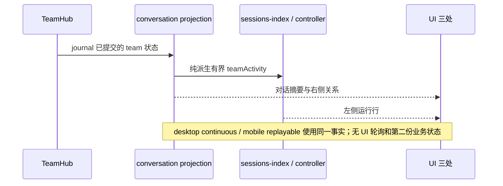

# Agents Team（多代理团队）设计 spec

## 对话优先 UI 与历史查询增量（2026-10-19）

用户确认交互设计后实施，细则与验收见
`docs/agent-team-implementation-2026-10-16/03-conversation-first-ui.md`。
该增量取代下节“右侧默认协作页”规则：默认总览，另设过程与协作；
保留草案审批、停止/恢复、成员只读转录及经 lead 邮箱投递的既有行为。
历史仅来自已保存 journal 的只读分页查询，不以 mailboxTail 冒充历史，
不承诺重建 journal 未记录的成员 working/terminal 边缘。

## 三处 UI 实施增量（2026-10-19）

按已确认的 `docs/agent-team-implementation-2026-10-16/02-three-surface-ui-design.md`
实施主消息当前团队摘要、右侧协作关系页、左侧团队运行行。TeamHub / journal 仍唯一拥有业务事实。

- 新增有界 `SessionSummary.teamActivity`：teamId、name?、status、memberCount、completed、total。
  契约在 shared 新文件定义一次；CLI 从同一 ConversationSnapshot.team 纯派生，参与 sessions-index
  conflation，Host controller 和手机任务快照仅透传。旧帧字段缺席合法；列表不得 acquire 对话。
- 主消息只有一份当前团队摘要，使用实时快照，放在消息列表尾部的通用 footerSlot 内；当前 wire
  没有可靠的建队 turn 联接，故不猜测历史 turn，也不反复向持久消息流插入系统行。
- shell 提供有作用域的团队导航端口：先选择父会话，再调用现有 handleOpenTeamSidePane。
  workspaceIdentity 优先于路径，remoteSessionId 贯穿。无 shell 导航端口的手机/独立预览可展开
  只读协作详情，不额外建立 runtime。
- 右侧默认协作页，保留任务与成员页；依赖图仅用 dependsOn，消息图仅用 mailboxTail，保留
  delivered、at、sourceTaskId/sourceAttemptId。不能把未投递显示为已送达，不能推断交接历史。
  交接页诚实显示当前版本未提供历史。无历史的普通快照不生成任何假记录。
- 图是有界派生；大任务板使用选中任务的直接邻域，并显示范围。缺失引用保留未知节点；失败、
  取消不解锁依赖，循环/未知引用不崩溃。选择、图层、成员下钻仅属于当前 teamId 的局部状态。
- 新主体放 ui-team 新文件；现有接缝：sessions-index schema/controller schema 与 CLI summary
  producer 加 helper 调用，UI/Host/手机摘要映射各加字段，TaskListItem/SessionPane/WorkspaceShellLayout
  只组合新组件或端口；ConversationTimeline 只新增通用 footerSlot。上游同步逐处重放这些接缝。
  手机独立 RemoteConversationTimeline 也在同一 footerSlot 组合摘要，沿用既有 statusSnapshot.team。
- 会话行使用独立公开入口 `team/session-line.ts`，不能因轻量摘要加载成员会话与工具渲染器。
  无 teamActivity 的旧会话直接返回空，不新增 IntlProvider 要求；保留既有行交互回归。



验收：新增 shared summary/schema/conflation、UI 关系纯函数、真实 React 浏览器场景；
运行 Node 声明版本下的 typecheck/lint/architecture 与 CLI 检查，报告实际结果与 E2E 范围。

状态：设计定稿（v3 方案落地稿）；实现进度见实施增量与文末逐里程碑登记。调研与可行性论证见
`docs/agent-team-feasibility-2026-10-16/99-final-report.md`（下称"调研报告"）。
本文是实现的唯一权威依据；与调研报告冲突时以本文为准。

## 0. 决策摘要

- **做什么**：为 Drora 增加 agents team——一个 lead 会话显式创建的命名团队实体，
  含若干长寿命可寻址 teammate、单所有者共享任务板、受限成员消息。
- **不做什么**：不做 handoff 所有权转移、不做 GroupChat 广播发言权、不自建编排框架层、
  不做可视化编排器（Swarm 归档 / Agent Builder 弃用的反面证据，见调研报告 §2）。
- **上游判定（已实证）**：官方 ZCode 上游（3.14.3 原版 bundle + v3.15.1 对齐源码 +
  3.14.3 web snapshot）经穷尽 grep 无任何多代理协作协议面（`team` 字面命中全部为
  Team Coding Plan 订阅套餐、第三方补全/高亮数据与提示词文案）——agents team 是
  **纯 Drora 自研增量**，全部新逻辑放新文件/新模块，经 ports 接入。
- **替换条件**：若上游未来引入团队机制（如 Agent 工具加 name 参数成队），按
  AGENTS.md「官方实现优先」迁移官方契约并删除重复面；每次上游同步跑
  `scripts/check-bundle-key-parity.mjs` 时核对 team 键族。
- **核心裁决**：teammate 在 wire sessionKind 与内部 taskType 上**一律复用
  `subagent_child`**，团队性由请求级 additive 字段承载（§5）。由此全仓 23 处
  `subagent_child` 行为门零改动自动继承（§9）。
- **形态借鉴（dynamic-workflow 三个成熟先例）**：①权限模式在成队那一刻定死并记
  journal，此后 lead 换模式不影响在飞的 team（`workflow-actor-permission.ts` 模式）；
  ②team 是 run 型实体，有自己的状态机、journal 与恢复语义；③显示逻辑独立——专属
  侧栏面板（照 workflowRuns 投影 + WorkflowRunSidePane），会话正文只留紧凑摘要行。
- **二次借鉴（dsh-agent-teams v0.1.23，对照与取舍见 §15）**：①attempt 陈旧尝试防护
  （转派先撤销旧 attempt 并等旧 worker 静默，迟到写入按 attemptId 拒绝）；②事件驱动
  自动调度（成员 idle 即自动认领下一个 ready 任务）；③两阶段成队（staged 花名册+DAG
  审批后才 spawn）；④质量门禁（任务合同+verdict 机器判定，M5 可选）；⑤诚实边界
  声明（投影如实反映持久状态，模型不守仪式不以面板失真掩盖）。
- 实现设计：见 `docs/agent-team-implementation-2026-10-16/00-master-design.md`（2026-10-16 重设计定稿；**2026-10-17 v2 模块化重构**：集成架构改为组装根集中制，上游镜像文件触点 23→3，见该文档「v2. 集成架构重构」章与本文件 §11）。

### 实现设计修订（2026-10-17 v2 模块化重构）

应用户约束（模块化设计、尽量少影响源码、上游同步低成本）对集成架构的整体重写，
**取代下列 2026-10-16 十条中的第 1、2、8 条**（其余七条不受影响）：

- **v2-1（取代 2026-10-16 第 1 条「23 触点」）**：接缝账收敛为上游镜像文件 3 处
  （α 组装根 create-app.ts 单 hunk / β v4 投影 additive 块 / γ 命令注册表一行
  spread）。机制：TeamHub 私有持有 team 化 SubagentPort（`createExploreSubagentPort`
  的 `runExploreAgent` 必传构造回调，runner.ts:110-133）——团队性由「走哪个端口」
  承载，不再穿透请求/options；teammate 生命周期 = 未修改的 runner.ts。23 触点及其
  白名单断链问题类整体消失。
- **v2-2（取代第 2 条「单向 import」）**：subagent.port.ts **零编辑**，循环依赖
  问题不存在；team 类型全部在新文件 contracts team 族。
- **v2-3（取代第 8 条事件分立中的 S6 面）**：session.events.ts 零编辑；hub 事件
  全部走 team journal 自有事件流（TeamRuntimeAdapter 通道保留）。
- **v2-4（新增）**：团队工具注册改为自包含 ToolEntry 闭包 + hub 自建注册表实例经
  `deps.toolRegistry`（agent-runtime.ts:332）注入——types.ts（S3）与
  runtime-tools.ts（S4）零编辑；§6.2 的 TeamPort 接口语义不变，注入方式从 deps
  字段改为闭包捕获。
- **v2-5（新增）**：禁令文本经导出的 `formatIncomingMessage`（incoming-message.ts:12）
  在 team 投递代码内格式化，S5（加 export）撤销。
- **v2-6（新增取舍）**：member-runtime.ts 对 subagent.ts 构造区 ~100 行有意复制
  （失败模式从静默漂移变 typecheck 显式报错）；受限 profile 协作工具强制保留降级
  为 profile 约定（需要机器强制时再评估第 4 接缝）。

### 实现设计修订（2026-10-16）

以下十条为实现设计定稿过程相对本文正文的决策变更（逐条含变更与理由），对应实现设计文档 §10 差异清单 D1-D9（其中 D1 拆为下述第 1、2 条）；本文正文其余章节的完整口径回填按实现设计 PR-0.1 执行。

1. **变更**：接缝触点总数从 spec 的 8 处扩为 23 处：S1 为 launch+复活双链 13 触点（contracts 4 + runner.ts 9）——含 launch 链两道 options 白名单透传（launch :168-171 与 start() :473-481）、复活链 resume 签名 :958-966 加 sendOptions + 调用点 :928-936 透传、resumeRequest :975-985 恢复、runBackgroundAgent :1018-1023 透传；S2 为 3 触点（deps spread/:258-259 mode+planEnabled/:452 sink 三元）；S4 为 4 触点（含 tool/types.ts:87）。**理由**：终审实读证实：start() 在 :473-481 重建 runOptions 仅 signal/model 丢弃 startOptions.teamMemberPort——漏此触点则首次 spawn 成员零协作工具（includeTeam=false，任务板死锁）；resumeTerminalAgentInBackground 签名无 sendOptions 且调用点未传，sendOptions 引用不可编译；补齐后双链运行时可达。
2. **变更**：类型引用裁决为单向 subagent.port.ts →（type-only import）→ team.port.ts：SubagentTeamMemberSpec 与 TeamMemberPort 统一定义在 team.port.ts，team.port.ts 不依赖 subagent.port.ts（TeamSendDelivery 与 subagent.port.ts:74 是字面量对齐非类型引用）；初版 team.port.ts 段「依赖 subagent.port.ts 的类型」声明失实已修正。**理由**：终审指出两文件互指成环违反 AGENTS.md 禁循环依赖纪律；单一方向裁决消除，type-only 单向合法。
3. **变更**：TeamHub 生命周期定为 session 级常驻、内部 0..1 个 team。**理由**：若 hub 随 team 实体生灭，lead runtime 构造时 deps.teamPort 无从注入，TeamSpawn 注册门陷入先有鸡问题。
4. **变更**：TeamSpawn 在 staged 态再次调用 = 原子更新同一草案；一会话至多一个活跃 team；team 投影 status wire 枚举从 spec §6.3 七值扩为八值（加 archived）。**理由**：spec 要求原子更新同一草案但未指明载体；abandonTeamPlan 归档态需要 wire 载体。
5. **变更**：team journal 只记用户/协议动作与板/邮箱数据事实，常规状态迁移与成员运行态不写 journal，恢复后推导。**理由**：「team 状态是投影字段」不变量的工程推论，避免第二份状态。
6. **变更**：v4 用户命令面从 spec 四条补全为八条（+reviseTeamPlan/abandonTeamPlan/haltTeam/resumeTeam）。**理由**：staged 三分支与 halted/escalated 恢复语义需要显式用户命令入口。
7. **变更**：成员移除 v1 只走用户命令 stopTeamMember，不给 lead 模型移除工具。**理由**：给 lead 移除权扩大编排失控面，v1 从紧。
8. **变更**：S6 session 事件三值与 team journal 十五种事件分立两套；hub 发射通道经 TeamRuntimeAdapter.emitTeamEvent 构造时注入。**理由**：session 事件是进程内广播、journal 是持久化事实流；初版 emit 无接口载体。
9. **变更**：TeamPort 拆分为 TeamMemberPort/TeamLeadPort 两级接口配 isTeamLeadPort 谓词；S3 字段类型为 teamPort?: TeamMemberPort（spec §6.2/§11 单一 TeamPort 口径）。**理由**：lead 专属工具需要结构性注册门与冒用免疫；接口签名级变更，PR-0.1 回填 spec 必须同步。
10. **变更**：运行中投递禁令承载 = S2 落点 3 替换 message sink（member-sink.ts，subagent_reply_steer + no_active_turn 20×10ms 重试）；复活链 team 族经 SubagentSendMessageOptions 供给；queued 不算注入、hub 不重发（registry pending 队列已持有，成员下回合 flush）。**理由**：message-steering.ts:32/:44 硬编码 coordinator_steer 无禁令渲染；无重试则 no_active_turn 窗口投递滞留至下次复活且 hub 无重触发点；重发会重复投递。

## 1. 产品规则

| 规则                  | 内容                                                                                                                                                                                                                                                                                                                                                                                                                                                                                                                                         |
| --------------------- | -------------------------------------------------------------------------------------------------------------------------------------------------------------------------------------------------------------------------------------------------------------------------------------------------------------------------------------------------------------------------------------------------------------------------------------------------------------------------------------------------------------------------------------------- |
| 显式成队              | 主入口是内置斜杠命令 **`/team [goal]`**（照 `/workflow` 先例：代码定义 prompt 型内置命令、名字进 shared 帮助表保留字、正文指向 bundled skill `agents-team` 与 staged 流程；斜杠菜单+加号菜单双入口；child 上下文禁用）+ TeamPanel 显式操作；不采用官方 Claude Code「Agent 工具带 name 即隐式成队」（副作用大）。命令与 UI/交互的权威设计见 `docs/agent-team-implementation-2026-10-16/01-command-and-ui-design.md`（先于实现定稿）                                                                                                           |
| 一会话至多一 team     | team 绑定 lead 会话（session-scoped），无嵌套 team                                                                                                                                                                                                                                                                                                                                                                                                                                                                                           |
| 成员上限              | 默认 5，settings 可调（键定义在契约常量区，见 §6.4）                                                                                                                                                                                                                                                                                                                                                                                                                                                                                         |
| 成员不可派生          | teammate 禁止再派生子代理/teammate（现有 child 硬编码 `subagents:{enabled:false}`，`core/src/runtime/methods/subagent.ts:305-308`，保持不动）。第二个理由：团队级取消只需一层 abort 级联（`core/src/subagent/runner.ts:622-654`）即充分                                                                                                                                                                                                                                                                                                      |
| 灰度                  | team 默认关闭，settings/config 显式开启（端口/配置双门先例：`runtime-tools.ts:67-76` offPeak/dynamicWorkflow 同风格）                                                                                                                                                                                                                                                                                                                                                                                                                        |
| 权限模型成队时定死    | 创建 team 时捕获 lead 会话权限模式（plan 不带入，记 build——team 总在执行，与 run 同理）写入 team journal；此后 lead 换模式不影响在飞的 team；resume 从 journal 读回。成员 profile 只能收窄（如 Explore 只读）、不能放宽（§8.1）                                                                                                                                                                                                                                                                                                              |
| 消息零授权            | 任何 teammate 消息不得充当待决权限的批准；被拒操作不得经成员转发绕过（§8.3）                                                                                                                                                                                                                                                                                                                                                                                                                                                                 |
| 用户对成员说话        | 必须经 lead 侧团队命令走邮箱投递；teammate 会话本体只读（v4-bridge 只读守卫自动覆盖，§8.2）                                                                                                                                                                                                                                                                                                                                                                                                                                                  |
| 两阶段成队            | 默认先 staged：花名册占位 + 任务 DAG，**不 spawn 任何成员**；用户在 TeamPanel 审查（可改成员路由/角色/依赖/负责人）后 Approve & Run 才原子创建成员并启动调度。用户明确要求跳过审批时才直通（approval: automatic 同款例外）。**草案校验（2026-10-18 登记）**：stageTeam 源头拒绝成员重名（E13）与悬空 assignee（E14）——wire 面 agent↔task 关系全部按 memberName 联接，重名/悬空会让任务卡负责人、成员下钻与邮箱地址失位；lead 寻址键字面量单一出处为 shared `TEAM_LEAD_ASSIGNEE`（core 以 `LEAD_ASSIGNEE_KEY` 再导出，UI 直接引 shared 常量） |
| 停止与恢复分离        | halted（用户停队：取消 lead 当前回合 + 中断全员 + 冻结调度，team 不删除）≠ escalated（自动循环到上限，升级给用户）；halted 后普通建任务不得静默恢复，必须显式 TeamResume 且带理由                                                                                                                                                                                                                                                                                                                                                            |
| 转派/接管是 lead 专属 | 成员可建任务、可认领，但撤销 attempt 与转派（含 lead 接管）只有 lead 工具能做（§2.3）                                                                                                                                                                                                                                                                                                                                                                                                                                                        |

## 2. 概念模型与状态所有者

### 2.1 术语

| 术语        | 定义                                                             |
| ----------- | ---------------------------------------------------------------- |
| Team        | 绑定 lead 会话的显式命名实体；持有花名册/任务板/邮箱的唯一事实源 |
| Lead        | 用户的主交互会话 runtime（现有 interactive runtime，不新起进程） |
| Teammate    | 命名、长寿命、可寻址的子代理成员；会话层就是 `subagent_child`    |
| TeamBoard   | 共享任务板：三态 + 依赖 + 原子认领的结构化任务列表               |
| TeamMailbox | 成员消息投递队列；写成功（持久化后）才算发送成功                 |

### 2.2 状态所有者表（谁写、谁读）

| 状态                                                 | 唯一所有者（写）                                                                           | 读取方                                                                 | 持久化                           |
| ---------------------------------------------------- | ------------------------------------------------------------------------------------------ | ---------------------------------------------------------------------- | -------------------------------- |
| 花名册（name→agentId/childSessionId/profile/状态机） | lead runtime 内 **TeamHub**（新模块，`core/src/team/`）                                    | lead 模型（经工具）、teammate（经 TeamPort 只读快照）、UI 投影（只读） | team journal（session store 侧） |
| 共享任务板                                           | TeamHub（**所有 board 写操作经 TeamPort 收敛到 hub 串行裁决**，in-process 原子，无文件锁） | 同上                                                                   | 同上                             |
| 成员邮箱                                             | TeamHub 写入并投递（运行中 steer / 终态复活续跑）                                          | 目标成员                                                               | 写入持久化后才 ack               |
| team 权限模式记录                                    | TeamHub（成队时一次写入，此后只读）                                                        | 全体成员构造与复活（hub 花名册记录，经私有端口构造通路）、UI 权限徽标  | team journal `team-created` 事件 |
| teammate transcript                                  | 各 child runtime（现状不变）                                                               | 下钻 UI 只读订阅 child topic                                           | 现有 session store               |
| UI teamStore（`packages/ui/src/store/teamStore.ts`） | renderer 派生缓存，**不得冒充服务端事实**                                                  | —                                                                      | 内存                             |
| Main / 外部 relay / Host facade                      | **零团队业务状态**（AGENTS.md 边界不变）                                                   | —                                                                      | —                                |

所有者判据：与 conversation 投影同源、与 RuntimeTaskRegistry 单 runtime 所有权模型
（`core/src/runtime-task/registry.ts:70-94`）同构，只是从「per-runtime 内存态」升格为
「per-lead-session、跨成员、可持久化」。

### 2.3 任务板语义

- 任务卡 schema（落 `packages/shared/src/drora-protocol-v4/team.ts`，纯 schema+纯函数）：
  `{ taskId, title, spec:{目标,验收标准,产出格式}, status: pending|claimed|in_progress|completed|failed|cancelled,
assignee?, attempt, attemptId, dependsOn: taskId[], artifactRefs[], createdAt/updatedAt,
contract?: { objective, acceptance[], inScope?, outOfScope?, verify? } }`。
  状态机 pending→claimed→in_progress→终态（claimed 不得直接 completed）；依赖只认上游
  **completed**——failed/cancelled 永不解锁下游。刻意不引入 INPUT_REQUIRED 等中间态
  （权限待决由 pendingInteraction 链路自然表达）。`contract` 为 M5 质量门禁的 additive
  预留字段，v1 不强制。
- **原子认领**：`claim(taskId)` 由 TeamHub 单线程裁决；依赖未完成的任务不可认领；
  **一个成员同时至多一个未完成任务**；任务进终态时 hub 解锁依赖它的任务并推送 board 更新。
- **attempt 陈旧尝试防护（借鉴 dsh-agent-teams）**：每次执行携带任务上的单调
  `attempt` 计数与本次唯一 `attemptId`；taskUpdate 必须携带当前 attemptId，
  **迟到写入（旧 attemptId）一律拒绝**。转派（lead 专属 TeamReassign）与 lead 接管
  的顺序是：使旧 attempt 失效 → 中断旧成员 → 等待其静默（终态结算完成）→ 开新
  attempt——新结果不会被旧成员的迟到更新覆盖。成员被移除时同款：撤销 attempt、
  回收其未完成任务、等待中断收敛后重新调度。
- **自动派发（事件驱动调度，借鉴 dsh-agent-teams）**：TeamHub 订阅成员终态事件
  （现有 finalize 链路 + waitForTerminal，无新钩子）——成员 idle 且板上有 ready 任务
  时自动为其认领一个并投递任务卡（走 §7 运行中/复活投递）。**谁该干活由 hub 的
  确定性代码裁决**（强化 §3 拓扑理由 1），成员主动 claim 仍保留为补充；成员消息是
  增强而非依赖的兜底语义不变。lead 离线时调度静止（无轮询），任务与消息留在
  journal 等 lead 恢复——事件驱动而非常驻扫描。
- **冷恢复有界重试**：lead 会话 resume 时，对「开放 attempt 且成员已不在场」的任务
  自动重试**一次**；恢复投递失败则保持原状，**不退化为可无限重派的 pending**
  （dsh 实证的防雪崩语义）。
- **交接纪律**：任务产出默认落盘 + artifactRefs 引用回传，消息只传轻量引用与结论
  （Cognition/MetaGPT 实证：抑制级联幻觉与上下文碎片化）；产物区
  `.drora/team-artifacts/{teamId}/`（清理策略见 §12 开放问题）。
- 默认调度纪律：顺序优先、只读任务才并行（后派者能读先完成者产物）。

### 2.4 成员生命周期（定死：终态 + 复活路线，不新造 idle 钩子）

```
spawned(TeamSpawn) → working(独立 turn)
  → 终态（现有 finalizeBackgroundCompletion 结算：产物落盘 + idle 通知附最终结果，
         core/src/subagent/runner.ts:1497-1574）
  → 消息复活（给终态成员发消息 = resumeTerminalAgentInBackground 同族：
         恢复历史 + 消息为下一条 prompt，runner.ts:958-1036）
  → working … 循环
终态 → removed（用户移除 / lead 会话结束；花名册与终态 registry 条目此时才清）
```

- TeamHub 感知成员转 idle 走既有 RuntimeTaskRegistry.waitForTerminal（`registry.ts:197-204`），
  不新增端口方法。
- 长寿命策略经请求显式传递：spawn 请求带 `memberMaxTurns`（建议默认 40），
  经 `request.maxTurns` 优先级先例（`methods/subagent.ts:284`
  `request.maxTurns ?? this.config.subagents?.maxTurns ?? 4`）生效——**不经 taskType 分叉**。
- 名字重定向防护：花名册记录 name→agentId 绑定；名字移除后重用必须绑定新 agentId；
  TeamSendMessage 校验名字当前指向原成员否则拒绝。

### 2.5 关键事件顺序图

```
用户/lead模型           TeamHub(lead runtime)              teammate A               teammate B
   │ TeamSpawn(name) ──→ 校验花名册/上限/灰度门
   │                    构造 child runtime（复用 methods/subagent.ts:254-392 构造路径，
   │                      taskType 保持 subagent_child；hub 私有端口构造回调注入团队工具
   │                      + memberMaxTurns 显式传入）
   │                    ── spawn prompt(executeTurn) ──→ │
   │                    ←─ claim(taskId) 原子裁决 ────────│ A: 读板/认领
   │                    board 更新 → v4 team 投影(delta)                            │ B: 只读 board
   │                    ←─ TeamSendMessage(A→B) ──────────┼────────────────────────│
   │                    邮箱持久化→ack；B 运行中→steer(subagent_reply_steer)
   │                               / B 终态→复活续跑(消息体自嵌禁令, §7.2)
   │                    ←─ 终态结算(idle 通知附最终结果) ──│ [现有 finalize 链路]
   │ TeamSendMessage(A) → 复活（恢复历史，消息为下一条 prompt）

权限审批上浮：
teammate 工具调用 → permissionService.checkPermission(继承 lead 模式)
  → ask 经 deriveChildClientPorts 路由回 lead session(methods/subagent.ts:324-328)
  → v4 pendingInteraction(subagent origin 携带 parent/child sessionId)
  → 桌面/手机同链路 resolveInteraction 裁决
⟂ teammate 间消息 ≠ 任何批准（硬边界在工具执行前门控，permission-flow.ts:56-96）
```

### 2.6 team 级工作流程（run 型状态机，照 workflow run 形态）

```
created（显式成队：权限模式与成员路由定死并记 journal）
  → staged（两阶段成队：花名册占位 + 任务 DAG，零成员零会话；TeamPanel 可编辑）
      ├─ Approve & Run → active（原子创建成员 + 启动调度）
      ├─ 回对话修改 → 追问一次修改方向，原子更新同一草案（不得另建 team）
      └─ 放弃 → 归档草案，禁止自动重建
  → active（有成员 working 或邮箱有未读）
  → idle（全部成员终态且邮箱无未读——TeamPanel 折叠空闲态）
  → active …（自动派发 / 消息复活 / 新委派再激活）
  → completed（用户收队 / lead 会话正常结束，归档保留完整花名册/板/邮箱）
  / halted（用户停队：取消 lead 当前回合 + 中断全员 + 冻结调度；显式 TeamResume
           带理由才恢复，普通建任务不得静默解除。中断成员的终态边缘在冻结期内被
           消费且不 kick（冻结面）；TeamResume 即唤醒边缘——resume 翻状态后 kickTeam
           重新武装调度：共享池 pending 任务与待投递邮箱由 kick 复活派发，被中断
           成员的 claimed+parked 任务仍 sticky（只由 lead 转派轮换，§16.1）。
           2026-10-21 缺口7 登记前 resume 只翻状态：全员终态后无任何派发边缘可等，
           调度死寂（无轮询），此为中断半边的配套语义）
  / escalated（自动循环到上限：升级给用户裁决，与 halted 语义分离）
  / cancelled（lead 会话被删 / 显式取消）
```

- team 状态是投影字段（§6.3），由 TeamHub 唯一裁决——成员终态/复活/邮箱事件驱动迁移，
  **不是成员状态的重复推导**（避免第二份状态）。
- 恢复语义与 workflow run 同构：lead 会话 resume 时 TeamHub 从 team journal 重放
  `team-created`（含权限模式与成员路由快照）与后续事件，恢复状态机、花名册、板、邮箱；
  在飞成员由既有 child 会话恢复路径（resumeFromStore）承接。

## 3. 拓扑选型结论

**显式 lead 编排（agents-as-tools）+ 单所有者黑板任务板 + 受限成员消息。**

理由（对照调研报告 §5.2 候选表）：

1. 与 turn 所有权模型相容——teammate 各自是独立 runtime/session，各有自己的 TurnMachine
   与命令队列（`core/src/runtime/command-queue.ts:11-17` 串行 admission 不变）；「谁该干活」
   由任务板（确定性代码外壳）表达，LLM 只决定「拆什么、派给谁」。
2. guardrail 集中——权限审批、最终答复收在 lead 一侧，权限上浮链路完全复用现状。
3. 上下文碎片化结构性缓解——成员不互读完整 trace，共享的是任务板 + 落盘产物引用。
4. 成员消息是增强而非依赖——无消息能力时成员仍可凭任务板自领/交付。

## 4. teammate 会话构造（复用清单，不改）

| 能力                                                            | 位置                                                                                                                                                                     | 复用方式                                                                                                               |
| --------------------------------------------------------------- | ------------------------------------------------------------------------------------------------------------------------------------------------------------------------ | ---------------------------------------------------------------------------------------------------------------------- |
| 构造三件套（child runtime + deriveChildClientPorts + 事件镜像） | `core/src/runtime/methods/subagent.ts:254-461`                                                                                                                           | TeamHub 经私有端口构造回调（member-runtime.ts，v2）复刻同款装配并注入团队工具与 memberMaxTurns——subagent.ts 本体零编辑 |
| 后台生命周期/终态结算/abort 级联/复活                           | `core/src/subagent/runner.ts:184-218、622-654、903-1036、1497-1574`                                                                                                      | teammate = 走现有终态结算的后台式 child；TeamHub 保留花名册与 registry 条目                                            |
| lead 接收成员回复                                               | `core/src/runtime/methods/subagent-messages.ts:77-99`（persistSubagentMessageCommand 产生 subagent_reply(\_steer)）                                                      | 成员→lead 方向本来正确，现状复用                                                                                       |
| 工具注册表                                                      | `core/src/tool/registry.ts:12-13`（ToolEntry 自包含）+ `agent-runtime.ts:332`（deps.toolRegistry 注入）                                                                  | 团队工具 = 闭包捕获 hub 的 ToolEntry，注册进 hub 自建注册表实例——runtime-tools.ts 零编辑（v2）                         |
| 权限链路                                                        | permission-flow.ts:56-96、resolveSubagentPermissionMode（subagent.ts:527-549）、subagent origin（interaction-origin.ts:17-37）、v4 pendingInteraction/resolveInteraction | 全部原样（§8）                                                                                                         |
| 成员角色定义                                                    | `.drora/agents/*.md` profile（profile.ts:46-70；color 字段 :30,80 作成员视觉标识）+ ISubagentsService（subagents.ts:15-41）                                              | teammate 角色即 agent profile                                                                                          |
| UI 多会话下钻                                                   | WorkflowActorSessionSidePane.tsx:56-108（父投影门 + 只读 SessionPane 租约复用）                                                                                          | 复制为 TeamMemberSidePane                                                                                              |
| 手机远控                                                        | webRemoteControlSharedHostAttachments.ts:41-189（clientMode=web-remote-replayable 已注入）                                                                               | team 帧沿既有 relay 桥透传，零新语义                                                                                   |

**刻意不动**：Agent 工具 schema（`contracts/src/tools/agent.ts`，现状无 name 参数）与
`Task` 兼容别名（`core/src/tool/compat.ts:2`）——上游对齐文件零改动。

## 5. taskType 复用裁决（本 spec 最重要的单项决策）

- **wire sessionKind = `subagent_child`**：droraSessionKindSchema 闭集不加值
  （旧端收到未知枚举整帧解析失败的偏斜代价，`snapshot.ts:365-368` 注释教训）；
  旧桌面/手机把 teammate 当普通子代理显示，天然优雅降级；任务索引排除
  （droraTaskIndexSyncer.ts:1680）自动沿用。
- **内部 taskType 亦保持 `subagent_child`**。新增 `team_member` 的方向 A **已评估并否决**：
  全仓行为门均为 `=== "subagent_child"` 严格相等（实测 22 处、S2 后 23 处，§9），新值不命中即落入
  非子代理分支——runtimeScope="main"、automation/offPeak 照注册、后台 bash 上限失效、
  下钻/查询链路（subagent-session-query.ts:395、server-operations.ts:1738）跳过导致
  teammate 漏出、tool-allowlist.ts:114 不补回 RespondToCoordinator——逐点改判定 ≈10+ 处
  新接缝，违背最小接缝纪律。
- **采纳方向 B（v2 形态）**：团队性由 **TeamHub 私有 team 化 SubagentPort** 承载
  （`createExploreSubagentPort` 必传构造回调，§11）——不经请求字段、不加构造分支；
  长寿命经构造回调内取 roster 记录值（memberMaxTurns，:284 优先级先例同款）。
- teammate 与一次性 subagent 的区分不在会话种类层，而在 TeamHub 花名册与 team 投影
  （UI 团队面板按 roster 识别）。**会话层 teammate 就是子代理——这正是全族行为门
  自动正确的原因。**

## 6. 新增模块与接口

### 6.1 新增文件总表

| 层       | 新增                                                                                      | 放置                                                                                                                                        |
| -------- | ----------------------------------------------------------------------------------------- | ------------------------------------------------------------------------------------------------------------------------------------------- |
| CLI 契约 | TeamPort 接口 + 请求/结果类型                                                             | `apps/drora-cli/packages/contracts/src/interfaces/team.port.ts`                                                                             |
| CLI 契约 | 团队事件枚举值（TeamMemberSpawned/TeamBoardUpdated/TeamMessageDelivered，additive）       | `contracts/src/events/session.events.ts`（SubagentSpawned 族在 :178-180）                                                                   |
| CLI 核心 | TeamHub / TeamBoard / TeamMailbox / 生命周期 / 工具 / 消息格式化 / 成员投递 / v4 投影产出 | `apps/drora-cli/packages/core/src/team/`（新目录，照 subagent/ 体例；含 member-delivery.ts、message-format.ts）                             |
| CLI 核心 | 工具 handler：TeamSpawn、TeamTaskCreate/Get/List/Update、TeamSendMessage、TeamList        | `core/src/team/team-tools.ts` + `core/src/tool/handlers/team-*.ts`                                                                          |
| CLI 引导 | v4 命令 handler（stopTeamMember/sendTeamMessage 等用户面命令）                            | `bootstrap/src/drora-protocol-v4/commands/handlers/`（注册表 index.ts:16-28 一行 spread）                                                   |
| shared   | team 投影 schema、限额常量、持久化键前缀                                                  | `packages/shared/src/drora-protocol-v4/team.ts`（照 workflow-runs\*.ts：纯 schema+纯函数）                                                  |
| UI       | teamStore.ts                                                                              | `packages/ui/src/store/teamStore.ts`（归属裁决：AGENTS.md 明文 Zustand 状态在 store/ 目录，全局单例状态不适用托管模块自治——本行即裁决记录） |
| UI       | TeamPanel / TeamBoardView / TeamMemberSidePane + hooks                                    | `packages/ui/src/team/`（新托管模块 ui-team，照 gen-ui 三模块样板，architecture-policy.yaml 登记 + 五件套）                                 |
| UI 手机  | MobileTeamPanel                                                                           | `packages/ui/src/mobile`（MobileTaskShell 旁）                                                                                              |

### 6.2 TeamPort 接口（语义签名，非实现）

```
TeamPort —— lead runtime 的 TeamHub 实现，注入 teammate child runtime deps
  roster(): TeamRosterSnapshot                       // 只读花名册
  boardRead(): TeamBoardSnapshot                     // 只读板
  taskCreate / taskUpdate(input): TeamTaskMutationResult   // 写收敛到 hub 串行裁决；
                                                     // taskUpdate 必须携带当前 attemptId，
                                                     // 旧 attemptId 一律拒绝（§2.3）
  taskClaim(taskId): TeamTaskClaimResult             // 原子认领（成功/已被占/依赖未就绪三态）
  send(request: { to: memberName|agentId, message, summary }): TeamSendResult
                                                     // 邮箱持久化成功才算发送成功；
                                                     // 投递结果 queued|steered|resumed
                                                     // （delivery 语义复用 subagent.port.ts:74 枚举）
```

工具面映射：lead 注册全部团队工具（含成员侧没有的 **TeamReassign / TeamResume /
TeamStageApprove**——转派与接管、恢复停队、批准 staged 草案均为 lead 专属）；
teammate 按 profile tools 面裁剪，但 runtime 强制保留 TeamSendMessage 与
TeamTask\*（认领/更新/查询，对齐官方「即使 disallowedTools 也保留协作工具」）；
受限只读角色（Explore 型）不注入 TeamPort 即不注册团队工具。**冒名结构性免疫**：
TeamPort 调用方身份由 in-process 注入确定（port 知道自己注入进了哪个 child runtime），
`from` 不可伪造——dsh 需要「拒绝冒名 from」校验，Drora 结构上不存在此面。

### 6.3 v4 协议投影（B 档，自研面无上游负担）

- **snapshot**：`conversationSnapshotSchema`（snapshot.ts:471-511）additive optional 字段
  `team: teamProjectionStateSchema.optional()`——照 subagents/workflowRuns 先例（:497-500），
  **optional 只服务旧快照 wire 兼容，新 CLI 初始态与每次投影都携带**（workflowRuns
  冷快照教训：漏带会静默消失）。`teamProjectionStateSchema` 字段：
  `{ teamId, name?, status: staged|active|idle|completed|halted|escalated|cancelled,
permissionMode, members[], board{tasks[],limit}, mailboxTail[], artifacts? }`——status 与
  permissionMode 是 team 级状态机（§2.6）与权限徽标（§8.1）的显示依据。
- **delta**：`statePatchSchema`（delta.ts:40-62）新增 optional 键 `team`
  （`team: teamProjectionStateSchema.optional()`）。**模型是键级整体替换**——容器非
  strict，旧桌面收到新键只是剥离该键、保住 patch 其余键（workflowRuns 键 :55-57 同理，
  天然无偏斜防御需求）。花名册 ≤ 成员上限、任务板受 team 限额约束（boardTasksMax，
  建议 100）、消息投影只保留尾窗（teamMessagesRetentionPerMember，建议 20），整键替换
  的字节量有界；**不为 team 开 workflowRun.\* 式两级增量例外**（delta.ts:6-9 注明该例外
  仅此一例），除非实测出现 O(N²) 放大再按 spec 决策流程评估。
- **命令面**：commandPayloadSchemas（command.ts:44-297）加用户面命令
  sendTeamMessage/stopTeamMember/setTeamMemberName 等；逐条对照
  COMMANDS_REQUIRING_BASE_REVISION（command.ts:319-335）归类 CAS——初判全部
  非行级 CAS（团队命令不落 conversation 行），spec 实现时逐条复核。
- **限额**：PROTOCOL_V4_LIMITS（core.ts:64-100）加 team 键；relay envelope 尺寸上限
  （webRemoteControlManager.ts:966-969 oversize 即降级）要求 team 帧有界。
- **legacy 主协议（drora-protocol/index.ts 待删旧面）不做 team 投影——v4-only，
  避免双写**。

### 6.4 契约键单一出处

team 的 wire 命令名、delta 键名、事件枚举值、持久化键前缀（建议 `team.`）、灰度
settings 键、产物目录名，只在 `packages/shared/src/drora-protocol-v4/team.ts` 常量区
与 `@drora/contracts` 定义一次，CLI 与双端同源引用；上游同步键族差分须能甄别
（本行即为 check-bundle-key-parity 的登记说明）。

## 7. 成员消息投递机制（v3 重设计后定稿）

既有事实（实读证实）：`subagent_reply(_steer)` 只在父会话接收侧产生
（subagent-messages.ts:84）；既有注入链路硬编码 `coordinator_steer` 且无禁令
（message-steering.ts:32,44）；复活路径硬编码 `coordinator_input` 即裸 body
（methods/subagent.ts:458-459 + incoming-message.ts:21-22）；
`PEER_PERMISSION_GUIDANCE` 为模块私有常量（incoming-message.ts:5-6）。

定稿设计——投递由 team 模块自有代码（`core/src/team/member-delivery.ts`，新文件）完成，
**不复用 message-steering.ts**：

| 目标成员状态      | 投递方式                                                                                                                                                                                                                                                 | 禁令承载                                                                                                                                                      |
| ----------------- | -------------------------------------------------------------------------------------------------------------------------------------------------------------------------------------------------------------------------------------------------------- | ------------------------------------------------------------------------------------------------------------------------------------------------------------- |
| 运行中            | steerTurn，inputPresentation 选用**现有枚举值** `subagent_reply_steer`                                                                                                                                                                                   | 自动：incoming-message.ts:23-24 渲染 = "Another Drora session sent a message…" + PEER_PERMISSION_GUIDANCE + 回复指引；RuntimeInputPresentation 枚举**零加值** |
| 已终态            | 复活投递（hub 私有端口 sendMessage → 现有 revive 链，裸 body 为 prompt），消息体由 `core/src/team/message-format.ts` 组装：团队头（发件成员/任务引用）+ 正文，经**导出的** `formatIncomingMessage(body, "subagent_reply")`（incoming-message.ts:12）渲染 | 禁令由 formatIncomingMessage 内部渲染（单一出处，零接缝，v2 取代 S5）                                                                                         |
| 未注册/名字重定向 | 拒绝并返回错误                                                                                                                                                                                                                                           | —                                                                                                                                                             |

投递顺序与送达语义（§16.3）：**邮箱优先于新任务派发**；投递权在裁决内领取、
**仅注入被接受后才标记已送达**；任务相关消息带 attempt 世代，attempt 轮换后旧
报告在准入/读取/兜底三条路径自动废弃（叠加在 branchGeneration stale fencing 之上）。

语义复用的可读性债登记：`subagent_reply_steer` 名称与「teammate 收 peer 消息」用途
存在历史错位，值语义（渲染文本「另一会话发来的消息」）吻合故采纳；若后续需按
presentation 区分 teammate 消息，加值的偏斜面已澄清（该枚举不在 v4 wire 面，仅 CLI
本地持久化，读取侧 safeParse 防御），迁移成本可控。

## 8. 权限与安全

1. **权限模式成队时定死**（照 `workflow-actor-permission.ts` 模式，参照
   docs/dynamic-workflow/launch.md「Permissions inside a run」）：创建 team 那一刻捕获
   lead 会话权限模式——plan 不带入（team 总在执行，与 run 同理），记为 build；以可选键
   写入 team journal `team-created` 事件（同款键规：缺席而非 undefined 值）。此后 lead
   会话换模式**不影响在飞的 team**；全体成员的构造与复活均用记录值，经私有端口
   构造回调从花名册读取（覆盖 spawn 时点继承）
   （resolveSubagentPermissionMode，subagent.ts:527-549）。resume 从 journal 读回；记录值
   不在闭合集 `build|edit|yolo|guarded|auto` 内时按缺席处理、回退继承 lead 会话当前模式
   （旧版本不猜不懂的模式的语义——parseWorkflowSubagentPermissionMode 同款纪律）。
   成员 profile 只能收窄不能放宽（Explore 型角色用独立只读 PermissionService，
   :340-343 先例）。plan 工具由 SUBAGENT_CHILD_FORCED_DISALLOWED_TOOLS
   （tool-policy.ts:7-10）结构性剔除——teammate 不可能发起 plan approval，
   **本方案不设任何计划审批例外条款**。
2. **审批上浮单面**：teammate 权限 ask 经 deriveChildClientPorts 路由回 lead session
   （subagent.ts:324-328）→ pendingInteraction 携带 subagent origin → 桌面/手机同一条
   resolveInteraction 链路。多成员并发 ask 各为独立 interactionId 待决项，UI 按 origin
   分组成员徽标（点名格式照 workflowActorInteractionDescription 先例：
   `<memberName> (<teamId>)`），**不合并、不代理裁决**。
3. **输入边界（taskType 复用后自动成立）**：v4-bridge.ts:1764-1771 只读守卫
   （guard.subagentReadOnly）自动覆盖 teammate 会话——teammate 不接受绕过 lead 的直接
   conversation 输入。
4. **代理消息零授权**：硬边界由工具执行前门控（permission-flow.ts:56-96）结构性保证，
   不依赖提示文本；提示层禁令双路承载见 §7。
5. **后台与取消**：teammate 后台生命周期只依赖持久化 profile selection（单次执行模型
   禁入后台，runner.ts:153-167 BACKGROUND_UNAVAILABLE）；团队级取消 = 停止 lead turn
   级联 abort 各成员（一层级联因派生禁令而充分）。
6. **身份隔离**：team 实体绑定 `workspaceIdentity?.trim() || workspacePath`；远程链路
   贯穿 workspaceIdentity 与 remoteSessionId，不按路径匹配。
7. **成员模型路由快照（借鉴 dsh-agent-teams）**：member spawn 时把**最终生效**的
   provider/model/思考档快照写入 team journal；复活与冷恢复一律恢复该快照。解析规则：
   沿用 lead 当前路由时一并继承 lead 当前思考档；显式换 provider/model 任一时自动用
   目标模型默认档；显式指定思考档先校验目标模型兼容、不兼容则创建失败（不静默降档）。
   与 §8.1 权限模式快照同一家族——**建队/建成员那一刻的世界被固定，此后 lead 换
   路由不影响在飞成员**。
   **草案修订回写决策（2026-10-21，缺口10 修复）**：hub 查询面（TeamRosterSnapshot）
   补齐 team `name` 与逐成员 `modelSelection` 回读（additive optional）；reviseTeamPlan
   与 setTeamMemberName 以查询面重建草案入参时**原样回写**这两项。修复前边界：两命令
   重建草案不回写，stageTeam 整体替换 members 并经 journalStagedFact 持久化——草案
   成员的路由快照与本条「建队时刻定死」的语义（team 名同款）会在用户点「回对话修改/
   改名」时被静默清空；v1 无生产 stager 携带 modelSelection 时为潜在回归，UI staged
   编辑器展示路由标签后即成真回归。此前该边界仅在代码注释登记，未留 spec 决策记录
   （违反 AGENTS.md「分歧与边界须在 specs/ 登记」），本次修复时一并补记。
8. **具名工具策略（可选增强，借鉴 dsh toolPolicies，M4 评估）**：部署方在 settings
   声明具名 per-角色工具策略（allow/deny 集）；lead 模型只能**按 id 选择**已声明的
   策略，不能提交原始 allow/deny 列表、不能运行时新建；协作工具强制保留、lead 专属
   工具策略不可重开；解析后的过滤器写入 team journal 供审计，重启后由成员侧描述符
   重放同一过滤。反 laundering 价值：工具面收窄的裁决权在部署方不在模型。v1 可先
   不做（profile tools 治理已覆盖基本需求）。

## 9. subagent_child 行为门验证清单（24 处，零改动验证）

2026-10-16 实测：`grep -rn 'subagent_child' core/bootstrap/services src（非测试）| grep '===|!=='`
共 **22 处**（core/bootstrap 19 + services sessionKind 3）。
**2026-10-20 增补（S2 v3.16.1 上游合并，7d7ee097）**：上游在 server-operations.ts
新增 1 处会话归属守卫（resolve 循环内 `current.taskType !== "subagent_child"`——仅精确
ID 查询可凭持久化父链证明归属，目录/身份不符即拒绝，不回写身份、不激活 runtime），
按 §9 继承原则 teammate 自动继承（同一父链语义），census 22 → **23 处**
（core/bootstrap 20）。
**2026-10-21 再清点（v3.16.1 合并 S3 task-facts 重构后）**：repairSubagentTaskIndex.ts
随重构迁至 services/src/task-facts/（门随文件走），droraAgentService.ts 新增 1 处
会话归属守卫（按继承原则 teammate 自动继承），census 23 → **24 处（15 文件）**。分布：

| 文件                                                                                                                         | 处数 | 继承效果（taskType=subagent_child ⇒ 自动获得）                                                                                                 |
| ---------------------------------------------------------------------------------------------------------------------------- | ---- | ---------------------------------------------------------------------------------------------------------------------------------------------- |
| core/src/runtime/helpers/runtime-tools.ts（:56/:67/:72/:214/:228/:269）                                                      | 6    | RespondToCoordinator 注册门、automation/offPeak 不注册、subagentBackgroundBashMaxMs 适用、runtimeScope="subagent"、isSubagentChildRuntime 标记 |
| core/src/runtime/methods/background-notifications.ts                                                                         | 2    | 通知封印按子会话现状                                                                                                                           |
| bootstrap/src/drora-protocol/server-operations.ts（:1734 S2 新增/:1817/:2036）                                               | 3    | 子会话下钻/查询包含 teammate；S2 新增会话归属守卫（精确 ID 凭父链证明归属，teammate 同样适用）                                                 |
| bootstrap/src/app/subagent-observation.ts（:51/:95）                                                                         | 2    | 子代理观察面适用                                                                                                                               |
| bootstrap/src/drora-protocol/subagent-session-query.ts:395                                                                   | 1    | `!==` 跳过逻辑不命中 ⇒ 查询包含 teammate                                                                                                       |
| bootstrap/src/drora-protocol/v4-bridge.ts:1764-1771                                                                          | 1    | 只读守卫覆盖 teammate                                                                                                                          |
| core/src/runtime/helpers/tool-allowlist.ts:114                                                                               | 1    | RespondToCoordinator 经 allowlist 补回                                                                                                         |
| core/src/runtime/methods/model-request-session-type.ts、turn-model-step-usage.ts、background.ts                              | 3    | 模型请求归类/用量/后台语义按子会话                                                                                                             |
| core/src/telemetry/runtime-telemetry.ts                                                                                      | 1    | telemetry 归类                                                                                                                                 |
| services：droraTaskIndexSyncer.ts:1680、droraTaskServiceAdapter.ts、task-facts/repairSubagentTaskIndex.ts（2026-10-21 迁移） | 3    | 任务索引排除 teammate（不出现在任务列表）                                                                                                      |
| services：drora-agent/droraAgentService.ts（2026-10-21 新增）                                                                | 1    | 会话事件归属守卫：teammate 会话事件同样按父链归属，不串主会话                                                                                  |

**继承原则（入 spec 的机制约定）**：上游后续新增任何 subagent_child 门，teammate 自动
继承其行为——默认正确，因为 teammate 本质就是子代理；若某新门语义确需区分，按 spec
决策流程逐点评估（是未来事项，不是本方案前提）。M1 验收将本清单自动化为回归测试。

## 10. UI 与多端

> 本节为纲要；完整 UI 与交互设计（/team 命令契约、入口面、端到端交互流、
> staged 审批编辑器、组件树与 token 纪律、手机端、异常交互、交互级验收）以
> `docs/agent-team-implementation-2026-10-16/01-command-and-ui-design.md` 为权威。

- **桌面（desktop-continuous）**：TeamPanel 是 team 的专属显示面，结构照
  WorkflowRunSidePane 的 run 形态三段式——①状态头：team 状态机徽标（active/idle/…，
  §2.6）+ 权限模式徽标（§8.1 记录值）+ 成员数/板进度摘要；②进度视图：任务板三列
  （pending / in progress / completed，依赖以缩进表达）即 team 的「phase 图」；
  ③成员卡列表：名称/角色 profile/color/状态，点击下钻 TeamMemberSidePane（复制
  WorkflowActorSessionSidePane.tsx:56-108「父投影门 + 只读 SessionPane 租约」）看
  transcript 并可发消息（走 v4 命令）。**team 的显示逻辑独立于 conversation 行流**：
  lead 会话正文只留一行紧凑 team 摘要行（照 workflowRun 在 conversation 的呈现），
  细节全部在面板。消息流尾窗摘要；全 idle 30s 折叠、>3 idle 折叠为「N idle agents」；
  subagent 与 teammate 混排同面板。数据全部来自 conversationProjectionStore 的 team
  投影，**不走第二条真相通道**；派生视图状态入 teamStore。
- **staged 审批视图（两阶段成队）**：staged 态的 TeamPanel 即草案编辑器——成员行
  （名称/角色/路由只读展示；「路由/角色/思考档可改」与任务 DAG「负责人/依赖可改」
  归后续卡，前置条件见 §15「明确不做」登记——本行 2026-10-23 收窄，消除与 §15 的
  自相矛盾，实现与 wire 现状均为只读）；
  「确认并启动」（v4 命令 approveTeamPlan）是唯一创建成员的入口；「回对话修改」把
  草案标记为等待反馈、取消规划回合并只追问一次修改方向，之后必须原子更新同一草案
  （不得另建 team）；「放弃」归档草案并禁止自动重建。审批面挂载于会话流卡
  （TeamConversationSummary staged 分支）与侧栏（TeamSidePane → TeamPanel）两处，
  呈现规则一体适用。**审批面呈现规则（2026-10-22 登记，对齐 workflow 确认面板
  WorkflowPermissionBlock 的问句表头/信息层级语汇）**：
  - **问句表头**：编辑器顶部新增问句行（「启动这支团队？」语义，文案走 i18n）+
    「N 名成员 · N 项任务」计数（原 stagedSummary 文案移作表头计数）；会话流卡头
    已有团队名与状态徽标，表头不重复。表头为 team 自有实现，**不 import
    WorkflowCardChrome / WorkflowPermissionBlock**——后者的 workflow 图标硬编码于
    `packages/ui/src/components/workflow-timeline/WorkflowCardChrome.tsx:24`
    （WORKFLOW_CARD_ICON）与 :176（表头消费），team 决策卡借用即把 workflow 徽记
    带进 team 语境：对齐的是问句/层级的**语汇**，不是 workflow 的徽记资产。
  - **审批面定义即全量呈现，不设「显示完整草案」折叠**：批准的知情面 = 编辑器
    所见——wire 草案刻意只投影呈现字段（teamStagedDraftTask 仅
    taskId/title/assignee/dependsOn，`drora-protocol-v4/team.ts:232-239`；
    goal/acceptance/output_format 是批准后经 task_created 落板的执行字段），编辑器
    呈现即草案全量，无「折叠内容」可言；E13/E14 结构校验（§1 草案校验）只证明
    结构合法，不得拿来冒充「用户已知情批准」——折叠会制造「看到的与批的不是
    同一份」。
  - **信息层级**：成员组/任务组分组呈现，技术值（路由/任务 id/依赖 id）等宽，
    字级只用 DESIGN.md text-ui-* 刻度。
  - **三动作失败出显**：approveTeamPlan/reviseTeamPlan/abandonTeamPlan 的
    TeamCommandOutcome（`packages/ui/src/team/commands.ts:44-48`）必须有 UI 消费面
    ——编辑器内联失败提示（role=alert，按 ack.reasonCode 出 i18n 文案，未知
    reasonCode 有兜底文案），废除「失败只进 logger」（commands.ts:70-77 warn 现状）
    的无消费现状；hub 状态机与 shared wire 零结构改动（借形不借管线：对齐的是
    workflow 确认面板的呈现语汇，不接权限请求管线，命令单一通道不变）。
  - **触达**：编辑器内全部可交互控件（三动作按钮、改名铅笔/输入/确认/取消）
    pointer-coarse ≥44px（DESIGN.md:661-662；写法参照
    `TeamConversationSummary.tsx:73` 的 pointer-coarse:min-h-11/min-w-11）。
- **Web/手机（web-remote-replayable）**：冷快照必须携带 team 字段（§6.3）；
  MobileTeamPanel = 任务板只读 + 成员状态 + 发消息/停止走既有命令链路（replayable
  自动 inputOrigin=mobile 语义不变）；不为手机另起 Agent/Host；replayable 不产生
  telemetry/CUA observation 的 facade 现状对 team 无例外。
- **恢复语义**：lead 会话 resume 时 TeamHub 从 team journal 恢复花名册/板/邮箱未读；
  成员 transcript 本就以 childSessionId 落 session store；终态成员按 §2.4 复活。
  branchGeneration stale fencing（subagent-messages.ts:26-42）对迟到成员消息照常生效。

## 11. 接缝清单与上游同步重放方式

> **2026-10-17 v2 模块化重构（组装根集中制）**：应用户约束「模块化设计、尽量少
> 影响源码、上游同步低成本」，本节整体重写。v1 的 S1-S6（穿透式：SubagentLaunchRequest
> 加字段 + runner.ts 13 触点 + 构造分支 + deps 字段 + 注册门 + export + 事件枚举）
> **全部撤销**——团队性改由「TeamHub 私有 team 化 SubagentPort」承载
> （`createExploreSubagentPort` 的 `runExploreAgent` 必传构造回调，runner.ts:110-133，
> 上游自己装配 createDefaultSubagentPort 的同款机制）：teammate 只从私有端口出生，
> 全部生命周期代码 = 未修改的 runner.ts；团队工具 = 闭包捕获 hub 的自包含 ToolEntry，
> 注册进 hub 自建并经 `deps.toolRegistry`（agent-runtime.ts:332）注入的注册表实例；
> 禁令文本经导出的 `formatIncomingMessage`（incoming-message.ts:12）在我们的投递
> 代码里格式化，单一出处保持。v1 终审发现的「options 白名单断链」问题类（两道
> 对象字面量白名单 + 复活链作用域）**结构性消失**。机制证据表与架构细节见实现
> 设计文档「v2. 集成架构重构」章。

**A 档·上游镜像文件接缝 3 处（α/β/γ；原 S1-S6 撤销）**：

| #   | 位置                                                                                    | 改动                                                                                                                                                                                                           | 重放                 |
| --- | --------------------------------------------------------------------------------------- | -------------------------------------------------------------------------------------------------------------------------------------------------------------------------------------------------------------- | -------------------- |
| α   | `bootstrap/src/app/create-app.ts:791` 组装根                                            | 单 hunk（约 3-5 行）：deps 传 hub 自建 `toolRegistry` 实例 + 构造后调用 `installDroraAgentsTeam(...)`（新文件 bootstrap/src/app/drora-team/install.ts，供给 emitParentEvent/enqueue 通知等管道件并建 TeamHub） | 加回一个 hunk        |
| β   | v4 snapshot/delta 组装处（bootstrap v4 projection，实现时以 workflowRuns 键组装点定位） | additive 块（约 2-4 行）：`...(teamState ? { team: teamState } : {})` + delta 键                                                                                                                               | 加回一个 additive 块 |
| γ   | v4 命令 handler 注册表 commands/handlers/index.ts:16-28                                 | 一行 spread（注册表设计内扩展模式）                                                                                                                                                                            | 加回一行             |

**代价（有意取舍）**：member-runtime.ts 对 subagent.ts 构造区做 ~100 行有意复制
（用可见复制换不可见穿透——上游改构造签名时我们的文件在 typecheck 显式报错，
而非接缝语义静默漂移）；受限 profile 的协作工具强制保留降级为 profile 约定
（team 角色显式列协作工具或 `tools:["*"]`；如需机器强制再评估 tool-allowlist.ts
加 1 行，届时登记为第 4 接缝）；CLI 内部事件走 team journal 自有事件流，
不动 session.events.ts。23 处行为门继承不变（§9 照旧）。

**B 档·自研协议与界面的全新文件（δ）**：shared team.ts + snapshot/delta/command
additive（v4 为自研协议面无上游负担）；ui store/team 模块/mobile +
architecture-policy.yaml ui-team 登记（全新文件无上游冲突）。

**C 档·`/team` 命令面（2026-10-17 新增，全部 additive/新文件，照 `/workflow`
先例 `builtin-workflow-command.ts` 体例）**：

| #   | 位置                                                                       | 改动                                                                  |
| --- | -------------------------------------------------------------------------- | --------------------------------------------------------------------- |
| C1  | `packages/shared/src/drora-slash-command-help.ts`                          | additive 帮助条目（Drora 自有文件；保留字/TUI 候选/App 目录唯一出处） |
| C2  | `bootstrap/src/builtin-team-command.ts`                                    | 新文件（命令正文：指向 `agents-team` skill 与 staged 流程）           |
| C3  | `bootstrap/src/builtin-prompt-command.ts`                                  | 分发表加一个分支                                                      |
| C4  | `create-app.ts` 子上下文守卫（:904 同款）                                  | 一判（可并入 α hunk）                                                 |
| C5  | contracts `AGENTS_TEAM_SKILL_NAME` + bundled `skills/agents-team/SKILL.md` | additive 常量 + 新文件                                                |

## 12. 里程碑与验收

**M0：spec 与上游对拍（约 1 周）**——本文件评审通过（含状态所有者表与事件顺序图）；
§9 清单逐点有验证记录；architecture-policy.yaml 登记 ui-team 五件套骨架；
`pnpm architecture:check --changed` 通过。
验收：spec 评审签字；22 处清单核对完成。

**M1：CLI 内核（约 2-3 周，无协议改动）**——contracts team 类型族（不动
subagent.port.ts）；core/src/team/ 全套（私有端口 member-port + member-runtime +
attempt 防护 + 事件驱动自动派发 + staged 草案状态机内核）；bootstrap drora-team/
install.ts + 组装根接缝 α；灰度开关。
验收：① 单测——板原子认领并发（两成员同 claim 仅一成功）、依赖阻塞与终态解锁、
写成功即发送（邮箱持久化前不 ack）、名字重定向拒绝、复活消息体含禁令文本
（经导出 formatIncomingMessage 渲染，单一出处断言）、**权限模式成队定死**（成队后 lead 换模式，新 spawn 成员仍用
记录值；team 状态机迁移 staged/active/idle/halted；记录值不在闭合集时回退继承）、
**attempt 防护与调度故障矩阵**（借鉴 dsh 实测集：转派先撤销旧 attempt 并等静默后
迟到写入被拒 ×50、7 路认领竞争仅一成功、终态覆盖尝试 ×40 被拒、消息突发 ×42
不丢不乱序、成员移除回收任务并重派、冷恢复开放任务重试恰一次且失败不重派）；
**§16 实现级协议断言**——缺 attempt_id 与被撤销 attempt 的错误分类文案、终态署名
追补不改 verdict、新 attempt 清空旧证据、被移除成员的下一次 TeamPort 调用即拒、
attempt 轮换后旧成员报告经世代过滤不被投递、仅过时邮件触发的新回合被整体拒绝、
依赖产物预算截断（2k/项、12k 总量）、lead 接管 idle 归还池；
② 会话级
e2e——spawn 2 命名成员→委派→终态结算 idle 通知→自动派发下一任务→
消息复活；③ **行为门零改动回归**（§9 清单自动化）——runtimeScope=subagent、
automation/offPeak 未注册、下钻查询包含 teammate、直接对 teammate 发 conversation
输入被只读守卫拒绝、memberMaxTurns 显式传递生效（不落 `?? 4` 截断）；④ 权限——
成员写操作 ask 以 subagent origin 出现在 lead 待决面、拒绝后经 TeamSendMessage 转述
批准无效；⑤ typecheck/lint/architecture:check 全绿并如实报告。

**M2：协议与桌面 UI（约 2 周）**——shared team.ts + snapshot additive + delta 键 +
命令面（含 approveTeamPlan）；`/team` 内置命令（C1-C5）与 bundled skill；
teamStore/TeamPanel（含 staged 审批视图）/TeamBoardView/TeamMemberSidePane，
按 `01-command-and-ui-design.md` 的组件树与交互流实现。
验收：① v4 冻结面黄金测试（additive optional 全带 default——meta 字段教训
snapshot.ts:482-485）；② 旧快照（无 team 字段）旧端解析不破坏；③ 桌面 E2E
（desktop-continuous）：实时帧、断线 resync 后 team 面板一致、**staged→编辑→
Approve & Run→成员创建的全流程**（Approve 前零成员零会话）；④ 冷快照必带 team
字段的 round-trip 测试。

**M3：持久化与 replayable（约 2 周）**——team journal 持久化 + lead resume 恢复；
MobileTeamPanel；背压限额。
验收：① 刷新/重连/手机冷恢复后成员、板、**权限模式记录与 team 状态机**不丢（journal
重放读回一致，未知模式值回退不猜）；② web-remote-replayable E2E：gap 重放、
消息尾窗裁剪、envelope 有界；③ 迟到成员消息 branchGeneration 丢弃验证。

**M4：治理与打磨（约 1-2 周）**——团队级预算（token/成员数/并发，usage 聚合进 A 区
usage 投影）、空闲回收、质量门 hooks 评估（TeammateIdle/TaskCompleted 挂现有
workspace hooks 机制）、具名工具策略评估（§8.8）。
验收：预算超限拒绝新 spawn 且文案明确；团队取消传播（停 lead 全员级联终止，
halted 不删除 team）测试；两链路回归全绿。

**M5：质量门禁（可选，按需启动；借鉴 dsh quality-gates）**——任务 contract 字段
启用（§2.3 预留）：kind（work 默认 / requirements / implementation / verification /
review / repair / integration）；review 与 requirements 任务 verdict=pass 才能
completed，needs_revision/reject 必须 failed 且至少一条 finding；审查失败自动创建
repair + 下一轮 review（repair 不依赖 failed review；不复活终态任务、不用消息代替
门禁）；maxReviewRounds 上限后转 escalated 升级用户；完成时 changedPaths 范围审计
（诚实定位：完成时审计而非写拦截——同 dsh 第一版边界，不宣传成硬安全边界）。
验收：非法 completed 被机器拒绝（无 verdict/无验收证据/越界路径）；自动 repair 链
与轮次上限升级 e2e；「几个 Agent 互相说 OK」不构成终止条件的判定测试。

## 13. 风险与开放问题

**风险**：① token 放大（Anthropic 实证约 15 倍）——产物落盘+引用回传、last_message
回传、板级预算三重抑制，功能定位收窄在可并行的大范围调研/批量验证/多模块任务；
② 编排失控（官方早期失败案例：简单查询 spawn 50 个 subagent）——显式成队 + 上限 5 +
扩缩规则入 lead 系统提示 + 灰度默认关；③ 上游同步漂移——v2 后仅 α/β/γ 三处单
hunk 接缝需按 §11 重放；上游改 child 构造签名时 member-runtime.ts 在 typecheck
显式报错（可见失败模式），靠 check-bundle-key-parity 预警；④ 多成员并发权限风暴
UX——逐条裁决不改语义，UI 分组
降噪；写写冲突不在 v1 仲裁（靠任务板依赖）；⑤ 单进程资源压力——5+ 成员并发 CPU/
内存/句柄 M4 实测。

**已知边界（诚实声明，借鉴 dsh）**：模型可能完成任务却不执行预期的任务状态更新
仪式——TeamPanel 如实反映 TeamHub/journal 状态，不以面板失真掩盖；lead 汇总以
TeamStatus/journal 为准。lead 离线时调度静止（事件驱动无轮询），任务与消息留在
journal 待恢复。固定协议纪律：团队工具经端口在场即注册，团队协议段自 lead 首个
team 请求起固定——创建/批准/继续/暂停/归档**不重写 system prompt 与工具 schema**
（dsh 渐进加载撤回的实测教训：中途切换提示词让请求前缀缓存命中显著下降）；核心
规则不依赖工具结果，历史压缩后仍可读。

**开放问题**：① 上游未来引入团队机制触发替换条件的核对节奏（每次上游同步）；
② teammate 是否放开派生只读 Explore 子代理（当前禁止，放开需重设计两级级联）；
③ 跨会话/跨窗口共享同一 team（当前绑定 lead session，其他窗口只读订阅；workspace
级管理面留待真实需求）；④ 产物区清理策略（对照官方 cleanupPeriodDays）；⑤ 团队级
compact 策略（lead 压缩时任务板引用防失真）；⑥ 团队命令的 CAS 归类逐条复核（§6.3
初判为非行级，实现时验证）。

## 14. 与官方 Claude Code Agent Teams 的有意分歧（对照记录）

| 分歧点       | 官方                                | Drora                                | 理由                   |
| ------------ | ----------------------------------- | ------------------------------------ | ---------------------- |
| 成队方式     | Agent 工具带 name 即隐式成队        | 显式 TeamSpawn                       | 副作用可控             |
| 任务板一致性 | 文件锁                              | 单所有者内存板（TeamHub 串行裁决）   | 全 in-process 天然原子 |
| 进程模型     | tmux/split-pane（Windows 缺口）     | 全 in-process child runtime          | 天然覆盖 Windows       |
| 恢复         | resume 丢队友（官方自认实验性缺口） | team journal 整体恢复 + 终态成员复活 | 状态作为可恢复事实     |

## 15. 与 dsh-agent-teams 的对照与取舍（v0.1.23，2026-10-16 调研）

调研对象：NanmiCoder/dsh-agent-teams（DeepSeek Harness 多代理团队插件，2183 星），
README + docs/usage.md + docs/quality-gates.md + docs/progressive-loading.md。

**借鉴（已吸收进本 spec）**：

| 机制                 | dsh 实现                                                                                  | Drora 落点                      |
| -------------------- | ----------------------------------------------------------------------------------------- | ------------------------------- |
| attempt 陈旧尝试防护 | 单调 attempt + 唯一 attemptId；转派先失效旧 attempt、中断并等旧 worker 静默；迟到写入拒绝 | §2.3                            |
| 事件驱动自动调度     | 成员 idle 事件 → 自动认领下一个 ready 任务并唤醒；无轮询                                  | §2.3 自动派发                   |
| 两阶段成队           | staged 花名册 + DAG，Approve & Run 才 spawn；修改走同一草案原子更新                       | §1 / §2.6 / §10                 |
| 质量门禁             | 任务合同 + verdict/findings 机器判定 + 自动 repair 链 + 轮次上限升级                      | §2.3 contract 预留 + M5（可选） |
| 成员模型路由快照     | 最终生效 provider/model/effort 记入 team 记录，续聊/冷恢复恢复快照                        | §8.7                            |
| 具名工具策略         | owner 声明策略 id，模型只能选不能造原始列表；解析结果入记录可审计                         | §8.8（M4 评估）                 |
| halted ≠ escalated   | 用户停止与自动循环上限分离；显式 resume 带理由                                            | §2.6                            |
| 冷恢复有界重试       | 开放 attempt 冷启动自动重试一次，失败不退化为无限重派                                     | §2.3                            |
| 冒名防护             | 拒绝冒名 from；身份凭持久登记不凭 label                                                   | §6.2（结构性免疫，无需校验）    |
| 故障矩阵测试         | 8 成员 31 节点 DAG、50 迟到写入、7 路认领竞争、40 终态覆盖、42 消息突发                   | §12 M1/M3 验收                  |
| 固定协议             | 团队生命周期操作不重写 system/tools（渐进加载撤回的实测教训）                             | §13 已知边界                    |
| 诚实边界声明         | 面板如实反映磁盘真相，模型不守仪式不掩盖                                                  | §13 已知边界                    |

**不借鉴（与理由）**：

| dsh 设计                                                           | 不取理由                                                                                                                                              |
| ------------------------------------------------------------------ | ----------------------------------------------------------------------------------------------------------------------------------------------------- |
| 状态存工作区文件 `.agent-teams/` + 面板 1s 轮询                    | Drora 有 v4 投影（快照+delta）、双链路交付与 session store journal、workspaceIdentity 隔离——文件态会污染用户仓库、无法覆盖 web-remote-replayable 语义 |
| fork 子代理后端（memberProvider: spawn/fork）                      | Drora 子代理无 fork 后端（会话 fork 是另一概念）；现有 spawn 构造路径 + 终态复活已覆盖 durable member 语义                                            |
| 插件 capability seam（ctx.tools / ctx.subagents.startContinuable） | Drora 原生实现：私有端口 + 组装根 3 接缝（§11 v2），权限继承与 23 处行为门全链自动继承                                                                |
| 任务创建 captain-only                                              | 保持黑板开放（成员可建任务，Anthropic 板自治实证）；吸收的是转派/接管/恢复 lead 专属                                                                  |
| 中途增删工具/替换 system 的渐进加载                                | dsh 自己已撤回（缓存命中显著下降）；Drora 以固定协议纪律直接规避（§13）                                                                               |

## 16. 实现级协议细则（源码级借鉴 dsh-agent-teams，2026-10-16 二次调研）

本节是对 §2.3/§2.4/§7 的实现深度补充，依据 dsh src/{scheduler,mailbox,lineage,state,members,tools}.ts
实读提取；验收断言落入 §12 各里程碑。

### 16.1 竞态与一致性协议

- **双令牌模型**：`attemptId`（UUID）= 工作者更新任务的**能力凭证**；`handoffId`（UUID）=
  一次交接的**世代号**，序列化异步静默过程。TeamHub 是唯一写者（单线程串行裁决），
  但中断与静默是异步的，交接协议固定为：
  1. 裁决内：失效旧 attemptId、置 `reassigning=true`、铸造新 handoffId、清空上一轮
     结果（见下「结果归属」）；
  2. **裁决外**：中断旧成员并等待其终态结算（不持裁决等待，避免阻塞其他裁决）；
  3. 再入裁决：校验 handoffId/assignee/reassigning 三者未变——变了说明有更新的交接
     在途，**拒绝覆盖新状态**（新者胜）；未变则提交新 attempt。
- **读新于裁决内**：所有裁决临界区重新读取 hub 当前状态，不使用进入临界区前的快照。
- **派发失败回滚只撤销自己的票**：回滚前校验任务 attemptId 仍等于本票 attemptId；
  恢复投递失败则恢复原世代并保持 parked（不退回 pending），仅新派失败才退回 pending
  ——防止一次失败投递无限消耗 attempt（dsh 冷恢复雪崩防护的实现级形态）。
- **迟到写入的错误分类（教学式文案）**：缺 attempt_id ≠ attempt 已被撤销——前者提示
  「用当前 assignment 的 attempt_id 重试本次更新，不要重启工作」；后者提示「任务已
  转派，停止工作」。**错误文案即协议**：模型照错误信息行动而不是猜。
- **终态不可变 + 署名追补**：终态结果不可改；所有者与 lead 可**追加**
  acceptanceResults/commandsRun/evidence_note 作为署名补充证据，不改变 verdict、
  不需要重新认领（「完成的工作不得为补证据而重做」）。
- **结果属于单个 attempt**：开新 attempt 时清空上一轮的 output/verdict/findings/
  changedPaths/验收证据——重试必须自证，不得继承旧证据。
- **成员级派发串行**：同一成员的派发操作在 hub 内串行排队，两次 kick 不会并发派
  两张票给同一成员。
- **严格迁移表**：pending→claimed→in_progress→终态；claimed 不得直接 completed；
  同态更新幂等允许（补证据场景）。

### 16.2 任务维护协议

- **claim 只领不派**：成员 claim 返回 attemptId 作为后续更新凭证；唤醒与派发是
  lead/hub 的动作（TeamReassign / 自动派发），二者分离——避免「领取即开跑」与
  hub 派发竞争。
- **lead 接管守卫**：lead 同时至多一个未完成接管；接管在新 attempt 上直接置
  in_progress（lead 已在发起接管的回合内，无 claim 握手）；lead 回合结束（idle 边）
  时未完成的接管自动归还共享池——lead 没有调度通道去恢复被遗弃的接管，不归还
  就会变成永久 parked 的 claimed 任务。
- **工单陈旧警告（contractSnapshot）**：带合同的任务创建时快照工作区相关路径摘要；
  派发时对比——不一致则在派工提示注入「工作区已变化：先重读引用文件、按内容锚点
  定位、目标不存在时报 blocker 而不是硬改」（M5 范围，§2.3 contract 字段预留）。
- **verdict 起始快照**：review 类任务在 attempt 开始时快照 in-scope 路径内容——审查
  结论必须能声明它审的是哪个版本的树；审查期间他人改树，结论不得自称审的是稳定
  字节（dsh issue #161，M5 范围）。
- **成员移除安全序**：失效 attempt → 回收未完成任务 → 排空/中断 → 等待结算 → 重新
  调度；**每次 TeamPort 调用校验花名册在场性**（被移除成员的驻留会话在下一次端口
  调用即被拒，冷恢复同检）；**退休成员持久拒绝表**——被移除的成员永不接受复活/
  续聊（dsh retired-members.json 语义），防「移除后又被消息复活」。
- **LLM 失败处理**：成员回合在模型侧重试耗尽后失败 → 开放 attempt 记为 failed（附
  可行动的路由命名错误，含 fallback 提示），**不强制置 idle、不自动重试该任务**；
  备用路由按配置选择。
- **依赖产物预算**：派工提示递归收集已完成依赖的产出（拓扑序、环只截断该分支），
  单项截断 2000 字符、总量预算 12000 字符，超预算从最旧开始丢弃——上下文有界交接。
- **派工提示的工作者契约**：领任务（拿 attemptId）→ in_progress → 终态；每次更新
  带 attemptId；被拒为 stale 即停止；完成后向 lead 发带 source_task_id/
  source_attempt_id 的报告并转 idle；只做本任务与 in-scope 路径。

### 16.3 通信协议

- **邮箱优先**：pending 邮件先于新任务派发（邮件是真实的待处理工作）；投递链：
  裁决内领取投递权 → 注入（steer）→ **仅在被接受后标记已送达**，失败释放投递权
  留待重试。
- **世代过滤（isCurrentMail 语义）**：携带 sourceAttemptId 的任务报告，仅当源任务
  仍处于该 attempt 且仍指派给发送者才算「当前」；任务定向邮件仅当任务仍处于该
  attempt、仍指派给收件者且处于 claimed/in_progress。**attempt 轮换后，旧工作者的
  报告在准入、读取、兜底三条路径上都被自动废弃**——新工作者永远不会读到旧工作者
  的迟到报告。Drora 落点：TeamMailbox 在 subagent-message branchGeneration stale
  fencing（subagent-messages.ts:26-42）同族语义之上叠加 attempt 世代过滤。
- **回执准入（ack 只认注入）**：只有真正注入收件者回合的消息才标记已读；冗余唤醒
  抑制（终态通知与已读报告重复时丢弃重复唤醒）；**仅由过时邮件触发的新回合整体
  拒绝**（不为噪声唤醒模型），已有回合中的重复消息透传不阻塞。
- **结构化溯源**：每份报告头部携带 `[Source task X, attempt_id Y, status=Z]`。
- **损坏降级不劫持**：邮箱/状态读取异常时降级为直通，绝不阻塞宿主的回合准入
  （Drora 对应：TeamPort 异常返回错误给调用方，不影响 runtime 主循环）。
- **lead 世代链身份**：team 身份记录 leadSessionId；**lead 会话的 fork 沿世代链
  继承 lead 身份**（报告投递给最近的在世 fork 后代，持久记录仍写给记录的 lead）；
  成员会话与成员的 fork **永不**匹配 lead 身份（fail-closed——成员的父链包含 lead
  session id，不得据此获得 lead 权限；Drora 的 fork 会话种类真实存在，此规则必填）。
  世代深度上界 32、环防护。

### 16.4 Drora 映射说明

- dsh 的 withTeamLock（进程内 promise 链互斥）在 Drora 由 TeamHub 单所有者天然覆盖
  （hub 是唯一写者）；需显式实现的是**裁决外静默等待 + 再入校验**（16.1）与
  per-member 派发队列（16.1）。
- dsh 的磁盘真相 + 回执准入在 Drora 由 team journal（真相源）+ TeamPort 直投
  （结构上无冒名）覆盖；需显式实现的是**世代过滤**与 **ack 只认注入**（16.3）。
- contractSnapshot / verdictStartSnapshot 属 M5；§2.3 contract 字段已预留。

### 实现登记(2026-10-17,M1 落地收官)

M1 内核已实现并通过验证(分支 feat/agents-team,提交 7e82ba92..55019312;41 测试绿、
team 相关 typecheck 零错误、架构检查 0 违规)。以下五项为实现期裁决,补充登记:

1. **member-runtime 装配路线 = 路线 1(全复制,§11 v2 代价条款的修正登记)**:
   原装配依赖 subagent.ts 模块私有 helper(resolveSubagentMcpAccess/resolveSubagentToolAllowlist/
   resolveSubagentSkillPort/validateSubagentComputerUseConfiguration,约 400 行,不可导入)。
   裁决保住「上游镜像文件零编辑」:member-runtime.ts 复刻可导入装配面 + v1 收窄(下条)。
2. **v1 收窄**:teammate 不带 MCP / skills / CUA / 持久记忆(上述私有 helper 四域),
   PR-1.6 补齐;运行时断言①④已实证收窄不阻碍协作面可达。
3. **parentToolCallId 替代键**:模板的 traceStringAttribute(trace,"parentToolCallId")
   依赖私有 helper,member-runtime 用 `team:{agentId}` 稳定键替代(deriveChildClientPorts
   仅用于展示/路由,不影响持久化事实)。
4. **灰度过渡**:v1 经 env `DRORA_AGENTS_TEAM=1` 显式开启(settings 键
   `agentsTeam.enabled` 的设置面在 M2 与 /team 面板同批接入;builtin-prompt-command
   分支与 create-app 接缝同门)。
5. **PR-1.1′d 断言结果**(运行时可达,tests/team/team-install-runtime.test.ts):
   ① 私有端口 spawn → 共享注册表同时含团队工具与内建工具(白名单断链问题类结构性不存在);
   ② 终态复活投递消息体含零授权禁令(formatIncomingMessage 单一出处);
   ③ 灰度关注册表无任何 Team\* 工具;
   ④ steer 载荷 presentation 中性无双包装。

C 档 `/team` 命令(C1-C5)已落地:shared 帮助表条目 / builtin-team-command.ts /
builtin-prompt-command 分支(env 同门灰度)/ 子上下文守卫为结构性满足
(member-runtime 不装配 app 命令面,成员会话无斜杠命令入口)/ contracts
`AGENTS_TEAM_SKILL_NAME` + bundled skill `skills/agents-team/SKILL.md`。

### 实现登记(2026-10-18,PR-2.4c UI 接线收口与 PR-2.5b 摘要行改期)

桌面 UI 接线收口(分支 feat/agents-team):成员下钻 + 发消息全通(TeamPanel
onMemberClick/onMessageMember → TeamMemberSidePane setActiveMember;下钻 composer
onSendMessage → commands.sendTeamMessage,唯一通道 = lead 邮箱投递);ui-team 公开
入口补 TeamMemberSidePane re-export,app-shell 深路径导入同步收回。对话侧触发按
01-design §2 三入口落地:

1. **staged 自动打开（2026-10-22 已废除，用户裁定）**:原 PR-2.4c 以 TeamStagedAutoOpenBridge
   (App 每 workspace 常驻)监听 staged 边沿自动打开 TeamPanel。该桥把上游
   RemoteConversationAvailability 的 `h-full` 包装裸挂在 App 顶层 fragment(无布局上下文),
   `h-full` 解析为整窗高度——启动恢复活动会话即把 DesktopWindowFrame 顶出一屏
   (dev 实证壳层 flow 1354→2708、#root 被滚动 582.5px,即「上灰区下界面」回归)。
   裁定:审批对齐 workflow 模式——**会话流内、用户驱动**。staged 审批面(TeamStagedEditor
   同款:确认并启动/回对话修改/放弃)内联进会话流已有的 TeamConversationSummary 卡
   (staged 分支;connection.sendCommand 走 team/commands.ts 单一通道,与面板内审批同
   路径;无连接的历史视图退化为只读摘要)。自动打开桥与 shouldAutoOpenTeamPanel 边沿
   函数整体删除,布局回归随之消亡。回归测试
   packages/ui/test/teamConversationSummaryStagedApproval.test.tsx。01-design §2
   入口3/§3.1 的「自动打开」语义就此作废——入口始终用户驱动(会话流卡片/面板入口),
   不抢焦点。
2. **会话正文团队摘要行 → 改期 PR-2.5b(有意分歧,如实登记)**:01-design §3.5 的
   「conversation 行流中 team 生命周期摘要」v1 **未实现**;面板开态徽标(tab 标题
   TeamTabStatusDot,色 + sr-only 文字并行)作为 v1 简化先行。正文行流改造涉及
   v4 行流组装面,不与本卡混排,PR-2.5b(staged 审批视图 + 桌面 E2E)承接。
3. **加号菜单入口**:ChatPromptActionMenu QUICK_COMMANDS 增「组建团队」(chat.composer.
   addTeam),照 /workflow 双入口先例——选中即插入 /team 命令标签,可用性以 CLI
   catalog 为权威(灰度关 / child 上下文无候选时入口自然消失)。

### 实现登记(2026-10-18,M3 内核落地)

journal 持久化/resume 恢复/退休拒绝表/awaitingFeedback 回填已实现(提交 0fa21ddc;
并行卡 2c776c09 同期落地 agent↔task 关联展示修复与草案源头校验 E13/E14,合并态
core 79 + ui 52 测试绿)。补充登记:

1. **journal 事件清单(十五事件基础上实作 +3)**:escalated/archived(hub 已有动作点,
   不记则恢复后丢失「升级待决/归档禁止自动重建」语义,§2.6)与 message_delivered
   (送达 ack 是邮箱数据事实,§16.3 ack 只认注入;不记则恢复后重复投递)。
2. **恢复时机约束**:install 为新会话与 resume 共用装配点,restore 随装配调用一次、
   fire-and-forget——装配完成→恢复完成窗口内团队工具/命令看到「无 team」,冷快照可能
   缺 team 键,恢复完成后经 TeamStateChanged delta 收敛;窗口内已创建新 team 时恢复让位
   (adoptRestored 不覆盖现役记录)。PR-3.2 冷恢复 E2E 须覆盖此窗口。
3. **journal 刷盘为异步串行**(persistMailboxEntry 的异步降级同款契约):入队后刷盘前崩溃丢
   最后几条事实,只退化崩溃恢复。E12 全同步邮箱持久化已接线(2026-10-23 收口,v1 装配缺口
   闭合;订正本条早前「仍待接线」表述——终局复核发现跨项遗留,单项纪律均无过错):
   install persistMailboxEntry(install.ts:160)经 sessionStore.saveSessionEntry 同步入队,
   写成功才算发送成功,同步抛错由 hub enqueueMail 转 mailbox_persist_failed;于
   install.ts:306 注入 TeamHub(create-app.ts:921 灰度门内),行为由
   team-install-runtime.test.ts ⑪⑫(:533/:568)锁定。恢复读取面边界(同日补登记):
   team.mailbox 类型条目当前为只写 durable 通道,无路径读取该类型条目,恢复数据源仍是
   journal message_appended/message_delivered 重放(journal.ts:379-386)——install.ts:180
   warn 注释已按此口径表述,spec 在此补登记。
4. **成员运行态不入 journal 的推论**:恢复后成员一律推导 terminal(诚实态);活跃 team 冷
   恢复为 idle 而非 active;复活/重跑走既有 resume 链路由边缘事件重驱;冷恢复单次重试
   依赖重放保留的 attemptId/recoveryRetried(已持久化),自动触发接线属 PR-1.6 面。
5. **note 边界**:bootstrap reviseTeamPlan handler v1 不消费 wire note;面板将 note 拼进
   composer 预填(「要调整什么?
   {note}」)避免用户输入丢失,note 仍照常上 wire;hub 未来
   消费 note 时改为仅预填追问文案。
6. **预填回调契约**:仅传文本(string),替换 vs 追加语义由宿主实现决定(先例:knowledge
   handoff 非空拒绝/suggested prompt insert-replace);宿主接线点=AnimatedSidePanePanel
   →会话 composer 链路(候选:store requestComposerTextInsert 扩展,或 knowledge-handoff
   式目标会话 window 事件)——未接线期间 revise 行为=只发命令,与接线前一致。

### 实现登记(2026-10-18,M4 治理)

1. **静默通道接线完成**:install interruptAndSettle = 成员在飞后台任务 stopTask +
   taskRegistry.waitForTerminal(30s 上限,超时抛错 → 转派保持 in-flight,
   spec §16.1 协议不变);此前 v1 缺席=静默立即成功语义,自此转派/接管真正等待结算。
2. **冷恢复自动重试接线完成**:restore 采纳团队后逐成员 recoverOpenAttempt 恰一次
   (recoveryRetried 已持久化天然防重复;失败仅 warn 不阻断装配)。
3. **membersMax 可配置**:settings `agentsTeam.membersMax`(1-16,缺省 5,spec §1),
   全链 contracts RuntimeConfig / adapters schema / create-app 透传 / install 消费;
   超限拒绝文案=team_members_max 既有语义(spec §1 预算验收的成员数半部落地)。
4. **空闲回收=结构性免费(评估结论,无代码)**:成员终态即后台结算(finishBackground
   链路),架构上不存在驻留 idle 运行时;消息复活链路即回收后的再激活通道——
   无需独立回收器,官方 dsh 的 parked 驻留问题在本架构不出现。
5. **hooks 评估(结论=暂不接线)**:TeammateIdle/TaskCompleted 可挂现有 workspace hooks
   机制(评估过承载面),但 v1 无真实消费场景实证;建议随真实使用反馈再接,避免空转面。
6. **token 预算 defer(残留)**:usage 聚合进 A 区 usage 投影是独立特性(spec §12 M4
   原文),不在本批;成员数/板容量两维预算已生效,token 维度登记为 M4 残留待续。

### 实现登记(2026-10-18,真实实例验收——发现 slashCommands 失效缺口)

dev:desktop 真实实例 + CDP 验收。**已实证通过**:settings `agentsTeam.enabled=true` 写入
~/.drora/cli/config.json 后灰度面生效链、CDP 驱动(9229)、composer 注入、草稿跨重启持久、
可用性门拦截无模型发送、cherry-pick 0bd6aa18(droraCuaPlaceholder 占位修复,基线缺失会
dev:desktop 启动即崩)。**发现真实缺陷(PR-2.5b 头号项)**:

- **slashCommands 目录不随 install 失效**:App 启动窗口期(装配完成前)渲染进程首拉
  workspace-config/session 快照,slashCommands 被定为不含 team 的目录并缓存;install 完成
  (hub 注册)后**无失效机制**,刷新页面/重开菜单仍读旧目录——/team 不出现在斜杠面板。
- **实证**:文件埋点显示时序 `SLASH agents=false`(目录含 team,白名单修复已在 bundle)
  → `INSTALL sess_…`;重载页面后无新 SLASH 装配调用(目录来自会话快照缓存)。
- **修复方向(PR-2.5b)**:TeamStateChanged 时失效/重推该会话 slashCommands(键级 delta 或
  会话快照 revision 抬升);或 install 同步先于渲染进程首次订阅(装配顺序前移)。
- **dev 基建陷阱(两次踩实)**:dev:desktop 构建脚本对 cli/dist/drora.cjs 存在即复用旧
  bundle(脚本注释自认"陈旧 3 天,改动静默不生效")——CLI 侧改动后必须删
  `apps/drora-cli/packages/cli/dist/drora.cjs` 再启动,否则「改动没进去」伪装成「代码没作用」。

### 实现登记(2026-10-18 续,真实实例验收第二轮——/team 菜单缺显排查)

重建 bundle 后 /team 仍未出现。已排除:白名单(bundle 含 team ✓)、目录装配调用
(埋点实证 listProtocolSlashCommands 有被调用且 agentsTeamEnabled=显式 false)、
键错配(hub 注册键与会话键一致,LOOKUP 命中实证)。**剩余唯一可疑环**:
`getInstalledTeamHub(候选 app.sessionId)` 在目录装配时刻返回 undefined——即装配门
(install)与目录装配(listProtocolSlashCommands 调用方)不在同一判定上下文,或
create-app 的灰度 env/settings 未达目录装配所在进程/时机。已落地的 workspace 级门
(任一 in-memory 会话装配即开)为此环的正确形态;下一轮排查方向:

1. 在 v4-workspace-config 装配处文件埋点输出候选 app.sessionId 清单与逐个 LOOKUP 结果;
2. 核对 DRORA_AGENTS_TEAM 是否到达目录装配所在进程(host child spawn env);
3. 若确认为 host child spawn env 过滤,修=把 agentsTeam 设置值经 spawn args/env 显式传入。

### 实现登记(2026-10-19,/team 菜单缺显根因定谳与双环修复——冷启动实证入菜单)

六轮文件埋点逐环取证(多轮实例重启),推翻上节全部三条可疑方向,**真因是两个
时序环,灰度 env/settings 链路本身健康**(env 到达 ✓、装配门开 ✓、hub 登记 ✓、
目录门 lookup 命中 ✓):

- **环 1(服务端,补拉时机)**:install 的初始 TeamStateChanged 广播发生在
  createDroraApp **内部**,而协议层 `runtime.subscribeEvents`(→onSessionEvent→
  网关 team_state_changed 重拉拦截)在 createDroraApp 返回、record 创建之后才挂
  ——live 链路必然错过该广播;且 v4 目录重拉走 live session 快路径,要求 record
  已在 `context.sessions`(接缝放 materializeSessionRecord 内部即因早于
  sessions.set 而拉空)。**修复**:网关公开 `refreshWorkspaceConfig(workspaceId)`
  (pull+publish+flush 与 live 拦截共用一线),drora-team 新文件
  `config-invalidation.ts` 的 `notifyAgentsTeamConfigInvalidated`(hub 装配事实
  单点裁决)由 server-operations 的**新建与 resume 两个 `sessions.set` 之后**补拉
  (单行接缝 ×2 + 单 import,符合最小接缝纪律)。事件本体仍由 install 广播入档,
  本 helper 只补协议层一跳,零第二份状态。
- **环 2(渲染层,消费通道缺位)**:启动窗口期首拉目录(hub 未装)被
  droraSessionStore 缓存且水合守卫「非空即跳」永不自愈;服务端环 1 的补拉只进
  v4 workspace-config publisher——**无人订阅就没人收到**(渲染层此前只有一次性
  readWorkspacePresentation RPC,无该主题订阅者)。中间方案的两次证伪如实登记:
  (a) team 投影 undefined→defined 边沿(da50ce18 原案)双重死锁——面板仅在有
  team tab 时挂载,且 hub 在 lead 创建团队前 `snapshot()` 返回 undefined(record
  未立),投影键根本不存在;(b) 「会话首份快照到达」一次性重拉仍竞态——网关
  cold activation 的快照先于 CLI resume 装配完成到达,拉到的仍是装配前目录
  (窗口探针实证 fired+got 五项)。**最终修复**:渲染层订阅
  `workspace-config/<workspaceKey>` 主题(handshake 先行,ACK 前帧缓冲,帧回放
  回写 setSlashCommands/setConfigOptions;组装故障退订重订,CLI 换代按代际重建),
  hook 单一出处 `packages/ui/src/team/workspace-config-catalog-sync.ts`
  (`useWorkspaceConfigCatalogSync`),挂载点为工作区常驻的 SessionPane(draft 态
  也在)。此后任何服务端目录失效(装配完成、灰度变更)都经推帧自然收敛。
- **实证**(dev 实例 + CDP 驱动,2026-10-19):冷启动→打开任务会话→斜杠面板
  六项含 `/team Assemble an agent team for a goal.`(截图
  D:/tmp/agt-menu-open-task.png);订阅链零错误日志。ui team 测试 52/52 绿;
  v4-gateway-workspace-config/sessions-index 测试 29/29 绿;改动文件 oxlint 干净
  (既有 max-lines/unused 发现经 clean HEAD 对照确认为分支既有)。v4-gateway.test.ts
  单例失败为分支既有漂移(clean HEAD 复现,与本修复无关)。
- **草稿态边界就此消除**:订阅挂在工作区常驻面板,draft 态(尚无会话)同样收
  到装配完成的推帧——此前登记的「草稿态菜单缺 /team」边界由本方案覆盖。

## 12. 设置面接入与两处运行时断链修复（2026-10-21）

用户实测报告两项断链（输入框无 /team 目录项；用 /team 后消息流与侧边栏均无 team UI），与工作流审查缺口③④同根，本节登记修复：

1. **根因（两项同源）**：team 默认关闭且设置页无开关，v1 仅 env `DRORA_AGENTS_TEAM=1` 可开——
   hub 未装配 → 斜杠目录门（workspace-model-runtime 按装配事实）不放行 `/team`（问题①）；
   v4 会话快照永远没有 `team` 键 → SessionPane 的 TeamConversationSummary（消息区，已在
   SessionPane.tsx 挂载）零触发（问题②；当时同批挂载的 App.tsx 自动开侧板桥已于 2026-10-22
   废除，见 §10 实现登记——staged 审批改会话流内联）。桌面消息区渲染**本来就接线完整**，
   无需新增渲染面。
2. **修复面**：
   - `builtin-prompt-command.ts` 展开门消费调用点的 `agentsTeamEnabled`（此前声明了参数却调
     无参 resolveAgentsTeamEnabled——只认 env，settings 开启时 `/team` 提交不展开）；
   - AppSettings 新增 `agentsTeamEnabled`（默认 false；schema/patch/protocol 三处 + 遥测目录
     `settings.agents_team`），设置页新增开关行（i18n 双语，说明"新会话生效"）；
   - 桌面 Host env 桥：`resolveAgentsTeamHostEnv(setting, inherited)`（desktopRuntimeEnv）——
     设置开启即注入 `DRORA_AGENTS_TEAM=1` 到 Host/Agent 进程；未开启时保留 dev shell 透传
     （v1 过渡回落）。spawn 旗标快照在启动与设置 sync 时刷新（存量 Host 重开会话跟进）；
   - 优先级不变：CLI config `agentsTeam.enabled` 显式值 > 桌面设置(env) > 默认关
     （resolveAgentsTeamEnabled 裁决链单一出处，env 字面量收口 shared `DRORA_AGENTS_TEAM_ENV`）。
3. **§9 census 再清点**：repairSubagentTaskIndex 随 v3.16.1 合并 S3 迁至 task-facts/、
   droraAgentService 新增 1 处归属守卫——23→24 处（15 文件），FROZEN_GATES 与本表已同步。
4. **回归测试**：protocol-slash-commands（/team 门三态：显式 true 展开/false 拦 env/缺省回落
   env/全关拦截）、desktopRuntimeEnv（env 桥三态）、userActionTraceCatalog（settings 叶子 17）、
   behavior-gates.snapshot（24 门）全绿。

## 13. 对照 workflow 的事件与交互优化（2026-10-21 施工）

对照 workflow 审查（缺口编号族接 §12 已登记的 ③④）续登两批施工：事件批（缺口1/2/6/7，
core hub + bootstrap install 面）与交互批（缺口9/10，v4 handler + UI 面）。逐条按
「触发场景 → 根因 → 修复机制 → 回归测试」登记，登记时逐文件核对工作树 `git diff HEAD`。
spec 先行面随批更新：§2.6 补 halted 中断/resume 唤醒语义（缺口7）、§8.7 补草案修订
回写决策（缺口10）；§9 census 表仅随格式化对齐（内容未变）。

### 事件批（缺口1/2/6/7）

1. **缺口1｜派发回调把 sendMessage 失败当已接受（假回执）**
   - 触发场景：派发通道向成员 sendMessage 走 runner 失败路径（典型：冷恢复形态
     roster 有终态成员、本进程 registry 无其任务），邮件实际未送达。
   - 根因：install 派发回调原只判 `delivery !== "queued"`；runner 失败返回体
     （createSendMessageFailure）无 delivery 字段且 status="failed"，
     `undefined !== "queued"` 把失败误判为已接受 → hub markDelivered + journal
     message_delivered 记假回执、派发票据不回滚、recoveryRetried 白耗。
   - 修复机制：显式按 status 裁决——`delivery.status === "success" &&
     delivery.delivery !== "queued"`（install.ts:231）；queued 仍不算送达（§16.3）。
   - 回归测试：team-install-runtime.test.ts ⑤「dispatch channel does not treat
     sendMessage failure as accepted (no fake receipt)」——ghost 成员投递失败后
     mailbox 条目 deliveredAccepted=false、deliveredAt 缺席（不 ack 不记回执）。
2. **缺口2｜成员运行态边缘零生产接线 + spawn 臆造身份（自动派发死寂）**
   - 触发场景：Approve & Run 后成员首回合结束/进行中，花名册永远停在 spawning——
     routeMail 只认 working/terminal → 消息永远 queued、终态边缘不触发 kick、
     team 永挂 active。
   - 根因（两层）：(a) hub.markMemberWorking/handleMemberTerminal 此前只有测试调用，
     生产面无人把成员运行态变化通知 hub；(b) spawnMembers 臆造 `agent_` 前缀 id 与
     childSessionId 回填 roster（launch 的 sessionId 也误传臆造 childSessionId）——
     registry、sendMessage 派发与成员工具路由（按 childSessionId 联接）全部找不到成员。
   - 修复机制：接线走既有 RuntimeTaskRegistry.subscribe（§2.4：不新增端口方法）：
     running 边缘 → markMemberWorking、终态边缘 → handleMemberTerminal（内部刷新
     状态并 kick，邮箱优先/自动认领；fire-and-forget 失败仅 warn），lastSeen 去重防
     terminal→terminal 重复触发（install.ts:150-193）；spawnMembers 改用 launch 返回
     的真实 agentId/childSessionId（async_launched 校验，install.ts:273-284），父会话
     回归 lead.sessionId；launch 前预分配 agentId 并预登记装配期绑定
     （pendingSpawnBindings + member-port 透传 createAgentId 工厂，member-port.ts:22-29、
     install.ts:331-335/351-358）——成员首回合构造发生在 confirmMemberSpawned 之前
     （roster 仍 pending_ 占位），预登记保 §8.1 读到成队定死的权限模式而非回退
     lead 当前模式。
   - 回归测试：team-install-runtime.test.ts ⑥「member terminal edge drives
     auto-dispatch through the real send channel」——不直接调 handleMemberTerminal，
     断言首回合自然终态 → 任务自动认领（claimed/assignee）→ 复活回合翻回 working →
     再终态收敛。
3. **缺口6｜Approve & Run 逐成员 spawn 非原子（部分失败留孤儿与脏事实）**
   - 触发场景：批量 spawn 第 k 个成员 launch 失败（如未知 profile），前 k-1 个已成真。
   - 根因：原实现逐个 confirmMemberSpawned（member_added journal 与真实身份分批
     落库），失败路径不回收已启动成员（孤儿子代理在飞）；错误码混用
     mailbox_persist_failed——spawn 失败（该重批草案）≠ 消息未发出（该重发消息），
     混用误导调用方恢复路径。
   - 修复机制：全部 launch 成功后才一次性 confirmMemberSpawned + 注册
     memberPortByChildSession + 补一次运行态同步（事实与真实身份同批落库，
     install.ts:313-322）；失败反向 settleMemberTask（M4 静默通道抽出的共用 helper，
     install.ts:136-165）回收已启动成员并清空装配期绑定，原始错误照常上抛（hub
     回滚草案、零确认零 journal 污染；回收失败仅 warn，孤儿最坏由进程退出兜底）；
     错误码独立 member_spawn_failed（core errors.ts:112、cli contracts
     team.port.ts:205；shared/drora-protocol-v4/team.ts 无错误目录，未改）。
   - 回归测试：team-install-runtime.test.ts ⑦「Approve & Run spawn is atomic:
     partial failure recycles launched members and keeps the draft clean」——
     member_spawn_failed 专用码、roster 全员 pending_ 占位零确认、已启动成员被
     stopped 终态回收（事件落 lead 会话）。
4. **缺口7｜halt/removeMember/resume 的中断与重调度半边缺失**
   - 触发场景：停队后在飞成员回合继续跑到自然终态；移除成员后回收回池的任务无人
     唤醒（滞留 pending）；halt 消费掉终态边缘后 resume 只翻状态——共享池与邮箱
     无派发源（事件驱动无轮询，§2.3），调度死寂。
   - 根因：haltTeam 只翻状态记 journal；removeMember 缺 §16.2 移除安全序后两步
     （排空/中断 → 等待结算 → 重新调度）；resume 无唤醒边缘；portTaskUpdate 无
     halted 门（在飞成员回合仍可推进板状态，违背 §2.6 冻结调度）。
   - 修复机制：halt 对 working/spawning 成员裁决外 interruptAndSettle（静默失败不
     回滚冻结，被中断成员终态边缘由缺口2 接线收敛，hub.ts:410-416）；
     removeMember 完成静默后 kickTeam 重调度（hub.ts:552-558）；resume 即唤醒边缘
     ——kickTeam 重新武装调度，被中断成员的开放 attempt 仍 sticky park 只由 lead
     转派轮换（§16.1，hub.ts:432-443，escalated→resume 同理）；portTaskUpdate 补
     halted 拒绝（hub.ts:922）。
   - 回归测试：team-hub.test.ts「halt interrupts in-flight members (spec §2.6)
     and freezes task updates too」「resume re-arms dispatch after halt consumed
     the terminal edges (缺口7 resume 半边)」「removeMember interrupts the member
     and wakes teammates to reclaim recycled work (spec §16.2)」；
     team-journal.test.ts 序列断言随 resume kickTeam 追发的 task_updated 事实调整
     （resumed 之后仅允许任务事实族）。
   - 未做（如实登记）：halt 不取消 lead 自身回合（无现成 hub 依赖通道，审查修法
     清单未要求）；冷恢复成员的 memberPortByChildSession 重建为存量缺口
     （install.ts:315 仅 spawn 路径填充，消费端 install.ts:373）。

### 交互批（缺口9/10）

5. **缺口9｜团队面板「回对话修改 / 在主会话中引用任务」composer 预填断链**
   - 触发场景：staged 编辑器点「回对话修改」或任务详情点「在主会话中引用」——
     命令发出但会话输入框无预填（onPrefillComposer 回调无挂载点实现）。
   - 根因（两层，第二层为 HEAD 时 revise-prefill.ts 头注所记边界）：(a) 预填回调的
     Composition root 在 app-shell 之外，挂载点从未接线；(b) 唯一通用插入通道
     requestComposerTextInsert 的消费门（SessionPane externalTextInsertRequest）
     原为 `focused && sessionId === null`——只覆盖聚焦草稿 composer，团队场景的
     目标 lead 会话聚焦（主场景）时请求被丢弃。
   - 修复机制：WorkspaceShellLayout 提供 handlePrefillComposer（走 workspace store
     的 requestComposerTextInsert 既有通道，与插件 mention 同通道，不新造第二条
     composer 写路径），经 AnimatedSidePanePanel → TeamSidePane 注入
     onPrefillComposer；TeamSidePane 两条链（revise 预填 + onQuoteTask）随行
     tab.parentSessionId 作 targetSessionId 定向（不由消费端猜「当前聚焦的是不是
     lead」）；消费门扩展为 `(targetSessionId ?? null) === (sessionId ?? null)`
     （SessionPane.tsx:5398——缺席仍 = 草稿，建议 prompt/插件 mention 等既有生产方
     语义不变；主/辅 pane 同聚焦时按会话定向保证单一消费者不双插；目标未聚焦时
     请求留 store 待聚焦后应用）；store 契约（droraSessionStoreTypes.ts:132-138、
     workspace slice）与 ConversationComposer 的 ExternalTextInsertRequest 增设
     targetSessionId 路由元数据（composer 本体不读）；revise-prefill.ts 头注由
     「接线缺口登记」改记已接线与消费门语义。
   - 回归测试：teamSidePanePrefillMount.test.ts「TeamSidePane onPrefillComposer
     mount chains (缺口9)」4 例（revise 预填/note 随行/onQuoteTask 格式化/回调缺席
     诚实降级）；animatedSidePanePanelTeamPrefill.test.ts「AnimatedSidePanePanel
     team branch forwards onPrefillComposer (缺口9)」2 例（team tab 原样转发/缺席
     不下发）；v4SessionPaneComposerInsertTarget.test.ts「SessionPane composer
     插入请求消费门（缺口9）」8 例（lead 聚焦主场景闭环/草稿语义不回归/跨会话不
     劫持/非聚焦不消费/源码形态防回归）。
6. **缺口10｜setTeamMemberName 为 v1 stub + 草案重建丢 name/modelSelection**
   - 触发场景：staged 草案期改名无入口、命令链抛 teamCommandUnsupported；且
     reviseTeamPlan 以查询面重建草案不回写 team 名与逐成员 modelSelection——
     stageTeam 整体替换 members + journalStagedFact 会把 §8.7「建队时刻定死」的
     路由快照与 team 名静默清空并持久化（UI staged 编辑器展示路由标签后即成真
     回归）。
   - 根因：handler 为 M3 占位 stub（V4TeamUnsupportedError）；hub 查询面
     （TeamRosterSnapshot）缺 name 与 modelSelection 回读，此前该边界仅代码注释
     登记、无 spec 决策记录。
   - 修复机制：查询面 additive optional 补齐（TeamMemberView.modelSelection
     （team.port.ts:67-73）+ TeamRosterSnapshot.name（:81-82）；hub.snapshot 逐字段回读
     hub.ts:172/182）；setTeamMemberName 以 reviseTeamPlan 同款机制实现——
     snapshot/board 重建草案 → stageTeam 原子更新同一 teamId（staged 再次
     stageTeam 不另建 team，§10）→ 改名成员的任务 assignee 同批重定向（否则
     draft_unknown_assignee 拒绝）；非 staged（已 spawn）明确拒绝 team_not_present
     （spawn 后改名待内核改名端口，M3+），不在册成员复用 member_removed 语义码
     （handlers/team.ts:238-248）；reviseTeamPlan 与 rename 重建时均原样回写
     name/modelSelection；V4TeamUnsupportedError stub 移除（八条命令统一装配门
     teamHubUnavailable）。UI：改名入口放 staged 编辑器成员行（TeamStagedEditor
     DraftMemberRename，本地门只做非空与「有变化」，重名/长度由 wire schema 与
     hub 草案校验单一出处拒绝；TeamSelectionDetails/成员下钻仅在非 staged 渲染、
     内核拒绝该态改名）；「移除成员」入口接成员详情（TeamSelectionDetails）与
     下钻头部（TeamSidePane），均二次确认走 confirmDialogStore（useConfirmDialog），
     文案列移除影响面（回收任务 + 退休拒绝表，§16.2）；TeamPanel 动作区注释漂移
     按实际归属修正（send/stop/rename 三条命令的真实入口面）。
   - 回归测试：team-commands-smoke.test.ts ②——rename 正路径（同 teamId 原子
     更新、assignee 重定向、name/modelSelection 回写断言）+ 非 staged 拒绝
     （team_not_present）+ revise 同款回写断言；teamSidePanePrefillMount.test.ts
     「TeamSidePane staged rename entry (缺口10)」2 例、「TeamSidePane stop
     member entries (缺口10)」3 例（含取消确认不上抛）；i18n.test.ts 补
     stop/rename 文案键（teamMessages.ts 双语单一出处）。

### 批次外必要文件与验证口径（如实登记）

- team-commands-smoke.test.ts（core/tests）：① 未装配断言原对 setTeamMemberName
  单方面期待 teamCommandUnsupported，handler 去 stub 后必红；且它是 handler 行为
  改动的直接测试——必要改动而非顺手改。
- 验证口径（批次报告转录，本节登记未复跑）：apps/drora-cli 的 `pnpm lint` 包装
  脚本在干净基线（stash 对照）同样失败，判定环境性问题；改以逐文件
  `oxlint --no-ignore` 替代（0 警告 0 错误）。

## 14. 收口施工（批次 2，2026-10-21）

对照审查缺口 5/8/11/12 与两处登记边缘 + 一项调查新发现的致命缺口，逐项裁定与
实现登记。编号沿用 §12/§13 的缺口族。

### 缺口0（调查新发现）｜TeamSpawn 工具缺失——staged 草案无生产入口

- 触发场景：`/team` 命令展开后提示模型走「TeamStage → review → approve」，但
  `createTeamCollabToolEntries` 只注册任务板协作 5 工具；`team-tools.ts:9` 注释
  自认「lead 侧另有 TeamSpawn…PR-1.6 随 install 落地」且该 PR 从未落地——灰度
  开门后模型无从建草案，八条 v4 命令（approve/revise 等全部要求 staged 在场）
  全部空转，功能在生产路径上整体死路。
- 裁定：按 §6.1 工具面定名 **TeamSpawn**（§14 对照表同款命名），实现为 lead 专属
  工具（`createTeamLeadToolEntries`，team-tools.ts 新出口）；输入 = 花名册
  （name/profile/model_selection）+ 任务 DAG（task_id?/title/goal/acceptance/
  output_format?/assignee?/depends_on[]），wire 键 snake_case 照协作工具族；
  输出回显落库后的真实 task_id 全表 + 「等待用户审批」指引（审批是用户动作，
  模型不得自批——与「不批自己的实现」同源）。skipApproval 不经工具暴露
  （两阶段成队的例外只属于用户明确指令，§1）。
- 通道：同注册表实例（install 注册两族工具），身份经端口解析器结构性裁决
  （leadPort 有 stageTeam；成员端口无此方法，E10 同族）。`/team` 命令正文与
  agents-team skill 的措辞同步点名 TeamSpawn（原文「TeamStage」无对应工具）。

### 缺口5｜草案 taskId 身份不保持 + dependsOn 零校验

- 根因：`stageTeam` 整体替换任务时 `materializeTask` 一律生成全新 taskId——
  reviseTeamPlan/setTeamMemberName 以 board 重建草案再入库后，所有 dependsOn
  引用旧 ID 全部悬空（DAG 静默摧毁）；且 stageTeam 对 dependsOn 无存在性校验
  （新草案可引用不存在的任务/成环），portTaskCreate 同样不校验（成员可造出
  永久 pending 的悬空依赖任务）。
- 修复机制：`TeamStageInput.draftTasks` 单元开放 `taskId?`（内联交集类型，不进
  `TeamTaskCreateInput`——成员侧 TeamTaskCreate 工具 schema 不含该键，端口路径
  materialize 忽略，成员不能注入任意 ID）；stageTeam 保留 taskId（非空 + 草案内
  去重）→ dependsOn ⊆ 最终 taskId 集 → DFS 环检测，三道校验对应新错误码
  `draft_duplicate_task` / `unknown_dependency` / `dependency_cycle`（contracts
  错误目录 + errors.ts 文案单一出处；unknown_dependency 同时用于 portTaskCreate
  的存在性校验）；reviseTeamPlan/setTeamMemberName 重建草案时回传原 taskId
  （身份保持后 dependsOn 天然不悬空）。

### 缺口8｜成员消息 sink 硬编码 coordinator_steer（spec 修订10 落地）

- 根因：成员注册的 message sink 是通用 `createSubagentMessageSink`
  （member-runtime.ts），presentation 硬编码 `coordinator_steer`——渲染文案无
  PEER_PERMISSION_GUIDANCE（消息零授权禁令，§1）与回信指引；`buildSteerPayload`
  声明的 `subagent_reply_steer` 是死字段（dispatch 通道不承载 presentation）。
- 修复机制：新文件 `core/src/team/member-sink.ts`——`createTeamMemberMessageSink`
  复刻 no_active_turn 20×10ms 重试与 delivery:"guide"，presentation 引
  `MEMBER_STEER_PRESENTATION`（message-format.ts 单一出处）；member-runtime 换注册
  team sink；`buildSteerPayload` 收窄为只返回 body（presentation 职责归 sink，
  消除「hub 声明、无人消费」的死字段）。

### 缺口12｜lead 邮箱消费面缺失 + journal 重放保留期不一致

- 根因（两层）：(a) `routeMail` 对 `to=lead` 恒 return "queued"——成员发给 lead
  的消息不进 lead 会话事件流/模型上下文，唯一可见面是面板尾窗摘要；
  `returnLeadTakeovers()`（§16.2 lead 接管 idle 归还）生产零调用；(b) journal
  重放 `message_appended` 直接 push 不走 `appendToMailbox` 保留期裁剪——重放
  邮箱与运行态邮箱形状不一致。
- 修复机制：
  - lead 邮箱投递通道 = `lead.enqueueSubagentMessage`（RespondToCoordinator 同
    通道：mid-turn 经 active-loop 以 steer 注入、idle 即刻 drain 为 model-only
    独立轮——唤醒语义与后台任务通知同族）。hub 新增可选依赖
    `deliverLeadMail(entries)`；`routeMail` lead 分支 fire-and-forget 调
    `deliverPendingLeadMail()`（staged/归档/halted 冻结门同成员）；wire 返回值
    仍为 "queued"（送达事实只认邮箱 deliveredAccepted），送达事实经
    markDelivered(via="lead_injected") + journal message_delivered 落库（via
    联合类型 additive 扩展；deliveredVia 不入 wire 投影，投影面零改动）。
    ack 语义登记：enqueue 即接受（stale-branch 丢弃窗口与 RespondToCoordinator
    同源同责，不另造回执通道）；投递失败留 queued，由 kickTeam 末尾与 lead
    turn-complete 边缘重试。
  - `returnLeadTakeovers` 接线：install 给 lead 挂 SessionEventSink，lead 会话
    TurnComplete 边缘 → 归还接管任务 + 补投 lead 待决邮件（fire-and-forget）。
  - journal 重放改走 `appendToMailbox`（默认保留期与运行态同源；同批次
    message_delivered/lead_injected 重放后投递态一致）。

### 边缘1｜halt 不取消 lead 自身回合

- 修复机制：hub 新增可选依赖 `interruptLead`；halt 在中断成员后同批 fire-and-forget
  调用。install 实现 = `lead.stopActiveForegroundExecution({reason})`
  （internal-methods.ts:163；AbortController 域覆盖整条前台执行，goal verifier/
  continuation 交界同样命中）。静默失败不回滚冻结（同成员中断先例，hub.ts:410）。

### 边缘2｜冷恢复 memberPortByChildSession 不重建

- 根因：map 只在 spawn 路径填充（install.ts），journal 恢复的成员虽在花名册
  （member_added 事实带 childSessionId），成员会话的团队工具解析（按
  childSessionId 联接）永远 miss——恢复后成员用不了任务板。
- 修复机制：restore adoption 后按快照重建（跳过 pending_ 占位与 removed）；
  同批补投 lead 待决邮件（恢复窗口内送达失败的无别的重试边缘）。

### 缺口11｜正式桌面 E2E

- 裁定：TeamSpawn 落地后 staged 全流程（/team → TeamSpawn → staged 编辑/改名 →
  Approve & Run → 成员真实 spawn + 自动派发）可走真实用户路径 + replay provider
  夹具（零真实模型）；用例按 e2e-case-lifecycle 登记（catalog/matrix + pending
  spec + case-local fixtures），灰度门经 WDIO 进程 env `DRORA_AGENTS_TEAM=1`
  （未打包 Electron 走 dev shell 透传分支，desktopRuntimeEnv.ts）。
- 施工发现（AT-01 首跑实证）：产品链路全通（sendConversationCommandV4 OK、
  成员真实 spawn + 欢迎回合完成），但 **ack 可观测面有缺口**——
  commandAckObservability 的环形缓冲（头注「每条命令」）只在 SessionPane 派发
  路径记录，team 命令走 `ui/team/commands.ts` 自有通道从未入账，e2e/现场排查
  probe 不到 ACK。修复：sendTeamCommand 统一补记（与 SessionPane 同口径
  type/status/reasonCode/at），登记于本节。
- 运行证据：2026-10-21 `desktop-e2e-20261021-081600-613`（1/1 通过，replay 模式，
  DRORA_E2E_MANUAL_REVIEW=1）——staged 自动开侧板、Approve 前零成员请求（M2）、
  approveTeamPlan ACK accepted、成员欢迎请求 + 自动派发复活请求相继到达（缺口2
  E2E 化）、审批后 staged 编辑器退场。automation 保持 manual-review/pending，
  转正待人工复核（e2e:promote --reviewed）。夹具纪律：逐条 maxMatches=1
  （TeamSpawn 工具名出现在续跑请求历史里，不封顶父会话会被 tool_use 夹具反复
  命中成环）；测试查询捕获记录用解码态文本（不能搜 JSON 转义 `\"` 形态，
  夹具匹配面才是原始 body）。

## 15. staged 审批面呈现对齐 workflow 确认面板（2026-10-22 登记）

本卡把 staged 审批面（TeamStagedEditor；挂载于会话流卡 TeamConversationSummary
staged 分支与侧栏 TeamSidePane → TeamPanel 两个挂载点）的呈现对齐官方 workflow
确认面板（WorkflowPermissionBlock）的问句表头/信息层级语汇。规则正文已先行改写进
§10「staged 审批视图」（2026-10-22 修订，同日 01-design §3.1 同步）；本节登记本卡
的裁决依据与明确不做面，实现照 §10 五条呈现规则施工。

1. **图标决策**：问句表头为 team 自有实现，**不 import WorkflowCardChrome /
   WorkflowPermissionBlock**——workflow 图标硬编码于
   `packages/ui/src/components/workflow-timeline/WorkflowCardChrome.tsx:24`
   （`WORKFLOW_CARD_ICON = <Workflow …/>`）与 :176（表头消费点），team 决策卡一旦
   借用即把 workflow 徽记带进 team 语境。对齐对象是问句表头/信息层级的**语汇**
   （WorkflowPermissionBlock.tsx:111「表头（问句 + …）」、:240「问句在最上」），
   不是 workflow 的徽记资产。
2. **三动作失败出显（本卡新增行为）**：approveTeamPlan/reviseTeamPlan/
   abandonTeamPlan 返回的 TeamCommandOutcome（`packages/ui/src/team/commands.ts:44-48`）
   此前失败只进 `logger.warn`（commands.ts:70-77；传输异常 :80-86 logger.error），
   无任何 UI 消费面——本卡废除该现状：TeamStagedEditor 内联失败提示（role=alert；
   按 ack.reasonCode 出 i18n 文案，未知 reasonCode 有兜底文案），两个挂载点都要
   生效。**零结构改动约束**：team/commands.ts 形态、hub 状态机、shared wire 一律
   不动——借形不借管线（对齐 workflow 确认面板的呈现语汇，**不接权限请求管线**，
   命令单一通道不变）。
3. **触达**：编辑器内全部可交互控件（三动作按钮、改名铅笔/输入/确认/取消）
   pointer-coarse ≥44px（DESIGN.md:661-662「keep touch targets at 44px
   (`size-11`/`min-h-11`)」；写法参照 `TeamConversationSummary.tsx:73` 的
   `pointer-coarse:min-h-11 pointer-coarse:min-w-11` 现有写法）。
4. **note 闭环保持不动**：「回对话修改」的备注经 reviseTeamPlan 后由宿主预填会话
   输入框（`packages/ui/src/team/revise-prefill.ts` 现状；缺口9 的
   requestComposerTextInsert 通道与 targetSessionId 消费门均不变）。
   **三发起面 revise note 一律经预填通道落对话（2026-10-23 扩圈登记）**：预填接线自
   侧栏（TeamSidePane）扩至 dock（SessionPane 守卫块 → TeamApprovalDock）与摘要卡
   （TeamConversationSummary 内联形态），两面经 TeamStagedEditorConnected 统一注入
   （buildTeamReviseComposerPrefill，question+note，目标 = lead 会话，照缺口9 既有
   requestComposerTextInsert 通道与消费门，零新 composer 写路径）；无法触达 composer
   的挂载面（判定 = 未注入 onPrefillComposer，现含远端 timeline 摘要卡
   RemoteConversationTimeline）隐藏 note 输入并出「请在对话说明」提示（i18n
   `team.stagedEditor.noteSuppressedHint` 双语）——禁止 note 静默丢弃。hub 不消费
   wire note 的 v1 边界不变（实现登记 2026-10-18 M3 第 5 条）。
5. **不做「显示完整草案」折叠**：依据写在 §10 审批面定义本身——wire 草案刻意只
   投影呈现字段（teamStagedDraftTask 仅 taskId/title/assignee/dependsOn，
   `packages/shared/src/drora-protocol-v4/team.ts:232-239`；goal/acceptance/
   output_format 是批准后经 task_created 落板的执行字段），编辑器呈现即草案全量；
   E13/E14 结构校验（§1 草案校验）不得拿来冒充知情批准——批准的知情面是用户所见，
   不是校验通过。
6. **明确不做（归后续卡，本卡不得出现）**：
   - 权限作用域四选项——内容审批没有「始终允许」；
   - 并发上界控件；
   - lineage/saved 徽标；
   - **成员路由可调**：team 的 modelSelection 与 workflow 的 WorkflowRunSettingsModel
     **刻意不共用 schema**（`drora-protocol-v4/team.ts:213-218` 注释：「与 command
     面的 ModelSelection……**不是**同一词汇，刻意不共用 schema」）——后续卡动工前
     必须先解决两套词汇的适配，不得直接搬 workflow 的路由编辑控件；
   - **任务 DAG 时间线**：draftTasks 上界 boardTasksMax=100（team.ts:31、:244）对
     workflow phases ≤32（`create-workflow-display.ts:133`）存在上界冲突——后续卡
     必须先定超界降级策略再动工。

## 16. dsh-agent-teams 好设计借鉴 P0 批次——失败分类/终态不可变/邮箱投递租约/send 幂等与溯源配对（2026-10-22 登记，先于实现）

本节是 2026-10-22 dsh-agent-teams 三轮调研产物（报告：`out/dsh-study/dsh-agent-teams-good-designs.md`；
对照基线见 §15/§16）差距分析得出的四项 P0 缺口的**行为契约登记**。按 AGENTS.md「新增或修改
行为前，先更新对应 spec」纪律，契约先于实现落本文件；本节各项状态为**未实现**，实现落地后
在本节逐项补验证结果。四项全部是「spec 已定、实现缺位」的补齐（§16.1/§16.2/§16.3 既有裁决
的实现载体），不新开产品能力。与 §0「不做什么」及受限成员消息（§1「用户对成员说话」）逐项
对照：契约 2/3/4 无冲突；契约 1 的原提案甄别式与 §2.6 sticky park 裁决冲突，已按既有裁决
收窄（见契约 1 适配修正），核心项保留 P0。

**登记基线（实跑）**：`cd apps/drora-cli/packages/core && npx vitest run tests/team/` →
10 文件 / 100 测试全绿（9.07s）。typecheck/lint 本节未运行（纯 spec 修订，零代码改动）。

### 契约 1｜成员终态失败处置分类器（事件现场世代核对）

来源：dsh「成员终态失败处置」族（members.ts 语义，confirmed；报告 §调度与恢复主题）。
落点：§16.2「LLM 失败处理」（已定未实现，本契约补实现载体）+ §2.3 任务板语义。

现状缺口（实读证实）：install.ts:168-189 `syncMemberRuntimeState` 把 RuntimeTaskRegistry
全部六值终态（registry.ts:105-112：completed/failed/cancelled/killed/stopped/lost）一律汇入
hub.handleMemberTerminal（hub.ts:540-555）——只置 terminal+park+kick，不区分成败：成员回合
死于模型侧失败（429/鉴权/异常重试耗尽）时任务永久停在 claimed/in_progress（doKickMember
hub.ts:688-693 对 owned 任务 sticky park 直接 return），lead 零通知（DSH issue #205
「面板全绿但最后一轮死了」同形事故）。既有测试（team-hub.test.ts:295-349）只锁派发/回滚，
无失败分类用例。

**行为契约**：

- `classifyMemberFailure(observed, current)`（board.ts 新增纯函数，三分）：
  - `ignored`：成员已移除或换代（花名册无此成员 / agentId 已换），或 observed 的
    taskId/attemptId/assignee 任一与该成员当前开放任务不符——迟到失败不误伤新代；
  - `noted`：无开放任务——板零改动，仅通知；
  - `failed_attempt`：精确匹配（taskId、attemptId、assignee 三者一致，任务
    claimed/in_progress）→ 任务置 failed（claimed→failed 与 in_progress→failed 均为
    TASK_TRANSITIONS 合法边，board.ts:21-22），仅该代标 failed。
- `hub.handleMemberFailed(memberName, info: { status, stopInitiator? })`：
  `failed_attempt` → 走 applyTaskUpdate 同路径置 failed + journalTaskFact + 经既有邮箱
  路径通知 lead（from=成员、to=lead、携 source_task_id/source_attempt_id——迟到投递由
  isCurrentMail 自动失活），附可行动文案（§16.2：含路由命名错误与 fallback 提示）；
  `ignored` → 全静默；`noted` → 仅通知不动板。
- install.ts 终态边缘分诊：completed → 既有 handleMemberTerminal；**failed/lost →
  handleMemberFailed**；killed/stopped/cancelled 一律不标 failed（见适配修正）；
  `record.status === "halted"` 期间的失败边缘不分类（§2.6 冻结面：消费边缘，不 kick
  亦不标 failed）。

**适配修正（偏离差距分析原案，登记裁决）**：原案以 `stopInitiator !== "user"` 甄别
stopped/killed 是否用户中断。实读证伪：成员停机路径（runner.ts:1674-1695
createBackgroundStoppedTask）写 registry 终态 **"killed"**（runner.ts:1670
BACKGROUND_AGENT_STOPPED_STATE.registryStatus）且**不写 stopInitiator**——stopInitiator
目前仅 dwf 停止分支写入（background-stop-dynamic-workflow.ts:51），成员路径恒为 undefined。
成员路径的全部 stopped/killed 终态都来自 hub 自身中断动作（halt 的 interruptAndSettle、
removeMember 静默、spawn 回收、abort 级联），照 §2.6「被中断成员的 claimed+parked 任务
仍 sticky（只由 lead 转派轮换）」一律不标 failed；若按原案判定（`undefined !== "user"`
恒真），halt 中断成员的 sticky 任务会在 settle 超时窗口（install.ts:150，30s 上限）跨过
resume 后被误标 failed。故标 failed 的终态收窄为 failed/lost（模型侧失败）；
stopInitiator 仅随 info 透传作诊断，不作甄别键。

**不变量**：

- 迟到失败（attemptId/assignee 已换代）必须被 ignored 且不影响任务状态。
- failed_attempt 只置 failed、不自动重试、不强制置 idle（§16.2 原文）。
- halted 冻结期到达的失败边缘被消费后不补分类（lastSeen 去重），任务保持 sticky park
  由 lead 转派兜底——已知边界，与 §2.6 一致。
- abort 级联若产生 failed 终态，team 此刻已在归档/取消态，分类无调度后果
  （isArchival 冻结门）。
- 任务进 failed 后无复活路径（TASK_TRANSITIONS 终态无出边 + reassign 拒终态）；
  显式重开边界属 P1（见本节末「后续候选」；2026-10-23 起由 §16 契约 5 收窄为
  「无自动复活路径，lead 显式重开 reopenTask 是唯一受控通道」，失败通知文案随之更新）。

**测试要求**（tests/team）：

- team-hub.test.ts 新增五案：①失败且世代当前 → 任务 failed + lead 邮箱恰一条（携
  source_task_id/source_attempt_id）+ journal task_updated；②失败前任务已转派
  （attemptId 失配）→ 板零改动（新代不被误伤）；③失败时任务已 completed → 板零改动
  但 lead 仍收一次通知（noted）；④halted 冻结期的 failed 边缘 → 不标 failed；
  ⑤killed/stopped/cancelled 终态 → 不标 failed（保持 sticky park）。
- team-install-runtime.test.ts 新增：真实 registry failed 终态边缘 → handleMemberFailed
  被调（经 subscribe 链路断言，不直接调 hub 方法）。

**不做**：不引入 dsh 的失败重试预算与备用路由自动切换（§16.2「备用路由按配置选择」
属后续）；不给 lead 新增失败处置工具（通知走邮箱）。failed 终态不可经 reassign 处置
（reassign 拒终态，见上不变量）——失败通知文案按此裁决不再建议转派/接管，补救为
lead 新建替代任务再指派（见下方实现验证段裁决④）。

**实现验证（2026-10-22，本项已落地）**：board.ts `classifyMemberFailure`（三分纯函数）、
hub.ts `handleMemberFailed`、install.ts 终态边缘分诊（failed/lost → handleMemberFailed，
killed/stopped/cancelled → 既有 handleMemberTerminal，halted 冻结门在 hub 侧）按本契约实现。
两处登记为最小必要的实现细节：① info 在契约登记的 `{ status, stopInitiator }` 之上
additive 扩展 `agentId?/attemptId?/detail?`——事件现场世代核对（registry 快照
parentToolCallId/error 可得族）与 §16.2「路由命名错误」文案的载体，缺项不参与失配判定；
② failed_attempt 的通知先于置 failed 入箱——任务进 failed 即凭证关闭（attemptId 清空），
isCurrentMail 第一谓词会把事后入箱的通知判为过期死件，lead 将永远收不到；先入箱经
routeMail → deliverPendingLeadMail 同步评估世代当次投递，迟到重投仍由 isCurrentMail 自动
失活（本契约登记语义）。终局复核补登两裁决（2026-10-22）：③ 失败通知整段写入
task.output（`patch:{status:"failed", output:note}`）作为终态结果记录——成员死前
in_progress 阶段已写的部分 output 会被通知覆盖、且终态后受契约 2 terminal_read_only
封锁不可恢复，该覆盖面为有意取舍（output 承载「该代如何结束」的单一事实，同文通知
进 lead 邮箱），team-hub.test.ts ① 锁定；④ 通知文案终态一致性——早期文案建议
「reassign (TeamReassign) the work or take it over yourself」，与 reassign 拒终态
（invalid_transition）矛盾且 noted 路径无任务可转派；改为有绑定时「the failed task
is terminal and cannot be reopened or reassigned; create a replacement task and
assign it instead」、无绑定时不含转派建议，路由命名与 fallback 提示保留
（team-hub.test.ts ①/③ 断言同步）。实跑：`cd apps/drora-cli/packages/core &&
npx -y pnpm@10.33.2 exec vitest run tests/team` → 10 文件 / 107 测试全绿（8.73s；基线 100 + 本契约新增 7 =
五案 + classify 边界表 + install-runtime ⑩ 经真实 subscribe 链路断言）。core `tsc` 构建、
bootstrap `tsc --noEmit` 均过；core oxlint 0 警告 0 错误；改动文件经 apps/drora-cli 工作区
oxfmt 0.47 格式化并通过 `--check`。

### 契约 2｜终态不可变补齐：封住已完成任务 output/artifactRefs 的无凭证改写

来源：dsh「terminal-immutability + append-only evidence」（§3.11 族，confirmed；其锁定
测试同族）。落点：§16.1「终态不可变 + 署名追补」（已定，现状违反，本契约补齐）。

现状缺口（实读证实）：board.ts:179-193 applyTaskUpdate 的凭证校验（E1 缺 attempt_id /
E2 错 attempt_id / assignee 核对）整体包在 `if (!terminal)` 内，已终态任务跳过一切校验；
board.ts:242-245 的 patch.output 写与 artifactRefs 追加对终态任务无条件生效——任何在场
成员（checkPresence hub.ts:1266-1274 仅要求在册）可用
`TeamTaskUpdate{task_id, attempt_id:"x", patch:{output:"改写"}}` 静默改写 completed 任务
产出。已核对无既有测试依赖终态改写（team-board.test.ts:255、:265-273 的 completed 任务
均为直接构造，非 patch 路径）。

**行为契约**：

- applyTaskUpdate 入口先捕获 `wasTerminal = isTerminalTaskStatus(task.status)`
  （**迁移前旧态**）。
- `wasTerminal === true` 时：patch.output 与 patch.artifactRefs 的写被拒绝（拒绝 +
  教学文案；错误码入 errors.ts 单一出处——新增终态只读文案或复用 attempt_revoked
  语义族，实现时二选一并全链 grep 生产与消费）；acceptanceSupplement 追加保持唯一
  合法终态通道（board.ts:203-231 append-only 现状保留）。
- `wasTerminal === false` 时行为不变：同一次更新内 `status:"completed" + output` 的
  合法派发/提交流不受影响（凭证按迁移前状态核对）。

**不变量**：

- 已终态任务的 output/artifactRefs 不可被任何端口调用改写，无论 attempt_id 携带何值
  （空 / 错 / 恰好同值）——「过期 attemptId 的 update 必须被拒绝且不影响任务状态」
  在终态面同样成立。
- 「同一次更新置 completed + output」合法且行为不变。
- acceptanceSupplement 对终态任务永远可追加且 append-only（不改状态、不重认领，
  §16.1）。

**测试要求**（tests/team）：

- team-board.test.ts 新增：completed 任务带 patch.output 更新 → 拒绝且 output 不变；
  attempt_id 空值/错值同样拒绝；同一次更新 `status:"completed"+output` → 成功（迁移前
  非终态）；acceptanceSupplement 对 completed 仍可追加（既有锁定保留）。
- team-hub.test.ts 补一条经端口全链路断言：成员端口对 completed 任务提交 patch.output
  → rejected 且板上 output 不变。

**不做**：不做 dsh 的「同作者同代重复追补去重」加强——v1 只封改写口，append-only
已满足 §16.1。

**实现验证（2026-10-22，本项已落地）**：board.ts `applyTaskUpdate` 入口捕获
`wasTerminal = isTerminalTaskStatus(task.status)`（迁移前旧态），终态下携带
patch.output/artifactRefs 的更新整次拒绝（含混带追补的输入，不做部分应用——与函数
其余拒绝路径一致，登记为实现细节）；非终态路径（凭证 E1/E2/assignee 核对）与
「同一次更新 completed+output」行为不变；acceptanceSupplement append-only 通道保留。
「二选一」裁决：**新增错误码 `terminal_read_only`**（contracts team.port.ts union 追加
+ errors.ts 教学文案单一出处），不复用 attempt_revoked——其文案「已被转派」对已完工
任务是错误陈述，违背「错误分类即协议」；全链 grep 核实错误码字面量落点：contracts
union 追加成员（team.port.ts:220）、errors.ts 文案单一出处（errors.ts:39）、board.ts
唯一生产点（board.ts:238），测试为消费面（team-board.test.ts:335/346/356/375 与
team-hub.test.ts:1085）；hub 不含该字面量，仅经 `applyTaskUpdate` 返回值透传错误对象，
wire 侧 reasonCode 为自由字符串模板
（drora-protocol-v4/commands/handlers/team.ts `fault.command.teamRejected.${code}`），
无闭合枚举校验，union 追加 additive 安全。实跑：
`cd apps/drora-cli/packages/core && npx -y pnpm@10.33.2 exec vitest run tests/team` →
10 文件 / 112 测试全绿（6.37s；契约 1 落地后基线 107 + 本契约新增 5 = board 四案
[一次性 completed+output 合法 / 空·旧凭证改写全拒且零副作用 / 混带追补整次拒绝 /
追补通道保留] + hub 成员端口全链路一案）；contracts/core `tsc --noEmit` 均过（contracts
dist 重建后）；改动源文件 oxlint 0 警告 0 错误；改动文件经 apps/drora-cli 工作区
oxfmt 格式化并通过 `--check`。

### 契约 3｜邮箱投递租约（claim/release）：消除 routeMail×kick 双投窗口

来源：dsh「投递 claim 互斥 + 60s 崩溃租约」（confirmed：42 并发混合投递零丢失零重复；
报告 §通信/并发主题）。落点：§16.3「投递链：裁决内领取投递权 → 注入 → 仅在被接受后
标记已送达，失败释放投递权留待重试」——『领取投递权』已写入 spec 但实现无载体，
本契约补实现。

现状缺口（实读证实）：TeamMailboxEntry（types.ts:68-88）仅有
deliveredAt/deliveredVia/deliveredAccepted，无投递租约；pendingMail（mailbox.ts:85-96）
按 `deliveredAccepted === false` 选取。双投窗口实存：routeMail 对 working 成员的即时
投递 fire-and-forget（hub.ts:1119-1139 steer、1151-1172 复活，markDelivered 在 dispatch
resolve 后才写）；窗口内 doKickMember（hub.ts:661-686）可被 portTaskCreate 的 assignee
kick（hub.ts:970-972）或 kickTeam（hub.ts:649）/removeMember（hub.ts:605-612）再次捡起
同一批未标记邮件重复 dispatch。lead 批量路径 deliverPendingLeadMail（hub.ts:1185-1214）
三个并发触发点（routeMail hub.ts:1108、kickTeam hub.ts:649、TurnComplete sink
install.ts:422-430）同理可对同一 pending 集各投一次。

**行为契约**：

- TeamMailboxEntry 增内部态 `deliveryClaimedAt?: string`——**wire 不动**
  （teamMailboxTailEntrySchema 仅 delivered 布尔，drora-protocol-v4/team.ts:190-204）；
  journal message_appended 携带新字段对 replay 结构守卫透明（isMailboxEntryWellFormed
  journal.ts:495-506 只验必填、不拒多余字段）。
- routeMail / doKickMember / deliverPendingLeadMail 三条投递路径在发起 dispatch 前
  同步盖 claim（`clock.now()`）；dispatch 拒绝或抛错 → 释放 claim；dispatch 被接受 →
  markDelivered 覆盖（deliveredAccepted=true 后 claim 无语义）。
- pendingMail 与 lead 选取谓词跳过「claim 未过期」条目；租约时长常量入
  TEAM_KERNEL_LIMITS（types.ts:120-127），拍 **60s**（照 dsh 崩溃租约），时钟经
  BoardClock 注入可测（fake clock 推进超租约 → 可重投）。挂起中的 dispatch 不主动续租，
  租约到期自然失效。

**架构差异登记（不借鉴半部）**：dsh 的 read 三态（宿主接受 ≠ 模型消费）不借鉴——
Drora 无 pre-step 准入钩子、投递即注入，「宿主接受 ≠ 模型消费」的分野无消费面；
§16.3「ack 只认注入」的 Drora 语义（lead enqueue 即接受、成员 steer/resumed 即接受）
不变。

**不变量**：

- 同一条邮件在租约有效期内至多被一条投递路径拾取；两条路径并发到达时恰一条 dispatch
  收到该邮件体。
- dispatch 拒绝 → claim 释放，下一投递边缘重投恰一次（不因失败丢件）。
- 正常投递耗时超租约会提前重投——幂等兜底靠 ack 只认注入（dsh 同款已知边界），
  常量 60s 与取舍在此登记。
- markDelivered 成功后条目退出 pending 集，重复投递调用零副作用（现状保留）。

**测试要求**（tests/team）：

- team-hub.test.ts 新增三案：①dispatch 返回挂起 promise 期间并发 kickTeam → 第二条
  路径跳过已 claim 邮件（dispatch 恰一次收到该邮件体）；②dispatch 拒绝 → claim 释放、
  下一边缘重投恰一次；③fake clock 推进超租约 → 可重投。
- team-mailbox.test.ts 新增：pendingMail 的 claim 过滤谓词（未过期跳过 / 过期放行 /
  无 claim 放行）与 markDelivered 覆盖语义。

**不做**：不引入 NanmiCoder 的 withTeamLock 进程内锁——本仓状态权威在 team journal，
hub 单所有者同步裁决已覆盖同步面（§16.4 既有裁决）；租约只封「裁决外异步投递窗口」
（dispatch 发起到 markDelivered 之间），不是锁，不改变「hub 是唯一写者」模型。

**实现验证（2026-10-22，本项已落地）**：types.ts `TEAM_KERNEL_LIMITS.deliveryLeaseMs =
60_000`（租约时长唯一出处）+ `TeamMailboxEntry.deliveryClaimedAt` 内部态（不透 wire）；
mailbox.ts `isDeliveryLeaseActive`（无 claim 放行 / 未过期跳过 / 过期放行）、
`claimDeliveryLease`（按 messageId 集合盖 claim）、`releaseDeliveryLease`（带
ownerClaimedAt owner 核对——只释放自己的 claim，防并发路径误清他人租约开出第三重投
窗口）、pendingMail 谓词租约过滤与 `markDelivered` 覆盖 claim（正常路径清租约并退出
pending 集）按本契约实现。hub.ts 全部投递路径盖 claim，拒绝与 dispatch 抛错同责 catch
释放（lead 派发、portSend 两分支、成员报告 kick 三面）——「抛错与拒绝同责」登记为
实现细节（throw 不经返回值，catch 面统一释放）。实跑：实现项 3 deferred 登记
`cd apps/drora-cli/packages/core && npx -y pnpm@10.33.2 exec vitest run tests/team`
→ 10 文件 / 120 测试全绿（契约 1/2 落地后基线 112 + 本契约新增 8：hub 三案 [并发
kick 跳过已 claim / 拒绝释放后下一边缘重投恰一次 / fake clock 超租约重投] + mailbox
租约谓词与 markDelivered 覆盖分支；终局全套含契约 4 为 129，见契约 4 验证段）。

### 契约 4｜TeamSend 世代纪律：内容级幂等去重 + source 配对校验

来源：dsh「identical report retries reuse one durable message」（补1/补6，confirmed
directly borrowable）+「source_task_id / source_attempt_id 成对且与调用者当前代一致」
（tools.ts 语义）。落点：§16.3「结构化溯源」附近补两条：send 幂等去重、source 成对校验。

现状缺口（实读证实）：①enqueueMail（hub.ts:1077-1097）来者皆入箱——模型超时/重试重发
同一条 TeamSendMessage 会重复入箱并重复唤醒收件方；②portSend（hub.ts:1015-1074）对
sourceAttemptId 来者照收且可选——报告只在携带 sourceAttemptId 时受 isCurrentMail 世代
过滤（mailbox.ts:49-74），省略即全量穿透；成员工具 schema 两键皆可选（team-tools.ts
TeamSendInputSchema：source_task_id / source_attempt_id 均 optional）。

**行为契约**：

- 幂等去重（mailbox.ts 新增纯谓词）：候选与既有条目满足 from、to、message 逐字相同
  且 source 三元组（sourceTaskId/sourceAttemptId/sourceTaskStatus）与 target 双键
  （targetTaskId/targetAttemptId——2026-10-23 补审计增补，登记与测试要求见 §20 契约 2）
  相同、且旧条目仍 isCurrentMail → 命中去重：
  - 任务绑定报告（sourceAttemptId 有值）：无论旧条目是否已投递都去重（同报告重试
    复用同一条持久消息）；
  - 未绑定任务的普通引导：仅旧条目未投递时去重，已投递后重发允许新条目（有意重复
    提醒通道保留）——不对称语义照 dsh 补1；
  - 命中 → 不追加不投递，portSend 返回既有 messageId 及其当前 delivery
    （TeamSendDelivery 是闭合枚举，team.port.ts:38，不加 "duplicate" 值避免 wire
    偏斜——同 messageId 返回即去重信号）。
- source 配对校验（portSend）：sourceTaskId 有值时 sourceAttemptId 必填，缺填 →
  拒绝（missing_attempt_id 族教学文案）；源任务非终态时必须精确匹配「任务当前
  attemptId === 提交的 sourceAttemptId 且 assignee === 发送者」，不符 → 拒绝
  （attempt_revoked 族教学文案）；源任务已终态时凭证已随终态关闭（board.ts:235-240
  清 attemptId），入箱侧不再做 attemptId 精确核对（无法核对即放行入箱），世代准确性
  仍由投递侧 isCurrentMail 既有谓词把守；纯引导（无 source）不受限。（2026-10-23 补
  审计证实该把守对终态源为恒吞件——attemptId 已随终态清空、「终态宽容」子句在 &&
  链中后置不可达；终态源入箱语义已由 §20 契约 1 修订为剥离 sourceAttemptId 的
  无绑定投递。）

**不变量**：

- 同一报告重发 N 次 → 邮箱恰 1 条、portSend 每次返回同一 messageId。
- 已投递普通引导重发 → 允许新条目（提醒通道不被去重误伤）。
- 世代轮换后同文重发 → 正常入箱（旧条目已不 isCurrentMail，去重谓词不命中）。
- 携带 sourceTaskId 必须成对携带 sourceAttemptId；非终态下过期/错配的
  sourceAttemptId 必须被拒绝且不入箱。
- 去重 O(mailbox) 全文比较在 retention=20/成员（TEAM_KERNEL_LIMITS，
  types.ts:120-127）下有界；逐字比较对措辞变化不敏感是设计取向（照 dsh）。

**测试要求**（tests/team）：

- team-hub.test.ts 新增六案：①同报告重发两次 → 邮箱恰 1 条且 messageId 相同；
  ②已投递普通引导重发 → 允许新条目；③世代轮换后同文重发 → 正常入箱；④带
  sourceTaskId 缺 sourceAttemptId → 拒绝；⑤带过期 sourceAttemptId → 拒绝；⑥带当前
  sourceAttemptId → 成功。
- team-mailbox.test.ts 新增：去重谓词逐分支（三元组相同/不同、isCurrentMail 过期、
  绑定与未绑定的不对称语义）。

**不做**：不引入消息级 dedup key / content-hash 字段（逐字比较即可，避免 wire 与
内部态双词汇）；不改 isCurrentMail 语义本身（终态后补发报告能否送达由谓词现状裁决，
属已知边界，本批不动——**该边界裁决已于 2026-10-23 由 §20 契约 1 撤销收口**：终态源
报告改由 portSend 入箱侧剥离 sourceAttemptId 恢复投递；「isCurrentMail 本体不改」的
字面约束保留）。

**实现验证（2026-10-22，本项已落地）**：mailbox.ts `findDuplicateMail`（from/to/message
逐字相同 + source 三元组相同 + 旧条目仍 isCurrentMail；任务绑定报告无论已投递与否都
去重、普通引导仅未投递时去重——绑定/未绑定不对称）；hub.ts `enqueueMail` 去重先行于
persist（hub.ts:1344，对该方法全部调用方生效，含契约 1 失败通知路径）；`portSend`
source 配对校验两拒绝族（带 sourceTaskId 缺 sourceAttemptId → missing_attempt_id；
非终态源任务 attemptId/assignee 精确核对失败 → attempt_revoked；终态源放行、由投递侧
isCurrentMail 把守）；`currentDeliveryOf` 对 lead_injected 归报 queued 的映射裁决
（枚举不加 "duplicate" 值避免 wire 偏斜）。实跑：tests/team 10 文件 / 129 测试全绿
（2026-10-22 终局复核者与本修复轮各自实跑一致；契约 3 落地后基线 120 + 本契约新增
9 = hub 六案 + mailbox 去重谓词分支）。

### 契约 5｜任务终态恢复预算：failed 任务的 lead 专用显式重开（受控出边）

来源：差距分析 P1 清单第 4 条的配套契约（本节末「后续候选」首条，2026-10-23 立契并实现）。
落点：§2.3「冷恢复有界重试」的姊妹语义（自动预算的显式对应物）+ 契约 1 不变量第 5 条
（failed 无复活路径）的受控收窄。

现状缺口（实读证实）：TASK_TRANSITIONS 终态无出边（board.ts:13-20，
failed:[]/completed:[]/cancelled:[]）；reassign 对终态任务必拒 invalid_transition
（hub.ts:1019-1024）；失败通知教学文案已把「新建替代任务」定为唯一补救路径
（hub.ts:188-195「cannot be reopened or reassigned」）；attempt 世代机制齐备
（beginTaskAttempt board.ts:58-73、invalidateTaskAttempt board.ts:79-93）；冷恢复自动
重试恰一次（recoverOpenAttempt 的 recoveryRetried 标志 hub.ts:738-758）；终态只读唯一
通道为 acceptanceSupplement 署名追补（board.ts:236-240 之外的追补保留面）。failed 任务
由此成为死账：lead 唯一手段是新建替代任务（新 taskId），旧任务的失败史与 dependsOn
拓扑位置无法原地延续。

**形态取舍（登记）**：本契约选择**形态 (b) 显式重开**——TASK_TRANSITIONS 增加**受控出边**
failed→pending，消费唯一通道为 lead 专用端口方法 `TeamLeadPort.reopenTask`（不复用
reassign，其终态拒绝语义原样保留）。形态 (a)「新建替代任务」零内核改动路径保留为并行
补救（失败通知文案两路并存）；completed/cancelled **不获得出边**（交付结果与用户裁决
终局不可重开，恢复走新建任务）。

**行为契约**：

- `TeamLeadPort.reopenTask(input: { taskId })`（hub 新方法）：板级处置照 reassign 先例
  requireLeadRecord lead-only（hub.ts:1011-1013）；成员终态离场后无板级权限，成员端口
  结构性无此通道。仅 failed 可重开——pending/claimed/in_progress/completed/cancelled
  一律 invalid_transition（`{from, to:"pending"}`，与 reassign 终态拒绝同族）；
  staged/halted/归档态拒绝 team_halted（照 reassign hub.ts:1014-1016 冻结门）。
- 板级执行 `reopenFailedTask`（board.ts 新纯函数）：failed → **pending 回共享池**
  （assignee 清空；定向指派经既有 reassign，reopen 与 reassign 正交）；证据清空
  （output/acceptanceSupplement，「重试必须自证」clearAttemptResult 同语义；
  artifactRefs 是历史产出引用不属当代证据，保留）；reassigning/handoffId 复位（重开
  无异步静默半边——失败成员已终态，无需交接序列化，不铸 handoffId）；**recoveryRetried
  重置**（见下）。
- attempt 延续：重开本身**不改 attempt 计数、不铸 attemptId**（pending 无凭证）；
  attempt 的 +1 与新 attemptId 由再认领时的既有 beginTaskAttempt 重铸——即「重开 =
  开新世代槽位」，attempt 计数跨重开边界延续（旧代 N → 再认领后 N+1），世代纪律
  （证据清空、旧代更新即失效 attempt_revoked）全部复用既有认领路径，零新词汇。
- 「受控」的机制：failed→pending 出边入 TASK_TRANSITIONS 后，applyTaskUpdate 对
  wasTerminal 任务的 patch.status 写在迁移合法时一律拒绝 **team_lead_only**（复用既有
  码——其文案「reserved for the team lead」对本场景是正确陈述，不新增错误码；非出边的
  终态迁移仍走 invalid_transition）。通用更新面（含 lead 的 taskUpdate）即便迁移合法也
  不消费该边——否则在场成员可无凭证把 failed 任务拉回 pending，绕过重开的 lead 权与
  预算语义。acceptanceSupplement 追补通道不受影响。
- 与 recoveryRetried 的关系（**两预算独立**）：recoveryRetried 是「自动」冷恢复预算
  （恰一次、仅开放任务、成功与失败都置位 hub.ts:748/754）；显式重开是「人工」预算，
  次数不受限（lead 可反复重开同一任务）。recoveryRetried 随重开重置（undefined），新
  世代仍享恰一次冷恢复；parkedAttempts 残留按 failed_attempt 先例（hub.ts:726-729）
  清理——前 assignee 的 parked 值不再对应其当前开放 attempt 时清除，防悬挂凭证。
- 邮箱/世代联动（逐条裁决）：
  - isCurrentMail：重开后任务 attemptId 为 undefined，旧世代条目（失败通知、迟到报告）
    的 source.attemptId 失配 → 不再当前，pendingMail 不投、discardStaleMail 可清——旧
    世代邮件不复活进新世代；已送达的历史事实（deliveredAccepted 条目）不受影响。
  - TeamSend 去重三元组：旧世代条目 isCurrentMail=false → findDuplicateMail 不命中，
    新世代同文报告正常入箱为新条目（去重谓词的世代前提即隔离墙）。
  - 投递租约（契约 3）：无联动——租约只封投递窗口，世代失配由 isCurrentMail 独立把守。
  - 终局记录归属：重开清空任务 output（含契约 1 裁决③写入的失败通知），失败史的持久
    事实源是 lead 邮箱与 journal（message_appended/task_updated），任务卡不再承载旧代
    证据——与「重试必须自证」既有语义一致。
- 失败通知文案联动（收窄契约 1 裁决④）：成员面仍不可重开/转派（成员端口无此通道、
  reassign 拒终态不变），通知文案从「cannot be reopened or reassigned」更新为如实陈述
  两路补救——lead 可显式重开（lead 专用通道）或新建替代任务再指派。
- 派发联动：重开任务回共享池后 kickTeam 重臂调度（事件驱动无轮询，spec §2.3——无
  唤醒边缘则重开任务永久 pending；fire-and-forget 照 resume 先例 hub.ts:578）。

**不变量**：

- failed→pending 出边只有一个消费通道（reopenTask）；通用更新面对终态任务的 status 写
  全拒绝（team_lead_only），无论 attempt_id 携带何值——「过期 attemptId 的 update 必须
  被拒绝且不影响任务状态」在重开边界同样成立。
- 重开不改 attempt 计数（延续值由再认领 +1 重铸）、不清 dependsOn/artifactRefs。
- completed/cancelled 无出边：reopenTask 与 applyTaskUpdate 双面拒绝，恢复走新建任务。
- 重开后新世代冷恢复预算恰一次（recoveryRetried 重置）；人工重开次数与自动冷恢复预算
  互不约束。
- 邮件世代隔离：重开不复活任何旧世代邮件；新世代邮件不受旧世代条目去重误伤。

**测试要求**（tests/team）：

- team-board.test.ts 新增：迁移表锁定（failed:["pending"]，completed/cancelled 仍空）；
  通用更新面关闭（failed 任务携带空/旧凭证的 patch.status:"pending" → team_lead_only
  且板零副作用，混带追补整次拒绝）；reopenFailedTask 纯函数（failed → pending + 清
  证据 + recoveryRetried 重置 + attempt 保留；completed/cancelled/claimed → false
  no-op）；attempt 延续（重开后 claimTask → attempt=旧+1 + 新凭证，旧代 attemptId
  更新 → attempt_revoked）。
- team-hub.test.ts 新增：非 lead 重开拒绝（错误 session → team_lead_only；成员端口经
  taskUpdate 拉回 pending 全链被拒）；lead 重开快乐路径（板态 + journal task_updated +
  kickTeam 重臂再认领）；重开规则边界（completed/cancelled/开放中 → invalid_transition，
  未知任务 → team_not_present，halted → team_halted，reassign 对 failed/completed 仍拒
  invalid_transition）；冷恢复预算独立（recoveryRetried 置位后重开 → 新世代仍享恰一次 +
  parkedAttempts 残留清理）；邮箱世代联动（旧世代排队邮件不被重投，新世代同文正常入箱）。

**不做**：不重开 completed/cancelled；不引入任何自动重开触发面（重开只由 lead 显式
发起）；不动 reassign 的终态拒绝语义；不做 v4 wire 命令与 lead 工具 schema 暴露（端口
契约先行，协议面接入留待后续批次）；不新增错误码与 journal kind（重开事实 = task_updated
板事实，wire/journal 词表零扩展）。

**实现验证（2026-10-23，本项已落地）**：contracts `TeamReopenInput` + `TeamLeadPort.
reopenTask`（union/interface additive，唯一实现方 hub.leadPort）；board.ts
`TASK_TRANSITIONS.failed = ["pending"]`（completed/cancelled 保持无出边）+ 纯函数
`reopenFailedTask`（failed→pending 回共享池 + clearAttemptResult 同语义清证据 +
recoveryRetried 重置；artifactRefs/attempt 计数保留）+ applyTaskUpdate 的 wasTerminal
守卫——非出边终态迁移仍走 invalid_transition（既有 ×40 锁定不变），出边在通用更新面
（含 lead 的 taskUpdate）一律 team_lead_only；hub.ts `reopenTask`（requireLeadRecord
lead-only + staged/halted/归档 team_halted 门 + 仅 failed 可重开 invalid_transition +
parkedAttempts 残留按前 assignee 当前开放 attempt 核对清理 + journalTaskFact +
fire-and-forget kickTeam 重臂）。三处实现细节登记（照契约 1/3 先例）：①
`TeamReopenInput` 仅 `{ taskId }`——重开回共享池不携带指派与 reason（定向指派经既有
reassign，reopen 与 reassign 正交；不新增 journal kind 故无 reason 持久化面）；②
守卫放迁移检查内分支而非前置——保证非出边拒绝码不变，混带追补的输入整次拒绝（与其余
拒绝路径一致）；③ hub.ts:188-195 失败通知文案收窄契约 1 裁决④——「cannot be
reopened」改为「closed to member updates; the lead can explicitly reopen it via the
lead-only reopen port, or create a replacement task」（既有断言 replacement task /
无 TeamReassign / 无 take it over 全部保留通过）。实跑：
`cd apps/drora-cli/packages/core && npx -y pnpm@10.33.2 exec vitest run tests/team` →
10 文件 / 139 测试全绿（8.61s；契约 4 落地后基线 129 + 本契约新增 10 = board 五案
[迁移表锁定 / 通用面关闭+追补保留 / reopenFailedTask 语义 / 非 failed no-op /
attempt 延续+旧代失效] + hub 五案 [①非 lead 拒绝含成员全链 / ②重开快乐路径+journal+
再认领 / ③规则边界+reassign 仍拒终态+lead 自身 taskUpdate 被拒+halted 门 / ④冷恢复
预算重置+parkedAttempts 清理+恰一次 / ⑤旧世代邮件失活+新世代去重照常]）。contracts
build（tsc）与 core/bootstrap `tsc --noEmit` 均过；core `oxlint` 0 错误（13 警告均为
他文件 HEAD/存量，改动文件 0 警告）；改动文件经 apps/drora-cli 工作区 oxfmt 格式化并
通过 `--check`；`pnpm architecture:check --changed` → violations 0。

### 后续候选（P1，不展开）

- **任务终态恢复预算**（2026-10-23 已立契并落地为上方契约 5，原候选描述存档）：任务进
  failed 后无复活路径（TASK_TRANSITIONS 终态无出边 +
  reassign 拒终态）——failed 任务的显式重开/重派边界（谁有权、attempt 计数是否延续、
  与冷恢复单次重试 recoveryRetried 的关系）为差距分析 P1 清单第 4 条的配套契约。
- 其余 P1 候选（read 三态消费面、失败重试预算/备用路由、契约 1「ignored 全静默」的
  noted/failed 覆盖完备性复核）随差距分析全量清单另行登记，本节不展开。

## 17. 灰度关三缝修复：技能同门 + /team 未开启提示 + 开关生效语义（2026-10-22 登记，先于实现）

背景（session_76d145bb250bd0afa5e09e0617cb00ef 实证）：灰度关时 `/team` 原文透传进模型；
模型自行加载 bundled agents-team 技能（技能注册不受灰度门），按正文指示尝试调用
TeamSpawn——工具因同一灰度门未装配而缺席——随即用 AskUserQuestion 即兴模拟「方案审批」
并以普通任务完成请求：伪团队（零实体、零投影、零 UI）且指令-能力不匹配。本节三契约
把「说明书在、工具不在」与「菜单可见、执行无效」两条缝一并关死。

### 契约 1｜agents-team 技能与装配同门

- bundled agents-team 技能的发现与加载受与 hub 装配同源的灰度裁决：
  `resolveAgentsTeamEnabled(fileConfig agentsTeam.enabled ?? env DRORA_AGENTS_TEAM=1)`；
  与 create-app.ts 同一裁决函数。skillPort 有**两个装配面，都包同一道门
  （gateAgentsTeamSkillPort）**：
  - bootstrap skills.ts 的 createSkillDiscovery——CLI/目录清单面（`skills list/inspect`、
    引用目录、草稿态 $ 目录）；
  - create-app.ts 的 runtimeAgentDeps.skillPort——模型会话内真正使用的运行时端口
    （discoverSkillsForContext/loadSkill）。终局复核（2026-10-23）实证 skills.ts 单包
    时门只在目录面关闭、模型面仍可加载 agents-team 而团队工具缺席，即本节背景
    「说明书在、工具不在」的缝；两面共用同一契约与裁决值。options.skillPort 显式注入
    为主机自装配的覆盖缝，不在此门内。
- 关：discoverSkills 结果剔除 bundled source 的 agents-team；loadSkill(agents-team)
  以「Skill not found」稳定失败。开：行为逐字节不变。
- 只按 `source === "bundled"` 且名字匹配剔除——用户/项目/插件同名技能不误伤
  （照 visualize-skill-gate 纪律）。
- 原则依据：bundled-skills.ts 头注「教模型使用这些工具的技能必须同样不可移除」的
  灰度化——工具缺席时说明书也缺席（同生共死）。

### 契约 2｜/team 灰度关展开为确定性未开启提示

- 灰度关时 `/team` 不再 `return undefined`（原文透传）；改为展开确定性提示：
  告知用户未开启与开启路径、禁止模拟团队（AskUserQuestion 假审批/谎称建队/尝试加载
  agents-team 技能），随后按普通任务处理 `$ARGUMENTS`。
- **对 DWG-03 形态的有意分歧，仅 team**：workflow 灰度关仍原文透传不变（其工具门是
  「显式 false 才挡」且 TUI/headless 恒开，指令-能力脱节面不同）。分歧理由即本节背景。

### 契约 3｜设置文案与事实对齐

- settings.agentsTeamEnabledDescription 由「开启后需新开会话生效」修正为真实语义：
  灰度值在 Agent 进程创建时快照（Host env 桥 index.ts resolveAgentsTeamHostEnv），
  已运行窗口内新开会话不生效，需重启应用或新开窗口；CLI 配置显式值仍优先。

### 后续卡登记｜运行态呈现对齐 workflow（不在本批）

- team 运行态在消息流内无 workflow 式 run 卡/执行时间线，右侧无成员执行详情面板
  （现有=会话流摘要卡+TeamStageRail+TeamSidePane）；立项前先补 §10 呈现规则，
  方案参照 §15 同源的 workflow 确认面板设计研究。

### 测试要求

- bootstrap：技能门单测（发现剔除/加载拒绝/同名用户技能不误伤/开启时透传）；
  protocol-slash-commands 的 /team 灰度关用例改为断言确定性提示而非 undefined。
- ui：i18n 词典键不变仅改值，一致性测试自然覆盖。

### 不做

- 不做设置热生效（运行中 Host 的 env 重注）——跨进程设置通道属架构变更，v1 以契约 3
  文案登记语义。
- 不改 workflow 的 DWG-03 透传。

### 契约 4｜TeamSpawn 输入与 wire 限额同门（2026-10-23 追补）

- 背景（session_7117760500b839fd57cf6fb705e4aedd 实证）：契约 1-3 落地、灰度开、真链路
  打通后，模型给出的 200+ 字符成员 profile 使 team 投影 emit 的每一帧被渲染器按
  proto.frameAssemblyInvalidPayload 拒掉 → 会话流 fail-closed 白屏（CLI 侧回合仍
  completed；hub 草案、任务列表徽标均正常——协议两侧对「合法载荷」的认知不同门）。
- TeamSpawn 工具入参 schema 与 hub stageTeam 源头校验都按 shared TEAM_LIMITS（单一
  出处）拒绝超限草案（新错误码 E15 draft_field_too_long：name/profile/memberName
  ≤maxNameChars、title/goal/acceptance 项 ≤maxTextChars、acceptance ≤acceptanceMax、
  dependsOn ≤dependsOnMax 且项 ≤maxIdChars、成员 ≤membersMax、任务 ≤boardTasksMax、
  model_selection 各元 ≤maxIdChars）。模型在工具边界当场拿到校验错误自纠，坏载荷
  不再落库；hub 校验是状态所有者对 port 其它调用方的不变量兜底。
- 诊断增强（协议层）：wire-assembler 的 invalidPayload 故障附带 zod issue 摘要
  （≤10 条，TopicWireAssemblyFault.schemaIssues）——「知道烧了帧」升级为「知道哪根
  键烧的」。2026-09-21 工具卡载荷事故若有此增强可省去三轮重连取证。

### 契约 6｜成员装配的 agentType 恒为 general-purpose（2026-10-23 追补；同日复核由「契约 5」改号）

- 编号消歧：本契约原登记为「§17 契约 5」，与 §16 契约 5（任务终态恢复预算）撞号——
  相邻两节同名编号各指一物，裸引「契约 5」（如 §16 节内回指）极易错位，改号为契约 6；
  代码注释引用（install.ts deliverLeadMail 注）已同步。
- 背景（session_418f27096140f9a6828b1c7f413a64d6 实证）：灰度开真链路的首次真实批准中，
  spawnMembers 把成员 `profile`（花名册的展示描述，spec §6.2：模型自然语言写的角色画像）
  当 agentType 传给 memberPort.launch，描述性文本以 UNKNOWN_AGENT_TYPE 秒败（27ms）→
  E12 member_spawn_failed。deliverLeadMail 的寻址 agentType 同病。
- 成员一律按 `general-purpose` 装配与寻址：profile 只进 UI 成员行与审批面，不进 launch。
  spec §6.2 的 profile 语义本来就是展示画像；成员能力差异由 prompt（memberWelcomeText）
  与路由（modelSelection，spec §8.7）承载，不经 agentType。
- 既往未暴露的原因：单测/E2E 夹具的 profile 为空串或合法类型名，真实模型自由生成的
  描述性画像才触发。
- **测试影响登记（2026-10-23 复核补登）**：core `tests/team/team-install-runtime.test.ts`
  测试⑦（缺口6 原子性）原以 bob `profile="no-such-profile"`（非法类型名）经
  `resolveAgentProfileForRequest` 抛 UNKNOWN_AGENT_TYPE 触发第 2 个成员 launch 失败；
  本契约硬编码 agentType 后该失败前提失效（profile 不再进 launch，bob 会正常 spawn，
  approveStage 误返 ok）。处置：夹具改注入 `leadDeps.getAgentDefinitions`——第 1 个成员
  的一次后台 launch 固定消费 2 次解析（runner.ts 的 launch+start）放行，此后花名册撤空，
  第 2 个成员的 launch 解析落空走同一 UNKNOWN_AGENT_TYPE 路径；「部分失败反向回收 +
  草案零污染 + member_spawn_failed 专用码」断言不变。前述「既往未暴露的原因」据此补正：
  除空串/合法类型名外，测试⑦此前是**故意用非法 profile** 制造失败场景，本契约落地时
  未同步该夹具，属登记遗漏。

## 18. staged 审批面迁移 timeline bottom dock（2026-10-23 登记，用户裁定）

staged 审批面从「会话流摘要卡内联」（§10 原规则、2026-10-22 内联裁定）迁移为
**timeline bottom dock**：与 workflow 确认窗（PermissionDialog）同位同 chrome——
钉在 timeline 底部、composer 之上，`rounded-2xl border bg-popover` 容器 +
「团队计划待确认」眉题 + 问句表头 + 草案全文 + 三动作（TeamApprovalDock）。
内联位置在长会话里需要滚动寻找审批面；workflow 确认窗的「钉底待决」才是同一交互
的正确位置（样式与位置都对齐 workflow 确认窗，用户裁定）。

- 桌面（SessionPane）：dock 挂载于 V4InteractionDialogs 之后的同一 bottom dock 区，
  守卫与 footerSlot 同源（staged + 当前会话 + 非 readOnly/importedShare）；摘要卡传
  `stagedEditorSuppressed` 退化为只读摘要。
- 移动/远端（RemoteConversationTimeline）：无 dock 机制，摘要卡内联编辑器保留
  （stagedEditorSuppressed 缺省 true 不生效），行为不变。
- 命令单一通道不变（team/commands.ts）；失败出显接线收拢
  TeamStagedEditorConnected（dock 与摘要卡共用，单一实现）；借形不借管线裁定不变
  （dock 不接权限管线）。
- 团队自测回归（CDP，2026-10-23 补可复现清单——原「见本节末尾」指向落空，末尾只有
  设计审查登记；步骤与断言如下）：
  1. 冷恢复：重启 dev → 打开含 staged 草案的会话 → dock 钉底渲染（眉题/问句表头/成员/
     任务/三动作）、摘要卡退化只读、零 `proto.frameAssemblyInvalidPayload` 烧帧；
  2. 批准：点「确认并启动」→ 按钮进入在途禁用（契约 6）→ spawn 完成 → dock 随
     status=active 卸载、任务列表徽标翻「执行中」、状态面板出现 Team 分区（契约 6）；
  3. 执行态：成员徽标滚动、权限升级上浮 lead 会话、摘要卡显示进度 N/M；
  4. 权限上浮：成员触发权限请求 → lead 会话出现权限卡 → 批准后成员继续执行。
  回归结论：全部通过，零烧帧零 teamRejected（截图 06/07）。

### 设计审查登记（2026-10-23，DESIGN.md 对齐）

- 幽灵 token 清除：TeamPanel/TeamStagedEditor 曾用 `bg-neutral-2`/`bg-neutral-3`/
  `text-neutral-foreground`——非主题 token（全 ui 仅 team 在用，类静默不生效），一律改
  语义 token（`bg-surface`/`text-foreground-subtle`）；规则依据 DESIGN.md「Never replace
  semantic tokens with ad hoc values」。
- 裸 `rounded` 清除：TeamPanel 只读摘要框、TeamStagedEditor 成员/任务行按容器层级改为
  `rounded-lg`/`rounded-md`；TeamMemberSidePane 输入与发送钮按「无圆角父容器 → 控件
  rounded-lg」升级。
- TeamApprovalDock 的 `rounded-2xl` 为 PermissionDialog 对齐镜像（workflow 确认窗同类
  阻塞面），随对齐裁定保留。
- 其余全过：text-ui-* 刻度零违规、无任意字号、无 console/window 直连、i18n 全词典
  （TSX 文本零硬编码中文）、成员/任务行 id 呈现有 font-mono 或不展示 id。

## 19. team 完成批次——UI 数据流转缺口修复（2026-10-23 登记，先于实现）

本节是 2026-10-23 team 全链缺口裁决的五项入选登记（四 high 一 medium；取舍标准：断链
> 增强、severity、单轮可测，其余 confirmed 项按 severity/批次留档不落本节）。五项全部是
「已有契约未实现」或「呈现规则扩圈」的补齐，不新开产品能力。逐项与 §0 十条修订及既有
裁决对照无冲突：契约 1-4 引用既有契约编号（不重复登记产品规则）；契约 5 是 §10 呈现
规则4 的**扩圈修订**（原规则明文只圈三动作，其余五命令属规格留白——本节登记即修订，
先于实现）。全部契约**零 wire 词表扩展**（shared team schema 与
TEAM_COMMAND_PAYLOAD_SCHEMAS 均不动）、零新错误码、灰度语义不变（无新开关面）。

**施工次序（依赖登记）**：契约 1（一行通知，零依赖）→ 契约 2（空白归一）→ 契约 3
（补桥，**必须后于契约 2**——桥补 modelSelection 映射前 thought 空白下界必须先生效，
否则复现 §17 契约 4 烧帧白屏）→ 契约 4（工具接线，独立）→ 契约 5（UI 呈现，独立）。

**登记基线**：本节为纯 spec 修订（零代码改动），未运行任何测试套件；行号与字段以
2026-10-23 检出实读（Read/grep）为准。裁决轮的运行时复现（tsx 直载 hub 验证
abandonStage 零通知、shared dist teamProjectionStateSchema 对 profile:"" safeParse 失败）
为裁决轮事实，本节未重跑。

### 契约 1｜abandonStage 补通知半边：归档必发 TeamStateChanged

来源：2026-10-23 数据流转闭环裁决（confirmed/high）。落点：§10 呈现规则的 dock 收敛
语义（既有）的**通知半边**——spec 已定（§0 修订 4 的 archived wire 态、§2.6 禁止自动
重建），实现缺通知。

现状缺口（实读证实）：hub.ts:480-492 abandonStage 成功路径置
record.status="archived" + journal({kind:"archived"}）（:489）后直接 return ok，
**无 notifyChange**；同文件 notifyChange 调用点全枚举（411/437/457/526/550/586/608/
797/1182/1441/1595/1752）不含 abandonStage——姊妹路径 markStageAwaitingFeedback（:457）、
approveStage（:526）、halt（:550，journal→notify 次序先例）、resume（:586）、
markEscalated（:608）、removeMember（:797）均有。通知是投影的唯一驱动：
deps.onChange（install.ts:239-243）→ emitTeamStateChanged（install.ts:100-114，全
bootstrap 唯一 TeamStateChanged 发射点）→ onTeamStateChanged 投影重算
（product-projection.ts:4716）→ JSON diff（:4719）→ delta。abandon 后不可自愈：
refreshStatus 对 staged/halted/escalated/archival 早退（hub.ts:1734-1744），无任何状态机
边缘可补发。后果：UI 审批 dock（packages/ui/src/v4/SessionPane.tsx:5603-5617 以
snapshot.team.status==="staged" 把门）、侧栏 TeamPanel、手机摘要卡全部停留在 staged 草案
+ 三动作；此后 approve/revise/abandon 均被 hub 拒绝（team_lead_only/team_not_present），
出显误导性失败文案。测试盲区：grep abandonStage/abandonTeamPlan 于
core/tests/team/team-hub.test.ts 零命中（实跑确认现零覆盖）。

**行为契约**：

- abandonStage 成功路径在 journal({kind:"archived"}）之后、return ok 之前补
  this.notifyChange()——次序照 halt 先例（journal 先、notify 后，hub.ts:549→550）。
- 收敛路径（登记为零投影层/UI 改动的自洽链）：notify → deps.onChange → TeamStateChanged
  → onTeamStateChanged → teamProjectionViewOf 返回 archived 投影（stagedDraft 仅 staged
  携带，core projection.ts:296-297 → stagedDraft 键缺席）→ 与上一投影 JSON 不等
  （product-projection.ts:4719）→ delta 发出 → SessionPane dock 守卫失败 dock 消失，
  TeamPanel/手机摘要卡同源快照随 delta 收敛。
- 拒绝语义不变：非 staged → team_lead_only；无队/会话不符照 requireLeadRecord 现状。
  通知补齐后这些拒绝在正常 UI 流不再可达（dock 已消失）。

**不变量**：

- 归档投影：status="archived" 且 stagedDraft 键缺席；abandon 后任何半边不得把草案重新
  呈现为 staged（journal archived 重放冻结，§2.6 禁止自动重建）。
- 通知次序登记：状态迁移路径的登记次序为「journal 先、notify 后」（halt/resume/
  markEscalated/abandon 同序）；stageTeam 现状 notify（:437）→journalStagedFact（:438）
  反序为已知非对称——journal 是旁路事实流（§0 差异裁决#5），不改无行为危害，本批不
  统一（备查，非必修）。

**测试要求**：

- core team-hub 新增 abandon 用例（现零覆盖）：abandonStage 成功后 onChange 计数 +1 且
  snapshot().status==="archived"。
- bootstrap 投影测试：TeamStateChanged 后 delta 的 team.status==="archived" 且
  stagedDraft 键缺席。
- UI 测试：abandon ACK 后 dock 消失（TeamStagedFailureWiring.test.tsx 现只锁失败出显，
  补成功收敛断言）。

**不做**：不动投影层与 UI；不改拒绝码；不统一 stageTeam 的 notify/journal 次序。

### 契约 2｜草案空白 profile/thought 落库归一为键缺席（封 wire min(1) 侧烧帧）

来源：2026-10-23 wire 层裁决（confirmed/high）。落点：§17 契约 4（TeamSpawn 输入与 wire
限额同门）的姊妹半边——该契约封了超上界（E15 draft_field_too_long），未封空串破
min(1)。

现状缺口（实读证实）：工具边界 profile/thought 均为 `.max(...).optional()` 无 min
（team-tools.ts:371/:376）——空白串是合法入参；三处 `?? ""` 把 optional 缺省写成空串
（team-tools.ts:473 TeamSpawn、handlers/team.ts:122 reviseTeamPlan、:261
setTeamMemberName）；契约类型必填放大了这一点（team.port.ts:183
TeamStageMemberDraft.profile: string）；hub 物化原样（hub.ts:432）、snapshot 透传
（hub.ts:281）、桥透传（product-projection.ts:5972）、projectTeam 对非 undefined 一律上
wire（projection.ts:222/:301）——模型只要合法省略任一成员的 profile，投影即带
profile:"" 出帧。wire 对 members[].profile、stagedDraft.draftMembers[].profile、
modelSelection.thought 均要求 min(1).optional（shared drora-protocol-v4/team.ts:175/:221/
:226），烧帧语义见 §17 契约 4 背景（session_7117760500 实证：每帧
proto.frameAssemblyInvalidPayload、会话流 fail-closed 白屏）；staged→approved→archived
全程烧（members 无条件投影，abandon 只翻状态不清成员）。持久化复燃面：journal staged
重放 `...(member.profile === undefined ? {} : { profile: member.profile })`
（journal.ts:316-333）原样恢复 legacy 空串——不修则烧帧草案 CLI 重启复燃，且 fail-closed
下用户连 abandon 都不可达。

**行为契约**：

- ① 契约类型对齐 wire：team.port.ts:183 `profile: string` → `profile?: string`；
  draftOverLimitField 的 profile 长度检查补 `member.profile !== undefined &&` 前置
  （hub.ts:1821——类型放宽后的编译锁）。
- ② hub.stageTeam 源头归一（唯一所有者；hub.ts:429-436 物化处）：成员 profile 与
  modelSelection.thought 空白（trim 后 === ""）→ 键缺席（undefined）。归一先于
  journalStagedFact，落库即规范形。provider/model 空白不归一：工具边界已 min(1) 拒绝
  （team-tools.ts:373-374），生产不可达；port 直调方传空 provider/model 属非法输入，
  不属归一职责（登记边界）。
- ③ 三个生产点改透传：team-tools.ts:473、handlers/team.ts:122/:261 的 `?? ""` 改为
  直接透传 member.profile（optional，undefined 即键缺席）。
- ④ journal 重放归一：journal.ts:316-333 staged case 同款空白→undefined 归一——legacy
  空串事实重放后归一为键缺席，烧帧草案不再复燃。
- approveStage 的 `member.profile ?? ""`（hub.ts:509）保留：spawn 面非 wire（§17 契约 6
  已裁决 profile 不进 launch/agentType，此处仅 spawn 载荷）。
- 词表声明：零 wire 词表扩展——min(1).optional 是 shared team.ts:175/:221/:226 既有
  契约，本契约是对齐实现；灰度语义不变。

**不变量**：

- 任何经 stageTeam 落库的草案成员：profile/thought 在 snapshot 与 journalStagedFact 中
  要么键缺席、要么非空白；含空白 profile/thought 的工具入参合法（optional 无 min，非
  校验错误），落库后投影 wire safeParse 必过。
- legacy 已落库空串经 journal 重放归一，不再出帧；归档态花名册保留现状（烧帧面由归一
  闭合，不需要 abandon 清成员）。
- 无 profile 成员的批准路径行为不变。

**测试要求**：

- core team-hub 单测：stageTeam(profile:"") 后 snapshot 无 profile 键且
  journalStagedFact 不含 profile；thought 空白同款断言。
- team-schema-roundtrip 增样例：含无 profile 成员的草案经 stageTeam→projectTeam 后
  teamProjectionStateSchema.parse 通过。
- team-journal 重放单测：legacy 空串事实重放后归一为键缺席。
- 重跑 team-schema-roundtrip + team-commands-smoke 全绿；桌面 E2E 补一条无 profile 草案
  的 staged 审批流。

**不做**：不给工具 schema 补 min(1)（模型省略 profile 是合法缺省，拒绝式校验误伤合法
输入）；不动 wire schema；不改 E15 语义（超上界仍拒绝，空白下界归一不入 E15）。

### 契约 3｜投影桥 teamProjectionViewOf 补 name 与 modelSelection：审批面所见即全量

来源：2026-10-23 core hub 层裁决（confirmed/high）。落点：§8.7 草案修订回写决策（hub
查询面补齐 name/modelSelection 回读——已实现）的**投影半边** + §10 呈现规则「审批面
定义即全量呈现」的知情面意图（既有契约，本契约补实现）。

现状缺口（实读证实）：唯一生产桥 teamProjectionViewOf（product-projection.ts:5958-5998；
两调用点 :527 冷快照组装与 :4716 onTeamStateChanged delta——两显示链同源）record 字面量
缺 roster.name 与 member.modelSelection（:5965-5996 显式字段清单无两字段）。链条其余
环节全部就绪：hub.snapshot() 携带（hub.ts:275/:285，缺口10）；projectTeam 入参/出参支持
（projection.ts:62/:92；:173 name；:302-312 stagedDraft.draftMembers modelSelection）；
wire schema 支持（shared team.ts:265 name、:219-229 stagedDraft modelSelection）；
view-model 派生支持（view-model.ts:172/:203-205）；UI 渲染就绪（TeamStagedEditor.tsx:
281-283 路由标签、TeamPanel.tsx:173 与 TeamConversationSummary.tsx:73 队名）。后果：
TeamSpawn 命名的队名在会话卡/面板/摘要卡恒显 fallback 通用标题；staged 审批面成员行
路由恒显「未设置路由」——用户在看不到 §8.7 建队定死路由的情况下批准建队，违背 §10
「审批面定义即全量呈现」。hub.ts:269-274 注释「投影侧（teamProjectionViewOf）逐字段
映射不受影响」与事实不符，随修复订正。

**行为契约**：

- ① 桥补两处条件映射（键缺席表达，照该文件 `...(x === undefined ? {} : { x })` 同规）：
  team 层补 `...(roster.name === undefined ? {} : { name: roster.name })`；member 映射补
  `...(member.modelSelection === undefined ? {} : { modelSelection: member.modelSelection })`。
  name 经 projectTeam 直达 wire（projection.ts:173）；modelSelection 经 stagedDraftOf 进
  stagedDraft.draftMembers（projection.ts:302-312）。
- ② 有意不映射（登记免误补）：花名册行（teamMemberProjectionSchema，shared
  team.ts:171-183）无 modelSelection 键——桥的 member 行不加该键是正确现状；
  modelSelection 只经 stagedDraft 行上 wire。
- ③ 前置依赖（同门次序）：契约 2 的 thought 空白归一必须先于本契约生效——wire
  stagedDraft thought min(1)（shared team.ts:226）而工具/内核现状无下界
  （team-tools.ts:376、draftOverLimitField 仅查 max），桥补映射后 thought="" 草案即
  复现 §17 契约 4 烧帧白屏。施工次序：契约 2 → 契约 3。
- 词表声明：零 wire 词表扩展（name/modelSelection 均已入 shared schema）；灰度语义
  不变。

**不变量**：

- 草案带 name/modelSelection 时：冷快照与 delta 两链（同源桥）的 wire 全帧 safeParse
  必过且两字段在场；缺席照旧键缺席（无名草案/旧数据兼容）。
- 呈现闭环：队名在会话卡/面板/摘要卡显示真实名；staged 成员行显示建队路由（§8.7
  快照）。
- 花名册行不携带 modelSelection（wire 词表现状，active 态无此消费面）。

**测试要求**：

- bootstrap 投影测试：TeamSpawn 草案带 name+modelSelection → snapshot 与 delta 的
  team 键 wire safeParse 断言两字段在场；无 name 草案 name 键缺席回归。
- thought="" 草案经契约 2 归一后投影不含空 thought（与契约 2 测试共用面）。
- UI 既有 view-model 单测自然覆盖（路由标签/队名派生）。

**不做**：不改 §8.7 查询面与 hub.snapshot；不做花名册行 modelSelection 上 wire（无
消费面）；不扩 stagedDraft 词表。

### 契约 4｜TeamReassign lead 工具接线：sticky-parked 任务轮换通道闭合

来源：2026-10-23 core hub 层裁决（confirmed/high）。落点：§1:138「转派/接管只有 lead
工具能做」+ §6.2:354 lead 注册全部团队工具（含 TeamReassign）——**已有契约未实现**
（端口与内核全备，生产零调用方）。注：§6.2 同句的 TeamStageApprove/TeamResume 已由
后续批次裁决改道用户面 v4 命令（approveTeamPlan 是唯一创建成员入口，§10；resumeTeam，
§2.6），不随本契约补工具。

现状缺口（实读证实）：实现全备——hub.reassign（hub.ts:1028-1096，六拒绝语义：
staged/halted/归档 → team_halted :1031-1032；未知任务 → team_not_present :1035；终态
任务 → invalid_transition :1036-1040；交接在途 → attempt_revoked :1042-1043；to 非在册
→ name_redirect :1045-1046；lead 接管唯一性冲突（已有另一 claimed/in_progress 任务
assignee="lead"）→ team_lead_only :1048-1058。三步交接 = 失效旧凭证+journalTaskFact →
interruptAndSettle 静默（失败 → attempt_revoked、交接保持 in-flight）→ handoffId 再入
校验新者胜 + lead 接管直接 in_progress + kickMember 唤醒）；TeamLeadPort.reassign
（team.port.ts:297）与 TeamReassignInput{taskId,to,reason}（team.port.ts:165-170，to
注释 memberName 或 "lead"）。生产零调用方：handlers/team.ts teamHandlers 恰八命令无
reassign（:308-316）；createTeamLeadToolEntries 仅 TeamSpawn（team-tools.ts:408 起）；
packages/ui 无 reassign 动作。后果：sticky-parked 任务的轮换唯一通道不可达
（hub.ts:911 注释「只有 lead 转派可轮换」；resume 只 kickTeam 不解 park :592；board
通用更新面凭证门使无 parked attemptId 的 lead 更新被 attempt_revoked 拒——经
TeamTaskUpdate 取消再新建的替代路径丢失任务身份与 DAG 位置）；install.ts
TurnComplete→returnLeadTakeovers（:470 已接线）因接管无从发起近乎死边（staged 预指派
assignee="lead" 的归还边除外）。语义补充（现状事实，免误读）：TeamReassignInput.reason
为端口必填载荷，hub.reassign 现状不消费不持久化（reassign 事实 = task_updated 板事实，
照 §16 契约 5 reopen「无 reason 持久化面」同规）。

**行为契约**：

- ① team-tools.ts createTeamLeadToolEntries 增加 TeamReassign 条目（照 TeamSpawn 体例）：
  - runtime zod schema：`task_id: z.string().min(1).max(TEAM_LIMITS.maxIdChars)`、
    `to: z.string().min(1).max(TEAM_LIMITS.maxNameChars)`、
    `reason: z.string().min(1).max(TEAM_LIMITS.maxTextChars)`——限额单一出处
    TEAM_LIMITS（§17 契约 4 同门：超限在工具边界报错，模型当场自纠）；min(1) 拒空串，
    工具入参面拒绝（契约 2 的「空白归一」是 hub 落库面语义，两门不混用）。
  - handler：resolveLeadPort({sessionId}) 返回 undefined → 抛 CoreError（照 TeamSpawn
    的结构性 lead-only 拒绝——成员会话零通路，E10 team_lead_only 的结构化保证）；调
    port.reassign({taskId, to, reason})，rejected → 抛 CoreError 携 error.code，六拒绝
    语义全数透传（见现状缺口枚举）。
  - description 写明：to 接受 memberName 或 "lead"（lead 接管直接 in_progress，无
    claim 握手）；lead 同时至多持有一项开放任务（claimed/in_progress，team_lead_only）；
    仅非终态任务可转派。
- ② 词表声明：零 wire 词表扩展——TEAM_COMMAND_PAYLOAD_SCHEMAS 八命令不动（shared
  team.ts:288-321 无 reassign）；灰度语义不变（工具随既有装配门）。
- ③ UI 面板入口为**第二步**（权威设计
  docs/agent-team-implementation-2026-10-16/01-command-and-ui-design.md:135/:193 的
  预制参数）：失败成员卡/active 态动作区「转派」钮，预制参数经对话流引导 lead 调工具
  （最小）或新增第九条 v4 命令（照 resumeTeam 体例），二选一登记后续批次；本批不做。

**不变量**：

- lead 专属结构性：工具仅 lead 会话可调；reassign 内核语义零改动（三步交接/静默链/
  新者胜全部现状）。
- parked 任务轮换通道恢复：reassign 是 sticky-parked 任务唯一轮换面；board 通用更新面
  凭证门 attempt_revoked 现状不变。
- 模型可见文案一致性：工具 description 与失败通知不得指引成员自转派（§16 契约 1
  裁决④同规——成员面无此通道）。

**测试要求**：

- core team-hub reassign 既有用例回归（team-hub.test.ts 冻结门/终态拒/并发交接新者胜/
  lead 接管唯一性）。
- 新增工具边界用例：lead 会话可调；成员会话 resolver undefined 拒；to="lead" 二次接管
  team_lead_only 透传；超限 task_id/reason 工具边界拒。
- bootstrap 工具注册冒烟一条（TeamReassign 在 lead 工具清单）。
- 桌面 E2E（失败成员卡 → 转派入口 → 板面 assignee 轮换、旧 assignee 更新被
  attempt_revoked 拒）随 UI 入口批次（第二步）登记，本批不锁。

**不做**：不做 v4 wire 命令（reassign 不入 TEAM_COMMAND_PAYLOAD_SCHEMAS）；不做 UI
入口（第二步）；不给 reason 新增持久化/journal 面；不动 hub.reassign 与 board。

### 契约 5｜八命令失败出显与 composer 草稿保留（§10 呈现规则4 扩圈）

来源：2026-10-23 wire 层裁决（confirmed/medium）。**specImpact：需要修订既有契约**——
§10 呈现规则4（三动作失败出显，2026-10-22 登记）明文只圈 approve/revise/abandon，其余
五命令属规格留白；本契约即扩圈修订，登记先于实现。

现状缺口（实读证实）：三动作失败出显之外，haltTeam/resumeTeam（TeamSidePane.tsx:182/
:185）、stopTeamMember/setTeamMemberName（:213/:219）、sendTeamMessage（:294）全部
`void` fire-and-forget；commands.ts:70-77 拒绝仅 logger.warn、:80-86 异常仅
logger.error。composer：TeamMemberSidePane.tsx:110-115 send() 在 onSendMessage 返回前
setDraft("")，而 onSendMessage 通路为 void 型（TeamSidePane.tsx:292-302）——outcome 无
返回通路。hub 对用户发送有真实拒绝路径（portSend 全部 status:"failed"）：team_halted
（hub.ts:1322-1323）、message_target_terminal_retired（:1363-1367/:1376-1381）、
name_redirect（:1382）、mailbox_persist_failed（enqueueMail persist 抛错）。最痛场景：
用户 halt 团队后在下钻框发消息 → 静默拒绝 + 草稿已清，消息文本丢失且无任何提示。

**行为契约**（本契约即 §10 呈现规则4 的扩圈登记）：

- 扩圈后的呈现规则：八条用户面团队命令（approve/revise/abandon/halt/resume/stop/
  rename/send）的 TeamCommandOutcome 一律有 UI 消费面；拒绝（ack 非
  accepted|duplicate|noop）与传输异常（ack 缺席、error 在场）都出内联提示（role=alert）。
  reasonCode→文案键沿用 TEAM_STAGED_FAILURE_REASON_I18N_KEYS 映射（9 键 + transport +
  fallback，TeamStagedEditor.tsx:70-90），未知码走 fallback（既有兜底语义扩圈适用）；
  该表「呈现归并、不构成契约的生产/消费对」头注定位不变，新码不要求同步映射表。
- composer 草稿纪律：TeamMemberSidePane send() 改 async——await outcome，ok 才
  setDraft("")；!ok 回填原文（草稿保留）+ composer 上方 role=alert；传输异常同按 !ok
  处理（transport 文案 + 草稿保留）。onSendMessage 通路改返回
  Promise<TeamCommandOutcome>（TeamSidePane onSendMessage 去 void 丢弃）。
- 面板四命令（halt/resume/stop/rename）补 outcome 消费：失败在动作区 inline 出显；
  stop 已有二次确认，确认后被拒必须出显（确认 + 静默失败是最差组合）。
- i18n：补 message/命令域拒绝键 team_halted、message_target_terminal_retired、
  name_redirect、mailbox_persist_failed（transport/fallback 复用既有键），zh-CN/en-US
  双语，入既有 i18n 键守卫。
- hub/wire/命令类型零改动：无新错误码、无新命令、无 schema 变化（纯呈现层扩圈，命令
  单一通道 team/commands.ts 不变）；零 wire 词表扩展，灰度语义不变。

**不变量**：

- 用户发送被拒时草稿永不丢（回填原文）；成功路径行为不变（清空）。
- 三动作既有失败出显行为不变（只扩圈不重构）；命令单一通道不变。
- 团队 halt 后 composer 仍可输入可提交（门不额外收紧），提交结果必须可见（拒绝出显）。
- fire-and-forget 先例的废除范围仅限八条团队命令（workflow cancel/resume 同款先例不
  随动）。

**测试要求**：

- ui vitest：composer stub 失败 outcome → role=alert 出现且草稿回填原文；成功 → 清空；
  传输异常（error 在场）→ transport 文案 + 草稿保留。
- 面板四命令各一条失败出显断言（stub 拒绝 ACK，照 TeamStagedFailureWiring.test.tsx
  模式）。
- E2E：halt 团队后下钻成员发消息 → 内联错误文案出现且输入框内容未丢。

**不做**：不做在途命令对账/自动重试（留档项维持现状——hub 投影是服务端事实，重点击
无重复副作用，拒绝出显已兜住可见性）；不给 composer 加预检禁用（halt 门在 hub 裁决
侧，UI 不预判团队状态）；不动 workflow 的 fire-and-forget 先例。

### 契约 6｜三动作在途纪律 + 运行态最小闭环 + 命令收口与守护升级（2026-10-23 登记，同日施工）

来源：2026-10-23「Team UI 深度评审（对照 workflow）」三维审查（可用性/及时性/系统性，
报告 docs/team-ui-deep-review-2026-10-22.md；19 条 verified + 1 条推翻）+ 本日施工。本契约
登记该轮评审的修复面与**有意取舍**；§19 契约 1-3 已于同日先期施工（abandon 通知半边/
空白归一/投影补桥），契约 5 于本批施工，故本节只登记增量。零 wire 词表扩展、零新错误码、
灰度语义不变。

**A. 三动作在途纪律（评审 high-1/medium-4 修复半边；timeliness）**

- 现状缺口：TeamStagedEditor 三动作无 pending 态——按钮不禁用、无等待文案，approve 长事务
  （串行 launch 全程）零中间投影帧；workflow 确认窗有 responding 全禁用 + 飞行锁
  （PermissionDialog.tsx:633/:878/:1088-1094），team 未对齐。评审推翻项（保留供查）：
  「双击二次重入 spawnMembers」不成立——生产路径唯一调用方（handlers/team.ts:89）经
  command-inbox per-session FIFO（gate 持有到 settle）串行化，第二条 approve 被 staged
  检查以 team_lead_only 拒绝；install.ts:410「无并发交叠」实为网关维持。
- 行为契约：TeamStagedEditor 增 `pendingAction` prop——任一动作发起即置位，三动作按钮
  全禁用 + 在途按钮出等待文案（「正在启动成员…」等三键）+ 备注输入禁用；outcome 结算即
  清空。状态机单一出处 useTeamStagedActions（TeamStagedEditorConnected，dock/摘要卡/侧栏
  三发起面共用，§19 契约 5 施工时两处状态机重复就此收拢）。hub 侧 approveStage 在
  await spawn 后复查 `status === "staged"`（纵深防御：并发写者绕过命令通道直调 port 的
  非法输入下拒绝 team_lead_only、不腐蚀 record；生产面不可达，spawn 孤儿进程不做对账——
  「不做」沿用契约 5）。
- 可达性半边（评审 medium-6）：TeamApprovalDock 容器 `role="status" aria-live="polite"`
  播报眉题——dock 静默插入并把 composer 下推，读屏/键盘用户需感知；失败播报由编辑器内联
  role=alert 承担。workflow 对照修正：PermissionDialog 本体非 dialog 语义、无开启落焦，
  对齐的是「失败播报 + 键盘回焦路由」语汇而非 dialog 角色。
- 测试：TeamStagedEditor.test.tsx（pending 三禁用+等待文案/无 pending 可点）、
  teamApprovalDock.test.tsx（在途禁用→结算恢复/role=status/改名入口信封）、
  team-hub.test.ts 竞态复查用例。

**B. 运行态最小闭环（评审 high-3/medium-9 修复半边；systematicness/timeliness）**

- 现状缺口：团队运行态在会话流/状态面板/composer 三层缺席——workflow 有轮尾摘要卡/完成卡/
  状态面板 WorkflowRunRow/composer 徽标四处，team 仅 footerSlot 摘要卡 + tab 状态点；
  ConversationStatusPanel 的模型输入无 team 键（grep 零命中实证）。
- 行为契约（状态面板 team 分区）：buildConversationStatusPanelModel 增 `team` 输入 →
  `ConversationStatusPanelTeam` 单对象（一个会话至多一个团队，§0 team 键单例）；**只收
  在途状态**（active/halted/escalated/idle）——staged 由 timeline bottom dock 钉底承载、
  终态由会话流摘要卡与任务列表徽标承载，面板不重复。行呈现：队名（fallback 通用标题）+
  状态词（复用 team.status.*）+「成员 working/members · 任务 completed/total」+ blocked
  计数（>0 才出）+ working 灯；行点击经 onOpenTeamPanel 打开 team 侧栏（SessionPane 接
  useTeamNavigation，与摘要卡同一 TeamNavigation 路径，不造第二条导航）；宿主缺席
  （手机远控未接线）时行退化为不可点事实行。hasContent 计入 team。
- 有意取舍（登记，不做）：
  - **composer 徽标 team 直达不做**：胶囊计数吃 backgroundWorks/subagentCount 词表，
    team 非后台工作类；扩词表把「实时活动」语义搅混。状态面板分区已交付感知面，徽标
    直达待分区实测反馈再定。
  - **成员/任务卡 running 时长不做**：wire 花名册行无时间戳（契约 3 有意不映射的同族）、
    任务只有 createdAt/updatedAt（前者含等待、后者随每次迁移跳动），起算点不真——
    不臆造数据。需要成员级 startedAt 词表扩展，归后续卡（与成员路由可调同批）。
  - **轮尾终态完成行不做**：需按轮锚定完成事件（照 ConversationWorkflowCompletion 的
    行流接线），归「运行态呈现对齐 workflow」后续卡（§17 后续卡登记的承接）。

**C. 命令收口与过程面活性缝（评审 low-17/medium-8 修复）**

- TEAM_HISTORY_QUERY（team 域第九条 wire 命令）收进 team/commands.ts：信封构造/发送/
  recordV4CommandAck 单一口径——此前 ACK 不进观测环，与八命令补环同一理由（AT-01 实证
  probe 不到 ACK）。TeamHistoryConnection 类型随迁，useTeamHistory 保留再导出（消费面
  不动）。
- useTeamHistory 增 `refreshKey` 参数（照 useWorkflowRunJournalSummaries 同名先例——那边
  注释记载「跑完的 run 不挪位」是实测修过的 bug）：TeamProcessPanel 传「看板各列计数 +
  working 成员数 + 最大任务 updatedAt + 尾窗末条消息 id」拼的投影侧单调信号，团队跑动中
  任一活动边缘抬升即重查当前页；手动「回最新」保留为兜底。

**D. i18n 守护升级与死键清理（评审 low-18 修复）**

- 手写迁移清单只覆盖两家族且键集一致断言以 zh 为基准（两侧同删无报警）。升级为源码扫描
  双守（i18n.test.ts）：正向——team 目录 + app-shell/TeamSidePane 源码里的 team.* 字面量
  （含 label: 形态与三元 id 形态）在双语词典非空；反向——词典 team.* 键必须被静态字面量、
  动态映射表或登记的动态键族消费。反向守首轮揪出并删除 4 个死键（双侧同删）：
  team.ui.tasks / team.ui.task / team.ui.approval / team.panel.title（消费方均已改名或
  移除，全仓 grep 仅剩词典）。施工教训登记：**批量清理脚本必须先验消费再删**——首轮循环
  误删 8 个动态形态活键（三元 id/模板拼键静态扫描不可见），已从 git 字节级恢复。

**E. 触达与既有面收尾（评审 low-13/low-15）**

- pointer-coarse ≥44px 补齐 staged 之外四处：TeamPanel HaltTeamButton/ResumeTeamSection
  （输入+按钮）、TeamMemberSidePane 下钻 composer（输入+发送）、TeamSessionLine 主行——
  此前触达纪律只覆盖 staged 编辑器，全局一致性破口。
- relations 截断提示（评审 low-15 补充边界）**不施工**：TeamCollaborationPanel 已有
  「已显示 shown/total 节点」scope 行 + 超 12 节点的聚焦选择器（:83/:115-116）——评审
  只读了 relations.ts 没看到消费面，缺口不存在。

**F. 测试与门禁**

- ui vitest：TeamStagedEditor/TeamStagedFailureWiring/teamApprovalDock/i18n 全绿；core
  vitest：team-hub（含契约 6 竞态复查用例）全绿；契约 5 的 composer 草稿保留/面板命令
  失败出显用例随 §19 契约 5 本批落地。
- E2E（2026-10-23 当日闭环）：staged-approval 桌面 E2E 更新到 dock 挂载点并实跑
  **3/3 全绿**（1m08s，desktop-e2e-20261023-140157）——①主流程（dock 内编辑器 +
  role=status 守门 + 摘要卡只读退化 + 恰一实例 + rename 入队 + Approve 真实 spawn +
  终态边缘自动派发）；②契约 2 无 profile 流；③契约 5 halt 后下钻发消息被拒
  （team_halted 内联出显 + 草稿保留真断言）。夹具新增 sendrej 四条（TeamSpawn carol
  带 profile/parent-final/welcome/assignment，upstream + cases 双侧）；施工两修：M2
  计数改基线差分（上游捕获工件跨用例累计，绝对 0 吃到前用例请求）、halt 二次确认
  弹窗补点确认钮（单测 mock 的自动确认在真 UI 不存在）。

**不做**：不改 wire 词表与错误码（花名册行 modelSelection 的可见性缺口归 wire 扩展
后续卡，与成员路由可调同批）；不动投影 team 键整键重发（评审 low-16/20：≤5 成员 +
尾窗 ≤10 有界，登记为已知取舍，手机远控实测带宽敏感再改节点级差）；不重建
TeamStagedAutoOpenBridge 类面板外常驻监听（§10 修订的裁定不变）。

## 20. team 邮箱内核补审计——终态源报告投递语义 + 去重 target 双键（2026-10-23 登记，先于实现）

本节是 2026-10-23 team 内核补审计的两项入选登记（一 medium 一 low；来源：§16 契约 4
落地后的组合复核，清单位于裁决轮记录）。两项都是**对 §16 契约 4 已落地实现的修订**，
不新开产品能力：契约 1 修订其 source 配对校验的终态分支（终态源报告当前「放行即死件」，
改回可投递），契约 2 修订其去重谓词维度（补 target 双键，与契约 1 同批一次改完该段
spec——§16 契约 4 行为契约与「不做」句的指针批注已随本节登记落笔）。逐项与 §0 十条
修订对照无冲突；与 §16 契约 4「不做」中「终态后补发报告能否送达由谓词现状裁决，属已知
边界」的既有边界登记相抵——本节按裁决**撤销取代**该边界（见 §16 契约 4 不做句批注），
「isCurrentMail 函数本体零改动」的字面约束保留。零 wire 词表扩展（TeamMailboxEntry 的
sourceAttemptId 本就 optional，types.ts:79 同族）、零新错误码、灰度语义不变。

**登记基线（实跑）**：`node scripts/check-workspace-freshness.mjs` 基线新鲜
（feat/team-staged-approval-panel，相对 origin/main ahead 1 / behind 1）；
`cd apps/drora-cli/packages/core && npx vitest run tests/team` → 13 文件 / 157 测试
全绿（8.51s）。typecheck/lint 本节未运行（纯 spec 修订，零代码改动）；行号与字段以
2026-10-23 检出实读（Read/grep）为准。

### 契约 1｜终态源报告剥离 sourceAttemptId 入箱：恢复终态场景的省略投递语义（修订 §16 契约 4 配对校验终态分支）

来源：2026-10-23 补审计（medium——本批唯一静默数据丢失级）。落点：hub.ts portSend
配对校验段与入箱 entry 构造（§16 契约 4「source 配对校验」的终态分支）+ mailbox.ts
isCurrentMail 头注订正。

现状缺口（实读证实）：portSend 对源任务已终态的报告跳过精确核对直接放行
（hub.ts:1365-1383，注释自言「无法核对即放行入箱，世代准确性仍由投递侧 isCurrentMail
既有谓词把守」），entry 保留成员提交的 sourceAttemptId（hub.ts:1423-1435，:1431）。
但任务终态时 applyTaskUpdate 已同步清 attemptId（board.ts:337-345 终态分支 :339-344，
attemptId/handoffId/reassigning 同块清空），isCurrentMail 第一谓词的 attemptId 相等
检查（mailbox.ts:53-57）位于「终态宽容」子句（:59-65）**之前**——终态后板上 attemptId
已清、等值必假、整链 false，宽容子句在终态场景不可达；mailbox.ts:41-48 头注宣称
「终态宽容……仍算当前」与实现求值顺序矛盾。组合效果：成员「先
TeamTaskUpdate{status:"completed"} 再 TeamSend{report, source_task_id, source_attempt_id}」
的自然顺序——完成报告入箱即死件（pendingMail 投递评估 isCurrentMail 失败永不投递、
discardStaleMail 直接清除）；重试每次追加新死条目（findDuplicateMail 要求旧条目仍
isCurrentMail，mailbox.ts:104，死条目不命中去重）。契约 4 之前成员可省略
source_attempt_id（无绑定邮件不受世代过滤、恒可投递）；契约 4 的配对强制（缺
sourceAttemptId → missing_attempt_id 拒绝，hub.ts:1371-1374）封死了该旁路。派发
prompt（hub.ts:1010-1023）与 memberWelcomeText（install.ts:554-561）均未规定报告与
完成更新的先后，两种顺序在模型行为中都自然发生。

**行为契约**：

- portSend 组合裁决：sourceTaskId 有值、源任务在板且已终态（isTerminalTaskStatus）时，
  入箱 entry **剥离 sourceAttemptId**（保留 sourceTaskId 作展示引用——
  sourceProvenanceHeader 对缺 attemptId 渲染 `attempt_id n/a`
  （message-format.ts:20-22），是剥离后的如实呈现），降级为无绑定邮件：投递侧
  isCurrentMail 第一谓词整段跳过（sourceAttemptId undefined，mailbox.ts:53），死件变
  可投递。语义即**恢复契约 4 之前终态场景「省略 attemptId 恒可投递」的投递语义**，
  世代纪律对非终态源一字不变。
- 非终态源两拒绝族不动：missing_attempt_id（hub.ts:1372-1374）、attempt_revoked
  （:1376-1382）的触发条件与文案不变；纯引导（无 source）不受限不变。
- 有意收敛（登记，用例锁定）：剥离后该类报告在去重谓词中按无绑定邮件半边处理——
  同文同收件人、sourceTaskId 相同（sourceAttemptId/sourceTaskStatus 双方均 undefined）
  且旧条目未投递（deliveredAccepted === false）时归并复用既有 messageId；旧条目已投递
  后重发允许新条目（绑定/未绑定不对称语义照 dsh 补1 的未绑定半边）。
- mailbox.ts:41-48 头注订正（必做）：改为如实描述求值顺序——attemptId 相等先行；
  终态时 attemptId 已随终态清空、等值必假，后置的终态宽容子句在终态场景不可达；
  终态源报告由 portSend 入箱侧剥离 sourceAttemptId（本契约）按无绑定邮件投递。
- 不可达子句处置裁决：isCurrentMail 终态宽容子句（mailbox.ts:59-65）**保留并注明**，
  本批不删除（最小 diff）。注明内容：该子句首分支
  `entry.sourceTaskStatus === undefined` 对模型报告条目是 load-bearing——
  TeamSendInputSchema 无 source_task_status 键（team-tools.ts:118-125），模型报告该键
  恒 undefined、整组对模型报告恒真；携带 sourceTaskStatus 的内部条目现仅契约 1 失败
  通知路径（hub.ts:1684-1686 三键齐写）。

**不变量**：

- 契约 1 失败通知路径严禁触碰：其入箱（hub.ts:748 enqueueLeadFailureNotice）先于置
  failed（置 failed 在其后经 applyTaskUpdate），凭证在场当次同步投递
  （enqueueMail → routeMail → deliverPendingLeadMail），且不经 portSend 配对校验——
  剥离逻辑位于 portSend，对该路径结构上不可达；「先入箱后置 failed」次序
  （hub.ts:739-745 注释登记语义）不得因本契约改动。
- isCurrentMail 函数本体语义零改动（§16 契约 4「不做」的字面保留；本契约只改 portSend
  入箱构造与头注，不改谓词次序）。
- 非终态源报告仍携 sourceAttemptId 入箱、仍受世代过滤（§16 契约 4 既有六案回归）。
- 无绑定化后的已知边界（登记）：剥离条目不再参与任何世代过滤——源任务此后重开换代
  （§16 契约 5）时的迟到送达也照投（恢复的就是契约 4 之前的省略投递语义）；不做按
  sourceTaskId 的软世代核对。
- 存量死条目不回填：journal 已持久化的终态前死条目重放后保持原样（不迁移、不修复）；
  成员按新语义重发生成新条目（sourceAttemptId 三元组不同、旧死条目不命中去重）可投递
  ——已知边界，不做事后修复面。已投递历史条目（deliveredAccepted）不受影响。

**测试要求**（tests/team）：

- team-hub.test.ts 新增顺序用例：TeamTaskUpdate{status:"completed"} 后
  TeamSend{report + source_task_id + source_attempt_id} → success 入箱且 entry 无
  sourceAttemptId、保留 sourceTaskId；lead 侧 pendingMail 可投递（deliverPendingLeadMail
  或 kick 后投递恰一次）。
- 同文重试去重两半边锁定：旧条目未投递 → 归并复用（同一 messageId）；已投递 → 允许
  新条目。
- 非终态回归：§16 契约 4 既有六案（missing_attempt_id / attempt_revoked / 当前凭证
  成功 / 去重）不变红。
- 实跑 `npx vitest run tests/team`（基线 13 文件 / 157 用例 + 本契约新增）全绿。

**不做**：不改 isCurrentMail 谓词本体与求值次序（宽容子句保留并注明）；不动
discardStaleMail 与 pendingMail 选取；不动契约 1 失败通知路径的入箱次序与文案；不做
存量死条目的 journal 回填或持久化迁移；不改 sourceProvenanceHeader 展示格式；
wire 词表零扩展。

### 契约 2｜findDuplicateMail 去重谓词补 target 双键（修订 §16 契约 4 去重维度）

来源：同批补审计（low——静默错投，与契约 1 同批一次改完 §16 契约 4 该段 spec）。
落点：mailbox.ts findDuplicateMail 谓词 + §16 契约 4 去重维度句（已随本节登记订正，
见该节批注）。

现状缺口（实读证实）：findDuplicateMail（mailbox.ts:91-107）逐字比较 from/to/message
+ source 三元组（:98-103），不比较 targetTaskId/targetAttemptId。无 source 的普通引导
仅在旧条目未投递时去重：模型携 target_task_id=T1 给 idle 成员发引导（queued 未投）后
再发同文本携 target_task_id=T2 → 命中去重，返回旧 messageId（hub.ts:1450-1457 命中即
返既有条目、不追加），T2 的任务定向静默丢失，工具返回 success 掩盖定向失效。
targetAttemptId 是每次发送对板上任务 attempt 的独立快照（hub.ts:1416-1421），两条候选
该值天然可不同。测试盲区：team-mailbox.test.ts:279「never dedups on any difference」
的差异枚举（text/source 三元组/from-to/stale）不含 target 维度。

**行为契约**：

- 谓词补双键：`existing.targetTaskId === candidate.targetTaskId &&
  existing.targetAttemptId === candidate.targetAttemptId`，与既有逐字比较同规
  （undefined === undefined 视为相同——双方均无 target 定向的邮件行为零变化）。
- 幂等意图不变：targetAttemptId 为投递时快照，同任务同 attempt 的两次同文发送快照
  同值 → 仍归并（幂等重试语义保留）；旧条目未投递期间任务换代（快照值不同）或换目标
  任务 → 不归并，返回新 messageId。
- §16 契约 4 去重维度句已同步订正：「source 三元组相同」扩为「source 三元组与 target
  双键相同」（本节一次改完该段）。

**不变量**：

- 命中条件合取不变：全部比较键逐字相同 + 旧条目仍 isCurrentMail + 绑定/未绑定不对称
  半边——target 定向不再被归并吞掉。
- isCurrentMail 第二谓词（targetAttemptId 世代过滤，mailbox.ts:68-76）零改动；本契约
  只改去重谓词，不动投递语义。
- 命中返回值语义不变：仍返回既有 messageId 及其当前 delivery（不加 "duplicate" 枚举
  值，§16 契约 4 的 wire 偏斜裁决保留）。

**测试要求**（tests/team）：

- team-mailbox.test.ts「never dedups on any difference」差异枚举补 target 维度：同
  收件人同文本、T1 旧条目未投递 → 再发携 T2 不归并、返回新 messageId；targetAttemptId
  同值（同任务同 attempt 两次发送）仍归并（幂等意图不变）。
- 回归 `npx vitest run tests/team` 全绿（与契约 1 同批实跑）。

**不做**：不引入 target 内容级派生键或 dedup key（双键直比即可，照 §16 契约 4
「避免 wire 与内部态双词汇」同规）；不改 isCurrentMail 第二谓词与 pendingMail 选取；
不改 TeamSendDelivery 返回语义；wire 词表零扩展。

**施工次序（依赖登记）**：契约 1 与契约 2 相互独立、可同批施工收口（两处实现分别
落 hub.ts portSend 一段与 mailbox.ts 谓词一行）；测试同批一次实跑 tests/team。
