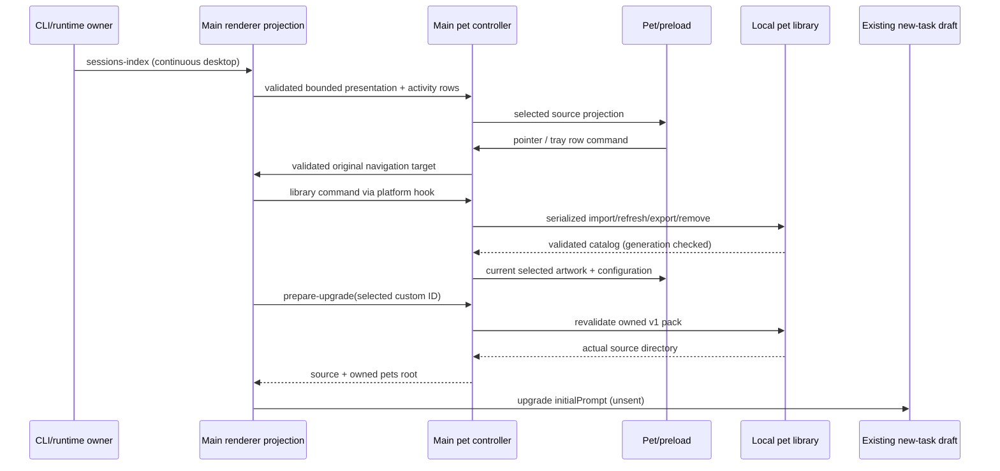

# Codex desktop pet compatibility

## Scope and reference

The user requested parity with the locally installed Codex desktop pet, excluding
Quick Chat and voice (2026-10-17). This supersedes the fixed-character and
click-to-open rules in `desktop-pet.md`. Following the user's full-format migration
request, existing Drora artwork is repacked as standard Codex v1 packs;
OpenAI's bundled artwork is not redistributed. Custom Codex pet packs can be
copied/imported without reauthoring their manifest or spritesheet.

Reference: Codex `26.1013.31256`, `D:/software/codex/resources/app.asar`.
`docs/desktop-pet-codex-evidence.json` records original bundle file names, byte
offsets, hashes and short evidence excerpts. Offsets refer to UTF-8 bytes in the
original archive member, not a prettified file. Product docs:
https://learn.chatgpt.com/docs/pets . Implementation evidence wins over assumptions
about what a pet ought to do.

## Product contract

- Desktop only, opt-in, one floating pet. Settings own enabled/selected character,
  width, position and badge corner. Width is an integer 80–224 DIP, default 112.
  Every pet uses aspect ratio 192/208 and the same Codex tracks, including built-ins.
  There is no legacy character-specific geometry, FPS or runtime row-mapping path.
- The native library owns `${Drora data root}/pets/<folder>/pet.json`. Also read
  `avatars/<folder>/avatar.json`, preferring a matching `pets` entry. Folder name
  determines `custom:<folder>` identity. Manifest fields: optional `id`, optional
  `displayName`, nullable/optional `description`, `spriteVersionNumber` (1 or 2,
  default 1), `spritesheetPath` (default `spritesheet.webp`). Display name fallback:
  displayName, id, folder. Sort custom pets by most recent manifest/image mtime.
- v1 = 1536×1872, 8 columns × 9 rows; v2 = 1536×2288, 8 × 11. Cells are 192×208.
  PNG and WebP are supported. Decode/validate format and dimensions before use.
  UI image upload adds the documented 20 MiB bound. Filesystem imports are also
  bounded to avoid unbounded IPC/memory use. Paths must remain inside the pack
  after realpath resolution, including symlinks. Malformed packs are reported
  and skipped individually; they must not break the rest of the library.
- Four built-in IDs (`violet`, `noir`, `snow`, `ginger`) remain stable so saved
  selections need no destructive migration. Their canonical assets live under
  `packages/desktop/assets/desktop-pets/<id>/pet.json` and `spritesheet.webp`.
  The build generator embeds these standard packs for installation-independent
  loading. Library is the single loader for bundled and custom packs: parse the
  same manifest schema, preflight the same geometry, decode the same image, then
  return one loaded-pack shape. Configuration only applies size/corner and the
  shared Codex animation tracks. Unknown/unavailable selections use the standard
  Violet pack; they never fall back to an old implementation.
- Built-in atlas migration is deterministic frame packing, not new character
  artwork. Preserve aspect ratio inside the 192×208 cell with transparent padding;
  sample the existing pose sequences into Codex's required counts. Violet rows
  source idle/working/working/attention/completed/error/attention/working/completed;
  catgirl rows source idle/walk/walk/wave/happy/error/attention/working/happy.
  The left-running row mirrors its corresponding right-running source. Only the
  required cells are filled. Existing artwork provides no authored 16-direction
  poses, so these packs accurately declare v1. Genuine imported v2 packs use rows
  9–10 without conversion. Original pose sources remain build inputs only; old
  generated TS artwork, character adapters and legacy generators are retired.
- Built-ins can also be exported as standard pet folders, using their stable ID
  as the export folder stem. Import/export round trips preserve manifest version
  and image bytes. Deletion and upgrade preparation remain custom-only; bundled
  files are immutable. UI exposes one export action for any available selection.
- Settings: built-in/custom selection with previews, refresh, open folder, import
  pack/root directory, import spritesheet, export custom pack, delete owned custom
  pet, size/reset. Import copies into Drora; it never modifies Codex's files.
  Create opens an unsent task draft using the existing onCreateTask path, with the
  owned directory and v2 artwork contract prefilled. The user supplies a character
  idea and sends it. Generation uses that task's available artwork tools; unlike
  Codex, Drora uses its own bundled `create-pet` integration, with the licensed
  hatch-pet processing pipeline and Drora publishing rules. See
  `desktop-pet-creation-skill.md`. Available image-generation tools are still
  required. Creation guide also exposes local manifest instructions.
- As in the local Codex collection, a selected custom v1 pet exposes an upgrade
  action. Main revalidates the selected owned pack and returns its actual source
  directory (including legacy `avatars`), rather than letting UI construct a path.
  The existing task-draft path carries the original pet and owned `pets` target,
  asks for a v2 upgrade preserving character identity, and requires retaining the
  original until the replacement passes image/animation validation. Built-ins,
  unavailable packs and v2 packs do not expose this action. Opening the draft does
  not send a task, install a plugin or mutate files.
- Header dimensions are only a bounded preflight. The library's injected image
  decoder must decode the entire PNG/WebP and confirm the dimensions before a
  pack is listed, copied or shown. Corrupt/truncated payloads are rejected without
  replacing the current artwork. A stale preload decode failure must not mark a
  newer successful configuration as failed or disable its mouse hit-testing.
- Decoder uses Sharp's full async pixel decode for both PNG and WebP. Electron's
  `nativeImage.createFromBuffer` cannot serve this contract: actual Codex WebP
  atlases return empty images despite decoding correctly in Chromium. Sharp is a
  production desktop dependency and stays external in bundled Main; native
  packaging must retain its platform binaries. Tests load actual installed Codex
  atlases in an isolated fixture when a reference directory is supplied; no
  OpenAI artwork is copied into shipped resources.
- Use a versioned shared contract for all IPC, manifest keys and custom identity
  prefixes. UI calls an optional `IPlatformService` method through a hook; Web and
  mobile expose no pet controls or filesystem operations.

## Animation and pointer semantics

Codex rows and holds (milliseconds) are exact reference values:

| State         | Row | Cells | Holds                                  |
| ------------- | --: | ----: | -------------------------------------- |
| idle          |   0 |     6 | 280,110,110,140,140,320 (idle loop ×6) |
| running-right |   1 |     8 | 120 each, last 220                     |
| running-left  |   2 |     8 | 120 each, last 220                     |
| waving        |   3 |     4 | 140 each, last 280                     |
| jumping       |   4 |     5 | 140 each, last 280                     |
| failed        |   5 |     8 | 140 each, last 240                     |
| waiting       |   6 |     6 | 150 each, last 260                     |
| running       |   7 |     6 | 120 each, last 220                     |
| review        |   8 |     6 | 150 each, last 280                     |

- Non-idle state animation plays three cycles then joins the slow idle loop;
  explicitly looping interactions may repeat. Reduced motion shows the first
  representative cell and does not animate. Repeated identical projections must
  not restart playback.
- Task mapping follows the reference notification presentation: working → running,
  needs input → waiting, failure → failed, completed/unread → review. Waving is
  the initial greeting, jumping is hover; completion must not be confused with the
  greeting animation. All built-in packs use the same rows and timings.
- Hover selects jumping; leaving restores the derived task state. Drag overrides
  hover. Movement ≥4px on either axis distinguishes drag from click; direction
  chooses running-left/right. Apply the final release position even when no move
  event was delivered. Pointer cancel/lost capture finishes dragging, never clicks.
  Ignore non-primary and Ctrl-primary presses. Suppress the synthetic click after
  a drag; keyboard activation still works.
- Badge activation follows the same admitted primary-pointer rule. Ctrl/non-primary
  clicks and cancelled/lost-capture badge gestures never open the tray; Enter,
  Space and accessibility activation remain available.
- v2 follows the global pointer in 16 directions, in 22.5° increments, rows 9/10,
  clockwise starting north. Ignore a ≤1px center dead zone. Use look poses only
  for idle/running/waving, not hover-jump, waiting/review/failure or drag. v1 never
  addresses rows 9/10.
- Drag preserves the cursor's grab offset across displays, and clamps on release.
  Display matching uses the greatest intersecting work-area surface, independent
  of display enumeration order, in Electron's screen-DIP coordinates. If the
  previous display is removed, clamp to the surviving/primary display; never
  multiply DIP coordinates by a monitor's scale factor again.
  Alt-release snaps to top/bottom × left/center/right at 16px work-area inset.
  Ordinary pet dragging has **no inertial throw**: the reference release velocity
  path is guarded by `usesOrbPhysics` and belongs to the excluded voice/orb mode.
- Transparent padding passes mouse input through; visible pet/controls remain
  interactive. On standard Electron use ignoreMouseEvents with forwarding and
  cursor hit-testing; do not depend on Codex's patched native input-shape API.
- Badge can be dragged to any corner using the same 4px threshold. A badge click
  toggles the activity tray; badge drag never moves the pet or opens a task.
- Right click (and ContextMenu/Shift+F10) opens a menu with pet selection, size
  reset, folder/refresh and hide. No extra native drag handle is needed.

## Task tray, ownership and sequencing

Runtime remains the task state owner. Renderer projects bounded session facts
(identity/path/remoteSessionId/sessionId, title, status, lastAssistantPreview,
lastActivityAt). A desktop-only Root component reuses the existing sessions-index
registry for every open workspace, including background tabs; remote service
resolution follows the existing attachment registry and readiness guards. Each
window publishes one aggregate, not competing workspace writes. Main merges
window aggregates, deduplicates by identity/remote session/session ID, and uses the
most recently focused window as navigation tie-breaker. Every row retains its
original source window; closing/reloading a source removes only its rows. Attention
precedes failure, newly completed activity, running, then idle. Initial historical
completion is not a fresh notification. A new sessions-index baseline resets
transition detection. At most 30 rows and 120 preview characters per row cross IPC.

Clicking pet/badge toggles the tray. Clicking a row focuses its original source
window and routes its full validated target through existing navigation. Dismiss
and expand/collapse are local presentation state, keyed by target and activity
revision; a new revision resurfaces. They never acknowledge permissions, cancel
tasks, mark runtime state read, or create an accepted command queue. Task payloads
are text, never HTML. The tray positions above/below and clamps to the display.

Main owns native windows, drag, input pass-through and source routing. The renderer
publication registry owns only derived per-workspace presentations and leases;
unmounting one workspace withdraws that lease without clearing others. Library
owns files; settings service owns persisted preferences. Preload owns only local
animation/gesture state. A configuration generation invalidates older async loads;
locale/size/character/refresh cannot publish stale artwork. Disable/dispose cancels
polling, listeners and pending window loads. Pet/tray are excluded from normal
window discovery and settings broadcasts. Web's replayable transport is unchanged.

## Acceptance and evidence matrix

| Case                                                                           | Required evidence              |
| ------------------------------------------------------------------------------ | ------------------------------ |
| v1/v2 PNG/WebP import, default fields, legacy precedence, sorting              | library tests                  |
| bad JSON, wrong dimensions, traversal/symlink, oversized image, partial import | library tests                  |
| collision-safe copy, export, delete selection, source untouched, restart       | library + native E2E           |
| exact rows/holds/three cycles/reduced motion                                   | animation tests + renderer E2E |
| all 16 looks, dead zone, v1 excluded, task/hover/drag priority                 | animation + renderer E2E       |
| click, 3px jitter, 4px axis, final release, cancel/lost capture, Ctrl/right    | gesture + renderer E2E         |
| cross-display offset, clamp, Alt six anchors, missing display                  | layout tests + native E2E      |
| transparent pass-through, hover jump, right menu, size/reset, badge drag       | native/renderer E2E            |
| tray sort/open/dismiss/resurface/collapse, stale target/source, escaped text   | projection + native E2E        |
| disabled/reload/locale/rapid selection/dispose, themes and zh/en               | controller/native E2E          |
| local/remote equal paths retain identity, no mobile publisher                  | projection regression          |

New desktop E2E candidates remain under `manual-review/pending` until human
review, per the repository lifecycle. Native behavior is tested with an isolated
Electron harness; it must not change the user's running Codex/Drora settings.
Record actual executed checks and platform limits; do not equate unit tests with
cross-platform native interaction proof.
