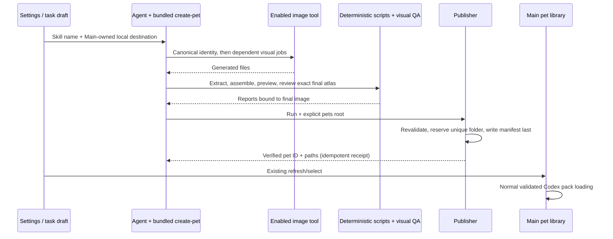

# Desktop pet creation skill

## Product and integration

Ship `create-pet` in `apps/drora-cli/packages/bundled-skills/skills/create-pet`.
It creates, repairs and upgrades Drora/Codex-compatible v2 pets from a concept or
reference image. The existing bundled-skill root discovers it without a new
plugin, market entry, runtime tool or change to restored bootstrap code. Existing
desktop/remote staging and SEA asset collection recursively include this folder.
The skill and all referenced helpers/license files must survive staging; test the
actual asset collector and the normal skill discovery adapter.

Settings > Desktop pet > Create/Upgrade continues to open an unsent task
draft. The prompt explicitly loads the bundled skill and carries the destination
returned by Main's pet library. The shared desktop-pet contract owns the skill
name used by UI. The skill can also be discovered for a natural-language pet
request. Do not assume a remote workspace can write the desktop's local path;
if the supplied target is inaccessible, request a local task instead of silently
writing a same-looking remote directory. Never modify Codex's data or application
settings. Publishing makes a pack available; refresh/select in Drora remains the
existing activation path.

The Agent owns its creation run and image-generation jobs; enabled generation
tools own their external requests. Use an installed image-generation skill when
present, otherwise an enabled image-generation/editing tool. No Codex-only API,
connector, worker model or dependency-loader name is required. If no such tool
exists, explain the missing capability and retain useful work. Never substitute
procedural placeholder art or claim an image was generated. A Python interpreter
with Pillow is required for the deterministic pipeline; detect it before work.
No new provider, API credentials or environment variables are introduced.

## Source and workflow

Reference: locally installed Codex 26.1013.31256, curated `hatch-pet` skill. Its
Apache-2.0-licensed scripts/references are vendored with their license, original
file hashes and explicit adaptation notes. Drora writes a separate SKILL entry
and publishing helper. Original helpers remain deterministic image processing;
they are not image generators. Keep identity references, nine motion strips,
four cardinal anchors, two coherent look strips, shared scale/registration,
chroma removal and visual direction/motion review. Newly published packs are v2;
v1 inputs may provide approved standard rows for upgrades.

Output uses the existing exact atlas/manifest contract in
`desktop-pet-codex-parity.md`. The hatch-pet assembler additionally stores a
neutral reference at row 0, column 6 in v2, and its validator requires that cell.
Preserve this producer convention: the desktop loader accepts it, while idle
playback still uses its six standard frames. All other unused cells remain empty.
A run directory contains request/jobs, generated
sources, extracted frames, intermediate/final atlases, reports and contact/motion
previews. Run directories are outside the final installed pet folder. Preserve
the original and completed work during cancellation, failed QA or upgrade.

The publisher accepts `--run-dir` and an explicit `--pets-root`, plus an optional
folder stem. It reads the prepared metadata, validates the exact final WebP with
the upstream validator, rejects v1/opaque/missing/oversized content, and requires
successful frame/chroma reports and an atlas-hash-bound visual review. Direction
review covers all sixteen directions with no failed cardinal or unreviewed
warning. Reject stale approval when bytes change. The skill preflight checks
that its referenced helper assets exist.

Publish only after all gates pass. Atomically reserve a new, non-hidden folder
under the explicitly supplied real pet root; choose collision suffixes across
case-sensitive and case-insensitive systems. Write image first and `pet.json`
last as the loader admission point. Never overwrite an existing pet or follow a
destination/source symlink outside its owner. A failed write removes only the
newly reserved directory. A retry with an already published, unchanged image
returns the prior receipt; it must not create duplicate pets. The receipt binds
the real destination and image hash and is verified before reuse.

## Acceptance and proof

- Runtime discovery finds `create-pet` with all references/scripts available;
  SEA collection retains the complete skill, original license and provenance.
- Prepare works without Codex-specific tools; its job graph has thirteen jobs
  with base/cardinal/look dependencies and usable layout guides.
- Deterministic assembly/extraction/direction/chroma regression tests pass.
- Publishing rejects missing/stale/failed QA, invalid atlas and unsafe paths;
  valid v2 output passes the production pet library decoder. Collision, retries
  and existing-pet preservation are verified in isolated roots.
- Actual Settings component create and upgrade actions name `create-pet`, carry
  correct local target/source paths and retain unsent-draft behavior in zh/en.
- A generated character is not required to test skill installation. Synthetic
  fixtures prove processing only; do not report a live image-generation run
  unless a real enabled tool was exercised.
