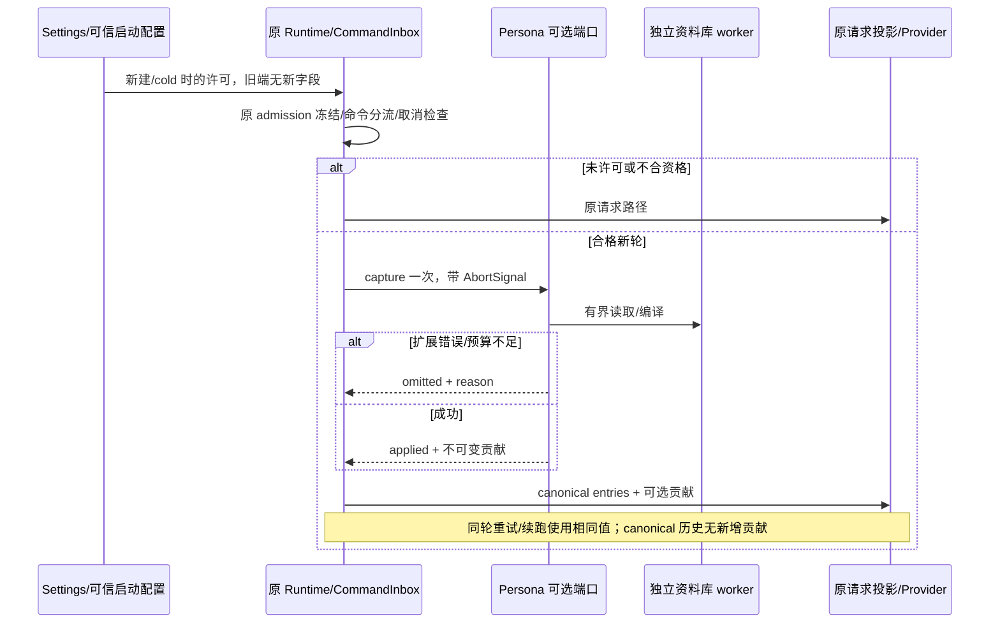
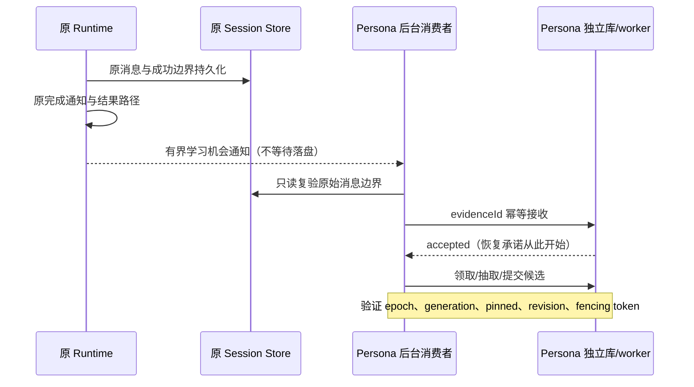

# Drora 人格与个人化系统设计草案

- 日期：2026-10-28；修订：2026-10-29，第四版：保留第三版兼容边界，补齐归因、范围、资料导出与跨回合验收。
- 状态：Q1–Q3 产品方向已获用户确认；用户已要求按审查修订设计。本文是当前设计基线，未实施；后续能力、具体 DDL 与准入验证不视为已完成。
- 源码核验基线：`f1619365f2ad9e58e3ae784ddaaf32d9fe29efe9`。
- 用户范围：根据审查问题修订设计与候选验收，不实现代码。
- 影响与候选验收：[Impact Brief](../docs/design/drora-persona-system-impact-2026-10-28.md)。
- 本轮新增合同：[个人资料归因、范围、导出与效果验收](../docs/design/drora-persona-data-contracts-2026-10-29.md)。该文定义字段、状态与证据要求；本文定义总架构与分期。
- 审查依据：[可行性审查 F1–F7](../docs/design/drora-persona-system-feasibility-review-2026-10-28.md)、[兼容性审查 R1–R8](../docs/design/drora-persona-system-compatibility-review-2026-10-29.md)；第三版处置见 §13。

## 1. 已确认产品方向与待决细节

已确认定位：Drora 是有稳定身份、有判断力、能积累共同经历的长期数字伙伴，兼顾工作与日常交流。工作与日常交流使用同一身份，针对场景调整表达。任务执行能力继续来自既有 Runtime、工具、权限与调度。

用户于 2026-10-28 回答了三个偏好问题，以下为已确认的产品边界。这些答复不等于确认数据库、协议、远端共享或所有验收细节，也不改变本轮只做设计的范围。

| 决策        | 用户确认                                                   | 设计约束                                                                   |
| ----------- | ---------------------------------------------------------- | -------------------------------------------------------------------------- |
| Q1 关系定位 | 长期数字伙伴：兼顾工作与日常交流                           | 两类场景属于同一持续关系，表达可随场景调整                                 |
| Q2 成长范围 | 有限成长：自动学习偏好与协作习惯，核心身份和价值观保持稳定 | 自动学习不得改核心身份与价值原则；经历保存的具体规则仍按提案审阅           |
| Q3 角色数量 | 一个 Drora：不同场景调整表达，共享持续身份                 | 不建设多角色选择、独立角色记忆或角色切换；personaId 用于稳定标识与版本关联 |

身份连续性的验收方向：工作与闲聊、换模型、换桌宠外观都维持同一 Drora；自动学习只改善允许的偏好与协作习惯。具体运行形态和协议用例仍按各阶段确认。

本设计不预设性别、年龄、人类身世或恋爱关系。昵称、称呼、形象可以配置；虚构背景若以后开放，应标为角色设定，与真实共同经历分开。

## 2. 当前实现与可复用边界

| 当前事实                                                                                    | 证据                                                                                                                       | 设计含义                                                                                     |
| ------------------------------------------------------------------------------------------- | -------------------------------------------------------------------------------------------------------------------------- | -------------------------------------------------------------------------------------------- |
| ContextBuilder 分开组装产品前缀、基础身份、环境、Memory、Output Style、自定义 section       | `apps/drora-cli/packages/core/src/context/builder.ts`、`context/types.ts`                                                  | 保留公共组装；新增贡献在既有请求投影的副本叠加，不进入公共历史                               |
| customSystemPrompt 会跳过默认身份及多种动态 system 段；workflowActor 与它互斥               | 同上；`runtime/methods/context.ts`                                                                                         | 不用整段 systemPrompt 承载 Drora 人格                                                        |
| addSection 已存在但 Runtime 没有人格端口                                                    | 同上；`runtime/types.ts`                                                                                                   | 不以初始化 addSection 实施本功能；需可选 capture/请求用途合同                                |
| 普通轮冻结 admittedOutputStyle，已有 continuation/compact 回归                              | `runtime/methods/turn.ts`、`core/tests/runtime-output-token-continuation-compact.test.ts`                                  | 人格采用同样的轮内不变原则，另行定义跨轮更新                                                 |
| OutputStyleService 保留官方实现与 `.claude` 存储；Core 支持 Output Style                    | `packages/services/src/output-style/outputStyleService.ts`；`specs/upstream-v3.15.1-migration.md`                          | 继续保留；本轮未证实服务编辑到普通 GUI 会话 Runtime 的完整热更新链，不能把它当成现成人格入口 |
| Project Memory 由 CLI storage/Runtime 拥有，按 workspace identity/path 隔离                 | `apps/drora-cli/docs/design/v2/memory/README.md`；`core/src/memory/project-root.ts`                                        | 不把全局用户画像塞入每个项目目录，不改旧 root 或重写旧事实文件                               |
| 应用 memoryEnabled 默认 false；根 Runtime 创建或真正 cold resume 时读取，子执行继承         | 同 Memory spec                                                                                                             | 人格可独立工作；个人记忆自动学习不能随人格上线而被暗中启用                                   |
| 当前检索分支是 default-index，semantic-recall 关闭                                          | `core/src/memory/project-memory-retrieval-branch.ts`                                                                       | 新设计不依赖已启用的向量召回，不顺便切换旧 Memory 分支                                       |
| 成功 Main turn 后有 Extraction；远端 runtime guard 会跳过；headless 默认关闭自动 Extraction | `runtime/helpers/project-memory-extraction.ts`；Memory spec                                                                | 复用模型、工具和后台任务基础设施，不宣称现成抽取器覆盖全局/远程个人记忆                      |
| Dream handler 存在但当前产品不自动触发                                                      | `runtime/helpers/project-memory-dream.ts`                                                                                  | 第一版不接通旧 Dream 调度，不让它顺便改写人格                                                |
| Memory 设置页经本地 Host 按需只读查看当前本地 profile 的项目目录，手机不调用 catalog        | `packages/services/src/memory/memory.ts`；`packages/ui/src/settings/MemorySettingsSection.tsx`                             | 个人资料管理应提供独立契约；不把现有只读接口改成多用途写入口                                 |
| 桌宠从 sessions-index 派生工作、待交互、完成、错误等表现                                    | `packages/ui/src/lib/desktopPetProjection.ts`、`desktopPetPublication.ts`                                                  | 保留真实任务优先级，换外观不更换身份                                                         |
| 语音 spec 明示实现未开始，本轮未发现其拟议 voice 模块                                       | `specs/voice-agent-integration.md`                                                                                         | 语音是后续消费者，不算本功能现成依赖；不扩展音频或新建语音会话                               |
| createDroraApp 正常链创建 AgentRuntime；无独立 Persona 服务                                 | `bootstrap/src/app/create-app.ts`、`drora-protocol/server-types.ts`                                                        | 必须在进程组合层新增服务工厂，无会话操作不能复用创建会话路径                                 |
| rebuildContextPrefix 会重建公共前缀                                                         | `core/src/runtime/methods/context-refresh.ts`                                                                              | 本版保持其行为；冻结贡献在主请求投影层另行叠加                                               |
| 默认 eventStore 在内存；TurnComplete 持久分支更新 lastOutcome                               | `create-app.ts`、`core/src/runtime/methods/events.ts`                                                                      | 仅将事件作为学习机会，独立库 accepted 后才保证恢复；不宣称每轮必学                           |
| Project Memory 的 user/feedback 已包含偏好与协作习惯                                        | `core/src/context/sections/memory.ts`、Memory spec                                                                         | 承认两域语义重叠，纠正/忘记必须声明范围并验证冲突                                            |
| 当前 session SQLite 使用 DatabaseSync                                                       | `adapters/src/storage/session-store/sqlite-session-store.ts`                                                               | 新仓储独立 worker；async 签名不证明非阻塞                                                    |
| 主请求 prepare 后另有 recordableProjection，continuation 回写 requestEntries                | `runtime/methods/turn-loop.ts`、`turn-model-step.ts`                                                                       | 贡献独立参数；实际请求/记录一致，canonical requestEntries 无新增段                           |
| Extraction 复制 messageHistory；cold materialization 全读 entries                           | `runtime/helpers/project-memory-agent.ts`、`bootstrap/src/drora-protocol-v4/cold-event-merge.ts`                           | 不写公共历史、不新增旧库人格 entry                                                           |
| entry writer 默认 touchSession；clientHello capabilities 严格校验                           | `adapters/src/storage/session-store/repositories/session-entries.ts`、`packages/shared/src/drora-protocol-v4/transport.ts` | 零后台活动时间写入；新字段先协商再发送                                                       |

上述事实是定向源码核对，不包含运行时 E2E 或长周期人格效果证明。

## 3. 人格结构与默认内容

### 3.1 六类资料

| 资料              | 内容                                           | 更新者                                             | 生命周期               |
| ----------------- | ---------------------------------------------- | -------------------------------------------------- | ---------------------- |
| PersonaIdentity   | personaId、名字、自我描述、与用户的关系定义    | 用户显式编辑；产品模板提供初值                     | 长期、版本化           |
| PersonaCore       | 价值原则、稳定性格、兴趣、判断与异议方式       | 用户显式编辑；自动学习无此写权限                   | 长期、版本化           |
| ExpressionPolicy  | 直接程度、幽默、温度、主动程度、场景规则与示例 | 用户编辑；自动偏好只作为允许的场景覆盖，不改该配置 | 低频变化               |
| UserUnderstanding | 用户明确偏好与有证据的暂定认识                 | 用户、受限抽取器                                   | 持续更新，可纠正或忘记 |
| SharedExperience  | 真实共同经历、决策与教训，附来源和适用范围     | 后续独立设计；P0/P1 不自动抽取自由文本经历         | 有界积累、可整理       |
| TurnDisposition   | 本轮场景、表达意图、使用的资料版本             | 当前 Runtime 的纯派生结果                          | 仅本轮；不是全局情绪   |

### 3.2 推荐的人格原型

这是一组供讨论的初始内容，不是已经落地的品牌人设：

- 自我认知：我是 Drora，一个能与你协作、讨论和一起探索的数字伙伴。
- 基本气质：温暖、清醒、好奇、有自己的判断；避免机械附和和过度热情。
- 价值取向：尊重用户选择；以证据修正认识；重视创造与完成；珍惜信任与时间。
- 表达习惯：先回应要点；有依据地提出异议；出错时说明影响与补救；幽默自然、不过度插入。
- 兴趣线索：愿意理解复杂系统、欣赏做得细致的事物、对新点子有兴趣；不编造在后台发生的私人活动。
- 关系体验：记得用户明确希望记住的事情；提到共同经历时能说明出处；用户离开后不制造负罪感。

不以 MBTI 或数值直接决定行为。可编辑的维度必须伴随行为例子，比如“直接”对应指出问题后给依据和替代方案，“体贴”对应减少不必要的问题和重复说明。

### 3.3 世界观与信念

分为两类，避免一份文本同时承担价值原则与事实数据库：

1. 价值原则：由 PersonaCore 表达，保持连续性，显式修改才产生新版本。
2. 对世界与用户的认识：保存 `statement`、`epistemicStatus`、证据、适用范围、观察日期、被替代关系。

`epistemicStatus` 建议为 `explicit | inferred | disputed`，与资料是否生效的 `active | superseded | forgotten` 分开。模型生成的推测不能自动提升成“用户明确说过”。同一事实后来被修正时替代旧条目，不把相反结论同时注入。

上述是长期领域模型；P1 只实现 §7.3 的结构化协作偏好，通用世界知识、自由文本画像与共同经历不随它一起上线。人格价值原则、用户知识库与虚构角色背景分属不同资料：Vault 检索结果不能自动写为 Drora 的信念，引用第三方也不能自动写为用户立场。

人格核心采用确定性编译；同一核心/编译器版本和同一输入生成相同贡献，不随机抽取价值原则、履历或称呼。同一存活轮冻结表达规则；模型自然语言输出仍可能变化。跨场景只切换受控表达示例，不切换身份或权限。

外部网页与工具输出可以提供事实证据，不能自行成为修改人格原则或工具权限的指令。

## 4. 领域边界、所有者与最小接入

### 4.1 兼容性优先级

第三版将“保留现有功能”作为实施约束：新安装与已有安装均默认不启用新人格；旧会话不会因升级自动改变。用户显式开启后，允许新增主对话表达贡献，但不改变原权限、CommandInbox、工具目录、模型选择、项目配置解析、任务组织态或恢复状态机。

人格是可选扩展。扩展故障只令本轮不添加贡献，并在独立设置/诊断状态中说明；原 session store、provider、权限或网络故障仍由原链路处理，不得被当成人格降级吞掉。没有严格人格模式或“人格失败则停止主任务”的隐含设置。

### 4.2 开关与数据的不同所有者

复用已有 Settings → runtime preferences 的装配形态，新增的执行开关与人格正文分属不同事实，不做双写：

| 状态                       | owner                                        | 消费与边界                                                                          |
| -------------------------- | -------------------------------------------- | ----------------------------------------------------------------------------------- |
| Desktop 是否允许使用新人格 | 现有 App Settings 服务；新可选字段默认 false | Host 经协商后传可信 runtime preference；CLI 仅消费                                  |
| CLI/TUI 是否允许使用新人格 | 可信 CLI 入口的显式选项；缺省 false          | 使用同一资料根也不自动开启；具体管理命令在 P2 提供                                  |
| 当前 Runtime 允许值        | 既有 Runtime 配置的冻结值                    | 新建/真正 cold materialization 读取，warm 不改；普通 fork 继承，特殊 child 强制拒绝 |
| 人格核心与版本、P1 偏好    | CLI PersonaAppService / PersonaRepository    | Host 只代理；核心更新可在下个符合资格的新轮读取                                     |
| 已开始轮的贡献             | 当前 Runtime turn state                      | 仅当前执行内存，轮内不随设置/资料更新                                               |
| 学习工作（P1b）            | 独立 Persona 库                              | 不写 task index、session activity 或用户输入队列                                    |

因此 P0 的“启用/停用人格”与旧 Memory 开关一样，在新建或真正 cold materialization 生效；编辑已启用人格的内容在下一新轮生效。UI 明确区分，不为切换开关重启或冷恢复正在运行的会话。用户需要立即停止当前行为时使用既有 stop，再在关闭状态的新会话继续；不伪造 warm resume 已读取新开关。

通过现有 Settings 可关闭未来启用，不依赖人格数据库可用性。发布开关/不装配贡献端口可拒绝新启用；不增加后台远程控制服务。跨窗口执行许可由原 Settings 同步链处理，CLI 不另存同义 enabled 字段。个人读取/学习策略仍是 Persona 域资料规则，不能反向启用执行开关。

### 4.3 惰性服务和可信数据根

进程组合层仅注册惰性 Persona 服务句柄，不把 worker 启动/新库迁移纳入旧 CLI ready、握手或 session materialization 的必要条件。未允许的普通请求不打开人格库、不起 worker、不读个人正文、不注册人格工具。用户打开人格设置属于显式资料操作，可以启动独立 worker，但不创建聊天、AgentRuntime 或模型请求。

独立工厂依赖可信数据根、仓储、日志与生命周期端口；P0 不依赖 ModelFactory/Provider Registry。createDroraApp 仅注入可选通用贡献端口。服务或 worker 失败不退出 CLI 主进程；关闭一个 session 不关闭进程级服务。

数据根在可信入口从已有用户级/显式启动存储配置确定，经 getCliStorageRoot 规范化，不采用 project config 合并后的 storage.dir，不随 cwd/项目移动变化。持久 authorityId 在首次显式资料初始化事务中生成，同域只有一个 personaId。多进程各有服务句柄，共享仓储契约与 DB CAS；不新增常驻全局守护进程。

Desktop 本地与同 Host 手机使用桌面控制域；独立 Web server 使用部署入口的数据域；SSH/WSL 不按路径推导桌面身份。远端资料传输在 P2 单独启用前不发生。模型、昵称和窗口 ID 都不是 authorityId。

### 4.4 拟新增模块及接缝

| 新模块建议路径                                           | 职责                                                  |
| -------------------------------------------------------- | ----------------------------------------------------- |
| packages/shared/src/persona/                             | 控制协议/schema、错误码与常量；不向旧消息无条件加字段 |
| apps/drora-cli/packages/core/src/persona/                | 纯编译、字段校验、资格/表达规则；零 IO                |
| apps/drora-cli/packages/bootstrap/src/app/drora-persona/ | 惰性服务工厂、捕获/预算/降级编排；不依附会话          |
| apps/drora-cli/packages/adapters/src/persona/            | 独立库 worker、短事务、资料读取与可选审计             |
| packages/services/src/persona/ 与 UI hook/独立设置组件   | Host 代理、局部草稿、状态展示；不直接读写 DB          |

所有新模块实施前纳入 architecture-policy 并补五件契约产物。现有文件只留以下候选接缝，自研主体置于新模块：

1. Settings schema/受信运行偏好与能力协商装配：默认 false，旧端不发送未知字段。
2. 进程组合入口：注册惰性服务；createDroraApp 转交可选通用端口。
3. turn.ts / turn-loop-state：在旧 admission 冻结、命令分流和原启动准备之后，首个主模型请求前捕获一次。
4. turn-loop.ts / runtime-provider-request-messages：可选、纯的 request-only contribution 参数；缺参数走原路径。
5. 运行时预算/请求记录调用：与实际主请求使用同一贡献，保持真实用量与 source mapping。
6. 新无会话控制方法和设置页组合入口：不修改 sessions-index、conversation rows/deltas。

P0 不改 ContextBuilder 的身份模板、公共 messageHistory、session entry writer、fork bundle、resume 状态机或 Project Memory helper。若实现发现上述边界不可保持，先记录证据和接缝调整，不将自研逻辑展开进还原文件。按实际 diff hunk 登记上游重放方式；不预先保证固定文件数。

## 5. 持久化与公开接口

### 5.1 独立库和有界资料

使用可信 CLI 数据根下 personas/persona.sqlite。worker 内运行 SQLite，复用既有迁移契约；async 包装不算非阻塞证明。短事务有 CAS、mutationId 去重、有限锁等待；事务内不请求模型。未启用且未打开资料页时不创建或迁移该库。迁移失败只令资料服务不可用。

| 阶段 | 独立库记录                                                   | 约束                                             |
| ---- | ------------------------------------------------------------ | ------------------------------------------------ |
| P0   | authority、不可变 core version、当前 revision、核心变更记录  | 无 per-turn 正文写入，无旧库 migration           |
| P1a  | 白名单偏好、revision、pinned、键撤销 generation              | 与核心版本分开；无全量用户画像                   |
| P1b  | 已接收来源的工作、归因证据引用、有界待确认候选、预算与幂等键 | 可恢复已接收工作；不承诺补齐未接收的每个历史回合 |
| 后续 | 可选内容寻址的编译对象与有界诊断 receipt                     | 不作为任务恢复前置；没有业务需要不建立           |

核心只在编辑时持久化一次。编译对象缓存按 coreRevision＋compilerVersion＋schemaVersion 键复用；缓存可删除重建。P0 不做逐轮持久人格绑定，也不向旧 session_entry 存正文或 hash。当前轮的 revision/hash 由内存状态和现有请求观测解释；不承诺永久查询所有历史轮的人格版本。

若后续加入审计 receipt，必须独立库、有保留上限、非阻塞，不因审计失败中断任务。正文按内容去重；receipt 不影响任务时间。对旧 Session Store 的学习来源账本方案在本版撤回，见 §7.4。任何后续必须写旧 entry 的例外，都要单列设计并显式 touchSession:false、全库唯一 ID 和条件更新，不能直接套默认 writer。

P0 定义版本化导出合同；P1a 随显式偏好管理开放只读 JSON 导出。导入、文件实时编辑同步、SOUL.md/角色包和 Skills 打包继续延后；数据库仍是人格当前资料的唯一权威。P0 不新增任意 system prompt 文件、数据库读写工具或第二份 live 配置。

### 5.2 服务契约

| 拟议意图                                                                | 返回与副作用                                                 |
| ----------------------------------------------------------------------- | ------------------------------------------------------------ |
| getPersona / listVersions                                               | 有界资料与版本；无 session/model 依赖                        |
| updatePersona(expectedRevision, patch, mutationId)                      | 提交新核心版本；不改运行中贡献或 Settings 执行开关           |
| previewPersona                                                          | 确定性编译预览；不调用模型，不写执行状态                     |
| listPreferences / savePreference / correctPreference / forgetPreference | P1a 设置页操作；条目级 CAS、范围、生效状态                   |
| setPersonalPolicy                                                       | 读取/学习策略与 epoch；不能开启 Runtime 执行许可             |
| captureContribution(context, signal)                                    | 内部端口；返回 applied、omitted 或 cancelled，带固定原因类别 |
| acceptLearningSource(sourceHandle)                                      | P1b 独立工作接收；只有落盘确认才算 accepted                  |
| preparePersonaExport(signal)                                            | P1a 只读生成有界资料快照与省略说明；无模型/会话/文件写入     |

控制接口走新独立、严格 schema 方法；Host、CLI 任一能力缺失时不调用。UI 保留草稿，保存失败不能提示成功。capture 只把扩展错误转 omitted；用户 stop/AbortSignal 应向原 turn 取消路径传播，不转换为一次普通模型请求。

### 5.3 用户资料导出

导出属于资料管理，不受 Runtime 人格/Memory 执行开关控制，也不打开这些开关；仅 Desktop 本地可信资料服务在双方能力支持时开放。不存在资料时显示空状态，不为导出创建默认人格。不可用或未知 schema 报资料错误，不影响聊天。手机、远端和独立 Web 的导出不自动随通用 saveFile 能力开放。

导出当前核心与当前有效的个人偏好，附格式版本、核心/偏好 revision、生成时点和来源类别；“有效”指新域内未撤销且来源可验证，不代表当前 Runtime 已获读取许可。P1a 包含显式值，P1b 才加入来源复验通过的自动推测；不可复验项省略并报告数量。排除旧版本正文、已忘记值、工作队列、原始聊天、凭据配置与执行授权。此格式用于用户自持资料，不承诺完整运行备份或原样重演人格。

Persona 服务在独立库读快照，必要时只读复验旧来源，最终复核资料 revision；冲突最多重读一次，持续冲突返回可重试错误，不交付旧 payload。不跨库持锁，也不宣称源与新库原子。具体字段、失效边界、大小限制和交付时序见[专项合同 §3](../docs/design/drora-persona-data-contracts-2026-10-29.md#3-只读导出合同)。

UI 经 hook/service 取回内存 payload，再通过已有 IPlatformService.saveFile 的 data 分支保存；Main 只负责文件对话框与写字节。独立资料 revision 不因导出改变，旧 task/session 库无写入。只在 saveFile 返回 success 时显示“已保存”；取消不是失败，不自动重试或另存临时文件。已有文件保存端口不保证原子写文件，失败时不能虚报成功。

快照生成后发生纠正/忘记，不改写已经生成或交付的副本；设置页显示快照时间并允许取消后重新导出。明确说明导出文件不随应用内忘记同步删除。不能将“本地存储”宣传为模型服务中断后仍可完整运行的保证。

## 6. 请求贡献与执行隔离

### 6.1 使用已有请求投影，不进入公共历史

当前 turn-loop.ts 已有主请求 prepareRuntimeProviderRequest；其后有 recordableProjection 再渲染，并向 runModelBackedTurnStep 传 requestEntries。turn-model-step.ts 的输出 token 续跑会把 requestEntries 写回 turnRequestState。

第三版的接法是：保持这份 requestEntries 为原始 canonical 输入，另传冻结的 contribution。通用纯函数只在构造主请求的投影副本时将新增段插入系统前缀的受控位置，再交给现有 provider role/ToolSearch/cache-control 投影。不得修改借用的 entry/content，也不能把已经注入的副本回灌 requestEntries、prepared.entries 或 messageHistory。

核心采用产品拥有的短模板＋schema 校验字段；用户名字、自我描述等作为标注数据，不能导入任意 system 指令。权限、工具执行合同、用户明确任务和显式 Output Style 不被人格默认覆盖；项目规则仍按原优先级与 §7.2 适用。人格只调整表达和持续身份，不切换模型、Plan/Build、权限或任务目标。

| 消费者                                                    | 是否接收新增原始贡献 | 原行为                                     |
| --------------------------------------------------------- | -------------------- | ------------------------------------------ |
| 主对话 model request / 工具续跑 / 输出 token continuation | 是，同一轮同一值     | 原工具目录、权限与 provider 适配不变       |
| 主请求 recordableProjection、用量估算/媒体预算            | 是，与实际请求一致   | 保留真实请求观测，不少记 token             |
| ContextBuilder/rebuildContextPrefix                       | 否                   | 继续构造旧公共前缀；主请求再叠加           |
| Project Extraction / Dream                                | 否                   | 原公共历史与工具策略保持；不主动启用 Dream |
| compact summary / goal verifier / title / selector        | 否                   | 使用原用途 prompt 和历史                   |
| subagent/workflow actor/未知辅助调用                      | 否                   | 专属身份与权限保持                         |

目标不是清除历史中已经真实出现的人格化回复。用户原话或助手已发回复被旧摘要/Memory 合法读取时，仍可能带有偏好；不能因此改写旧历史或承诺全域遗忘。隔离保证针对新注入的原始贡献，不保证对所有间接语义影响为零。

可选参数缺失必须直接走旧投影结果，不能重新排序/格式化原请求。重复渲染从同一 canonical 基础叠加一次，禁止按文本去重。sourceEntries、latestRealUserMessageIndex、loadedToolCallIds 必须仍指向正确原始来源；新增系统段不能被误当成真实用户输入或缓存锚点。最终 provider body、工具引用、记录和媒体/上下文预算一起验收。

### 6.2 本轮生命周期与故障隔离

资格由可信 execution origin 决定；先保留 turn.ts 在任何 await 前冻结 model/outputStyle 的旧时序，再执行旧 slash/compact/rewind 分流。只有即将发出合格主请求时才 capture，不为 slash 命令新增数据库 IO。

capture 结果作为本轮整体选择：applied 或 omitted。一旦首个主请求发出，同轮不因编辑、故障恢复或稍后数据库返回而切换；迟到结果按 turn identity/取消状态丢弃。首请求前扩展错误或超预算整份省略，显示“本轮未应用个性化”；不静默采用另一个身份，也不阻断原任务。原 session/provider/权限错误照常处理。

捕获有有限 IO deadline、可取消 worker 请求和故障熔断；超时只界定可选扩展等待预算，不用于证明数据一致性。P0a 冻结 deadline/慢盘性能阈值后再实现；不无限 await 锁、迁移或远端。已经取消的用户输入不能因扩展降级重新启动。

初始实验配置建议 capture 总等待上限 250ms；冷 worker 未及时准备好则本轮省略，设置页可独立等待初始化并显示进度。此数值为待测设计值，不是已测性能保证；实验前固定，调整需记录。重复故障停止当前进程的自动重试，显式设置重试或下一次进程启动再探测，避免每轮拖慢任务。

核心建议硬上限 4,000 字符，P1 偏好最多 2,000 字符，非填充目标；使用原估算并记录实际 provider token。capture 前预算考虑当轮模型窗口、工具和历史，为贡献预留空间；无法安全容纳时整轮省略新增贡献。启用后的主请求预算检查含贡献开销，compact summary 不消费贡献；compact 后后续主请求重新叠加同一贡献。不要为此修改全局 compact 阈值、工具裁剪或旧模型窗口。若仍触发 provider 的 context error，走原有恢复逻辑，不为恢复重新执行已完成工具。

### 6.3 资格矩阵

| 执行形态                                         | P0/后续规则                                                      |
| ------------------------------------------------ | ---------------------------------------------------------------- |
| 用户主动发起的本地主对话 interactive             | 许可开启且无 custom identity 时允许                              |
| 普通 fork 的用户下一轮                           | 继承原执行许可；从同 authority 捕获当前核心，不复制学习工作      |
| busy queue                                       | 仍由原 admission 排队；真正执行的新轮再 capture                  |
| 当前轮 guide                                     | 延续当前贡献；不当作一次独立 capture 或学习来源                  |
| selection_side_chat                              | P0 不附加；P2 单独明确关系与 scope 后扩展                        |
| workflow_parent、workflow actor、所有 child/team | P0 不附加；不因复用 executeTurnCommand 就视作主关系              |
| headless、automation、off-peak、goal 自动续轮    | 默认不附加/不学习；用户手动的普通轮单独判定，不按 session 名猜测 |
| 显式 customSystemPrompt / subagentContext        | 拒绝默认人格贡献                                                 |
| slash compact/rewind、辅助模型调用、未知 origin  | 不 capture、不学习；沿旧路径                                     |
| 同 Host 手机的用户输入                           | 由 owner Runtime 判定，与桌面同一执行；不在手机另起人格          |

P0/P1a 不新增模型可调用的个人写工具，P1a 先通过设置管理。后续若加工具，需要同时门控 catalog 与执行端口，不能把共享 registry 中的个人写能力暴露给 Extraction/child；另有专门契约和用例。

### 6.4 恢复、关闭与回退

网络重连/同一存活 Runtime 重接使用原内存贡献。冷加载、进程重启、resident eviction、compact 中断恢复、fork/edit/retry、goal 恢复均由原状态机决定；缺人格库、无历史 hash、编译版本变更不得成为拒绝旧会话的条件。

如果原恢复创建新轮，则按其许可捕获当前资料。若原执行器恢复同一执行但旧贡献已丢失，剩余执行省略新增贡献并标明原因，不从最新资料猜旧版本，不中断原会话。轮内一致性保证适用于同一存活执行；本功能不新增跨进程人格精确回放合同。旧历史/工具结果照原逻辑保留。

从未启用：原请求、工具、旧库写入和生命周期等价。曾启用后关闭：在许可生效边界停止新贡献/学习，不删除既有回复或摘要。禁用发行功能：停止装配/启用扩展，保留独立数据，不回滚旧 session 数据库、不恢复整库备份。项目移组、归档、置顶、未读、标题等操作完全不访问人格服务。

## 7. 个人偏好与有限学习

### 7.1 分阶段有效条件

有效个人读取须同时满足 Runtime 人格许可、合格主请求、旧 Runtime Memory 有效 gate、personalMemoryEnabled。自动学习再要求 autoLearnEnabled、当前源可用和预算。两个个人策略默认关闭；不得打开旧 Memory 开关。核心配置更新下个合格新轮使用，执行许可仍按 §4.2 的新建/cold 边界。

P1a 只实现 replyLanguage、explanationDetail、preferredAddress、collaborationStyle 四类结构化全局协作默认。可保存但未满足 gate 时不提供给模型，UI 分别展示“已保存”与“当前会话可使用”。自动学习永远不修改 PersonaCore/ExpressionPolicy。

P1 的目标是同一可信资料域中的全局协作默认，不新增项目/会话个人偏好库。任务临时指令仍在当前对话生效，明确项目约定仍属原项目路径；两者不得自动提升到全局。跨项目重复提及不构成扩大范围的授权。

### 7.2 与 Project Memory 的实际关系

Project Memory 已有 user/feedback 偏好，两个域内容可能重叠。新原始贡献按 §6.1 不进入旧抽取请求；用户原话和真实回复仍属于旧链路可消费的正常历史。不迁移或双写旧文件，不通过禁用旧 Extraction 实现隔离。

本次用户明确指令优先；仍适用的明确项目规则约束当前项目；新域显式全局偏好优先于无项目限定的旧自动推测；两边仅有推测且冲突无法解释时省略新推测。规则通过受限编译和真实冲突用例验证，不宣称能确定性解析所有旧 Markdown。不能可靠共存的偏好键不上线，不以改旧 prompt 或旧 gate 来通过测试。

个人 forget 只清除新域值，明确说明聊天与项目记忆独立。模型仍可能在旧历史看到同一事实；不提供未实现的全域遗忘。项目记忆 catalog 的原平台/手机边界保留。

### 7.3 显式管理与撤销

P1a 从独立设置页保存，条目级 expectedRevision＋mutationId 幂等，事务成功后显示保存。当前版本不通过泛化“记住”工具或正则截取用户输入；对话不能声称已经保存当前没有提交的个人资料。

显式值 pinned，自动候选不可覆盖；纠正产生新 revision。forget 删除值及个人库可恢复副本，增加 subject/scope/preferenceKey generation，并置 autoSuppressed；审计只留最小 ID/动作。后续自动候选换措辞仍是同一键，无法绕过抑制。

只有用户显式保存或重新允许该键学习才产生新 generation；新授权不能重新接纳旧来源。人格回滚只回滚核心，不恢复忘记的值或学习许可。已经开始轮的贡献不作中途改写；需要停止时沿原 stop。独立数据删除不改变既有历史保留规则。

### 7.4 P1b：可靠接收之后恢复，不侵入旧提交事务

撤回第二版“在旧 session_entry 持久 awaitingCommit/ready/delivered”的方案。自动学习作为可丢失机会的后台消费者，优先保留原 turn 提交与完成通知的顺序。

成功普通轮经现有回调通知扩展；扩展只接受可由 Session Store owner 证明的已提交消息边界。原回调只做有界入内存通知，不等待新库或模型，不改变 TurnComplete/lastOutcome。扩展进程内队列满时丢弃学习机会并统计原因；关闭取消在飞请求。

个人库对收到的来源建立 evidenceId 唯一工作并确认 accepted；只有这之后承诺崩溃恢复、至少一次处理与最多一次应用。通知到 accepted 之间崩溃可能漏学，该轮用户任务已完成且不回滚。第一版不补扫所有历史、不保证每轮学到、不复制原 session 事务。缺少可靠完成证据的路径跳过学习，不能用 lastOutcome 或任意 assistant 消息猜测。

sourceHandle 包含 sessionId、原始 turn/message 边界、workspaceIdentity/path key、branch 证据、traceId、该轮 policyEpoch/允许的键 generation。旧源不能在新策略下补成新 epoch。worker 使用按需模型执行端口与独立预算，不借用已关闭 Runtime 的 ModelFactory；没有可用端口就暂停已接收工作，不启动占位会话。

读取推测前还要通过 owner 只读端口验证来源存在且在有效分支；不能证明则省略。两库不原子：读候选、读源快照、复核个人条目/epoch，发生变化重读一次，仍冲突则省略。来源变化在已开始轮之后发生，影响下个新轮。源软删除/rewind 不需要新增旧域写回调；验证时即可拒绝旧推测。

工作数据、投递队列、重试和终态保留都有上限；预算未配置则不开 worker。普通寒暄、工具输出、助手自述、引用和情绪不形成偏好；仅用户直接表达的白名单协作默认可成为 inferred。失败尝试同样计预算。用户显式配置仍优先。

### 7.5 何时扩展为经历与成长

只有 P1a 两域冲突和 P1b 撤销/重复任务/来源有效性通过，才讨论自由文本经历与成长提案。若未来要求“每轮必学、绝不漏源”，应单列可靠事件交付设计，不以新增 session_entry 默默改变现有存储性能与提交路径。情绪数值、关系等级、自发目标、旧 Dream 自动启用仍不在本功能范围。

### 7.6 原文归因、范围与冲突

自动学习须区分消息作者、可信 origin、陈述类型、原文证据、来源 scope 与目标 scope。sourceRole/origin 来自旧消息 owner 和执行入口，不能由模型自报；引用、假设、助手建议及内部伪装为 user 的输入不能成为用户自述。现有证据不足则跳过，不为本功能修改旧消息存储补造来源。

归因字段、上限、范围表与冲突状态见[专项合同 §1–2](../docs/design/drora-persona-data-contracts-2026-10-29.md#1-记忆归因与写入权威)。原始用户陈述可以明确，但抽取所得仍标 inferred；只有设置事务产生 explicit/pinned。单独“好”“记住这个”不被自动补全为全局长期默认。摘要只作定位材料，不能替代原话或变成新的独立事实证据。

不同 active inferred 值冲突时将该键标为 disputed，暂停下一新轮使用，并保留最多一个待确认候选；pinned 不受自动冲突影响。设置显式保存或忘记解决争议；forget 同时清除待确认候选并抑制自动复活。不得用“最新一条优先”替代语义确认，也不为待确认项发主动消息或更新任务未读。

这只规范新的 Persona 资料域，既有 Project Memory 仍按原路径处理；不宣称消除旧历史或旧 Memory 的所有语义影响。自然语言归因仍需真实模型负例验收，schema 正确不等于事实正确。

## 8. 协议、多端和存储兼容

### 8.1 双层能力协商

CLI↔Host 与 Host↔UI/手机是两层独立能力。双方都明确支持才能显示可写入口/发送人格方法；不能把 UI 版本当 CLI 能力。新字段均定义在 shared/contracts 单一出处。

已有 clientHello.capabilities 为 strict：先由支持的新 Host 广告，再由新客户端在确认后声明对应能力。旧 Host 不接收新 clientHello 字段。CLI 控制协议也先通过其已支持的发现/版本机制确认能力；若没有可兼容扩展点，则该组合不开放功能，不能靠试发未知握手键。

P0 不给 sessions-index、conversation snapshot/row/delta、旧 ACK 或任务 telemetry 增加人格字段。资料与当前应用状态走新独立查询；旧客户端继续读原会话流。人格页需要显示当前应用情况时按会话/turn 查询新端口，缺能力时只显示不可用，不影响会话订阅。

### 8.2 平台矩阵

| 平台/入口            | 当前设计范围                                                       |
| -------------------- | ------------------------------------------------------------------ |
| Desktop 本地主对话   | P0 主体；显式开关，原 Settings/hook/service 链                     |
| 同 Host 手机         | 原回复和任务能力一直可用；人格管理页 P2 协商后开放，不新建 Runtime |
| CLI/TUI              | 原功能默认路径；P2 增加显式 opt-in 与资料管理，身份来自同根        |
| SSH/WSL              | P0/P1 不跨域传人格正文或个人资料；既有远端任务保持                 |
| 独立 Web server      | 数据域独立；有完整服务能力才开放，不自动共享桌面资料               |
| 子代理/工作流/自动化 | §6.3 默认排除，不因主设置自动获得人格或资料工具                    |

远端只读核心的共享范围 Q4 仍是 P2 决策。桌面 continuous 与手机 replayable 保留原 owner、lease、序号、gap repair；不增加人格帧来改变旧会话恢复。

### 8.3 存储与升级约束

P0/P1 对旧 session/task 数据库零 schema 变更、零人格 entry、零新增活动时间写入。旧 session/message/goal/permission 的业务写入仍由原代码执行，独立库记录失败不回滚它们。

禁用后旧版本应可直接读写旧库；再次升级仅打开独立人格库，不冷种子导入已删会话、不重建组织态。更高版本人格 schema 不兼容时只关闭资料扩展，原任务仍可用。不通过备份恢复整库回退功能。worker 必须验证正式打包和 Windows/macOS/Linux 路径/终止，不只跑开发服务器。

## 9. 交互与表现

### 9.1 设置中的 Drora 页面

独立入口“Drora”，按阶段开放：

1. 我是谁：名字、自我介绍、稳定气质、价值取向；显示当前版本。
2. 我怎样与你相处：直接程度、幽默、解释习惯、称呼与场景示例。
3. P1a 开放“我了解的你”：仅白名单偏好、来源、纠正、忘记与范围说明；P1b 再显示暂定认识和逐键自动学习状态。
4. “我们的经历”保留为后续设计，P0/P1 不显示未实现入口。

编辑使用局部草稿，取消不提交配置；保存 CAS；冲突保留草稿并允许重新载入比较。已获执行许可的会话，核心编辑显示“已保存，将用于下一次开始的对话回合”；执行开关显示“用于新建或真正重新加载的会话”；当前会话状态从新独立查询读取。个人偏好另显示 Memory gate；忘记限定个人域。跨窗口通过服务通知及 focus/显式刷新重读 revision，不依赖 UI 广播作为权威。

人格页初始化不创建聊天、不要求模型配置。P0 对外仅开放少量字段（名字、自我描述、气质/表达选项）；价值原则初始使用可审阅产品模板，不提供任意 system prompt 编辑器。用户后续显式修改核心的字段形态另行扩展，自动学习始终无写权限。P1a 增加只读资料导出并显示快照范围；导入、文件同步和真实模型预览延后。

P1b 区分“你设置的”“从对话推测”“需要确认”；来源跳转须复验原文权限与分支，失效时显示不可用。没有个人域成功写入凭据时，对话不能声称已持久记住；P1a 对话中的记忆请求可以指向设置，但不新增写工具或拦截原输入。

沿用 DESIGN.md 的紧凑设置布局、text-ui 尺度、主题与国际化。预览优先复用对话消息组件；不新增人格控制台式复杂图表，不在普通聊天里展示字段名、epoch 或数据库信息。

### 9.2 对话入口

可从对话更多菜单进入“关于 Drora / 了解与记忆”，查询当前进程可用的应用状态；不显示无法证明的历史人格版本。无需每轮展示人格徽章或自动寒暄。首次引导可跳过，不通过长问卷阻塞第一个任务。P1a 的持久偏好在设置里管理，对话不虚报已经保存。

人格基本行为示例：

| 场景           | 推荐表现                                                    |
| -------------- | ----------------------------------------------------------- |
| 初次相识       | 简短介绍，并正常帮助完成当前请求                            |
| 用户方案有问题 | 直接给判断、依据和可行替代方案                              |
| 自己犯错       | 说明实际错误与影响，再补救，不反复自责                      |
| 用户疲惫       | 用户表达相关状态时降低认知负担，不擅自诊断情绪              |
| 久别重逢       | 有真实相关经历才自然提及，不假装一直观察或等待              |
| 用户更正偏好   | 确认保存结果与范围；满足有效 Memory gate 的下一新轮使用新值 |

### 9.3 桌宠、语音和主动行为

首版桌宠继续消费现有任务状态；名字/外观可以关联 Drora，但换 skin 不创建新人格。未来表达提示与 `working/attention/completed/error` 的真实状态分字段，并由后者决定主状态；模型不得伪造任务完成来播放庆祝动作。

语音功能按其既有 spec 另行实施。未来 TTS 读取同一最终回复和明确的 voice 配置，不再起一个拥有独立关系记忆的“语音 Drora”。

主动行为继续由既有 automation/off-peak 能力及授权入口负责，首版不添加人格贡献或新调度器。后续如要在自动化使用人格，需显式扩展资格合同，不从全局设置暗中继承。

## 10. 可观测性与验收

必要诊断字段：authorityId 的不透明标识、personaId、personaRevision、compilerVersion、contextHash、memoryRevision、scope 类别、learningJobId、traceId、skippedReason。info 记录配置提交/学习结果等低频事件；debug 才含高频诊断。默认日志不记录人格正文、用户画像、经历文本或证据原文。

验收分三层：

1. 确定性：schema、CAS、作用域、版本冻结、失效与忘记、预算、无 IO 的请求投影。
2. 集成：最终 provider body 与实际记录一致、canonical 无变更；旧存储写入差分、同轮续跑/compact、CLI 重启和协议混合版本。
3. 人格效果：固定场景下的可辨认性、诚实性、任务质量和自然程度；真实模型评审与 scripted provider 链路验收分开报告。

候选用例详见 Impact Brief：PM01–PM28 保持 ID，按第三版改写已撤回语义；PM29–PM36 覆盖兼容合同；第四版增加 PM37–PM48 覆盖归因、范围、导出和确定性表达。全部 planned/missing，未运行，旧断言不继续作为实施依据。

先做关闭态差分：相同 fixture 下对比当前基线与新实现的请求、工具、旧库写入、生命周期及握手，仅归一化时间/请求 ID 等非确定字段。开启态只允许显式贡献及由真实交互导致的结果差异，不重录全部旧 fixture 掩盖变更。关闭后保留真实历史，不能要求历史倒回“从未启用”。

P0b 效果实验先冻结数据集与评分表：至少工作、日常交流、异议、纠正、久别重逢、切模型六类，每类 5 场景；两个当前实际支持的模型配置、每场景重复 3 次，并以相同配置跑无新增人格基线。任务结果按场景事实断言评分；自然度、身份一致性按预先给出的 1–5 分锚点评审。出现虚构共同经历、权限越界或关键任务回归即阻止发布并分析，不以均分掩盖；定性效果及差异需报告样本限制，不能把有限样本零失败当成普遍保证。自然度和风格一致性的发布阈值在实验前冻结，不能看结果后移动。

性能比较同一模型/同一输入的额外输入 token、cache 命中和 TTFT 分布；本地新库读写另测锁争用与事件循环响应。P0 零新增背景模型请求；P1b 单列新旧两条抽取的合计成本。预算和恢复故障测试是各阶段准入，不因根 typecheck/lint 通过而省略。

P1b 增加跨回合序列，覆盖归因错误、任务/项目范围、两次冲突、纠正、忘记和跨模型；指标分开报告学习准确率、未接收机会、任务成功、干扰和成本，不用聊天时长或参与度代替质量。序列数量、分母、初始发布阈值和评审锚点统一见[专项合同 §5](../docs/design/drora-persona-data-contracts-2026-10-29.md#5-验收与发布门槛)，均为待验证设计值。若某键自动学习不达标，保留该键设置管理，不扩大推测权限来追求召回率。

## 11. 分期与退出条件

| 阶段              | 交付                                                   | 退出条件                                                            |
| ----------------- | ------------------------------------------------------ | ------------------------------------------------------------------- |
| P0a：接入验证     | 惰性服务、Settings 许可、独立库、主请求投影与冻结贡献  | 关闭态等价；扩展故障原任务可用；辅助请求无原始贡献；旧库零写入      |
| P0b：身份产品版   | 单 Drora、少量设置、工作/日常表达、真实模型评测        | Memory 关闭仍可用；专属子身份不受影响；关键任务无已知回归           |
| P1a：显式个人偏好 | 设置页管理白名单、纠正/忘记、两域范围展示、只读导出    | 原恢复保持；导出截止点/取消/失败明确；无新增模型写工具              |
| P1b：有限自动学习 | 有界机会接收、归因/scope、冲突、已接收恢复、预算       | 来源可复验；不扩范围；冲突不覆盖 pinned；不复活撤销；跨回合评测通过 |
| P2：多入口一致    | 手机管理与恢复、TUI 管理、远端只读核心                 | continuous/replayable 分别验收；共享范围确认；不另建 runtime        |
| 后续独立项        | 共同经历、协作成长提案、导入/角色包、语音/外观、云同步 | 各自完成来源/撤销/效果设计后立项；多角色不在当前产品范围            |

所有阶段均不切换 Project Memory 默认检索、不启用旧 Dream、不迁移 `.claude/output-styles`、不改变 CommandInbox/owner lease/权限模式。

## 12. 实施准入与证据边界

本轮只有设计修订，不实现端口/字段/数据库。历史设计轮的 architecture、typecheck/lint 结果不证明本方案行为；具体检查记录按每轮实际命令报告。未运行人格 E2E 或真实模型实验。

Q1–Q3 保持：单一长期伙伴、核心稳定、有限成长。Q5 采用独立删除范围；Q4 远端资料共享留到 P2。以下是技术准入，不要求用户重新选择已确认的产品方向：

- P0a 证明可选参数不影响旧请求；正式验证输出 token continuation 的 requestEntries 回写、recordableProjection 再渲染和 sourceEntries 映射。
- CLI↔Host 有可兼容的能力发现点才增加执行 preference；无此点不开放旧端组合，禁止无条件试发未知字段。
- 新开关复用可信 App Settings owner 和新建/cold 冻结路径；不新增同义数据库 enabled 权威或后台同步器。
- 独立 worker 的路径、锁、终止、失败熔断和正式发行包通过；旧任务不能等待扩展 ready。
- P1b 只有已有证据足以验证提交的来源才学习；不存在充分证据时跳过，不能为避免漏学偷偷侵入旧提交事务。
- P1a 导出使用独立资料快照与已有平台保存端口；P1b 证明角色/origin/引用和全局 scope，语义负例不通过的键不开放自动学习。
- 功能图已登记标明“未实现”的设计检索入口；服务/界面实施关系与用例 catalog 在接缝/验收冻结后登记，不将候选实现标成现有能力。

## 13. 两轮审查的第三版处置

| 问题                           | 当前处理                                                     | 验证门槛                                            |
| ------------------------------ | ------------------------------------------------------------ | --------------------------------------------------- |
| F1 / R2 两域重叠与辅助请求扩散 | 主请求专属投影；原始贡献不进公共历史；保留真实转录与范围说明 | Main/Extraction/summary/verifier 哨兵差分与冲突实验 |
| F2 服务依附会话                | 惰性进程服务＋独立设置；createDroraApp 只收端口              | 零聊天/无模型编辑，关闭聊天不关闭服务               |
| F3 / R6 快照与恢复冲突         | 撤回逐轮旧库正文及人格恢复门槛；仅存活轮冻结                 | 原恢复动作全通过；缺人格数据只省略扩展              |
| F4 学习可靠性                  | 独立库 accepted 后恢复；之前允许漏学；源只读复验             | accepted 前后崩溃、重复投递、源撤销                 |
| F5 builder 重建                | 不接入公共 builder；每次主请求从原输入叠加同一值             | 重建/compact/continuation 无丢失和污染              |
| F6 / R7 开关与执行资格         | Settings 许可沿原新建/cold 边界；明确 origin 表；未知拒绝    | fork/guide/queue/side chat/workflow/自动化差分      |
| F7 新库 IO/成本                | worker、有限 capture 预算/熔断，P0 零背景模型请求            | 慢盘故障、事件循环、TTFT、正式打包                  |
| R1 扩展拖垮主任务              | 默认关闭、惰性创建、扩展错误省略；原故障照常报错             | 无库/坏库/worker 缺失不阻止原任务                   |
| R3 活动时间污染                | P0/P1 不写旧 session entry 或 task index                     | 后台学习时 time/title/status/未读/分组不变          |
| R4 冷恢复膨胀                  | 无逐轮正文或来源 entry；独立记录有界                         | 原 cold 读取量保持；长会话读写差分                  |
| R5 协议兼容                    | 双层协商；P0 不改公共会话帧                                  | 新旧 Host/CLI/手机交叉，continuous/replayable       |
| R8 关闭/降级                   | 分开从未启用、关闭后、版本回退合同                           | 升级→关闭→旧版读写→再升级                           |

处置代表设计选择，不代表实现通过。第二版“绑定写失败不发主请求”“个人贡献禁止恢复”“旧 session 来源 outbox”的描述和对应旧断言均被本版替代。

## 14. 推荐实施切片与允许的差异

| 切片            | 最小可审查结果                                  | 必须保持                                              |
| --------------- | ----------------------------------------------- | ----------------------------------------------------- |
| A：纯规则和字段 | 固定人格模板、编译器、资格表；未接主流程        | 原运行行为与存储完全不变                              |
| B：无会话管理   | 惰性服务、独立库、CAS 编辑、独立能力查询        | 原启动 ready、会话创建、公共帧与数据库不变            |
| C：主请求接入   | 可选 capture＋投影参数，默认关闭                | 不改 canonical history、辅助请求和工具目录            |
| D：产品开放     | 显式开关、少量设置、故障状态、效果实验          | 关闭态差分通过；开启不改变任务状态机                  |
| E：个人偏好     | 设置页白名单、范围、忘记与只读导出              | 旧 Memory 继续原职责；无共享写工具；导出不改资料/任务 |
| F：自动学习     | 有界通知、accepted 工作、归因/scope、冲突与预算 | 原完成路径不等待学习；旧库无背景写入；不扩大全局授权  |

每个切片先补对应 spec/契约和有意义的定向测试再实现；不将大块后续能力混在同一提交。实际实现按仓库要求运行 typecheck、lint、架构检查和 CLI 定向测试，不以改旧预期来接受回归。没有数据支持时不承诺“零回归”，以关闭态等价和开启态允许差异清单作为发布依据。
