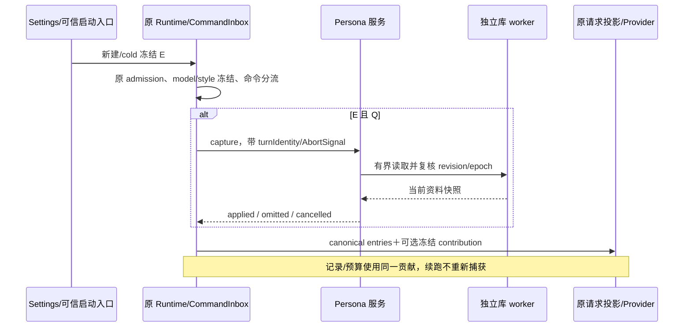
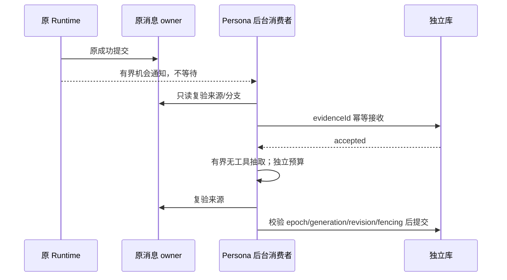

# Drora 人格与个人化系统

- 版本：v5，2026-10-29；P0a 纯领域模块、可选请求投影接缝与 Runtime 轮内捕获编排已实现，完整功能尚未启用。
- 源码依据：54db6b6309c2b155f1e6d6630062c97c0432f0f2。
- 本文是唯一产品设计基线，取代[文件方案](drora-persona.md)及本文件 v4。旧评审保留问题发现过程，不再作为并行实施合同。
- 配套：[数据与接口合同](../docs/design/drora-persona-data-contracts-2026-10-29.md)、[影响/验收](../docs/design/drora-persona-system-impact-2026-10-28.md)、[实施计划](../docs/superpowers/plans/2026-10-29-drora-persona-p0.md)、[综合评审](../docs/design/drora-persona-integrated-review-2026-10-29.md)。

## 1. 产品目标与设计取舍

Drora 是兼顾工作与日常交流的长期数字伙伴：有稳定身份、性格、价值判断和表达习惯；能提出异议、承认错误、逐步理解用户。所有场景共用一个身份。成长限于用户交流默认和协作习惯，自动学习不得改写核心原则、身份或权限。

本会话已明确确认上述方向。用户要求按综合评审完成设计；以下是据此采用的设计取舍，不把其他文档中的历史裁定当作新的直接确认：

| 决策         | v5 规则                                          | 原因                                                  |
| ------------ | ------------------------------------------------ | ----------------------------------------------------- |
| 产品定位     | 长期数字伙伴，工作与日常共用                     | 不限于编程同事                                        |
| 核心权威     | CLI Persona 服务＋独立 SQLite 库                 | 版本/CAS/多进程共享有一个事实来源                     |
| 编辑方式     | 设置内受控字段；P1a 可读 JSON 导出               | 不提供任意 system prompt、Markdown 双向同步或文件导入 |
| 注入         | 主请求投影附加冻结贡献，canonical 历史不改       | 避免直接进入共用历史消费者                            |
| 执行许可     | 原 Settings → 可信 runtime preferences；默认 off | 不新增 spawn env 开关和重启 Host 依赖                 |
| 显式交流默认 | 独立于旧 Project Memory 开关                     | 用户不必为语言/称呼启用项目抽取                       |
| 自动学习     | P1b 独立授权、默认 off、仅白名单字段             | 与显式设置、旧 Memory 分别控制                        |
| 诊断记录     | 保留真实请求；准确披露正文副本                   | 不承诺所有间接工具读取路径均隔离                      |
| agent 写核心 | 不提供产品写接口；保持原工具权限                 | 不虚报同用户 OS 权限下任意工具硬隔离                  |
| 首版         | 身份、受控编辑、应用状态、故障降级               | 先证明价值与兼容性                                    |
| 桌宠         | 原呈现不变；后续只做当前态表达                   | 复杂气泡需另立事件事实与配额合同                      |

未来要求自由外编、任意工具硬隔离或复杂主动气泡时另修对应合同，不作为隐藏的首版前提。设计完整不等于功能已实现；未通过验收不得称 shipped。

## 2. 人格与用户偏好的字段边界

| 层         | 字段/含义                                                              | owner 与修改权                               | 不包含                           |
| ---------- | ---------------------------------------------------------------------- | -------------------------------------------- | -------------------------------- |
| 产品核心   | identityStatement、principles、capabilityHonesty、relationshipBoundary | 产品模板及 templateVersion；设置可审阅       | 自动生成身世、真实经历、工具权限 |
| 可编辑核心 | displayName、selfDescription、warmth、directness、humor                | Persona 服务；用户显式保存                   | 用户称呼、回复语言、解释长短     |
| 交流默认   | replyLanguage、explanationDetail、preferredAddress、collaborationStyle | 单一 Preference 记录；P1a 显式保存，P1b 推测 | 模型选择、权限、自动执行授权     |
| 情境表达   | 工作/日常/异议/纠正等固定示例                                          | 产品模板确定性编译；模型理解当前任务         | 每轮分类模型、随机人格、持久情绪 |
| 项目知识   | 项目事实、项目约定、原 user/feedback                                   | 原 Project Memory owner                      | Persona 双写、全局自动晋升       |

相同称呼/解释默认只保存一次。设置页可以有多个入口，但指向同一 preferenceKey、revision 和写 API。核心产品基线是无用户设置时的 fallback，不是另一份可写偏好。

世界观表达“怎样对待事实、合作、差异与不确定性”，不建立自由叙事履历或自动信念库。静态自我介绍不能宣称当前未探测到的运行能力；工具是否可用、权限是否获准仍以当前真实环境为准。

### 默认核心语义

- 身份：我是 Drora，一个协助你工作、思考和处理日常事务的数字伙伴。
- 性格：温和、直接、好奇、有主见；对结论给依据，允许用户纠正。
- 原则：诚实区分已知与推测；承认限制；尊重自主；不靠迎合维持互动。
- 关系边界：不要求排他、不制造依赖、不声称一直观察/等待用户；没有证据不描述共同经历。
- 表达：先回应任务，在用户允许的场景自然交流；结构化输出时不夹带人格自述。
- 权限：表达风格不授权工具调用，“少问我”“主动一点”不改变权限或执行范围。

这些是产品模板的语义要求；最终中英文模板须独立版本化和评测。用户自由文本作为标注资料嵌入，有长度/结构校验，不能被提升为权限规则；自然语言误解风险仍需模型验证。

## 3. 当前实现事实与保留边界

| 当前事实                                                                                               | 接入结论                                                           |
| ------------------------------------------------------------------------------------------------------ | ------------------------------------------------------------------ |
| ContextBuilder 装配默认身份、Memory、Output Style；system 内容进入 messageHistory                      | 不新增公共人格 section                                             |
| turn-loop 调用 prepareRuntimeProviderRequest，记录投影可能再次渲染；continuation 会回写 requestEntries | 新贡献单独传递，prepared.entries/requestEntries 始终保持 canonical |
| Extraction 捕获公共历史；Memory 只读工具仍可读取本地文件                                               | 保证无直接附加，不宣称所有间接文件读取无法发生                     |
| model-io 的 generate/stream 会记录 request.messages                                                    | 原始人格及有效偏好可能进入真实诊断记录                             |
| Dream handler 可读 model-io，但当前无自动调度                                                          | v5 不启用、不新暴露；未来自动接线必须先做安全学习视图              |
| runtime preferences 已有 memoryEnabled 等启动请求                                                      | 新人格许可沿可信装配及能力协商加入，不依赖 env                     |
| 默认 eventStore 在内存，durable 按事件类型处理                                                         | 不能由 appendEvent 名称推断全部事件落旧库                          |
| 语音、团队、桌宠、手机恢复已有实现                                                                     | 都是兼容性检查对象；本功能不改变它们的 owner                       |
| 桌宠 mode/revision 不含完整执行事实                                                                    | 不据其推断连续失败、权限等待时长或任务耗时                         |

旧 CommandInbox、权限、工具目录、provider、模型配置、项目配置解析、任务组织态、owner/lease、stream/snapshot/恢复继续原路径。Persona 对旧 session/task 数据库零 schema 变更、零新增 persona entry、零额外活动时间写入；原事件/请求诊断可能增加贡献内容，不能把它描述成整个系统“零新字节”。

## 4. 所有者、存储和模块

| 状态                                     | 唯一 owner                  | 消费/提交                                    |
| ---------------------------------------- | --------------------------- | -------------------------------------------- |
| 人格执行许可                             | 原 AppSettings / 可信入口   | Runtime 新建或真正 cold materialization 冻结 |
| authorityId/personaId/核心版本/偏好/策略 | CLI PersonaAppService＋仓储 | 无会话管理 API，CAS、mutationId              |
| 当前轮贡献                               | 原 Runtime turn state       | 捕获一次，轮内不可变                         |
| 原始来源与有效分支                       | 原消息/Session Store owner  | 新域只读引用，不复制原聊天                   |
| accepted 学习工作                        | Persona 仓储，P1b 才建      | 有界队列、租约/fencing、最多一次应用         |
| 设置草稿                                 | UI 局部状态                 | 保存成功后重读版本，冲突保留草稿             |
| 文件保存                                 | IPlatformService            | 只写已生成字节，不拥有资料事实               |
| 桌宠显示                                 | 原 Main presentation owner  | 只消费有界事实，不成为任务事实库             |

独立库位于可信 getCliStorageRoot 下 personas/persona.sqlite。根来自可信启动存储配置，不能使用 project config 的 storage.dir 或 cwd。首次显式初始化事务生成 authorityId/personaId；同根多进程共享同一库，不另设常驻全局守护进程。workspaceIdentity 用于来源隔离，不是用户身份。

未启用且未进入资料管理时，不读库、不迁移、不起 worker。打开设置可以惰性初始化，不创建聊天/AgentRuntime/模型请求。SQLite worker、迁移失败只影响扩展；session 关闭不能销毁进程级资料服务。多进程写采用短事务和 CAS，不在事务内等模型或跨库 IO。

无会话管理仍经当前窗口 Local Host：Host 复用同一可信本地资料域的 CLI 控制连接，必要时按原进程管理器启动 CLI 控制进程，但不调用 session/create、不生成占位会话、不绑定当前远程 workspace。新控制处理器在进程组合层惰性取得 Persona 服务，不能通过构造 AgentRuntime 来取得仓储。Host 按连接和已验证的 authority 路由，不能取“最近活跃 workspace 的 CLI”代替资料身份；该无会话链路是 P0a/PM19 的必测接缝，若当前装配必须创建 Runtime，先补独立组合端口再开放 UI。

| 拟议模块                           | 职责                                |
| ---------------------------------- | ----------------------------------- |
| shared/contracts 人格常量与 schema | wire 键/错误码/能力字面量单一出处   |
| core/persona                       | 纯编译、字段与用途资格；零 IO       |
| bootstrap/app/drora-persona        | 惰性服务组合、捕获/取消/预算/降级   |
| adapters/persona                   | 独立库 worker、事务、迁移和来源适配 |
| services/persona、UI hook/设置组件 | Host 代理、草稿、版本与状态显示     |

实施前按 architecture-governance 注册模块与受控上下文；不得向还原文件内联自研逻辑。若选定接缝位于禁止特性扩展的还原文件，必须先改用允许的组合端口，不能以本 spec 为豁免。代码级接缝重放表见实施计划。

## 5. 执行许可、策略和生效

设 E=Runtime 人格许可，Q=可信入口合格，U=使用交流默认策略，L=自动学习策略，M=旧 Project Memory 许可：

| 能力           | 条件                                   | 生效时点                                     |
| -------------- | -------------------------------------- | -------------------------------------------- |
| 核心贡献       | E && Q                                 | 执行许可在新建/cold 冻结；核心在新轮 capture |
| 交流默认读取   | E && Q && U                            | 下一次新轮读取；不依赖 M                     |
| 新域学习接收   | E && Q && U && L && 预算 && 成功源证据 | 新合格轮；关闭策略立即阻止新提交             |
| 项目 Memory    | 原 M 与原 guards                       | 完全沿原语义，与 U/L 不联动                  |
| 管理/预览/导出 | 已授权本地管理入口与能力支持           | 不要求 E/M/U/L，不开启它们                   |

新旧安装 E/U/L 默认 false。P0 只展示 E，P1a 展示 U，P1b 才展示 L。关闭 U 同一事务关闭 L、递增 policyEpoch、撤销租约并清待处理工作正文；重新开启 U 不恢复 L。关闭 L 不删除已存资料，停止自动接收/提交；读取仍由 U 控制。

E 的开关按原启动许可边界生效，warm Runtime 不重新读取，普通 fork 继承原许可。UI 必须说明“用于新建或真正重新加载的会话”，不能显示“当前会话已关闭”。U/L/forget 是服务策略：提交后立即影响新捕获/后台提交；已经冻结且已发送的当前轮不被中途改写。需立刻停止当前执行时沿原 stop。

关闭 E 不自动修改 U/L 或原 M；有效后台工作在提交时还要检查捕获时的 Runtime 授权凭据、最新新域策略、epoch 和预算。当前 warm Runtime 保留其原 E 语义，UI 不承诺关 E 立即终止旧会话学习；需要立即停学使用 L/U。发行版撤下扩展端口则不再新捕获或调度，保留资料。

## 6. 捕获、请求投影与恢复

先完成旧同步 model/style 冻结与 slash 分流，再在首个合格主请求前 capture；slash compact/rewind 不额外读库。成功结果含 coreRevision、policyEpoch、compilerVersion、内容摘要和编译后正文；这些是内存观测事实，不新增公共会话帧字段。

重复渲染每次从 canonical 基础附加一次；不得修改借用数组/content，不得把注入副本回灌 messageHistory、prepared.entries、requestEntries。sourceEntries、latestRealUserMessageIndex、loadedToolCallIds 与真实来源保持对应；人格不是用户输入或新缓存锚点。实际 provider body、ToolSearch tools、媒体预算、token 估算和 recordableProjection 一起验证。

捕获首次结果锁定整轮：applied 或 omitted；重试、工具续跑、输出 token continuation 与同轮 compact 后主请求沿用。省略后迟到结果丢弃，不在同轮突然出现另一个身份。stop/AbortSignal 传播原取消路径，不能将 cancelled 当 omitted 继续请求。

故障只省略扩展：首次无自定义资料可以明确使用内置模板；已保存自定义核心损坏、未知 schema、worker/锁等待失败不能静默换成默认身份。原 session/provider/权限错误照常报错，不由 Persona 吞掉。

capture 初始实验等待预算 250ms，核心硬上限 4,000 Unicode code point、偏好贡献 2,000；均是最大值不是填充目标。实际 token 用原估算/模型窗口校验，预算不足整份省略；不改旧 compact 阈值。冷启动/熔断必须测实际应用率，不能只证明主任务不阻断；显式管理可以等待初始化，运行中不能无限等 worker。

重连使用存活 Runtime 的冻结值。原恢复若创建新轮则按资格捕获当前值；原恢复若继续同一执行但已丢失贡献，余下执行省略并说明原因，不猜旧版本，不拒绝恢复。首版不承诺跨进程人格精确重演。fork 不复制学习工作；archive/pin/title/unread 等组织操作不访问 Persona。

### 用途与入口矩阵

| 用途/入口                                                     | 原始贡献直接附加          | 学习来源                     |
| ------------------------------------------------------------- | ------------------------- | ---------------------------- |
| Desktop 本地主对话的真实用户轮                                | E/Q 满足时是              | P1b 满足全部学习条件时可     |
| 同 Host 手机的同一主会话                                      | 由同一 owner Runtime 决定 | 来源仍须可信、符合本地资料域 |
| 同轮工具续跑/重试/guide                                       | 沿用冻结值                | 不产生新机会                 |
| busy queue / 普通 fork 下一用户轮                             | 真正执行新轮时判定        | 不以入队时版本替代           |
| customSystemPrompt/subagent/child/team/workflow               | 否                        | 否                           |
| side chat、headless、自动化、off-peak、goal 自动续轮          | 否                        | 否                           |
| compact/title/selector/verifier/Extraction/Dream 直接请求装配 | 否                        | 不因本功能扩大原用途         |
| SSH/WSL/独立 Web/未知执行来源                                 | P0/P1 否                  | 否                           |

排除资格不改变原执行可用性；不通过 session 名称或 role=user 猜可信来源。workflow_launch 的 synthetic/real_user 等现有语义必须与用途资格分别判定。

## 7. 诊断记录、学习输入与安全承诺

**直接投影隔离是硬合同；所有间接语义/文件读取零影响不是本版承诺。**

| 通道                     | v5 合同                                                          |
| ------------------------ | ---------------------------------------------------------------- |
| canonical 历史           | 不附加新增原始人格正文；真实用户/助手已发送内容保留              |
| 主请求及其真实诊断       | 包含实际贡献；沿原 model-io 脱敏/保留/轮转规则                   |
| 辅助用途直接输入         | 不传 contribution；从 canonical 组装原上下文                     |
| 旧 Memory 的现有文件工具 | 原权限和能力不变；可能读取已获准文件，包括诊断                   |
| 新 P1b 学习输入          | 仅 owner 提供的有界原始人类消息；无文件/shell/原始 model-io 工具 |
| Dream                    | 不新增调度或产品入口；现有 handler 保留，不声称它不能读诊断      |

不把新贡献标记成普通用户事实；不从 model-io 反向重建新域学习证据。新域候选绝不能使用原始请求日志作为来源。未来要启用 Dream 自动消费或提出“所有 Memory 都无法读人格原文”的要求，必须先建立结构化学习视图和完整工具访问约束，单独审查；仅加正文过滤或设置 skipTranscript 不构成正确隔离。

这是一项明确的范围裁决：不为人格功能收窄旧 Memory 文件工具，不暗改日志真实性；接受已授权工具间接读取的既有能力边界。验收分别证明直接无新增贡献、新学习无日志通道、诊断按实记录，而不使用无法兑现的全链路哨兵零出现断言。

Persona 不提供模型可调用的核心/偏好写工具，设置服务只接受受信管理入口；模型输出的“已记住”不是写入凭据。普通 Bash/js/MCP 等仍由原权限控制。独立库不是同用户任意代码的安全沙箱，不声称工具绝对无法修改磁盘。

## 8. 有限成长与项目记忆

P1a 只有四个交流默认，值和接口见专项合同。当前任务要求、Output Style、适用项目规则优先于全局默认；没有显式值时才考虑合格推测，再回落到产品表达基线。应用当前覆盖不反写资料。自由 Markdown 的语义冲突不能全部程序化证明；不稳定的键保持显式设置，自动学习不发布。

P1b 只在普通成功轮获得有界机会通知；不阻塞 TurnComplete、不写旧库 outbox。通知丢失/队列满允许漏学。只有独立库成功写入 accepted 后才承诺崩溃恢复和最多一次应用。原消息/提交边界/分支/身份由现有 owner 证明，缺证据即跳过，不补造旧字段。

来源角色、origin、命令/turn/message ID 由可信 owner 提供；模型只判断语义并引用被提供的片段。自动提取永远 inferred，设置事务才 explicit/pinned。全局范围必须直接明确；项目限定、临时要求、引用、假设、助手建议、裸“好”不晋升。核心不会从聊天中自动成长。

冲突：pinned 不被自动覆盖；不同 inferred 值使该键 disputed，下一轮停止注入，最多一个待确认候选。用户设置保存/忘记解决；不因未确认项主动发消息、修改未读或排序。

读取 inferred 前复验来源存在及有效分支，复核新域 revision/epoch；冲突重读一次，再失败省略。两库没有共同原子快照。已开始轮之后的源删除影响下一新轮，不追溯改写已发送请求。

新域不迁移、不双写原 Project Memory；用户原话与真实回复仍可能被原链路合法抽取。纠正/忘记明确标注个人域，不能宣称已从项目资料和聊天中移除。

## 9. 纠正、忘记与导出

forget 是逻辑撤销：删除应用可访问的该键值、历史正文、候选和待处理负载，增加 keyGeneration、autoSuppressed；取消旧工作提交。审计只留动作/ID，不保留旧正文。重新授权不能给旧来源重新编号使其复活。核心回滚不能恢复偏好或学习许可。

不承诺介质级安全擦除，也不删除旧聊天、原项目 Memory、既有诊断或用户导出文件。当前轮冻结值在原 stop 前可能仍参与执行。界面使用准确范围说明，不叫“所有地方彻底忘记”。

P1a JSON 导出是只读资料快照，含当前核心、当前有效默认、格式版本、capturedAt 和省略计数；无历史正文、原聊天、工作队列或凭据。最大 256KiB。capture/来源复验/冲突处理见专项合同；既有 IPlatformService.saveFile 负责保存。无资料不为导出初始化默认身份；取消/失败不虚报已保存；不提供导入、授权恢复或全量运行备份。

## 10. 交互与多端

设置入口“Drora”复用 Settings 组件、主题、text-ui 字号和双语资源：

| 阶段/区域    | 展示与行为                                                             |
| ------------ | ---------------------------------------------------------------------- |
| P0 身份      | 核心说明、名字/自我描述/三个表达选项、局部草稿、保存/取消/恢复产品默认 |
| P0 预览      | 确定性展示本地模板内容，不请求模型；明确不是实际输出保证               |
| P0 应用情况  | 分开显示已保存版本与指定会话/轮的 applied/omitted；无执行时显示未应用  |
| P1a 交流默认 | 唯一字段入口、使用许可、保存/纠正/忘记、JSON 导出                      |
| P1b 推测     | 来源状态、争议、抑制、自动学习开关；无虚构经历页                       |

所有来源查询按 authority/session/turn 关联；旧请求迟到不能覆盖切域后的页面。保存冲突保留草稿，提供重新加载比较，不静默 last-write-wins。设置页无模型也可管理；只打开页面不启用执行/学习。预览和恢复默认都不修改执行中的轮。

跨窗口以服务 revision 为权威，focus/显式刷新重读；UI 广播不是提交事实。会话状态查询用独立方法，不往旧 snapshot/delta/index 里加字段。手机原聊天仍显示同一执行结果，P0/P1 不开放资料管理；CLI/TUI、SSH/WSL 和独立 Web 的新管理与正文传输后置。该限制不影响原入口本来拥有的功能。

两层能力发现分别发生在 CLI↔Host、Host↔UI：前者使用现有 runtime/capabilities，后者使用 hello.capabilities 广告 personaControlV1，再查询本地 overview 确认执行端。不新增 clientHello 键或人格推送帧；只有确认新 CLI 后才发送 personaEnabled 运行偏好。具体兼容顺序见专项合同 §4.1。能力缺失的组合不可用，原会话继续；不能通过试发未知握手字段探测。

## 11. 桌宠与语音

P0/P1 保留现有桌宠动画/拖拽/导航和 voice 行为。后续 P2 允许纯当前态表达：working 为专注、attention 为等待回应、error 为遇到问题；completed 包含中断，因此使用中性结束态，不庆祝成功。不持久化人格情绪，不影响工具/决策。

连续失败、权限等待 5 分钟、长任务完成、每日问候和主动气泡不属于已设计准入的 P0–P2 当前态切片。它们需原业务 owner 提供可信执行标识/原因/时间/失效事实；日额度若跨重启成立需独立持久配额。Main 不能从重复 mode 行重建业务历史，也不能用计时器补造事实。

语音已经存在，需检查人格启用不改录音/播报状态、取消与来源身份；新增语音人格、实时情绪和多人格是后续独立设计。

## 12. 分期、准入与回退

| 阶段             | 范围                                             | 硬准入                                                |
| ---------------- | ------------------------------------------------ | ----------------------------------------------------- |
| P0a 接缝验证     | 无完整 UI 的受控 contribution/独立资料读取实验   | 默认关闭等价、取消/续跑、记录/预算、无 canonical 回写 |
| P0b 可交付身份   | 受控字段、管理、许可、应用状态、正式 worker 打包 | G1–G5 通过，固定模型对照；无后台模型调用              |
| P1a 显式交流默认 | 四键唯一 owner、U、纠正/忘记、导出               | 与旧 M 解耦、跨窗 CAS、撤销/快照合同                  |
| P1b 有限学习     | L、来源/预算、accepted 恢复、冲突与抑制          | 归因负例、旧源 fencing、源复验和成本达到阈值          |
| P2 当前态呈现    | 可选桌宠显示适配                                 | 原 parity/导航/E2E；无主动气泡或任务新状态            |

G1=统一字段/owner/许可合同；G2=用途与诊断边界；G3=执行/恢复/协议兼容；G4=产品效果与性能；G5=发行/降级/检查。设计已规定 G1/G2 的语义，运行证据仍缺；不能将文档完成写为这些门已通过。

功能关闭只移除新捕获/调度，保留资料，不恢复整库备份。未知资料 schema/迁移失败只停扩展；旧会话、旧库及原组织态继续可用。发行验证覆盖 Windows/macOS/Linux worker 资源、终止、路径和混合版本；根 typecheck/lint 与目标定向测试必须真实执行，根 affected 不替代 CLI 和 E2E。

性能实验初始采用 250ms capture 上限并报告冷/热应用率、TTFT、额外 token/cache、锁等待；阈值实验前冻结，失败不能临时降门槛宣称通过。P1b 单列新旧抽取合计成本。模型效果与确定性合同测试分开，详细样本/判定见专项合同。

## 13. 评审问题闭合

### 实施跟踪（2026-10-29）

用户要求整个功能在 codex/drora-persona-system 分支、一个专门 Draft PR 中跟进，不拆分功能 PR。首个 P0a 提交实现纯核心校验/编译和请求投影的可选 contribution 接缝；尚不注册执行许可、capture、资料库或 UI，普通调用不传参数即沿原路径。projection 在原 provider role/ToolSearch/cache 映射完成后，把只属于本请求的 system 消息插入前导 system 组末尾；同时调整 sourceEntries/真实用户/cache 索引，返回的 canonical entries 不加入该消息。诊断和实际请求的调用者必须传同一贡献。

第二批提交（同日）落地 §6 的轮内捕获编排：cli-persona-domain 新增封闭世界入口资格表（任何合成来源、model-only 续跑、automation/off-peak 身份不合格，未知值拒绝）与 `PersonaCapturePort` 契约；Runtime 经可选 deps 端口注入，admission 同步冻结资格，首个合格主请求前捕获一次并整轮冻结，重试/工具续跑/输出 token continuation/同轮 compact 后主请求复用，omitted 终局，取消沿原 AbortSignal 传播，端口故障按省略降级；实际请求与 recordable 二次渲染使用同一冻结贡献。执行许可 E、生产 Persona 服务与资料库仍未注册，端口缺席即功能关闭。

第三批（切片 B，同日）落地独立存储、服务与生产装配：shared/contracts 新增 `persona.ts` 作为存储键、错误码与限额常量的单一出处；adapters 登记 `cli-persona-store`——独立 SQLite 库 worker、`0001_persona_p0_base` 迁移建 `persona_authority`/`persona_core`/`persona_mutation_receipt` 三表、多进程短事务 CAS，首次默认与库损坏明确区分，模块内路径仅取自 `PERSONA_STORAGE_KEYS`，无 cwd/homedir/process.env/storage.dir 派生；bootstrap 登记 `cli-persona-service`——PersonaAppService 无会话管理 API（初始化幂等、CAS/`mutation_conflict`、校验拒绝、确定性预览且零存储访问）与版本化产品模板，并经 `create-app` 生产默认装配进程级绑定与 `personaCapturePort`。执行许可 E 仍未注册：生产 capture 统一快速返回 `omitted(permission_not_granted)`，不读库、不起 worker，取消返回 `cancelled`。未注册任何 Host 控制协议方法、能力发现或 UI 入口（`drora-protocol/` 全目录无 persona 字样），§4 的无会话 Host 链路与 §10 设置页仍属切片 C；旧 session/task 库 schema、任务活动时间与还原文件零变更。

第四批（切片 C 协议与许可层，2026-10-30）落地执行许可 E 与双层能力发现的协议事实。设置 UI 与 E 开关文案属切片 C 的另一层，已由同日第五批落地（见下）。shared contracts 常量区新增 `PERSONA_PROTOCOL_CAPABILITY_CONTROL_V1`/`PERSONA_RUNTIME_PREFERENCE_ENABLED`/`PERSONA_PROTOCOL_METHODS`（七个 wire 名）为单一出处：CLI↔Host 的 `droraRuntimeCapabilitiesSchema` 与 Host↔UI 的 `hostCapabilitiesSchema`（均非 strict 可选布尔）引用同一能力字面量；`droraSessionRuntimePreferencesResultSchema` 与原 AppSettings/SharedSettings 的 `personaEnabled` 字段引用同一偏好键。CLI server 经 `deps.personaControl`（entrypoint 进程组合层 `createPersonaControlPort` 惰性绑定，不经 AgentRuntime 取仓储）注册 `persona/getPersonaOverview|initializePersona|getPersonaCore|updatePersonaCore|resetPersonaCore|previewPersona|getPersonaApplication` 七个无会话管理方法；runtimeCapabilities 仅在控制端口已装配时广告 `personaControlV1=true`，缺席整键缺席（fail-closed，未知方法 -32601）。Host 侧 `supportsPersonaControlV1` 按 CLI 连接实例缓存（`lifecycle:"observation"` 短超时探测，缺失/断线一律 false），`attachPersonaEnabledForCapability` 只对确认能力的连接保留 `personaEnabled`，旧 CLI 原地剥键；hello 的该位仅在 desktop-continuous 出现，手机/远端不广告。E 冻结链：node.ts 读原 Settings → requestRuntimePreferences 响应（能力确认后附加）→ `resolveSessionStartupPreferences` 冻结进 record/runtimeConfig.persona（fork 走 inherit 分支继承父值、不发新偏好请求）→ create-app 以 `capturePortForPermission(冻结值)` 绑定捕获端口：off 零 IO 快速省略，on 走真实存储捕获（未初始化省略不建库、环境故障按封闭错误码省略）。core Runtime 新增轮内应用记录与 `getPersonaTurnApplication` 查询口，`persona/getPersonaApplication` 按 sessionId+turnId 如实回答 applied/omitted/not_available（重启即 not_available，不进旧 snapshot/delta/index）。测试：shared contract 契约钉住（20 项）、core 轮捕获+应用三态（58 项）、bootstrap E 门/无会话路由/fork 继承/协议三态（52 项）、services 能力缓存与附加门（8 项）全部通过；`droraAgentService.test.ts`（41）与 `drora-protocol.test.ts`+`protocol-runtime-shutdown.test.ts`（124）回归通过；root lint 395 warnings 与基线一致、root typecheck 20 个错误全部为 relay-v2-server 既有 TS2307 家族。

第五批（切片 C 设置 UI 与评审修复，2026-10-30）落地 §10 设置页：`packages/ui/src/drora-persona`——`usePersonaCoreEditor` 状态机（五字段草稿、CAS 冲突保留草稿、focus/显式刷新重读不覆盖脏草稿、确定性预览去抖、初始化与恢复默认；写请求 `outcome_unknown` 或 RPC 失败后保留 mutationId，重试同 ID 幂等回放、不换新 ID 重写（合同 §2/PM53））、`PersonaSettingsSection` 分区渲染与 E 开关文案（「用于新建或真正重新加载的会话」＋隐私说明，经原 Settings 保存通道，不声称当前轮已应用）、`PersonaApplicationArea` 应用情况三态查询（generation 防迟到覆盖，省略原因文案映射引用 shared 常量，未知原因原样展示）、`usePersonaControlAvailability`（hello.capabilities 的 personaControlV1 位，缺失/握手失败一律关闭入口）、SettingsPage 经 settingsPageConfig 能力确认后注入 drora 分区，zh-CN/en-US 文案。同批按评审收口契约单一出处与预算边界：capture 省略原因字面量上移 shared/contracts（`PERSONA_CAPTURE_OMITTED_REASONS`），bootstrap 生产方与 UI 消费方引用同一常量（UI 不反向 import bootstrap）；CLI `runtimeCapabilities` 生产点改用 `PERSONA_PROTOCOL_CAPABILITY_CONTROL_V1` 计算键；E on 捕获补合同 §2 的 250ms 总预算（`PERSONA_STORE_DEFAULTS.captureBudgetMs`，打开库+迁移+读快照整体限时，超预算按 `budget_exhausted` 省略、原任务继续，含「挂起不返回」与迟到失败不产生 unhandled rejection 用例）；core 编排强制 spec §6 记录边界（端口 cancelled 不落省略记录、端口抛错落无原因 omitted，取消轮查询如实 not_available）；Host `getPersonaApplication` 改 existing-only 观察者（不为已死 CLI 拉起进程，无运行时如实报 runtime-unavailable）；external authority 的 `respondSessionRuntimePreferences` 回包统一经 `attachPersonaEnabledForCapability` 剥键（合同 §4.1 不分 authority）。测试（本批实跑）：shared 契约 20 项（省略原因 pin 并入 wire 字面量用例，受 max-contract-lines 300 行上限约束）、UI drora-persona 3 文件 24 项、core 轮捕获/契约 2 文件 60 项、adapters 3 文件 37 项、bootstrap persona 5 文件 54 项（tests/persona/ 目录：product-template 6＋contract 2＋persona-system 9＋persona-app-service 25＋persona-protocol 12；带尾斜杠统计，不带尾斜杠的过滤器会误匹配无关的 tests/personal-config-default-integration.test.ts）、bootstrap `drora-protocol.test.ts`+`protocol-runtime-shutdown.test.ts` 124 项、services 能力门+连接域 50 项、`droraAgentService.test.ts` 41 项全部通过；root typecheck 仅 relay-v2-server 既有 20 错（TS2307 家族，与本分支基线一致），shared/services/ui/bootstrap/core/adapters 包级 typecheck 0 错（bootstrap 需先重建 adapters dist）。

| 问题            | 本版处理                                                 |
| --------------- | -------------------------------------------------------- |
| R1 两套设计     | 本文唯一基线，A 标历史，原 P0 计划整体重写               |
| R2 公共历史     | request-only，PM05/30/36                                 |
| R3 诊断间接消费 | §7 明确收窄保证；新学习只用可信消息；不接 Dream 自动调度 |
| R4 禁写强承诺   | §7 明确应用接口边界，不虚报 OS 硬隔离                    |
| R5 桌宠触发     | §11 剪枝历史触发，保留当前态阶段                         |
| R6 来源与范围   | 字段唯一归属、源 owner、全局限定、P1 分期                |
| R7 可用性       | 应用率/冷启动/恢复列入准入                               |
| R8 旧依据       | 以当前 HEAD 刷新 voice/检查/生效合同                     |
| S1/S2           | U/L 与旧 M 分离，同义偏好一个字段                        |
| S3/S4           | 逻辑忘记准确承诺，产品收益与模型分组实测                 |

闭合含“改变合同、收窄承诺、剪枝后置”，不表示所有潜在风险已经由代码消除。P0 的产品设计无待确认阻断项；技术接缝、能力发现与性能须在实施门验证，失败时回到 spec 记录事实，不叠加临时兜底。
