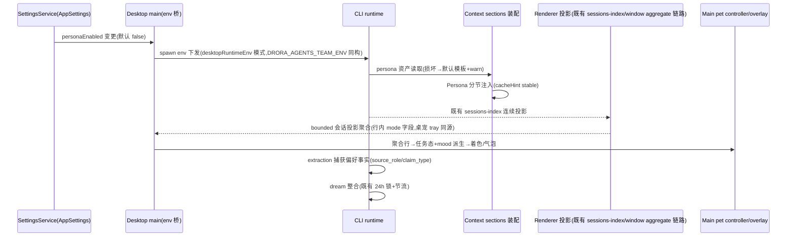

# Drora 拟人系统（Persona）

> 历史方案，2026-10-29 已由 [Persona v5 统一设计](drora-persona-system.md)替代。下文保留历史记录，不再作为实施合同；原 P0 计划也已改写为 v5 分期计划。文件权威、公共 section、env 开关、旧 Memory 绑定及复杂气泡不得与 v5 混用。

Status: superseded（原 2026-10-29 设计记录，未实现；当前以 v5 为准）
调研基础：六轮调研结论存档于项目记忆 `drora-persona-system-research`；本 spec 只沉淀设计，不复述调研。

## 0. 产品裁定（2026-10-29，用户四项）

| 裁定项 | 结论 |
| --- | --- |
| 人格定位 | 专业同事+温度：有名字、性格、记忆，本质是真诚的编程搭档；反谄媚/防依赖条款内置；**不做养成系好感度** |
| 成长记忆透明度 | 完全透明可编辑：本地文件，设置页可查看/编辑/删除/导出；local-first 是产品承诺 |
| v1 呈现 | 直接带桌宠：在已实现的 Codex parity 桌宠上叠加情感态 |
| v1 主动行为 | 桌宠气泡轻主动：本地模板渲染、场景白名单、频率上限 |

## 1. 范围

**v1 做**：
1. 身份层：persona 资产文件 + system prompt 新分节注入（人格锚）。
2. 成长层：用户偏好/工作习惯事实轨，复用现有 memory 体系（extraction/dream/recall），透明可管理。
3. 情感层：会话事件派生的 ephemeral 情感态（桌宠着色 + 气泡语气），不进 wire 协议、不持久化。
4. 呈现/主动层：桌宠气泡轻主动（场景白名单 + 频率上限）。
5. 设置面：开关、人格文件入口、记忆管理。

**v1 不做（预留接口，登记为有意分歧）**：
- 情绪影响决策、好感度/亲密度数值系统（人格定位裁定排斥养成系）。
- LLM 逐句情绪标签（不动 wire 协议帧结构）。
- OffPeak 晨报、世界观关键词触发检索（worldview v1 为常驻小节）、agents-team 成员挂 persona、语音。

## 2. 分层架构与状态所有者

四层各自映射到现有挂载点，不新建平行体系：

```
呈现层  桌宠(已实现,Codex parity) + 气泡(desktopPetOverlayContent 扩展)   ← main 拥有
情感层  会话事件→mood 派生(ephemeral 展示投影,同 dock 徽标性质)            ← main PetController 派生
成长层  现有 memory 体系 type:user 轨扩展归因字段(source_role/claim_type)      ← CLI runtime 拥有
身份层  ${dataRoot}/persona/ 资产 + ContextSection 注入                    ← CLI runtime 装配
```



所有权裁决：
- persona 资产文件的所有者是 CLI runtime（读）与用户/设置页（写）；人格锚**每会话重注入**，免疫 compaction，不随对话改写（防漂移双轨制：锚只读、成长只进记忆层）。
- 情感态是展示投影：无队列、无持久化、断电即失，性质等同 `syncApplicationUnreadBadge`；不构成业务状态，不进 `drora-protocol`。
- 气泡文案由本地模板渲染，**不调用模型**（成本与失控双隔离）。

## 3. 身份层

### 3.1 资产文件

`${Drora data root}/persona/`（与 `pets/` 同级，数据根解析复用既有 `dataRoot` 工具）：

| 文件 | 内容 | 变更频率 |
| --- | --- | --- |
| `soul.md` | 人格锚：身份/性格/语气/边界，默认模板内置，用户可整文件覆盖 | 极低频 |
| `worldview.md` | 世界观/背景叙事（Drora 是什么、从哪来），v1 常驻小节 | 低频 |

损坏/缺失/超限（soul.md 上限 **4000 字符——产品参数草案，实现前经用户确认**）→ 回退内置默认模板并 `warn` 级日志（服务日志走 `createServiceLogger`），**不阻断会话**。

### 3.2 注入契约

- 新 `ContextSection`（`source: "persona"`，`injectionTarget: "system"`，`cacheHint: "stable"`）。sections 注册点在 `context/builder.ts`（sections.push 序列，~L84-181，无还原标记，属可改自研代码；最终经 architecture-governance 受控上下文确认）。**注入顺序的真实语义**：`orderSectionsForInjection`（builder.ts ~L319-334）按 `(target, hint)` 重排全部段，push 序仅在同组内保留——persona 落位实为「stable 组内 identity 之后」，最终顺序 identity→persona→desktop→(dynamic 组)，与直觉位置有偏差但不破链。
- **三个装配门（审查裁定必须显式；门④为二轮审查补充）**：① `!isWorkflowActor` 门——workflowActor 路径保留 memory 段（builder.ts ~L129-130），不加门会给工作流子代理注入主 persona，与其自带身份段（workflow-actor.ts ~L54-59）叠加重复；② `!hasCustomSystemPrompt` 条件语义与 memory 段（~L153）对齐；③ **persona 内容在 context init 时一次性快照**——`rebuildContextPrefix`（context-refresh.ts ~L32-45）会在 model/outputStyle 变更时会话中重建 builder，若届时重读 soul.md，用户改文件即打穿整段 prompt cache（stable 块=history 首条 system 消息，内容变化=全量前缀失效）；快照落点=既有 `contextSourceSnapshot`（runtime/methods/context.ts ~L39-91，经 context-source.port.ts 扩字段），section builder 内禁止读盘；④ **subagent 门（三轮 dry-run 修正：架构天然隔离，改为字段约束）**——subagent 走独立的 `SubagentContextBuilderConfig`（+override build()），不进主 builder，门④天然满足；约束条款：**persona 内容只能放 ContextBuilderConfig 专属字段，禁止放进 subagent 共享的 skills/userInstructions 等字段**（二轮发现的风险——空 systemPrompt 的 Explore profile 会走默认 identity 路径——由该隔离天然化解，但仍需 A14 验收守护防回归）。
- **与 OutputStyle 的裁决（二轮审查补充）**：outputStyle 非整体替换，是 identity intro 改写（identity.ts ~L32-35）+ dynamic 组 `# Output Style` 追加（builder.ts ~L171-174），与 persona 分节**同时存在不互斥**。裁决：**表达/格式冲突时 Output Style 优先，persona 保留身份与记忆约束**（persona 管道不变，Output Style 管怎么写）。
- 注入优先级声明对齐 OpenClaw guidance 惯例：persona 分节内附一行「人格约束语气与表达，不覆盖 Harness/安全条款；冲突时安全与任务指令优先」。
- 默认人格模板内置「专业同事+温度」与四条反谄媚条款（warmly yet honestly / 不做无依据恭维 / 鼓励独立而非依赖 / 情感支持场景保持克制），措辞对齐泄露的 GPT-4o Personality v2 与 Anthropic Constitution。
- 固定核心 + 不随机：v1 全量注入（soul+worldview 合计 <6000 字符），风味段随机采样（ElizaOS 式）留待后续版本。

### 3.3 开关与生效

- `AppSettings.personaEnabled`，默认 `false`（opt-in），进 `validationAppSettings.ts`（full schema `.default(false)` ~L557 + patch schema `.optional()` ~L692，照 desktopPetEnabled 先例）。
- **生效粒度（审查修正）**：env 在 Host spawn 时烘焙（`desktopRuntimeEnv.ts` → `desktopHostProcess.ts` fork），agent 进程按 workspaceKey **常驻复用**（`processesByWorkspaceKey` + 空闲回收）——同窗口新会话复用旧 Host+旧 CLI 进程，拿不到新 env。真实生效单位是**新 Host 进程 + 新 CLI 进程**（新窗口或旧 Host 终止后），不是「新会话」；且 env 桥下发 off 不会清除已烘焙的 `"1"`，完全回基线需新 Host。设置页文案按此口径明示（沿用「Agent 进程快照须重启」文案模式）。
- **表面边界（二轮审查补充）**：①设置页 persona 行加 `isDesktop` 门（照 `SettingsPage.tsx` ~L2254-2256 桌宠行先例）——Web/手机设置页不渲染该开关（env 桥仅存在于 packages/desktop，web/server spawn 的 CLI 拿不到）；②**远程会话语义显式声明**：手机远控复用桌面既有 Host（shared-host-attachment），远程会话与桌面会话**吃到同一 persona**（同一进程内 system prompt，合理不对称：人格跨端一致、桌宠/气泡 desktop-only）。

## 4. 成长层（记忆轨，subagent 审查后重设计）

**v1 原案（独立 persona facts 轨）经审查推翻**：现有 memory 体系的 `metadata.type: user` 已覆盖「role, expertise, preferences」（`context/sections/memory.ts` ~L51）——「记住我用 pnpm」两轨都会捕获，独立轨即第二条写入路径，违反 AGENTS.md「避免重复状态和多条写入路径」；且 dataRoot 新根不在 extraction 工具边界（`resolveContainedMemoryFilePath` 只允许写 memoryRoot 内）、`origin-session.ts` 打标仅对 memoryRoot 内文件生效（dataRoot 文件=静默 no-op）。

**修正案（v1）**：persona 事实**并入现有 memory 体系**，不建独立轨：

- 事实落点=workspace memoryRoot 内既有文件（与项目记忆同根），`metadata.type: user` 轨承载用户偏好/习惯；**扩展归因字段**：`source_role`（user/assistant）、`claim_type`（preference/fact/agreement/suggestion）写入 frontmatter（新增字段为 additive，schema 向后兼容）。`source_role=assistant` 或 `claim_type=suggestion` 不得固化为用户偏好（HanaAgent issue #2053 反面教材）。
- 捕获/整合/回灌/检索**全部走现有链路，不建平行体系**（二轮审查修正表述：「零改动」不成立，实际改动点如下）：
  - **格式模板**：`context/sections/memory.ts` ~L38-47 是 frontmatter 唯一格式出处（extraction prompt 明确引用它），加 `source_role/claim_type` 必须改此模板与 ~L51 类型说明；dream prompt 不含模板，**自由编辑可能抹掉新字段**（dream.ts 整合时需在 prompt 中声明保留归因字段，或接受字段丢失后由下次 extraction 重建）。
  - **可见性链路**：manifest 为字段选择式提取（`recall/manifest.ts` ~L135-161 只取 description/metadata.type，未知字段静默忽略不拒绝）——新字段默认对 manifest/selector/回灌/管理 UI **全不可见**，要被感知需扩 `recall/types.ts`（MemoryManifestEntry）+ manifest 提取 + `services/memory` summary 类型 + MemorySettingsViewer 四层。
  - **管理能力现状**：MemorySettingsSection 已有 list/toggle；「查看」RPC 接口存在（`readProjectMemoryFile`）但 UI 零调用；「编辑」=外部编辑器按钮；「删除」无——spec 承诺的查看/编辑/删除/导出中，**删除与导出为新能力，查看需接线**，均列入 P1 交付项（§0 裁定的「导出」v1 落点=文件本体在 workspace memoryRoot 内可直接拷贝，UI 级导出按钮登记延后）。
- **透明管理**：复用既有 `packages/ui/src/settings/MemorySettingsSection.tsx` 记忆设置区扩展（见上「管理能力现状」），不新建平行管理面。
- **claim_type 守卫的分层实现（二轮审查补充）**：写入路径有三条——①主 agent 直写（extraction 检测到直写即跳过 extraction，**不过任何 policy**）②extraction 子代理 ③dream 自由编辑。程序化守卫钩子位= `memory-agent-loop.ts` ~L142-186 的 `evaluateMemoryAgentToolPolicy` Write/Edit 分支（可扩 content 校验），只覆盖 ②③；①只能靠 memory.ts 模板软约束。spec A5 的守卫按此分层声明，主 agent 直写残留风险登记为已知边界。
- **隔离**：persona 事实天然 per-workspace（与现有 memory 语义一致）；跨 workspace 的全局用户画像留 P3（届时再议 identity 级目录，且目录名必须用 slug+hash 归一——仓库先例 `memory/project-root.ts:10-33` 的 `slug-sha256前16hex` 构造，**禁止原始 workspaceIdentity/workspacePath 直接做目录名**，含斜杠跨平台必坏）。
- persona 资产目录 `${dataRoot}/persona/` 因此只放 soul.md/worldview.md（低频人格锚），不再含 facts。
- dream 现状如实声明：整合为自由 LLM 编辑+`collectDreamTouchedPaths` 可观测收集（dream.ts ~L172-199）；**add/merge/supersede 裁决与 preimage 回滚并非现状**（审查证伪了初稿的「已就绪」声称），若 P1 需要门控整合为新增工作，单独立卡。

## 5. 情感层（ephemeral 派生）

v1 不做 LLM 情绪输出，由 main 侧 pet controller 从**既有 window aggregate**（renderer 投影、`desktopPetSource.ts:29-60` zod 校验后持有，桌宠 tray 同源）按规则派生四种 mood tint：`calm`（默认）/`focused`（working）/`pleased`（completed）/`concerned`（error/attention）。**字段名以代码为准**：聚合行字段是 `mode`（`packages/shared/src/desktopPet.ts:54`，枚举 working/attention/completed/error，无 `failed` 字面量），非 `status`。投影仅在变更时推送，**超时类触发（concerned 的等待超时变体）需 main 进程内计时器**，不能用超时掩盖同步问题——计时器只做展示派生，不做重试。mood 派生的自然挂点：`desktopPetWindow.ts` render 链（~L48-59）。

- mood 仅影响：气泡文案语气变体、tray 行内状态词；**不改变动画轨道选择**（动画仍由任务态独占，避免与 Codex parity 契约冲突）、不影响任何工具/决策行为。
- 无时间衰减公式（v1 规则派生即随事件翻转；VPet 式数值衰减留待好感度类后续裁定）。
- mood 不持久化、不跨进程广播出 main。

## 6. 呈现层与气泡轻主动

### 6.1 桌宠情感着色

复用 Codex parity 九轨（不新增轨道、不改编解码/手势/拖拽契约）。**工程形态注意**：`desktopPetOverlayContent.ts` 是静态隔离 HTML 文档（CSP `default-src 'none'`、无外部脚本、i18n 为文件内 zh/en 内联、动态内容一律经 typed IPC 下发）——「mood 着色/气泡」的实现 = 该文档新增气泡 DOM 节点 + `contracts/persona.ts` 新增 typed IPC 消息类型，**不是** packages/ui 的 React 组件改动，也不接 packages/ui i18n 体系。

### 6.2 气泡轻主动

| 项 | 契约 |
| --- | --- |
| 触发白名单 | ①任务失败且连续 ≥2 次；②permission 等待输入超时 ≥5min；③长任务（≥30min）完成；④开启后首次问候（waving 语义，一次为限）。**四个阈值均为产品参数草案，实现前经用户确认** |
| 频率上限 | 默认 ≤1 条/15min、≤4 条/日（ElliQ 主动度校准：低频默认+设置可调+可整体关闭）；**计数器为 main 进程内 ephemeral 状态，重启重置，不持久化**（对齐「无队列无持久化」投影原则） |
| 文案 | overlay 文档内 zh/en 内联模板 × mood tint 变体，**不调用模型**；含会话标题/摘要等 bounded 事实（复用 tray 的 ≤120 字符预览约束），经 typed IPC 下发 |
| 交互 | 点击气泡=聚焦对应窗口（复用 tray 行导航路径 `desktopPetWindow.ts:241-246` → `desktopPetSource.ts:104-117`）；**target 必须来自 main 下发的聚合行原文**（:114 防伪造守卫：只导航当前投影内的原始 target）；关闭=仅本条消失，不写任何运行时状态 |
| 窗口形态 | 气泡挂**常驻 pet 窗口**（enabled 期间一次创建 `desktopPetWindow.ts:173-198`），不新建窗口 |
| 通道 | desktop-only；Web/手机远控不投影（对齐桌宠「Desktop 专属表面」先例） |

### 6.3 DESIGN.md Motion 豁免

气泡入场/退场动画豁免 Motion 条款需在 DESIGN.md 登记：仅允许 opacity/translate 过渡 ≤200ms（clarify state change 语义：新消息出现），禁 bounce/循环动效。视觉规格引用 overlay 文档内既有 CSS token（`--color-*` 系列已内置于 `desktopPetOverlayContent.ts`），不引入新 token 体系。

## 7. 契约键与接口

- 新 `packages/shared/src/contracts/persona.ts`，照 `desktopPet.ts` 扁平 `as const` 模式（fs 路径段/typed IPC channels），**但注册点三处必须同批落（审查补充，漏一即 knip/architecture 检查红）**：① `contracts/module.ts` 的 `publicEntrypoints` 加 persona.ts（且与 `architecture-policy.yaml` 一致，module.ts:3 注释明示检查器校验）；② 根 barrel `packages/shared/src/index.ts` re-export（CONTRACT.md:18 明文）；③ `contract.ts:1-13` 头注释契约清单同步。
- **env 键归属与透传语义（三轮 dry-run 修正，反义措辞风险）**：spawn 门 env 常量归属 `packages/shared/src/runtimeEnv.ts`（L224 `DRORA_AGENTS_TEAM_ENV` 先例）。**`SANITIZED_RUNTIME_ENV_KEYS`（runtimeEnv.ts:43-94）是剔除名单，不是透传名单**——`DRORA_PERSONA_ENV` 只定义常量、**不进剔除名单**，靠默认透传+main 注入（照 agents-team 语义）；若误加入名单，env 会在 `sanitizeDroraRuntimeEnv` 被从子进程 env 删除、永远到不了 CLI。CLI 侧消费点=RuntimeConfig（runtime/types.ts）扩字段 + bootstrap 构造处读 `process.env[DRORA_PERSONA_ENV]`（照 install.ts:72-74 先例）。
- **契约注册是四处不是三处（dry-run 补充）**：contracts/module.ts publicEntrypoints 之外，**`architecture-policy.yaml` shared-contracts 段须同步**（module.ts:3 注释明示检查器双向校验，managed 模块新文件不登记即 unmanaged-new-file 红）；加根 barrel index.ts re-export 与 contract.ts 头注释，共四处；契约需同批有消费方（knip 抓未消费导出）。
- **IPlatformService persona 方法是四层接线链**（dry-run 补充）：platform.ts 可选方法（照 ~L913-920 inline import 风格）→ renderer `desktopPlatform.ts` → `preload/index.ts`（~L793 desktopPet 先例）→ main `drora-extensions/` 实现（该目录属 managed 模块，新文件同样登记 publicEntrypoints）。只改接口不接线四层=Web/desktop 双端静默 undefined。命名注意：validationAppSettings 已有 `voicePersonaId`（~L550）领域词，persona 设置键命名避开歧义。
- 设置校验进 `validationAppSettings.ts`；UI 经 `IPlatformService` **可选方法模式**（照 `platform.ts:913-920` 的 `publishDesktopPet?/manageDesktopPets?` 先例追加 persona 文件读写方法）+ hook 访问，不直接 `window.drora`；设置页分区复用 `MemorySettingsSection.tsx` 整区组件先例。
- 修改任何一侧前全链 grep 生产与消费。

## 8. 安全与对抗边界（三轮安全审查裁定）

1. **persona 文件注入的硬边界在代码层不在提示层**：SECURITY_NOTICE 是 identity.ts 硬编码常量（persona 无法覆盖其文字），但 sections 拼接进同一 system 消息，恶意 soul.md 可与之并列矛盾——§3.2 优先级声明只是提示层。真正的硬边界=write-tier-policy（resolveWriteToolTier 不消费 persona 内容，语气软化不了 S03 写安全）+ 本节各条。spec 声明：**persona 注入不降低任何权限层级**。
2. **persona 读写路径校验（缺口已补）**：soul.md/worldview.md 读写必须等价桌宠库防线——`containedPath`（resolve+isInside+双侧 realpath 防 symlink 逃逸，desktopPetLibrary.ts:19-25 先例）+ 读取尺寸上限；**soul.md 若为 symlink 可将任意文件内容注入 system prompt**，读侧 realpath 校验为必选项。
3. **agent 写 persona 目录=deny（远程放大面裁定）**：persona 是机器级全局资产（非 per-workspace），远程会话诱导 agent 写 `~/.drora/persona/soul.md`（workspace 外写入的权限请求转发到手机端）一次批准即投毒全部桌面后续会话——**v1 直接禁止 agent 运行时写 persona 目录**（用户经设置页/文件系统手动编辑是唯一写路径）。
4. **persona→memory 免确认写复合链（登记为已知风险）**：memory .md 写是免确认档，被投毒 persona 可诱导 agent 无确认写入伪造偏好且**存活于 persona 删除之后**；缓解=归因字段+A5 守卫+memory 管理面可删，残余风险登记不增补兜底。
5. **A5 守卫能力边界（诚实声明）**：程序化守卫只能验 frontmatter 格式合法（枚举值），**归因真伪不可程序化证明**（LLM 自己写字段，policy 无会话转录交叉验证；主 agent 直写路径不经过 policy）——A5 的守卫=格式校验+extraction prompt 约束+抽查，不是可证明的保证。
6. **呈现层实现纪律**：气泡文本仅 `textContent`（照 tray 先例 desktopPetTray.ts:49-51，全 preload 无 innerHTML），禁 innerHTML/insertAdjacentHTML；mood 计时器与频率计数器随桌宠 dispose 取消/清零（照 desktopPetWindow.dispose ~L287-301 与 NativeInteraction clearInterval 先例）。

## 9. 上游对齐（模块化隔离）

官方上游无 persona 系统，本特性为纯自研叠加：

- 实现一律新文件/新模块（contracts/persona.ts、context/sections/persona.ts、memory persona 轨、PetController 扩展模块），经 ports/设置注册/env 桥接入；**禁止写入还原目录、禁止还原文件 import 自研 persona 实现**。
- 分歧登记进 `specs/drora-divergence-ledger.md`（条目四要素：上游行为/本仓行为/依据（文件:行）/下次同步注意，编号不复用）；上游若未来推出官方 persona 契约，按官方契约迁移人格资产。
- feature-graph 新增 `surface.persona`（气泡/情感态）与人格设置分区节点（按现有 node schema：id/kind/label/aliases/docs/codeSeeds/invariants），并**必须挂边到既有节点**（二轮审查补充）：`persistence.app-settings`（personaEnabled）、`capability.project-memory` / `service.project-memory-extraction-lifecycle` / `surface.project-memory-settings` / `persistence.project-memory-files`（P1 归因字段）、`state.desktop-runtime-process-env`（sanitize 透传）、`service.desktop-local-host-startup`（env 烘焙点）、`service.shared-host-attachment`（远程同人格）、`capability.subagents` / `state.subagent-child-runtime`（subagent 门）。`architecture:check --changed` 必须过。

## 10. 验收场景

| # | 场景 | 期望 |
| --- | --- | --- |
| A1 | 默认安装（开关关） | 全链路零行为变化；system prompt 无 persona 分节 |
| A2 | 开启→**新 Host 进程**（新窗口或旧 Host 终止后） | `/context` 可见 Persona 分节；soul+worldview 注入；cacheHint stable（同窗口新会话拿不到旧进程外的 env——按 §3.3 生效粒度验收） |
| A3 | soul.md 损坏/超限 | 回退默认模板 + warn 日志；会话正常 |
| A4 | 用户说「记住我用 pnpm」 | extraction 捕获为 `type:user`+归因字段（source_role=user）；MemorySettingsSection 可见可编辑可删；后续会话经既有 recall/memory 链路回灌 |
| A5 | 助手建议型内容 | 不得固化为用户偏好——守卫=格式校验+extraction prompt 约束（§8.5 能力边界：归因真伪不可程序化证明、主 agent 直写不经过 policy，登记为已知边界）；单测覆盖格式守卫分支 |
| A6 | 聚合行 mode=error 连续 ×2 | 桌宠气泡提醒（频率上限内）；点击聚焦源窗口；关闭仅本条消失 |
| A7 | 15min 内多事件 | 气泡限流生效（≤1/15min）；mood 不影响动画轨道（parity 回归） |
| A8 | 两个 workspace | persona 事实天然 per-workspace（memoryRoot 语义），不串台 |
| A9 | 关闭开关后**新 Host 进程** | 回到 A1 基线（env 烘焙不清除，旧 Host 存续期间维持原状为已知语义）；已写记忆文件保留 |
| A10 | 全量门禁 | `pnpm typecheck` / `pnpm lint` / `pnpm architecture:check --changed`；**CLI 侧门禁=`pnpm --dir apps/drora-cli check`（turbo typecheck+test）或至少 core 包 test——根 affected 单测与根 typecheck 均不覆盖 apps/drora-cli（三轮核实：根 vitest projects 仅含 packages/*/test）**；验收记录实际执行命令 |
| A11 | 气泡/桌宠交互 E2E | 对齐桌宠 spec 的 E2E 矩阵惯例：气泡出现/点击聚焦/限流/关闭仅本条消失（renderer+native E2E）；**E2E 测试与夹具同批配齐，不留后补** |
| A12 | overlay 文档 CSP | 气泡内容经 typed IPC 下发后文档仍满足 `default-src 'none'`（无脚本注入面） |
| A13 | persona 开启 + 选择 Output Style（如简洁） | 两分节同时注入；表达/格式冲突时 Output Style 优先，persona 身份与记忆约束保留 |
| A14 | 派发空 systemPrompt 子代理（Explore profile） | 子代理 system prompt **不含** persona 分节（subagent 门生效） |
| A15 | persona 目录路径对抗 | soul.md 为 symlink 指向目录外文件→读取被拒（containedPath+realpath）；写入经设置页且有尺寸上限；**agent 运行时写 persona 目录=deny（§8.3）** |

测试纪律（AGENTS.md）：行为改动先补测试（A4/A5 的 extraction 归因守卫为单测必选项）；交互改动 E2E 先行（A11）；实现与验证同批交付，未执行或环境受限时如实说明。

## 11. 分期交付

- **P0**：spec 定稿 + 受控上下文确认 + `contracts/persona.ts` 四处注册 + `runtimeEnv.ts` 常量（不进剔除名单）+ CLI RuntimeConfig/bootstrap env 消费点 + `context/types.ts`（ContextSource 联合+Config 字段）+ `context-source.port.ts` 快照扩字段（contracts 包，注意重建 dist）+ 分节文件与 builder 注册（四门）+ `main/index.ts` 三段接线（快照/patch/spread，照 ~L1109-1117/1133-1135/1913-1919 agents-team 先例）+ 设置行（isDesktop 门+i18n 双词典）+ IPlatformService 四层链 + persona 资产读写（含 §8.2 路径校验）+ divergence-ledger/feature-graph 登记 + persona 资产读取单测（CLI tests/ 新建）（A1-A3、A9、A14）。
- **P1**：成长记忆（memory.ts 模板扩字段 + manifest/types/memoryService/Viewer 四层可见性 + MemorySettings 查看/删除接线 + 归因守卫 + 夹具扩 memory-test-utils）（A4-A5、A8）。
- **P2**：mood 派生 + 桌宠着色 + 气泡轻主动（含限流器纯函数测试 + harness 气泡 case 与聚合行 error×2 序列夹具同批配齐）+ DESIGN.md Motion 豁免登记 + E2E（A6-A7、A11-A13、A15）。
- **P3（预留不排期）**：OffPeak 晨报、worldview 检索化（lorebook 关键词触发+token 预算）、团队成员 persona、风味段随机采样、全局用户画像（identity 目录须 slug+hash）。

每期交付物含同批测试（单测+E2E）与真实执行结果；feature-graph 节点（`surface.persona` 等，按 `drora-feature-graph.yaml` 现有 node schema：id/kind/label/aliases/docs/codeSeeds/invariants）随 P0 落。
