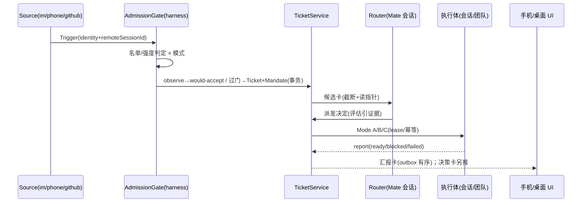

# Drora Mate（个人助理「大副」）设计 spec

- 日期：2026-11-04
- 状态：P4 已实施（feat/mate-p4 两批：host 批=watchdog 判据与 stale 标记（schema v5）+
  auto 信任门+配额中心数据判定面+Surface B「切 auto」入口；第二棒=汇报卡完整版（工件
  只读核验→awaiting_output 滞留（schema v6）→人工确认出口、usage 按代分解、未确认增量
  行、证据页签全量）+配额中心 UI（状态条配额行/摘要卡/调整入口）+桌宠气泡闸接线+验收
  资产）。前序：P3 已实施（feat/mate-p3 两批）；P2 已实施（feat/mate-p2，host 内核 +
  Surface 批次）；P1 已交付（feat/mate-p1）。实现与本文的偏差按 00-master-plan §8/§9、
  04 详设回填注记、ui-mate 与 assistant-tickets CONTRACT.md 登记；无真实凭据的连通
  （飞书/GitHub 真机、飞书回复端口接线）、跨卡 Y/N/E 全局键盘流与真实 Host 工件核验
  git 真链路随总闸联调验收为已登记遗留。
- 基线：main @ 42bacc627（upstream **v3.17.2 已整并**：b3e44cb2a 六段合并 + a9fe401ee 源同步）。
  本 spec §3/§7 引用的四个接缝路径（`apps/drora-cli/packages/core/src/team/hub.ts`、
  `drora-protocol-v4/sessions-index.ts`、services 的 drora-session 与 bot-project-runtime）
  已于合并后核实在原位。上游 subagent 面若继续演进，按 §13 覆盖判断条款评估。
- 外部依据：TRAE宝（字节 Trae 个人助理）与 DeepSeek dsh-superagent 及其 60+ 衍生实现的
  社区普查（2026-11-03~04，含 DSH 原型源码级分析）。关键外部教训已内化为 §2/§8/§9 的规则。

## 1. 定位与命名

Drora Mate（中文名：**大副**）是常驻的跨项目个人助理层。航海隐喻贯穿词汇体系：
船长=用户，大副=Mate，船员=agents-team 成员，航次=工单。**大副自己永不执行**——assistant
preset 无 bash、无写盘工具，只做路由、派发、盯单、汇报。

命名契约一次定齐（契约键单一出处，见 §5 落点）：

| 层       | 值                                                                                                                                                             |
| -------- | -------------------------------------------------------------------------------------------------------------------------------------------------------------- |
| 产品名   | Drora Mate / 大副（i18n：zh「大副」/ en "Mate"）                                                                                                               |
| 服务模块 | `packages/services/src/assistant-tickets/`                                                                                                                     |
| UI 模块  | `ui-mate/` 新文件族（复用 teamActivity 三面接缝先例）                                                                                                          |
| 协议     | P2 起为 `packages/shared/src/contracts/assistant.ts`（assistantActivity wire schema=`sessionMateActivitySchema`，drora-protocol-v4/index.ts 仅 re-export；原设想的 `assistant.ts` v4 命令族随 S2-T0 (a) 路线不设立）        |
| 契约常量 | `packages/shared/src/contracts/assistant.ts`（新文件）                                                                                                         |
| 命令入口 | `/mate`（CLI `.drora/commands` 自定义命令 + UI 导航端口）                                                                                                      |
| 设置键   | `drora.mate.*`（P4 启用，01 §1.4）；持久化=数据目录 `mate/` 下库文件 `mate.sqlite`（contracts/assistant.ts ASSISTANT_STORAGE_KEYS 单一出处；00 §8.5 命名统一） |

## 2. 产品规则

1. **三层结构**：全局 Mate（窗口 Local Host 内 assistant 虚拟 workspace 的常驻会话）→
   项目会话 / agents-team（既有）→ 工单执行体。Mate 会话是**可重建的无状态壳**：编排事实
   全部在 TicketService 台账，不在会话上下文；定期/随时轮转重建不丢状态。
2. **五入口一个 Mate**：桌面对话、Side Pane 任务中心、手机（App/远控）、IM（飞书
   channelRuntime 既有；其余经 §5 Source 注册表扩展）、语音（接 voice-agent spec）。
   **P10 设计注记（2026-11-07 v2，10 号详设，纯设计未实施；v1 入口倒转已被用户裁定
   修正）**：大副=harness 之上的**管理员/管家层**——可管理 harness 内任何对象（会话/
   任务/team），**只对用户一个委托人负责**（单委托人原则）；既有直连入口全部保持
   （**不做 Mate-first 路由**）。「桌面对话」入口由 P10a 兑现为**对话管理台**：对话流=
   台账的消息投影（用户消息=trigger、决策卡/答复/工单摘要行内嵌），composer 发送=
   explicit 触发进准入门；新增 query scope kind `chat`（Router 会话聊天轮，互扰标记+
   不计轮转，无工具无承诺话术——双脑禁令）。P10b=**管理动作面**：routerDecision 扩
   manage 第六臂（targetKind/action/reason/evidence，targetRef 只能取自台账可见集——
   attach 臂同款反编造纪律），决策卡人工 Y 后经**既有 harness 服务面**执行（session=
   v4 stop 含 executionId 守卫/offpeak=cancelTask），大副零新执行逻辑；动作族封闭
   （一期 stop_turn/cancel），**auto 模式管理动作同样必须人工 Y（管理≠自动）**；红线
   「投影不等于接管」修订为「**接管=经批准的管理动作**」。P10c 主区一级入口条件触发
   后置。
3. **交互契约三条**：
   - 决策收件箱不刷屏：默认只推送需要人拍板的事，带每日打扰配额（可配，默认 5）。
     **P4 落地注记（2026-11-05，feat/mate-p4 host 侧批次）**：配额中心数据与判定面
     落 TicketService——kv `quota:<yyyy-mm-dd>` 按日记账（决策卡推送/汇报推送/桌宠
     气泡三类事件同源计数），统一计数接口 `admitDisturbance`（判定：决策类永不抑制、
     仍计数；report/bubble 类当日累计超配额即转次日摘要聚合）+ 查询接口
     `getDisturbanceQuota`（当日用量/余量/未投递摘要）+ `markDailyDigestDelivered`
     （摘要投递回执）。配额值来自 AppSettings `droraMateDailyQuota`（contracts
     ASSISTANT_SETTINGS_KEYS 单出处；protocol.ts + validationAppSettings 两处挂载 +
     normalizeSettingsPatch 语义，缺省 5=ASSISTANT_DISTURBANCE_DEFAULTS）。UI 呈现
     （状态条配额行/摘要卡/调整入口）**已随 P4 第二棒交付**（feat/mate-p4）：
     MateStatusStrip 配额行消费 snapshot.quota（缺席不渲染）；MateDigestCard 同卡
     分节呈现近 ≤7 日未投递摘要与 watchdog 通知区（同一快照源，无第二计数器），
     「标记已投递」=markDailyDigestDelivered 回执；MateConfigSection 每日配额行
     （草稿-dirty 纪律同名单编辑）经 useSettings 写 AppSettings；桌宠气泡闸接线
     MatePetSync——弹泡差分命中先过 admitDisturbance(kind=bubble)，未放行/判定失败
     皆不发布气泡帧（fail-closed，汇报仍在 tray 速览与面板可见）。
     **P4 修复批注记（2026-11-05，feat/mate-p4 修复轮）——三类事件的生产接线现状**：
     「三端同源计数」指经统一计数接口 `admitDisturbance` 进出（不建第二计数器），不
     假设三类各有生产方。decision 类生产接线=gate 落卡事务（`recordTrigger`/
     sourceIngest 落 decision_card 同事务计数——决策卡落卡即推送事件；decision 永不
     抑制，本接线只兑现「仍计数」，used.decision 不再恒 0）。report 类现状生产方=
     watchdog 通知（§10）；**工单终态汇报卡为快照被动呈现、无主动「推送」动作可挂**
     ——桌面现状下「汇报到达」的打扰语义由桌宠气泡闸（kind=bubble）承接，汇报推送
     的 report 计数生产接线随手机推送/主动推送通道批次补齐（§14 P4 遗留登记，替换
     条件=存在主动推送通道）。auto_notice 告知卡（auto 已执行告知）不在三类事件
     分类学内，不计数（有意边界，非缺口）。
   - 先航海日志后放行：observe 信任梯度（§6），放行率达标才出现切 auto 入口。
   - 成本永远同行：任何工单展示必带实耗（token/费用），换代不换账。
4. **诚实规则**：用户原文 verbatim 进 brief，不静默改写；换代增量如实标注（"第 N 代重启，
   第 N-1 代末尾 X 处改动未确认"）；失败写原因，不自动重试。
5. **安全边界（诚实声明）**：Worker 隔离=独立会话+独立目录+工具白名单+凭据不下发，
   **不是容器级安全边界**，文档与 UI 均须明示；完全访问档（yolo）必须经决策卡人工放行。

## 3. 与既有实现的关系（官方优先）

| 能力   | 复用（不动）                                     | 新建（自研）                 |
| ------ | ------------------------------------------------ | ---------------------------- |
| Router | 官方会话机制 + persona 预设（contracts/persona） | assistant preset 配置        |
| Worker | agents-team 成员 / drora-session 会话            | —                            |
| 投递   | CommandInbox 串行 admission、v4 sendText         | —                            |
| 附着   | bot-project-runtime 的 identity+lease 范本       | 派发桥（services 层）        |
| 准入   | workspaceIdentity 名单                           | admission 域模型（§6）       |
| 事件   | bots channelRuntime（飞书）、automations cron    | Source 注册表                |
| 台账   | —                                                | AssistantTicketService（§5） |
| UI     | Side Pane/footerSlot/session-line 三接缝         | ui-mate 组件族（§11）        |

**TeamHub 与还原区零改动**。Mode B 采用 prompt 驱动建队（走既有 stage→人批流程），
不引入 `assistant_dispatch` 审计枚举（原设计已取消）。

## 4. 状态所有者

| 状态                           | 唯一所有者                                                                  | 说明                            |
| ------------------------------ | --------------------------------------------------------------------------- | ------------------------------- |
| Trigger/Ticket/Decision/Outbox | AssistantTicketService                                                      | 事务写；幂等键=ticketId         |
| 团队执行事实                   | TeamHub journal（既有）                                                     | 不建第二份                      |
| 名单/准入/预算配置             | mate.sqlite kv 表（01 §1.4：P1 不动 AppSettings；drora.mate.\* 键 P4 启用） | 键单出处（contracts/assistant） |
| Router 会话                    | CLI runtime（既有会话机制）                                                 | 可重建，无业务事实              |
| Renderer                       | 投影 + 草稿 + pending overlay                                               | 不新增业务状态                  |
| Main / relay                   | 仅转发与进程/窗口管理                                                       | 不承载工单                      |

## 5. 领域模型

- **Trigger**：不可变事件（来源=Source 注册表：im / phone / github / local），携带
  workspaceIdentity 与 remoteSessionId 贯穿。
  **P3 落地注记（2026-11-05，feat/mate-p3 host 侧批次）**：source_kind 封闭枚举
  `ASSISTANT_SOURCE_KINDS`（local/feishu/phone/github）在 contracts/assistant.ts 单出处；
  trigger 表新增 `channel_ref`、`remote_session_id` 列，ticket 表新增 `channel_ref` 列
  （schema v4，只加不破；channelRef 串接格式在 services assistant-tickets/sources/
  channelRef.ts 单出处——仅 host 侧 mate.sqlite 自产自读，不跨进程）。工单经决策卡放行
  建票时从 trigger 回填 ticket.channel_ref 绑定（feishu 线程 / GitHub issue / 手机会话），
  同绑定 SourceEvent 命中活动工单即直通（§8 Tier1）。
- **AdmissionDecision**：strength=`explicit|inferred`；详见 §6。
- **Mandate**：授权凭证。只有三种变更途径：accept 创建、用户 stop、校验失败撤销。
  **消息、评论、引用文档只是输入，不能改变权限。**
- **Ticket**（工单，唯一稳定身份）：brief（verbatim）+验收标准+预算+写域声明+成本账本 +汇报历史+incarnation 指针（§8）。
- **Incarnation**（当代执行体指针）：`{workspaceIdentity, sessionId, hostId?,
remoteSessionId?, anchor}` + generations 历史（每条带 cause:
  superseded|lost|user_picked|expired）。
- **Report / Outbox**：同 ticket 严格有序投递；请求 id=ticketId，只投一次。

落点：P1 域 schema 位于 services 模块（host 侧 parse，UI type-only 引用）；
S2-T0 结论为 **(a) 结构化文本**（persona preset 会话 + system prompt 约定 schema 输出 +
host 侧 zod 校验，零 CLI 改动）——v4 命令族全程不需要，`ASSISTANT_V4_COMMAND_TYPES`
不设立；spec §7 的 mate_\* 工具白名单仅在 (b) 路线启用，(a) 路线 Router 无自定义工具。
env/`_meta`/持久化前缀常量在 `contracts/assistant.ts` 单出处。
P2 起派发幂等键升级：commandId=`<ticketId>-<投递序号>`（kv 计数器；P1 恒取 ticketId
仅单发成立），anchor=最后一次成功 sendText 的 commandId（CLI inputId）。

## 6. 准入（off / observe / auto × explicit / inferred）

| 模式    | explicit（名单内点名/follow-up） | inferred（名单内未指名/名单外机器） |
| ------- | -------------------------------- | ----------------------------------- |
| off     | 拒绝并记录                       | 拒绝并记录                          |
| observe | **零执行**：出决策卡一键放行     | 记 would-accept，不出卡             |
| auto    | 执行（出告知卡）                 | 经评估后执行（评估须引用原文证据）  |

- observe 语义取**全量零执行**（比 DSH 的"observe 仍执行点名"更保守）：所有自动接单先记
  would-accept；点名请求以决策卡呈现，放行即转执行。理由：P1 阶段最小信任面，且决策卡
  本身就是产品交互的一部分。
- inferred 接受永远需要一次评估且评估引用原文（intent evidence 约束）；直接接受非
  explicit 触发在代码层拒绝。
- 切 auto 仅在信任条达标后开放（§11），需确认 dialog（不可逆操作）。
- **P3 落地注记（2026-11-05）**：真实 Source 强度判定落地于服务 `ingestSourceEvent`——
  `mention && allowlist 包含 identity → explicit，否则 inferred`（03 详设 §1）；名单外
  identity 由 gate 拒绝（消息不能改变权限不变式不变）。P1 `recordTrigger` 的模拟语义原样
  保留（本地双按钮降级为测试工具，master plan §4.1）；手机端新增 channel 可见入口
  `submitSourceEntry`（仅开放 sourceKind="phone"，identity 由 host 侧取本机用户——
  renderer 不可自报 feishu/github identity，防身份伪造；remoteSessionId 贯穿）。
  **收尾注记（2026-11-05，P3 修复批）**：`phone.enabled` 开关同时覆盖两条事件路径——
  ①注册表运行态门（sourceRegistry reconcile 按 enabled 启停 emitPhoneInput 桥）；
  ②`submitSourceEntry` 入口前置 `isSourceEnabled("phone")` 检查（关闭时拒绝，
  错误码 `mate.source.disabled`，含直通臂——与飞书/GitHub「Source 停用=事件面全关」
  语义对齐，不留半开门）。配置写入口（sourcesConfig/identityMap 的 kvSet 生产路径）
  随 Source 配置 UI 批次（§14 P3 遗留登记；当前 kv 手改，kv 空=三 Source 恒关为
  诚实缺省）。
  **P4 落地注记（2026-11-05，feat/mate-p4 host 侧批次）**：auto 信任门实装——统计口径
  `releaseRate = decision_card+decided_by='user' 放行数 /（would_accept 数 + 放行数）`，
  样本数=两者之和（与快照 trust 同一 SQL 口径，单一事实源 admission_decision；kv
  `trust_gate_stats` 为 watchdog 同轮落账的审计投影，setMode 判定读实时 counts，
  不读缓存）。开放条件 `releaseRate ≥ 0.8 且样本 ≥ 15`（阈值 kv `trust_gate_min_rate` /
  `trust_gate_min_samples` 可调，缺省 ASSISTANT_TRUST_GATE_DEFAULTS 单出处）。
  `setMode("auto")` 由「P1 恒拒」改为信任门判定：未达标仍 `mate.auto.locked`，达标即
  解锁（确认 dialog 是 UI 侧不可逆提示，服务侧不二次确认）。
  **审查修复批（2026-11-05，全链审查 P1/P2）**：Source 入口预检对账基准修正——比较
  「事务内 verdict vs 预检 verdict」（与 recordTrigger 同参；旧实现误比
  autoPlan.finalOutcome，无目标降级计划与 auto_notice 恒不等 → 飞书/GitHub 无目标
  事件被静默丢单并落虚假 auto_notice）；另补孤儿 auto_notice 守卫（预检 observe→
  事务 auto 翻转时降级 decision_card 问人，explicit 触发必有可操作出口）。
  auto 下规则：explicit 带
  目标 → 直接建票派发（Mode A/默认 build 档，decision 记新 outcome `auto_notice`=
  告知卡，decided_by 恒 gate——不计入放行率分母/分子）；explicit 无目标 → 降级
  decision_card 进 Router 候选卡循环（目标探测失败同降级，问人不猜测）；inferred →
  Router 建议须 dispatch/attach 臂且 evidence ≥1 条（zod schema 校验形状；「引用原文」
  由 auto 执行门做结构性包含校验——每条 evidence 须为触发原文子串，任一失配即不自动
  执行留卡问人，2026-11-05 审查修复批补齐；人工放行不受影响）才自动建票派发，
  hold/reject/评估失败/探测失败一律留在 decision_card 问人。模式在执行时点复核（gate 与派发之间切回 observe → 建议不自动
  执行）。

## 7. 派发桥与三种打通模式

Mate 不持有跨项目大 Team。派发桥（services 层，模型不可见）按工单选择模式：

| 模式 | 何时用                 | 机制                                                                                                                           |
| ---- | ---------------------- | ------------------------------------------------------------------------------------------------------------------------------ |
| A    | 默认：独立可并行单工单 | 目标 workspace `createSession` + brief 作首条输入 sendText；worktree 隔离（§9 W1）                                             |
| B    | 需多角色并行           | 目标 workspace 建 lead 会话，sendText 指示走既有 /team stage→approve 流程；approve 门保持人批（prompt 驱动，无程序化 staging） |
| C    | follow-up/续既有工作   | identity 解析（§8）→ lease 附着 → CommandInbox 投递（保序、busy 排队合法）                                                     |

Mate 工具白名单（assistant preset，无 bash/写盘）：`mate_projects`（只读）、
`mate_dispatch`、`mate_report_read`（截断+读指针分页）、`mate_reply`（走 outbox）。
**P2 落地注记（(a) 路线）**：Router 无自定义工具面，白名单随 (b) 路线（若启用）一并
落地；Router 的 system prompt 契约以候选卡首条输入的路由约言承载（host 侧拼装、
CLI 零改动；createSessionRequestedConfigSchema 无 persona preset 字段，persona 控制面
迁移留 P3+）。派发桥独占：identity/lease 解析、createSession/attach、幂等投递、
report 归账、权限档映射（Mandate scope → TeamHub 批准时权限档，默认 build/guarded）、
成本挂账。

## 8. 目标会话解析与代际

身份锚在工单，不在会话。session 是易变执行体，Ticket 持 incarnation 指针。

**解析三层**：Tier1 绑定直读（同 ticket follow-up 直投，busy 排队合法）；Tier2 受限解析
（无绑定时：harness 生成有界候选集——sessions-index 快照，硬过滤 busy/跨 identity/过期，
Mate 带证据选择，派发桥校验后生效）；Tier3 决策卡问人（低置信必经，"开新会话"永远是选项）。

**锚校验与换代**：anchor=最后一条已投递消息 id/轮次锚（CAS 双基准先例）。投递前校验，
失配即当代失效。换代在事务内先归档旧代再立新代；凭台账（brief+汇报+工件）重派新代并
携带浓缩上下文，未汇报增量如实标注。
**P2 落地注记**：anchor=最后一次成功 sendText 的 commandId（=`<ticketId>-<投递序号>`）；
投递前经 host 会话索引对账（`reconcileSessionsIndexV4` 存在/删除语义）校验锚仍可寻位；
换代续用同一 worktree/分支，usage_accum 按 ticketId 记账不改写。
**审查修复批二（2026-11-05，全链审查 P1/P2）**：换代退订修复——旧会话退订须在换代
事务改写 incarnation_current **之前**捕获 sessionId（旧实现事务后读行恒 no-op：旧代
帧订阅泄漏、旧代事件归账新代、旧会话删除时对新代二次换代）；换代重派档位自落库
dispatch_intent 恢复（旧实现硬编码 build，guarded 工单换代被静默降档）。派发回写补
终态守卫——stop 后在途 ACK 不复活 running/不重挂订阅（旧实现无条件回写）。
**审查修复（2026-11-05）**：对账「不可用」（reconcile 抛错/快照投影未就绪）≠锚失配，
不触发换代重派——触发源仍封闭为上表三源；follow-up 在不可校验时如实报错（不猜测、
不重试），另开会话/问人由人工决策承接。workspace 探测失败（远程/非本地路径/目录
不存在）同口径：放行事务前预检拒绝、决策卡不消费（人工改选目标后可重放），
不再在建票后静默置 failed；探测端口缺席（P1 形态）按 workspace 域派发（未隔离明示）。

| 会话变化           | 检测（全部事件驱动） | 处置                             |
| ------------------ | -------------------- | -------------------------------- |
| compaction/换模型  | 无需                 | 不动，工单只读 projection        |
| fork/rewind 分支   | 锚校验失配           | 升新代或决策卡换绑               |
| 会话删除/归档      | 生命周期事件         | 无损重启（台账重派）             |
| 远程 Host 断连     | lease 失效通知       | 代际重附；超窗按删除处置         |
| 用户在别处手动继续 | Tier2 命中相似会话   | 决策卡换绑（cause: user_picked） |
| workspace 迁移     | identity 解析失败    | 拒绝猜测，问人                   |

不变式：任一时刻最多一代执行；换代只由锚校验/生命周期事件/lease 失效触发，
**禁止超时兜底**（不用超时掩盖同步问题）。

## 9. 并发与写域

三层边界：会话内串行（CommandInbox 唯一入口，既有）；工单间并行（默认）；工作区内协调
写域（不串行，无全局锁，无硬上限——软预算默认同 workspace 活动工单 3，超出排队+告知卡；
**P2 起恢复 3（contracts ASSISTANT_DEFAULTS 单出处），超预算 approve 进入 queued 状态、
释放即 FIFO 派发（kv cursor）；P1 曾简化为 1（已随 P2 改回）**）。

| 档  | 机制                                                                       | 适用/默认                                                                                      |
| --- | -------------------------------------------------------------------------- | ---------------------------------------------------------------------------------------------- |
| W1  | 每工单 `git worktree .drora/mate/<id>` + 分支 `mate/<id>`，交付走 PR/patch | Mode A 默认（**P2 已落地**；终态清理 worktree 保留分支，失败清理动作入 fail_reason 附属日志；换代重派前已检出则续用） |
| W2  | 写域声明+派发桥比对同 workspace 其他活动工单，重叠→排队/问人               | 非 git 或用户关闭 W1（P2：重叠进 budget 队列）                                                 |
| W3  | 附着用户会话不隔离（那是用户自己的工作目录）                               | Mode C；仍检查与 W1/W2 工单冲突（P2：冲突进 budget 队列）                                      |

不变式：Mate 派生活动工单两两写域不相交；工单终态即清理 worktree（保留分支），失败清理
动作如实入台账；换代重派续用同一 worktree/分支，不重复 `worktree add`。
**P2 落地注记（2026-11-05 审查修复）**：queued FIFO 释放前复检预算与队头写域冲突
（与仍在活动工单比对，重叠则保持 queued 终止本轮释放——不变式在释放侧同被强制）；
放行形态（Mode A/B/C、附着目标、权限档）在建票事务落库 `ticket.dispatch_intent`
（schema v3，dispatchIntent.ts 单一形状），释放按落库形态重放派发——排队不静默改写
用户放行动作（Mode B 重套 /team 指示、Mode C 附着原目标、权限档恢复放行值）。
W1「用户关闭」入口已补（setWorktreeDisabled：kv 唯一写路径+快照投影+MateConfigSection
开关，只影响之后的派发规划）；W2 声明域「决策卡可编辑」入口仍为 P2 裁剪（空集=待
声明整域自动互斥进队列），随声明域 UI 批次交付。

## 10. Watchdog

automation（cron 协议既有）驱动，周期读 TicketService 状态时间戳与停滞判据；产出=
停滞标记+纠偏建议+通知人，**不自动终止、不自动换代**。与 §8 换代触发源互补且不重叠。

**P4 落地注记（2026-11-05，feat/mate-p4 host 侧批次）**：定时器=desktop host 进程
内部 tick（`host/cronMateWatchdog.ts`，照 startManualClaimHeartbeat 的 setInterval
先例；不进任何会话），每 tick 调服务内部入口 `runWatchdogRound`——是否到轮由服务按
kv 裁决（`watchdog_interval_ms` 可调，缺省 15 分钟；`watchdog_last_round_ms` 记账），
kv 改值无需重启定时器。判据（04 详设 §1 判据表）：running 停滞=running 且
updated_ms 距今 >30min → ticket 置 stale 标记（列 `stale_ms`/`stale_kind`，schema v5
只加不破）+通知；排队饥饿=queued 且 updated_ms 距今 >24h → 仅告知卡通知（不置
stale）；awaiting 滞留判据**已随 P4 第二棒激活**：工件核验失败进入 awaiting_output
（schema v6 列 `awaiting_since_ms`，§3 落地注记）的工单由服务按轮喂入
`awaitingCandidates`（>60min → stale+建议人工核验通知；人工出口=confirmTicketOutput
接口——汇报卡/详情「人工确认交付」按钮）。通知走 §2 交互
契约的每日打扰配额：经 TicketService 统一计数接口（`admitDisturbance`，kind=report）
判定，配额内写入快照有界通知区（`watchdogNotices ≤5`），超额自动聚合次日摘要；
判据解除（状态流转/有新事件）后同轮清除 stale 标记与过期通知。快照、SQL、kv 三处
不新增第二条换代/终止写路径——watchdog 只写 stale 列与 kv。
   **P4 修复批注记（2026-11-05，feat/mate-p4 修复轮）**：同一停滞回合单通知语义——
判据持续命中期间，同 (ticketId, kind) finding 不再每轮重复过配额闸计数、不重复入列
通知区（首个修复稿实现每轮无条件 admit+push，持续停滞工单 15min/轮 × 配额 5/日 约
75 分钟即耗尽当日 report 预算，并把 ≤5 条通知区挤满同工单条目）。通知随判据回合
生存：判据解除出清后再次命中才重新过闸（单停滞回合单通知；跨类别翻转=新回合）。
通知区构建保持一工单一条（新条目让同工单旧条目让位）。

## 11. UI（四面一源）

所有面是 TicketService 快照的投影；`mateStore`（zustand）只存过滤/选中/展开局部态；
数据经 `useAssistantTickets()` 订阅（getSnapshot 拉一次 + onDidChange 推送；实现为
useModelCapabilities 同构形态，00 §8 二审 B2）。

**能力审查修复批落地注记（2026-11-07，双路能力审计后）**：三处「通道在、消费方缺」
  断链补齐——① `/mate` 命令真接线：App 层本地命令（照 `/side` 先例——slash 面板
  选中即开面板 tab，不发送给模型；AppSlashCommand）+ Composer 提交拦截
  （`/mate <原文>` 回车即按 explicit 点名走 recordTrigger 进准入门并开面板，verbatim
  不改写；CLI catalog 同名命令优先让位，与 `/side` 同规则）；原 02 号详设的
  mate-command.md 资产退役（prompt 型命令在无 mate_* 工具时只能诱导模型谎报「已
  记录」，与诚实纪律冲突）。② stopMandate UI 消费：工单详情页（Surface C）对非终态
  工单出「停止」按钮（确认框→服务 stopMandate：置 failed/stopped_by_user+worktree
  清理+排队 FIFO 释放——服务语义既有，此前无 UI 入口；awaiting_output 的第三出口
  04 §3 设计文字兑现）。③ dismissObservation UI 消费：观察行出「忽略」按钮
  （outcome→ignored 出清；48h 否定记忆是 autonomy 卡专属语义，观察行维持无此记忆）。
  维持不修（登记在案）：GitHub 终态回复外发不计 report 配额（随 P11 主动推送通道
  批，quotaCenter 头注记）、queryReply 应答恒中文（locale 占位，双语模板成本另议）。

**P7 落地注记（2026-11-06，08 号详设）**：对话式查询直答——Router 五臂扩 query_status
  （进度/状态/成本/摘要类查询意图），host 确定性应答器（queryReply.ts）按账本模板直答
  （**零 LLM 加工**，与面板事实恒一致；不建票/不派 worker/不过 Mandate）；outcome=
  status_replied（不进放行率、不进决策卡集；decision 配额计数触发时已落不回冲——
  永不抑制，统计偏差 ≤1 有界）。**读特例注记**：query 臂在 observe/auto 行为一致
  （读操作无执行语义，非提权）；off 照常 ignored（含读零执行不变）。A 路径（Router
  mate_* 只读工具白名单）S1 探查后启动（08 §4）。

**P6 落地注记（2026-11-06，07 号详设）**：桌宠速览升级为工作面板——三区（待决策/进行中/最近完成）；活动行携带 updatedAtMs+mode（B/C 徽标）可选字段；recentTickets（终态 ≤4 倒序）可选数组；纯 DOM 零定时器（绝对时刻不做相对时长）。

**P5 落地注记（2026-11-06，06 号详设）**：配置面（MateConfigSection）扩为设置中心——
模型偏好（MateModelPreference，清单与 workflow 子代理模型选择同源）、高级区（软预算/
信任门阈值/watchdog 间隔，bounds=ASSISTANT_CONFIG_LIMITS 单出处双闸）、Source 设置
（三开关+GitHub 参数+身份映射嵌套两组，publish 即 reconcile 即时生效）；模型偏好作用
于 Router 与 Mode A/B 新建会话（config.modelSelection），下一次建会话生效、在途不热切。

1. **Surface A 大副对话**：状态条（模式徽标/打扰配额/活动工单数）+ 对话流内嵌决策卡
   （原文引用+预估+`Y/N/E` 键盘流+"已等待"只显示不超时）与汇报卡（结论+工件链接+实耗+
   代际徽标与未确认增量）。
   **P2 落地注记（2026-11-05，随 feat/mate-p2 Surface 批次）**：状态条=Mate 面板内
   `MateStatusStrip`（mode 徽标+活动工单数/软预算+待决策数）；**打扰配额 P2 不渲染**——
   每日配额默认 5 与全端生效是 P4 交付（§14），P2 无事实源，诚实省略。决策卡 Router
   预填按快照 v2（`routerState`/`routerSuggestion`/`routerError`）：suggested 渲染建议区
   （四臂 kind+目标/会话/权限档/briefBase+证据 ≤3 条 verbatim+reason）并以预填参放行
   （dispatch 建议→`dispatchMode:'A'`；attach 建议→`attachToSessionId`；hold/reject 建议
   只展示 reason，人工终审不变）；failed 渲染 `routerError` 降级行（不重试模型）。
   Mode B 建队=决策卡第二放行动作（`dispatchMode:'B'`）；软预算/写域冲突放行返回
   `queued:true` → 卡内告知行为放行响应的**即时反馈**（快照推送后卡片按 decided_by=user
   折叠，持续告知由工单行 queued 灯档承接、`queuedReason` 全文在 Surface C 时间线排队站）。
   **`Y/N/E` 键盘流的诚实降级**：P2 仍为按钮流（[放行]=Y/[忽略]=N/[追加说明后放行]=E，
   语义等价）；跨卡全局键盘流涉及 side pane 焦点管理与多卡竞争裁决，随 P3 Source 批次
   （桌宠 tray 直达需要同一焦点通道）一并交付。"已等待 X"=工单行相对时间既有口径
   （formatTaskRelativeTime），只显示不超时。
   **P4 UI 落地注记（2026-11-05，feat/mate-p4 第二棒）**：状态条补配额行（snapshot.quota
   单行：当日累计/生效配额/余量；缺席=旧 Host 不渲染）；面板滚动区顶部增 MateDigestCard
   摘要卡（watchdog 通知区 ≤5 与近 ≤7 日未投递摘要分节，「标记已投递」按钮=
   markDailyDigestDelivered；无内容不渲染整卡）；汇报卡完整版——容器按状态路由
   done/failed/**awaiting_output** → MateReportCard（awaiting 卡=⏳ 滞留提示+滞留时长+
   「人工确认交付」按钮；done/failed 卡补「未确认增量」常驻横幅与「确认增量」按钮——
   generationCount>0 且 incrementsConfirmedMs 缺席时显示，spec §2.4 措辞同源）；
   Surface C 详情：时间线补「工件核验」站（awaitingSinceMs 有值时）、成本页签按代分解
   （usageByGeneration 投影：每代 input/output/时长，Σ=合计；缺席沿用 P2 说明）、
   证据页签补 briefFull verbatim 与工件链接区（writeDomain 只读；paths/workspace=「无
   git 工件」诚实降级）；状态灯补 awaiting 档（warning 空心，与 queued 同色系不发明
   新色）。工单行/汇报卡补 stale 停滞徽标（staleSinceMs 有值）。awaiting_output 计入
   活动工单数（软预算口径与服务 activeCountFor 同步收入该状态）。
2. **Surface B Side Pane「大副」tab**：按 workspace 分组的工单列表；过滤（待决策/进行中/
   观察中/全部）；软预算指示；观察记录累计区=信任条（would-accept 数/放行率，达标才出现
   切 auto 入口）。
3. **Surface C 工单详情**：时间线/汇报/证据/成本四页签；代际时间线用 mate scope 的
   timeline token（不挪用 workflow 家族）。
   **P2 落地注记（2026-11-05）**：落点=Mate 面板内下钻二级视图 `MateTicketDetail`
   （工单行点击进入；返回按钮回列表；选中态=mateStore 既有 `selectedTicketId` 分域复用，
   面板卸载即收敛）。时间线=代际站（快照 v2 字段：queued 站（queuedReason）→ 派发站
   （dispatchMode+sessionId）→ 锚站（anchorCommandId 或「尚未投递」）→ 当前代站
   （第 generationCount+1 代）；轨/站用新增 mate scope token `--color-mate-trace`·
   `--color-mate-trace-strong`·`--color-mate-rule`，DESIGN.md 已登记）；汇报页=
   output_summary/fail_reason+实耗+「打开会话」；证据页=决策卡关联（快照 v2 工单新增
   可选 `decisionId` 投影——ticket.decision_id 列既有，UI 据此取该决策卡 triggerText
   verbatim 与 Router 证据；无关联工单显示 brief 原文诚实降级）；成本页=usage
   input/output 合计+代数说明；**usage_log 按代分解随 P4 汇报卡完整版**（快照只有
   usage_accum 合计，不伪造逐代数据）。
4. **Surface D 摘要行**：`assistantActivity` 有界字段，**host 侧任务行 overlay 合成**
   （`windowHostControllerService` 的 teamActivity overlay 同位；事实源=TicketService，
   非 CLI 投影——保持 CLI 零改动；P2 已落地：`controller/tasks-index` 帧 task row
   activity 携带可选 `mate: {activeCount, pendingDecisions, updatedAtMs}`（键
   `SESSION_MATE_ACTIVITY_KEY` 在 contracts/assistant.ts 单出处，schema 在
   schema `sessionMateActivitySchema` 在 contracts/assistant.ts 受管根，
   drora-protocol-v4/index.ts 仅 re-export——7ff226e66 架构门禁修复迁位；台账 16 同口径），
   desktop 与手机经 controller 快照透传同源消费；CLI→host 的 sessions-index wire 不加字段，
   旧帧字段缺席合法；
   `mate/session-line.ts` 接缝随 Surface 批次交付）；手机单列+drawer，
   推送=决策卡精简版，footerSlot 同源。

状态灯映射：待决策=destructive 级提示、运行中=warning、观察=foreground-subtlest 空心、
完成=success、失败=destructive；工单行/卡片标题行必带实耗。遵守 DESIGN.md（text-ui-\*
强制、elevation 克制、i18n、断点语义不变）。

**P3 UI 面落地注记（2026-11-05，feat/mate-p3 接缝批次）**：各 Source 的呈现=决策卡/
观察行补来源徽标（快照 v2 增量可选字段 decision.sourceKind——trigger JOIN 既有列，
只加不破）；Thread 直通呈现=工单详情时间线「直通通道」站（ticket.channel_ref 有值即
渲染，展示不透明串接值本身、不解析格式——串接格式是 host 侧 sources/channelRef.ts
单出处，UI 不复制第二解析）。

**P3 桌宠接缝事件面（2026-11-05，feat/mate-p3 接缝批次；03 详设 §6 落地形态）**：
五件全落桌面 pet/tray 既有基建，宠物本体（动画/manifest/Codex 兼容）零改动，
pet/tray 不建第二 Host：
- 数据=主窗口 renderer 把 TicketService 快照投影为有界 MatePetProjection
  （待决策 ≤5/进行中 ≤5/最新汇报一条；schema 在 shared assistantPet.ts，通道字面量
  `MATE_PET_COMMANDS` 在 contracts/assistant.ts 单出处），经 Main 转发给宠物窗
  （badge）与 tray 窗（速览区）；Main 只转发、校验来源窗口，不持工单事实。
- 导航端口=Main→Renderer 的 rendererEvent（open-mate/open-ticket/decide 三事件）：
  菜单「打开大副」、tray 点卡直达、气泡点击共用同一端口；renderer 侧执行既有
  handleOpenMateSidePane + mateStore.selectTicket + service 动作——tray 放行与主窗口
  状态一致（同一 service、同一快照推送，无第二条写入路径）。
- badge：宠物窗渲染层，待决策数>0 时优先显示（destructive 级）；=0 回落既有活动数
  语义（任务活动计数不回退）。
- 气泡：宠物窗渲染层，新汇报一句话（按 ticketId+更新时刻判新），点击直达对应工单
  详情（汇报全文在详情汇报页签）；**每日打扰配额计数归 P4 配额中心**（03 详设 §6
  「P4 配额中心同一计数」——P4 事实源不存在，P3 不建第二计数器，气泡按事件驱动
  显示、不设配额闸）。
- tray 速览几何复用 desktopPetInteractionLayout 330×400；速览内放行/忽略经 decide
  事件回主窗口 renderer 执行。权限档与面板放行同参（收尾注记 2026-11-05）：待决策
  投影行携带 Router 建议档 `suggestedTier`（可选；yolo 建议不透传、建议缺席=回落
  build——与面板 approveTier 预填同规则），decide 执行体按其预填放行档，速览行
  明示实际生效档位；Main 桥 decide 转发时从已校验投影查档，宠物窗命令 payload
  不扩（不可信面最小化）。

## 12. 双链路语义

desktop-continuous：Router 会话实时流。web-remote-replayable：手机只见快照+汇报回放，
不建 runtime。改动 stream/snapshot/queue/重连时**两种语义必须同时验证**（对齐 AGENTS.md
红线）。

## 13. 上游对齐与差异记录

- 官方优先：Router=官方会话+persona 预设；派发=官方 drora-session/team；watchdog=官方
  automations。上游 subagent 面若在 v3.17.2 后覆盖本层能力，按覆盖判断五要素
  （持久化/权限/取消恢复/身份隔离/平台能力）决定迁官方，移除自研重复。
- 自研清单（全部新文件/新模块，不进还原区）：admission 域模型、TicketService、派发桥、
  Source 注册表、ui-mate。TeamHub/CLI core 零改动（原 `assistant_dispatch` cause 枚举设计
  已随 Mode B 改 prompt 驱动而取消）；差异登记见 `specs/drora-divergence-ledger.md` 台账 16。
- 差异台账同步登记本 spec 为有意扩展（非缺口）。

## 14. 阶段与验收

| 阶段 | 内容                                                                    | 验收                                                                                                                                                        |
| ---- | ----------------------------------------------------------------------- | ----------------------------------------------------------------------------------------------------------------------------------------------------------- |
| W0   | 本 spec + 差异台账                                                      | 评审通过                                                                                                                                                    |
| P1   | 准入域模型（含 Mandate）+ observe + 手动放行直派（Mode A）+ 观察记录 UI | 本地双触发（点名=explicit→决策卡放行 / 未指名=inferred→would-accept）→会话执行→完成记录含实耗；im/手机 Source 后移 P3；typecheck/lint/architecture:check 绿 |
| P2   | assistant preset + Mode B/C + 代际 + Surface A/C                        | E2E：候选卡→建议→人放行；follow-up 直投；换代重派标注增量；手机快照透传；双链路各验一遍。**已实施（feat/mate-p2，两批）**：host 内核批=Router 决策 schema+候选卡循环、Mode B/C 派发、代际锚校验、W1/W2、assistantActivity host 挂载及单测；Surface 批=MateStatusStrip 状态条+Router 预填决策卡（dispatch/attach/hold/reject 四臂呈现与预填放行、failed 降级、queued 告知）、MateTicketDetail 四页签（时间线=代际站 mate-trace token/汇报/证据/成本）、工单行 queued/模式/代际徽标、MateSessionLine 任务行 mate 徽标（controller tasks-index 透传）、/mate 文档片段；服务快照 v2 补 `decisionId` 可选投影（证据页签关联）。单测与浏览器验收资产（fixture+`mate-surface-ac.test.mjs`）随批交付；真实 Host 端到端（候选卡→建议→人放行、换代重派、双链路）随总闸联调验收 |
| P3   | Source 插件化（github）+ Tier1 直通                                     | GitHub 点名建单；同 ticket follow-up 直投不过 Router。**已实施（feat/mate-p3，host 批+接缝批）**：Source 注册表（assistant-tickets/sources/，按 kv 配置惰性启停）、飞书 Source（bots `assistantForwarder` 回调出口，bots 内部逻辑零改动）、手机 Source（channel 可见 `submitSourceEntry`，identity=host 本机用户防伪造，事件面见 03 详设 §3 探查回填）、GitHub Source（comments 轮询 ETag+游标，点名=整词 @+名单映射）、Thread 直通（channel_ref 命中→followUp 直投，不过 gate 不过 Router）、工单终态 Source 回复端口；桌宠接缝（MATE_PET_COMMANDS 单出处、Main 桥只转发、菜单「打开大副」/tray 速览 Y+N/badge 待决策数/汇报气泡、rendererEvent 导航端口三点共用）、UI 呈现（决策卡/观察行来源徽标=decision.sourceKind、工单详情直通通道站、双语 i18n）。验收：场景 1-4 服务链路由 host 批单测锁定（assistantSourceIngest/assistantSourceRegistry.test.ts，146 项 mate 回归绿）；场景 5 UI 侧由 desktopPetMateSeam（桥路由+托盘 DOM）+ petProjection（投影/气泡差分）单测与浏览器验收资产 mate-source-pet.test.mjs（MSP01-06：徽标/通道站/直通不建卡/投影发布/气泡推进/双语，实跑通过；P1/P2 资产同轮回归通过）覆盖。遗留：飞书/GitHub 真实凭据连通与飞书回复端口真机接线、桌宠真机点击链路与跨卡 Y/N/E 全局键盘流（03 未定义设计）、气泡打扰配额闸随 P4 配额中心；手机端 UI 触发入口接线（channel 口 `submitSourceEntry` 已备、无 UI 触达面）、Source 开关/身份映射配置写入口（生产无写方——kv 手改，CONTRACT.md「Source 事件面」登记）、手机端 UI 形态（单列+drawer+「回放 · 未建 runtime」徽标，03 详设 §3）——三项去向为后续 Source 配置 UI/手机入口批（排期未定，见 00 master plan §0 遗留） |
| P4   | watchdog + auto 门                                                      | 停滞被标记并通知；auto 需信任条达标+确认 dialog。**已实施（feat/mate-p4，两批）**：host 侧第一棒=watchdog 定时器与判据（§10 落地注记，含 stale 标记 schema v5）、auto 信任门（§6 落地注记：setMode 判定+auto_notice 派发路径+Router 证据强约束）、配额中心数据与判定面（§2.3 落地注记：admitDisturbance/getDisturbanceQuota/markDailyDigestDelivered + AppSettings droraMateDailyQuota）、信任条「切 auto」入口与确认 dialog（Surface B）。第二棒=汇报卡完整版（§3 落地注记：工件只读核验→awaiting_output 滞留喂 watchdog（schema v6 awaiting_since_ms）→「人工确认交付」出口 confirmTicketOutput、usage 按代分解快照投影（Σ=合计）、未确认增量行（increments_confirmed_ms+确认出口）、证据页签 briefFull+工件链接全量只读）、配额中心 UI（§2.3/§11 落地注记：状态条配额行/MateDigestCard 摘要卡（通知区+未投递摘要+投递回执）/MateConfigSection 每日配额调整（AppSettings 写入）/桌宠气泡闸接线（MatePetSync 弹泡差分先过 admitDisturbance，fail-closed））、验收（§5）：核验四分支矩阵/awaiting 判据/人工确认/按代投影由 assistantP4Report.test.ts 9 项单测锁定，UI 侧 MRP01–07 浏览器验收资产实跑通过（chromium headless 27.1s 0 fail；P1–P3 资产同轮回归 0 fail——coverage matrix「Mate P4 第二棒增量」节），mate 全回归 16 文件 209 项绿；门禁 typecheck/lint（warning 432=第一棒基线）/architecture:check 全绿。修复轮补齐：「切 auto」确认框→setMode→失败臂 UI 链路浏览器验收资产 MTA01–03（mate-trust-auto.test.mjs，coverage matrix「Mate P4 修复轮增量」节；此前该交互链零自动化覆盖）与 watchdog 停滞回合单通知、配额 decision 类生产接线（§2.3/§10 修复批注记）。遗留（随总闸联调验收）：真实 Host 端到端——工件核验 git 真链路（rev-parse/merge-base 对真实 worktree）、watchdog 定时轮 30min 判据真机、配额跨端（桌面/手机/桌宠）一致性与手机快照透传；工单终态汇报推送的 report 计数生产接线（桌面汇报卡为快照被动呈现无主动推送动作，随手机推送/主动推送通道批次补齐——§2.3 修复批注记） |
| P5   | 设置中心 + 模型选择（06 号详设）                                        | 五类 kv 参数收进大副设置页（budget/信任门阈值/watchdog 间隔/Source 配置/身份映射——服务统一写入口，publish 即 reconcile 即时生效）；大副模型偏好（modelSelection）作用于 Router 与 Mode A/B 新建会话（**下一次建会话生效**，不热切在途会话），清除回落 CLI 缺省。验收：configActions 单测（bounds 矩阵/结构校验/publish 触发）+ MSA13 设置面写入闭环（fixture 扩 setters）+ 门禁全套 |
| P7   | 对话式查询直答（08 号详设批 1）                                         | query_status 第五臂→host 应答器四 scope 直答（秒级、零工单、答案与面板恒一致）；MSA14+queryReply 单测+落点/ dismissing 用例。**已实施（feat/drora-mate）**：五臂 schema+迁移 v7+queryReply.ts+评估落点+状态答复卡 UI+Source 答复外发（replyPort status="query"）。批 2（mate_* 只读工具）S1 探查后启动 |
| P6   | 桌宠工作面板（07 号详设）                                               | 托盘速览升级为三区工作面板（TRAE宝 式）：待决策（既有）+ 进行中（增强：模式徽标 B/C + 最近活动时刻 HH:mm）+ **最近完成**（done/failed 最近 4 条倒序、失败红、点行直达详情）；投影 recentTickets 可选字段（旧帧缺席=区隐藏，Main safeParse 兼容）。验收：petProjection 单测 +2 + seam 断言扩展 + MSP07 发布链端到端 |
| P8   | 全域工作台账（09 号详设 §1，设计 v2）                                   | 大副看得见全部工作：mate 工单账 + 用户会话/teams（sessions-index 投影）+ off-peak 任务（tasks-index）三源合并的跨项目台账投影。接缝=provider 端口（`setAssistantInventoryProvider`）注入快照 `inventory?` 可选字段（**部分源缺席=整体缺席**，null=冷启动「投影就绪中」）；bootstrap 三步破循环依赖（近 14d 工单 target ∪ tasks-index 项目集→逐 workspace 常驻订阅（持有者=装配层 disposer，不走引擎 watcher 清零语义）→刷新驱动重推导动态发现，订阅集 ≤16 超界最久未活动退订）；刷新环路=delta/广播→host face `refreshInventory?()`→服务节流重 publish（30s kv `inventory_refresh_interval_ms` 可调，前沿+尾沿）。多窗口口径=本窗口 host 可见域（09 §1.2 登记）。**P8a 已实施（feat/drora-mate）**：contracts `mateWorkInventorySchema`+界常量（inventoryWorkspaceMax=6/RowMax=20/WorkspaceSetMax=16/TitleMax=120）+INVENTORY_DEFAULTS、workInventory 纯函数（合并/managed/有界/自举推导）、workInventoryBootstrap 装配运行时、服务 refreshInventory 节流；单测 assistantWorkInventory.test.ts（14 项，登记 isolated 清单）。**变更指纹跳过已实施（2026-11-06 复审，09 §4 对策后半兑现）**：assembleWorkInventory 不读时钟为纯函数，provider 对输入域（工单行/订阅域会话投影/off-peak 缓存）算稳定指纹（会话按订阅键+sessionId 排序归一，插序翻转不误判），未变则复用上次视图引用跳过重组装——工单事件高频 publish 不再产新对象（快照按内容序列化与 UI memo 吃引用稳定）；回归=assistantWorkInventory.test.ts「provider 变更指纹跳过」矩阵。**P8b 已实施（feat/drora-mate）**：query_status 第六 scope kind `"work"`（±workspaceIdentity；应答器读快照 inventory——缺席回落工单账并注明「仅工单视角」，09 §1.6）；`composeLedgerDigest` 消费 inventory（速览段追加全域会话/teams/闲时事实，界 `ledgerDigestInventoryMax=600` 进 SNAPSHOT_LIMITS——与工单速览 400 两界并存，attach 佐证扩为全域）；快照 `inventoryReady?` 就绪信号（provider 装配即 true——UI 三态区分的结构性依据：true+inventory 缺席=「投影就绪中」、字段缺席=旧 Host 卡不渲染，禁超时兜底）；UI `MateWorkOverview.tsx` 总览卡（面板顶部状态条下：每项目行 kind 徽标计数/最近活动/停滞警示点/managed 标记+展开行列表——工单行 selectTicket 下钻、会话行 onOpenMateSession 既有导航（跨组传组键作路径）、闲时行禁用+提示（无任务中心导航面不发明新面））；MSA15 资产（mate-surface-ac 实跑 29.8s pass+同 fixture 四资产回归）。**登记（v2 审查后的有意收敛）**：sessions-index v4 帧不携带跨域 workspace 引用，「delta 出现新 workspace 引用」的动态发现在现 wire 上无载体——收敛为刷新驱动的 desired 集重推导（delta/工单 publish/state:projects 广播均触发对账），新增未订阅 workspace 的发现有时延但有界；单 workspace 订阅失败按源缺席处理（整体缺席语义，不拼半张账） |
| P9   | 自主节奏层（09 号详设 §2，设计 v2）                                      | 自主评估循环：心跳=watchdog cron tick 同源触发（独立 face 入口 `runAutonomyRound` **fire-and-forget 不进 watchdog await 链**；kv `autonomy_interval_ms` 缺省 30min 节流+`autonomy_enabled` 总闸缺省 true）。自主评估=全域速览（composeLedgerDigest）直调 router port（输入含「本输入为自主评估」互扰标记；`countTowardsRotation=false` 不计入 ticketsSinceRotation）→ 独立 zod `autonomyVerdictSchema` 三臂恰现其一（quiet/report{text≤800}/suggest{brief,dispatch\|attach+参数}——非 routerDecisionSchema 第六臂；解析失败=quiet+warn，不落 router_evaluation 不进 Tier3）。三臂出口：quiet 零动作；report→admitDisturbance(kind=report) 过闸→自主通知区（kv `autonomy_notices` 与 watchdog_notices 分键单写者、快照 watchdogNotices 合并投影=MateDigestCard 既有面）+桌宠气泡（petProjection 差分源扩 report 帧 `autonomyBubble`+deriveMateAutonomyBubble）；suggest→**独立建卡事务**（trigger source_kind=autonomy+strength=autonomous 字面量如实标注+decision outcome=decision_card decided_by=gate+同事务 decision 配额计数+**建卡即写 `autonomy_muted:<对象hash>` 24h**；**不调 scheduleRouterEvaluation——auto 模式无任何自动建票路径**，卡上 routerState 缺席=无建议区人工终审）。防打扰五闸：配额闸/速览指纹去重 24h（hash 输入域=对象集合+状态摘要排除时刻类字段）/建卡即冷却/否定记忆（忽略 autonomy 卡→同对象 48h，服务 ignoreDecision 事务内 writeAutonomyNegationTx）/总闸+首启一次性告知通知。mode 联动：off=整体停跳（含评估读）；observe/auto=autonomy_enabled 控制。设置区=MateConfigSection 节奏区两项（自主观察开关+心跳间隔 30-1440min，bounds=ASSISTANT_CONFIG_LIMITS.autonomyIntervalMinutes）+快照 `rhythm?` 投影；ASSISTANT_SOURCE_KINDS 扩 autonomy（徽标消费方 view-model/pet schema 同步）+i18n 双语+守卫清单。**已实施（feat/drora-mate）**：autonomy.ts（schema/循环/建卡事务/指纹/冷却）、快照合并投影+rhythm?、cron fire-and-forget、desktopPet 自主气泡+open-mate 命令、节奏区 UI、assistantAutonomy.test.ts（24 项：三臂 schema 对偶断言/off 停跳/节流/指纹去重/quiet 零动作/report 过闸+超额聚合/suggest 事务+冷却+§2.2.1 补强断言（router_evaluation 零行+auto 无建票）/否定记忆/解析失败/首启告知/节奏投影/通知区合并）+cron 3 项（fire-and-forget 不阻塞 watchdog/旧 face 缺席/异常只 warn）+petProjection 自主气泡差分 3 项；MSA16 资产（mate-surface-ac：autonomy 徽标卡+节奏区写入回显）。遗留（随总闸联调验收）：真实 Host 心跳 30min 真机节奏、真实 Router 会话自主评估真机链路 |
| P10  | 大副管理动作面与对话管理台（10 号详设 **v2**，纯设计未实施）                  | 用户裁定（2026-11-07 v2 修正）：大副=harness 的管理员/管家——可管理 harness 内任何对象、只对用户一个委托人负责（单委托人原则）；**入口不倒转**（既有直连全保留，Mate-first 路由撤回）。**P10a 对话管理台**：面板对话流=台账的消息投影（用户消息=trigger verbatim/决策卡内嵌（管理指令的 Y/N 在对话现场）/答复=status_replied 气泡/工单摘要行），composer 发送=recordTrigger(explicit)（与 /mate 拦截同链）；query scope kind 扩 `chat`（Router 判定非四 scope 读意图→Router 会话聊天轮：互扰标记+不计轮转+无工具+约言禁承诺执行）；readMateThread 分页只读；mode 矩阵=off 对话面只读。**P10b 管理动作面**：routerDecisionSchema 扩 manage 第六臂 {targetKind: session\|offpeak_task, targetRef, action: stop_turn\|cancel, reason, evidence}——targetRef 只能取自台账可见集（attach 同款反编造）；决策卡人工 Y → **既有 harness 服务面**执行（session=v4 stop 含 expectedForegroundExecutionId 守卫/offpeak=offPeakTaskService.cancelTask），执行结果回写卡（幂等终态=已无需执行；失败不重试）；**auto 同样必须人工 Y（管理≠自动；autonomy 对管理动作最多 suggest 建卡）**；动作族封闭 enum（一期 stop_turn/cancel；delete/rewind/fork、他人 team 写、automations 均登记不做）；台账行（MateWorkOverview 会话行/闲时行）出「经大副停掉/取消」直达同一 manage 卡（入口多样、准入门唯一）。红线修订：「投影不等于接管」→「**接管=经批准的管理动作**」。P10c 主区一级入口条件触发后置。分批 P10a-1 服务面（chat kind+chat 轮+readMateThread，1 天）→P10a-2 UI（对话管理台+MSA18，1-1.5 天）；P10b（manage 臂+执行面+台账行入口+MSA19，1-1.5 天）独立可并行 |

## 15. 明确不做（反模式）

- 不做跨 workspace 大 Team（TeamHub 保持会话内语义，上游同步零成本）。
- 不做 workspace 级全局串行锁或硬上限（软预算+告知卡）。
- 不做向量检索召回（解析=有界候选+证据引用）。
- 不做用户提示词静默改写。
- 不做超时自动换代/自动重试（事件+校验驱动）。
- 不做自动合并（P4 前不做；P4 若做须名单批准制+显式开关）。
- Renderer/relay/Main 不承载工单状态；不做第二份团队执行事实。
