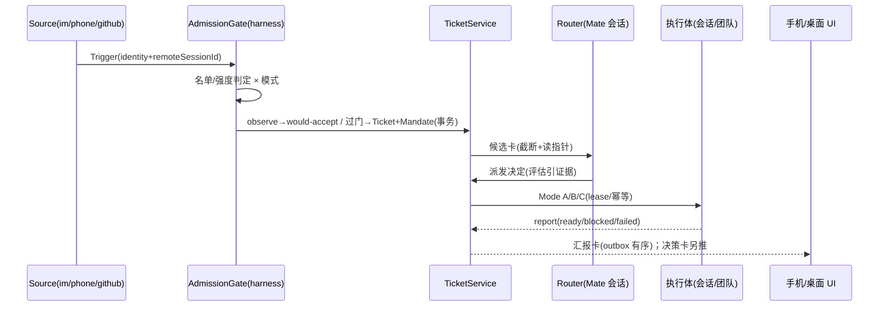

# Drora Mate（个人助理「大副」）设计 spec

- 日期：2026-11-04
- 状态：P2 实现中——P1 已交付（feat/mate-p1：PR-1A 服务核心 + PR-1B UI 面 + ticketLedger
  帧接线，见 ui-mate CONTRACT.md 与 coverage matrix）。P2 host 内核（Router 决策 schema
  与候选卡循环 / Mode B·C / 代际锚校验 / W1·W2 写域 / assistantActivity host 挂载）随
  feat/mate-p2 交付；Surface A·C、/mate 入口与阶段地图由后续批次接力。实现与本文的偏差
  按 00-master-plan §8/§9 与 assistant-tickets CONTRACT.md 登记。
- 基线：main @ 42bacc627（upstream **v3.17.2 已整并**：b3e44cb2a 六段合并 + a9fe401ee 源同步）。
  本 spec §3/§7 引用的四个接缝路径（`apps/drora-cli/packages/core/src/team/hub.ts`、
  `drora-protocol-v4/sessions-index.ts`、services 的 drora-session 与 bot-project-runtime）
  已于合并后核实在原位。上游 subagent 面若继续演进，按 §13 覆盖判断条款评估。
- 外部依据：TRAE宝（字节 Trae 个人助理）与 DeepSeek dsh-superagent 及其 60+ 衍生实现的
  社区普查（2026-11-03~04，含 DSH 原型源码级分析）。关键外部教训已内化为 §2/§8/§9 的规则。

## 1. 定位与命名

Drora Mate（中文名：**大副**）是常驻的跨项目个人助理层。航海隐喻贯穿词汇体系：
船长=用户，大副=Mate，船员=agents-team 成员，航次=工单。**大副自己永不执行**——assistant
preset 无 bash、无写盘工具，只做路由、派发、盯单、汇报。

命名契约一次定齐（契约键单一出处，见 §5 落点）：

| 层       | 值                                                                                                                                                             |
| -------- | -------------------------------------------------------------------------------------------------------------------------------------------------------------- |
| 产品名   | Drora Mate / 大副（i18n：zh「大副」/ en "Mate"）                                                                                                               |
| 服务模块 | `packages/services/src/assistant-tickets/`                                                                                                                     |
| UI 模块  | `ui-mate/` 新文件族（复用 teamActivity 三面接缝先例）                                                                                                          |
| 协议     | P2 起为 `packages/shared/src/drora-protocol-v4/sessions-index-mate-activity.ts`（assistantActivity wire schema；原设想的 `assistant.ts` v4 命令族随 S2-T0 (a) 路线不设立）        |
| 契约常量 | `packages/shared/src/contracts/assistant.ts`（新文件）                                                                                                         |
| 命令入口 | `/mate`（CLI `.drora/commands` 自定义命令 + UI 导航端口）                                                                                                      |
| 设置键   | `drora.mate.*`（P4 启用，01 §1.4）；持久化=数据目录 `mate/` 下库文件 `mate.sqlite`（contracts/assistant.ts ASSISTANT_STORAGE_KEYS 单一出处；00 §8.5 命名统一） |

## 2. 产品规则

1. **三层结构**：全局 Mate（窗口 Local Host 内 assistant 虚拟 workspace 的常驻会话）→
   项目会话 / agents-team（既有）→ 工单执行体。Mate 会话是**可重建的无状态壳**：编排事实
   全部在 TicketService 台账，不在会话上下文；定期/随时轮转重建不丢状态。
2. **五入口一个 Mate**：桌面对话、Side Pane 任务中心、手机（App/远控）、IM（飞书
   channelRuntime 既有；其余经 §5 Source 注册表扩展）、语音（接 voice-agent spec）。
3. **交互契约三条**：
   - 决策收件箱不刷屏：默认只推送需要人拍板的事，带每日打扰配额（可配，默认 5）。
   - 先航海日志后放行：observe 信任梯度（§6），放行率达标才出现切 auto 入口。
   - 成本永远同行：任何工单展示必带实耗（token/费用），换代不换账。
4. **诚实规则**：用户原文 verbatim 进 brief，不静默改写；换代增量如实标注（"第 N 代重启，
   第 N-1 代末尾 X 处改动未确认"）；失败写原因，不自动重试。
5. **安全边界（诚实声明）**：Worker 隔离=独立会话+独立目录+工具白名单+凭据不下发，
   **不是容器级安全边界**，文档与 UI 均须明示；完全访问档（yolo）必须经决策卡人工放行。

## 3. 与既有实现的关系（官方优先）

| 能力   | 复用（不动）                                     | 新建（自研）                 |
| ------ | ------------------------------------------------ | ---------------------------- |
| Router | 官方会话机制 + persona 预设（contracts/persona） | assistant preset 配置        |
| Worker | agents-team 成员 / drora-session 会话            | —                            |
| 投递   | CommandInbox 串行 admission、v4 sendText         | —                            |
| 附着   | bot-project-runtime 的 identity+lease 范本       | 派发桥（services 层）        |
| 准入   | workspaceIdentity 名单                           | admission 域模型（§6）       |
| 事件   | bots channelRuntime（飞书）、automations cron    | Source 注册表                |
| 台账   | —                                                | AssistantTicketService（§5） |
| UI     | Side Pane/footerSlot/session-line 三接缝         | ui-mate 组件族（§11）        |

**TeamHub 与还原区零改动**。Mode B 采用 prompt 驱动建队（走既有 stage→人批流程），
不引入 `assistant_dispatch` 审计枚举（原设计已取消）。

## 4. 状态所有者

| 状态                           | 唯一所有者                                                                  | 说明                            |
| ------------------------------ | --------------------------------------------------------------------------- | ------------------------------- |
| Trigger/Ticket/Decision/Outbox | AssistantTicketService                                                      | 事务写；幂等键=ticketId         |
| 团队执行事实                   | TeamHub journal（既有）                                                     | 不建第二份                      |
| 名单/准入/预算配置             | mate.sqlite kv 表（01 §1.4：P1 不动 AppSettings；drora.mate.\* 键 P4 启用） | 键单出处（contracts/assistant） |
| Router 会话                    | CLI runtime（既有会话机制）                                                 | 可重建，无业务事实              |
| Renderer                       | 投影 + 草稿 + pending overlay                                               | 不新增业务状态                  |
| Main / relay                   | 仅转发与进程/窗口管理                                                       | 不承载工单                      |

## 5. 领域模型

- **Trigger**：不可变事件（来源=Source 注册表：im / phone / github / local），携带
  workspaceIdentity 与 remoteSessionId 贯穿。
- **AdmissionDecision**：strength=`explicit|inferred`；详见 §6。
- **Mandate**：授权凭证。只有三种变更途径：accept 创建、用户 stop、校验失败撤销。
  **消息、评论、引用文档只是输入，不能改变权限。**
- **Ticket**（工单，唯一稳定身份）：brief（verbatim）+验收标准+预算+写域声明+成本账本 +汇报历史+incarnation 指针（§8）。
- **Incarnation**（当代执行体指针）：`{workspaceIdentity, sessionId, hostId?,
remoteSessionId?, anchor}` + generations 历史（每条带 cause:
  superseded|lost|user_picked|expired）。
- **Report / Outbox**：同 ticket 严格有序投递；请求 id=ticketId，只投一次。

落点：P1 域 schema 位于 services 模块（host 侧 parse，UI type-only 引用）；
S2-T0 结论为 **(a) 结构化文本**（persona preset 会话 + system prompt 约定 schema 输出 +
host 侧 zod 校验，零 CLI 改动）——v4 命令族全程不需要，`ASSISTANT_V4_COMMAND_TYPES`
不设立；spec §7 的 mate_\* 工具白名单仅在 (b) 路线启用，(a) 路线 Router 无自定义工具。
env/`_meta`/持久化前缀常量在 `contracts/assistant.ts` 单出处。
P2 起派发幂等键升级：commandId=`<ticketId>-<投递序号>`（kv 计数器；P1 恒取 ticketId
仅单发成立），anchor=最后一次成功 sendText 的 commandId（CLI inputId）。

## 6. 准入（off / observe / auto × explicit / inferred）

| 模式    | explicit（名单内点名/follow-up） | inferred（名单内未指名/名单外机器） |
| ------- | -------------------------------- | ----------------------------------- |
| off     | 拒绝并记录                       | 拒绝并记录                          |
| observe | **零执行**：出决策卡一键放行     | 记 would-accept，不出卡             |
| auto    | 执行（出告知卡）                 | 经评估后执行（评估须引用原文证据）  |

- observe 语义取**全量零执行**（比 DSH 的"observe 仍执行点名"更保守）：所有自动接单先记
  would-accept；点名请求以决策卡呈现，放行即转执行。理由：P1 阶段最小信任面，且决策卡
  本身就是产品交互的一部分。
- inferred 接受永远需要一次评估且评估引用原文（intent evidence 约束）；直接接受非
  explicit 触发在代码层拒绝。
- 切 auto 仅在信任条达标后开放（§11），需确认 dialog（不可逆操作）。

## 7. 派发桥与三种打通模式

Mate 不持有跨项目大 Team。派发桥（services 层，模型不可见）按工单选择模式：

| 模式 | 何时用                 | 机制                                                                                                                           |
| ---- | ---------------------- | ------------------------------------------------------------------------------------------------------------------------------ |
| A    | 默认：独立可并行单工单 | 目标 workspace `createSession` + brief 作首条输入 sendText；worktree 隔离（§9 W1）                                             |
| B    | 需多角色并行           | 目标 workspace 建 lead 会话，sendText 指示走既有 /team stage→approve 流程；approve 门保持人批（prompt 驱动，无程序化 staging） |
| C    | follow-up/续既有工作   | identity 解析（§8）→ lease 附着 → CommandInbox 投递（保序、busy 排队合法）                                                     |

Mate 工具白名单（assistant preset，无 bash/写盘）：`mate_projects`（只读）、
`mate_dispatch`、`mate_report_read`（截断+读指针分页）、`mate_reply`（走 outbox）。
**P2 落地注记（(a) 路线）**：Router 无自定义工具面，白名单随 (b) 路线（若启用）一并
落地；Router 的 system prompt 契约以候选卡首条输入的路由约言承载（host 侧拼装、
CLI 零改动；createSessionRequestedConfigSchema 无 persona preset 字段，persona 控制面
迁移留 P3+）。派发桥独占：identity/lease 解析、createSession/attach、幂等投递、
report 归账、权限档映射（Mandate scope → TeamHub 批准时权限档，默认 build/guarded）、
成本挂账。

## 8. 目标会话解析与代际

身份锚在工单，不在会话。session 是易变执行体，Ticket 持 incarnation 指针。

**解析三层**：Tier1 绑定直读（同 ticket follow-up 直投，busy 排队合法）；Tier2 受限解析
（无绑定时：harness 生成有界候选集——sessions-index 快照，硬过滤 busy/跨 identity/过期，
Mate 带证据选择，派发桥校验后生效）；Tier3 决策卡问人（低置信必经，"开新会话"永远是选项）。

**锚校验与换代**：anchor=最后一条已投递消息 id/轮次锚（CAS 双基准先例）。投递前校验，
失配即当代失效。换代在事务内先归档旧代再立新代；凭台账（brief+汇报+工件）重派新代并
携带浓缩上下文，未汇报增量如实标注。
**P2 落地注记**：anchor=最后一次成功 sendText 的 commandId（=`<ticketId>-<投递序号>`）；
投递前经 host 会话索引对账（`reconcileSessionsIndexV4` 存在/删除语义）校验锚仍可寻位；
换代续用同一 worktree/分支，usage_accum 按 ticketId 记账不改写。

| 会话变化           | 检测（全部事件驱动） | 处置                             |
| ------------------ | -------------------- | -------------------------------- |
| compaction/换模型  | 无需                 | 不动，工单只读 projection        |
| fork/rewind 分支   | 锚校验失配           | 升新代或决策卡换绑               |
| 会话删除/归档      | 生命周期事件         | 无损重启（台账重派）             |
| 远程 Host 断连     | lease 失效通知       | 代际重附；超窗按删除处置         |
| 用户在别处手动继续 | Tier2 命中相似会话   | 决策卡换绑（cause: user_picked） |
| workspace 迁移     | identity 解析失败    | 拒绝猜测，问人                   |

不变式：任一时刻最多一代执行；换代只由锚校验/生命周期事件/lease 失效触发，
**禁止超时兜底**（不用超时掩盖同步问题）。

## 9. 并发与写域

三层边界：会话内串行（CommandInbox 唯一入口，既有）；工单间并行（默认）；工作区内协调
写域（不串行，无全局锁，无硬上限——软预算默认同 workspace 活动工单 3，超出排队+告知卡；
**P2 起恢复 3（contracts ASSISTANT_DEFAULTS 单出处），超预算 approve 进入 queued 状态、
释放即 FIFO 派发（kv cursor）；P1 曾简化为 1（已随 P2 改回）**）。

| 档  | 机制                                                                       | 适用/默认                                                                                      |
| --- | -------------------------------------------------------------------------- | ---------------------------------------------------------------------------------------------- |
| W1  | 每工单 `git worktree .drora/mate/<id>` + 分支 `mate/<id>`，交付走 PR/patch | Mode A 默认（**P2 已落地**；终态清理 worktree 保留分支，失败清理动作入 fail_reason 附属日志；换代重派前已检出则续用） |
| W2  | 写域声明+派发桥比对同 workspace 其他活动工单，重叠→排队/问人               | 非 git 或用户关闭 W1（P2：重叠进 budget 队列）                                                 |
| W3  | 附着用户会话不隔离（那是用户自己的工作目录）                               | Mode C；仍检查与 W1/W2 工单冲突（P2：冲突进 budget 队列）                                      |

不变式：Mate 派生活动工单两两写域不相交；工单终态即清理 worktree（保留分支），失败清理
动作如实入台账；换代重派续用同一 worktree/分支，不重复 `worktree add`。

## 10. Watchdog

automation（cron 协议既有）驱动，周期读 TicketService 状态时间戳与停滞判据；产出=
停滞标记+纠偏建议+通知人，**不自动终止、不自动换代**。与 §8 换代触发源互补且不重叠。

## 11. UI（四面一源）

所有面是 TicketService 快照的投影；`mateStore`（zustand）只存过滤/选中/展开局部态；
数据经 `useAssistantTickets()` 订阅（getSnapshot 拉一次 + onDidChange 推送；实现为
useModelCapabilities 同构形态，00 §8 二审 B2）。

1. **Surface A 大副对话**：状态条（模式徽标/打扰配额/活动工单数）+ 对话流内嵌决策卡
   （原文引用+预估+`Y/N/E` 键盘流+"已等待"只显示不超时）与汇报卡（结论+工件链接+实耗+
   代际徽标与未确认增量）。
2. **Surface B Side Pane「大副」tab**：按 workspace 分组的工单列表；过滤（待决策/进行中/
   观察中/全部）；软预算指示；观察记录累计区=信任条（would-accept 数/放行率，达标才出现
   切 auto 入口）。
3. **Surface C 工单详情**：时间线/汇报/证据/成本四页签；代际时间线用 mate scope 的
   timeline token（不挪用 workflow 家族）。
4. **Surface D 摘要行**：`assistantActivity` 有界字段，**host 侧任务行 overlay 合成**
   （`windowHostControllerService` 的 teamActivity overlay 同位；事实源=TicketService，
   非 CLI 投影——保持 CLI 零改动；P2 已落地：`controller/tasks-index` 帧 task row
   activity 携带可选 `mate: {activeCount, pendingDecisions, updatedAtMs}`（键
   `SESSION_MATE_ACTIVITY_KEY` 在 contracts/assistant.ts 单出处，schema 在
   drora-protocol-v4/sessions-index-mate-activity.ts），desktop 与手机经 controller
   快照透传同源消费；CLI→host 的 sessions-index wire 不加字段，旧帧字段缺席合法；
   `mate/session-line.ts` 接缝随 Surface 批次交付）；手机单列+drawer，
   推送=决策卡精简版，footerSlot 同源。

状态灯映射：待决策=destructive 级提示、运行中=warning、观察=foreground-subtlest 空心、
完成=success、失败=destructive；工单行/卡片标题行必带实耗。遵守 DESIGN.md（text-ui-\*
强制、elevation 克制、i18n、断点语义不变）。

## 12. 双链路语义

desktop-continuous：Router 会话实时流。web-remote-replayable：手机只见快照+汇报回放，
不建 runtime。改动 stream/snapshot/queue/重连时**两种语义必须同时验证**（对齐 AGENTS.md
红线）。

## 13. 上游对齐与差异记录

- 官方优先：Router=官方会话+persona 预设；派发=官方 drora-session/team；watchdog=官方
  automations。上游 subagent 面若在 v3.17.2 后覆盖本层能力，按覆盖判断五要素
  （持久化/权限/取消恢复/身份隔离/平台能力）决定迁官方，移除自研重复。
- 自研清单（全部新文件/新模块，不进还原区）：admission 域模型、TicketService、派发桥、
  Source 注册表、ui-mate。TeamHub/CLI core 零改动（原 `assistant_dispatch` cause 枚举设计
  已随 Mode B 改 prompt 驱动而取消）；差异登记见 `specs/drora-divergence-ledger.md` 台账 16。
- 差异台账同步登记本 spec 为有意扩展（非缺口）。

## 14. 阶段与验收

| 阶段 | 内容                                                                    | 验收                                                                                                                                                        |
| ---- | ----------------------------------------------------------------------- | ----------------------------------------------------------------------------------------------------------------------------------------------------------- |
| W0   | 本 spec + 差异台账                                                      | 评审通过                                                                                                                                                    |
| P1   | 准入域模型（含 Mandate）+ observe + 手动放行直派（Mode A）+ 观察记录 UI | 本地双触发（点名=explicit→决策卡放行 / 未指名=inferred→would-accept）→会话执行→完成记录含实耗；im/手机 Source 后移 P3；typecheck/lint/architecture:check 绿 |
| P2   | assistant preset + Mode B/C + 代际 + Surface A/C                        | E2E：候选卡→建议→人放行；follow-up 直投；换代重派标注增量；手机快照透传；双链路各验一遍。P2 host 内核已交付（feat/mate-p2）：Router 决策 schema+候选卡循环、Mode B/C 派发、代际锚校验、W1/W2、assistantActivity host 挂载及单测；Surface A/C 与 /mate 随接力批次验收 |
| P3   | Source 插件化（github）+ Tier1 直通                                     | GitHub 点名建单；同 ticket follow-up 直投不过 Router                                                                                                        |
| P4   | watchdog + auto 门                                                      | 停滞被标记并通知；auto 需信任条达标+确认 dialog                                                                                                             |

## 15. 明确不做（反模式）

- 不做跨 workspace 大 Team（TeamHub 保持会话内语义，上游同步零成本）。
- 不做 workspace 级全局串行锁或硬上限（软预算+告知卡）。
- 不做向量检索召回（解析=有界候选+证据引用）。
- 不做用户提示词静默改写。
- 不做超时自动换代/自动重试（事件+校验驱动）。
- 不做自动合并（P4 前不做；P4 若做须名单批准制+显式开关）。
- Renderer/relay/Main 不承载工单状态；不做第二份团队执行事实。
