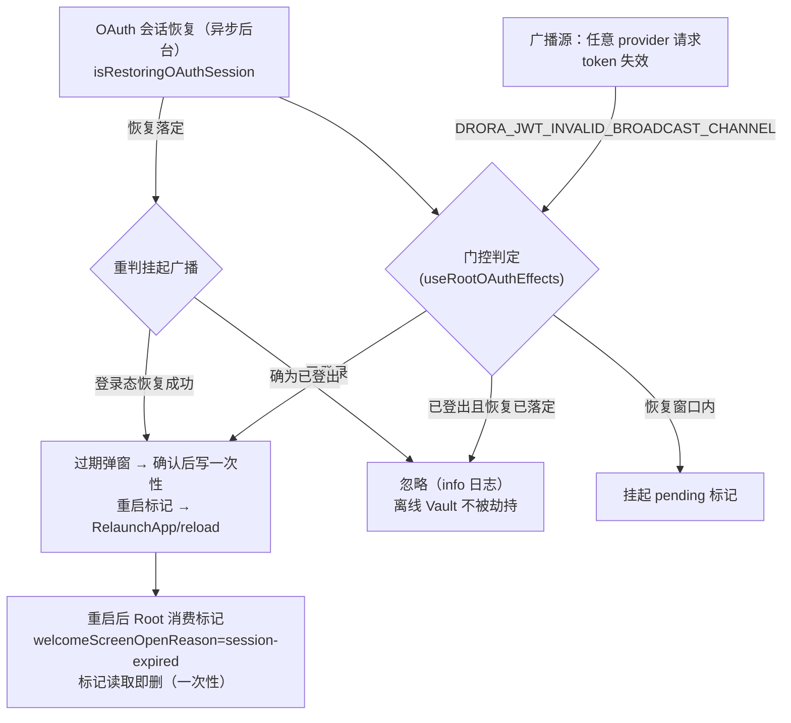

# JWT 失效广播门控与会话恢复（ui-auth-1 修复决策记录）

> 2026-10-18 补记（终审发现 conv-3/ui-auth-1：「JWT 广播门控修复无 spec 条款」）：
> 本文件按 AGENTS.md「行为改动先更新 spec」补录该修复的行为契约与决策依据，
> 行为本身在 PR #23 已落地并有测试锁定，本补记不改变任何实现。

## 0. 背景与缺陷

全局 JWT-invalid 广播（契约键 `DRORA_JWT_INVALID_BROADCAST_CHANNEL`，单一出处
`packages/shared/src/oauth.ts:153`）由任意后台 provider 请求在 token 失效时发出。
ui-auth-1 修复前的两难：

1. **已登出误弹窗**：与登录态无关的后台 provider 刷新也会发出该广播；若桌面端本就
   已登出（本地/离线 Vault 作业），弹「会话过期」模态会错误劫持离线工作区——
   不存在任何需要重新认证的登录态。
2. **恢复窗口吞播**：启动时 OAuth 本地会话恢复（`restoreCachedSessionState`）是异步
   后台流程；恢复未落定前 `user===null` 不能证明「已登出」。若仅以 `user!==null`
   为唯一判据，恢复链因 activeProvider 被清而收敛成 signed-out 的场景里，真实过期
   广播会被静默吞掉，用户被无提示登出（原缺陷 ui-auth-1）。

## 1. 决策（三态门控）

实现位于 `packages/ui/src/root/useRootOAuthEffects.ts`（门控主逻辑）与
`packages/ui/src/root/oauthCachedSessionRestore.ts`（判定函数
`shouldShowJwtInvalidSessionDialog`）：

- **已登录**（`authenticatedUserRef.current` 为真）→ 照常走既有过期弹窗流程
  （确认后写一次性重启标记 `droraJwtInvalidRestartMarker` 并 RelaunchApp / Web reload；
  重启后由 `Root.tsx` 消费标记回到登录页）。
- **已登出且恢复已落定** → **忽略**该广播（info 日志）：不为不存在的登录态弹过期
  模态，离线 Vault 不被劫持；本门不授权任何账号请求、不保留失效凭据。
- **恢复窗口内（`isRestoringOAuthSession` 为真）** → **挂起待重判**（
  `pendingJwtInvalidDuringRestoreRef` 置位 + info 日志），恢复落定后按最终登录态重判：
  恢复成功 → 补走过期弹窗；确为已登出 → 丢弃挂起广播。

判定函数保持纯布尔语义（`shouldShowJwtInvalidSessionDialog(hasAuthenticatedUser)`），
不持有状态；订阅回调经 ref 读取最新登录/恢复事实，避免闭包过期值误判。

## 2. 状态所有者与事件顺序

- 登录态事实所有者：Drora store 的 `user`（恢复链 `setUser` 落定）；门控只读投影
  （`authenticatedUserRef` 同步镜像，不另立第二事实源）。
- 恢复窗口事实所有者：store 的 `isRestoringOAuthSession`；`oauthSessionRestoreInFlightRef`
  为其订阅侧只读镜像。
- 挂起标记 `pendingJwtInvalidDuringRestoreRef` 是组件内一次性缓冲：重判即消费
  （先清位再判定），不跨会话持久化；重启标记才是持久面（localStorage 一次性键）。

## 3. 边界与不作出的保证

- 本门控只决定「过期弹窗是否弹出」，不撤销 token、不触发登出、不拦截广播本身——
  其他订阅者照常收到广播。
- 挂起重判以「恢复落定」为界，不设超时：恢复链自身有错误收敛路径（失败清恢复态），
  不用定时器掩盖同步问题（AGENTS.md 时序纪律）。
- 已登录判定以 renderer 持有的 user 投影为准；服务端事实仍以各 provider 请求的
  实际 401/刷新结果为准，弹窗确认后的重启/登出动作沿用既有链路，不在本门内新建。

## 4. 验收映射

| ID | 场景 | 断言 | 证据 |
| --- | --- | --- | --- |
| JIG-1 | 恢复未落定时到达的真实过期广播 | 不弹窗也不吞掉（挂起）；恢复成功后照常弹出 | `packages/ui/test/rootJwtInvalidBroadcastGate.test.ts` |
| JIG-2 | 恢复落定后确为已登出 | 挂起的广播被丢弃；离线 Vault 不被过期弹窗劫持 | 同上 |

回归入口 `rootJwtInvalidBroadcastGate.test.ts` 目前不在 CI 工作流枚举内
（终审发现 e2e-a-2，另行跟进），本 spec 仅记录行为契约。
