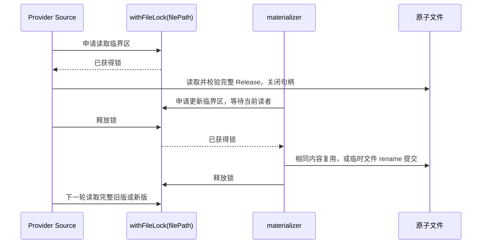

# Provider Bundled 固定资源持久化与并发验收

## 产品与所有者

2026-10-19：本规则明确已有固定资源方案的跨平台验收边界，修正 Windows 推送门禁中
`bundled-config-replacement.test.ts` 的测试契约，不改变 Release、路径或发布格式。
已有决策见 `docs/working-memory/provider-refactor/steps/todo-104-pre-release-schema-review.md`
§6.17；Windows 文件句柄约束见 `docs/windows-test-compatibility.md`。

- `materializeDroraBuiltinProviderConfig` 在既有环境路径释放唯一 `drora-builtin.json`。
  同内容复用；不同内容通过同目录临时文件 + rename 提交。失败保留旧文件并向调用者报错。
- Bundled 升级以退出旧程序为前提；不支持安装包升级时由旧进程持续裸读被替换的文件。
- Provider Source 是消费入口。Source 与 materializer 指向同一个可变文件时，双方通过
  `withFileLock(filePath)` 协调完整读取和提交；进程内 FIFO 与跨进程目录锁使用同一既有入口。
  独立 Active 的运行时更新由 Active 路径锁协调；Bundled 在其生命周期内是安装包基线。
- shared 原子写入器只拥有文件替换，不拥有 Provider 状态。保留现有错误传播及有界重试；
  不增加等待时间、删除目标后重建、直接 truncate 覆写或 Windows 测试专用成功分支。

## 验收场景

1. Windows、macOS、Linux 均执行真实 Source 与 materializer 并发测试：多次提交两个
   完整 Release，读者每次都得到合法旧版或新版；写入与读取均成功，不留下临时、锁或 hash 历史文件。
2. 使用真实打开的只读句柄及执行屏障验证：Source 持有读取锁期间，materializer 等待读者
   关闭句柄后才替换。按事件顺序判断，不能通过 sleep 碰概率。
3. POSIX 额外验证不参与锁的裸读者与 rename 并发读取完整文件。Windows 不宣称支持此
   POSIX 场景；该专属压力用例明确隔离，场景 1、2 仍必须执行，不能整体跳过并发验收。
4. 同内容并发启动不改写 mtime；非法 Release 或写入失败保留完整旧文件并报告错误。

本轮是验收缺陷修正，生产 Source、锁与共享持久化实现保持原有接口和执行路径。

## 验证记录（2026-10-19）

Node 24.14.0 / pnpm 10.33.2，Windows：Bundled 替换、Built-in lifecycle、真实双进程
消费回归共 7 项通过，1 项 POSIX 裸读场景按平台跳过。根 typecheck、Lint、架构检查通过；
Lint 为 396 条既有警告、0 错误。macOS / Linux 的专属裸读压力场景未在本机执行。
