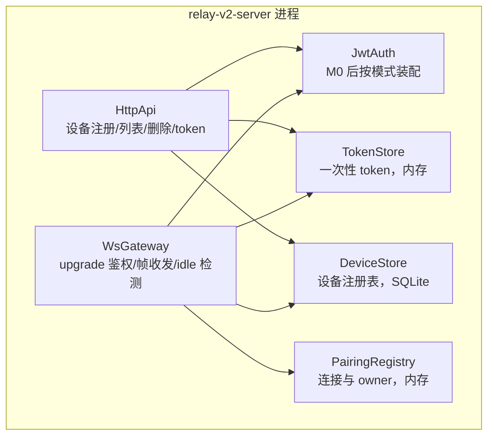
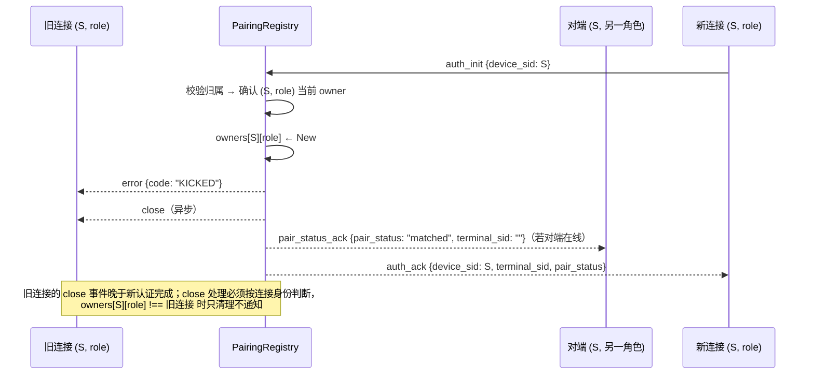
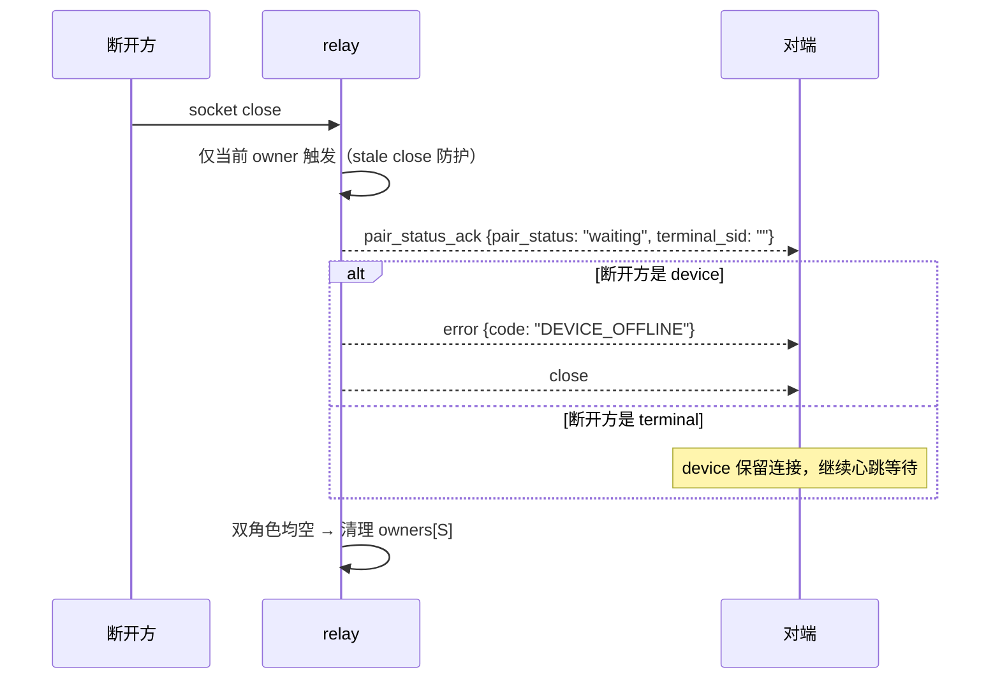
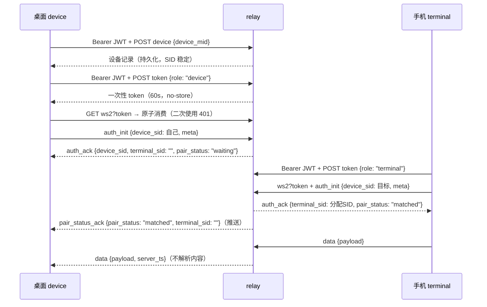

# 自建 Relay V2 服务端设计方案（官方 relay 平替）

> 状态：**设计稿 v2，未实施**。本文定义一个可部署的自建 relay 服务，平替官方 zcode.z.ai 的 Relay V2。
> 协议契约以 [Relay V2 spec](../docs/web-remote-control/relay-v2-pairing.md) 为唯一权威；行为以
> `packages/shared/test/fixtures/fake-relay-v2.ts`（子路径 `@drora/shared/testing/fake-relay-v2`）为可执行参照。
> 目标读者：要自建部署、不修改 Drora 客户端的维护者。
>
> v1 → v2 修订记录（2026-10-22，经三轮对照审查）：
> ⓪ §3/§13 契约模块由 vendor 拷贝改为 **monorepo 直接复用**（`workspace:*` import `@drora/shared/web-remote-relay`）——vendor 是第二份真相源且违反"契约键单一出处"仓库纪律，旧 `packages/relay-server` 即 workspace 依赖先例；工程位置由"独立项目"改为 `packages/relay-v2-server` 新包；
> ① §6 鉴权重构——v1 假设 Bearer payload 含 `sub` 直接可用，审查证实仓库从不本地读身份 claim
> （userId 恒走 userinfo `sub ?? id`，见 `zaiProviderAdapter.ts:419`），身份 claim 名与跨平台一致性
> 必须先实测（新增 M0），并补 `iss` 命名空间隔离与 `sub,id` 回退链；
> ② §8 客户端指向全部改为 Drora 实名（`DRORA_ENDPOINT_ORIGIN` 等，v1 用的 `ZCODE_*` 本仓不存在），
> 补手机页**构建期** VITE env（OAuth redirect_uri 构建期烘焙，v1 完全缺失）、版本托管策略、
> Caddyfile 回源 Host 头、OAuth 白名单覆盖 authorize+token exchange 两步；
> ③ §7 修正 SQL 内联 INDEX 语法错误，备份改 `VACUUM INTO`，补 devices GC；
> ④ §5 精化 `terminal_sid` 公式、补 `auth_ack` 的 `device_sid` 回显、§6.2 补对端通知步骤；
> ⑤ §4 引用 task-command-queue 的 relay 禁令；§9 补消息 trace 红线与可观测性；
> ⑥ §10/§12 补 M0 与 M1 stub auth、L0 增历史故障用例；§5.3 半开检测由可选改必备；
> ⑦ v2.1 新增 §8.4 控制端与运维 UI 边界——控制端 UI 整体复用现有 `/remote/v4` 页面（零 UI 研发，
> 区别于已删的旧 R2/R3 手机页计划），UI 验收面并入 L1；relay 运维管理面 V1 不做；桌面指向
> 产品化入口明确不做并记录代价。
> ⑧ 2026-10-23 新增 §6.1.1「M0 探测记录（无凭据部分）」——三域 `/.well-known` OIDC/JWKS 探测
> 完结（均不存在，jwks 模式前提证伪出局）、introspect 双端点存在性证实（ZAI 走 HTTP 401 前置、
> BigModel 走 HTTP 200+业务 code）、token 端点 GET 404 如实记录（方法约束未证实）；§12 M0
> 清单据此收窄至仍需真实凭据的项。

## 1. 背景与目标

Drora 手机远控链路依赖外部 Relay V2 服务（官方 Go 实现，drora-server 仓库，仓库外）。本设计产出一个协议兼容的自建服务，使现有客户端（桌面 App + `/remote/v4` 手机页面）**零源码改动**接入。

目标：

1. 严格实现 Relay V2 契约的 HTTP 与 WebSocket 面，行为以 fake relay 为可执行参照。
2. 单实例部署即可用；设备注册持久化，relay 重启后桌面 SID 与二维码保持有效。
3. 接受官方 OAuth（ZAI/BigModel）链路签发的 drora JWT 并映射为隔离的用户身份。
4. 保持官方架构纪律：relay 只做鉴权、配对、心跳应答与 `data.payload` 透传。

非目标：

1. 多实例水平扩展与跨实例路由（官方网关"同 MID 落同一实例"在单实例下不需要）。
2. IP 封禁、限流、审计等生产运维能力（可后续追加，不阻塞协议正确性；但注册接口的持久化滥用防护见 §7 GC）。
3. 修改 Drora 客户端任何源码。
4. 区分 `KICKED` 的"被替换"与"owner 丢失"两种语义——客户端按 60 秒窗口处理，平替必须维持现有触发时机，不能"做得更好"。

## 2. 总体架构与部署拓扑

```mermaid
flowchart LR
    subgraph 客户端（零改动）
        D[桌面 App<br/>DRORA_ENDPOINT_ORIGIN 指向自建域]
        M[手机浏览器<br/>自托管 /remote/v4 页面<br/>构建期烘焙自建域]
    end
    subgraph 自建部署
        P[反向代理 Caddy/Nginx<br/>唯一 TLS 终止点]
        R[relay-v2-server<br/>单进程 Node，仅监听 127.0.0.1]
        S[(设备注册表<br/>SQLite)]
        W["静态资源<br/>web 包构建产物"]
    end
    O[官方 zcode.z.ai<br/>Coding Plan API / OAuth token / 其余路径]
    Z[官方 OAuth<br/>chat.z.ai / bigmodel.cn]

    D -->|/api/v1/remote/* HTTPS+WSS| P
    M -->|同源 /api/v1/remote/* + /remote/v4 + /api/v1/oauth/token| P
    P -->|远控路径| R
    R ---|持久化| S
    P -->|静态 /remote/v4| W
    P -->|其余路径（含 OAuth token 交换）| O
    D -.->|OAuth 登录，不经自建域| Z
    M -.->|OAuth authorize，回调=自建域 /remote/v4| Z
```

要点：

- 反向代理是唯一 TLS 终止点；relay 进程只听明文 HTTP/WS，**默认绑定 127.0.0.1**（`BIND_HOST`），避免明文 JWT 被误暴露公网。
- `DRORA_ENDPOINT_ORIGIN=https://自建域` 使桌面把远控 HTTP、WS、二维码页面全部指向自建域；**其余路径反代回官方**，Coding Plan / 计费流量不受影响。注意官方域可能有 WAF/风控，回源可用性须实测（§11.7）。
- 手机页面 OAuth 的 `redirect_uri` 由**构建期** endpoint origin 推导（§8.2），token 交换 `POST /api/v1/oauth/token` 是同源相对路径——经 catch-all 反代回官方执行，官方在 authorize 与 token exchange **两步**都会校验 redirect_uri，因此自建域回调必须在官方 OAuth 应用白名单（外部依赖，§11.3）。
- 桌面 OAuth 走独立的 `ZAI_OAUTH_ORIGIN`（本仓保留此名，见 `droraEndpoint.ts:96`），不经过自建域；JWT 仍是官方链路签发，自建 relay 只负责消费。

## 3. 技术选型与契约复用

| 项          | 选择                                                                                                                                           | 依据                                                                                                                                                  |
| ----------- | ---------------------------------------------------------------------------------------------------------------------------------------------- | ----------------------------------------------------------------------------------------------------------------------------------------------------- |
| 语言/运行时 | TypeScript + Node.js ≥24（单进程）                                                                                                             | 直接复用 shared 契约解析器；与 fake relay 同构                                                                                                        |
| WS 库       | `ws`（`noServer: true` + 手动 upgrade）                                                                                                        | 与 fake relay 一致；`maxPayload: 1_048_576` 天然实现 1 MiB 硬闸                                                                                       |
| 持久化      | `node:sqlite`（`DatabaseSync`）                                                                                                                | Node 24 内置，无原生依赖；同步接口足够单写者                                                                                                          |
| 契约模块    | **直接复用**：monorepo 包内 `"@drora/shared": "workspace:*"`，import `@drora/shared/web-remote-relay` 与 `@drora/shared/testing/fake-relay-v2` | 契约键单一出处（AGENTS.md）：生产方与消费方引用同一份代码，漂移在编译期即暴露，不存在第二份真相；旧 `packages/relay-server` 即此先例（`workspace:*`） |

复用清单（来自 `@drora/shared/web-remote-relay` → `packages/shared/src/web-remote-relay/index.ts`，fake relay 已验证）：

- `parseWebRemoteControlRelayV2HttpRequest` —— HTTP 请求体严格校验（register / delete / token）。
- `parseWebRemoteControlRelayV2OutgoingMessage` —— WS 客户端消息严格校验，含 `client_ts` 秒级时间戳与拒绝毫秒值。
- `WEB_REMOTE_CONTROL_RELAY_V2_WS_PATH` —— WS 路径常量（`/api/v1/remote/ws2`）。
- 消息/设备/错误码类型定义。

**1 MiB 硬闸安全性说明**：业务大消息（远控首屏 snapshot 预算 200KB、`getTaskSnapshotBody` 整包补拉）在 rpc-frame 层已分片（旧 relay-wire 对账档案记录 16 MiB 总量 / 64 分片上限），每个 WS 帧远低于 1 MiB。此上限与官方一致，**不得**为"大快照"调高——分片保证不需要，调高反而偏离官方行为。

## 4. 服务端组件与状态所有者

单进程内组件，状态归属唯一：



| 状态                                           | 所有者          | 存储   | 生命周期                                  |
| ---------------------------------------------- | --------------- | ------ | ----------------------------------------- |
| 设备记录（sid、mid、user、created_at）         | DeviceStore     | SQLite | 持久，跨重启（§7 GC 淘汰）                |
| 设备在线状态与 `meta`                          | PairingRegistry | 内存   | 连接期；列表接口实时 join                 |
| 一次性 token（user、role、expiresAt）          | TokenStore      | 内存   | 60 秒或首次消费                           |
| 连接与 `(SID, role)` 当前 owner                | PairingRegistry | 内存   | 连接期                                    |
| `pair_status`                                  | PairingRegistry | 内存   | 由 owner 存在性派生（对端存在即 matched） |
| 每连接收发计数（frames/bytes in-out）          | WsGateway       | 内存   | 连接期；诊断"单向断"用（§9）              |
| task / session / workspace / 快照 / 已提交输入 | **不在 relay**  | —      | 归桌面 Main / Host / CLI                  |

不可变量：

1. 每个状态只有一个写入路径；`pair_status` 永远从 owner 映射派生，不单独存储。
2. JWT 与一次性 token 不写日志、不落盘。
3. relay 不解析任何 `data.payload` 内容，转发前只做外层 schema 校验。
4. **relay 不得持有任何私有持久命令队列**——权威出处 [`docs/web-remote-control-task-command-queue.md`](../docs/web-remote-control-task-command-queue.md)："relay、desktop main 和 host 不能通过私有持久队列绕过该产品边界"；已提交输入的可靠性由 CLI CommandInbox + 手机 replayable snapshot 保证，relay 重启丢连接是契约内事件。

## 5. 协议实现清单

### 5.1 HTTP 接口

信封：成功 `{code: 0, msg: string, data}`（msg 必填，可为空串）；失败 `{code: 非零, msg, data?: null}`。调用方同时检查 HTTP 状态与业务 code。响应允许携带未知字段（客户端解析时忽略），已声明字段不可缺失或类型错误。

| 方法与路径                          | 请求                             | 成功 data                 | 失败语义                                                                                                                                |
| ----------------------------------- | -------------------------------- | ------------------------- | --------------------------------------------------------------------------------------------------------------------------------------- |
| `POST /api/v1/remote/device`        | `{device_mid}` 非空白、≤128 字符 | 完整设备记录              | 参数非法 → HTTP 400 `code 3001 "parameter error"`                                                                                       |
| `GET /api/v1/remote/device`         | 无                               | 当前用户设备记录数组      | —                                                                                                                                       |
| `POST /api/v1/remote/device/delete` | `{device_sid}`                   | `null` 或省略             | SID 不存在 → 幂等 200；异账号 → HTTP 200 `code 1006 "no permission"`；在线 → HTTP 400 `code 3005 "wrong status"`；参数非法 → 400 `3001` |
| `POST /api/v1/remote/token`         | `{role: "device" \| "terminal"}` | `{token, expires_in: 60}` | 未知 role → 400 `3001`                                                                                                                  |

实现规则（与 fake relay 逐条对齐）：

1. 所有接口要求 `Authorization: Bearer <jwt>`；缺失或无法映射用户 → HTTP 401（客户端停机报 `auth-required`，仅用于真正的鉴权失败）。
2. token 签发：`randomBytes(16).toString("base64url")`（22 字符无填充），`expires_in: 60`，响应头 `Cache-Control: no-store`；绑定 user + role，不绑定 SID。
3. 注册：每次同 MID 注册产生新 SID（格式 `d_<uuid>`），不接收 `meta`；`created_at` 为 Unix 秒；响应记录含 `online: false, meta: {}`。
4. 列表：按 JWT 映射的 userId 过滤；`online` 取 PairingRegistry 实时状态；离线设备 `meta` 为空对象。
5. 删除：只能删自己的离线设备（在线判定经 PairingRegistry join）；DeviceStore 物理删除，删除后的 SID 无法再通过 `auth_init` 认证。删除仅限离线设备，单线程顺序处理下与 WS 认证无竞态。
6. 设备 `meta` 仅在线时由 `auth_init` 提供；不持久化历史 meta（与官方一致，手机端以本地缓存补全离线设备名，见配对契约 06）。
7. CORS：同源生产部署（页面与 relay 同域）不需要；为 L1 联调与浏览器测试保留与 fake relay 同款的 `Access-Control-Allow-Origin` 开关（`CORS_ENABLED`，默认关，开启时 `*` + OPTIONS 预检 204）。

### 5.2 WebSocket

入口 `WEB_REMOTE_CONTROL_RELAY_V2_WS_PATH`，查询参数 `token` 必填，`mid` 网关路由提示**接受但忽略**（单实例无需路由；历史上官方边缘层按 mid 分片曾致双端落不同后端，单实例天然免疫）。

升级规则：

1. token 缺失、未知、过期或已消费 → 升级前以原始 socket 应答 `HTTP/1.1 401 Unauthorized` 并关闭（与 fake relay 一致）。
2. 消费即删除（Node 单线程下同步 Map delete 天然原子）；失败不恢复，重连必须重新申请。
3. `maxPayload: 1 MiB`；只接受 JSON 文本帧，二进制帧按 `WRONG_PARAM` 处理后关闭。

消息规则（`C→S` 消息先经 `parseWebRemoteControlRelayV2OutgoingMessage` 严格校验）：

| 场景                                             | 行为                                                                                                                                                    |
| ------------------------------------------------ | ------------------------------------------------------------------------------------------------------------------------------------------------------- |
| `auth_init`，连接已认证（重复认证）              | `error WRONG_PARAM` + 关闭                                                                                                                              |
| `auth_init`，`device_sid` 不存在或不属于当前用户 | `error AUTH_FAILED` + 关闭                                                                                                                              |
| `auth_init` 合法                                 | 绑定 SID 与 meta → 同角色替换（§6.2）→ 通知对端 → 回 `auth_ack`                                                                                         |
| 未认证连接发 `pair_status_query` / `data`        | `error AUTH_FAILED` + 关闭                                                                                                                              |
| 非法字段 / 非法 JSON                             | `error WRONG_PARAM` + 关闭                                                                                                                              |
| `pair_status_query`                              | 回 `pair_status_ack`，`terminal_sid = peer?.terminalSid ?? ""`（见下方填充规则）                                                                        |
| `data`                                           | 有对端 → 原样转发 `{type:"data", payload}`；无对端 → `error INTERNAL`（**不关闭**，terminal 快速重连场景官方也曾短暂返回 INTERNAL，客户端按可恢复处理） |

服务端发送的每条消息统一附加 `server_ts`（Unix 秒）。`auth_ack` 必带三字段：`device_sid`（回显本次认证的 SID）、`terminal_sid`、`pair_status`。

`terminal_sid` 填充规则（与 fake relay 实现逐字对齐，注意 device 连接的 `terminalSid` 恒为 `""`）：

- device 的 `auth_ack`：`""`；terminal 的 `auth_ack`：本连接分配的 SID（`t_<uuid>`）。
- **查询**触发的 `pair_status_ack`：`peer?.terminalSid ?? ""`——device 查询得到对端 terminal 的 SID；terminal 查询时对端是 device，得到 `""`（不回显 terminal 自己的 SID）。
- **推送**触发的 `pair_status_ack`（配对成功、对端断开）：一律 `""`。

### 5.3 生产行为（fake relay 明确不模拟、自建必须补齐）

| 行为                  | 设计                                                                                                                                                                                                                                    |
| --------------------- | --------------------------------------------------------------------------------------------------------------------------------------------------------------------------------------------------------------------------------------- |
| 认证超时              | 连接建立后 `AUTH_TIMEOUT_MS`（默认 15 秒）内未完成 `auth_init` → 直接关闭，不发错误消息                                                                                                                                                 |
| **idle 检测（必备）** | 客户端心跳为 5s±1s 的 `pair_status_query`，活跃连接必然持续来帧。任一入站帧（含 pong）刷新活跃时间；`IDLE_TIMEOUT_MS`（默认 120 秒）无入站 → 关闭并按断连通知流程清 owner。防半开连接把 `pair_status` 钉死在 matched、设备删除永远 3005 |
| 服务端 Ping           | 每 30 秒 WS protocol ping（保 NAT 活性）；pong 计入活跃时间，不参与业务状态                                                                                                                                                             |
| 消息频率保护          | 可选：单连接 `data` 超过阈值（如 200 条/秒）按 `INTERNAL` 丢弃该条并告警，不断连                                                                                                                                                        |
| 优雅停机              | SIGTERM → 停止接受新连接 → 对每条连接发 `error INTERNAL` 后关闭 → 等待 flush → 退出；客户端按既有退避自动重连（`INTERNAL` 属可恢复错误）                                                                                                |

## 6. 鉴权设计

### 6.1 前置：M0 token 实测（模式选型的依据，先行于一切鉴权实现）

仓库证据边界（v1 设计在此翻车，v2 明确记录）：

- 桌面 Bearer = `oauth:zai:access_token`，其契约是 `/api/auth/z/login` 返回的**业务 token**（`zaiProviderAdapter.ts:299-304`）；手机 Bearer = 同源 localStorage 的 `drorajwttoken`。
- token 是自包含 JWT：`resolveJwtExpiration`（`shared/src/oauth.ts:167`）本地 base64url 解 payload 读 `exp`，两平台（ZAI/BigModel）均签发"drora JWT"（issue 01）。
- **未知**：payload 中的身份 claim 名（仓库从不本地读身份，userId 恒走 userinfo `sub ?? id`）、签发者标识、签名方案、是否有公开 introspection/JWKS 端点；两平台 JWT 的身份值是否可能数值撞车。

M0 动作：取两平台真实 drora JWT，离线解码 payload 记录 claim 形状（脱敏归档进本 spec 附录）；探测 `/.well-known/jwks.json` 与可能的用户信息端点；验证"同一账号在桌面与手机取到的 JWT 映射到同一 userId"。**M0 结论决定 §6.2 模式取舍**；M0 之前 decode/jwks/introspect 均为候选而非定案。

### 6.1.1 M0 探测记录（无凭据部分，2026-10-23）

**方法与纪律**：共 12 个请求（11 个目标 + 1 次同域 307 跟进），全部 `curl` 默认 UA（不伪装浏览器，被拦即如实记录）、纯 GET 无请求体、`--max-time 10`、不发送任何凭据。探测目标出处：域名常量 `packages/shared/src/droraEndpoint.ts:3-9`；token 端点 `packages/services/src/oauth/providers/zaiProviderConfig.ts:22` 与 `bigmodelProviderConfig.ts:19`；userinfo 实际路径 `zaiProviderConfig.ts:23`（`/api/oauth/userinfo`）与 `bigmodelProviderConfig.ts:10,20`（`/api/biz/customer/getCustomerInfo`）。探测前仓库源码中不存在任何 `.well-known`/jwks 引用（全仓 grep 仅 node_modules 命中）。

| #   | 目标                                                                   | 状态                                | 响应证据                                                                                                            | 结论                                                                                                                                      |
| --- | ---------------------------------------------------------------------- | ----------------------------------- | ------------------------------------------------------------------------------------------------------------------- | ----------------------------------------------------------------------------------------------------------------------------------------- |
| 1   | `chat.z.ai/.well-known/openid-configuration`                           | 200 text/html（15729 B）            | md5 `6232fb72…`，与 #2/#10 为同一 SPA 兜底页                                                                        | SPA 兜底页，非 OIDC 文档；该路径无 discovery                                                                                              |
| 2   | `chat.z.ai/.well-known/jwks.json`                                      | 200 text/html（15729 B）            | 同 #1 md5                                                                                                           | JWKS 不存在（200 是 SPA 兜底假象）                                                                                                        |
| 3   | `bigmodel.cn/.well-known/openid-configuration`                         | 200 text/html（6676 B）             | HTML（与 #4 前 200 字节一致，后段差异疑为每请求 nonce）                                                             | HTML 兜底，非 OIDC；不存在                                                                                                                |
| 4   | `bigmodel.cn/.well-known/jwks.json`                                    | 200 text/html（6676 B）             | 同 #3 类 HTML                                                                                                       | JWKS 不存在                                                                                                                               |
| 5   | `zcode.z.ai/.well-known/jwks.json`                                     | 404 text/html（5535 B）             | Next.js 风格 404 页                                                                                                 | JWKS 不存在                                                                                                                               |
| 6   | `zcode.z.ai/.well-known/openid-configuration`                          | 307 → `location: /cn/.well-known/…` | `Server: ESA`、`Set-Cookie: zcode_locale=cn`                                                                        | 纯 locale 路由重定向，非文档                                                                                                              |
| 7   | `zcode.z.ai/cn/.well-known/openid-configuration`（跟进 #6，同域）      | 404 text/html（5535 B，同 #5）      | 同款 404 页                                                                                                         | OIDC discovery 不存在                                                                                                                     |
| 8   | `zcode.z.ai/api/v1/oauth/token`（GET，无体）                           | 404 text/plain（18 B）              | `404 page not found`；带 `x-request-id`、`via: ens-cache…`                                                          | 网关存活且为 Go 风格 404，但 GET 未命中路由——**未出现预期的 405/400，方法约束未能从外部证实**；端点存在性仍以仓库两处 tokenUrl 配置为证据 |
| 9   | `chat.z.ai/api/v1/userinfo`（候选）                                    | 404 application/json                | `{"detail":"Not Found"}`                                                                                            | API 网关（FastAPI 风格）存活，该候选路径未路由——排除                                                                                      |
| 10  | `chat.z.ai/userinfo`（候选）                                           | 200 text/html（15729 B）            | 同 #1 md5（SPA 兜底）                                                                                               | 排除                                                                                                                                      |
| 11  | `chat.z.ai/api/oauth/userinfo`（仓库实际 userinfoUrl）                 | **401** application/json            | `{"detail":"Missing Authorization header"}`                                                                         | **端点存在且鉴权前置**：ZAI introspect 端点候选由猜测升级为已证实                                                                         |
| 12  | `bigmodel.cn/api/biz/customer/getCustomerInfo`（仓库实际 userinfoUrl） | **200** application/json            | `{"code":1001,"msg":"Header中未收到Authorization参数，无法进行身份验证。","success":false}`、`server: nginx/1.21.6` | **端点存在**；BigModel 以 HTTP 200+业务 code 表达鉴权失败——introspect 实现必须校验业务 code 而非仅 HTTP 状态（与 §5.1 信封规则同构）      |

**对 §6.2 三模式的含义（只记录本轮证据支持的结论）**：

- `jwks`：三域各 1 条 `jwks.json` 探测（共 3 条，表 #2/#4/#5）均无 JWKS——chat.z.ai/bigmodel.cn 的 200 全为 SPA/HTML 兜底假象，zcode.z.ai 是 404 真 404；"公开 JWKS 存在"的前提**证伪**，jwks 模式出局；本轮未发现任何存在 JWKS 的线索。
- `introspect`：两端点存在性已证实（#11 ZAI 401 前置、#12 BigModel 200+code 1001），且两端**错误语义不同**（ZAI 走 HTTP 状态、BigModel 走业务 code）。剩余待凭据实测的仅一步：携带真实 drora Bearer 调用能否返回可用的 `sub ?? id`。
- `decode`：不依赖任何官方端点，仍是唯一零外部依赖模式；身份 claim 名（`sub`/`id`）仍需真实 JWT 离线解码定案。

**边缘观察（弱信号，不外推）**：本轮记录中仅 `zcode.z.ai` 显出边缘层特征（#6 `Server: ESA`、#8 `via: ens-cache…`）；`bigmodel.cn` 记录到 `server: nginx/1.21.6`（#12），`chat.z.ai` 各行未记录 server 头，`acw_tc`/`cdn_sec_tc`/`visitor_id` 反爬 cookie 均不在本轮表内证据中——三域是否同在阿里 ESA 边缘之后，**无法由本轮证据判定**。本轮无凭据 GET 未触发 403 挑战——对 §11.7「整域回源可用性」是一个**仅限 GET 路径**的弱正面信号；POST/WS/OAuth 交互面、带凭据行为及 `zcode.z.ai` 的 `/api/v1/remote/*` relay 面均未探测，外推无效。

### 6.2 JWT → userId 映射（三模式）

| 模式         | 行为                                                                                                                                                                                           | 适用                                    |
| ------------ | ---------------------------------------------------------------------------------------------------------------------------------------------------------------------------------------------- | --------------------------------------- |
| `decode`     | base64url 解 payload；身份 claim 按 `JWT_ID_CLAIMS` 回退链取值（默认 `sub,id`，镜像客户端 userinfo 的 `sub ?? id` 先例）；`exp` 存在且已过期 → 401；userId 一律加 realm 前缀（见 6.3）。不验签 | 个人/小团队自用（M0 证实身份 claim 后） |
| `introspect` | 携 Bearer 调官方用户信息端点（M0 探测确认可用性后定案端点），取 `sub ?? id` 为 userId——与两端客户端同一条提取路径，身份一致性天然成立                                                          | 多用户候选；依赖官方端点存在且稳定      |
| `jwks`       | JWKS 验签（RS/ES），校验 `iss`/`aud` 白名单，再按 decode 同规则取身份                                                                                                                          | 多用户生产（M0 证实公开 JWKS 存在后）   |

安全边界如实记录：`decode` 不是密码学认证——能构造合法形状 JWT 的人可映射任意 userId，但配对仍需知道目标 `device_sid`。多用户部署必须 `introspect` 或 `jwks`。桌面侧身份绑定（`{userId, endpointOrigin}` 变更 → 重注册）使用桌面自己的 `login.userId`；只要映射稳定（同一账号恒同 userId），桌面不会反复重注册——这正是 M0 要验证"映射一致性"的原因。

### 6.3 平台命名空间隔离

ZAI 与 BigModel 是两个身份域，配对契约要求手机与桌面同平台登录。为防两域 id 数值撞车把不同用户并到同一 owner 域，**userId 一律带 realm 前缀**存储与比较，格式 `realm:identity`（半角冒号分隔；单一出处 `src/auth.ts` 的 `REALM_SEPARATOR`。M0 定案前为临时格式：改动分隔符须同步本节，并注意 DeviceStore 旧记录不回填、realm 前缀变更即身份变更）。realm 来源：`JWT_REALM_MODE=iss`（从 payload `iss` 推导，M0 证实后默认）或显式 `JWT_REALM`（单平台自用时可写死，如 `zai`）。DeviceStore 中旧记录不回填——realm 变更视为身份变更，桌面按既有重注册语义自愈。

### 6.4 同角色替换（KICKED）事件顺序



客户端契约：首次 KICKED 延迟 2–5 秒重连，60 秒内第二次终止为 `session-conflict`。服务端只在真实 owner 替换时发 `KICKED`；进程重启导致的 owner 丢失表现为后续 `auth_init` 直接成功（新连接），不发多余 KICKED。

### 6.5 断连通知事件顺序



### 6.6 配对全流程（含 token 消费）



## 7. 持久化设计

SQLite 单文件（`DB_PATH`），单表 + 单索引（SQLite 不支持 CREATE TABLE 内联 INDEX，v1 语法错误已修正）：

```sql
CREATE TABLE IF NOT EXISTS devices (
  device_sid  TEXT PRIMARY KEY,
  device_mid  TEXT NOT NULL,
  user_id     TEXT NOT NULL,
  created_at  INTEGER NOT NULL   -- Unix 秒
);
CREATE INDEX IF NOT EXISTS idx_devices_user ON devices(user_id);
CREATE INDEX IF NOT EXISTS idx_devices_mid  ON devices(device_mid);
```

- 写路径：注册 INSERT、删除 DELETE、GC DELETE，均在请求线程同步完成；无后台合并、无多写者。
- `online` / `meta` 不入库，由 PairingRegistry 实时 join（fake relay 的 `view()` 语义）。
- 重启语义：设备与 SID 保留 → 桌面已存 `{deviceSid, userId, endpointOrigin}` 继续有效，二维码不失效；未消费 token 丢失（客户端重申请，契约允许）；连接全断 → 双端按既有退避自动重连（桌面 1s→30s，手机 500ms→10s），无需广播。
- **备份（M2 已交付）**：DeviceStore 打开即设 `PRAGMA journal_mode = WAL`（本条论述的前提；`VACUUM INTO` 在任意 journal 下都产出一致快照，WAL 防的是「运行中直接 cp 拷出撕裂副本」）。备份走 `SqliteDeviceStore.backup(toPath)`（`VACUUM INTO`，与源库一致的自包含快照；目标文件必须不存在，SQLite 语义，错误原样上抛），经装配层暴露为 `RelayV2ServerHandle.backupDevices(toPath)` 运维接缝。**备份是手动运维接缝，部署侧未内置定时备份**：compose 内嵌 run-relay 引导当前只接 SIGTERM/SIGINT→优雅停机，需要定时备份时部署侧在该引导自行接 cron/信号或手工调用（与 GC 的装配层内置 24h 定时器不同，备份无内建调度）；注入的 DeviceStore 未提供 backup 能力时抛错不伪造。运行中直接 `cp` 仍然禁止。
- **GC（防无界增长）**：同 MID 每次重注册产生新行、旧行只靠用户手删会无限累积。每日一次：删除 `created_at` 早于 `DEVICE_TTL_DAYS`（默认 180 天）**且当前离线**的设备行；不删在线行。GC 触发时若设备恰好在线（join 判定）则跳过该行，下轮再试。调度归装配层（src/index.ts）：监听成功后按 24h `setInterval` 周期执行，结果（删除行数与 cutoff）记结构化日志；间隔与时钟经 `CreateRelayServerOptions` 可注入供 L0 对时（生产缺省即每日一次）。丢库等价于"所有设备重新注册"，桌面在 `auth_init AUTH_FAILED` 后有每启动一次的重注册恢复，但不应依赖它。

## 8. 反向代理与客户端指向

### 8.1 路由（Caddy 示例，v2 修正回源 Host 头）

```caddyfile
relay.example.com {
    # 远控 HTTP + WS → 自建 relay（Caddy 自动处理 WebSocket upgrade）
    handle /api/v1/remote/* {
        reverse_proxy 127.0.0.1:8080
    }
    # relay 健康检查（可选直暴）
    handle /healthz {
        reverse_proxy 127.0.0.1:8080
    }
    # 手机页面（单版本钉死，见 8.3；/remote/v4 与 /remote/v4/ 均需可达）
    handle_path /remote/v4* {
        root * /srv/web-remote-control
        try_files {path} /index.html
        # file_server 承接 try_files 的匹配结果：缺了它 Caddy 不会真正服务静态文件，
        # SPA 回退与 base=/remote/v4/ 构建产物配套（deploy/Caddyfile 同款，v2.2 补齐）
        file_server
    }
    # 其余全部回源官方（Coding Plan / OAuth token / 帮助配置等）。
    # 必须改写 Host：默认透传 relay.example.com 会被官方源站按 Host 路由拒绝。
    handle {
        reverse_proxy https://zcode.z.ai {
            header_up Host {upstream_hostport}
        }
    }
}
```

### 8.2 客户端指向（零源码改动；v2 全部使用本仓实名）

| 客户端       | 配置                                                                                                                                                                                                                                                                                                                                                                                                                                                                                                                                                                                                                                                                                                                                               | 出处                                                                                  |
| ------------ | -------------------------------------------------------------------------------------------------------------------------------------------------------------------------------------------------------------------------------------------------------------------------------------------------------------------------------------------------------------------------------------------------------------------------------------------------------------------------------------------------------------------------------------------------------------------------------------------------------------------------------------------------------------------------------------------------------------------------------------------------- | ------------------------------------------------------------------------------------- |
| 桌面（生产） | 启动环境变量 `DRORA_ENDPOINT_ORIGIN=https://relay.example.com`；一般无需再设 `DRORA_WEB_REMOTE_CONTROL_RELAY_WS_URL` / `DRORA_WEB_REMOTE_CONTROL_URL`（同为 env、优先级更高的显式调试覆盖）                                                                                                                                                                                                                                                                                                                                                                                                                                                                                                                                                        | `droraEndpoint.ts:80,218`；`desktop/src/main/index.ts:913-914`                        |
| 桌面（开发） | 设置项 `droraEndpointOrigin`（仅非 production 构建生效）                                                                                                                                                                                                                                                                                                                                                                                                                                                                                                                                                                                                                                                                                           | `validationAppSettings.ts:192`                                                        |
| 桌面 OAuth   | `ZAI_OAUTH_ORIGIN`（独立于端点，不经自建域）                                                                                                                                                                                                                                                                                                                                                                                                                                                                                                                                                                                                                                                                                                       | `droraEndpoint.ts:96`                                                                 |
| 手机页面构建 | **必须**带构建期 env：`VITE_DRORA_ENDPOINT_ORIGIN=https://relay.example.com`（OAuth `redirect_uri` 与 relay 推导都从这里烘焙，`webZaiOAuthConfig.ts`；漏掉则整条手机登录链路指向官方域）。**实测注意（v2.2）**：本仓 `packages/web/vite.config.ts` 的 `define` 把 `import.meta.env.VITE_DRORA_ENDPOINT_ORIGIN` 解析自 `resolveRuntimeDroraEndpointOrigin`，后者消费的是**无 `VITE_` 前缀的 `DRORA_ENDPOINT_ORIGIN`**（`droraEndpoint.ts`）——只设 `VITE_` 变量时 define 仍解析官方默认域并烘焙进产物（实测 dist 中 `VITE_DRORA_ENDPOINT_ORIGIN:'https://zcode.z.ai'`）。构建须**同时**设置两者；`tools/verify-v4-build.mjs` 校验烘焙结果。测试隔离时跟随 `VITE_BIGMODEL_OAUTH_ORIGIN` 等。clientId 沿用官方公开值（`client_P8X5…`） / appId `drora` | `packages/web/src/auth/webZaiOAuthConfig.ts`；`packages/web/vite.config.ts` define 段 |

构建命令：仓库现有 `build:web-remote-control:test`（base=`/remote/__test__/`）不含 `/remote/v4` 生产变体；root script `build:web-remote-control:v4`（`pnpm --filter @drora/web exec vite build --base=/remote/v4/`）已提供生产变体命令（产出挂载到 §8.1 静态目录）。script 本身不注入 env，域名是部署侧输入——生产构建必须按上表**同时**注入 `VITE_DRORA_ENDPOINT_ORIGIN` 与 `DRORA_ENDPOINT_ORIGIN`，产物校验走 `packages/relay-v2-server/tools/verify-v4-build.mjs`（base 前缀 + 自建域 OAuth redirect 烘焙 + 官方域 redirect 反例）。

### 8.3 版本托管策略（v2 新增，v1 完全缺失的维度）

官方 OSS 网关"按 app_version 选择 index、按目录选择静态资源"（架构文档），其权威部署规则文档 `remote-v4-static-deployment.md` 当前在仓库中是**悬空链接**（架构文档引用两处、文件不存在——需另行修复仓库文档）。自建部署裁定：

- **V1 形态：单版本钉死**。托管页构建与当前部署的桌面版本对齐；URL 上的 `app_version` 由页面自身重写为本地版本（`webRemoteControlVersion.ts:54-56`），不参与资源选择；配对后手机侧"校验桌面版本"在业务层进行。
- **升级流程（必须写进运维手册）**：桌面升级 → 用新版本重建页面（同 VITE env）→ 替换静态目录。桌面与托管页版本失配的实际表现需在 L1 联调确认并登记。
- 预留：若未来需要多桌面版本共存，再仿官方做版本目录 + index 选择；单实例自用不需要。

### 8.4 控制端与运维 UI：现状与边界（v2.1 补）

**控制端 UI = 现有 `/remote/v4` 页面，整体复用、零 UI 研发**。与被删的旧 V1 方案（R2 自研极简手机页 → R3 完整移动前端两级 UI 计划）不同，V2 客户端已实现完整手机控制面（登录门禁、设备列表、任务会话、权限审批、composer——见契约 05/06），本设计只负责把它构建出来托管在自建域（§8.2/§8.3）。不新建、不改版、不裁剪任何 UI。

由此产生的三个边界决策：

1. **自托管域下的 UI 验收纳入 L1/L2（必做，已并入 §10）**：同一份页面在自建域必须逐面验证——双平台登录门禁与回调参数保留、设备列表（在线/离线分组、最近设备自动连接、多连接选择）、扫码直连、KICKED 提示、主题/i18n、以及 §8.3 的版本失配表现。UI 用例不新写，复用契约 05/06 的既有浏览器回归（`remote-login-v2.mjs` 等 pending 用例）打自建域。
2. **relay 运维管理面（V1 不做）**：官方 relay 没有用户可见管理 UI，设备管理由手机端设备列表承担（删除/在线态都在那里）。V1 对齐此形态：运维信息走 `/healthz` + 结构化日志 + CLI，不做 Web 管理台。若后续单实例自用确有需要，可加只读 admin 页（连接列表/owner 状态/收发计数），作为后续可选扩展登记，不进里程碑。
3. **桌面指向自建域的产品化入口（明确不做，记录代价）**：生产版桌面目前只能用 `DRORA_ENDPOINT_ORIGIN` 环境变量指向自建域，设置项 `droraEndpointOrigin` 仅非 production 构建生效；v1 时代的 `relayServerUrl` 设置项已随 d1a46eaf 删除。零客户端改动是本设计的立身原则，因此**面向非技术用户的一键切换 UI 不在本期范围**——目标读者是能设环境变量的维护者。若未来要产品化，需先立客户端 spec 恢复设置面，属新决策不属本服务。

### 8.5 外部依赖（不在本服务控制内）

| 依赖             | 说明                                                                                                                                                                | 缓解                                                                                                                          |
| ---------------- | ------------------------------------------------------------------------------------------------------------------------------------------------------------------- | ----------------------------------------------------------------------------------------------------------------------------- |
| OAuth 回调白名单 | 自建域 `https://自建域/remote/v4` 需在 ZAI/BigModel 的 OAuth 应用登记；**authorize 与 token exchange 两步都校验 redirect_uri**（token 交换经 catch-all 回官方执行） | 局域网自用可走契约允许的私网 `return_to=/remote/v4` 开发转发构建（`VITE_DEV_ORIGIN` + `VITE_WEB_REMOTE_ALLOW_DEV_RETURN_TO`） |
| 官方契约演进     | 客户端升级可能带来 V3 或字段变化                                                                                                                                    | 契约模块直接复用 `@drora/shared`（§3）：客户端改 shared 时本包编译期即暴露不兼容；fake relay 夹具同步演进可跑差异断言         |

## 9. 配置项与可观测性

| 变量                                                               | 默认                          | 说明                                                                                                                                                                                                                                  |
| ------------------------------------------------------------------ | ----------------------------- | ------------------------------------------------------------------------------------------------------------------------------------------------------------------------------------------------------------------------------------- |
| `BIND_HOST`                                                        | `127.0.0.1`                   | 明文监听地址；唯一预期客户端是本机反代                                                                                                                                                                                                |
| `LISTEN_PORT`                                                      | `8080`                        | 明文 HTTP/WS，TLS 由代理终止                                                                                                                                                                                                          |
| `DB_PATH`                                                          | `./relay-v2.db`               | SQLite 文件                                                                                                                                                                                                                           |
| `JWT_MODE`                                                         | `decode`（M0 后按结论定默认） | `decode` \| `introspect` \| `jwks`；`stub` 仅测试/进程级冒烟可用（不校验任何凭据，生产禁用，spec §12 M1）。**非法值（含大小写不符，如 `JWKS`）启动即报错、不静默回退**——误配会静默降级到不验签的 decode，是本节容错解析策略的唯一例外 |
| `JWT_ID_CLAIMS`                                                    | `sub,id`                      | decode/introspect 身份 claim 回退链                                                                                                                                                                                                   |
| `JWT_STUB_USERS`                                                   | —                             | `JWT_MODE=stub` 必填：JWT→userId 映射（JSON 对象，如 `{"jwt-a":"user-a"}`）；非法 JSON/非字符串值按未提供处理，`createJwtAuth` 装配期缺省即报错。仅测试/冒烟（spec §12 M1）                                                           |
| `JWT_REALM_MODE`                                                   | `iss`（M0 证实后）            | 见 §6.3                                                                                                                                                                                                                               |
| `JWT_JWKS_URL` / `JWT_ISSUERS` / `JWT_AUDIENCE` / `INTROSPECT_URL` | —                             | 对应模式必填，装配期校验缺失启动即失败；jwks 的 `JWT_ISSUERS`/`JWT_AUDIENCE` 漏配会静默放行任意 issuer/audience（弱化 §6.2 安全边界），故同属 fail-fast 不做静默跳过                                                                  |
| `AUTH_TIMEOUT_MS`                                                  | `15000`                       | 未认证连接关闭时限                                                                                                                                                                                                                    |
| `IDLE_TIMEOUT_MS`                                                  | `120000`                      | 已认证连接 idle 关闭时限（§5.3）                                                                                                                                                                                                      |
| `DEVICE_TTL_DAYS`                                                  | `180`                         | 离线设备 GC 阈值（§7）                                                                                                                                                                                                                |
| `CORS_ENABLED`                                                     | `false`                       | 同源生产关闭；联调开                                                                                                                                                                                                                  |
| `LOG_LEVEL`                                                        | `info`                        | 结构化日志                                                                                                                                                                                                                            |
| `MSG_TRACE`                                                        | `false`                       | 消息级 trace 总开关（默认关）                                                                                                                                                                                                         |

日志与红线：

- 生命周期日志记录 realm 前缀 userId、`device_sid` 前缀、role、事件类型与错误码；**不记录 JWT、一次性 token、`data.payload` 内容与完整设备名**。
- 消息级 trace（`MSG_TRACE=true`）仅用于诊断，字段红线沿用 [`web-remote-control-relay-message-logging.md`](../docs/web-remote-control-relay-message-logging.md) 的仓库既有裁决：只允许 `type / pair_status / role / code / drora_type / requestId / bridgeSessionId / bytes` 摘要级字段，**永不输出 payload 全量正文**，生产默认关闭。
- 每连接收发计数（frames/bytes in-out，spec §4 归 WsGateway 连接期状态）经 `/healthz` 暴露——官方 relay 时代"pending 超时难定位是 desktop 没处理、单向断还是手机收不到"（稳定性分析 §5）在自建侧用一对计数器即可诊断。健康面按角色聚合存活连接：`counters: {device, terminal} × {framesIn, bytesIn, framesOut, bytesOut}`，连接关闭即出清；入站计数含认证前帧，出站计数含错误与 ack——「单向断」表现为一方向持续增长而另一方向停滞。
- `/healthz` 返回进程 uptime、连接数、owner 数、DB 行数与上述 `counters`；供 docker-compose healthcheck 与反代探活。

## 10. 测试与验收

三层验证，全部不修改客户端：

| 层                      | 内容                                                                                                                                                                                                                                                                                                   | 方法                                                                                         |
| ----------------------- | ------------------------------------------------------------------------------------------------------------------------------------------------------------------------------------------------------------------------------------------------------------------------------------------------------ | -------------------------------------------------------------------------------------------- |
| L0 契约一致性           | fake relay 的全部行为在本服务上逐一成立：注册/列表/删除（含 1006/3005/3001）、跨用户隔离（含 realm 隔离）、一次性 token/过期/复用 401、同角色替换 close 顺序、双向透传、断连通知顺序与 stale close 防护、1 MiB 硬闸、`server_ts` 秒级、`terminal_sid` 填充规则（含 terminal 查询得 `""` 的反例）       | 把 fake relay 的场景测试改写为针对本服务真实 loopback 的集成套件（fake relay 即可执行规范）  |
| L0 追加（历史故障模式） | ① 双向透传对称性（上行通则下行必通，防官方出现过的单向通路）；② terminal 快速刷新/重连不产生假 INTERNAL 或错序（官方曾短暂返回 INTERNAL，须验证本实现仅在真无对端时返回且不关闭）；③ idle 超时后 pair_status 正确转 waiting、设备可删（防 3005 钉死）；④ relay 重启后旧 owner 全清、双端退避重连全链路 | 定向注入 + 计数器断言                                                                        |
| L1 客户端联调           | 官方桌面 App + 浏览器手机页面完成注册→扫码→OAuth 回跳→配对→bootstrap→rpc-frame 传输；桌面与托管页版本失配表现登记。**UI 面（§8.4）**：复用契约 05/06 既有浏览器回归打自建域——双平台登录门禁与回调参数保留、设备列表（在线/离线分组、最近设备自动连接、多连接选择）、扫码直连、KICKED 提示、主题/i18n   | `DRORA_ENDPOINT_ORIGIN` 指向本地部署；`parseWebRemoteControlAppPayload` 收发正常即协议层通过 |
| L2 验收矩阵             | 复用契约的真机验收矩阵（扫码首次登录、已登录直连、无码选设备、异账号归属失败、双手机接管 KICKED 窗口、登出重登、relay 进程重启恢复——替代官方"滚动 KICKED"场景）                                                                                                                                        | 逐项记录版本、平台、截图/脱敏日志                                                            |

L2 的 relay 重启场景是自建部署特有的必测项：重启后桌面 SID 不变、手机 15 秒宽限内重连或按退避恢复、replayable snapshot/gap 链路完整。

**自动化门禁（L1-lite，常驻）**：`tools/verify-same-origin.mjs` 单脚本起三件——relay（dist 产物子进程，临时 DB + stub 鉴权进程级配置，同 `smoke-process.mjs` 形状）监听一个端口、静态服务挂 `packages/web/dist` 监听另一端口、前置同源入口把 `/api` 与 `/healthz` 转发 relay、`/remote/v4*` 剥前缀转发静态（§8.1 Caddy 同款路由）；断言页面与所引资产逐个 200、同源 `GET /api/v1/remote/device` 无凭据 401（证明 API 路径打到本服务而非静态服务）、`/healthz` 为本服务五字段视图、页面产物烘焙非官方域（含自建域正向 + 无官方 redirect 字面量/内联 env 反例，与 `verify-v4-build.mjs` 同款判别）。`packages/web/dist` 缺失时经钉版工具链跑 `build:web-remote-control:v4`（§8.2 双 env 注入）。它只覆盖 HTTP 面，不替代 L1 真机联调；WS 配对链路由 `smoke-process.mjs` 覆盖。

## 11. 已知限制与风险

1. **M0 未完成前鉴权模式未定**（§6.1）——这是 v2 最大的开放项；decode 的可用性、introspect/jwks 的存在性都待真实 token 实测。
2. `decode` 不验签（§6.2），多用户必须 `introspect`/`jwks`；两者都依赖官方端点可达且契约稳定。
3. 单实例：进程崩溃期间服务不可用，客户端退避自愈；无 HA。
4. 手机 OAuth 回调白名单是外部组织流程，不是技术问题。
5. `KICKED` 语义重载沿用官方（客户端无法区分两种成因），自建版不改进该语义。
6. 设备 `meta` 不持久化，离线设备在列表中无名称/平台——与官方一致，手机端本地缓存已兜底。
7. **整域回源官方的可用性未实测**：官方域可能校验 Host 之外的指纹（WAF/风控/验证码面，旧取证提过）；若回源被拒，退路是只反代远控路径、桌面其余流量仍走官方域（端点拆开配置）。
8. 托管页版本与桌面版本的失配行为（§8.3）依赖 L1 实测登记。

## 12. 里程碑

| 阶段                                                                                                                                                                   | 交付                                                                                                                                                                                                                                                                                                                                                                                                                                                                                          | 完成判据                                                                                           |
| ---------------------------------------------------------------------------------------------------------------------------------------------------------------------- | --------------------------------------------------------------------------------------------------------------------------------------------------------------------------------------------------------------------------------------------------------------------------------------------------------------------------------------------------------------------------------------------------------------------------------------------------------------------------------------------- | -------------------------------------------------------------------------------------------------- |
| **M0 token 实测与构建链验证**（新增；2026-10-23 收窄——无凭据端点探测已完结，见 §6.1.1：jwks 前提证伪出局、introspect 双端点存在性证实、token 端点 GET 方法约束未证实） | **仍需真实凭据的全部剩余项**：① 两平台真实 drora JWT 离线解码 claim 形状（身份 claim 名/`iss`/`exp`，脱敏附录）；② 带真实 Bearer 实测 introspect 双端点——ZAI `chat.z.ai/api/oauth/userinfo`（HTTP 401 语义）与 BigModel `bigmodel.cn/api/biz/customer/getCustomerInfo`（HTTP 200+业务 code 语义，须校验 code）；③ 桌面/手机同账号 JWT 映射一致实证；④ `VITE_DRORA_ENDPOINT_ORIGIN` 页面构建走通 OAuth 回跳（私网 return_to 先行）。原「introspect/jwks 端点探测结论」项已由 §6.1.1 无凭据完结 | 本 spec §6.2/§6.3 模式定案（**定案范围收窄为 decode vs introspect**）；桌面/手机同账号映射一致实证 |
| M1 协议内核                                                                                                                                                            | HttpApi + WsGateway + PairingRegistry + TokenStore + **stub auth**（测试 JWT→userId 表，fake relay 同款 `users` 选项） + 认证超时/idle 检测                                                                                                                                                                                                                                                                                                                                                   | L0 契约套件全绿（含跨用户隔离——依赖 stub auth，v1 排期矛盾已修）                                   |
| M2 鉴权与持久化                                                                                                                                                        | M0 定案的 JwtAuth + DeviceStore + GC + 优雅停机 + 备份                                                                                                                                                                                                                                                                                                                                                                                                                                        | L0 含重启场景全绿                                                                                  |
| M3 部署链路                                                                                                                                                            | Caddyfile + `/remote/v4` 生产构建 script + 静态托管 + docker-compose + healthcheck                                                                                                                                                                                                                                                                                                                                                                                                            | L1 通过                                                                                            |
| M4 真机验收                                                                                                                                                            | 手机页面 + 验收矩阵执行记录                                                                                                                                                                                                                                                                                                                                                                                                                                                                   | L2 逐项留痕                                                                                        |

## 13. 工程结构（Drora monorepo 新包 `packages/relay-v2-server`）

v1 的"独立项目 + vendor 拷贝契约模块"已废弃：vendor 是第二份真相源，CI diff 只能检测漂移不能消除漂移，且违反仓库"契约键单一出处"纪律。改为 monorepo 包（旧 `packages/relay-server` 同款形态），契约模块与 fake relay 夹具经 `workspace:*` 直接复用；部署独立性与仓库位置无关——tsup 打出零依赖源码的可部署 dist，Docker 构建只消费产物。

```text
packages/relay-v2-server/
├── src/
│   ├── index.ts          # 装配与优雅停机
│   ├── http.ts           # 设备注册/列表/删除/token + /healthz
│   ├── ws.ts             # upgrade 鉴权、帧收发、认证超时、idle 检测
│   ├── pairing.ts        # PairingRegistry：owner 替换、路由、断连通知
│   ├── devices.ts        # DeviceStore（node:sqlite）+ GC
│   ├── tokens.ts         # TokenStore（一次性，内存）
│   ├── auth.ts           # JWT decode / introspect / jwks + realm 命名空间
│   └── config.ts
├── tools/
│   ├── probe-token.ts       # M0：离线解 JWT 打印 claim 形状（脱敏）
│   ├── smoke-process.mjs    # 进程级冒烟：spawn dist 产物（临时 DB + JWT_MODE=stub 进程级配置）
│                            #   → /healthz → 注册设备 → WS auth_init → pair_status_query 全流程
│   ├── verify-v4-build.mjs  # /remote/v4 构建校验：base 前缀 + 自建域 OAuth redirect 烘焙（§8.2）
│   └── verify-same-origin.mjs # 同源链路 L1-lite 门禁：relay + 静态 + 前置同源入口三件，页面/资产 200、无凭据 401、烘焙非官方域（§8.1/§8.2/§10）
├── test/                 # L0 契约一致性套件（含历史故障模式 + 对照 fake relay 的差异断言）
└── deploy/               # Caddyfile、docker-compose.yml（构建产物挂载）
```

依赖仅 `ws`、`node:sqlite`（内置）与 `@drora/shared`（workspace:_，实际仅消费 `web-remote-relay` 子路径；该模块外部依赖只有 zod）。devDependencies 追加 `@drora/client` 与 `@drora/rpc`（workspace:_，仅 `test/differential.test.ts` 消费，`architecture-policy.yaml` 的 relay-v2-server `requires` 同步登记 `client`/`rpc`）：§10 L0 差异测试复用被测 transport 的公开协议入口（`createWebRemoteControlRelayProtocol` rpc-frame 组帧 + `VSBuffer`）对 fake relay 与本服务做同场景双打断言；src 构建闭包不变，tsup 产物仍零依赖（noExternal 不含 client/rpc）。新包接线清单：`pnpm-workspace.yaml` 的 `packages/_`glob 自动纳入；root`typecheck`项目清单与`architecture-policy.yaml`模块条目需登记（旧 relay-server 曾有`id: relay-server, managed: false` 先例）；不影响桌面产物——无任何包依赖它，不会进桌面 bundle。

---

## 附：v1 审查中对过、无需改动的部分（备查）

§5 协议表格的全部错误码/HTTP 状态组合、SID 格式（`d_<uuid>`/`t_<uuid>`）、token 形态（16 字节 base64url 22 字符）、KICKED/断连/配对三个时序图的顺序、状态所有者划分、非目标（KICKED 语义不改进、不做多实例）、重启语义与客户端退避参数（桌面 1s→30s、手机 500ms→10s、首踢 2-5s、60s 窗口）——均与契约文档及 fake relay 实现逐条核对一致，v2 原样保留。
