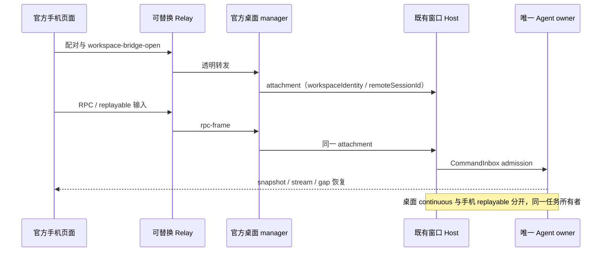

# ZCode v3.15.1 同步与模块化扩展策略

状态：公开源码迁移补齐与本地集成验证已完成；49 项上游测试/实现不一致和两项公网归档访问限制单列保留。跨平台、官方云服务和发行 bundle 验收不在此结论内。实施结果见 [补齐验收](../docs/upstream/zcode-v3.15.1-followup-result.md)。

后续执行依据：[完整性复核](../docs/upstream/zcode-v3.15.1-completeness-review.md)、[补齐合并方案](../docs/upstream/zcode-v3.15.1-followup-plan.md)与[逐案例基线证据](../docs/upstream/zcode-v3.15.1-followup-evidence.json)。49 项失败已经逐案例对拍；后续新增失败仍须独立定位，不能自动归因于上游。

## 固定基线

- Drora：`82b02c1411a995a4c33080d5ea497b1477ae6ded`。
- 官方旧基线：`29628c9acdb81b703bbd4080c207a0e7ce5e276e`（v3.14.3）。
- 官方新基线：`aac4755666d09fdcd70272fcf063c077a639015f`（v3.15.1）。
- 实施分支：`integrate/upstream-v3.15.1`；不重写现有历史、不创建 worktree。

## 官方实现优先（2026-10-13）

用户确认以 ZCode 实现为准。每次上游同步先比较官方实现与同职责的 Drora 实现：官方已覆盖现有需求时，采用官方实现并删除重复业务链路；仅部署参数、品牌或发行差异时，通过端口装配到官方入口；官方尚未覆盖的能力才保留独立扩展。覆盖判断包括持久化兼容、权限、取消、恢复、workspace identity 与平台要求，不能只比较功能名称或 UI。

迁移以官方契约、状态所有者和执行路径为单位。自研测试中的既有需求仍须验收；确需数据转换时在适配层一次迁移，不长期维护双写或两份会话事实。每项保留差异记录官方缺少什么及重新评估条件；后续官方补齐时再次替换，不能把旧的自研实现自动当成不可更改的基线。

| 同职责范围                                   | 当前取舍                                               | 接入或保留依据                                                                                           |
| -------------------------------------------- | ------------------------------------------------------ | -------------------------------------------------------------------------------------------------------- |
| 手机页面、聊天、任务与远控控制面             | 已采用官方 Web/UI、manager、transport、Host attachment | `mobile-web` 只构建/部署官方产物；旧 UI 不在生产入口                                                     |
| 输入排队、模型执行材料、session finalization | 已采用官方行为，共用单一实现                           | `CommandInbox` 持有已接受输入；共享 helper 迁址到 app 层，旧协议仅 re-export，不维护复制函数             |
| 输出风格                                     | 已采用官方服务实现                                     | `outputStyleService.ts` 与固定上游除包名外一致，继续使用同一 `.claude` 配置和 service，不另建 Drora 服务 |
| Gen UI、MCP Apps、Visualize、Bot、工作流     | 已采用官方公开实现                                     | 旧 webhook 名只在独立无状态入站适配中兼容，不复制 Bot 验密或执行逻辑                                     |
| 更新轮询、下载、重试与菜单状态               | 已采用官方状态机                                       | Drora GitHub feed 与安装恢复是发行装配；保持已决定移除启动强制更新门控                                   |
| LAN / 自建云 Relay                           | 保留独立部署适配与 Relay 服务                          | 公开上游没有云 Relay 服务端；适配只持有端点、鉴权、转发和生命周期，不持有任务状态                        |
| 知识库、VaultView、Jev/ONNX、证据审批        | 保留独立扩展                                           | 上游 memory/output-style 不覆盖 Vault 索引、检索与证据账本，不能直接替换                                 |
| S03 Plan/P0 写入保护                         | 保留已记录的策略差异                                   | 当前官方权限不覆盖这些约束；共用官方执行入口，并复核最终输入，不另建 admission                           |
| 桌面宠物                                     | 保留独立扩展                                           | 固定上游没有同等功能；由独立窗口控制器和 hook 接入                                                       |
| Computer Use                                 | 官方宿主/Skill 接入，保留冻结 SDK/Helper               | 上游 0.6.4 为占位包，不足以替换可运行的 0.6.3；宿主完整性检查仍必须覆盖官方 Skill                        |

### CUA 完整性收敛验收

二次审查 R01：Bootstrap 的 `OFFICIAL_CUA_REQUIRED_SEED_PATHS` 漏掉 `skills/computer-use/SKILL.md`，与官方要求及 Desktop staging 不一致。本轮仅补回宿主声明，不更改冻结 SDK、Helper 或原生依赖。

- filesystem 与 SEA 使用既有 `findMissingOfficialPluginSeedPaths` 和单一 seed 链路。
- 全新缓存收到仅缺 Skill 的源时拒绝缓存，诊断准确列出缺少的 Skill，启动可降级。
- 同版本完整缓存已存在时，残缺源不能替换缓存或修改 seed marker；CUA 不能退回旧版本 cache 混用 consumer。
- 完整源继续 seed，保留 package/sharp 的额外运行时检查；Desktop staging 与 Bootstrap 要求的五个路径保持一致。

## 远控迁移决定

官方已公开浏览器 UI、两端传输、共享协议和桌面 Host 接入。外部 Relay 服务端实现不在公开仓库。

1. **页面唯一实现**：以官方 `packages/web` 的远控页面与共享 `packages/ui` 为后续同步来源。停止继续发展独立的逆向手机 UI；`packages/mobile-web` 迁为构建/资产部署适配入口，复用官方页面产物，不复制官方组件建立另一套行为。
2. **桌面唯一控制面**：以官方远控 manager、device transport 和 Host attachment 为控制面；已有逆向控制器退出正常启动链。自建 Relay 与 LAN 的服务端职责继续保留在独立模块，不能向官方 manager 插入另一份任务队列或业务投影。
3. **扩展接在装配层**：自建云中继只提供 endpoint/资产根配置；LAN 模块负责内嵌 Relay 生命周期、地址选择和凭据 origin 隔离。由独立 Drora 适配模块构造官方依赖。官方页面和控制器不直接 import 自建 Relay 实现。
4. **默认使用新源码构建页**：旧 3.14.3 发行快照保留取证用途，不能继续优先于新页面。页面 URL 与构建资源版本来自一个配置所有者，不以修改 app_version 掩盖跨版本不兼容。
5. **保留官方行为**：窄屏任务首页/聊天、宽屏任务列表、独立选中态、主题、重连、权限交互、任务生命周期及失败面采用公开实现。新增 Drora 操作与设置通过独立组件/扩展注册接入。
6. **不增加承诺范围**：官方未提供手机 Gen UI/MCP 沙箱时保持官方降级。远控不另起 Host 或 Agent，不在 Relay 存储 task/session/业务快照。

## 状态所有者与事件顺序

| 状态                                     | 唯一所有者                         |
| ---------------------------------------- | ---------------------------------- |
| task/session、被接受的输入、权限、工作流 | 既有 Agent/runtime 与 CommandInbox |
| workspace scope、owner/lease 与服务实例  | 窗口 scoped Host                   |
| attachment 创建/释放与远控会话路由       | 官方 desktop manager               |
| WebSocket 握手、心跳、重连               | 官方 device/terminal transport     |
| Relay 注册/鉴权/配对和透明转发           | 自建或官方 Relay 服务端            |
| LAN listen/stop、端点与凭据 origin       | 独立 Drora LAN/endpoint 适配模块   |
| 手机当前选中任务、视图、主题、草稿       | 官方 Web 页面；不回写桌面选中态    |

旧 socket/迟到请求不得落入新 attachment。释放 attachment、关闭窗口、停止远控和凭据轮换沿用官方顺序；origin 隔离的 LAN/云凭据不互换。重复连接/命令的幂等和序号校验由原有对应 owner 执行。

## 其余同步与自研隔离

- 尽可能采用官方 shared 契约、Agent/runtime、动态工作流、MCP Apps/Visualize、Bot、会话投影、UI 与测试；按依赖闭包移植，不只复制界面。
- 自研知识检索/VaultView/Jev/ONNX、S03 写入分级、桌面宠物、自建 Relay、发行更新与 Helper 身份各有独立模块和契约，通过 ports、注册表、依赖注入和装配入口接入。
- 原实现文件内只保留明确接入点，不散落自研业务分支；还原权威文件不得 import 自研实现。新增跨模块边先登记契约和架构依赖。
- 保留现有 `knowledge/search`、Vault accessor、证据/审批账本及数据库升级路径。新权限流程的 resolveInput、hook 修改和 inputAdjustments 后均保持最终输入的 S03 复核。
- 保留已移除的上游 forceUpdate 门控决策和 Drora 更新渠道。上游 Computer Use/request-security 占位实现不能覆盖现有还原能力。
- 改名严格遵守 `specs/drora-rename.md`：外部服务、OAuth、wire headers、manifest 目录、官方字节/许可资产和新契约逐项处理，禁止盲目全仓替换。

## 实施顺序与验收

1. 共享契约、必要依赖/runner 与架构登记。
2. Agent/runtime、工作流、权限和插件。
3. 服务/Host、Bot、知识扩展装配。
4. MCP/Gen UI、会话/辅助对话、官方 Web/远控 UI。
5. Relay/LAN 适配与部署资产入口。
6. 类型检查、Lint、架构门禁、行为测试、构建与平台发行验证。

| 场景                      | 验收                                                        |
| ------------------------- | ----------------------------------------------------------- |
| 官方页面 + 自建云 Relay   | 握手/配对、任务列表、输入、停止和审批实际贯通               |
| 官方页面 + 内嵌 LAN Relay | 本地端点和新源码页正确；凭据与云端隔离                      |
| 桌面与手机在线            | 同一 owner；独立选中态；输入只 admission 一次               |
| 断网/切后台/重连          | ACK、gap、snapshot/replay 不丢失、不重复、不串 workspace    |
| SSH/远程工作区            | 使用原 workspaceIdentity/remoteSessionId，已有连接重连      |
| VaultView/知识检索        | accessor、knowledge/search、引用/审批/索引迁移保持有效      |
| 新权限流程                | P0 逐次确认、plan 禁写、hook/inputAdjustments 不能绕过      |
| MCP/Gen UI                | 实例归属、CSP、手势、资源预算与失效实例验证；Web 依官方降级 |
| 发行                      | Drora 品牌/Helper/更新源不回退；许可和资产 provenance 完整  |

固定版本 `pnpm typecheck`、`pnpm lint`、架构门禁、CLI 深度 smoke 和模块行为测试必须实际运行。真实 Electron/Windows/macOS/移动浏览器/网络验证与 mock 分别报告，不把 mock 通过写成真机通过。旧上游 bundle 对拍不能代替 3.15.1 真值；未取得新版官方 bundle 时记录该限制，不伪造 parity 通过。

### 更新器收敛

更新器的轮询、下载重试、已下载版本替换和菜单状态采用 3.15.1 官方单一状态机。
Drora 发行源由独立适配层配置，默认复用安装包的 GitHub feed，显式 URL 覆盖走 generic feed；不装配 ZCode 云端 manifest provider。
启动时的最低版本阻断、forceUpdateGuard/Prompt/服务调用保持移除。更新器内部可复用的主动检查/下载入口不产生启动门控。
保护既有安装失败恢复回调，通过装配 hook 接入，不能改写更新事实或添加第二个队列。

### Host 知识装配的模块边界

`assembleDroraKnowledgeHost` 归属 services 自研扩展，由 `@drora/services/node` 提供公开入口；Desktop Host 只调用装配结果，不导入 Host tsconfig 范围外的桌面源码。装配读取设置，按需创建零出站本地 embedding 端口；Jev 每轮重新解析设置，失败降级，不新增会话所有者。

### 回归测试入口

补齐复核发现 CLI `/model` 与 `/effort` 的成功分支未调用既有偏好保存端口。
恢复官方 `rememberCurrentModelSelection` 调用：会话选择先成功，再由唯一 Personal 配置端口写默认；保存失败只追加警告，不撤销成功的选择。
Drora `/model main` 解析保留，不能因此丢失普通模型/推理档选择的跨会话持久化。
REPL/Browser bridge 的元数据常量改用已有公开 `@drora/contracts/mcp` 入口，保持常量单一出处且不加载整个 Agent 契约 barrel。

上游 Vitest 测试与 Drora 的 Node test runner 用例保持各自原生运行器。根 `test:unit` 必须运行两者；通过导入 `node:test` 识别 Node 用例，避免 Vitest 报零 suite，禁止排除后不执行。Node TS 用例用已声明的 tsx loader，保留原断言与跳过统计。

CI 的「Official plugin hook runtime tests」专项显式执行 `node --import tsx apps/drora-cli/packages/bootstrap/test/official-plugin-hook-runtime.test.mjs`，覆盖既有 manifest 重写、env overlay 与 hook runner 全部断言。迁移前 Bootstrap 的 `test` 指向此原生入口；迁移后同名脚本指向官方 `vitest tests`，不能继续用脚本名代替专项职责。官方包级完整测试仍通过原生 `test` / `test:upstream-cli` 执行并保留真实非零失败结果，不增加白名单、skip 或 continue-on-error。

根项目引用类型检查在 CI 显式使用 `NODE_OPTIONS=--max-old-space-size=4096`（4 GiB V8 堆），避免各 OS/runner 的默认堆上限不同影响全工作区编译。该设置仅作用于 CI 的 Typecheck / Emit workspace dists 步骤，不进入产品配置、不缩减项目引用或修改类型规则。macOS 首次运行退出 134 是此资源验证的触发证据；是否解决由重跑结果判定，不能将进程中止写成类型检查通过。

### Windows CUA 打包来源与唯一 staging

CI `38491068939` 已验证 macOS 资源调整有效；Windows 在 `prepare:windows-cua-helper` 失败，因为解析到 SDK `packages/zcode-cua`，该包没有 Windows 产物契约。此错配也存在于迁移前主分支，并非本次删除了 producer 声明。实际 0.6.3 产物位于 `packages/zcode-cua-helper/runtime/cua-helper`，包含原版 package/manifest、entry、PE addon 与运行依赖。

- SDK、Helper 运行时包、发行 manifest 是三个不同身份；名称在 shared 的公开 `cua-runtime-artifact-identity` 入口声明，打包端与 services 运行时引用同一常量。冻结 package/manifest 及二进制保持原字节和原版名字。
- 显式 `DRORA_CUA_HELPER_RUNTIME_PACKAGE_DIR` / `DRORA_CUA_DEV_ROOT` 优先级保持原约定，错误的显式源直接失败；无覆盖时优先解析本工作区的冻结 Helper。冻结目录不存在时仍支持已安装 producer 的路径，不向用户目录或其他仓库扫描。
- `prepare-agent-node-bundle` 调用既有 `prepareWindowsCuaHelperAssets`，该函数独占 Windows Helper staging；移除 `prepare-runtime-assets` 的第二次 producer staging。独立 `prepare:windows-cua-helper` 继续调用同一函数。
- 源契约只接受已知 SDK producer 或冻结 Helper 身份；生成 manifest 使用 services 已要求的原版 producer 名，生成 ESM package 使用原版 Helper 身份及其契约。继续验证规范路径、realpath、PE 架构、SHA256、完整依赖闭包与签名后哈希，不用占位标志跳过 Computer Use。
- 验收：真实冻结产物在 Linux 上做 win32-x64 staging 后，经打包 verifier 与实际 services resolver 双重验证；entry/addon 字节与原始 manifest 哈希一致。坏 hash、错误架构及缺契约的显式 SDK 源必须失败。最终 Windows CI 仍须实际通过。

桌面冷启动仍按官方时序在平台 IPC 注册后调用 `primaryWindowCoordinator.ensurePrimaryWindow("app-ready")`，再绑定首屏性能监控；后台更新不能阻止该入口。实际 Electron 验收必须有渲染页面和 Host 响应，不能只检查进程。

清理三路合并产生的重复 switch/object 键。Server/Docker 按官方 dedicated remoteSessionId 保持逻辑会话生命周期，不采用被遮蔽的旧 Server 同目标复用分支；SSH/WSL 仍按官方规则复用。旧冻结控制器只保留取证与回归：其 grace 定时器依据 `relay-wire/replayBuffer.ts` 的严格 `now > queuedAt + graceMs` 和官方 chunk-C6VCYWB4.js @8551 所记录 deadline 口径，触发时间加 1ms，防止恰好落在边界时一次性看门狗失效。

构建约束：ONNX 的本机二进制由 Node 的 `onnxruntime-node` 包加载，HTTP/桌面 Main、Host、scheduler 都外置该依赖；对应部署包显式声明运行时依赖。不能把某个平台的 `.node` 文件内联为 esbuild 的临时资源。UI 扩展传入 memo 组件的展示节点和回调保持稳定引用。

### Linux 进程退出观测

容器内 PID 1 可能不回收僵尸条目：实测失败 PID 已是 `/proc/<pid>/stat` 的 `Z` 状态，`kill(pid, 0)` 仍成功。保持官方进程身份复核、信号顺序和 deadline，在最终退出结果中异步读取 Linux procfs，仅排除已确认为 Z 的条目；读取失败保守保留。测试验收使用现有 `isPidRunning`，仍要求真正可执行的后代结束。

CUA 懒启动仍由官方 Helper lifecycle 统一 admission；Windows 的懒启动 fallback 保留稳定 named pipe 和 recipe，不能使用 macOS Unix socket 路径。macOS/Windows 的真实原生 Helper 安装验收需要对应平台，当前 Linux 只验证装配和既有契约。

### 旧手机页面退役

3.14.3 的逆向 app/ui/intl 迁入 `packages/mobile-web/legacy-v3.14.3`，保持取证和历史辅助函数回归。旧 Vite 配置归档，不再提供第二个开发/生产页面入口；当前 mobile-web 的 dev 转发 packages/web，build 直接构建 packages/web。原始发行 snapshot/recovered 仅供 provenance。历史 Node 测试继续运行其原断言，不能拿历史 UI 用例代替当前官方页面验证。

CLI 构建产物冒烟保持 stdin pipe，按 Desktop 的真实 stdio 生命周期等待首条 startup 通知；stdin EOF 是单独退出事件，不能把启动前直接 EOF 与协议就绪混为一谈。

实施结果：[合并记录](../docs/upstream/zcode-v3.15.1-merge.md)、[验证记录](../docs/upstream/zcode-v3.15.1-validation.md)。

全量架构检查补齐 Gen UI 服务的契约测试入口：把已有的 sandbox provenance/状态转义/完整文档拒绝回归迁到 `gen-ui/contract.test.ts`，改经公开 `node.ts` 构造服务。保留全部原断言，不增加重复 suite，不修改产品行为或 baseline。

### CLI 回归夹具与工作区边界

合并后 CLI 属于根 pnpm 工作区，SEA 的依赖重建使用 `pnpm --filter @drora/cli... build`，每次实际执行 build，不使用 Turbo 缓存。验证应检查根工作区依赖闭包及构建顺序，不能要求不存在的内层 lockfile。冻结 CUA SDK 仍需向可信 REPL 宿主临时交付 scoped token；非授权入口、模块求值阶段及宿主退出后不得暴露凭据。Debug 测试通过隔离 home 验证现有路径和 loopback Host 限制，不放宽生产边界。

CLI Node runner 将测试文件并行度限制为 2，避免云环境并行构建造成终端渲染饥饿；保留原有用例超时和断言。TUI 登录测试在 runner 的 after hook 中释放 renderer，即使 highlighting 等待超时也不得遗留循环使 CI 挂起。

回归夹具保留真实进程/HTTP/SQLite：并发授权与兄弟取消通过显式启动屏障建立现场，不依赖冷启动速度；非 Git 夹具只隐藏夹具边界外的沙箱 `.git` 占位，正向 Git 用例不变。Linux 进程退出检查将明确的僵尸 Z 状态视为已终止，运行/阻塞进程继续检查；Windows taskkill/EPERM 分支保持原断言。插件本地枚举用例仅模拟可选 CDN 图标，独立图标下载/缓存断言与真实 Git 克隆保持原路径。
