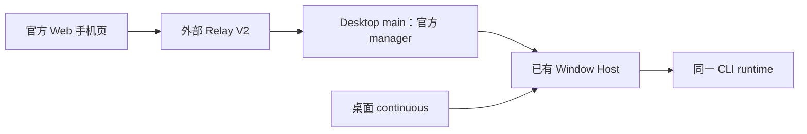

# ZCode v3.16.1 同步与分段合并策略

## 2026-10-22：移除自研 Relay 复刻

用户确认上游未开源云端 Relay 服务，要求删除本仓复刻实现及相关文档。
删除自建服务端、仅服务旧协议的客户端/手机壳、HMAC 凭据与协议辅助代码、LAN 宿主、
自建地址/传输选择 UI、旧二维码轮换入口及其专属测试和设计文档。
保留当前官方 Relay V2 客户端、canonical Web 手机页面、原版冻结取证资产和 Host/CLI 恢复链路。
既有本地注册表/凭据文件不做磁盘删除；废弃设置不再参与启动或端点解析。

端点统一经当前应用 endpoint origin 推导；显式调试覆盖继续使用官方环境变量。
上游云端可用性仍属于外部依赖，本次不实现替代服务，也不宣称云端已完成联调。

验收：正式启动接线与设置界面没有自建/LAN 分支；V2 登录、端点覆盖、共享 Host、
分片 ACK/重放和 continuous/replayable 边界的现有回归继续执行；完成类型、Lint 和架构检查。
以下历史阶段中的“后续补齐自建 Relay V2”决定已被本节撤销。

状态：**实施完成（2026-10-20）**。S0-S7 全段落地说完毕：a5fcd647/cc1b9a26/58cd765（S0 转换+黄金+预演）→ 4f814061/810d3d5b（S1 契约）→ 7d7ee097/c62b2c32/69bda53a（S2 CLI）→ ac72baf5/81a32c5d（S3 services）→ 9a5a6c1a/c58bd34c（S4 desktop+Relay V2）→ 5bf741d3/b9a6e63d（S5 UI/web）→ 3de1880a（S6 资产+R5 快照）→ 69daa438/576c3dbc/b830139b（S7 终验）→ 25837882（祖先记录 merge，merge-base=0a1fc56d）。终验门禁全绿（typecheck 18 项目/lint/fmt/架构 0 违规/单测 vitest+node 全量 0 失败/CLI 19 包 0 失败/SHA256 锚点）。结构对齐审计：上游 3.16.1 现行树缺口 18 条全部有据。明细见 docs/upstream/zcode-v3.16.1-segment-plan.md。遗留：G-hint E2E 真机再基线、E2E/跨平台/真包 parity 属 CI 与发布验证。

总目标：合并后目录结构与原版 ZCode 保持对齐（在 zcode→drora 改名空间下），结构差异仅允许两类——自研新增模块、spec 已记录的有意分歧；S7 做结构对齐审计并固化差异清单。本文是执行的唯一依据；实施结果与证据链后补于 `docs/upstream/zcode-v3.16.1-*.md`。

## 固定基线

- Drora 起点：`main` = `7f187c1e`（与 origin/main 同步）。
- 官方旧基线：`aac4755666d09fdcd70272fcf063c077a639015f`（v3.15.1）。**它已是本仓 main 的 git 共同祖先**（上轮迁移用"保留产品树的 merge commit" `44ddf7860` 记录）。
- 官方新基线：`0a1fc56d279fd1001f78387bd81aec1c26767411`（v3.16.1，Source Sync Bot 压扁提交，内部源提交 `1f4d7f01`，2026-10-19），其父提交恰为 `aac4755`。
- 变更规模：4502 文件（新增 1658 / 删除 300 / 改名 44 / 修改 2500），+355981 / −121976。
- v3.15.1 同步完成点：`82b02c14`（main 祖先，已验证），作为改名转换脚本的黄金校验对照。
- 实施分支：`integrate/upstream-v3.16.1`；不重写历史、不创建 worktree；完成后同样以保留产品树的 merge commit 把 `0a1fc56d` 记为祖先，供下次同步直接使用 git 祖先。

## 上游变更主轴（v3.16.1 概要，详细清单见对话记录/后续 analysis 文档）

1. 远程连接体系重构（Source Server / R3）：ssh/wsl/docker 目标、连接向导、恢复策略、启动重连、版本兼容门禁。
2. Web 远控 Relay V2（JWT 注册 + 一次性连接 token），**删除 V1 认证/传输**。
3. Tool Search + 延迟工具加载；Off-Peak 错峰执行运行时。
4. 项目侧栏重写（project-sidebar，约 90 文件）；Project 存储大重构（project-storage / task-groups v6 / task-facts，DB schema v4/v5）。
5. 会话分享（conversation-share 全链）；Office 文档运行时（CLI 新子包 office-runtime）。
6. SQLite 迁移基础设施（sqlite-migrations：契约/runner/backup/restore）。
7. 协议面：v3 `providerRefreshRegistry`、`additionalDirectories`、`historyFirst`；v4 `sessionId` 预留、`lastOutcome`、`sessionsIndexReconcile`、`runtimeInitialization`；契约字面量增删（见 §契约字面量差分）。
8. zcode-cua 占位包 0.6.3→0.6.5（仍为占位）；文档/测试/架构工具（architecture:adopt、upstream-admission、sqlite-schema-contract）。

## 合并引擎与方法论

### 为什么不直接 `git merge upstream/main`

改名使两侧路径/内容系统性偏移：base→ours 是 zcode→drora 全量改名+自研扩展，base→theirs 是 v3.16.1 演进。直接 merge 即使 rename 检测成功，theirs 的新增行会以 zcode 字面量落进 drora 文件（如 `ZCODE_FOO` 不经转换混入），制造"同一文件两个命名空间"的撕裂；新增文件也会落在 zcode 路径。上轮迁移实证直接 merge 产生 4107 个冲突路径。

### 引擎：正向转换 + 逐文件三方合并（上轮方法论的机械化升级）

1. **正向改名转换脚本** `scripts/upstream/transform-upstream-tree.mjs`（新增，自研工具）：
   - 输入 git ref，输出转换后的树（临时目录）。规则唯一来源 = `specs/drora-rename.md` 有序替换表 + 豁免清单（CDN/OAuth 回调/appId（覆盖对象形态 `appId: "zcode"` 与 URL 查询形态 `appId=zcode`；2026-10-21 修复——原实现 APPID_RE 只护对象形态，URL 形态曾被规则 8 sweep，残留缺口与取舍见 `specs/drora-divergence-ledger.md` 台账 6）/`x-zcode-*` wire header/`.zcode-plugin`/官方 URL 如 `github.com/zai-org`/许可文本），外加大小写变体（`Zcode`→`Drora`）。
   - 路径层与内容层都做转换；对二进制/官方字节资产跳过内容转换（豁免区）。
2. **黄金校验**（S0 内完成，不通过不得进入 S1）：对 `aac4755` 全树做正向转换，与 `82b02c14` 树做文件级 diff。残差必须全部可归类为：forceUpdate 家族删除、品牌资产（Drora 图标/SVG）、上轮迁移补齐修复、既有 spec 已记录的有意分歧。残差清单固化为转换脚本的「分歧白名单」，后续段落引用。
   - 路径层已知校验数据：反替换命中率 99.92%（16866/16880），未命中的 14 条上游路径已知原因（2 条 `Zcode` 大小写、9 条 Drora 主动删除、3 条结构差异）。
3. **逐文件三方合并**：对上游变更路径集（aac4755..upstream/main 的 name-status，经路径映射转 Drora 命名空间）逐文件执行 `git merge-file`：
   - base = 转换后的 `aac4755:<zcode路径>` 内容；
   - ours = `main:<drora路径>`（不存在 = Drora 主动删除 → 走决策表）；
   - theirs = 转换后的 `upstream/main:<zcode路径>` 内容。
   - base 与 ours 的 diff 只剩 Drora 真实改动、base 与 theirs 的 diff只剩上游真实改动 → 冲突仅在双方真实改动重叠处出现。
   - 上游新增文件：转换后直接落盘。上游删除： ours 无独有改动则随删，有则走决策表。
4. **决策表**（逐条登记，不许静默）：ours 删/theirs 改 → 维持删除（forceUpdate 家族，spec 已裁定）；theirs 删/ours 改 → 评估（Relay V1 见 R1）；双方大分歧同名路径（`zcode-cua-plugin`）→ Drora 拥有，上游增量人工甄别。常设性（跨版本）有意分歧的逐条台账集中在 `specs/drora-divergence-ledger.md`（2026-10-21 依合并审计补建），本表只记合并执行期裁决。
5. **分段清单驱动**：预演产出每段的上游路径集 glob，逐段应用、门禁、核查、提交。

### 工具链约束

- 本机无 mise：PATH 前置 volta node24 镜像 + corepack pnpm@10.33.2；裸 pnpm(9/node18) 会裁掉 vendored node_modules（恢复法：`git ls-files -d | xargs git checkout --`）。
- `pnpm-lock.yaml` 不手工合并：各段收集 package.json 变化，S1/S7 用 pinned pnpm 重新 `pnpm install` 生成；改过依赖源码的包须重建其 dist。
- vitest/wdio 采用上游版本与配置（R4 裁定：按 zcode 原版实现），去掉 Drora 钉版 4.1.7/9.2.1；上游版本若暴露本机问题，作为独立缺陷修复，不恢复钉版。

## 段表（S0–S7）

每段流程：应用 → 机械门禁 → 三方核查（V1/V2/V3）→ 修复循环 → commit（信息注明段号与决策引用）→ 更新本 spec 进度。段内不许混入下一段路径的改动。

| 段                                      | 范围                                                                                                             | 上游要点                                                                                                                                                                               | 机械门禁                                                                     |
| --------------------------------------- | ---------------------------------------------------------------------------------------------------------------- | -------------------------------------------------------------------------------------------------------------------------------------------------------------------------------------- | ---------------------------------------------------------------------------- |
| S0 准备与预演（不改产品树）             | 新增转换脚本+预演清单；建集成分支                                                                                | 转换脚本、黄金校验、全量试合并冲突清单（按段聚类）、修改/删除决策清单、段路径集                                                                                                        | 脚本自测；黄金校验通过                                                       |
| S1 根配置 + 共享契约                    | 根 package.json/pnpm-workspace/vitest/lint/architecture-policy、`packages/shared`、`packages/rpc`                | source-server/、web-remote-relay/、sqlite-migrations/、conversation-share\*、off-peak-execution、telemetry/validation 扩容、drora-protocol v3/v4 增量                                  | shared/rpc typecheck + 测试；契约键两侧 grep 清单                            |
| S2 CLI 核心                             | `apps/drora-cli` 全部                                                                                            | tool-search/deferred、off-peak runtime、workflow 入口工具化+阻塞提醒、channel-reply、session-execution（residency-lease）、argument-parsing、office-runtime 新子包、usage 手册、权限面 | CLI typecheck；test:upstream-cli；S03 既有 28 测试全过                       |
| S3 services + server + relay/server-cli | `packages/services`、`packages/server`、`packages/provider*`、`packages/client`、`packages/drora-server-cli`     | project-storage/task-groups v6/task-facts、source-server-workspace、bot-project-runtime、conversation-share、offPeakTaskService、server source-server                                  | 各包 typecheck + 测试；knowledge/vault 225 检测不回退                        |
| S4 desktop                              | `packages/desktop`                                                                                               | sourceServer host 全家、web-remote-relay V2、database-startup、desktopCommandIpc、conversationShareAttachmentService、embedded-browser-permission-contract、E2E 迁移                   | desktop typecheck；真 Electron 冒烟与 mock 分开报告                          |
| S5 UI + web + mobile-web                | `packages/ui`、`packages/web`、`packages/mobile-web`（仅转发面）                                                 | project-sidebar 重写、CONTRACT.md 模式新模块、conversation-share-interaction、chat-input-toolbar、web 的 web-remote-control 模块化+share 落地页                                        | ui/web typecheck + 新增测试；i18n zh/en 键对齐                               |
| S6 CUA + 文档 + 脚本 + 资产             | `packages/zcode-cua*`、`docs/`、`scripts/`、`patches/`、`third-party/`、`.agents/`、AGENTS/DESIGN/CONTEXT/README | cua 0.6.5 占位（R3）、docs 160 篇、adopt/upstream-admission/sqlite-schema-contract、radix-collapsible patch、许可补齐                                                                  | lint/fmt；architecture:check --changed；许可完整性                           |
| S7 终验与收口                           | 全仓                                                                                                             | lockfile 重生、全量验证、祖先记录 merge commit、证据文档、PR                                                                                                                           | `pnpm typecheck`/`lint`/`architecture:check`/全部测试入口真实结果；freshness |

段间已知中间态：S1 契约先行会造成消费方（S2/S4/S5）短暂类型破坏——记录在案、由后续段收口；各段自身测试必须绿。

## 段执行补记

### S6（commit `3de1880a`，481 文件 = 385 机械落地 + 13 文档/配置冲突并集 + R5/清理连带）

- **快照机制（R5 落地）**：upstream-admission 白名单——按本仓转换树重生成 `scripts/architecture/upstream-snapshot.json`（18031 files + 1503 introduced，已复核），unmanaged-new-file 171→0。三条 S5 合并移植产生的模块边双面登记：`packages/ui/src/project-sidebar/module.ts`（+ui-team，TeamSessionLine 移植）、`team/module.ts`（+services，workspace-config-catalog-sync）、`drora-extensions/module.ts`（+web-remote-control-ui，RemoteControlDialog 包装 v3.16.1 新远控模块）；scripts/architecture 12 文件随机制一并落地（属 R5 登记连带，非越段）。
- **许可补齐**：buffers/chainsaw/noto-sans-sc 三快照落地（依赖已在 lockfile）；`third-party/README.md`/`SPEC.md`/`inventory.json` take-theirs；`THIRD-PARTY-NOTICES.md` 并入 radix 条目。
- **污染清理**：删除 `apps/drora-cli/packages/cli/src` 下 86 个 tsc 就地发射 `.js`（已复核 86D/0 残留跟踪），`apps/drora-cli/.gitignore` 补 `src/**/*.js`、`src/**/*.d.ts`、`packages/cli/src/**` 编译产物规则（上游仅跟踪 `.ts`）。
- **门禁终态**：lint 0 error；`architecture:check --changed` 0 违规；`test:architecture` 36/36（commit 信息记录）；三方核查 V1 覆盖性/V2 保真性/V3 一致性通过（V3：文件名层 zcode 残留 1 条均属豁免，工作区干净）。fmt 未在 S6 门禁内（段表沿用 lint/fmt 定义为后续统一处理，S7 全量收口）。

## 三方核查协议（每段必做，三个独立 subagent，不共享上下文）

- **V1 覆盖性核查**：输入=段路径集 + aac4755..upstream/main diff + 决策清单。逐条验证：每条上游变更要么已落地（经反替换归一化比对内容），要么在决策清单中有登记与依据。产出零静默丢失证明；任何遗漏回主流程修复后复验。
- **V2 保真性核查**：输入=B 类共享触点表 + A 类自研目录清单（见 §自研保护区）。验证：挂载点仍存在且语义未变（App.tsx 的 team/pet/webRemote 桥、SettingsPage 的 Knowledge/Pet 区、create-app 的 team/vaultSearchPort 装配、main/index.ts 的 drora-extensions、architecture-policy 的 owner:drora 模块表）；S03/write-tier 门控未削弱；drora-protocol-v4 的 team/team-history 键仍 additive；A 类目录零改动。对照合并前快照 diff 保护区。
- **V3 一致性核查**：豁免区外残留 `zcode|ZCode|ZCODE|Zcode` 字面量扫描（audit-drora-agent-remnants 风格 + 新扫描）；新增/改名 import 解析；契约键单一出处（env/`_meta`/权限键生产消费两侧同源）；决策记录完整；本段 commit 与 spec 进度一致。

判定：三个核查全部通过才进入下一段；发现问题→修复→针对该发现复验。

## 自研保护区（合并期间冻结清单）

A 类（上游无对应物，整目录保护）：`packages/ui/src/team/`、`apps/drora-cli/packages/bootstrap/src/app/drora-team/`、`packages/services/src/{knowledge,obsidian-vault}/`、Jev/ONNX（jevDynamicProvider、localEmbeddingPort、knowledge-evidence、knowledge-jev）、`packages/drora-server-cli/`、手机远控 UI（WebRemoteControl\*、mobile/）、桌宠资产与 `drora-extensions/desktopPet`、发行更新 `drora-extensions/updateFeed`、四层 `drora-extensions/`、`packages/mobile-web`（upstream/ 快照整目录排除合并）。

B 类（共享文件，逐挂载点保真，冲突高危）：`packages/ui/src/App.tsx`、`i18n/locales/{zh-CN,en-US}.ts`、`app-shell/`（TeamSidePane、WorkspaceShellLayout）、`SettingsPage.tsx`+`settings/`、`create-app.ts`（team 装配 L106/184/797/886-905/926、vaultSearchPort）、permission 面（write-tier-policy 单一出处）、`packages/desktop/src/main/index.ts`（remoteControl/desktopPet/webRemoteControlManager 装配）、`packages/shared/src/`（drora-protocol* 63 文件、desktopPet.ts、knowledge*）、根 `architecture-policy.yaml` 与 `package.json` scripts。

还原资产（内容字节保持，不参与内容转换）：`packages/mobile-web/src/recovered|upstream`、`packages/zcode-cua{,-helper}` 还原区、`packages/desktop/resources/{cua-helper,cua-helper-3.11.2-reference,glm-natives-3.14.3}`、`third-party/`、`apps/drora-cli`（oxlint 整包 ignore）。

## 契约字面量差分（S1 处置清单）

| 族                 | 上游新增                                                                                                                                                                                          | 上游删除                                                                                                         | 处置                                                                                                             |
| ------------------ | ------------------------------------------------------------------------------------------------------------------------------------------------------------------------------------------------- | ---------------------------------------------------------------------------------------------------------------- | ---------------------------------------------------------------------------------------------------------------- |
| env 键             | ZCODE_COMPATIBILITY_MANIFEST、ZCODE_ERROR_CODES、ZCODE_MIN_COMPATIBLE_VERSION\_\_(编译期)、ZCODE_MIGRATION_BACKUP_SKIPPED、ZCODE_WORKSPACE_ROOT、ZCODE_CUA_REPO                                   | ZCODE_SKIP_REMOTE_ASSETS、ZCODE_GUIDE_PLUGIN_CACHE_PATH、ZCODE_GUIDE_PLUGIN_ID、ZCODE_CUA_HELPER_EXECUTABLE_NAME | 转 DRORA\_ 落地；删除项全链 grep 消费方，确认 Drora 无残留依赖（尤其 CUA_HELPER_EXECUTABLE_NAME 与冻结链的关系） |
| 权限键             | `WebFetch: "web-fetch"`                                                                                                                                                                           | 该条目 `"search"`                                                                                                | 契约键单一出处更新 + S03 复核最终输入不受影响                                                                    |
| `_meta`/originMeta | `workflowBlocked`（questions/holes/sinceMs）                                                                                                                                                      | 无                                                                                                               | additive，直接落地                                                                                               |
| 协议字段           | v3 additionalDirectories/historyFirst/toolSearchMode/providerRefreshRegistry/alwaysLoad；v4 sessionId/lastOutcome/sessionsIndexReconcile/runtimeInitialization/retryInitialization/sourceServerId | `sessionListParams.includeArchived`                                                                              | 新增直接落地；删除项 grep 消费方同段收口                                                                         |

## 裁定面

预裁决（既有 spec 已定，执行时不再询问）：forceUpdate 家族维持删除；`WebRemoteControl*` UI 随上游模块化迁移但 Drora 旁路（drora-extensions/RemoteControlDialog）保留接线；mobile-web upstream/ 快照整目录排除；`Zcode` 大小写变体纳入转换表。

已裁定（2026-10-20 用户）：

- **R1**：保留官方 Relay V2 客户端；自建服务端复刻已按 2026-10-22 用户决定删除，不再安排后续适配。
- **R2**：按推荐——`__ZCODE_MIN_COMPATIBLE_VERSION__` 由 build-drora.mjs 注入 Drora 独立值，不复用官方值。
- **R3**：按推荐——维持冻结 CUA 0.6.3 SDK/Helper 运行时；上游 0.6.5 占位包仅登记对照。
- **R4**：按 zcode 原版实现——vitest/wdio 采用上游版本与配置，去掉 Drora 钉版。
- **R5**：按推荐——引入 upstream-admission 白名单机制（S6）。
- **结构对齐总目标**：目录结构与原版对齐，差异仅限自研新增实现（S7 结构审计固化例外清单）。

## 验收矩阵

| 场景     | 验收                                                                                                                  |
| -------- | --------------------------------------------------------------------------------------------------------------------- |
| 覆盖性   | 每段 V1 零静默丢失证明；S7 全量复跑一次全仓覆盖核对                                                                   |
| 自研保真 | B 类挂载点逐点核对；team/vault/pet/knowledge/S03/relay 既有测试全绿；225 knowledge 检测不回退                         |
| 一致性   | 豁免区外零 zcode 残留；typecheck/lint/架构门禁真实通过                                                                |
| 协议     | desktop-continuous 与 web-remote-replayable 两链路语义分别验证                                                        |
| 发行     | Drora 品牌/更新源/Helper 身份不回退；许可 provenance 完整；bundle parity 无官方 v3.16.1 bundle 时如实记录限制，不伪造 |
| 祖先     | 收口 merge commit 使 `git merge-base main upstream/main` = `0a1fc56d`                                                 |

## 与既有 spec 的关系

- 上游对齐总策略、官方实现优先表、CUA/更新器/知识装配边界沿用 `specs/upstream-v3.15.1-migration.md`，本文只增量记录 v3.16.1 的段表与裁定；该文与本文冲突处以本文为准（期间），收口后回写合并。
- 改名规则唯一权威仍为 `specs/drora-rename.md`；转换脚本是它的机械化实现，规则变更须先改 spec。
- 常设性有意分歧（CLI 版本线、任务模式投影、lock 插件 importer、oxlint 覆盖面、vault 侧栏槽位、appId 转换形态）集中登记于 `specs/drora-divergence-ledger.md`；下次上游同步先查该台账再判「缺口」与「有意分歧」。
