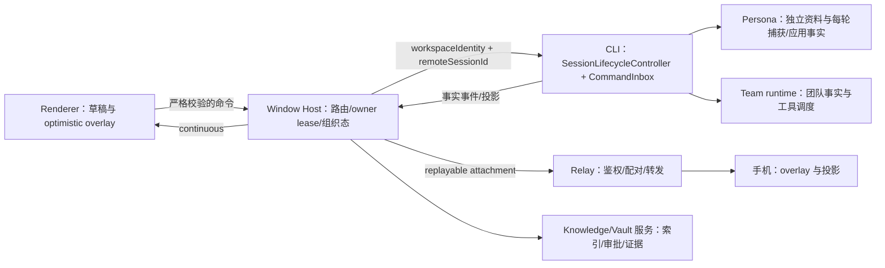
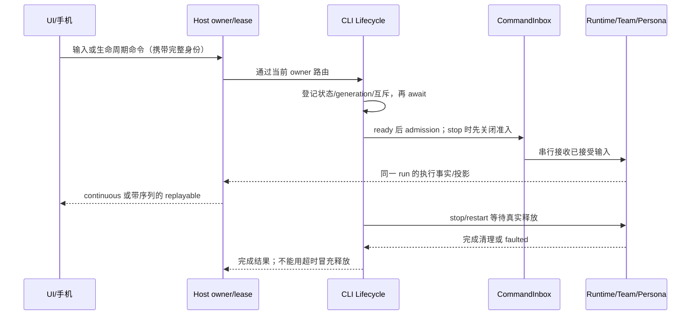

# ZCode v3.17.1 合并方案与保真合同

日期：2026-10-31（Asia/Shanghai）。状态：**规划与只读预演完成，尚未执行产品合并**。

本文规定本轮迁移的产品与技术边界；[执行任务与日志](../docs/upstream-sync/2026-10-31-v3.17.1/tasks.md)是进度唯一记录；[特性保护及验收矩阵](../docs/upstream-sync/2026-10-31-v3.17.1/feature-preservation.md)规定保留什么、怎样证明。机器清单的字段和复核方式见[调查证据](../docs/upstream-sync/2026-10-31-v3.17.1/README.md)。历史 v3.16.1 文件保留作证据，不覆盖本轮合同。

## 1. 目标、交付与执行边界

将官方截至固定提交的增量完整吸收到 **CavinHuang/Drora 的 main**，保留 Drora 自研能力及有意分歧，并建立可继续同步下一版上游的证据链。完整性按逐路径、逐契约和逐行为判断，不能只看 Git 没有冲突或编译成功。

本轮用户要求先提供完整方案并写任务文件。因此本次仅调查、预演和写文档，不切换分支、不修改产品代码、不创建产品 merge commit、不推送、不直接合入 main。以下命令均为后续执行说明，除证据文件标注已执行的项外均未执行。

后续交付必须同时满足：

1. 上游清单每条都有吸收或有意分歧的结论和证据，待裁决条目为零。
2. 自研保护区逐文件有结论；共享文件中的挂载、调用、权限、恢复、身份隔离保持或经有据的等价迁移。
3. 当前 persona 分支的既有实现纳入保护范围，包括其 Relay 切换；尚未完成的原有验收继续标为未完成，不能借升级宣称已发布。
4. 必须检查和验证的项目真实完成；选中零项、全量跳过、mock 通过、历史通过均不冒充当前运行时或 E2E 通过。
5. 最终以 PR 面向 Drora main；不向官方 origin/main 推送，不重写任何既有分支历史。

## 2. 固定基线与分支事实

| 名称                    | 固定 SHA                                   | 作用                                                     |
| ----------------------- | ------------------------------------------ | -------------------------------------------------------- |
| B：已吸收的官方 v3.16.1 | `0a1fc56d279fd1001f78387bd81aec1c26767411` | 唯一上游增量起点                                         |
| U1：官方 v3.16.2        | `3c5b227649371507ddc4eb46ac5133afe6db1cab` | 中间版本的独立核对点                                     |
| U2：官方 v3.17.1        | `a60ba6a7e5a06742270ca605f5d2cc2766afa7e1` | 本轮唯一上游终点                                         |
| C0：调查初期 Drora main | `8ee406fc92d4f217ccdc2c3f357c341621f15e3c` | 历史对照，含语音、Team 审批、Relay 服务等                |
| C：最新 Drora 远端 main | `66c9193fdd006df0bb30f0cc7c6ab316553d6052` | **实际集成起点**，通过 PR #32 包含 F，tree 与 F 完全相同 |
| L：本地 main            | `02b0e30410b7547226abec2a65a0fc1206508fb2` | 目前落后 C 144 个提交，不作集成起点                      |
| F：当前 persona 分支    | `1a0081c230f578c420ed9d41545ad6d67bd641b5` | 领先 C0 11 个提交，176 个路径差异；现已是 C 的祖先       |

- remotes：`origin` 是 **zai-org/ZCode**，`drora` 是 **CavinHuang/Drora**，`drora-local` 是本机另一仓库。不能把 origin/main 当 Drora main。
- 调查开始检出 `codex/drora-persona-system`，当时工作区干净。本地 main 已由另一 worktree 占用，不在当前目录 checkout main，也不改动其他 worktree。
- 最终检查时发现外部操作已将当前目录切到 `codex/upstream-v3.17.1-integration`（HEAD=C，和 F 同树）；本聊天没有执行该 checkout。已有同名分支，执行时先核对归属、WIP 和隔离条件，不能再次创建或重置它。本文中 F 始终指原调查输入，不跟随当前 HEAD 漂移。
- 已验证 `merge-base(C,U2)=B`。`merge-base(L,U2)=aac4755666d09fdcd70272fcf063c077a639015f`，说明使用 L 会重做上一轮迁移并漏掉 C 上的功能。
- 调查期间 Drora main 于 2026-10-31 18:15:04 +08:00 通过 PR #32 前进至 C；`git diff F C` 为空，二者 tree 均为 `0be1e6aa4938e25b12c77bbab5daf382c02cd6f8`。因此已完成 F 的文本预演也适用于 C 的内容，不再重复合并 F；这次并发变化不是本聊天执行的 merge。
- U2 发布时间 2026-10-30 11:47:07 +08:00；提交内 Source-Commit 为 `73158b64ace2c753b67e77e1f83bbaca31b43944`。以公开 U2 为代码对象，内部 Source-Commit 只作出处，不假定可访问。
- GitHub 连接器最新提交、`git ls-remote origin main` 与本地 U2 一致。首次 origin fetch 遇 TLS 连接错误；固定 SHA 的对象在本地可读，已实际用于全量 diff。执行期重新 fetch 并校验，失败不得悄悄换基线。

### 2.1 集成分支方案

后续先保存 C、F、U1、U2 的只读锚点，在新的独立 checkout 建立 `codex/upstream-v3.17.1-integration`，从 **C** 起步。F 已经经 PR #32 合入 C，验证其祖先关系和内容即可，不再重复合并人格分支。历史 C0→F 的 11 个提交、176 路径保留为专项保护台账。

C 是本方案的交付基线，F 是与 C 同树的产品内容保护锚点。当前缺少的 persona E2E、真实模型效果或跨平台验证必须保留为待办，未满足发布门就暂停本轮升级交付，不能通过删除人格能力来“通过升级”。已合入 main 的事实也不表示功能全部验收完成。

其他开发分支（如 `feat/agents-team`、`feat/vaultview-w10-gui-e2e`、`feat/virtual-pet-management`、`fix/d-g20-1-and-cleanups`）保留原 ref、独有提交与工作区内容，不自动合入这次 main。执行前重查 main 是否已包含其提交；完成升级后逐支做兼容性预演，防止其后续合入覆盖本轮结果。不能仅因 branch 名称判断功能是否已进 main。

若 main、F 或 U2 在执行前变化，重新生成对应清单和预演；已完成条目仅在输入 SHA 与文件 hash 均未变化时复用。上游新提交留给单独增量，不在执行中漂移目标。

## 3. 实际增量规模与变更主题

使用 `git diff --name-status --no-renames B U2` 作完整性计数，避免启发式 rename 将删除折叠后造成清单口径不同。累计 **5,548 路径：新增 1,263、修改 1,987、删除 2,298**。B→U1 为 263，U1→U2 为 5,464；两个区间有重复路径及增删抵消，不能相加当累计数。

启用默认 rename 检测的 `--shortstat` 为 5,317 文件，并提示 renameLimit 不足；仅作参考，不作覆盖总数。后续对疑似移动使用定向内容/rename 检测，原始 A/D 两行必须共同指向同一迁移证据。

| 段  | 范围                                               | 新增 | 修改 |  删除 |  总数 |
| --- | -------------------------------------------------- | ---: | ---: | ----: | ----: |
| S1  | 根配置、shared、rpc                                |   38 |   81 |   165 |   284 |
| S2  | Agent CLI 全部子包                                 |  279 |  639 |     2 |   920 |
| S3  | services、provider、server、client 等其他 packages |   43 |  122 |   444 |   609 |
| S4  | desktop，含 E2E 与夹具                             |  655 |  557 |   545 | 1,757 |
| S5  | ui、web、mobile-web、public                        |  126 |  277 | 1,129 | 1,532 |
| S6  | CUA、工程脚本、文档、技能、资产、许可              |  122 |  311 |    13 |   446 |

段号是机器清单唯一归属。S1 的治理决策与 S6 的治理实现组成依赖子批；先准备工具、后完成文档，不重复登记同一路径。锁文件虽在 S1 清单，实际在依赖终态生成。

### 3.1 必须吸收并验收的主轴

| 主题                       | 已查实的源码/合同                                                                                                                | 与 Drora 的重叠风险                                                                                                     |
| -------------------------- | -------------------------------------------------------------------------------------------------------------------------------- | ----------------------------------------------------------------------------------------------------------------------- |
| Session 生命周期唯一 owner | CLI `docs/design/v2/session-runtime-lifecycle.md`；unloaded/starting/ready/stopping/faulted 与四个 lifecycle 请求                | Team 子运行、persona 捕获、CommandInbox、恢复/取消不得绕过新 owner；stop/restart 的未执行输入处置不能与既有恢复规则拼接 |
| 项目与会话持久化           | project-storage `0007_initial_workspace_order`、`0008_remote_entry_deleted_cache`、`0009_session_creation_commands`，schema 增量 | 旧库 checksum、全局分组、远端入口、重复创建幂等；新增 purge 合同与本仓既有软删除规则需专项裁决                          |
| 手机远控增量               | shared relay mobilePushEvent，web-remote-control，v4 input-prediction/session-data                                               | 自建 relay 可能缺新增服务端能力；输入预测仅 overlay；continuous/replayable、配对/断线重放与身份边界                     |
| 设备配置同步与设置 scope   | services/ui `data-sync`、`settings-scope`、`provider-provisioning-status`                                                        | 设置页新增入口不能吞掉 persona/语音/知识/桌宠；本地、远端 source-settings、手机权限必须分开                             |
| UI 与面板                  | side-pane-full-view、file-menu、image-preview-editor、Office 预览、会话查找与输入区改动                                          | TeamSidePane、Vault 主视图、语音输入与播报 owner、桌宠投影、单一 SessionPane 保活                                       |
| Agent/工具/工作流          | workflow quota-resume、MCP Node fallback、会话功能 header、工具执行/恢复、插件商店 componentTypes、新 site 插件                  | 写入分级门、审批、vaultSearchPort、Team 工具表、人格请求装配、官方市场改名桥                                            |
| OAuth/桌面运行资源         | 浏览器 pending 登录持久化、窗口/托盘/未读、原生搜索、构建与 release 依赖                                                         | Drora callback scheme、appId、GitHub 更新 feed、Windows 安装、Node/SEA/远端工具闭包                                     |
| App 单测退役与工程测试入口 | 官方 `docs/testing/unit-test-quality.md`、根 package/vitest、architecture、pre-push                                              | 本仓当前明确要求保留回归测试及 affected UT 合同，不能直接整包照抄                                                       |

上述是源码与合同确认的变更主题，不表示本轮已逐个完成语义评审。完整列表以清单为准，任何未归入主题的路径仍需结论。

### 3.2 只读预演的解释边界

已用 B/U2 的 Git blob、现有改名转换器和固定 ours 做逐文件 `git merge-file -p --diff3`。只写临时文件，未修改产品树。旧 C0 预演发现 **140 个文本冲突、365 个上游删除/本地改动、310 个无文本冲突但需语义复核的合并**。F/当前 C 同树预演为 **149 / 367 / 314**，详见调查证据与逐路径清单。

这是文本预演，不模拟依赖安装、整棵树 rename、类型解析、平台运行或数据库升级。`take-upstream` 只表示 ours 与转换后的 B 一致；`text-clean-needs-semantic-review` 也可能破坏调用顺序和功能接线。所有状态都不是最终验收。

测试目录/文件名粗分类命中上游删除 **2,259 路径**，包含夹具、helper、移动前旧位置，不能写成 2,259 条业务用例。上游新增同类路径 785 个。测试删除先分类再处理，不能根据数量宣称覆盖率保持。

## 4. 状态所有者、接口与事件顺序

所有者保持以下边界：

- CLI 持有 session 内容、运行态、生命周期和 admission；Host 只镜像事实并持有项目/分组/置顶/已读等组织态；Main 不新增 task/session 事实副本。
- workspace 身份统一 `workspaceIdentity?.trim() || workspacePath`；cwd 与显示仍用 workspacePath；远程同时贯穿 remoteSessionId。分组不改变 cwd、身份、模型或权限。
- Persona 独立资料域不是项目 memory、AGENTS.md 或 provider 自定义 system。上游 Personalization 编辑用户指令不构成等价替代；能力发现、本地入口门控、E/U/L、revision/CAS、worker lease 与捕获语义继续独立。
- Team 投影与命令是唯一 UI 数据路径，不能复制一份 Host/UI team 状态。语音状态归 voiceSessionStore 与 guarded actions，跨 pane 播报通过 owner claim；生命周期重挂载不能意外取消另一 pane。
- Relay 不持有业务 queue/snapshot；新增 mobile push 的发送、投递状态与能力协商逐项检查。自建端未实现的官方服务能力只能明确报告不可用，不得伪造成功，也不能以“升级”为由删除自建 Relay。
- 输入预测只处于客户端 overlay，不能替代 CLI 接收结果；断线、stale run、lease 更替和取消后重连必须回归。

## 5. 合并方法、冲突裁决与还原边界

### 5.1 正向转换后做三方增量

沿用上轮已记录的方法：`base=T(B)`、`ours=集成分支当前产品树`、`theirs=T(U2)`；T 的唯一规则来源为 `specs/drora-rename.md`。直接 `git merge origin/main` 会把官方路径、env、导出和新增文本混进 Drora 命名空间，不作为产品合并操作。

先对 B→U1、U1→U2 做契约差分和主题核对，产品导入采用 B→U2 的累计路径清单，按依赖段逐次应用。中间版本被覆盖或撤销的改动登记 superseded，不重复落盘。

旧工具不能直接执行：`scripts/upstream/merge-dryrun.mjs` 硬编码 aac4755、upstream/main、HEAD 与 POSIX /tmp；转换器的整树入口也依赖 sh/tar 和 /tmp。后续先在新工具文件封装显式 base/ours/theirs/out，Windows 用 execFile 参数数组、异步 IO、受控临时目录；旧脚本留作历史。不能为复用而让 upstream/main 指向错误仓库。

转换工具验收：保护 URL/header/appId（对象、URL、常量赋值）、插件 manifest、CUA 官方身份；路径与内容同源映射；UTF-8 严格解码、二进制逐字；symlink/mode 保留；大小写不敏感路径冲突、映射多对一、非法路径均 fail-closed。输入 SHA、规则脚本 hash、工具版本、输出 hash 必须写 manifest；不得仅凭输出目录存在就复用缓存。

### 5.2 裁决规则

| 三方情况                         | 执行规则                    | 必需证据                                             |
| -------------------------------- | --------------------------- | ---------------------------------------------------- |
| 上游新增、产品无同名             | 依 zone/模块合同吸收        | 依赖/入口/契约检查，不能只复制文件                   |
| 同名新增或新增 import 与自研碰撞 | 人工归属裁决；保全已有能力  | before/after 接线图、接口与行为验收                  |
| 双方修改且文本无冲突             | 机械结果作候选              | 逐共享触点语义复核及相关回归                         |
| 双方修改且有冲突                 | 按 owner/contract 合并      | 冲突片段与各方意图，禁止整文件 ours/theirs           |
| 上游删除、产品有独有改动         | 暂保留，先判断迁移/等价替代 | 替代路径、所有消费者、持久化/权限/取消/身份/平台对照 |
| 上游删除、产品未修改             | 仍先查消费者与测试归属      | 无消费者或替代证据后逐条删除                         |
| 本仓主动删除、上游修改/重建      | 默认保持删除并查既有决策    | force-update/skin 等 spec，禁止恢复已移除能力        |
| 二进制、生成物、原版 seed        | 专项流程                    | producer/原始 hash/打包清单，不能文本合并            |
| lockfile                         | 依赖终态由 pinned pnpm 生成 | workspace importer、patch、native/seed 闭包检查      |

禁止全局 `-X theirs`、`checkout --theirs .`、整目录覆盖、把有冲突文件加入豁免后跳过。上游能力已完整覆盖自研时，才在该段改用官方 owner/接口/执行路径；迁移前先写 spec 与等价证明，删除重复逻辑必须使用 dep-refs/消费者核对，不能凭 UI 名称相同下结论。

### 5.3 冻结还原资产

带“还原自发行 bundle”头、upstream 切段、CUA seed、runtime 官方二进制等按原有豁免规则保护。官方新源码不自动授权覆盖这些资产。若修复还原错误，必须记录对应版本原版 bundle 文件、SHA256、字节偏移和片段，并核对常量、字段集、拒绝文案与阈值。

先对原版与候选 bundle 运行 `node scripts/check-bundle-key-parity.mjs <原版bundle> <候选bundle>`，再做还原目录逐文件 diff；exit 非零的原版独有字面量逐项裁决，品牌豁免不能掩盖 wire 漂移。当前只有源码预演，**未取得本轮 bundle parity 结论**。缺原版对应资产时该专项保持待验证，不能用源码 diff 冒充完成。

CUA 当前 package 元数据中的 placeholder 与实际保留的还原源码/资源并存，不能根据描述、版本号或上游占位目录直接判定可删。按当前 specs、实际打包引用和生产者流程逐项验证。

## 6. 本轮高风险决策及建议终态

下表是可供评审的具体建议。只有落实到相应 spec、逐文件裁决和验收后才能关闭，规划不是已实施的决定。

| ID  | 风险                                                       | 建议终态 / 停止条件                                                                                                                                                                    |
| --- | ---------------------------------------------------------- | -------------------------------------------------------------------------------------------------------------------------------------------------------------------------------------- |
| D01 | 上游退役 App UT，Drora 有自研/修改 UT 与当前 affected 合同 | 上游工程测试链可吸收；Drora 自研与修改测试保留在显式独立回归集合并有可运行入口。未修改官方退役项可在消费者与证据迁移审计后退役。不得先删全套再补覆盖；AGENTS/技能/矩阵同步反映真实入口 |
| D02 | SessionLifecycleController 与旧恢复/Team/Persona 时序重叠  | 用官方 lifecycle 作唯一实例 owner，扩展经现有端口接入；关闭准入→取消/释放→确认完成→替代实例。若现有自研需写入官方还原资产，先隔离接口，不就地塞入新逻辑                                |
| D03 | Persona 与上游用户指令编辑都在设置/提示词路径              | 并存且语义分离；身份/交流默认与用户 AGENTS.md 不互相迁移，不把资料同步到远端设备或手机                                                                                                 |
| D04 | 远控 mobile push 与自建 Relay 服务端能力差                 | 保留官方/自建切换、三 URL 来源优先级、ws2 路径；逐项协商新能力，服务端新增功能作为独立扩展任务，不静默启用依赖尚未实现的路径                                                           |
| D05 | 项目 purge/远程删除缓存 vs 既有软删除规则                  | 单独核对新 purge 的实际调用者及授权，未经产品规则更新不暴露永久删除、不改写已有迁移 checksum；不只合 SQL 即算完成                                                                      |
| D06 | 官方发布/更新元数据会覆盖 Drora 发行链                     | 源版本与产品版本分开；保留 GitHub feed、签名/渠道、CLI 0.0.1 与发布闭包修复；不恢复 force-update、被移除皮肤中心等                                                                     |
| D07 | 架构快照、例外、lint 与契约测试规则变化                    | 保留 owner:drora 模块和细粒度豁免。官方文件快照与本仓 introduced 差异分别审计，不从候选全树无差别 adopt 以洗白遗漏或越界                                                               |
| D08 | appId/clientType/header/新常量族命名                       | 外部契约按生产消费证据决定；appId 保官方注册值。clientType/api-key 名的历史疑点仍需证据，不根据相似名称随意改名                                                                        |

已有 `specs/drora-divergence-ledger.md` 1–9 条继续有效，尤其第 9 条（2026-10-31）恢复自建 Relay 客户端切换，优先于 10-22 历史“删除自研 Relay”段落。主分支已重新包含 `packages/relay-v2-server`，这不是待清理旧模块。

## 7. 分阶段执行与每段退出条件

每个任务的操作、依赖、验收和状态见 tasks.md。推进必须满足：spec/用例先行 → 小批应用 → 机械门禁 → 上游覆盖复核 → 自研保真复核 → 命名/契约一致性复核 → 保存独立可回退提交 → 更新清单与日志。三个复核分别给结论，不能只写“review passed”。

| 阶段            | 主要操作                                                                                | 本段退出证据                                                     |
| --------------- | --------------------------------------------------------------------------------------- | ---------------------------------------------------------------- |
| P0 冻结         | 重查 remote SHA、所有 worktree/WIP；建立 C/F/U1/U2 锚点、独立 checkout；确认 C 已包含 F | refs/WIP 清单、原功能基线、任务文件进入集成分支                  |
| P1 工具与设计门 | 新工具参数化与安全校验；黄金转换；契约/原版资产差分；确定 D01–D08                       | 可重放 dry-run、zone/删除/碰撞表、验收场景与风险责任记录         |
| S1 共享与根合同 | shared/rpc/协议 schema、平台和 capabilities；根配置按 D01/D06/D07 合并                  | 严格 schema/同源常量；原扩展命令、导出、权限保留；生产消费 grep  |
| S2 CLI          | lifecycle/queue/recovery/workflow/MCP/插件；回接 Team/Persona/write-tier/vault 端口     | CLI 包级 typecheck 与对应测试；生命周期竞态、取消/恢复、隔离证据 |
| S3 服务与存储   | project 迁移、data-sync、provider、Host 服务装配、server/远端闭包                       | schema/touchedTables/hash/失败恢复；项目/分组/索引与知识库回归   |
| S4 桌面         | main/host/preload、远控新能力、窗口/未读、打包与 feed；保护 Pet/Voice/Relay 装配        | 真 Electron 与 mock 分开；Node/SEA/远端资源/签名安装验证         |
| S5 UI/Web       | 新面板、scope/data-sync、远控预测和移动端；回植 Team/Vault/Persona/Pet/Voice            | UI 交互 E2E、主题/国际化/窄屏、本地/SSH/WSL/手机边界             |
| S6 资产与治理   | CUA/seed/第三方/技能/说明/架构快照；按消费者处理旧测试与证据                            | bundle/producer hash、许可、边界零违规、无过时执行入口           |
| S7 终验         | 依赖终态 lock；全路径裁决对账；保真矩阵、构建与分层验收                                 | unknown/pending 为零，真实日志完整，feature门与发布门全部满足    |
| S8 main 交付    | 并发 main 追平、复验、上游祖先记录、PR→main、合后核验                                   | main 同时包含原 C/F 与 U2 的祖先/内容证据，无强推                |

S1 先于消费方可能造成中间态类型失败，必须列明由哪一段解决，不能把红态写成绿态；不得把不可运行中间态合到 main。治理工具依赖的 S6 子批先落地，必须提前列白名单路径并标注 S6-pre，避免“顺手”越段。

## 8. 验证策略与验收标准

### 8.1 当前规划轮已执行

- freshness：通过，但其 origin/main 指官方；该脚本结果不能证明本地 main 新鲜。
- 使用 Node **24.14.0**、pnpm **10.33.2**（mise.toml）。初始 PATH 的 Node 为 24.1.0；本轮检查已显式使用本机现有的 24.14.0，没有修改全局安装。
- `pnpm typecheck`：exit 0。
- `pnpm lint`：exit 0，**395 warnings / 0 errors**；warning 属当前基线，未顺手修改。
- `pnpm architecture:check --changed`：exit 0，0 violations；当时工作区干净，这是规划基线，不是候选合并结果。
- 未执行产品 E2E、根全量 UT、CLI 全包测试、打包或 bundle parity。它们不应在任务表被勾选。

### 8.2 执行轮分层门禁

1. 每段跑对应包可用的 typecheck、相关回归与架构受控上下文；实现前读 `.agents/skills/architecture-governance/SKILL.md`，会话/项目/分组迁移读 session-management。UI 另读 DESIGN.md，插件商店另读 CONTEXT.md。
2. 每段和终态必须执行 `pnpm typecheck`、`pnpm lint`、`pnpm architecture:check --changed`；对已提交集成差异，还要用当前检查器支持的显式基线参数覆盖 **C..候选**，不能只检查干净工作区。
3. 在 D01 落实前，根 UT 使用现有 `pnpm test:unit:affected --base <该段起点>`，对删除资源和命令入口补明确选择。选中整个根套件时说明并跳过，不自动跑 `pnpm test`/`pnpm test:unit`。全量仅在用户明确要求后执行。
4. CLI 是独立测试入口，按各包当前 scripts 和真实文件选择；不能用根 affected 冒充。可用命令例：`pnpm --dir apps/drora-cli/packages/core exec vitest run tests/team`、`... tests/persona`。`pnpm test:upstream-cli` 是否覆盖整套先读脚本、按需执行；不盲跑所有包。
5. 独立 Relay 回归：`pnpm --filter @drora/relay-v2-server test`，并按 package.json 验证 build/smoke/同源部署；其 package 级测试不是根全量 UT。
6. CUA 用当前 `pnpm --filter @drora/drora-cua test` 与所改 producer/parity 入口；跨平台真机与本机 mock 结果分开。
7. 存储：`pnpm db:schema:check`；旧 fixture 升级→读写→重启/重升；逐表 hash 只允许 touchedTables 变化；迁移失败恢复验证正文行数/哈希，不能借升级操作真实用户库。
8. 工程：`pnpm test:architecture`、变更文件格式检查、依赖和许可证、pre-push。上游新增 engineering/stale/e2e-target 命令在落地前属于未来入口，不在当前仓库冒充可用命令。
9. E2E 按保护矩阵逐场景执行并写结果/证据：当前桌面 runner 是 `pnpm --filter @drora/desktop test:e2e -- --spec <实际文件>`；先确认 runner 的参数转发与资源隔离。新场景先写 catalog/matrix，再按 e2e-case-lifecycle 建 pending，不绕过人工复核转正。
10. 仅格式检查变更文件；`docs/upstream-sync/**` 当前有显式 formatter 豁免，需人工核对其字面量，不把“ignored”写成格式已验证。不全仓 fmt sweep，防止已有 markdown 字面量篡改缺陷复发。

必验交叉为桌面 continuous/手机 replayable × 本地/SSH/WSL；平台能力有区别时分别验证 Windows、macOS、Linux。Docker 远端、新模型/云推送需要对应运行资源；环境缺失写 blocked 及待跑入口，不写 N/A 来绕过必需门。功能不提供的组合（例如独立 Web persona 管理）按设计明确禁入，也要验证入口缺席与无副作用。

### 8.3 零遗漏对账

- 上游 ledger 每行最终为 applied / migrated / superseded / intentional-divergence，含候选 commit、证据和复核结果；pending=0。删除与保留都要结论，文本预演状态不当裁决。
- 自研 ledger 每行最终为 unchanged / equivalent-migration / approved-removal，新增文件默认保持；未分类差异仍阻断。该清单包含文档、夹具和生成物，不把每行都称为功能。
- A 类独立目录的意外改动为零；B 类触点检查代码调用与运行行为；C 类有意删除不复活；D 类原版资产 hash 和 producer 链完整。
- 契约 producer/consumer 同源，品牌扫描按豁免分类，不机械要求原版 wire、历史出处与 seed 无 zcode。
- 测试配置真正发现并执行自研回归；文件存在但没有注册、用例全部 skip、矩阵引用已删除路径都算缺口。

## 9. 提交、祖先记录、main 并发与回滚

每段保留小提交，信息包含段号、源区间、决策 ID、验证摘要；不把失败和 WIP 掩在大提交中。始终以集成产品树为准，不直接让官方未改名树覆盖它。

S7 全部通过后，才执行一次 **保留已审核产品树的上游祖先记录**，与上轮方式一致；这不是解决冲突的捷径。记录前冻结 tree，使用经评审的 Git plumbing 生成双 parent 记录（集成候选与 U2），断言新旧 tree 完全相同、U2 成为祖先，再进入 S8。实现命令必须校验预期旧 HEAD，失败不得移动 ref。不能先做 ours merge 再遗漏后续补丁，不能 squash 丢掉 U2 祖先关系。

最终 PR 基于 `CavinHuang/Drora:main`，描述背景、设计意图、上游范围、Drora 特性保真、每项 bugfix 的触发/根因证据/机制/回归、未完成项。候选必须保留祖先关系；若平台使用 squash/rebase 会丢失祖先，先调整交付方式，不能假称本轮可供下次增量同步。

提交 PR 与最终合入前分别重取 Drora main；若 main 已前进，合入最新 main 到集成分支，重跑触及段的三项复核、全局静态门和交叉回归，生成新的 main-advance 清单。main 交付需确保 `C`、`F`、`U2` 均为候选/main 祖先，并审查内容没有仅“记账”未吸收。禁止 force-push main，禁止直接推官方 origin。

回滚分三层：

- 尚未落地的候选批次：只在专用 checkout 放弃该批次，保留调查证据与无关 WIP；不在共享目录 hard reset/clean。
- 已进 main 的代码：用有描述的 revert/修复提交恢复稳定产品树，不改写历史。若回退包含上游祖先的 merge，后续重做不能假定 Git 会重放上游，必须重新使用固定 B/U2 与 ledger 计算内容。
- 数据库/发行：代码回退不等于 schema 可回退；执行迁移前验证旧版兼容与独立备份恢复演练。发生不可逆数据语义变化，停止 rollout，按经验证的恢复方案处理；不直接把旧整库覆盖到新数据上。发布/部署本身为独立后续步骤，本次不触发。

## 10. 完成定义

计划文件存在只表示可以审阅；任务表中未完成项必须继续保留。只有 S8 完成、main 内容核验通过、保护矩阵与逐文件清单无待决项，才能说“v3.17.1 已合入 main 且自研特性已保留”。在此之前统一描述为“规划中/分段集成中/待验收/待合入”。
