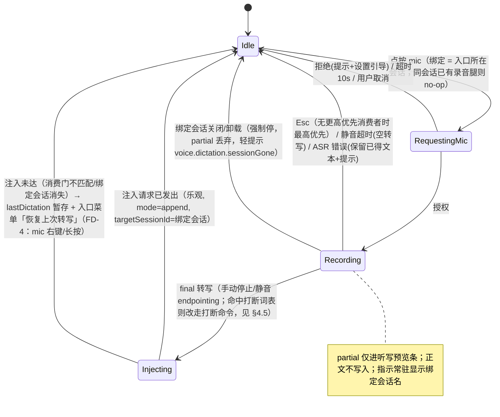
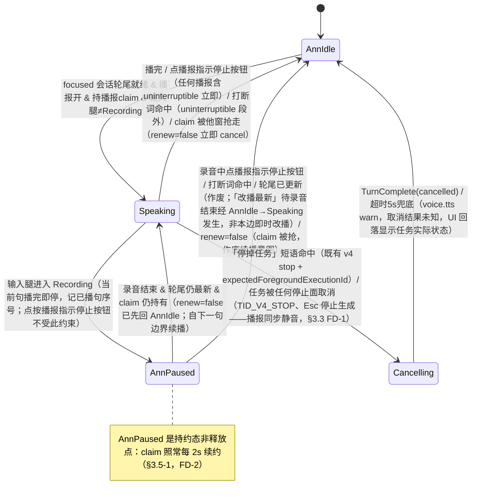
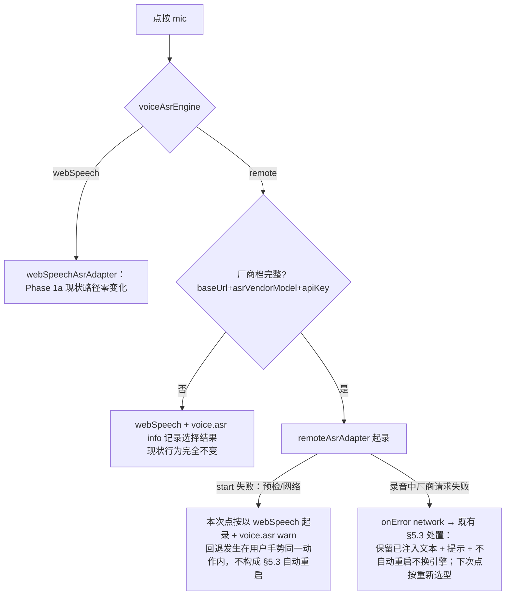

# Drora 语音 Agent 接入 Spec

- 日期：2026-10-22
- 状态：已立项、定稿。本文件是语音接入决策记录的冻结权威，**冻结范围 = 除正文标注「建议，待拍板」的条目与 §10 open/keptOpen 条目之外的全部决策**；`docs/voice-agent-integration-design-2026-10-22.md`（下称「设计报告」）保留为论证基础，其 §1.1 决策总表与 §1.2 不做清单自本文件起视为冻结，冲突处以本文件为准。
- 输入材料：设计报告（含附录 A 评审落实对照、附录 B 核验记录）+ 2026-10-22 待决点清单（14 项 extraGaps + 17 项 items）+ 2026-10-22 定稿评审（3 项矛盾消解、4 项补充缺口、1 项行号纠错；裁决记 FD-1~FD-7，见附录 A）。逐条裁决见附录 A。
- 证据约定：文中 `path:line` 为 2026-10-22 在本仓检出源码上实际读取核验所得（本核验记录见附录 B）；引用自设计报告前期勘察且本轮未复验的行号一律标注「未复验」。本 spec 为 spec 先行交付物，实现未开始，不含任何实现代码。

---

## 1. 背景与形态选型决策记录

### 1.1 形态路线（冻结）

**Phase 1 = A+B（端上 ASR 听写 + 轮尾 TTS 播报，全部 renderer 侧，零协议音频）→ Phase 2 = D 的事件语义（voice 来源契约、三层打断映射、任务运行中语音 steer/queue）→ Phase 3 = 完整 D 音频旁路（条件触发）。跳过 C（语音 peer 会话），不做 E（端到端 S2S）。**

依据（继承设计报告 §2，本 spec 采纳为冻结决策）：

1. D 所需的四项运行时预留 Drora 已全部具备，无需任何协议面预留：
   - **常驻会话**：CommandInbox 串行 admission + per-session FIFO + session resident pool；
   - **运行中指令注入**：turn-loop guide drain（`apps/drora-cli/packages/core/src/runtime/methods/turn-loop.ts:57-72`，本轮核验 `drainPendingRuntimeCommandsForActiveLoop` 与 `drainedSteerForNextRequest` 消费点）；
   - **三层取消**：foreground controller → turnAbortScope → call-runner AbortSignal 贯通 + stop 带 `expectedForegroundExecutionId` 防误杀（命中即 `throw new V4CommandNoopError("guard.stopTargetChanged")`，`session-flow.ts:346` 本轮核验）；
   - **进度事件**：SessionEventType 全集经 conversation topic 按 30ms/150ms profile 分发（`packages/shared/src/drora-protocol-v4/core.ts:35-60` `DELIVERY_PROFILES` 本轮核验：continuous `flushWindowMs:30, toolProgress:false`；replayable `flushWindowMs:150, toolProgress:true`）。
2. C 的存在理由（绕过常驻化改造）在 Drora 不成立；旁路会新开第二条输入面，与「turn 循环内 guide drain 是唯一内联插话机制」冲突，且与 admission 幂等（同 commandId 幂等 + settled LRU）打架。
3. E 放弃产品核心（工具生态/权限/owner/lease/审计全在文本侧）换对话体验天花板，上游对齐约束下属重依赖决策，无对应需求。
4. always-listening 后台监听不做（隐私红线）；语音自动提交与权限语音 allow Phase 1 均不做（防误发/防误授权，开放问题 OQ-4）。

### 1.2 relay rpc-frame 信封 1MiB 修正（评审 wrongClaims #1 落定）

设计报告已修正、本轮逐项复核属实：

| 常量 | 值 | 位置（本轮核验） |
|---|---|---|
| relay rpc-frame 信封上限 `MAX_PHYSICAL_FRAME_BYTES` | **1MiB**（缺省，无生产方 override） | `packages/relay-client/src/clock.ts:7`、`rpcFrameChannel.ts:71`（`maxEnvelopeBytes ?? MAX_PHYSICAL_FRAME_BYTES`） |
| 16MiB 的真正归属：v4 wire 层 `logicalFrameAssemblyMaxBytes` | 16MiB | `packages/shared/src/drora-protocol-v4/core.ts:67`（设计报告行号本就正确；本 spec 初稿漂移表误记「实际 :69」——:69 实为 `logicalFrameAssemblyMaxConcurrent: 32`，定稿轮复核纠正，见附录 B） |
| 高水位 `RELAY_SATURATION_HIGH_WATER_MARK_BYTES` | 1MiB | `packages/shared/src/relay-wire/constants.ts:9` |
| 重放缓冲 / 宽限 | 8MiB / 45s | 同文件 :13 / :15 |

修正后的论据**更强**：持续音频流会在秒级写满 1MiB 信封与高水位，随后写满 8MiB 重放缓冲触发 `RELAY_REPLAY_DEGRADED_BUFFER_EXCEEDED`，把文本控制面一起拖垮。故**不新增音频帧通道、不启用 binaryFrames（两处 hello 硬编码 false、无物理载体）、不新增 clientMode（`.strict()` 握手整条拒收老 Host 未知值）**。Phase 1/2 音频不过 relay、不过 v4 wire；Phase 3 音频走 Host 内 sidecar（照 `packages/desktop/src/host/remoteMediaPreviewProxy.ts` lease+TTL+并发上限先例，存在性本轮核验），届时独立 spec。

### 1.3 明确不做清单（Phase 1/2，冻结）

1. 无音频帧通道、无 WebRTC/实时音频栈（Phase 3 条件另议，音频不过 relay/v4 wire）。
2. 不启用 binaryFrames 能力位（启用即空承诺）。
3. 不新增 clientMode。
4. 无 always-listening、无后台监听；麦克风仅显式点按后开启。
5. 无语音自动提交：final 转写必经 composer 人工发送（OQ-4 跟踪）。
6. 无权限语音 allow：语音对权限请求 Phase 1 只播报不消费；Phase 2 至多 decline/cancel（待决策），allow 必须点按。
7. 无三层打断之第②层（按播放位置截断上下文）：CLI 无原语（`cancelled-stream-persistence.ts:16-17`「只 flush 已经到达本进程的 text/reasoning」本轮核验；实现 :37-53 只落快照内已有 text/reasoning）。开放问题 OQ-1/TV-2。
8. CLI 不承载 UI 语义：durable intent 只固化 `source={kind:"voice"}` 数据事实；「来自语音」等文案全部在 renderer i18n。
9. 自研代码不进还原目录、不内联进 `ConversationComposer`（2900+ 行收口文件）、不进 CLI runtime；`ChatPromptEditor` 保持纯 props 壳，语音态经 props 注入。

---

## 2. 契约与接缝

### 2.1 `packages/shared/src/contracts/voice.ts` 常量区（逐键清单）

照 `packages/shared/src/contracts/desktopPet.ts` 先例（对象常量 + 嵌套 channel 命名，本轮核验其结构）。**契约键单一出处**：以下字面量只在此定义一次，生产方与消费方引用同一常量；改名任何一侧前全链 grep 生产与消费（AGENTS.md）。

```ts
/** wire 契约：input-intent source kind 字面量。input-intent.ts 的 schema 以
 *  z.literal(VOICE_INPUT_SOURCE_KIND) 引用，禁止两处独立写字面量。 */
export const VOICE_INPUT_SOURCE_KIND = "voice";

/** appSettings 持久化键（validationAppSettings.ts schema 字段名与此一一对应，
 *  由 parity 单测钉住；见 §6.1）。 */
export const VOICE_SETTINGS_KEYS = {
  composerEntryHidden: "voiceComposerEntryHidden",
  announcementEnabled: "voiceAnnouncementEnabled",
  announcementVoice: "voiceAnnouncementVoice",
  announcementRate: "voiceAnnouncementRate",
  dictationLang: "voiceDictationLang",
  asrEngine: "voiceAsrEngine",
  toolBriefEnabled: "voiceToolBriefEnabled",
  privacyDisclosureAcknowledged: "voicePrivacyDisclosureAcknowledged",
} as const;

/** 跨窗口 claim 键（经既有 BroadcastHub 通用 claim 通道，Main 不解析语义）。 */
export const VOICE_BROADCAST_CLAIM_KEY = {
  announcement: "drora:voice-announcement-claim",
  /** 预留键（FD-7）：Phase 1 零生产/消费方，唯一潜在消费方 EG-7 keptOpen（§10）；
   *  随 EG-7 裁决启用或移除。Phase 0 的 dep:refs 同源断言不覆盖本键（§9.1）。 */
  mic: "drora:voice-mic-claim",
} as const;
```

**明确不进 contracts/voice.ts 的东西**：行为阈值（录音超时、简报限流窗口、claim 续约间隔、lastDictation TTL）是 renderer 行为参数而非跨进程契约键，放 `packages/ui/src/voice/voiceTuning.ts`，调参不牵动 shared 包；打断词表放 `packages/ui/src/voice/interruptionWords.ts`（UI 交互判定，不进 wire）。跨窗口偏好即时广播若 Phase 1b 实测 appSettings 既有同步不满足（跨窗口同步机制现状见 `packages/ui/src/store/codingPlanQuotaResetState.ts:75-85` sourceWindowId 防回环先例），届时再在此补 `drora:voice-preference-sync` 频道键——键先进常量区、消费方后接，避免撕裂。

### 2.2 `voiceInputSourceSchema` additive 扩展与 `.strict()` 偏斜方向

扩展点（本轮核验）：`packages/shared/src/drora-protocol-v4/input-intent.ts:31-47`，`conversationInputSourceSchema` 是 `.strict()` discriminatedUnion，现仅 `pluginUi`（:31-37）/`genUi`（:40-46）两个成员；`conversationInputIntentSchema.source` 已是 optional 字段（:115）。

```ts
export const voiceInputSourceSchema = z
  .object({
    kind: z.literal(VOICE_INPUT_SOURCE_KIND),
    /** BCP-47；听写发生时的 locale 快照（诊断面，不参与路由）。 */
    lang: z.string().min(1).max(35).optional(),
    /** 引擎标识；新增引擎 = additive 追加枚举成员，同样遵守 CLI 先行。 */
    engine: z.enum(["webSpeech", "remote"]).optional(),
  })
  .strict();
// 追加进 conversationInputSourceSchema 的 union 成为数组第三项。
```

**偏斜方向（关键，冻结）**：schema 是 `.strict()` discriminatedUnion，旧 CLI 收到 `kind:"voice"` 会整条拒收 sendText。落地顺序必须 **CLI 先行**（schema + admission 固化 + source 数据随既有投影面下发先合入，无任何文案），renderer 在 CLI 具备后才携带 source；灰度期内听写照常以纯文本发送（source 本就 optional），功能不受影响。方向是 **CLI→renderer，不可倒置**。偏斜安全先例：`packages/shared/src/drora-protocol-v4/transport.ts:355-356`「新方法天然偏斜安全——旧桌面根本不会调用它」（本轮核验）。不引入运行时探测/降级重发分支——桌面同仓同发 CLI，顺序门禁（PR 依赖声明）足够。

**固化不变量**：source 在 admission/drain 边界一次性写进 durable session_input 账本（`apps/drora-cli/packages/core/src/runtime/methods/input-intent-persistence.ts:5-9` 头注「在 admission/drain 边界一次性固化，后续消费者只能读取，不能重新猜测」本轮核验）；恢复后 renderer 按 `intent.source` 投译卡片文案。CLI 侧改动 = sendText 参数→intent 固化路径纳入 source（既有 `source` 字段透传不剥离）+ 投影面下发，Phase 0 实现时按 `session-flow.ts` 的 sendText admission 现状读码定位，schema 之外零新协议概念。

### 2.3 ASR/TTS 端口与播报规划器接口签名（签名级，不写实现）

```ts
// packages/ui/src/voice/voiceAsrPort.ts
export type VoiceAsrErrorCode =
  | "not-allowed" | "service-not-allowed"   // 权限 → 提示 + 设置引导
  | "network"                               // 网络 → 保留已注入文本 + 提示
  | "audio-capture"                         // 设备 → 设备检查提示
  | "aborted" | "no-speech";                // 同静音超时处理

export interface VoiceAsrStartParams {
  lang: string;        // BCP-47，跟随当前 locale，不硬编码（现状 speech-input.tsx:90 硬编码 en-US）
  hints?: string[];    // 打断词等偏置词，引擎支持时使用
}

/** 一次录音会话；端口实现负责 getUserMedia 约束
 *  { echoCancellation: true, noiseSuppression: true, autoGainControl: true }（全仓首批，现状 grep 零使用）。 */
export interface VoiceAsrSession {
  /** 手动停止（点按/Esc）：等待最终结果，resolve final 文本（可能为空串）。 */
  stop(): Promise<{ final: string }>;
  /** 丢弃式停止（错误/超时/绑定会话关闭）：不产生 final。 */
  abort(): void;
}

export interface VoiceAsrPort {
  isSupported(): boolean;
  /** 授权失败/引擎不可用 throw VoiceAsrError(code)。 */
  start(params: VoiceAsrStartParams): Promise<VoiceAsrSession>;
  /** partial 订阅；返回退订函数。partial 只进预览条（§5.1），永不上协议。 */
  onPartial(cb: (text: string) => void): () => void;
}
```

```ts
// packages/ui/src/voice/voiceTtsPort.ts
export interface VoiceTtsUtterance {
  text: string;
  lang: string;
  voice?: string;   // 系统音色名；缺省 = 系统默认
  rate?: number;    // 语速倍率，缺省 1
}

export interface VoiceTtsHandle { readonly utteranceId: string; }

export interface VoiceTtsPort {
  /** 单句合成播报；排队/分句策略归规划器，端口不排队。 */
  speak(u: VoiceTtsUtterance): VoiceTtsHandle;
  /** 无参 = 全停（点按播报指示停止按钮立即，任何状态含 uninterruptible 段——层①载体消歧见 §3.3 FD-1）。 */
  cancel(): void;
  /** 句边界推进回调（引擎支持 onboundary 时）；返回退订函数。
   *  reason="error" 时实现必须吞异常并落 voice.tts warn（照 taskNotificationSound.ts:19-42 吞 autoplay 异常先例）。 */
  onDone(cb: (handle: VoiceTtsHandle, reason: "end" | "cancelled" | "error") => void): () => void;
}
```

```ts
// packages/ui/src/voice/turnSpeechPlanner.ts —— 播报规划器
/** 只作 conversation 投影的消费者：轮尾正文取 ConversationTurnGroup 聚合同源
 *  （assistantTextRows，照 packages/ui/src/v4/assistantPreviewCards.ts:19-37 的
 *  join("\n\n") 聚合（join 链在 :34-37），与 assistantCopyText/复制文本一致），不建第二事件流、不建第二状态源。 */
export interface TurnSpeechPlannerDeps {
  getFocusedTurnTail(sessionId: string | null): { turnId: string; text: string } | null;
  tts: VoiceTtsPort;
  claim: VoiceAnnouncementClaimPort;
  isAnnouncementEnabled(): boolean;   // 照 taskNotificationPreferences.ts:33 reader 收口先例
}

export interface TurnSpeechPlanner {
  /** focused 会话轮尾终态就绪（TurnComplete）时调用；内部判定 claim/互斥/顺延规则。 */
  consumeTurnTail(turnTail: { turnId: string; text: string }): void;
  /** 输入腿进入 Recording：当前句播完即停（句粒度，§4.7 裁决）。 */
  notifyUserRecordingStarted(): void;
  /** 输入腿退出 Recording：轮尾仍最新 → 句边界续播；已更新 → 作废只播最新。 */
  notifyUserRecordingEnded(): void;
  /** 点按播报指示停止按钮（层①载体，非 TID_V4_STOP——§3.3 FD-1）：任何播报态（含 uninterruptible 段、AnnPaused）立即 cancel 回 AnnIdle，不取消任务。 */
  notifyStopPressed(): void;
  /** ASR final 命中打断词表：层①停播报不续播（uninterruptible 段外）。 */
  notifyInterruptWordHit(): void;
  /** 「停掉任务」命中：层③，发既有 v4 stop（带 expectedForegroundExecutionId）。 */
  requestCancelTask(): void;
}
```

```ts
// packages/ui/src/voice/voiceAnnouncementClaim.ts —— 单播报者 claim（经既有 BroadcastHub 通用 claim 通道）
export interface VoiceAnnouncementClaimPort {
  /** reserve+commit；false = 他窗持有。key = VOICE_BROADCAST_CLAIM_KEY.announcement。 */
  acquire(key: string): Promise<boolean>;
  /** 续约；false = 已被抢，调用方必须立即 tts.cancel() 回 AnnIdle（以 claim 为准校正本地态）。 */
  renew(key: string): Promise<boolean>;
  release(key: string): void;
}
```

### 2.4 `ComposerTextInsertRequest.mode="append"`（UI 包内部 additive，非 wire）

扩展点（本轮核验）：`packages/ui/src/store/droraSessionStoreTypes.ts:127-139`，`mode?: "replace" | "prepend-if-missing"`（:131），`targetSessionId` 消费门注释「主/辅 pane 可同时 focused，按会话定向保证单一消费者」。

- `mode` 增 `"append"`：正文为空 → 直接写入；正文非空且尾字符非空白 → 先补一个空格再追加（确定性规则，避免中英混排粘连；不覆盖用户已编辑内容）。生产方 Phase 1 仅语音。
- 同批适配 `SessionPane` 消费门匹配函数（按 `(targetSessionId ?? null) === (sessionId ?? null)` 既有匹配 + mode 分支），含单测「拼接不覆盖用户编辑」。

### 2.5 接缝清单（全部本轮核验存在）

| 接缝 | 位置 | 用途 |
|---|---|---|
| 听写逻辑先例（只复用逻辑、重写 UI） | `packages/ui/src/components/ai-elements/speech-input.tsx`（:90 lang 硬编码 en-US、:151-153 handleError 静默关闭、:287-303 裸色样式——三者均为本设计要修复的现状，无消费方） | WebSpeechAsrAdapter 逻辑来源 |
| 输入来源契约扩展点 | `input-intent.ts:31-47` | §2.2 |
| 定向注入消费门 | `droraSessionStoreTypes.ts:127-139` | §2.4、§3.4 |
| composer 按钮插槽 | `packages/ui/src/prompt-editor/ChatPromptEditor.tsx:65/:119`（leadingActions）、:67/:127（betweenCancelAndSubmitAction）、渲染点 :424/:450 | mic 按钮进 leadingActions |
| Esc 仲裁先例 | `packages/ui/src/v4/composer/escapeStop.ts:1-24`（dialog 路径忽略判定）、`ChatPromptEditor.tsx:226`（Esc→onCancel） | §4.4 键位仲裁 |
| 入口默认隐藏哲学 | `packages/ui/src/hooks/useCuaComposerEntry.ts:70-73`（`!== false` 判定 + 防闪烁注释）、:35-36（isWebRemoteControl） | §6.1 入口开关 |
| 轮尾文本聚合同源 | `packages/ui/src/v4/assistantPreviewCards.ts:19-37`（export :19，join("\n\n") 链 :34-37） | §4.1 播报内容 |
| 跨窗口 claim 先例 | `packages/desktop/src/main/broadcastHub.ts:24-25`（TTL 5000ms / retry 250ms）、:82-92（窗口关闭清理 reserved、commit 保留 + 过期清理） | §3.5 |
| 偏好 reader 收口先例 | `packages/ui/src/lib/taskNotificationPreferences.ts:33`、`taskNotificationSound.ts:19-42` | §6.1、§7.1 |
| 契约常量先例 | `packages/shared/src/contracts/desktopPet.ts` | §2.1 |
| appSettings 持久化先例 | `packages/shared/src/validationAppSettings.ts:527/:650`、`packages/shared/src/protocol.ts:293` | §6.1 |
| 权限自动处置先例 | `packages/ui/src/hooks/useTaskInteractionAutoResolutionSnooze.ts`（存在）、`packages/ui/src/v4/V4InteractionDialogs.tsx`（存在） | §4.6 |
| Host 内旁路先例 | `packages/desktop/src/host/remoteMediaPreviewProxy.ts`（存在） | Phase 3 |
| 停止按钮（层③既有面，**非层①载体**——FD-1） | `packages/shared/src/test-ids.ts:594` `TID_V4_STOP`、`packages/ui/src/v4/ConversationComposer.tsx:1442`（`canStop && !hasDraftToSubmit` 渲染条件）、:2504-2505（onClick=handleStopClick→onStop）、`packages/ui/src/v4/SessionPane.tsx:4594`（`handleStop("button")`，:5435 接线） | §4.3 层③、§3.3 FD-1 消歧 |
| 音频附件类型（Phase 3 才用） | `packages/shared/src/drora-task-types-core.ts:245/:274` `DroraPromptAudioAttachment` | Phase 1 不做音频附件发送 |

---

## 3. 状态所有者与状态机

### 3.1 状态所有者表（单一所有者，无第二写路径）

| 事实 | 所有者 | 说明 |
|---|---|---|
| partial/final 转写、录音态、绑定会话、lastDictation 暂存、ASR 错误态 | renderer `voiceSessionStore`（`packages/ui/src/store/voiceSessionStore.ts`，落 store/ 目录照 AGENTS.md 约定与 `composerAttachmentUploadStore` 先例，不做 feature-colocation 豁免） | 局部事实，不进协议；partial 亦不进 composer 正文 |
| 播报腿（annState、当前句序号、播报 claim 持有、uninterruptible 段标记） | 同上 | 纯 UI 态，不进 CLI 账本；跨窗口仲裁见 §3.5 |
| composer 正文 | Composer（唯一写入 = composerTextInsertRequest 通道，含 targetSessionId 消费门） | 语音生产方不绕过 requestId 版本号；final 文本自动随既有草稿机制持久化 |
| 会话事实（admission/queue/busy） | CLI CommandInbox | 语音=文本同路，无快速通道；partial 不逐条过 admission |
| busy 权威 | snapshot.control.canStop | 播报门禁复用，不另设 busy 判定（useCuaComposerEntry.ts:36 注释先例） |
| 偏好（§6.1 八键） | appSettings（validationAppSettings schema）+ reader 函数收口 | 跨窗口广播照既有机制，sourceWindowId 防回环（codingPlanQuotaResetState.ts:75-85 先例） |
| ASR final 输入事实 | CLI durable intent（source 一次性固化，无文案） | §2.2 |
| 音频 buffer | **禁入任何 store** | 录音结束即弃，零持久化 |

### 3.2 两条腿状态机（按本 spec 裁决更新）

原设计报告单张状态机把 Recording 与 Speaking 画成串联态，无法承载互斥规则。修订为**两条腿**，由 `voiceSessionStore` 单实例持有，互斥规则表（§3.3）链接。

**输入腿（听写）**——相对设计报告的更新：新增「绑定会话关闭」强制出边（EG-6 裁决）：



**播报腿（TTS）**——相对设计报告的更新：AnnPaused 暂停/续播定为**句粒度**（EG-9 裁决，§4.7）；Speaking 进入条件含「持 claim 且未被他窗抢走」；claim 续约贯穿 AnnPaused（FD-2，§3.5）；停止面按 FD-1 消歧（§3.3）：



### 3.3 互斥与裁决规则表（冻结）

| 规则 | 内容 |
|---|---|
| Recording 优先 | 输入腿 Recording 时播报腿不得处于 Speaking；已在播 → 当前句播完即停入 AnnPaused（句粒度，§4.7） |
| 顺延规则 | Recording 期间轮尾就绪 → 不立即播；录音结束时该轮尾仍最新 → 从句边界起播；期间已更新 → 作废旧轮尾只播最新。不排队多轮 |
| 停止面消歧（FD-1） | 两个停止面语义不同、永不合并：① **播报指示停止按钮**（AnnouncementIndicator 内，Phase 1b 新增，test id `TID_VOICE_ANN_STOP`）= 层①——任何播报态（含 uninterruptible 段、AnnPaused）点按立即 `tts.cancel()` 回 AnnIdle，零协议、不取消任务；轮尾正文播报（主场景：TurnComplete 后 canStop=false、`TID_V4_STOP` 不渲染）的唯一静音载体。② **`TID_V4_STOP`** = 既有 v4 stop（层③取消任务），渲染条件 `canStop && !hasDraftToSubmit`（ConversationComposer.tsx:1442）与点击链（:2504-2505 → SessionPane.tsx:4594）零改动，不挂任何语音逻辑；权限播报恰逢任务运行（canStop=true）时点按 = 取消任务 + 播报同步静音（经 Cancelling 边，§3.2），不为「只静音」改其语义。物理输入永远压倒语音通道 |
| uninterruptible 界定 | 仅约束语音打断词通道（权限内容播报段内语音「停」不生效，防回声与播报正文字误触发）；点按通道不受限 |
| Cancelling 兜底 | 5s 内无 TurnComplete 即回 AnnIdle + `voice.tts` warn。依据：guard.stopTargetChanged 命中是 throw V4CommandNoopError 无 ACK（session-flow.ts:346 本轮核验）；host 崩溃/断连同理 |
| Injecting 乐观 + 暂存 | composerTextInsertRequest 无回执类型（requestId 单向递增）；注入后乐观回 Idle，final 文本暂存 `lastDictation`（TTL 300s），入口菜单「恢复上次转写」（FD-4：mic 按钮右键/长按，§5.4）以新 requestId 重试；绑定会话消失走同一暂存路径 |
| 会话跟随 | 听写绑定 = mic 入口所在会话，录音期间不变；播报跟随 = 当前 focused；切换 focused 停旧播报；非 focused 完成 → 文字+未读徽标既有面，不播不排队 |
| 绑定会话生命周期 | 绑定会话关闭/删除/归档（composer 卸载）→ 强制停录音、partial 丢弃、轻提示；final 未注入的进 lastDictation。主/辅 pane 同会话双 mic 入口：同会话同时只允许一个录音腿，第二点按 no-op 并短暂高亮既有录音指示 |
| 单播报者 | 同 workspace 多窗口经 BroadcastHub claim 仲裁（§3.5），未持有者静默（UI 不出「其他窗口播报中」指示，Phase 1 从简） |
| 打断词 | 词表精确命中 OR en 词数阈值兜底；按 locale 配置 + 第三语言回退 en（§4.5）；命中的 final 不注入 composer |

### 3.4 会话绑定与播报跟随

`voiceSessionStore` 是全局单例，而 `ComposerTextInsertRequest.targetSessionId` 消费门明示「主/辅 pane 可同时 focused，按会话定向保证单一消费者」（droraSessionStoreTypes.ts:127-139 本轮核验）。因此：

- **听写绑定**：`dictationTargetSessionId` = mic 按钮所在 composer 的会话 id，按下即捕获，录音期间不变（含切换 focused）。final 经 `composerTextInsertRequest(targetSessionId=绑定会话, mode="append")` 定向注入——消费门保证单一消费者，**不存在插错会话的路径**。录音中切换 focused：不改绑定，录音指示常驻显示绑定会话名；此时 Esc 停录音（§4.4）。
- **播报跟随**：播报只跟随当前 focused 会话的轮尾正文。非 focused 会话 TurnComplete 不自动播报。focused 切换时正在播旧会话内容 → 立即停播；新 focused 会话若有就绪轮尾则从 AnnIdle 起播。多会话并行 TurnComplete：只播 focused 那个，不排队。

### 3.5 单播报者 claim（含续约与接管语义裁决）

「播放位置/播报中 = renderer 本地态」+ 偏好跨窗口广播，意味着不仲裁时桌面多窗口同 workspace 会叠音。

**机制（照 BroadcastHub 通用 claim 通道，零新协议）**：claim 通道已有 reserve/commit/release 三消息与过期清理（broadcastHub.ts:64-92 本轮核验；`BROADCAST_CLAIM_RESERVATION_TTL_MS = 5_000`、`BROADCAST_CLAIM_RETRY_MS = 250`）。播报 claim 与「完成提示一次性 claim」的语义差异及裁决：

1. **TTL 5s + 周期续约**： Speaking 与 AnnPaused 全程持 claim，每 2s `renew` 一次（约束：续约间隔 < TTL/2；数值初值如此，Phase 1b 多窗口实测后可在 voiceTuning.ts 调）。**AnnPaused 不释放 claim（FD-2）**：录音时长无上限、超 5s TTL 是常态，暂停期不续约会被他窗按规则 2「空窗即抢」抢走，录音结束经 AnnPaused→Speaking 直接续播即双窗叠音，违反单播报者。不用「commit 后永久持有」语义——窗口崩溃会泄漏 claim 导致所有窗口永久静音；TTL 过期即视为主播报者死亡。
2. **空窗即抢**：claim 过期不静默等待，任何窗口 `acquire` 成功即可开播（立即抢占）。不设随机退避（播报开始不是高频竞争面）。
3. **漂移校正以 claim 为准**：`renew` 返回 false（被他窗抢走，Speaking 或 AnnPaused 期间均可能）→ 本地立即 `tts.cancel()` 回 AnnIdle——AnnPaused 被抢则作废续播意图，录音结束后按顺延规则从 AnnIdle 重新竞争，不播「被抢」提示（Phase 1 从简）。
4. **release 时机**：AnnIdle、播报开关关闭、窗口关闭（Composer 卸载）三处 release；AnnPaused 是持约态不是释放点（FD-2）；窗口崩溃依赖 TTL 过期兜底。
5. mic 跨窗口互斥与播报 claim 复用同一机制与键空间（`VOICE_BROADCAST_CLAIM_KEY.mic`），Phase 1 仅产品约定 + 窗口内互斥，Phase 2 验证后决定是否启用（EG-7 keptOpen）。

**跨端（桌面+手机）**：不做强仲裁。手机播报为手动触发的本地 TTS（§8.2），桌面播报默认关，「默认关 + 手动触发」把叠音概率压到产品可接受；跨端仲裁列开放问题（OQ-3）。

---

## 4. 播报设计

### 4.1 播报内容分级表

**白名单闭集原则：只有下表「播」级内容可进入 TTS；新增任何播报内容必须先改本表再实现。**

| 级别 | 内容 | 数据源（同源约束） | 时机 | Phase |
|---|---|---|---|---|
| 播 | 轮尾正文 | ConversationTurnGroup 聚合 `assistantTextRows`（与 assistantCopyText/复制文本同源，assistantPreviewCards.ts:19-37 聚合方式，join("\n\n") 在 :34-37） | TurnComplete 终态后整段分句播，不跟流式 text_delta 中间态 | 1b |
| 播 | 权限请求内容摘要 | V4InteractionDialogs 既有 pending 队列条目的标题+问题文本 | 权限请求到达且播报开；到达时正在播正文/简报 → 当前句播完后插队进权限段（权限 > 正文 > 简报，句粒度让位，FD-3）；正在播权限段 → 新权限段排队背靠接连播（段间句隙不开放正文/简报）；播报前不触碰 interaction-registry 状态（§4.6 裁决）；超长截断至 200 字符 + 尾缀「内容已截断，请在卡片查看」；标记 uninterruptible 段（段 = 一次权限请求的完整播报，整段闭合，见 §4.2-5） | 1b |
| 播 | 工具简报（「正在编辑 foo.ts」） | ToolCall 行「从无到有」提交事件（见 §4.2） | 播报空闲插播，限流规则见 §4.2 | 2 |
| **永不播** | 工具 stdout/stderr、diff、日志等 chunk 级输出（tool output 行内容、streamOutputCap 内的增量） | — | — | 永久 |
| **永不播** | reasoning 内容与流式增量 | — | — | 永久 |
| **永不播** | 流式 text_delta 中间态（只播轮尾终态） | — | — | 永久 |
| **永不播** | partial 转写回读 | voiceSessionStore partial | 防回声自触发 + 隐私 | 永久 |
| **永不播** | 非 focused 会话的任何内容 | — | — | 永久 |
| **永不播** | 失败堆栈、诊断、内部错误详情 | — | — | 永久 |

### 4.2 工具简报合并限流规则（EG-1 裁决：合并窗基准=最近播出，已拍板）

代码事实（本轮核验）：`DELIVERY_PROFILES` continuous `flushWindowMs:30, toolProgress:false`、replayable `flushWindowMs:150, toolProgress:true`（core.ts:35-60）——桌面 renderer 收到的是 30ms 级 flush 的行提交，进度级增量（toolProgress 流）在桌面 continuous 上**不到达**。规则：

1. **触发源收窄**：简报只在 ToolCall 行「从无到有」（新工具调用开始）时生成一条候选；同一次调用的进度级更新不生成（桌面本就收不到；手机 replayable 收到的 progress 事件同样只用于行渲染，不生成简报候选）。
2. **同类时间窗合并（EG-1 拍板：窗口基准 = 该工具类最近一次实际播出时刻）**：同名工具在该类最近一次**实际播出**后 `sameToolMergeWindowMs = 10s` 窗口内的后续候选不上交，只把待上交目标持续刷新为最新（连续 Edit a.ts / b.ts → 只保留最新一次）；窗过期后由下一次快照驱动上交一条（仍受规则 3 间隔约束），被合并者不补播。拍板理由（防机关枪是本规则的目的）：若以「候选到达」为基准，首条候选即时上交后基准并不前移，同类后续候选每满 5s 间隔就各播一条——连续编辑 5 个文件会以 5s 间隔连报 5 条；以播出时刻为基准后，同类简报至多每 10s 一条（实现与守护：`toolBriefPlanner.ts` / `toolBriefPlanner.test.ts` 含 [5s,10s) 偏差区间用例）。
3. **最小间隔**：任意两条已播简报间隔 ≥ `minGapMs = 5s`；不足则丢弃，**不排队**（简报是可丢弃的增强信息，排队会造成播报积压）。
4. **只播最新**：窗口内多条候选只保留最新一条，被合并者不补播。
5. **不打断正文与权限段（FD-3）**：简报永不打断正在播的轮尾正文/权限内容；插播点仅限播报腿 AnnIdle 或**正文句间空隙**——让位条件 = 无待播正文**且无待播权限段**，二者齐备才消费。uninterruptible 段的粒度 = **整段**（一次权限请求的完整播报：标题+问题文本），权限段内句间空隙不开放简报插播（否则简报插进被标记 uninterruptible 的权限序列，打断词通道的失效窗口被拉长且边界模糊）；连续权限段背靠背连播，段间同样不插简报。
6. **上限**：每个 turn 简报 ≤ `maxPerTurn = 6` 条，超出静默丢弃；轮尾正文播报不受影响。
7. 文案模板：「正在 {action} {target}」（目标取工具输入中文件路径/命令首段，截断 40 字符）；i18n 键 `voice.brief.*`（§6.3）。

阈值常量落 `packages/ui/src/voice/voiceTuning.ts`（§2.1），Phase 2 真机调参不动契约。

### 4.3 三层打断映射表（对照现有 v4 stop 与事件集）

| 层 | 语义 | 触发 | 现有机制对照 | Phase |
|---|---|---|---|---|
| ① 停播报 | renderer 本地 `tts.cancel()`，任务不受影响 | 点按播报指示停止按钮（任何播报态含 uninterruptible，立即；FD-1——`TID_V4_STOP` 非层①载体）/ 打断词命中（uninterruptible 段外）/ claim 被抢 | 纯 renderer 行为，**不映射 v4 stop**，零协议 | 1b |
| ② 截断上下文 | 按播放位置截断被打断轮次已生成文本 | — | **CLI 无原语**：persistCancelledStreamSnapshot 只 flush 已到达本进程的 text/reasoning（cancelled-stream-persistence.ts:16-17/:37-53 本轮核验），被打断轮次已生成文本完整留在上下文。显式不做（OQ-1/TV-2） | 不做 |
| ③ 取消任务 | 取消当前 foreground 执行 | 仅「停掉任务」短语精确命中（§4.8） | 既有 v4 stop（`TID_V4_STOP` 同一命令面）带 `expectedForegroundExecutionId` 防误杀；命中 guard.stopTargetChanged 时 throw V4CommandNoopError 无 ACK → Cancelling 5s 兜底（session-flow.ts:346） | 1b |

D 语音网关所需事件集 ↔ Drora 现有机制的映射（设计报告 §2.1 四项预留的逐项落点）：实时输入通道 → CommandInbox 串行 admission（语音=文本同路，无快速通道）；运行中插话 → guide drain / steer / queue（`requestedDelivery=auto` 让 inputRouting 裁决；听写型输入不设 evidenceRefs，天然规避「带上下文禁 guide 回退 queue」分支，session-flow.ts:90-96 本轮核验）；打断 → 上表三层；进度 → SessionEventType 全集经 conversation topic 30ms/150ms profile（core.ts:35-60）。

### 4.4 键位仲裁表（录音态在 composer 域最高优先）

composer 域既有两处 Esc 消费（本轮核验）：`escapeStop.ts:1-24`（Esc→停止生成，`shouldIgnoreEscapeForStopGeneration` 的 dialog 路径忽略判定）与 `ChatPromptEditor.tsx:226`（Esc→onCancel）。仲裁按 composedPath 消费者判定：

| 优先级 | 场景 | Esc 归属 |
|---|---|---|
| 1 | Radix dialog 打开（`shouldIgnoreEscapeForStopGeneration` dialog 路径命中） | 弹层（关闭弹层），听写不受影响 |
| 2 | mention/补全菜单打开 | 关菜单（composer 内部既有消费），不停录音不停生成 |
| 3 | 录音中（无更高优先消费者） | **停录音**（stopPropagation），不触发停生成。理由：录音态下用户意图是结束拾音；误停任务代价高且 Stop 按钮始终可达 |
| 4 | 非录音态 | 既有语义不变（停生成 / onCancel） |

实现接缝（最小分支）：在 escapeStop 消费点与 ChatPromptEditor handleKeyDown 各加一处「voice 录音态优先」前置检查，不改 escapeStop.ts 纯函数本身。验收覆盖「mention 菜单开时 Esc 关菜单不停录音」「录音中 Esc 停录音且任务不中断」。

### 4.5 打断词表与语言扩展位（含 EG-5 第三语言回退裁决）

```ts
// packages/ui/src/voice/interruptionWords.ts（UI 交互判定，不进 wire）
export const VOICE_INTERRUPT_WORDS: Record<string, { exact: string[]; minWords?: number }> = {
  "zh-CN": { exact: ["停", "停下", "停止", "别说了", "取消"] },          // 1-2 字精确匹配即打断
  "en-US": { exact: ["stop", "stop it", "quiet", "cancel"], minWords: 3 },
};
export const VOICE_CANCEL_TASK_PHRASES: Record<string, string[]> = {
  "zh-CN": ["停掉任务"],
  "en-US": ["stop the task", "cancel the task"],   // 建议，待拍板
};
export const VOICE_INTERRUPT_FALLBACK = "en-US";   // 第三语言回退
```

判定语义（设计引用的 `MinWordsUserTurnStartStrategy` 本仓 grep 零命中，属外部来源，en 阈值语义据此处定义——建议，待拍板）：

- **zh-CN**：转写（trim 后）与词表项**精确相等** → 打断；否则正常听写注入。
- **en-US**：精确相等（大小写不敏感）→ 打断；词数 < 3 且未命中词表 → 视为噪声，丢弃（不注入、不打断，AnnPaused 正常续播）；≥3 词 → 正常听写注入。
- **第三语言回退（EG-5 裁决，建议，待拍板）**：locale 非 zh-CN/en-US 时整体回退 en-US 规则与词表（打断判定是加速器不是硬门槛，禁用语音打断的收益不抵体验损失）；新增语言 = 词表 map 加一项 + 本 spec 补记，结构已留扩展位。
- **命中的 final 不注入 composer**（打断词被语音命令通道消费）；「取消」∈通用词表 → 仅层① 停播报，不映射 UI 取消/任务取消/关闭弹层（§4.8）。
- 词表真机调优列开放问题（OQ-6）。

### 4.6 权限播报与 snooze（EG-2 code 裁决：设计报告 §4.6 断言不成立，本 spec 修订）

**读码裁决（本轮核验）**：设计报告 §4.6「既有 snooze 语义已支持」不成立——

1. auto-resolution 倒计时与 snooze 仅覆盖 `kind === "askUserQuestion"`：`interaction-registry.ts` register() 中 `autoResolutionEligible` 只对 askUserQuestion 置真（:126 一带），`snoozeAutoResolution` 入口 kind 门同样只认 askUserQuestion（:191-206，非该 kind 直接 return false）。**permission 类交互既无倒计时也无 snooze 入口**——「权限播报与倒计时竞争」在现实现上没有对象。
2. 现有 snooze 语义是「首次有效操作**永久**暂停」（:192-193 注释，state→snoozed 无 resume API），与「播报结束或用户处置后恢复倒计时」不匹配，无恢复型命令。

**本 spec 修订（冻结）**：Phase 1b 权限内容播报**不引入 snooze 联动**，语音通道不触碰 interaction-registry 任何状态。原 Phase 1b 验收项「权限内容播报开始时倒计时已 snooze」删除，改写为：「权限请求内容播报期间，askUserQuestion 类交互的既有 auto-resolution 行为不变；权限卡片点按动作始终可用且不受播报影响」。

**残余产品决策（keptOpen，见 §10）**：若未来给 permission 引入倒计时，需新设计 pause/resume 型 CLI 命令（additive）+ renderer 播报触发点；在此之前本条不重开。

### 4.7 AnnPaused 续播粒度（EG-9 裁决：句粒度，冻结）

设计报告两处表述（执行摘要「说完从断句处续播」/ §5.4「句边界暂停，记播放位置」）统一为：**播放位置以句为粒度（句序号），不记句内 charIndex**。

- 暂停请求（输入腿进入 Recording）在**当前句播完**时生效（最坏一句时长延迟）；记已播句序号。
- 续播从**下一句边界**起；不存在句内中断、半句重读、半句跳过三种行为中的任何一种。
- 点按播报指示停止按钮不受句边界约束（立即 cancel 当前句，FD-1 载体）——紧急静音永远可即时达成。
- 「断句处」一词按句边界解释。此裁决使 Phase 1b 验收「结束后续播最新轮尾」可测。

### 4.8 「停掉任务」确认与「取消」语义边界（EG-8 裁决，建议，待拍板）

1. **「停掉任务」属明确指令，Phase 1b/2 首版直接执行层③**，不做二次确认回路——语音追问需要重新开麦，链路长且引入新的误触发面；「停掉任务」是完整短语精确命中（不在通用打断词表内，见 §4.5 独立短语表），误命中面足够小。若 Phase 2 使用数据表明误取消真实发生，再评审确认形态（语音追问 vs UI 确认卡片）与超时回落策略。
2. **「取消」∈通用打断词表 → 仅层① 停播报**：不升级为取消任务、不关闭任何弹层、不触发 UI 取消语义——通用 UI 取消语义保留给点按通道。zh 词表含「取消」的价值只在播报场景的口语习惯，语义收窄到停播报是唯一无歧义解释。

---

## 5. 听写设计

### 5.1 写入规则（冻结）

- **partial 只进听写预览条，不写 composer 正文、不进协议**：正文在录音期完全归用户键盘；每句 final 以 `mode="append"` 追加进正文，连续多句顺序拼接，不覆盖用户已编辑内容。取舍：牺牲「实时落正文」的即时感，换取零写入冲突（与人工编辑、多句 replace 歧义两个事故面从构造上消除）。
- **转写保留在输入框由用户手动发送**（Phase 1 不做语音自动提交，防误发 + 发送前人工审阅，与隐私披露互为支撑）。转写未发送时随既有草稿机制持久化。
- 听写语言跟随当前 locale（zh-CN/en-US），不硬编码（修复 speech-input.tsx:90 现状）；`getUserMedia` 显式约束 AEC/NS/AGC = true。
- **打断词命中优先**：Recording 期间 ASR final 若命中 §4.5 词表 → 消费为打断命令，不注入 composer（AnnPaused 场景下「停」必须能生效而不是打进正文）。

### 5.2 听写预览条交互（EG-14 裁决，建议，待拍板）

- 预览条**只读展示** partial 与进行中的听写状态，不做点按编辑——编辑入口就是 composer 正文（final 已落正文，随时可改），双编辑面只会制造第二写路径。
- 预览条提供「清除」按钮：一键丢弃当前未定 partial 缓存（已落正文的 final 不受影响，那些已是用户正文）。
- **清空时机**：每句 final 注入发起即从预览条移除该句；录音结束时预览条随录音腿回 Idle 一并清空。
- **焦点互斥**：预览条不获焦（`tabindex={-1}`），录音中键盘焦点保持在 composer——Esc 仲裁（§4.4）因此不需要处理预览条分支。

### 5.3 RequestingMic 超时与 ASR 错误处置（冻结）

- 权限对话框被忽略/折叠 → **10s 超时**自动回 Idle + 轻提示（voice.dictation.requestingMicTimeout）；拒绝 → 提示 + 设置引导（IPlatformService optional 引导方法，照 openCuaPermissionOnboarding 模式，前期勘察未复验）。
- ASR 运行中失败：`not-allowed`/`service-not-allowed` → 权限提示 + 设置引导，回 Idle；`network` → **保留已注入文本** + 「语音服务不可用」提示，回 Idle；`audio-capture` → 设备检查提示；`aborted`/onend 无结果 → 同静音超时处理。**不自动重启**（防后台白跑与隐私顾虑），重试 = 用户再次点按。修复 speech-input.tsx:151-153 静默关闭的先例行为。

### 5.4 注入失败与 lastDictation

composerTextInsertRequest 无回执类型；注入后乐观回 Idle，final 文本暂存 `lastDictation`（TTL 300s），覆盖两条失败路径：消费门不匹配（§3.2 输入腿 Injecting→Idle 暂存出边）与绑定会话消失（§3.3 生命周期规则）。**「恢复上次转写」入口（FD-4）挂在 mic 按钮上**：lastDictation 非空且未过 TTL 时，mic 按钮右键（桌面）/长按（触屏）弹出单项菜单；左键点按仍是开始听写，不受影响。恢复以**新 requestId** 重试，目标 = 触发恢复的 mic 入口所在会话（原绑定会话已消失或消费门不匹配，重试不指向旧目标）；恢复成功即清空暂存。TTL 300s 过期后菜单项不再渲染（直接消失，不置灰）。乐观模型无法区分注入成败，菜单对两条失败路径同样可用，重复恢复产生重复文本属用户显式动作（语义同再次粘贴）。残余风险（记档不解决）：重试窗口内用户若已手动编辑正文，append 规则保证不覆盖，但文本顺序可能与口述顺序交错。

---

## 6. 设置面设计

### 6.1 voice 分节开关 × 默认值 × 持久化键 × 广播字段（EG-3 裁决，建议，待拍板）

新 `SettingsSectionId = "voice"`（settingsNavigation.ts:6-27 type union + isSettingsSectionId 联合守卫两处 additive，本轮核验现状无 voice；`packages/ui/src/SettingsPage.tsx:132` 引入处挂载），照 ComputerUseSection「能力+权限引导+设置项」先例。appSettings schema 字段落 `validationAppSettings.ts`（照 `computerUseComposerEntryHidden: z.boolean().default(true)` :527/:650 先例 + `protocol.ts:293` wire 面 optional 字段），键名与 `VOICE_SETTINGS_KEYS` 一一对应由 parity 单测钉住：

| # | 开关 | settings 键（= VOICE_SETTINGS_KEYS 值） | 默认值 | 跨窗口广播 |
|---|---|---|---|---|
| 1 | 听写入口（mic 按钮）显示 | `voiceComposerEntryHidden` | `true`（**隐藏**；`!== false` 判定照 CUA 哲学：新用户不闪按钮、不后台白跑权限查询，useCuaComposerEntry.ts:70-73 先例） | 是（appSettings 既有同步） |
| 2 | 播报总开关 | `voiceAnnouncementEnabled` | `false`（**关**） | 是 |
| 3 | TTS 音色 | `voiceAnnouncementVoice` | `""`（系统默认） | 是 |
| 4 | TTS 语速 | `voiceAnnouncementRate` | `1.0`（范围 0.5–2.0，step 0.1） | 是 |
| 5 | 听写语言 | `voiceDictationLang` | `""`（跟随 locale） | 是 |
| 6 | ASR 引擎 | `voiceAsrEngine` | `"webSpeech"` | 是 |
| 7 | 工具简报 | `voiceToolBriefEnabled` | `false`（Phase 2 生效） | 是 |
| 8 | 隐私披露已确认 | `voicePrivacyDisclosureAcknowledged` | `false`；**首次开启任一语音能力时必须先展示三条披露并显式确认**（FD-5：确认门覆盖两个开启入口——设置页任一语音开关的开启动作，以及入口可见但 `acknowledged=false` 时点按 mic 的兜底门，两入口共用同一 reader 守卫；确认后**中止本次动作**，再次显式点按才开始——与披露 3「仅点按后开启」一致，不做「确认即连续开录」；取消则开关回落 / 回 Idle） | 是 |

消费读取一律经 reader 函数收口（照 `isTaskNotificationSoundEnabled` taskNotificationPreferences.ts:33 先例：播放/入口消费点不直接读 store，保证设置关闭后运行时行为一致）。权限引导走 IPlatformService optional 方法；权限结果是一次性生产事件经同通道回报 renderer；Web/手机缺席即不出入口（能力探测，不写 UA 分支）。

### 6.2 隐私三条披露（zh/en 双语成稿，冻结进设置面）

设置 voice 分节固定披露三条（键 `voice.settings.privacy.asr / .persistence / .mic`）：

**zh-CN**

1. **语音识别引擎与数据去向**：听写默认使用浏览器/系统内置语音识别（Web Speech API），音频与转写由该引擎的云服务处理，Drora 不额外存储音频；若切换为其他引擎，此处会如实标注其数据处理方。**（2026-10-23 增补，§9.6.5 落地配套）配置云厂商 TTS 后，设置面数据流披露（voice.settings.vendor.dataHandler）如实标注：助手回复正文、权限请求摘要与工具简报目标会发送给该厂商处理。**
2. **口述文本的持久化与流转**：您确认发送后的口述内容与键盘输入完全同等对待——进入会话记录、可随会话导出或分享、不会自动删除。口述可能包含密码、路径等敏感信息，发送前请在输入框中审阅。
3. **麦克风边界**：麦克风仅在您点按麦克风按钮后开启，录音期间界面持续显示录音指示，按 Esc 或再次点按立即停止；Drora 没有任何后台监听或免提常开模式；日志不记录转写原文与音频数据。

**en-US**

1. **Speech recognition engine & data flow**: Dictation uses your browser/system built-in speech recognition (Web Speech API) by default. Audio and transcripts are processed by that engine's cloud service; Drora stores no audio itself. If another engine is added, its data handler will be disclosed here.
2. **Persistence of dictated text**: Once you send it, dictated text is treated exactly like typed text — it is stored in the session transcript, can be exported or shared with the session, and is not auto-deleted. Dictation may contain credentials or paths; please review it in the composer before sending.
3. **Microphone boundaries**: The microphone turns on only after you press the mic button, a recording indicator stays visible while recording, and Esc or a second press stops it immediately. Drora has no background listening or always-on mode; transcripts and audio are never written to logs.

另设输出设备披露（键 `voice.settings.announcement.outputDisclosure`）：「播报使用系统默认输出设备；蓝牙拔出或系统切静音可能转为外放。播报中点按播报指示上的停止按钮可立即静音。」/ "Announcements play through the system default output device; unplugging Bluetooth or muting the system may route audio to speakers. Press the stop button on the announcement indicator to mute immediately."（停止按钮实体 = 播报指示停止按钮，FD-1 消歧。）

### 6.3 用户可见文案 i18n 键清单（EG-4 裁决，建议，待拍板）

现状（本轮核验）：locale 为扁平 `Record<string, string>` 点分键（`packages/ui/src/i18n/locales/` 仅 en-US.ts / zh-CN.ts），`voice.*` 键零存量。统一 `voice.*` 命名空间，enforced-by-test 照 `packages/ui/src/team/i18n.test.ts:1-16` 三断言先例（双语键集一致 / 消费键存在非空 / 占位符同构），守护测试落 `packages/ui/src/voice/voiceI18n.test.ts`：

```
voice.settings.title / voice.settings.description
voice.settings.dictation.entry.label / .description
voice.settings.dictation.lang.label / voice.settings.dictation.lang.auto
voice.settings.asr.engine.label / voice.settings.asr.engine.webSpeech / voice.settings.asr.engine.remote
voice.settings.announcement.enable.label / .description
voice.settings.announcement.voice.label / voice.settings.announcement.voice.default
voice.settings.announcement.rate.label
voice.settings.announcement.outputDisclosure
voice.settings.toolBrief.enable.label / .description
voice.settings.privacy.title / voice.settings.privacy.asr / voice.settings.privacy.persistence / voice.settings.privacy.mic
voice.settings.privacy.acknowledge
voice.entry.mic.start.aria / voice.entry.mic.stop.aria / voice.entry.mic.tooltip
voice.dictation.preview.hint / voice.dictation.preview.clear
voice.dictation.requestingMic / voice.dictation.requestingMicTimeout
voice.dictation.error.permission / voice.dictation.error.network / voice.dictation.error.device / voice.dictation.error.aborted
voice.dictation.sessionGone
voice.dictation.restoreLast
voice.dictation.recordingIndicatorAria        # 占位符 {session} = 绑定会话名
voice.ann.indicator / voice.ann.indicatorAria
voice.ann.stop.aria                          # 播报指示停止按钮（FD-1 层①载体，Phase 1b）
voice.source.fromVoice                        # 「来自语音」/ "From voice"
voice.brief.prefix / voice.brief.truncated    # Phase 2，简报模板与截断尾缀
voice.interrupt.hint                          # Phase 2
```

「来自语音」投译规则：renderer 按 `intent.source.kind === "voice"` 投译（照 pluginUi「来自插件 X」先例的 renderer 侧）；CLI 账本零文案。

---

## 7. 日志与冷热等价

### 7.1 日志映射与分级（voice scope：info/warn/error 边界）

走 `packages/ui/src/logger.ts`（renderer 模块约定），scope 划分与级别边界：

| scope | debug（生产不落盘） | info | warn | error |
|---|---|---|---|---|
| `voice.asr` | partial 事件、endpointing 触发、打断词命中（**只记事件类型/文本长度/命中与否，不记转写原文**） | 适配器选择结果、引擎可用性探测 | onerror 错误码（network/audio-capture/not-allowed）、非静音超时的 onend | 适配器创建失败致入口不可用 |
| `voice.tts` | 句边界 boundary 事件 | 首次播报启动（引擎名+语言） | 播放失败（吞异常但落 warn + reason）、claim 竞争失败与被抢、Cancelling 5s 超时兜底 | —（播放失败不升级 error，属可恢复） |
| `voice.entry` | 门控判定中间值 | 权限授予/拒绝结果、设置变更生效 | 权限拒绝后的再次尝试、sendText 携带 source 被旧 CLI 拒收 | — |

硬边界：不落音频数据、不落转写原文到任何级别的日志（隐私边界，与 §6.2 披露一致）。

### 7.2 冷热等价不变量边界

| 进持久化（admission 固化/账本，冷恢复后可见） | 纯 UI 态（不进协议、不持久化） |
|---|---|
| final 转写文本（=普通 text 输入，随 session_input 账本与 user message 持久化，可随会话导出/分享——conversationShareItems 先例，`packages/ui/src/v4/conversationShareItems.ts`，SessionPane.tsx:7 消费） | partial 转写（「仅 live」事实，天然不进 snapshot/recovery，照 transport.ts:418-419 conversationTelemetryFact 注释先例）、录音态、绑定会话 id、ASR 错误态 |
| `source={kind:"voice", lang?, engine?}` 数据事实（§2.2） | 播报腿全态（annState、句序号、claim、uninterruptible 标记）、播报开关即时值（冷恢复按 settings 默认/持久值重读） |
| delivery/order/steer/dispatch 既有字段（不新增） | lastDictation 暂存、音频 buffer（**禁入**）、播放位置 |

- **TTS 产物零持久化**：冷恢复重放文字事实，不重播 TTS 音频；恢复后重播需消费端显式重新 TTS。
- **不变量**：冷恢复后用户看到的文字事实与热态一致；播报是否发生过不留任何冷态痕迹。

---

## 8. 身份、双语义与手机落位

### 8.1 身份（冻结）

语音订阅/命令复用 DroraWorkspaceRef（workspacePath + workspaceIdentity? + remoteSessionId? + workspaceKey），不新造身份格式；远程 workspace 缺 workspaceIdentity/remoteSessionId 即 throw（`packages/desktop/src/main/desktopMobileRelayProtocol.ts:399` 本轮核验）；不手写 workspaceKey 三元表达式，引用 resolveWorkspaceKey/connectionScope 既有工具。

### 8.2 desktop-continuous vs web-remote-replayable（双语义分叉验收）

- **桌面 continuous**：播报消费 30ms flush 流式路径（output.text/summaryText 可用，toolProgress 不到达——§4.2），轮尾终态整段播报。
- **手机 replayable**：流式仅 text 路径 + WebView autoplay 限制 → 播报 = 手动触发的本地 TTS 消费同一文字投影（Phase 2）；重连后语音会话以文字事实从 snapshot/resume 恢复，不重播。
- 音频腿（未来若有）重建而非续传。两种语义各自验收（AGENTS.md 要求同验）。

### 8.3 手机听写入口落位（TV-7 code 裁决：设计报告落位假设推翻）

**读码裁决（本轮核验）**：`packages/mobile-web/README.md:3` 明示「当前版本以 packages/web + packages/ui 为唯一页面实现」；生产宿主优先托管 upstream 官方 3.14.3 原始字节；设计报告引用的源码轨 `src/app`、`src/ui`、`src/intl` 在当前 checkout 的 `packages/mobile-web/src` 下不存在（实测仅 `recovered/`）。改 upstream 字节违反还原资产规则（AGENTS.md）。

**落位修订（冻结）**：手机语音入口 Phase 2 落在 **packages/web + packages/ui 的受控远控 composer 扩展**（isWebRemoteControl 判定放行 mic 入口，能力探测不写 UA 分支），不改 mobile-web upstream 字节、不新建源码轨。若受控入口实测不可行，需先过 DESIGN.md R3 与上游对齐评审再立项——在此之前手机听写不实施。链路不变：手机浏览器 getUserMedia → 本地 ASR（Chrome Android SpeechRecognition；iOS Safari 无 → Phase 1/2 缺席，OQ-5）→ 转写文本进远控 composer → 既有 web-remote-replayable 链路 → desktop Host 同一 CommandInbox。**音频从不过 relay，过线的是文本。**

---

## 9. 分阶段实施清单与验收

每个 Phase 的验收写成可执行断言级；「given/when/then」中状态名对应 §3.2 状态机。所有 Phase 共同门禁：`pnpm typecheck`、`pnpm lint` 实际执行并报告真实结果；UI 改动遵守 DESIGN.md token 规则（speech-input.tsx 的裸色样式是反面教材，不搬入）。

### 9.1 Phase 0：契约先行（CLI 先行合入）

**新建**

| 文件 | 内容 |
|---|---|
| `packages/shared/src/contracts/voice.ts` | §2.1 常量区（VOICE_INPUT_SOURCE_KIND、VOICE_SETTINGS_KEYS 八键、VOICE_BROADCAST_CLAIM_KEY 两键） |
| `packages/shared/src/contracts/voice.test.ts`（位置照该包测试现状） | 常量 parity：validationAppSettings voice 字段名集合 === VOICE_SETTINGS_KEYS 值集合 |

**修改**

| 文件 | 改动点 |
|---|---|
| `packages/shared/src/drora-protocol-v4/input-intent.ts` | + `voiceInputSourceSchema`（§2.2，kind 引用常量）并追加进 conversationInputSourceSchema |
| `packages/shared/src/validationAppSettings.ts` | + §6.1 八字段（含 default 值） |
| `packages/shared/src/protocol.ts` | + appSettings wire 面 optional 字段（照 :293 先例） |
| sendText admission→intent 固化路径（`apps/drora-cli/packages/bootstrap/src/drora-protocol-v4/commands/handlers/session-flow.ts` 及其调用的固化函数） | source 透传不剥离；实现时读码定位，schema 外零新协议概念 |
| intent→投影下发面 | source 数据随既有投影面下发（无文案） |

**验收（断言级）**

- `.strict()` 解析往返：`{kind:"voice",lang:"zh-CN",engine:"webSpeech"}` parse 通过；未知 kind / 多余字段整条拒收；`conversationInputIntentSchema.source` 收 voice source 后往返不变。
- 旧 renderer + 新 CLI 灰度：sendText 不带 source 照常受理（既有测试全绿即证）。
- 顺序门禁：renderer 携带 source 的改动 PR 依赖声明在本批之后（新 renderer + 旧 CLI 不出现的合并顺序保证）。
- 契约 parity 单测通过；`pnpm dep:refs --list-exports packages/shared/src/contracts/voice.ts` 确认生产/消费引用同一出处——断言范围为已有生产/消费方的键（`VOICE_INPUT_SOURCE_KIND`、`VOICE_SETTINGS_KEYS`、announcement claim 键）；`VOICE_BROADCAST_CLAIM_KEY.mic` 为 EG-7 预留键（FD-7），Phase 1 零生产/消费方，豁免本断言，随 EG-7 裁决启用或移除。

### 9.2 Phase 1a：桌面听写

**新建**

| 文件 | 内容 |
|---|---|
| `packages/ui/src/voice/voiceAsrPort.ts` | §2.3 ASR 端口 |
| `packages/ui/src/voice/webSpeechAsrAdapter.ts` | 复用 speech-input.tsx 逻辑、重写 UI；AEC/NS/AGC 约束；错误码映射 §5.3 |
| `packages/ui/src/voice/voiceComposerEntryState.ts` | 纯函数门控判定（照 useCuaComposerEntry 三段式） |
| `packages/ui/src/voice/useVoiceComposerEntry.ts` | 入口 hook（platform/services/settings 汇聚 + 权限门控懒查询） |
| `packages/ui/src/voice/V4ComposerVoiceEntry.tsx` | mic 按钮 + 录音态（token 化指示，禁裸色）+ lastDictation 恢复菜单（§5.4 FD-4：右键/长按单项菜单，TTL 过期不渲染） |
| `packages/ui/src/voice/DictationPreviewOverlay.tsx` | 听写预览条（§5.2） |
| `packages/ui/src/voice/voiceTuning.ts` | 行为阈值常量（10s 超时、lastDictation TTL 300s 等） |
| `packages/ui/src/voice/voiceI18nKeys.ts` + `voiceI18n.test.ts` | 消费键清单 + 双语守护（§6.3） |
| `packages/ui/src/store/voiceSessionStore.ts` | 输入腿状态 + lastDictation（§3.1） |
| `packages/ui/src/settings/VoiceSection.tsx` | voice 分节（含三条隐私披露与确认流） |
| `packages/desktop/src/main/voicePermissionPolicy.ts` | app 主窗口 session 的 media(microphone) 权限 handler，照 `embeddedBrowserPermissionPolicy.ts` 模式（现 main 仅 embeddedBrowser/pluginSandbox 两处 handler——前期勘察结论，本轮未逐行复验两文件行号） |

**修改**

| 文件 | 改动点 |
|---|---|
| `packages/ui/src/lib/settingsNavigation.ts` | type union + isSettingsSectionId +（如需默认隐藏语义则 HIDDEN set）+ "voice" |
| `packages/ui/src/SettingsPage.tsx` | voice 分节挂载（:132 引入区） |
| composer 组装侧（`packages/ui/src/v4/ConversationComposer.tsx` 的 leadingActions 构造，行级位置实现时确认） | 注入 V4ComposerVoiceEntry；不改 ChatPromptEditor 壳 |
| Esc 仲裁接缝（escapeStop 消费点 + `ChatPromptEditor.tsx` handleKeyDown） | 「录音态优先」前置分支（§4.4，单处分支） |
| `packages/ui/src/store/droraSessionStoreTypes.ts` | mode + "append"（§2.4） |
| `packages/ui/src/v4/SessionPane.tsx` | 消费门 mode=append 分支 |
| `packages/ui/src/i18n/locales/zh-CN.ts` / `en-US.ts` | §6.3 Phase 1a 键 |
| `packages/shared/src/platform.ts` + desktop host/web 实现 | IPlatformService optional mic 权限引导/结果回报方法（Web 缺席即不出入口） |
| `packages/ui/src/hooks/useCuaComposerEntry.ts` 同型的语音门控消费点 | 入口 hiddenBySettings 判定接 voiceComposerEntryHidden |

**验收（断言级）**

- given 入口已启用且非 isWebRemoteControl 且 ASR isSupported()，when 点按 mic，则 getUserMedia 约束含 echoCancellation/noiseSuppression/autoGainControl=true 且输入腿=Recording。
- given Recording，when partial 到达，则预览条更新且 composer 正文不变、零 v4 帧发送（mock transport 断言零调用）。
- when 句 final 到达，则 composerTextInsertRequest(mode="append", targetSessionId=按下时会话) 恰好一次；非空正文尾无空白时恰好插入一个空格。
- given 用户已手动编辑正文，when final 追加，则编辑保留且新句在尾部。
- when 连续 3 句 final，则正文按序拼接 3 段。
- given Recording 中切换 focused，when final，则注入目标仍为绑定会话。
- given Recording，when Esc，则录音停止、零 v4 stop 调用（任务不中断）；given mention 菜单打开，when Esc，则仅关菜单且录音继续。
- when 权限对话框 10s 无响应，则回 Idle + 轻提示。
- when ASR network 错误，则保留已注入文本 + 提示，且不自动重启。
- given final 未发送即刷新，则文本随 composer 草稿恢复。
- given isWebRemoteControl 或 isSupported()=false 或入口隐藏，则 mic 入口不渲染。
- given 绑定会话在录音中被关闭，则录音强制停止 + 轻提示 + 零注入。
- given `acknowledged=false`，when 点按 mic，则先展示三条披露且不进入 RequestingMic；显式确认后回 Idle（不自动开录），再次点按才开始录音；取消同样回 Idle（FD-5）。
- given `acknowledged=false`，when 在设置页开启任一语音开关，则开关保持关闭直至披露确认，确认后本次开启生效（FD-5）。
- given lastDictation 非空且未过 TTL，when mic 右键/长按，则出现单项「恢复上次转写」；when 点按该项，则以新 requestId 发出恰好一次 `composerTextInsertRequest(mode="append", targetSessionId=当前入口会话)`，暂存清空，正文尾部追加且不覆盖既有编辑（FD-4）。
- given lastDictation 超 TTL 300s，则恢复菜单项不渲染（FD-4）。
- given 主/辅 pane 同会话各持 mic 入口且 A 已在录音，when 点按 B 的 mic，则 B 侧 no-op 且 A 的录音指示短暂高亮；partial 只出现在 A 的预览条（FD-6）。
- 双主题 + 390px/1200px 快照；voiceI18n 守护测试通过。

### 9.3 Phase 1b：轮尾播报

**新建**

| 文件 | 内容 |
|---|---|
| `packages/ui/src/voice/voiceTtsPort.ts` + `speechSynthesisTtsAdapter.ts` | §2.3 TTS 端口 + Chromium 内建实现（仓内 speechSynthesis 零使用，绿地；云 TTS 同端口后置换） |
| `packages/ui/src/voice/turnSpeechPlanner.ts` | §2.3 规划器（分句、句粒度暂停/续播、顺延规则） |
| `packages/ui/src/voice/interruptionWords.ts` | §4.5 词表 |
| `packages/ui/src/voice/voiceAnnouncementClaim.ts` | §3.5 claim 端口（走既有 BroadcastHub claim 通道，零新协议） |
| `packages/ui/src/voice/AnnouncementIndicator.tsx` | 播报中指示（**行外 overlay**，见 TV-6 裁决）+ 专用停止按钮（层①唯一载体，FD-1：onClick → planner.notifyStopPressed()，test id `TID_VOICE_ANN_STOP`） |
| `packages/ui/src/lib/voiceAnnouncementPreferences.ts` | reader 收口（照 taskNotificationPreferences 先例） |

**修改**

| 文件 | 改动点 |
|---|---|
| `packages/ui/src/store/voiceSessionStore.ts` | + 播报腿状态 |
| `packages/shared/src/test-ids.ts` | + `TID_VOICE_ANN_STOP`（additive）；`ConversationComposer`/`SessionPane` 既有 stop 链路（ConversationComposer.tsx:1442/:2504-2505 → SessionPane.tsx:4594）**零改动**——`TID_V4_STOP` 不挂任何语音逻辑（FD-1，原「Stop 按钮处理点点按调 notifyStopPressed」方案废止） |
| `packages/ui/src/settings/VoiceSection.tsx` | 播报开关/音色/语速 + 输出设备披露 |
| locales | voice.ann.* / voice.source.fromVoice 等 |

**验收（断言级）**

- given 播报开 + focused 轮尾终态，则 TTS 逐句播报的全文 === assistantTextRows 聚合文本（与复制文本一致）。
- given Speaking，when 点按播报指示停止按钮（`TID_VOICE_ANN_STOP`），则 50ms 内回 AnnIdle 且零 v4 stop 调用（任务继续）；given 权限内容播报（uninterruptible 段），when 点按播报指示停止按钮，则同样立即停（FD-1）。
- given 权限内容播报且任务运行中（canStop=true，`TID_V4_STOP` 可见），when 点按 `TID_V4_STOP`，则既有取消任务语义不变（发出 v4 stop）且播报同步静音、经 Cancelling 回 AnnIdle；对照断言：零 `notifyStopPressed` 调用，播报静音不依赖层①路径（FD-1）。
- given 轮尾正文播报中（TurnComplete 后 canStop=false），则 `TID_V4_STOP` 不渲染，播报静音唯一载体为播报指示停止按钮（FD-1 主场景断言）。
- when 语音「停掉任务」，则发出既有 v4 stop 且携带 expectedForegroundExecutionId；TurnComplete(cancelled) 后 AnnIdle 且不再播。
- given stop 命中 guard.stopTargetChanged（无 ACK），则 5s 超时回 AnnIdle + voice.tts warn。
- given Speaking 时开麦，则当前句播完即停（句粒度）；录音结束且轮尾仍最新 → 自下一句续播；轮尾已更新 → 只播最新；不排队多轮。
- given 两个窗口同 workspace 且都开播报，则仅 claim 持有者出声；given 持有者窗口关闭，则另一窗口 5s 内可接管。
- given 非 focused 会话 TurnComplete，则零播报。
- given ASR final=「停」（AnnPaused 下），则停播报不续播且「停」不出现在 composer 正文。
- given 权限内容播报，则 askUserQuestion 类交互倒计时行为与不开播报时逐一致（interaction-registry 零新调用）。
- 播报中指示为行外 overlay：ConversationRowView 行组件的 memo/props 零变化（对照 git diff 断言）。
- 双主题 + 390px/1200px。

### 9.4 Phase 2：D 事件语义

**新建/修改**

| 文件 | 内容 |
|---|---|
| `packages/ui/src/voice/remoteAsrAdapter.ts` | MediaRecorder blob → 云 provider，经 services 注册（TV-1 spike 结果决定是否需要） |
| `packages/ui/src/voice/toolBriefPlanner.ts` | §4.2 简报合并器（同类 10s 窗 / 间隔 5s / 只播最新 / 空闲插播 / 每 turn ≤6） |
| 受控远控 composer（packages/web + packages/ui 受控面，§8.3 裁决落位） | 手机 mic 入口 + 手机本地播报手动触发 |
| `packages/ui/src/v4/V4InteractionDialogs.tsx` 扩展 | 权限语音 decline/cancel 消费（**待 OQ-4 拍板后实施**；allow 永远点按） |
| locales | voice.brief.* / voice.interrupt.hint |

**验收（断言级）**

- given agent streaming（busy），when 语音新指令，则 inputAccepted(guide|queue)，无第二条输入面、无旁路会话。
- given 手机 Chrome Android，when 远控听写，则转写经 relay → desktop CommandInbox 串行受理；抓包断言 relay 载荷零音频字节。
- given Speaking，when 语音「停」，则打断且播报正文字不误触发（真机，麦克风/噪声环境，OQ-6 数据同步采集）。
- given 无转写噪声（咳嗽），则静默观察后恢复播报（观察时长/恢复条件 Phase 2 设计时定，EG-11 keptOpen）。
- given 10s 窗内同工具 5 次调用，则简报 ≤1 条；given 正文播报中到达简报，则正文不被打断、简报在其后空闲插播；given 一个 turn 12 个工具调用，则简报 ≤6 条。
- given 权限段播报中到达简报（含两句权限内容之间的句间空隙），则简报不插播、权限段整段播完后 AnnIdle 才消费；given 正文播报中到达权限请求，则当前句播完即插播权限段（句粒度让位，FD-3）。
- 工具简报开关关闭时零简报。

### 9.5 Phase 3（条件触发，另立 spec）

触发条件：Phase 2 验证「用户要在 agent 跑工具时说话」核心假设。范围：音频留档（chatAttachments audio 序列化分支 + attachmentRead 白名单扩展 + artifact 引用，改动前全链 grep）与 Host 内实时双工旁路 sidecar（照 remoteMediaPreviewProxy lease+TTL+并发上限先例）。音频不过 relay/v4 wire；隐私合规（OQ-7）与自建 relay-server 对照在独立 spec 决策。验收由该 spec 定义。

### 9.6 Phase 2 批次一：厂商对接与接口完善（2026-10-23 增补，工作树 feat/voice-agent-phase1）

增补性质：本章在 Phase 1 落地（附录 C 记录的批次）之后，对 §9.4 Phase 2 清单做批次切分并裁决「厂商对接与接口完善」批次的全部设计面。**不改写任何既有冻结裁决**；本章新增裁决自增补日起纳入头部冻结范围，标注「建议，待拍板」条目除外。与 §9.4 的关系：本批次实施 §9.4 新建表中的 `remoteAsrAdapter`（原注「TV-1 spike 结果决定是否需要」——TV-1 是 Phase 1a SpeechRecognition 可用性 spike，与远程 ASR 无关，该注作废，以本章为准）与 `toolBriefPlanner`，以及 busy 语义验收；§9.4 的手机入口行、权限语音消费行（待 OQ-4）不在本批次（见 9.6.9）。证据约定同头部；本轮新增核验见附录 D。

#### 9.6.1 厂商与协议：第一适配面（裁决）

**裁决：第一适配面 = 「OpenAI 兼容音频端点族」整段 HTTP 批量（ASR: `POST {baseUrl}/audio/transcriptions`，TTS: `POST {baseUrl}/audio/speech`），多厂商经 baseUrl/model/apiKey 三元组可配置，不按厂商写死适配器；流式 WS 与非 OpenAI 兼容格式只留扩展位（9.6.4/9.6.9）。**

端点事实（本轮一手核验，详见附录 D）：

| 端点 | 认证/请求 | 模型与响应 | 出处 |
|---|---|---|---|
| `POST https://api.openai.com/v1/audio/transcriptions` | Bearer；multipart/form-data（file + model） | model ∈ {whisper-1, gpt-4o-transcribe, gpt-4o-mini-transcribe}；参数含 language/prompt/response_format（json/text/srt/verbose_json/vtt）；webm 在支持格式列表 | developers.openai.com API reference「Create Transcription」与 Speech-to-Text 指南（WebSearch 摘要，2026-10-23） |
| `POST https://api.siliconflow.cn/v1/audio/transcriptions` | Bearer；multipart/form-data（file + model） | model ∈ {FunAudioLLM/SenseVoiceSmall, TeleAI/TeleSpeechASR}；响应 `{"text": string}`；≤50MB / ≤1h | docs.siliconflow.cn「创建语音转文本请求」（webReader 全文抓取，2026-10-23） |
| `POST https://api.siliconflow.cn/v1/audio/speech` | Bearer；JSON（model/input/voice/response_format∈{mp3,opus,wav,pcm}/speed/gain/sample_rate/stream） | 响应 = 二进制音频；speed 0.25–4.0；文档样本模型 fnlp/MOSS-TTSD-v0.5，body 另有 CosyVoice2-0.5B 页签 | docs.siliconflow.cn「创建文本转语音请求」（webReader 全文抓取，2026-10-23） |

依据：

1. **批量形态与 v1 交互严格同构**：调研报告 §7.2 已核验 OpenAI Chat Completions 音频「整段音频进出（`input_audio` 分片 + `message.audio{data,transcript}`），非流式会话，适合异步整段」——push-to-talk 批量（9.6.4）正是整段进出；整段 HTTP 不引入任何会话/帧协议，与冻结 §1.2「不新增音频帧通道」同向。
2. **多厂商横移成本最低**：调研报告 §6.6 核验「端到端事件协议正向 OpenAI Realtime 风格收敛……学会一套事件族即可低成本横移多家供应商」——音频端点族同理；流式扩展位届时按同一事件族风格预留，不另造协议。
3. **默认厂商建议（建议，待拍板）**：SiliconFlow——双腿同域 OpenAI 兼容、ASR/TTS 模型即调研 §4.2 的 FunAudioLLM 系（SenseVoiceSmall / CosyVoice2，与 §1.3「全中文栈 FunASR+CosyVoice」血统一致），且 **CORS preflight 本轮实测放行**（`Access-Control-Allow-Origin: *`，附录 D）。备选：① OpenAI 官方 transcriptions（海外/英文优先；其 CORS 本环境不可达未能核验，引入前须过 OQ-8 spike）；② 任意自托管 OpenAI 兼容网关（自托管面即调研 §1.3 中文栈路线的自托管部署；FunASR/CosyVoice 仓库本身只核验到「runtime WebSocket 服务」等事实，其 OpenAI 兼容 facade 属实现侧工作，不在调研核验范围）。
4. **明确排除**：GLM-4-Voice 直连——调研 §4.2「2024-12 后停更」+ §4.5「商用需在开放平台登记」；MiniMax——调研 §6.2「未检索到公开的实时语音对话协议文档」，公开面仅 T2A 合成（可作未来 TTS 备选格式，v1 不做多格式适配）。开源权重自托管（SenseVoice/CosyVoice 仓库）不作为「厂商」，按备选②的自托管网关形态接入。

#### 9.6.2 凭据与配置面（裁决）

**裁决：复用既有两套存储，零新凭据机制——baseUrl/model 等**非秘密**配置进 appSettings（voice 键区 additive），apiKey 进 `ICredentialService`（host 侧加密凭据，renderer 经既有 `useCredentials` hook 读写）；不进 LLM provider registry，不进 appSettings 明文。**

证据与理由：

1. **不进 provider registry**：provider 配置域是 LLM 模型域——`providerApiTypeDataSchema` 枚举仅 `anthropic-messages / openai-chat-completions / openai-responses`（`packages/provider/src/config/provider-data-schema.ts:4-8`），连通性测试是模型测试（`providerFacadeServices.ts:67-71` testModelConnectivity），配置面（baseUrl/apiKey 编辑：`InlineEditableProviderCard.tsx:193/:241`、`ProviderDraftSave.ts:46-62`、`ApiKeyInput.tsx:20-40` password 形态）全部围绕 model membership 与 registry 资格。语音厂商档塞进去会牵动 model-selection/registry 语义，收益为零。**复用的是 pattern（baseUrl+apiKey 输入形态、配置/凭据分层），不是 registry 本体。**
2. **apiKey 不进 appSettings**：appSettings 全 schema 无任何 apiKey 字段（`validationAppSettings.ts` grep 零命中，附录 D）；appSettings 走 protocol.ts wire 面跨窗口同步，秘密不宜上 wire。
3. **既有凭据通道全链在仓**：契约 `ICredentialService`（`packages/services/src/credential/credential.ts:1-15`，实现端负责加密、renderer 只经 RPC）；实现为 app config 目录 `credentials.json` + cipherProvider 加密 + 跨进程文件锁（`credentialService.ts:19-34/:139-154`）；UI 既有消费 hook `useCredentials`（`packages/ui/src/hooks/useCredentials.ts:9-16`）与命名空间键先例 `oauth:${family}:access_token`（`useCodingPlanEntryPlanList.ts:49`）。
4. **配置键 additive 四枚**（进 `VOICE_SETTINGS_KEYS`，parity 单测同步扩展，照 `contracts/voice.ts:20-29` 现状）：

```ts
// contracts/voice.ts 本批次 additive：
vendorBaseUrl: "voiceVendorBaseUrl",      // 厂商档根地址（双腿共用），default ""
asrVendorModel: "voiceAsrVendorModel",    // ASR model id（如 FunAudioLLM/SenseVoiceSmall），default ""
ttsEngine: "voiceTtsEngine",              // "system" | "cloud"，default "system"
ttsVendorModel: "voiceTtsVendorModel",    // TTS model id，default ""
// 凭据键（持久化键前缀，AGENTS.md 契约键单一出处；照 oauth: 命名空间先例）：
export const VOICE_VENDOR_CREDENTIAL_KEY = "voice:vendor:api-key";
```

   `voiceAsrEngine` 既有枚举 `["webSpeech","remote"]`（validationAppSettings.ts:537/:669）不动；TTS 引擎新增 `voiceTtsEngine`。双腿共用单一厂商档（baseUrl + 一枚凭据）是 v1 裁决：默认厂商双腿同域（9.6.1），用户「换厂商」只改一档；双腿异厂商的拆档 = 后续 additive 加键（键先进常量区、消费方后接）。
5. **厂商档完整判定**（选型函数纯谓词，9.6.6 消费）：`baseUrl.trim() && asrVendorModel.trim() && apiKey.trim()`（TTS 腿用 `ttsVendorModel`）。设置面 = `VoiceSection.tsx` 内厂商档分组（照 model-provider-section 的 ApiKeyInput password 形态，凭据经 useCredentials 读写）；`remote` 引擎选项仅在 ASR 厂商档完整时可选（消除无实现/无配置的可选态，照 `VoiceSection.tsx:125-129` disabled 占位先例）。
6. **隐私边界延伸**：§7.1 硬边界（不落音频、不落转写原文）延伸到 apiKey 与 Authorization 头——任何日志级别不落凭据；厂商错误对象透传 message 前须确认不含请求头。§6.2 披露 1「若切换为其他引擎，此处会如实标注其数据处理方」在本批次落地：任一云引擎开启且 baseUrl 非空时，设置面渲染该 baseUrl 为数据处理方。

#### 9.6.3 网络通道：renderer 直连（裁决）

**裁决：语音厂商调用一律由 renderer 进程直连厂商（浏览器 fetch），不经 host 代理、不经任何 Drora 协议通道；音频在本机（桌面 Chromium / 浏览器）内直接到厂商。**

证据与理由：

1. **决定性约束（远程语义）**：web/手机远控的 host 服务通道经 relay；若厂商调用在 host 侧，音频必须走 renderer→relay→host，直接违反冻结 §1.2「Phase 1/2 音频不过 relay、不过 v4 wire」与 §8.3「音频从不过 relay，过线的是文本」。renderer 直连使桌面/远控/手机三 surface 同一路径，构造性满足两处冻结。
2. **renderer 直连外部 URL 有仓内先例**：`cloudLottieRuntime.ts:36`（外部资源 fetch，`credentials:"omit", redirect:"error"` + 2MB 上限）、`mcpStatusProbe.ts:51`（renderer fetch 探测**用户配置的任意 baseUrl**——与语音厂商档同构）。市场索引、更新检查、captcha solver 分别走 CLI/host/Main 进程（`packages/desktop/src/main/autoUpdater.ts`、`captchaSolverWindow.ts`），属 agent/宿主流量，不构成「外部 HTTP 必须代理」的先例。
3. **代理与证书免费继承**：桌面 defaultSession（app renderer 出口）已按设置页代理显式收敛（`desktopNetworkPolicy.ts:56-74` fallback `direct`，注释「Drora 自身对后端与模型 API 的出口，收敛到设置页的显式配置」；:103 setProxy；:107-110 自定义 CA verify proc）——renderer 直连的厂商流量自动走同一代理/CA 策略。host 侧 fetch 则是另一套 env 代理体系（`agentProxyEnv.ts:11-22` HTTPS_PROXY；`nodeApiNetwork.ts:99` 注释「Host 是独立 Node 进程，Electron Session.setProxy 不会影响它的 globalThis.fetch」）——语音若走 host，桌面（session 代理）与远程（env 代理不可达）行为必然分叉。
4. **可行性事实**：主 renderer 入口 `packages/web/index.html` 无 CSP meta（全文读取，connect-src 无限制）；全仓 `webSecurity` 无一处禁用（grep 仅两处显式 `true`：pluginSandbox/guestPolicy.ts:45、electronBrowserWebmRecorder.ts:298）。
5. **代价与缓解（如实记录）**：CORS 是每厂商属性，直连仅在厂商允许浏览器来源时可用——默认厂商已实测放行（9.6.1-3、附录 D）；其他厂商连接失败走回退树（9.6.6）+ warn，不阻塞功能。厂商 CORS/容器格式能力矩阵列 **OQ-8（新增，keptOpen）**，**TV-8（新增）：默认厂商端到端连通性 spike 为本批次实施前置**（真实凭据直调两端点 + 桌面 renderer 环境 CORS 实测；SiliconFlow transcriptions 的容器格式支持列表本轮未抓取到，MediaRecorder 产出的 webm/opus 可用性以 spike 为准）。

#### 9.6.4 远程 ASR v1 形态：push-to-talk 批量（裁决）

**裁决：v1 = 批量整段转写。录音期间 MediaRecorder 本机收集；`stop()` 时整段上传，响应文本经既有 `onFinal` 交付一次；`onPartial` 永不发射。流式 WS 只留扩展位。**

1. **final 语义不变**：适配器实现既有 `VoiceAsrPort/VoiceAsrSession` 契约（`packages/ui/src/voice/voiceAsrPort.ts:34-63`，Phase 1a 已含 additive 的 `onFinal/onError`），`stop(): Promise<{final}>`、`onFinal` 逐句通道、`onError` 错误码语义（§5.3）零改动；下游 `useVoiceDictation.ts:250-266` 的错误处置与注入链（mode=append + 打断词分类）零改动。`input-intent.ts` engine 枚举 `"remote"`（:46-64 voiceInputSourceSchema 已落地）不区分批量/流式，wire 语义不变。
2. **v1 行为差异（如实记录，非缺口）**：① 无 partial——听写预览条（§5.2）空转，清除按钮行为不变；② 打断词命中判定从「句级实时」（§5.1）退化为「stop 时对整段 final 判定」——判定点与分类逻辑不变，判定时机变化；push-to-talk 下开停由用户手势控制，可接受。媒体参数：`VoiceAsrStartParams.lang` 映射端点 language 参数（格式转换在适配器内）、`hints` 映射 prompt 偏置（端点支持时，如 OpenAI transcriptions 的 `prompt`），不支持即忽略（照 webSpeech 适配器对 hints 的先例，webSpeechAsrAdapter.ts 文件头）。
3. **流式 WS 扩展位**：`VoiceAsrPort` 不变；未来流式 = 新适配器成员 + 选型函数加分支 + engine 语义按需细化，协议形态按调研 §6.6 OpenAI Realtime 事件族风格（`session` / `input_audio_buffer.*` / `response.*`）预留——届时独立增补本 spec，不预写无依据的帧格式。

#### 9.6.5 云 TTS v1 形态（裁决）

**裁决：v1 = 逐句批量合成。`speechSynthesisTtsAdapter` 之外新增 `cloudTtsAdapter` 实现同一 `VoiceTtsPort`（`voiceTtsPort.ts:24-34` 零改动）；句切分/排队/暂停续播仍全部归 `turnSpeechPlanner`。**

1. `speak(u)` → `POST {baseUrl}/audio/speech`（JSON：`model=voiceTtsVendorModel`、`input=u.text`、`voice=u.voice ?? 缺省`（复用既有 `voiceAnnouncementVoice` 作为厂商音色 id）、`speed=u.rate ?? 1` 映射端点 speed 0.25–4）；响应二进制音频在 renderer 解码播放；`u.lang` v1 不映射（默认厂商模型自判定语种，调研 §4.2 CosyVoice 多语种）。
2. 引擎选择在**播报腿解析点**（AnnIdle→Speaking 进入、设置变更、renderer 装配）解析一次：`voiceTtsEngine="cloud"` 且 TTS 厂商档完整 → cloud；否则 speechSynthesis（Phase 1b 行为逐字段不变）。`useVoiceAnnouncement.ts:133` 现状硬编码 `createSpeechSynthesisTtsAdapter()` 是本批次唯一接线点。
3. 失败语义：单句请求失败 = 既有「跳过坏句继续推进」（`turnSpeechPlanner.ts:322-325`）+ voice.tts warn，**不在播报中途换系统引擎重播同一句**（避免同会话混音色）；连续 `VOICE_TTS_CLOUD_CONSECUTIVE_FAILURES`（voiceTuning.ts 新常量，初值 3，调参面不冻值）句失败 → 中止本轮播报回 AnnIdle + warn，本次 renderer 会话内后续播报回落 speechSynthesis，至下一引擎解析点恢复。引擎选择结果落 §7.1 既有 voice.tts info 槽位（首次播报启动记引擎名+语言）。
4. **数据流披露（§6.2 配套，2026-10-23 实施轮补记）**：cloud 引擎开启且厂商档完整时，设置面数据流披露（voice.settings.vendor.dataHandler）如实标注：助手回复正文、权限请求摘要与工具简报目标会发送给该厂商处理（发送面 = speak(u.text) 的全部文本来源；§7.1 硬边界不变——日志仍不落这些内容）。

#### 9.6.6 引擎选择与回退树（裁决）



- **未配置厂商 → 现有 web speech 行为完全不变**：选型纯函数（`packages/ui/src/voice/resolveAsrAdapter.ts` 新文件）对 webSpeech 路径返回既有适配器实例，行为差异为零；设置面 `remote` 选项档未完整时不可选（9.6.2-5）。
- **TTS 对称规则**（9.6.5-2/-3）：未配置 → speechSynthesis 完全不变；播报中厂商失败 → 跳句 warn，连续失败中止并回落。
- 选型结果与回退事件全部落 §7.1 既有槽位（voice.asr info=「适配器选择结果」、warn=错误码），无新 scope。

#### 9.6.7 工具简报与 busy steer/queue 落点（裁决确认）

1. **工具简报**：实现 §4.2 六规则合并限流（EG-1）——新建 `packages/ui/src/voice/toolBriefPlanner.ts`（同类 10s 窗 / 最小间隔 5s / 只播最新 / 每 turn ≤6 / 仅 AnnIdle 或正文句间且无待播权限段才插播 / 权限整段 uninterruptible 内外边界照 FD-3），阈值常量落 `voiceTuning.ts`（§4.2 已定调参面）；触发源 = ToolCall 行「从无到有」提交事件（§4.2-1，消费现有 conversation 投影，不建第二事件流）；开关消费走既有 `voiceToolBriefEnabled`（设置面开关与 i18n 键已落地：VoiceSection.tsx:63/:199-206、voiceI18nKeys.ts:57），缺的只有 planner 与播报腿消费接线；文案模板 `voice.brief.*`（§6.3 已预留）。
2. **busy 语音 steer/queue = 零新协议，走既有 CommandInbox admission**：语音 final 注入 composer 后由用户手动发送（§5.1 冻结不变），sendText 载荷**不带** `requestedDelivery`（SessionPane.tsx:3727 仅显式传参时携带）；CLI 侧 `session-flow.ts:88-99` 以 `payload.requestedDelivery ?? (routingMode==="guide" ? "guide" : routingMode==="enqueue" ? "queue" : "startNow")` 裁决，inputRouting=guide 时经既有 guide drain、enqueue 时进 queue——语音文本与键盘文本同路、无第二条输入面（§4.3 映射表既有裁决，本批次只做验收与回归，无 CLI 改动）。本批次不实施 CLI source 固化（附录 C 第 2 条 CLI-first 门禁维持，语音输入继续以纯文本发送）。

#### 9.6.8 本批次实现范围与逐条验收（裁决 f）

**范围清单（全部 `packages/ui/src/voice/` 模块内 + shared 契约 additive + VoiceSection 扩展，零还原文件改动、零 CLI 改动）**

| # | 交付物 | 内容 |
|---|---|---|
| S1 | `packages/shared/src/contracts/voice.ts` additive | VOICE_SETTINGS_KEYS 四键 + `VOICE_VENDOR_CREDENTIAL_KEY`；`contracts.test.ts` parity 扩展；`validationAppSettings.ts` persisted/patch 两 schema + `protocol.ts` wire 面 additive（照 :529-537/:666-668 先例） |
| S2 | `packages/ui/src/voice/remoteAsrAdapter.ts`（+test） | 9.6.4 批量 ASR；MediaRecorder 收集 → multipart 上传 → final/onError；错误码映射 §5.3 |
| S3 | `packages/ui/src/voice/resolveAsrAdapter.ts`（+test） | 9.6.6 选型纯函数 + `useVoiceDictation.ts:51` 单点接线（现状硬编码 createWebSpeechAsrAdapter） |
| S4 | `packages/ui/src/voice/cloudTtsAdapter.ts`（+test） | 9.6.5 云 TTS；`useVoiceAnnouncement.ts:133` 单点接线 + 连续失败回落 |
| S5 | `packages/ui/src/voice/toolBriefPlanner.ts`（+test） | 9.6.7-1 六规则合并限流 + 播报腿消费接线 |
| S6 | `VoiceSection.tsx` 厂商档分组 | baseUrl/model 输入（appSettings 四键）+ apiKey（useCredentials + ApiKeyInput 形态）+ `remote`/`cloud` 选项启用条件 + 数据处理方披露渲染 |
| S7 | i18n + 文档 | `voice.settings.vendor.*` 等新键进 zh/en + voiceI18n 守护；`packages/ui/src/voice/CONTRACT.md` 同步 |

共同门禁照 §9 头（typecheck/lint 实测报告）；TV-8 spike（9.6.3-5）为 S2/S4 实施前置。

**验收（断言级，逐条对应交付物）**

- S1：given 新 schema，parity 单测字段集合 === VOICE_SETTINGS_KEYS 值集合通过；patch schema 缺省时 persisted default 生效（voiceTtsEngine="system"）。
- S2：given engine=remote 且厂商档完整，when 说话后停止，则**恰好一次** `POST {baseUrl}/audio/transcriptions`（multipart file+model，Bearer 来自 ICredentialService），响应 `{text}` 经 onFinal 交付一次并注入 composer（mode=append，注入链与 webSpeech 逐字段一致）；全程零 partial；零 v4/relay 载荷含音频字节（mock transport 断言）。
- S2：given Recording 中厂商请求失败（网络错误/非 2xx），则 onError("network") → 保留已注入文本 + 提示、不自动重启、不换引擎续录；下次点按重新选型。
- S2：given 打断词命中整段 final，则消费为打断命令且不注入 composer（§5.1 判定点回归）。
- S3：given engine=webSpeech，则适配器选择返回既有 webSpeech 实例，Phase 1a 验收（§9.2）全量回归通过；given engine=remote 且厂商档任一字段为空，则解析为 webSpeech + voice.asr info；given engine=remote 档完整但 start 失败，则本次以 webSpeech 起录 + warn。
- S4：given ttsEngine=cloud 且档完整，when 轮尾终态，则逐句 POST `/audio/speech`（model/input/voice/speed 映射）且播报全文 === assistantTextRows 聚合；given 单句失败，则跳句 + warn 继续下一句；given 连续 3 句失败，则回 AnnIdle + warn 且后续轮尾回落 speechSynthesis；given ttsEngine=system，则 Phase 1b 验收（§9.3）全量回归通过。
- S5：given 10s 窗内同工具 5 次调用，则简报 ≤1 条；given 正文播报中到达简报，则正文不打断、简报空闲插播；given 一 turn 12 个工具调用，则简报 ≤6 条；given 权限段播报中（含段间句隙）到达简报，则不插播；given `voiceToolBriefEnabled=false`，则零简报（§9.4 既有简报验收并入本批）。
- S6：given 任一云引擎开启且 baseUrl 非空，则设置面渲染数据处理方（baseUrl）；given 档不完整，则 `remote`/`cloud` 选项不可选；apiKey 输入为 password 形态且任何日志零凭据（§7.1 延伸边界）。
- S7：voiceI18n 三断言守护通过（新键双语一致/非空/占位符同构）。
- busy steer/queue：given busy 且 inputRouting=guide，when 语音 final 注入后用户发送，则 sendText 无 requestedDelivery 字段且 CLI 裁决 inputAccepted(guide)；given inputRouting=enqueue，同路 → inputAccepted(queue)；given「停掉任务」命中（既有 voiceCommandBus 通道），when busy，则既有 v4 stop 带 expectedForegroundExecutionId（Phase 1b 回归断言）。

#### 9.6.9 明确不做与 keptOpen（裁决 g）

**本批次不做（对应清单/状态维持，不改既有裁决）**：

1. **barge-in AEC 真机验收**——EG-11（防误触参数/回声护栏真机数据）与 OQ-6 维持 keptOpen；本批次远程 ASR 批量形态无并行播报拾音场景，AEC 验收仍绑定 Phase 1b 词表真机验收执行时。
2. **原子 claim renew**——不引入原子续约原语；§3.5「TTL 5s + 周期 renew 2s + 以 claim 校正本地态」语义维持（EG-10 已闭环），重开条件 = 多窗口实测出现续约竞态双播。
3. **播报输出设备选择**——OQ-2 维持 keptOpen（需 Main 原生层设计）。
4. **手机端播报**——§8.2「手动触发的本地 TTS」形态裁决不变，本批次不实施；受控入口可行性 TV-7 维持 keptOpen。**手机 mic 听写入口同批延后**（§9.4 手机行延后，TV-7 前置勘察未做）。
5. **打断词表真机定稿**——OQ-6 维持 keptOpen；本批次沿用 §4.5 词表与 9.6.4-2 批量判定时机。
6. 流式 WS ASR、非 OpenAI 兼容格式适配器、TTS 逐句预取/缓存、双腿异厂商拆档——仅扩展位（9.6.1/9.6.4/9.6.5/9.6.2-4），实施前须增补本 spec。
7. 权限语音 decline/cancel（§9.4 待 OQ-4 拍板）、CLI source 透传（附录 C 第 2 条）——维持。

**新增 open 条目**：

| # | 问题 | 为什么暂不裁决 | 重新打开的触发条件 | 责任人角度 |
|---|---|---|---|---|
| OQ-8 | 厂商 CORS / 容器格式能力矩阵（OpenAI 直连 preflight 本环境连接超时未能核验；SiliconFlow transcriptions 支持格式列表未抓取到） | 每厂商属性，只能实测；默认厂商已放行，第二厂商未引入 | 引入任何非默认厂商前（含 OpenAI 官方） | Phase 2 实现者 |
| TV-8 | 默认厂商端到端连通性 spike（真实凭据直调 transcriptions/speech + 桌面 renderer 环境 CORS + MediaRecorder webm/opus 容器实测） | 需真实凭据与目标运行时，静态核验不足 | **S2/S4 实施前强制前置**（同 TV-1 之于 Phase 1a） | Phase 2 实现者 |

---

## 10. 开放问题清单（含触发条件与责任人角度）

| # | 问题 | 为什么暂不裁决 | 重新打开的触发条件 | 责任人角度 |
|---|---|---|---|---|
| OQ-1 | 三层打断第②层（按播放位置截断上下文） | 需协议级「按播放位置截断」CLI 原语设计，非读码可裁决；层①③已覆盖主路径 | Phase 2 使用反馈表明打断后上下文污染不可接受，或第②层立项 | CLI 协议设计者 |
| OQ-2 | 播报输出设备选择 /「仅耳机播报」 | Web speechSynthesis 无设备选择 API，需 Electron Main 原生层（枚举/强制路由）设计 | 外放泄露成为实际使用问题（如蓝牙拔出转外放泄露敏感内容） | Desktop Main 负责人 |
| OQ-3 | 桌面+手机跨端播报仲裁 | 「桌面默认关 + 手机手动触发」已把叠音压到产品可接受 | 双端叠音被实际使用反馈为问题 | 产品 |
| OQ-4 | 语音权限 allow、语音自动提交 | 产品决策：误授权/误发风险 vs 效率；Phase 1 维持不自动提交、allow 必须点按 | Phase 2 带使用数据拍板 | 产品 |
| OQ-5 | iOS Safari 语音 | 平台能力缺失 + 仓内无转写服务端（grep 核验 SpeechRecognition 仅 speech-input.tsx 一处） | iOS 远控语音需求被真实验证 | 产品 + 服务端 |
| OQ-6 | 打断词表定稿（zh 词集、en 阈值语义） | 需真机（麦克风/噪声环境）调优数据；en「≥3 词」语义为本 spec 自定义（外部策略零命中），待验证 | Phase 2 验收「中文『停』可打断且正文字不误触发」执行时 | 语音/产品 |
| OQ-7 | Phase 3 音频过 relay 的隐私合规 | 条件触发项；音频不过 relay 前无风险 | Phase 3 立项时，独立 spec 对照 `specs/mobile-relay-server.md` | 产品 + 架构 |
| TV-1 | Electron 41.0.3（packages/desktop/package.json:122）renderer SpeechRecognition 可用性 | 依赖 Chromium 内建语音服务的网络/地区可用性，需目标运行时实测 spike；直接决定 Phase 1a ASR 选型（备选 RemoteAsr / 本地 whisper，whisper 体积/许可另评） | **Phase 1a 启动前的强制前置 spike** | Phase 1a 实现者 |
| TV-2 | 第②层上下文污染的实际影响 | 「污染存在」已由 cancelled-stream-persistence.ts 证实；「影响多大」需实测 | 与 OQ-1 同源同触发 | CLI 协议设计者 |
| TV-3 | speechSynthesis 中英双语播报质量 | 音质需真机听测（Windows SAPI/macOS/Linux 参差）；云 TTS 立项属产品/上游对齐决策 | Phase 1b 轮尾播报启动前 | 产品 + Phase 1b 实现者 |
| TV-5 | Electron 无 mic 权限 handler 时的默认行为 | 二进制运行时行为且要求跨版本一致，静态读码无法裁决（electron.d.ts 权限 handler 文档段 :12193 起提示需配合 setPermissionCheckHandler，未写明缺省行为） | Phase 1a「main 新增 mic 权限 handler」实现前的 spike；方案无条件采纳「request + check 双 handler 都显式登记」 | Desktop Main 负责人 |
| EG-2 残余 | permission 倒计时的 pause/resume 型 CLI 命令 | 现 permission 无倒计时，无对象；引入即新协议面（additive pause/resume）+ renderer 播报触发点 | 决定给 permission 引入倒计时时 | CLI 协议设计者 + 产品 |
| EG-7 | mic 跨窗口强互斥 | Phase 1 单 active 语音端产品约定 + 窗口内互斥；机制已备（§3.5 claim 同通道同键空间） | Phase 2 多窗口实测出现双开麦 | Phase 2 实现者 |
| EG-8 残余 | 「停掉任务」二次确认形态 | 首版直接执行（§4.8）；确认形态（语音追问 vs UI 卡片）与超时回落需使用数据 | Phase 2 使用数据表明误取消真实发生 | 产品 |
| EG-11 | Phase 2 防误触参数（静默观察时长、barge-in 回声护栏算法/阈值） | 需 Phase 2 前置设计 + 真机数据；spec 只冻结「列为前置设计与验收项」 | 路线图第 5 步 Phase 2 设计时 | 语音算法 + 产品 |
| TV-4 残余 | media-chrome 进 renderer bundle 的体积影响 | 依赖事实已裁决（已是 @drora/ui 直接依赖 ^4.18.2，packages/ui/package.json:88；lock 钉 4.19.0，pnpm-lock.yaml:10045；唯一消费方 audio-player.tsx:18 import media-chrome/react）；语音模块**不 import media-chrome**，bundle 不因语音新增该依赖，故只剩存量体积问题 | Phase 1a 若有复用 ai-elements 音频资产的需求时做构建产物分析 | Phase 1a 实现者 |
| TV-6 残余 | 播报指示 overlay 的具体挂点与渲染性能 | 机制已裁决（行外 overlay，行组件 memo/props 零变化——ConversationRowView.tsx 现有 13 处 memo( 本轮核验）；挂点位置是工程选型 | Phase 1b「播报中指示」实施时（长会话滚动 + 播报并行渲染验证） | Phase 1b 实现者 |
| TV-7 残余 | 受控远控 composer 能否承载手机 mic 入口 | 落位已改判 packages/web+ui 受控扩展（§8.3）；受控入口可行性未实测 | Phase 2 手机听写实施前勘察；不可行则走 DESIGN.md R3 + 上游对齐评审再立项 | Phase 2 实现者 + 架构 |

已闭环不再跟踪：EG-1（§4.2 六规则拍板，合并窗基准=最近播出，守护测试含 [5s,10s) 偏差区间）、EG-9（§4.7 句粒度裁决冻结）、EG-10（§3.5 claim 机制冻结，参数留 voiceTuning 调优面）、EG-12（附录 B 漂移表落定）、EG-13（本文档即立项，设计报告状态改冻结属编辑性后续动作）、EG-14（§5.2 裁决，待拍板项随 Phase 1a 评审收口）、APP-1/2/3（附录出处登记，分别同 OQ-3/OQ-2/OQ-6，不重复展开）。

---

## 附录 A：待决点裁决记录

| id | kind | 裁决 |
|---|---|---|
| EG-1 | open→裁决 | §4.2 六规则拍板（合并限流修复轮）：触发源收窄到 ToolCall 行新增 + 同类 10s 合并（**窗口基准 = 该工具类最近一次实际播出时刻**——防机关枪：以到达为基准会退化为每满 5s 连报）+ 间隔 5s + 只播最新 + 不打断正文空闲插播 + 每 turn ≤6。窗内候选保留待上交、目标刷新为最新，窗过期由快照驱动上交；实现 `packages/ui/src/voice/toolBriefPlanner.ts`，守护 `toolBriefPlanner.test.ts`（含 [5s,10s) 偏差区间用例） |
| EG-2 | code | 设计报告 §4.6 断言不成立（snooze 仅 askUserQuestion、无 resume API）；Phase 1b 权限播报不触碰 interaction-registry，验收项改写；残余 pause/resume 决策 keptOpen |
| EG-3 | product | §6.1 八开关四列表（入口默认隐藏 / 播报默认关 / 隐私披露确认门）。**建议，待拍板** |
| EG-4 | product | §6.3 voice.* 命名空间 + 43 键清单（Phase 1a 39 + Phase 1b/2 4，含 FD-1 新增 `voice.ann.stop.aria`；定稿轮纠正初稿「35 键」误记）+ team/i18n.test.ts 三断言守护。**建议，待拍板** |
| EG-5 | product | 第三语言回退 en-US 词表 + en ≥3 词语义自定义。**建议，待拍板**；新增语言 = 词表 map 加项 + spec 补记 |
| EG-6 | product | 绑定会话关闭即强制停录音 + partial 丢弃 + 轻提示；final 悬空走 lastDictation；同会话双入口窗口内互斥。**建议，待拍板** |
| EG-7 | open | Phase 1 产品约定 + 窗口内互斥；claim 机制已备，keptOpen（触发：多窗口实测双开麦） |
| EG-8 | product | 「停掉任务」完整短语精确命中直接执行层③，不做二次确认；「取消」仅层①。**建议，待拍板**；确认形态 keptOpen |
| EG-9 | open→裁决 | 句粒度暂停/续播（§4.7 冻结）；两处表述统一，「断句处」=句边界；点按播报指示停止按钮不受句边界约束（FD-1 载体） |
| EG-10 | open→裁决 | claim 机制冻结（§3.5：TTL 5s + 续约 2s + 空窗即抢 + 以 claim 校正本地态 + 三处 release）；参数 Phase 1b 实测可调（voiceTuning.ts） |
| EG-11 | open | keptOpen（触发：Phase 2 设计时；责任人：语音算法 + 产品） |
| EG-12 | code | 行号复验完成，漂移见附录 B；本 spec 引用的行号全部为本轮核验值。定稿轮纠正：logicalFrameAssemblyMaxBytes 行为初稿误报——core.ts:67 正确（设计报告无误），初稿误记「实际 :69」 |
| EG-13 | open→闭环 | 本文档即立项；设计报告头部状态改「已冻结」属编辑性后续动作，不阻塞 |
| EG-14 | product | 预览条只读 + 清除按钮 + final 即清 + 焦点不转移。**建议，待拍板** |
| OQ-1 / TV-2 | open | keptOpen（CLI 无按播放位置截断原语；触发：Phase 2 反馈） |
| OQ-2 / APP-2 | open | keptOpen（需 Main 原生层；触发：外放泄露成为实际问题） |
| OQ-3 / APP-1 | open | keptOpen（默认关+手动触发缓解；触发：双端叠音反馈） |
| OQ-4 | product | 维持 Phase 1 现状（不自动提交、allow 必须点按），Phase 2 带数据拍板 |
| OQ-5 | open | keptOpen（iOS 平台缺失 + 无转写服务端；触发：iOS 需求真实验证） |
| OQ-6 / APP-3 | open | keptOpen（词表定稿需真机数据；触发：Phase 2 词表验收执行时） |
| OQ-7 | open | keptOpen（Phase 3 条件触发；届时独立 spec 对照 mobile-relay-server.md） |
| TV-1 | open | keptOpen（**Phase 1a 前强制 spike**，结果决定 ASR 选型） |
| TV-3 | open | keptOpen（真机听测 + 云 TTS 产品决策；触发：Phase 1b 启动前） |
| TV-4 | code | media-chrome 已装（ui:88 / share-ui:50 / lock 4.19.0），唯一消费方 audio-player；语音不新增其消费，体积残余 keptOpen |
| TV-5 | open | keptOpen（Phase 1a spike；方案已定：request+check 双 handler 显式登记） |
| TV-6 | code | 行外 overlay 裁决（行 memo/props 零变化）；挂点 keptOpen（Phase 1b 实施时） |
| TV-7 | code | 落位假设推翻，改判 packages/web+ui 受控扩展（§8.3）；可行性 keptOpen（Phase 2 前） |
| FD-1 | code | 定稿评审：Stop 语义三处互斥表述消解（§3.2/§3.3/§4.3）。层①载体 = 播报指示停止按钮（`TID_VOICE_ANN_STOP`，AnnouncementIndicator 内新增）；`TID_V4_STOP` 保持既有 v4 stop 语义与渲染条件（canStop && !hasDraftToSubmit）零改动，播报中点按 = 取消任务 + 播报同步静音；主场景（canStop=false）唯一静音载体为指示停止按钮；§6.2 披露措辞同步指明实体 |
| FD-2 | code | 定稿评审：AnnPaused 是持约态——claim 照常每 2s 续约（§3.5-1/3/4），renew=false 回 AnnIdle 作废续播意图；AnnPaused→Speaking 出边补 claim 前置，AnnPaused→AnnIdle 出边标注「改播最新」的实际时机（§3.2） |
| FD-3 | product | 定稿评审：播报优先级 权限 > 正文 > 简报（§4.1/§4.2-5）。uninterruptible 段粒度 = 整段（一次权限请求的完整播报）；权限段内/段间句隙不开放简报插播；正文/简报当前句播完后让位给权限段；连续权限段背靠接连播。**建议，待拍板** |
| FD-4 | product | 定稿评审：「恢复上次转写」承载面 = mic 按钮右键（桌面）/长按（触屏）单项菜单（§5.4/§9.2）：lastDictation 非空且未过 TTL 才渲染，过期即消失不置灰；恢复目标 = 当前入口所在会话，成功即清暂存。**建议，待拍板** |
| FD-5 | product | 定稿评审：隐私确认门覆盖两个开启入口（§6.1 开关 8/§9.2）：设置开关与点按 mic 兜底门共用同一 reader 守卫；确认后中止本次动作、再次显式点按才开始，不做「确认即连续开录」。**建议，待拍板** |
| FD-6 | product | 定稿评审：同会话主/辅 pane 双 mic 入口验收补齐（§9.2）：第二点按 no-op + 既有录音指示短暂高亮 + partial 归属发起 pane。**建议，待拍板** |
| FD-7 | code | 定稿评审：`VOICE_BROADCAST_CLAIM_KEY.mic` 标注为 EG-7 预留键（§2.1）：Phase 1 零生产/消费方，§9.1 dep:refs 同源断言豁免该键，随 EG-7 裁决启用或移除 |

## 附录 B：核验记录（2026-10-22，本 spec 撰写轮）

**本轮实际读取核验的证据**（grep/read 命令与输出见会话记录）：

1. relay：`packages/relay-client/src/clock.ts:7`（1MiB）、`rpcFrameChannel.ts:71`（缺省信封）、`packages/shared/src/relay-wire/constants.ts:9/:13/:15`（1MiB/8MiB/45s）、`packages/shared/src/drora-protocol-v4/core.ts:35-60`（DELIVERY_PROFILES）、:67（16MiB；初稿误记 :69——:69 实为 `logicalFrameAssemblyMaxConcurrent: 32`，定稿轮复核纠正，见下方漂移表）。
2. 协议：`input-intent.ts:31-47/:115`、`transport.ts:355-356/:418-419`、`drora-task-types-core.ts:245/:274`、`test-ids.ts:594`、`validationAppSettings.ts:527/:650`、`protocol.ts:293`。
3. CLI：`interaction-registry.ts` register()（autoResolutionEligible 仅 askUserQuestion）与 snoozeAutoResolution（:191-206 kind 门 + 「首次有效操作永久暂停」注释 :192-193）、`session-flow.ts:90-96/:346`、`turn-loop.ts:57-72`（methods/ 子目录）、`input-intent-persistence.ts:5-9`（core/src/runtime/methods/）、`cancelled-stream-persistence.ts:16-17/:37-53`。
4. UI：`droraSessionStoreTypes.ts:127-139`、`speech-input.tsx:90/:151-153/:287-303`、`escapeStop.ts:1-24`、`ChatPromptEditor.tsx:65/:67/:119/:127/:226/:424/:450`、`useCuaComposerEntry.ts:35-36/:70-73`、`assistantPreviewCards.ts:19-37`（export :19，join("\n\n") 链 :34-37；初稿引 :20-34 未覆盖 join 行，定稿轮纠正）、`ConversationRowView.tsx`（13 处 memo( ）、`ConversationComposer.tsx:2505`、`team/i18n.test.ts:1-16`、`taskNotificationSound.ts:19-42`、`taskNotificationPreferences.ts:33`、`codingPlanQuotaResetState.ts:75-85`、`SessionPane.tsx:7`（conversationShareItems 消费）、`SettingsPage.tsx:132`、`settingsNavigation.ts:6-27/:48-60`。
5. Desktop：`broadcastHub.ts:24-25/:64-92`、`desktopMobileRelayProtocol.ts:399`、`packages/desktop/package.json:122`（electron 41.0.3）、`remoteMediaPreviewProxy.ts` 与 `embeddedBrowserPermissionPolicy.ts`/`pluginSandbox/session.ts` 存在性。
6. grep 零命中：`speechSynthesis`、`echoCancellation`（产品源码）、`MinWordsUserTurnStartStrategy`；locale 目录仅 en-US/zh-CN 且 voice.* 零存量；`packages/mobile-web/src` 仅 `recovered/`。
7. 前期材料引用、本轮未复验：`openCuaPermissionOnboarding` 模式细节、`useComposerAttachments.ts:92`、`useCuaComposerEntry.ts:109-113`、`conversationProjectionStore` 行号、electron.d.ts setPermissionRequestHandler 缺省行为文档（仅核验 :12193 起的 check-handler 配套提示）。

**相对设计报告附录 B 的行号/路径漂移表**（EG-12 裁决产物，本 spec 已按核验值引用）：

| 项 | 设计报告写法 | 本轮核验 |
|---|---|---|
| SettingsPage | `SettingsPage.tsx:75-95`（隐含 v4/ 下） | 实际 `packages/ui/src/SettingsPage.tsx`，settingsNavigation 引入在 :132 |
| ChatPromptEditor 渲染点 | :423/:450 | :424/:450（:423 为注释行） |
| turn-loop | `turn-loop.ts:57-72` | 路径为 `runtime/methods/turn-loop.ts`，行号成立 |
| input-intent-persistence | bootstrap/drora-protocol-v4/ 下 | 实际 `packages/core/src/runtime/methods/input-intent-persistence.ts` |
| drora-task-types-core | `drora-protocol-v4/` 下 | 实际 `packages/shared/src/drora-task-types-core.ts` |
| logicalFrameAssemblyMaxBytes | core.ts:67 | **初稿误报**：定稿轮复核确认设计报告 :67 正确——初稿误记「实际 :69」，该行实为 `logicalFrameAssemblyMaxConcurrent: 32` |
| desktopMobileRelayProtocol | :397-409 | 实际 `packages/desktop/src/main/`，throw 在 :399 |
| broadcastHub claim 细节 | 仅 :24 TTL | 另有 :25 retry 250ms 与 :82-92 reserve/commit/清理语义（对 §3.5 裁决有直接影响） |
| electron.d.ts | :12911-12915 | setPermissionCheckHandler 文档段实测在 :12193/:12216/:12243 |

**定稿轮补核（2026-10-22，FD-1~FD-7 裁决依据，本轮实际读取）**：

8. `packages/shared/src/drora-protocol-v4/core.ts:65-77`：:66 `maxFrameBytes: 1024*1024`、:67 `logicalFrameAssemblyMaxBytes: 16*1024*1024`、:68 `logicalFrameAssemblyMaxFragments: 1024`、:69 `logicalFrameAssemblyMaxConcurrent: 32`——据此纠正初稿漂移表对 :67/:69 的误报。
9. `packages/ui/src/v4/ConversationComposer.tsx`：:1442 `showStopControl = canStop && !hasDraftToSubmit`（Stop 按钮渲染条件）、:1938-1945 `handleStopClick` → `runUserAction({operation: onStop, completed: {resultSource: "optimistic_projection"}})`、:2498-2511 按钮渲染块（:2504 onClick、:2505 `data-testid={TID_V4_STOP}`）。
10. `packages/ui/src/v4/SessionPane.tsx`：:4594 `handleStopFromButton = useCallback(() => handleStop("button"))`、:5435 `onStop={handleStopFromButton}`——TID_V4_STOP 点击链终结于既有 v4 stop 动作。
11. `packages/ui/src/v4/assistantPreviewCards.ts:19-37`：`export function buildAssistantPreviewCardsForAssistantTextRow` 在 :19，`join("\n\n")` 聚合链在 :34-37。
12. `knip.json` 全文读取：无 contracts/ 专项 ignore；`desktopPet.ts` 导出有 5 个消费文件（desktopPetMenu/desktopPetConfiguration/desktopPetLibraryPort/desktopPetLibrary/desktopPetNativeInteraction）——`VOICE_BROADCAST_CLAIM_KEY.mic` 因对象整体被 announcement 消费方引用而不会触发未使用导出告警，「死键」是语义面而非 lint 面，仍按 FD-7 标注预留。

## 附录 C：实施批次记录（2026-10-23，范围修订与落地状态）

本附录记录正文清单各条目的落地状态与范围修订，是 AGENTS.md「新增或修改行为前，先更新对应 spec」的实施侧记录；不改写正文冻结决策，仅标注偏差与后续条件。

1. **§9.2 / §5.3 IPlatformService 权限引导方法——转后续批次**：Main 侧已落地 `packages/desktop/src/main/voicePermissionPolicy.ts`（§10 TV-5 方案：request + check 双 handler 显式登记；media audio 允许、含 video 拒绝、其余权限保持无 handler 时代自动批准现状），app 主窗口 session 权限面已成显式代码决定。但 renderer 的权限拒绝→设置引导跳转所依赖的 `IPlatformService` optional 引导方法（§5.3/§9.2 修改表）尚未实现，当前权限拒绝仅有 `voice.dictation.error.permission` 提示文案、无引导动作。该项与「权限结果一次性生产事件经同通道回报」（§6.1）合并为同一跨进程批次，实施前 §5.3 的「设置引导」分支以提示文案代位。
2. **§9.1 CLI 两项（sendText admission→intent 固化的 source 透传、intent→投影下发面）——未实施**：Phase 0 的 shared 侧（contracts/voice.ts、input-intent voiceInputSourceSchema、validationAppSettings 语音八键、protocol.ts wire 面）已落地；CLI 侧两项待独立批次读码定位实施。在 CLI 侧合入前，**携带 source 的 renderer 改动不得合入**（§2.2 偏斜方向 CLI→renderer 的顺序门禁保持有效）；当前听写以纯文本发送（source 缺省），功能不受影响。
3. **§10 TV-1（Electron renderer SpeechRecognition 可用性 spike）——未执行**：需目标运行时真机实测（桌面 app 启动 + getUserMedia/SpeechRecognition 探针），本仓实施环境无法运行 Electron 桌面端。TV-1 保持「Phase 1a 听写入口真机验证前的强制前置项」；若 spike 结论为不可用，Phase 1a ASR 按 §10 备选（RemoteAsr/本地 whisper）另评。
4. **§9.2/§9.3 验收末条（双主题 + 390px/1200px 快照）与交互 E2E——未交付**：需桌面 E2E 基建与真机运行。已交付的单测面：§4.4 Esc 仲裁顺序（composerEscapePlan 纯函数 + SessionPane/ChatPromptEditor 接线）、§3.3/FD-6 入口互斥（voiceSessionStore + useVoiceDictation wiring）、§9.3 层①/层③命令通道（voiceCommandBus + planner/wiring）。快照与 E2E 场景在桌面 E2E 基建批次补齐。
5. **§6.1 语音八键 appSettings 持久化——已提前落地**（原列 §9.1 Phase 0 修改表）：validationAppSettings persisted/patch 两 schema + protocol.ts wire 面 + parity 单测（contracts/contract.test.ts），Phase 1a 设置面（VoiceSection）与入口 reader 已消费。

## 附录 D：§9.6 增补核验记录（2026-10-23，工作树 feat/voice-agent-phase1 检出）

**本轮实际读取的仓库证据**（grep/read 于 D:/workspace/projects/drora-voice-agent）：

1. **provider 配置与 API key 模式**：`packages/provider/src/config/provider-config.ts:36-70`（ApiKeyAccessConfig：type/apiKey/apiKeyManagementUrl）、`:131-164`（ProviderApiConfig：type/baseUrl/headers）、`provider-data-schema.ts:4-8`（providerApiTypeDataSchema 仅 anthropic-messages/openai-chat-completions/openai-responses 三文本格式）、`:32-45`（apiKeyAccessDataSchema）；UI 读写链 `packages/ui/src/lib/providerApiKeyPersistence.ts:13-63`（经 IProviderSettingsService getView/savePersonalProviderOverlay）；服务契约 `packages/services/src/model-provider/providerFacadeServices.ts:30-71`；registry 装配在 host 侧 node 服务集合 `packages/services/src/node.ts:803/:1802`（ProviderRuntime 弱表 + createProviderRuntimeFromConfigRuntime）。设置面编辑先例：`InlineEditableProviderCard.tsx:193/:241`、`ProviderDraftSave.ts:46-62`、`ApiKeyInput.tsx:20-40`（password 形态）、`ProviderApiFormatSelect.tsx:7-11`（连接 API 格式三选一——均为文本 LLM 格式）。
2. **凭据通道**：契约 `packages/services/src/credential/credential.ts:1-15`（ICredentialService load/save/delete，实现端加密）；实现 `credentialService.ts:19-34`（credentials.json + cipherProvider，头注「当前持久化格式仍是 JSON，但 value 会在写入前加密」）、`:139-154`（跨进程文件锁 whole-file read-modify-write）；UI 消费 `packages/ui/src/hooks/useCredentials.ts:9-16`、命名空间键先例 `useCodingPlanEntryPlanList.ts:49`（`oauth:${family}:access_token`）；`packages/client/src/globals.d.ts:71`（「凭据管理已迁移到 ICredentialService（通过 RPC）」）。
3. **appSettings 无秘密先例**：`packages/shared/src/validationAppSettings.ts` grep `apiKey` 零命中；语音键现状 :529-537（persisted，voiceAsrEngine enum ["webSpeech","remote"] default webSpeech）/ :666-668（patch）。
4. **renderer 外部 HTTP 先例**：`packages/ui/src/components/cloud-content-dialog/cloudLottieRuntime.ts:36`（fetch 外部 URL，credentials:"omit"、redirect:"error"、2MB 上限）；`packages/ui/src/lib/mcpStatusProbe.ts:51`（fetch 用户配置 URL 探测 + AbortController 超时）。对照：更新检查 `packages/desktop/src/main/autoUpdater.ts`（Main）、captcha `packages/desktop/src/main/captchaSolverWindow.ts`（Main 窗口）——宿主流量不构成代理先例。
5. **网络策略与可行性**：`packages/desktop/src/main/desktopNetworkPolicy.ts:56-74`（defaultSession fallback direct + 注释「Drora 自身对后端与模型 API 的出口，收敛到设置页的显式配置」）、`:103`（setProxy）、`:107-110`（自定义 CA verify proc）；host 侧 env 代理 `packages/services/src/runtime-tools/agentProxyEnv.ts:11-22`、`nodeApiNetwork.ts:99`（「Host 是独立 Node 进程，Electron Session.setProxy 不会影响它的 globalThis.fetch」）；`packages/web/index.html` 全文无 CSP meta；grep `webSecurity` 全仓仅两处显式 `true`（pluginSandbox/guestPolicy.ts:45、browserView/electronBrowserWebmRecorder.ts:298）。
6. **语音模块现状（Phase 1 已落地面）**：`packages/ui/src/voice/` 目录清单（voiceAsrPort/voiceTtsPort/webSpeechAsrAdapter/speechSynthesisTtsAdapter/turnSpeechPlanner/voiceCommandBus/useVoiceDictation/useVoiceAnnouncement 等 33 文件）；`voiceAsrPort.ts:34-63`（端口 + onFinal/onError additive）；`voiceTtsPort.ts:24-34`；`useVoiceDictation.ts:51`（createWebSpeechAsrAdapter 硬编码接线点）、`:250-266`（§5.3 错误处置已实现）；`useVoiceAnnouncement.ts:133`（createSpeechSynthesisTtsAdapter 硬编码接线点）；`turnSpeechPlanner.ts:322-325`（error 跳句 warn）；`voiceTuning.ts:9-36`（六常量）；`VoiceSection.tsx:63/:100-130/:199-206`（asrEngine 选择器含 remote disabled 占位 :125-129、toolBrief 开关已落地）；`contracts/voice.ts:16-39`（VOICE_INPUT_SOURCE_KIND/VOICE_SETTINGS_KEYS 八键/claim 两键）；`validationAppSettings.ts:537/:669`。
7. **CLI busy 路由链**：`packages/shared/src/drora-protocol-v4/command.ts:88-95`（sendText requestedDelivery enum ["startNow","queue","guide"] optional）；`packages/ui/src/v4/SessionPane.tsx:3727/:3731-3736`（仅显式传参时携带 requestedDelivery）；`apps/drora-cli/packages/bootstrap/src/drora-protocol-v4/commands/handlers/session-flow.ts:88-99`（routingMode + requestedDelivery + evidence-safe delivery 裁决）；`apps/drora-cli/packages/bootstrap/src/drora-protocol-v4/command-inbox.ts`（CommandInbox）；`packages/shared/src/drora-protocol-v4/input-intent.ts:46-64`（voiceInputSourceSchema 已落地，shared 侧）。

**本轮执行的外部核验**（2026-10-23）：

8. `curl -s -i -X OPTIONS https://api.siliconflow.cn/v1/audio/transcriptions`（Origin: http://localhost:5173, Access-Control-Request-Method: POST）→ `HTTP/1.1 204`，响应头 `Access-Control-Allow-Origin: *`、`Access-Control-Allow-Headers: *`、`Access-Control-Allow-Methods: GET,POST,DELETE,PUT,PATCH`、`Access-Control-Max-Age: 43200`——默认厂商 CORS preflight 实测放行（本机网络环境，非目标用户环境）。
9. `curl -X OPTIONS https://api.openai.com/v1/audio/transcriptions`（同 preflight 头）→ 连接超时（`http_code=000`，exit 28，~21s）——本环境不可达，OpenAI CORS **未能核验**，列 OQ-8。
10. OpenAI transcriptions 端点事实（`POST /v1/audio/transcriptions`：Bearer + multipart file/model，model ∈ {whisper-1, gpt-4o-transcribe, gpt-4o-mini-transcribe}，language/prompt/response_format 参数，webm 在支持格式列表）：developers.openai.com「Create Transcription」API reference 与 Speech-to-Text 指南，经 WebSearch 结果摘要核验（未直接抓取原页）。
11. SiliconFlow 双端点事实（transcriptions：Bearer + multipart file/model，model ∈ {FunAudioLLM/SenseVoiceSmall, TeleAI/TeleSpeechASR}，响应 `{"text"}`，≤50MB/≤1h；speech：Bearer + JSON model/input/voice/response_format/speed(0.25–4)/gain/stream，响应二进制音频，样本模型 fnlp/MOSS-TTSD-v0.5、CosyVoice2-0.5B 页签）：docs.siliconflow.cn 官方 API 文档两页，经 webReader 全文抓取核验；**transcriptions 支持的容器格式列表未在抓取内容中出现**，MediaRecorder webm/opus 可用性列 TV-8 spike。
12. 调研报告引用（`docs/voice-agent-research-2026-10-22.md`，本仓文件）：§6.6 事件协议收敛、§7.2 Chat Completions 整段音频「适合异步整段」、§4.2 GLM-4-Voice 停更 2024-12 + 商用登记（HF 协议）、§4.5 许可红线（SenseVoiceSmall 自定义 model-license、CosyVoice2-0.5B Apache-2.0 存疑、CosyVoice 3.0 未核）、§6.2 MiniMax 无公开 S2S 协议文档仅 T2A、§1.3 中文栈自托管路线。调研报告对「各厂商 OpenAI 兼容 /v1/audio/* 端点覆盖面」未核验——本附录 8-11 为本轮补核，覆盖面仍以各家文档为准。
